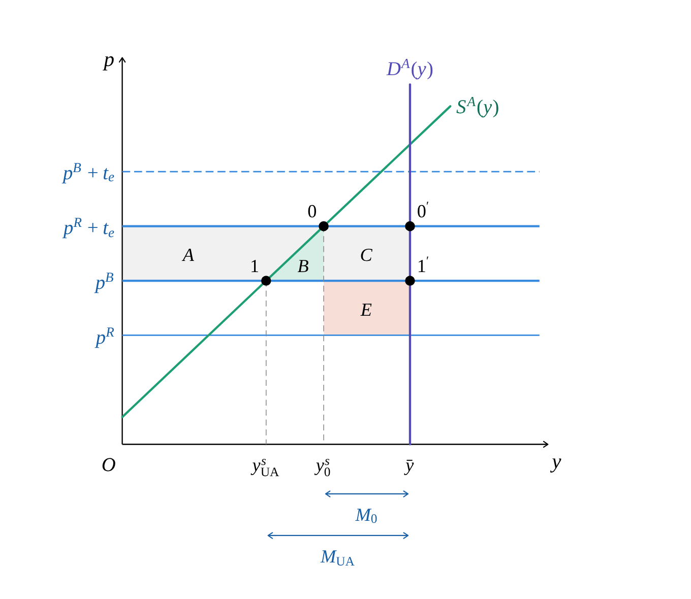
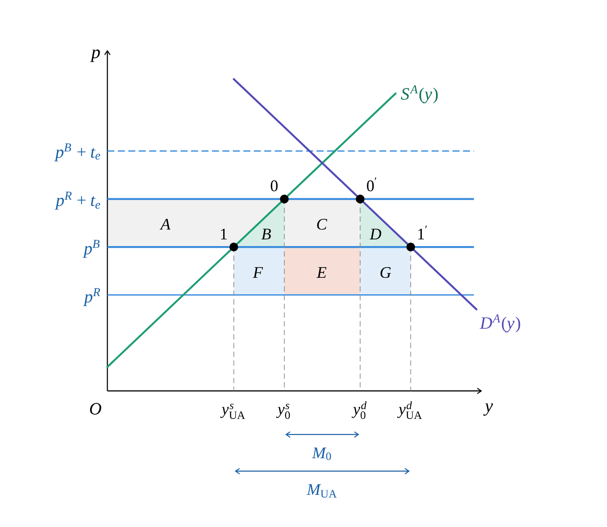
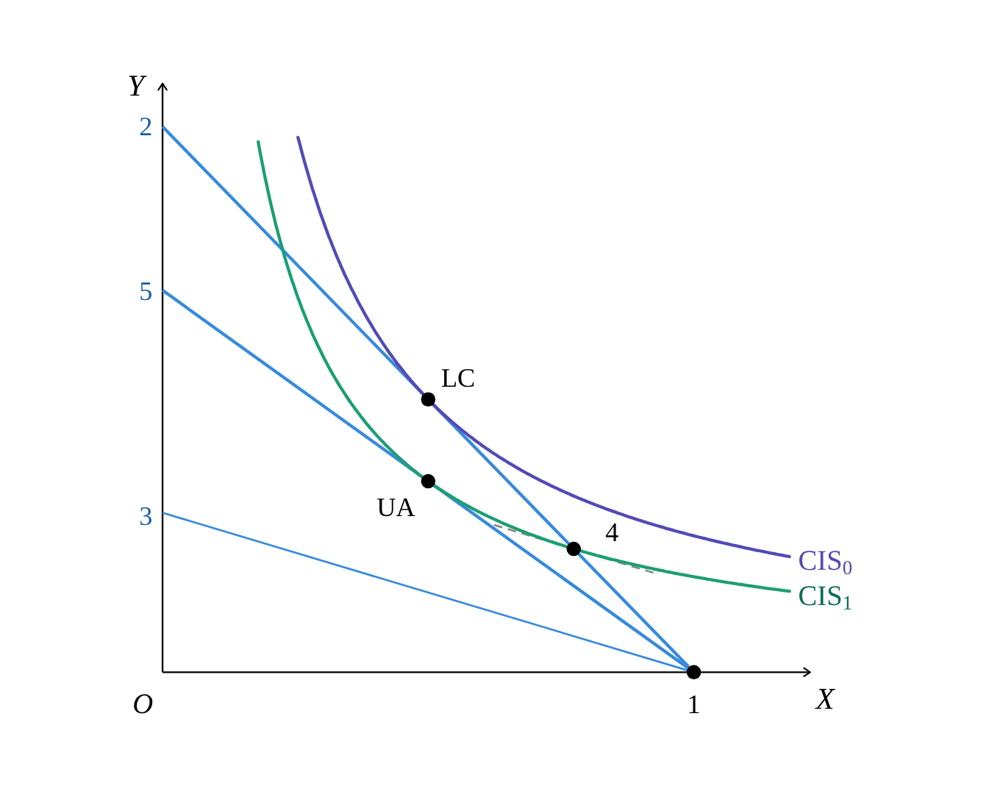
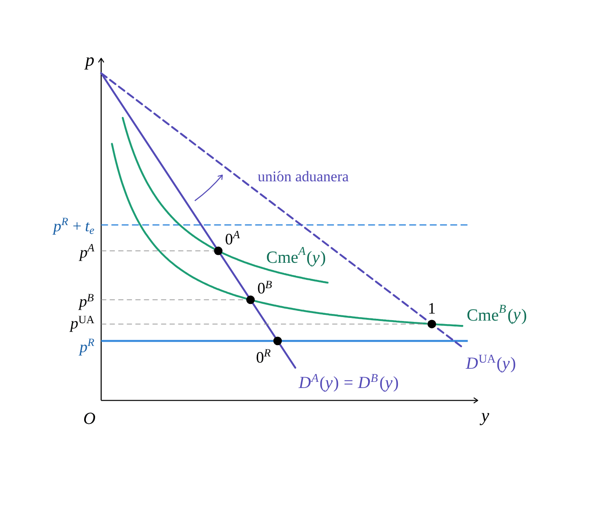
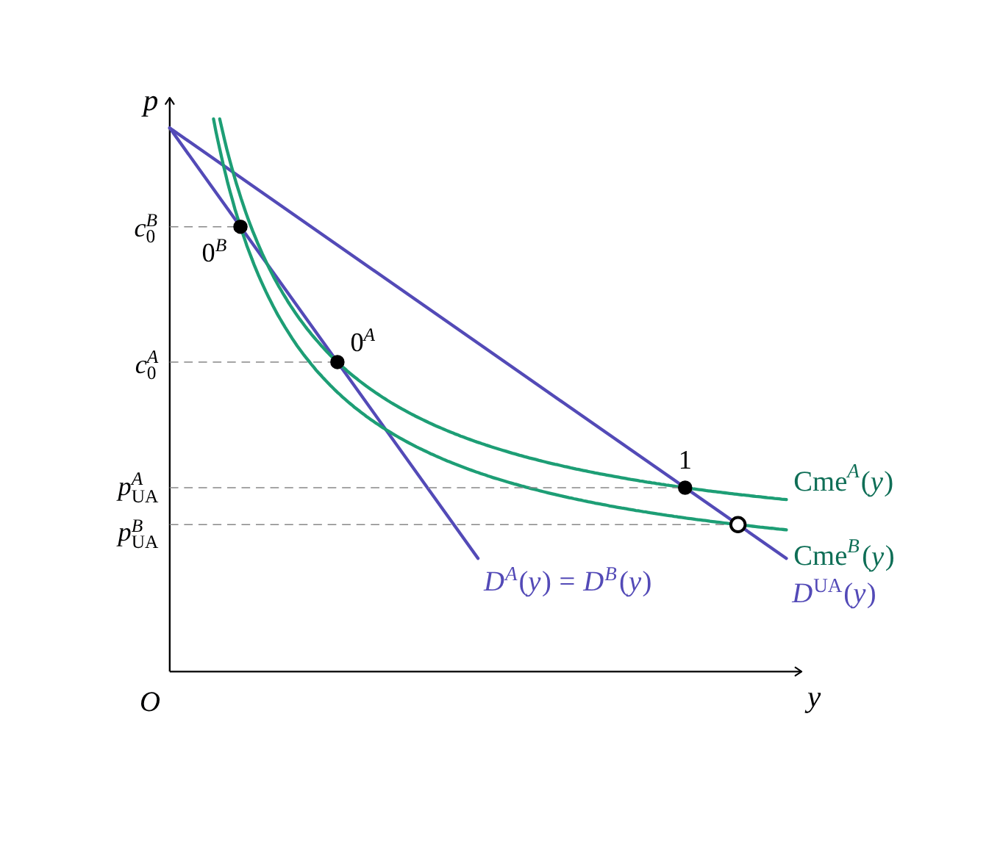
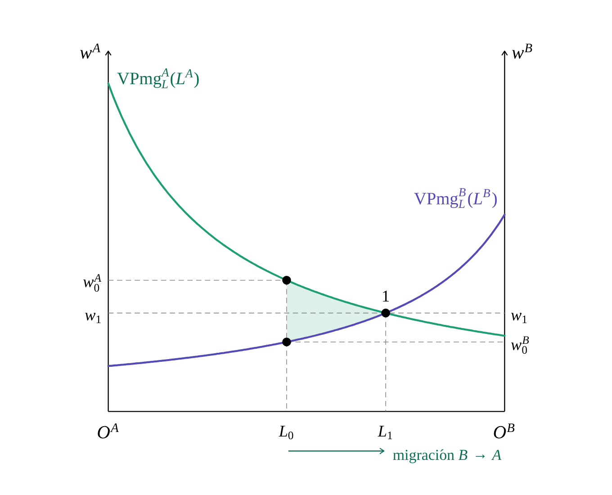

## Introducción



Este tema aborda la teoría de la integración económica como un análisis coste-beneficio en términos de bienestar, en tres partes:

- *Efectos estáticos*: se examinan primero la creación y la desviación del comercio que genera la integración, cuyo efecto neto sobre el bienestar es ambiguo.

- *Efectos dinámicos*: el tema estudia después sus beneficios dinámicos.

- *Proceso de integración*: la última parte trata los costes del proceso, el paso al mercado común y el debate entre regionalismo y multilateralismo.

Un anexo recoge la evidencia empírica disponible.

## 1. Efectos estáticos de la integración económica

En la literatura económica, el debate sobre los beneficios de la integración se puede dividir en dos etapas:

1. *Primera etapa (años cincuenta y sesenta)*: se desarrolla la teoría tradicional, centrada en el estudio de las uniones aduaneras. A este mismo marco pertenecen aportaciones posteriores que lo prolongan, como la crítica de los Wonnacott (1981) y el teorema de Kemp y Wan (1976).

2. *Segunda etapa (desde los años setenta)*: a partir de Corden (1972) y en línea con los desarrollos de la nueva teoría del comercio de finales de esa década, se levanta parte de los supuestos neoclásicos. El énfasis pasa a las economías de escala, la competencia imperfecta y los aspectos geográficos.

La teoría tradicional se centra especialmente en las uniones aduaneras porque, tras el final de la Segunda Guerra Mundial, aparecieron bloques regionales como la Comunidad Económica Europea (1958), fruto de los Tratados de Roma (1957). En esta etapa destacan las aportaciones de Jacob Viner, James Meade, Richard Lipsey, Charles Cooper, Benton Massell, Robert Mundell y Murray Kemp.

### 1.1. Creación y desviación del comercio (Viner, 1950)

**Origen**: el punto de partida de este debate es la aportación de Jacob Viner en *The Customs Union Issue* (1950), que pone de manifiesto la ambigüedad que, en términos de bienestar, puede suponer la integración económica.

**Idea**: el autor sostiene que el efecto de una unión aduanera sobre el bienestar es, *a priori*, ambiguo, es decir, respecto a una situación de aranceles no discriminatorios, el bienestar puede tanto aumentar como disminuir.

#### 1.1.1. Ideas previas

Hasta la aportación de Viner prevalecían dos ideas fundamentales:

1. *Unión aduanera y libre comercio*: el bienestar mundial es menor con la unión aduanera que con el libre comercio, dado que su arancel exterior común introduce una distorsión asignativa.

2. *Unión aduanera y reducción no discriminatoria*: se daba por hecho que la unión aduanera superaba siempre a una estructura arancelaria no discriminatoria (la que fija aranceles *erga omnes*), porque se la veía como un avance hacia el libre comercio. La unión suprime la distorsión entre los socios, aunque persista la que afecta al comercio con terceros países.

#### 1.1.2. Razonamiento

La aportación de Viner a este debate tiene que ver con la identificación de dos efectos contrapuestos en la configuración de cualquier unión aduanera:

1. *Creación de comercio*: se refiere a la sustitución de la producción nacional de un país por importaciones procedentes de un país socio en el marco de la unión aduanera. Esta sustitución se debe al abaratamiento relativo de las importaciones del socio y da lugar a nuevo comercio entre los socios, con la consiguiente ganancia de eficiencia, al desplazarse la producción hacia el productor más eficiente de la unión.

2. *Desviación de comercio*: se refiere a la reorientación de las importaciones desde un tercer país con bajos costes de producción hacia un país socio con mayores costes de producción. Se trata de una derivación del comercio desde exportadores eficientes hacia exportadores más ineficientes, con la consiguiente pérdida de eficiencia.

En función de cuál de estos dos efectos prevalezca, se producirá una ganancia o una pérdida de bienestar global. La integración tampoco garantiza una mejora paretiana, es decir, del bienestar de todos los países respecto a la situación de partida.

Gráficamente, ambos efectos se representan en el plano cantidad-precio del bien, desde la óptica del país A (figura -@fig-b101-viner):

1. *Curva de oferta de A*, $S^A(y)$: recoge la producción de A a cada precio y es creciente, porque su coste marginal es creciente.

2. *Curva de demanda de A*, $D^A(y)$: recoge el consumo de A y es vertical en $\bar{y}$, porque Viner supone un consumo fijo.

3. *Precios de B y del resto del mundo*: horizontales en $p^B$ y $p^R$, con $p^R < p^B$, porque ambos ofrecen a A cualquier cantidad a un precio constante, y, con el arancel específico $t_e$ (por unidad), en $p^B + t_e$ y $p^R + t_e$.

4. *Equilibrio inicial*: con un arancel no discriminatorio, A importa del resto del mundo al precio $p^R + t_e$, produce $y^s_0$ (punto 0) y consume $\bar{y}$ (punto 0′), de modo que importa $M_0$.

Con la unión aduanera, A pasa a importar de B al precio $p^B$, produce $y^s_{\text{UA}}$ (punto 1) y consume $\bar{y}$ (punto 1′), con lo que importa $M_{\text{UA}}$. El área B mide la ganancia por creación de comercio y el área E, la pérdida por desviación de comercio.

::: {#fig-b101-viner}

::: {.content-visible when-format="html"}
```{=html}
<div class="graph-frame">
<iframe src="../graphs/b101_Viner.html" style="height:630px" loading="lazy" title="fig-b101-viner"></iframe>
</div>
```
:::

::: {.content-visible unless-format="html"}

:::

Creación y desviación de comercio (Viner, 1950) como efectos de una unión aduanera sobre el bienestar del país miembro.
:::

Un ejemplo histórico es el de los productos agrícolas neozelandeses (mantequilla y cordero) en el Reino Unido. Tras su adhesión a la CEE en enero de 1973, el Reino Unido adoptó el arancel exterior común y la política agrícola común. Las dos medidas encarecieron las importaciones neozelandesas y desviaron parte de la demanda británica hacia proveedores comunitarios de mayor coste, que gozaban de libre acceso. Nueva Zelanda solo conservó contingentes específicos para algunos productos, como la mantequilla, y el Reino Unido aplicó el arancel exterior común y la PAC hasta el final del periodo transitorio del Brexit, el 31 de diciembre de 2020.

#### 1.1.3. Conclusiones

**Aspectos positivos**: la aportación de Viner dio lugar a una amplia literatura sobre las uniones aduaneras, tanto teórica como empírica, como el estudio de Béla Balassa (1967) sobre los efectos creación y desviación de comercio en la Comunidad Económica Europea.

**Limitaciones**: por un lado, el estudio solo considera las barreras arancelarias y no analiza el papel de las barreras no arancelarias. Por otro, el análisis de Viner deja fuera la demanda, y esa es su carencia más grave. En él, el consumo queda fijado en $\bar{y}$ (véase la figura) y no reacciona a los precios relativos, ni antes ni después de la integración, con lo que desaparece el efecto sustitución.

### 1.2. Modelo canónico neoclásico de integración económica

Los primeros trabajos posteriores a la obra de Viner, entre los que destacan los de James Meade (1955a) y de Richard Lipsey (1957), se centraron, precisamente, en los efectos de la integración sobre el consumo. La consideración del lado de la demanda da lugar a una serie de efectos adicionales:

1. *Creación de consumo*: si la integración permite acceder a bienes con menores precios, la demanda nacional de productos extranjeros se incrementa, y el efecto creación opera, por tanto, también por el lado del consumo.

2. *Reorientación del consumo* (*intercountry substitution*): también se produce un efecto desviación por el lado del consumo, consistente en la reorientación del consumo desde terceros países hacia los países de la unión.

3. *Sustitución del consumo* (*intercommodity substitution*): si existen varios productos sustituibles entre sí, hay que considerar además los efectos sustitución y los cambios en los patrones de consumo.

#### 1.2.1. Enfoque de equilibrio parcial (Meade, 1955a)

**Origen**: estas ideas se plantean primero en un análisis gráfico de equilibrio parcial basado en la obra de James Meade (1955a).

**Idea**: al incorporar una demanda con pendiente negativa, la unión aduanera genera, junto a la creación y la desviación de comercio, un efecto creación de consumo, y su efecto neto sobre el bienestar sigue siendo ambiguo.

**Supuestos**:

- *Entorno*: modelo neoclásico sin imperfecciones con tres países, dos de los cuales (A y B) van a formar una unión aduanera y son pequeños en relación con el tercero (R), que puede entenderse como el resto del mundo.

- *Agentes*: se supone que la demanda no es totalmente inelástica y, por tanto, tiene pendiente negativa.

- *Tecnología*: se considera que el coste marginal de A (es decir, su curva de oferta) no es constante, sino creciente, mientras que B y R ofrecen el bien a A a precios constantes, $p^B$ y $p^R$.

**Planteamiento**: se compara el bienestar de A en dos situaciones. En la primera, una estructura arancelaria no discriminatoria grava por igual a B y al resto del mundo con el arancel específico $t_e$. En la segunda, una unión aduanera con B suprime el arancel entre los socios y lo mantiene frente al resto del mundo como arancel exterior común.

**Desarrollo gráfico**: los efectos de la unión aduanera se representan en el plano cantidad-precio, desde la óptica del país A (figura -@fig-b102-integracion-i):

1. *Curva de oferta de A*, $S^A(y)$: recoge la producción de A a cada precio y es creciente, porque su coste marginal es creciente.

2. *Curva de demanda de A*, $D^A(y)$: recoge el consumo de A a cada precio y es decreciente, porque la demanda no es totalmente inelástica (Supuestos).

3. *Precios de B y del resto del mundo*: horizontales en $p^B$ y $p^R$, porque ambos ofrecen el bien a A a precios constantes (Supuestos), y, con el arancel específico $t_e$, en $p^B + t_e$ y $p^R + t_e$.

4. *Equilibrio inicial* (estructura arancelaria no discriminatoria): el país A grava por igual al país B y al resto del mundo y cubre su exceso de demanda importando solo de este último, puesto que $p^R + t_e < p^B + t_e$. Produce $y_0^s$ (punto 0), consume $y_0^d$ (punto 0′) e importa $M_0 = y_0^d - y_0^s$. La recaudación arancelaria equivale a las áreas C+E.

::: {#fig-b102-integracion-i}

::: {.content-visible when-format="html"}
```{=html}
<div class="graph-frame">
<iframe src="../graphs/b102_Integracion_i.html" style="height:630px" loading="lazy" title="fig-b102-integracion-i"></iframe>
</div>
```
:::

::: {.content-visible unless-format="html"}

:::

Modelo canónico de integración en equilibrio parcial (Meade, 1955a).
:::

**Estática comparativa**: cuando A y B forman la unión aduanera, desaparecen los aranceles entre ellos y se fija un arancel exterior común frente al resto del mundo. Dado que el precio del bien importado de B sin arancel es inferior al del bien importado del resto del mundo con arancel ($p^B < p^R + t_e$), el país A pasa a importar solamente del país B. En consecuencia, los consumidores de A aumentan su consumo hasta $y_{\text{UA}}^d$ (punto 1′) y los productores reducen su producción hasta $y_{\text{UA}}^s$ (punto 1), de modo que las importaciones aumentan de $M_0$ a $M_{\text{UA}} = y_{\text{UA}}^d - y_{\text{UA}}^s$.

**Bienestar**: los efectos brutos de la integración sobre el bienestar de A son tres:

1. *Excedente del consumidor*: aumenta en las áreas A+B+C+D (efecto expansión del comercio).

2. *Excedente del productor*: disminuye en el área A, dado que los productores de A son menos competitivos que los de B.

3. *Excedente del Gobierno*: disminuye en C+E, puesto que ya no se importa del resto del mundo y, aunque el arancel exterior sigue vigente, su recaudación pasa a ser nula.

El efecto neto sobre la economía A es $(A+B+C+D) - A - (C+E) \Rightarrow \text{EN} = B + D - E$. En detalle, se distinguen tres efectos:

1. *Efecto creación de comercio* (área B): se corresponde con la ganancia de eficiencia productiva, pues la producción $y_0^s - y_{\text{UA}}^s$ pasa de los productores de A a los del país B, que son más eficientes.

2. *Efecto creación de consumo* (área D): se corresponde con el excedente que ganan los consumidores de A que, al caer el precio, pasan a consumir cuando antes no lo hacían.

3. *Efecto desviación de comercio* (área E): se corresponde con la pérdida de eficiencia sobre la cantidad que antes abastecía el resto del mundo y que ahora produce el país B, menos eficiente que aquel.

De nuevo, se trata de una situación en la que no se puede hacer una predicción inequívoca sobre los efectos de la integración. Si la caída arancelaria es muy contundente y el precio del socio ($p^B$) no es mucho mayor que el del resto del mundo, el efecto desviación (área E) será pequeño en relación con el efecto creación (áreas B+D). En ese caso, la unión aduanera dará lugar a ganancias netas de bienestar. Sin embargo, bien podría darse la situación opuesta si el efecto desviación fuese dominante.

**Conclusiones**:

- *Aspectos positivos*: el análisis permite ilustrar gráficamente las intuiciones planteadas por Viner, incorporando el lado de la demanda.

- *Limitaciones*: se queda en el equilibrio parcial y deja fuera, por tanto, la posible sustitución cruzada entre mercados.

#### 1.2.2. Enfoque de equilibrio general (Lipsey, 1957)

**Origen**: Richard Lipsey trasladó por primera vez el análisis de las uniones aduaneras al marco del equilibrio general.

**Idea**: en equilibrio general, la comparación entre una unión aduanera y un arancel no discriminatorio depende de la relación real de intercambio (RRI) con el socio, por lo que tampoco admite conclusiones inequívocas.

**Supuestos**: el país A, pequeño, produce con productividad marginal constante un bien exportable, X, y otro importable, Y. Su frontera de posibilidades de producción (FPP) es, en consecuencia, una recta, y A se especializa por completo.

**Planteamiento**: se compara el bienestar de A en tres situaciones, el libre comercio, un arancel no discriminatorio sobre las importaciones de Y procedentes del resto del mundo y una unión aduanera con B, cada una con los precios relativos que implica para el consumo.

**Desarrollo gráfico**: las tres situaciones se representan en el plano bien X-bien Y (figura -@fig-b103-integracion-ii):

1. *Recta de la RRI de libre comercio*, 1-2: recoge los precios internacionales y parte del punto de producción, 1. Su pendiente es el precio relativo internacional, y sobre ella están las cestas que A puede consumir con libre comercio.

2. *Curvas de indiferencia social*, $\text{CIS}_0$ y $\text{CIS}_1$: representan un bienestar tanto mayor cuanto más alejadas del origen.

3. *Equilibrio inicial*: la situación de partida es el libre comercio, con el que A produce en el punto 1, especializado por completo en el bien X, y alcanza su consumo óptimo en el punto LC, sobre la $\text{CIS}_0$.

::: {#fig-b103-integracion-ii}

::: {.content-visible when-format="html"}
```{=html}
<div class="graph-frame">
<iframe src="../graphs/b103_Integracion_ii.html" style="height:580px" loading="lazy" title="fig-b103-integracion-ii"></iframe>
</div>
```
:::

::: {.content-visible unless-format="html"}

:::

Modelo canónico de integración en equilibrio general (Lipsey, 1957).
:::

**Estática comparativa**:

- *Arancel*: si A impone un arancel a las compras de Y al resto del mundo, Y se encarece en términos relativos y los precios interiores pasan a ser los de la línea 1-3, menos inclinada en el plano $(X, Y)$. El consumo se desplaza entonces a un punto que cumple dos requisitos:

    1. *Tangencia*: los consumidores deciden con el precio relativo interno, y el óptimo exige que la relación marginal de sustitución coincida con él (tangencia entre la línea de precios internos y la curva de indiferencia).

    2. *Restricción externa*: la recaudación del arancel vuelve a los consumidores, así que el consumo ha de situarse en la RRI internacional que parte del punto de producción, el 1, que la especialización completa deja inalterado. Como A es pequeño, el arancel no modifica su RRI con el resto del mundo.

    Ambas condiciones se cumplen en el punto 4, situado deliberadamente en la $\text{CIS}_1$, la curva de indiferencia por la que pasa también el punto UA de la unión aduanera.

- *Unión aduanera*: si A y B forman ahora una unión aduanera, A comercia con su socio según la línea 1-5, una RRI intermedia entre la de libre comercio, más favorable, y la relación de precios interiores con arancel (línea 1-3), menos favorable. Si con esa RRI A consume en UA, la unión no le aporta ni le resta bienestar frente al arancel no discriminatorio, dado que los dos puntos de consumo comparten curva de indiferencia. Esa igualdad es, sin embargo, solo un caso posible, porque el resultado depende de la RRI que A obtenga con el socio:

    - *RRI con el socio peor que 1-5* (recta con menor pendiente): A no llega a la $\text{CIS}_1$ y su bienestar cae por debajo del que le daba el arancel no discriminatorio.

    - *RRI con el socio mejor que 1-5* (recta con mayor pendiente): A alcanza una curva de indiferencia superior y queda mejor.

El equilibrio general, como antes el parcial, no permite decidir con carácter general qué es preferible, la unión aduanera o el arancel no discriminatorio. Lipsey lo atribuye a que ambas son situaciones de *second best* con respecto al libre comercio. Si se elimina solo una parte de las distorsiones y se mantienen otras, tanto en los países integrados como en los externos, nada garantiza que el bienestar mejore.

**Conclusiones**:

- *Aspectos positivos*: lleva el análisis de las uniones aduaneras al equilibrio general, con lo que recoge la sustitución entre bienes en el consumo que el enfoque parcial omite. También sitúa la teoría de la integración en el marco del *second best*, que desde entonces es su referencia.

- *Limitaciones*: descansa en supuestos muy restrictivos (dos bienes, productividad marginal constante con especialización completa y país pequeño). Además, es un análisis estático que deja fuera las economías de escala y la competencia imperfecta (apartado 2).

#### 1.2.3. Determinantes del efecto neto

Del análisis anterior se desprende una serie de factores de los que depende el efecto neto de la integración económica (el signo entre paréntesis indica su relación con la ganancia de bienestar):

1. *Número de miembros de la unión aduanera* (+): cuantos más países participen, más probable resulta que la unión englobe a los productores más eficientes.

2. *Volumen de comercio previo entre los miembros* (+): si los socios ya comerciaban mucho entre sí, queda poco comercio por desviar.

3. *Volumen de comercio previo con el resto del mundo* (−): un comercio previo intenso con terceros países deja más compras que la unión puede desviar hacia los socios.

4. *Magnitud de los aranceles previos* (+): unos aranceles de partida altos dejan más margen para que la unión cree comercio.

5. *Magnitud del arancel exterior común* (−): un arancel común elevado frente a terceros amplía la desviación de comercio. El artículo XXIV del GATT exige que el arancel exterior común de una unión aduanera no sea, en su conjunto, más elevado ni más restrictivo que la incidencia general de los aranceles previos de sus miembros.

6. *Grado de sustituibilidad de los bienes de los miembros* (+): las economías parecidas, con mucho comercio intraindustrial potencial, ganan más por creación de comercio y pierden menos por desviación de comercio.

7. *Elasticidad-precio de la oferta y la demanda* (+): una oferta y una demanda más elásticas amplían la creación de comercio y la de consumo.

8. *Número de bloques comerciales* (ambiguo): Krugman (1991b) muestra que la relación con el bienestar mundial no es monótona. Un solo bloque mundial equivaldría al libre comercio y maximizaría el bienestar global. Al aumentar el número de bloques, el bienestar cae hasta alcanzar, en sus simulaciones, su mínimo con un número reducido de bloques (unos tres). A partir de ahí, la desviación de comercio disminuye y el bienestar vuelve a crecer con el número de bloques.

9. *Diferencia de costes entre el país (A) y su socio (B)* (+): cuanto menos eficiente sea A respecto a B, mayor la ganancia por creación de comercio.

10. *Diferencia de costes entre el socio (B) y el resto del mundo (R)* (−): cuanto menos eficiente sea B respecto a R, mayor la pérdida por desviación de comercio.

### 1.3. Extensiones al modelo canónico

A raíz de esta ambigüedad surge una serie de estudios posteriores que buscan determinar si existen fórmulas de integración preferibles a las uniones aduaneras, teniendo en cuenta elementos adicionales como el tamaño de los países o las políticas de compensación.

#### 1.3.1. Tamaño de los países y relación real de intercambio (Mundell, 1964)

**Origen**: una de las primeras críticas se debe a Robert Mundell (1964). Señala que una de las principales limitaciones de la teoría tradicional es suponer que los países no pueden alterar la RRI, ni individualmente ni como unión.

**Idea**: el tamaño de los países influye en los efectos de la integración económica, puesto que determina su capacidad para alterar la RRI.

**Razonamiento**: las conclusiones cambian cuando los países tienen un tamaño relevante, tanto uno frente a otro como frente al resto del mundo. El análisis supone, además, que todos los bienes son sustitutivos brutos.

Con la unión, A compra a B una parte mayor de algunos bienes, lo que equivale a discriminar en su favor. B ve así crecer la demanda de sus exportaciones, y su RRI mejora tanto frente a A como frente al resto del mundo. La preferencia es recíproca, pues en otros bienes B favorece a su vez a A, cuya RRI mejora por la misma vía.

Entre los socios, el cambio en la RRI es de signo ambiguo, porque depende de cuál de las dos preferencias pese más. Frente a terceros, en cambio, no hay ambigüedad. Los miembros compran menos fuera y, dado el peso de la unión en el comercio mundial, esa retracción de la demanda abarata las exportaciones de terceros países, con lo que la RRI de la unión mejora.

Si a ello se añade la fijación de un arancel exterior común, el efecto puede ser aún mayor. La mejora de la RRI constituye, así, una ganancia adicional de la integración para los países grandes, invisible en el análisis de país pequeño.

**Conclusiones**:

- *Aspectos positivos*: incorpora el poder de mercado al análisis de la integración, anticipando la literatura sobre aranceles óptimos de las uniones.

- *Limitaciones*: la ganancia es, a escala global, un juego de suma cero (o negativa, por las distorsiones del arancel), obtenida a costa de terceros, por lo que invita a la retorsión. Además, resulta irrelevante para las uniones pequeñas, que carecen de peso en los mercados mundiales para alterar la RRI.

#### 1.3.2. Reducciones arancelarias unilaterales (Cooper y Massell, 1965)

**Origen**: Charles Cooper y Benton Massell (1965) plantean que es preferible obtener el efecto creación de comercio mediante reducciones arancelarias unilaterales y no discriminatorias.

**Idea**: siempre que la reducción de aranceles sea no discriminatoria, esta produce las ganancias de la unión aduanera sin sus pérdidas.

**Razonamiento**: sobre el gráfico de equilibrio parcial de Meade (figura -@fig-b102-integracion-i), el país A, en vez de formar una unión aduanera, reduce su arancel frente a todo el mundo hasta $t_e' = p^B - p^R$, es decir, aplica una política no preferencial tal que $p^R + t_e' = p^B$. Como el precio interior coincide exactamente con el que resultaría si se formara la unión aduanera, consumidores y productores disfrutan de los mismos excedentes que con ella.

La diferencia con la unión está en que A sigue comprando al resto del mundo, el proveedor más barato, y en que la recaudación arancelaria pasa de C+E a E+F+G. Para el país A el resultado neto es, sin ambigüedad, una mejora del bienestar ($\text{EN} = B + D + F + G$). Dicho de otro modo, una reducción arancelaria unilateral y no discriminatoria obtiene el efecto creación de comercio sin el efecto desviación y, por tanto, es preferible a una unión aduanera.

**Conclusiones**:

- *Aspectos positivos*: la aportación convierte la reducción arancelaria unilateral y no discriminatoria en la referencia con la que debe compararse toda unión aduanera.

- *Limitaciones*: omite la reciprocidad que ofrece la unión aduanera.

#### 1.3.3. Efectos de la respuesta exterior (Wonnacott y Wonnacott, 1981)

**Origen**: Paul y Ronald Wonnacott (1981) critican precisamente este punto de la aportación de Cooper y Massell, pues el análisis de Cooper y Massell omite los aranceles del resto del mundo y del socio (los “aranceles extranjeros ausentes”).

**Idea**: la comparación entre unión aduanera y liberalización unilateral cambia cuando se reconoce que los demás países también mantienen aranceles, pues solo la unión permite negociar su eliminación recíproca.

**Razonamiento**: si el socio B mantiene aranceles, la unión aduanera garantiza a los exportadores de A un acceso preferente al mercado de B que una reducción unilateral de A no puede conseguir. Esta reciprocidad mejora la RRI de A frente a su socio. Además, si los países de la unión actúan como un bloque grande frente al resto del mundo, pueden mejorar tanto su RRI como su bienestar conjunto.

**Conclusiones**:

- *Aspectos positivos*: rehabilita la unión aduanera frente a la crítica de Cooper y Massell al incorporar los aranceles ajenos, y ofrece la justificación teórica del valor de la reciprocidad, fundamento de la negociación comercial real.

- *Limitaciones*: las ganancias de acceso preferente dependen de que el socio mantenga aranceles significativos, por lo que el argumento pierde fuerza a medida que la liberalización multilateral reduce la protección, y la mejora de la RRI del bloque sigue obteniéndose a costa de terceros.

#### 1.3.4. Uniones aduaneras con políticas de compensación: el teorema de Kemp y Wan (1976)

**Origen**: Murray Kemp y Henry Wan (1976) argumentan que las uniones aduaneras se pueden construir de tal forma que mantengan el bienestar de los países no participantes.

**Idea**: con políticas de compensación adecuadas, la unión aduanera es Pareto-superior, es decir, puede mejorar a sus miembros sin empeorar a nadie.

**Razonamiento**: el teorema establece que siempre existe un arancel exterior común que, combinado con un sistema de transferencias a tanto alzado entre los miembros, permite mejorar a los países que forman la unión sin empeorar al resto. Ese arancel exterior común mantiene inalterado el comercio (y los precios) con el resto del mundo, lo que, en la práctica, se aproxima a la exigencia del art. XXIV del GATT de no elevar la protección frente a terceros.

**Conclusiones**:

- *Aspectos positivos*: ofrece un fundamento teórico a la disciplina que el artículo XXIV del GATT (1947) ya imponía a los procesos de integración. De hecho, la creación de la unión aduanera de la CEE llevó al GATT a exigir compensaciones, y la Comunidad Andina desarrolló mecanismos para compensar a los países pequeños perjudicados.

- *Limitaciones*: es un teorema de existencia, que no describe cómo se forman las uniones reales, y es poco probable que las compensaciones internas a tanto alzado que exige se lleven a cabo plenamente en la práctica.

#### 1.3.5. Áreas de libre comercio y normas de origen (Krueger, 1993)

**Origen**: Hirofumi Shibata (1967) extiende el análisis de las uniones aduaneras a las áreas de libre comercio (ALC), en las que cada miembro conserva su propio arancel frente a terceros, y Anne Krueger (1993) estudia las normas de origen que las sostienen.

**Idea**: sin arancel exterior común, las importaciones de terceros entrarían por el miembro de arancel más bajo y se reexportarían al resto (*deflexión de comercio*, *trade deflection*). Para evitarlo, el ALC exige *normas de origen*, que fijan qué bienes se consideran producidos en la zona y pueden circular en ella sin arancel.

**Razonamiento**: la diferencia con la unión aduanera tiene tres consecuencias:

1. *Normas de origen como protección*: para cumplirlas, el productor del bien final debe comprar en la zona una parte de sus insumos, aunque importarlos fuera más barato. La protección del bien final se extiende así a los insumos del socio, y la desviación del comercio, a los mercados de insumos (Krueger, 1993). A ello se suma el coste de acreditar el origen, que lleva a muchas empresas a pagar el arancel de nación más favorecida en lugar de pedir la preferencia.

2. *Competencia arancelaria*: como las importaciones de terceros tienden a entrar por el miembro de arancel más bajo, cada miembro tiene un incentivo a rebajar su arancel exterior para captar el comercio y los ingresos arancelarios (Richardson, 1995). Frente a la unión aduanera, cuyo arancel común se fija de forma conjunta y escapa a esa competencia, el ALC puede así generar menos desviación del comercio, aunque a costa de las distorsiones de las normas de origen.

3. *Versión del teorema de Kemp y Wan*: Panagariya y Krishna (2002) muestran que también existe un ALC que mejora a sus miembros sin perjudicar al resto del mundo, si cada miembro fija sus aranceles para mantener constante su comercio con terceros y las normas de origen se eligen de forma adecuada.

**Conclusiones**:

- *Aspectos positivos*: explica por qué la mayoría de los acuerdos regionales son ALC y no uniones aduaneras, ya que preservan la autonomía de cada miembro en su política comercial, y por qué las normas de origen son una pieza central de su negociación.

- *Limitaciones*: el balance de bienestar frente a la unión aduanera es ambiguo y depende de la estructura arancelaria de cada miembro y de lo restrictivas que sean las normas de origen, difíciles de medir.

### 1.4. Conclusiones

El análisis de Cooper y Massell padece dos carencias que comparte toda la teoría tradicional de la integración. La primera son sus supuestos neoclásicos, muy restrictivos, que ignoran fenómenos presentes en el comercio mundial, entre ellos las economías de escala, la competencia imperfecta o la diferenciación de productos. La segunda es su carácter estático, que le impide recoger los efectos dinámicos de la integración, objeto del apartado 2. Esas omisiones, junto con la de los aranceles ajenos que señalan los Wonnacott, resuelven la aparente paradoja de que se formen uniones aduaneras pese a que, según el propio análisis, la rebaja arancelaria unilateral sería preferible.

## 2. Efectos dinámicos de la integración económica

A raíz de las limitaciones del apartado 1.4 surgieron una serie de desarrollos que ofrecieron nuevas ideas a partir del levantamiento de algunos supuestos neoclásicos. El principal efecto de la integración económica es el aumento del tamaño de mercado, del que se derivan cuatro grandes familias de efectos dinámicos.

### 2.1. Efecto economías de escala: costes medios decrecientes (Corden, 1972)

**Origen**: la teoría tradicional de la integración contemplaba costes marginales constantes o crecientes, y el enfoque de equilibrio general de Lipsey, en concreto, supone productividad marginal constante. En muchas industrias, sin embargo, cada unidad sale más barata cuanto más se produce, porque las empresas disfrutan de economías de escala internas (costes medios decrecientes). Max Corden (1972) sostiene que con ellas la creación y la desviación de comercio conservan su validez y que a su lado surgen dos efectos nuevos.

**Idea**: la unión aduanera aumenta el tamaño de mercado y, por ello, ofrece ganancias potenciales derivadas de la explotación de las economías de escala. En este contexto aparecen dos efectos contrapuestos:

1. *Efecto reducción de costes*: un efecto positivo derivado del aprovechamiento de la escala de producción sobre un mercado mayor.

2. *Efecto supresión de comercio*: un efecto negativo, debido a que la protección de la unión permite nacer y sobrevivir a empresas que, sin ella, la oferta del resto del mundo habría desplazado.

**Supuestos**:

- *Entorno*: tres países (A, B y R) comercian un solo bien. A y B forman la unión aduanera y R es el resto del mundo. En el caso de referencia, los aranceles de partida son prohibitivos, de modo que cada país abastece por completo su mercado interno, mientras que en los otros dos casos algún país se abastece de R con arancel.

- *Agentes*: la demanda se considera lineal y existe simetría, de manera que las curvas de demanda son idénticas en A y en B.

- *Tecnología*: los costes unitarios se ordenan como en Viner, $p^R < p^B < p^A$, es decir, el resto del mundo produce más barato que el socio (B), y este, más barato que el propio país (A). En el primer caso, el arancel específico, $t_e$, es prohibitivo, $p^A \leq p^R + t_e$[^b10-4]. El coste medio decrece con la escala (economías de escala), y cada productor ofrece según su coste medio, que hace así de curva de oferta[^b10-5].

**Razonamiento**: los efectos sobre el bienestar de la unión aduanera dependen del patrón de producción previo a la unión. Por ello, el análisis distingue tres situaciones de partida, según haya un productor en cada país, en uno solo o en ninguno. No se considera el escenario de varios productores en un mismo mercado, ya que, al haber economías de escala, solo puede existir, a lo sumo, un productor en cada mercado.

**Desarrollo gráfico**: los efectos de la unión aduanera se representan en el plano cantidad-precio y coste (figura -@fig-b104-corden), para el primer caso:

1. *Curvas de demanda*, $D^A(y) = D^B(y)$: recogen el consumo de cada país a cada precio, son lineales y decrecientes e idénticas para ambos países (Supuestos).

2. *Curva de coste medio de A*, $\text{Cme}^A(y)$: decreciente, por las economías de escala internas.

3. *Curva de coste medio de B*, $\text{Cme}^B(y)$: también decreciente y por debajo de la de A, al ser B más eficiente.

4. *Oferta del resto del mundo*: infinitamente elástica al precio $p^R$, por debajo de ambas curvas de coste medio, y al precio $p^R + t_e$ con el arancel.

5. *Equilibrio inicial*: en la situación de partida, con aranceles prohibitivos, cada país abastece por completo su mercado interno, y se determinan dos equilibrios autárquicos (puntos $0^A$ y $0^B$, a los precios $p^A$ y $p^B$). El punto $0^R$ señala el consumo de referencia al precio mundial $p^R$, el que se alcanzaría con libre comercio.

::: {#fig-b104-corden}

::: {.content-visible when-format="html"}
```{=html}
<div class="graph-frame">
<iframe src="../graphs/b104_Corden.html" style="height:620px" loading="lazy" title="fig-b104-corden"></iframe>
</div>
```
:::

::: {.content-visible unless-format="html"}

:::

Efectos de la integración con economías de escala (Corden, 1972). Con un productor en cada país, la unión genera creación de comercio y un efecto reducción de costes.
:::

**Estática comparativa**: con la unión aduanera, el productor de B, que tiene costes menores que el de A, pasa a abastecer también todo el mercado de A. La curva de demanda a la que se enfrenta el productor de B pivota entonces sobre el eje de ordenadas hacia afuera, pues ahora agrupa la demanda de ambos mercados ($D^{\text{UA}} = D^A + D^B$), y se alcanza un equilibrio en el punto 1, al precio $p^{\text{UA}}$. Esto implica dos efectos:

1. *Efecto creación de comercio*: el productor de A cierra y todo el consumo de A se cubre con importaciones procedentes de B, más baratas, lo que eleva el excedente del consumidor de A.

2. *Efecto reducción de costes*: la mayor escala de B, que ahora sirve a los dos mercados, abarata su coste medio por las economías de escala internas. Esa ganancia adicional beneficia a los consumidores de ambos países, cuyo excedente aumenta.

Faltan, en cambio, la desviación de comercio, porque A no compraba a R, y la supresión de comercio, porque ninguna empresa nueva surge al amparo de la unión. Con un productor en cada país antes de la unión, el balance es, por tanto, inequívocamente positivo. Los otros dos casos se analizan del mismo modo:

- *Un solo productor, en B*: de partida, B está en autarquía y A, sin productor, comercia con aranceles y se abastece por completo de R, pues $p^R < p^B < (p^R + t_e) < p^A$. Constituida la unión aduanera, A se abastece de B, dado que $p^B < p^R + t_e$. No hay creación de comercio, porque A carecía de producción propia, ni supresión de comercio, porque no nace ninguna empresa nueva. Sí hay desviación de comercio, porque las compras de A pasan de R, el oferente más eficiente, a B, y reducción de costes, porque la producción se concentra en B y aprovecha las economías de escala. En consecuencia, los efectos son ambiguos.

- *Ningún productor*: de partida, A y B comercian con aranceles y se abastecen por completo de R. Constituida la unión aduanera, surge en B un productor que atiende su propio mercado y el de A. No hay creación de comercio, porque ninguno de los dos países producía, ni reducción de costes, porque la producción no se concentra, sino que se traslada íntegra de R a B. Sí hay desviación de comercio, porque las importaciones pasan de R a B, y supresión de comercio, porque la unión permite que nazca y se mantenga una empresa que, sin ella, quedaría desplazada por la oferta del resto del mundo. Por ello, los efectos son negativos, salvo que la creación de consumo, al caer el precio de $p^R + t_e$ a $p^{\text{UA}}$, compense la desviación y la supresión de comercio.

El modelo de Corden lleva así a una regla según el número de productores tras la unión. Si se reduce, el bienestar mejora, aunque menos de lo posible en caso de especialización perversa (apartado 3.1.3). Si no varía, el resultado es ambiguo. Si aumenta, el bienestar empeora, salvo que la creación de consumo compense la desviación y la supresión de comercio.

**Conclusiones**:

- *Aspectos positivos*: incorpora las economías de escala internas a la teoría de las uniones aduaneras, con los efectos reducción de costes y supresión de comercio, y da así un fundamento formal a las ganancias de la integración ligadas al aumento del tamaño de mercado.

- *Limitaciones*: es un análisis de equilibrio parcial con un solo bien, demandas idénticas, a lo sumo un productor por mercado y precios iguales al coste medio, sin un tratamiento explícito de la competencia imperfecta, que incorporan los modelos posteriores. Además, supone que la producción se concentra en el socio más eficiente, algo que no está garantizado.

### 2.2. Efectos procompetitivos y de variedad: modelo de Krugman (1979b)

La escala no es el único canal dinámico de la integración, que afecta también a la variedad de bienes disponible y a la intensidad de la competencia.

::: {.callout-note appearance="simple" icon=false}
El modelo de competencia monopolística en economía abierta (Krugman, 1979b) se desarrolla en el tema [B06](b06-nueva-teoria.qmd), apartado 2.1.2.
:::

En un contexto de competencia imperfecta y preferencia por la variedad, el aumento del tamaño de mercado que supone la integración produce dos familias de efectos, que se pueden ilustrar a partir del modelo de Krugman (1979b):

1. *Efecto variedad o innovación en bienes finales*: si se entiende la innovación como un aumento del número de variedades disponibles, el mayor tamaño de mercado conduce a un aumento del número de variedades al alcance de los consumidores, con la consiguiente ganancia de bienestar.

2. *Efectos procompetitivos*: la integración promueve la competencia entre empresas a escala internacional y, con ella, la “disciplina de mercado”. Esta disciplina produce, por un lado, un *efecto precio*, por el que la mayor competencia eleva la elasticidad percibida de la demanda y reduce los márgenes (*mark-ups*) sobre el coste marginal, con la consiguiente caída de los precios (véase la figura del tema [B06](b06-nueva-teoria.qmd), apartado 2.1.2). Por otro, unos *efectos no precio*:

    - *Ineficiencia-X*: según Leibenstein, se reduce gracias al esfuerzo adicional que aplican empresas y trabajadores para sobrevivir en un entorno más competitivo.

    - *Búsqueda de rentas*: los grupos de presión nacionales pueden perder poder, lo que puede reducir los comportamientos de búsqueda de rentas (p. ej. un *lobby* sectorial pierde influencia cuando el país puede abastecerse del exterior).

    - *Innovación*: el efecto es ambiguo, pues la competencia puede estimularla y, a la vez, desincentivarla al comprimir los márgenes con los que se financia.

### 2.3. Efectos sobre el crecimiento: variedades (Romer, 1990) y desbordamientos (Lucas, 1988)

Dos efectos vinculan la integración con el crecimiento a largo plazo, el de innovación en bienes intermedios y el de desbordamiento. Ambos se derivan de que la integración crea un mercado mayor que el nacional y se ilustran con los modelos de crecimiento endógeno.

::: {.callout-note appearance="simple" icon=false}
Los modelos de crecimiento endógeno se desarrollan en el tema [A44](a44-crecimiento-ii.qmd), apartados 1.3 y 3.1, y su versión en economía abierta, en el tema [B09](b09-comercio-crecimiento.qmd), apartado 3.1.
:::

**Efecto innovación en bienes intermedios**: la innovación se entiende aquí como un aumento del número de variedades de *inputs*. En un marco de competencia imperfecta en el sector de los bienes intermedios, la integración comercial amplía el mercado de cada variedad y eleva los beneficios de la innovación, lo que estimula la I+D y da lugar a crecimiento endógeno. Esto se ilustra a partir del modelo de I+D de Romer (1990).

**Efecto desbordamiento**: el aumento del tamaño de mercado incentiva la inversión y la acumulación de capital, lo que genera externalidades positivas (aprendizaje por la práctica, desbordamientos de conocimiento) sobre el resto de la economía y puede sostener el crecimiento endógeno. Esto se ilustra a través del modelo de externalidades del capital (Arrow, 1962; Romer, 1986; Lucas, 1988), expuesto en el tema [B09](b09-comercio-crecimiento.qmd).

### 2.4. Efecto selección: modelo de Melitz (2003)

Cuando las empresas difieren en productividad, la integración tiene un efecto adicional, el de selección. El efecto selección consiste en un traspaso de la producción desde las empresas menos productivas hacia las más productivas, que se ilustra a partir del modelo de Melitz (2003). Este efecto es especialmente importante desde el punto de vista de la política económica por dos motivos. Por un lado, el abandono de empresas puede dar lugar a desempleo, con los consiguientes costes económicos y sociales. Por otro, es un mecanismo que genera cambios en la productividad. En particular, si las empresas que se ven obligadas a salir son las menos productivas, la productividad agregada de la industria crece tras la liberalización.

::: {.callout-note appearance="simple" icon=false}
El modelo de heterogeneidad de empresas se desarrolla en el tema [B06](b06-nueva-teoria.qmd), apartado 3.1.
:::

### 2.5. Conclusiones

En conjunto, los efectos dinámicos (escala, competencia, variedad, crecimiento y selección) constituyen hoy el principal argumento económico en favor de la integración. Los efectos estáticos de creación y desviación son de una sola vez y de signo ambiguo, mientras que los dinámicos se despliegan en el tiempo. Los de escala, competencia, variedad y selección elevan el nivel de la renta y de la productividad, y solo los de crecimiento endógeno alteran su tasa de crecimiento a largo plazo. Las estimaciones del informe Cecchini (1988) atribuían a las economías de escala y a la mayor competencia en torno a la mitad de las ganancias del mercado único europeo.

## 3. El proceso de integración económica: retos y dificultades

Hasta aquí se ha examinado el debate sobre los beneficios de la integración, tanto estáticos como dinámicos. Sin embargo, en la realidad existe, además, una serie de costes que limitan los procesos de integración económica.

### 3.1. Costes

Esos costes son cuatro, la pérdida de soberanía económica, la transmisión de los ciclos, la especialización perversa y la concentración geográfica.

#### 3.1.1. Pérdida de soberanía económica

Uno de los principales costes de la integración es la pérdida de soberanía económica nacional. Por ejemplo, la fijación de un arancel exterior común supone una limitación de la autonomía de la política comercial y exige el cumplimiento de los acuerdos de cooperación establecidos entre los miembros, lo cual puede dar lugar a fallos de coordinación.

Dani Rodrik (2011) plantea esta tensión en su “trilema político de la economía mundial”, conocido como **trilema de Rodrik** (tema [B21](b21-sei-despues-bw.qmd), Anexo A.1.1), según el cual no es posible tener a la vez integración económica profunda, Estado-nación soberano y política democrática. A lo sumo pueden conjugarse dos de los tres elementos, de modo que profundizar en la integración exige ceder soberanía nacional (como en el proceso integrador de la UE) o subordinar las demandas democráticas internas a las exigencias de la economía global.

#### 3.1.2. Transmisión de los ciclos

La integración acelera la transmisión internacional del ciclo económico y puede acentuar sus picos y valles, porque cuanto más integrados están los mercados de bienes y las cadenas de producción, más rápidamente se propagan las perturbaciones entre países. Dos episodios ilustran esta idea. El primero es el gran colapso del comercio de 2009, cuando la crisis financiera global se transmitió a través de las cadenas de valor y el comercio mundial cayó mucho más que el PIB. El segundo, la pandemia de COVID-19 en 2020, en la que las disrupciones de las cadenas de suministro sincronizaron la caída de la producción entre economías muy alejadas del foco inicial.

#### 3.1.3. Especialización perversa (Grubel, 1967; Robson, 1984)

**Origen**: autores como Herbert Grubel (1967) y Peter Robson (1984) argumentan que el efecto reducción de costes derivado de una unión aduanera no está garantizado, porque una unión aduanera puede dar lugar a la llamada *especialización perversa*.

**Idea**: con los supuestos de Corden, cabría esperar que la unión concentrase toda la producción en B. Sin embargo, puede suceder que A, pese a que su curva de coste medio queda más alta que la de B, llegue a la unión con un coste medio menor que el de su socio, porque algún “accidente histórico” le permitió alcanzar antes una escala mayor. La noción de “accidente histórico” introduce un elemento dinámico.

**Razonamiento**: basta con que el precio de entrada al mercado esté por debajo del coste medio de las primeras unidades de B para impedir su entrada.

En ese caso, la unión deja ambos mercados en manos del productor de A. El resultado es una *especialización perversa*, ineficiente porque el mercado queda para quien no es el productor potencialmente más eficiente. Esta consideración ofrece un argumento plausible sobre la dicotomía norte-sur. Así, en una integración entre socios de desarrollo desigual, el socio avanzado que alcanzó antes una gran escala puede retener la producción aunque el menos desarrollado sea potencialmente más eficiente.

**Desarrollo gráfico**: la especialización perversa se representa en el plano cantidad-precio y coste (figura -@fig-b105-perversa):

1. *Curvas de demanda*: la de cada país, $D^A(y) = D^B(y)$, y la de la unión, $D^{\text{UA}}(y)$, que suma ambas.

2. *Curva de coste medio de A*, $\text{Cme}^A(y)$: decreciente, por las economías de escala.

3. *Curva de coste medio de B*, $\text{Cme}^B(y)$: decreciente y por debajo de la de A para cualquier volumen, pues B es potencialmente más eficiente.

4. *Equilibrio*: antes de la unión, A opera con un coste $c^A_0$ (punto $0^A$) inferior al de B, $c^B_0$ (punto $0^B$), porque alcanzó antes una mayor escala. Con la unión, A abastece todo el mercado ampliado al precio $p^A_{\text{UA}}$ (punto 1), por encima del que permitiría B, $p^B_{\text{UA}}$ (círculo hueco).

::: {#fig-b105-perversa}

::: {.content-visible when-format="html"}
```{=html}
<div class="graph-frame">
<iframe src="../graphs/b105_Perversa.html" style="height:620px" loading="lazy" title="fig-b105-perversa"></iframe>
</div>
```
:::

::: {.content-visible unless-format="html"}

:::

Especialización perversa. Por un accidente histórico, el productor potencialmente menos eficiente de la unión (A) abastece todo el mercado ampliado (punto 1). El círculo hueco señala el resultado eficiente, con B como productor.
:::

**Conclusiones**:

- *Aspectos positivos*: matiza el resultado de Corden, según el cual la unión entre países con un productor cada uno es inequívocamente beneficiosa. También introduce la dependencia de la historia en la localización de la producción, una idea que la nueva economía geográfica desarrolla con sus equilibrios múltiples.

- *Limitaciones*: es un argumento de posibilidad más que una predicción, pues no indica cuándo ni con qué frecuencia se produce el accidente histórico, y comparte los supuestos restrictivos del modelo de Corden (equilibrio parcial, un solo bien y un productor por mercado).

#### 3.1.4. Concentración geográfica: la nueva economía geográfica (Krugman, 1991a)

::: {.callout-note appearance="simple" icon=false}
El modelo centro-periferia se desarrolla en el tema [B06](b06-nueva-teoria.qmd), apartado 2.3.3.
:::

Las aportaciones de la llamada **nueva economía geográfica** ponen el énfasis en el hecho observado de que la riqueza, la población y el empleo están distribuidos espacialmente de forma desigual, tanto en el ámbito internacional como en el regional. 

Estos desequilibrios espaciales pueden surgir por dos tipos de determinantes: 

- *Primera naturaleza*: tienen que ver con la distribución desigual de los recursos naturales y se derivan de factores geográficos como la presencia de materias primas o la proximidad a vías naturales de comunicación (ríos, océanos). 

- *Segunda naturaleza*: derivan de la acción humana y, principalmente, de factores económicos como la estructura de mercado o las reglas de fijación de precios.

A su vez, existen dos tipos de fuerzas, las de **aglomeración o centrípetas**, que concentran la actividad en los mercados de mayor tamaño y productividad, y las de **dispersión o centrífugas**, que la esparcen por el espacio (costes de transporte, congestión, demanda inmóvil).

Estas ideas de la nueva economía geográfica se han formalizado en el **modelo centro-periferia** (Krugman, 1991a). El modelo consta de dos regiones, un bien homogéneo producido por trabajadores inmóviles y un bien diferenciado, sujeto a costes de transporte de tipo *iceberg*, producido en competencia monopolística por trabajadores móviles que migran hacia la región con mayor salario real. 

La interacción entre las fuerzas centrípetas y centrífugas genera dos tipos de equilibrio, el simétrico, con la actividad repartida entre ambas regiones, y el de aglomeración, con toda la industria concentrada en el centro y la otra región reducida a periferia. 

El resultado central (ilustrado por el diagrama de *tomahawk*, figura -@fig-b107-centro-periferia) es que el equilibrio depende del grado de libertad comercial, $\varphi$. Se distinguen tres tramos:

- *Equilibrio con simetría*: se da con costes de comercio altos. 

- *Histéresis comercial*: a partir del *punto de sostenimiento*, $\varphi_S$, la aglomeración pasa a ser sostenible y coexisten equilibrios múltiples, con histéresis y dependencia de los accidentes históricos. 

- *Aglomeración completa*: superado el *punto de ruptura*, $\varphi_B$, la simetría se vuelve inestable y cualquier perturbación concentra toda la industria en una región.

::: {#fig-b107-centro-periferia}

::: {.content-visible when-format="html"}
```{=html}
<div class="graph-frame">
<iframe src="../graphs/b107_Centro_periferia.html" style="height:520px" loading="lazy" title="fig-b107-centro-periferia"></iframe>
</div>
```
:::

::: {.content-visible unless-format="html"}

:::

Diagrama de *tomahawk* del modelo centro-periferia (Krugman, 1991a). Con la cuota de una región en la industria, $\lambda$, frente a la libertad comercial, $\varphi$, la simetría ($\lambda = 1/2$) es estable hasta el punto de ruptura, $\varphi_B$, y la aglomeración ($\lambda = 0$ o $1$) es sostenible desde el punto de sostenimiento, $\varphi_S$. Entre ambos hay equilibrios múltiples, y los inestables van en trazo discontinuo.
:::

La implicación directa para la teoría de la integración es que la reducción de los costes de comercio puede convertir de forma abrupta pequeñas asimetrías espaciales en procesos de aglomeración que concentren la industria en el centro y vacíen la periferia. Por tanto, la integración no garantiza la convergencia regional, lo que ofrece un fundamento teórico a las políticas de cohesión territorial como las de la UE.

### 3.2. Profundización de la integración: el mercado común (MacDougall, 1960)

Como se indica en la introducción, el mercado común es un estadio posterior a la unión aduanera, en la medida en que además permite la libre circulación de los factores productivos. La configuración de este tipo de mercado añade a las ganancias de la unión aduanera las de la libre movilidad de los factores, aunque con ganadores y perdedores propios.

**Origen**: el modelo de MacDougall (1960), también conocido como *modelo de MacDougall-Kemp*, permite ilustrar en un solo gráfico los movimientos del factor trabajo[^b10-13] y su impacto sobre el bienestar.

**Idea**: la libre movilidad del trabajo iguala su retribución entre países y elimina la pérdida de eficiencia de la asignación autárquica, con una ganancia inequívoca de bienestar global pero, de nuevo, con ganadores y perdedores.

#### 3.2.1. Supuestos

**Entorno**: dos países, A y B (por concreción, EE. UU. y México, respectivamente), con competencia perfecta en los mercados de bienes y de factores, de modo que los factores se retribuyen según el valor de su producto marginal. Se considera un entorno de corto plazo en el que el capital permanece fijo en cada país (el modelo puede estudiarse análogamente para la movilidad del capital). Las dotaciones factoriales no son necesariamente iguales en ambos países, por lo que las productividades marginales tampoco lo son, y de ellas depende la posición inicial de las curvas. La dotación total de trabajo se considera constante y exógena (no hay crecimiento poblacional), por lo que el análisis se centra en la demanda de trabajo de cada país.

**Tecnología**: la tecnología es neoclásica de buen comportamiento y no lineal en cada país, del tipo $X^A = f(\bar{K}^A, L^A)$ y $X^B = f(\bar{K}^B, L^B)$, con productividad marginal del trabajo positiva y decreciente ($f'_L > 0$, $f''_L < 0$). Cada país produce un único bien con dos factores homogéneos. De estos supuestos se deriva que los resultados del modelo dependen exclusivamente de las diferencias entre países en el valor del producto marginal del trabajo.

#### 3.2.2. Modelo

**Planteamiento**: la demanda de trabajo de cada país coincide con el valor de su productividad marginal del trabajo, ya que la CPO de la maximización del beneficio exige que el salario iguale dicho valor. La curva es también decreciente en el empleo de cada país, medido desde su propio origen, por la productividad marginal decreciente, y, con las tecnologías habituales (p. ej. Cobb-Douglas), convexa.

**Equilibrio**: en autarquía, EE. UU. remunera a sus trabajadores con un salario $w_0^A$ superior al salario mexicano $w_0^B$. En un mercado común, esa diferencia incentiva la migración de trabajadores mexicanos hacia EE. UU. Con plena flexibilidad, la migración continúa hasta que el salario se iguala en ambos países, $\text{VPmg}^A_L = \text{VPmg}^B_L = w_1$.

**Desarrollo gráfico**: los efectos del mercado común se representan en el plano cantidad de trabajo-salario (figura -@fig-b106-macdougall), con la dotación mundial de trabajo en el eje horizontal y un origen para cada país, $O^A$ y $O^B$:

1. *Demanda de trabajo de A*, $\text{VPmg}^A_L(L^A)$: recoge el salario al que A emplea cada cantidad de trabajo, igual al valor de su productividad marginal. Es decreciente en el empleo de A, medido desde $O^A$, porque esa productividad marginal es decreciente (Planteamiento).

2. *Demanda de trabajo de B*, $\text{VPmg}^B_L(L^B)$: recoge lo mismo para B y es decreciente en el empleo de B, medido desde $O^B$, por la misma razón.

3. *Equilibrio*: en autarquía, con el reparto del trabajo $L_0$, los salarios son $w_0^A$ en EE. UU. y $w_0^B$ en México. En el mercado común, la migración de B a A desplaza el reparto hasta $L_1$, donde ambas curvas se cortan (punto 1) y el salario se iguala en $w_1$. El área sombreada entre ambas curvas es la pérdida de eficiencia que se elimina.

::: {#fig-b106-macdougall}

::: {.content-visible when-format="html"}
```{=html}
<div class="graph-frame">
<iframe src="../graphs/b106_MacDougall.html" style="height:590px" loading="lazy" title="fig-b106-macdougall"></iframe>
</div>
```
:::

::: {.content-visible unless-format="html"}

:::

Mercado común (MacDougall, 1960). La migración de B a A iguala los salarios y elimina la pérdida de eficiencia de la asignación autárquica (área sombreada).
:::

**Bienestar**: constituido un mercado común, la migración produce los siguientes efectos:

- *Propietarios del capital del país receptor*: ganan, pues la caída del salario eleva su excedente.

- *Trabajadores residentes del país receptor*: pierden, debido a esa misma bajada salarial. Esta pérdida está en la base de los argumentos de los movimientos antiinmigración.

- *Trabajadores migrantes*: ganan, pues pasan a percibir un salario superior al de su país de origen.

- *País de origen*: los trabajadores que permanecen ganan (el salario sube al reducirse la oferta de trabajo), mientras que los propietarios del capital pierden. Además, la producción total del país de origen cae con la salida de los migrantes, y solo las remesas pueden compensar esa pérdida, de ahí su importancia para muchos países en desarrollo.

En general, la magnitud de estos efectos depende de las dotaciones factoriales de ambos países, que determinan la posición de las curvas, y de la elasticidad de la demanda de trabajo, que determina su pendiente. Con todo, el efecto neto global es una ganancia de bienestar por la eliminación de la pérdida de eficiencia (el “triángulo” entre las curvas). Si no se consideran las remesas, esa ganancia global es el saldo de una ganancia neta para el país receptor y una pérdida neta, menor, para el país emisor.

#### 3.2.3. Conclusiones

**Aspectos positivos**: muestra en un solo gráfico que la libre movilidad del factor trabajo eleva el bienestar global, al producir una mejor asignación de los recursos. Como en términos de equidad da lugar a ganadores y perdedores, explica también la aparición de políticas que restringen los movimientos internacionales de factores.

**Limitaciones**: supone trabajo homogéneo y que los migrantes gastan sus rentas en el país de destino. Sin embargo, los migrantes son a menudo jóvenes formados, con lo que la fuga de cerebros agrava el efecto negativo sobre el país de origen. Si se incorporan las remesas, en cambio, el país de origen podría salir beneficiado, pues la masa salarial que perciben los migrantes al salario $w_1$ supera el valor de la producción que habrían generado en origen. Por su parte, el país de destino no resultaría perjudicado, ya que sus residentes conservan la parte del triángulo de eficiencia situada por encima de $w_1$.

### 3.3. Regionalismo y multilateralismo

Fuera de los modelos, la integración se materializa en acuerdos concretos. Se estudian los acuerdos comerciales regionales y el debate sobre su encaje en el sistema multilateral de comercio.

::: {.callout-note appearance="simple" icon=false}
El artículo XXIV del GATT se desarrolla en el tema [B33](b33-omc-gatt.qmd), apartado 1.2.2, y el debate entre regionalismo y multilateralismo, en ese mismo tema, apartado 3.5.4, y en el tema [B35](b35-no-comunitarios.qmd), apartado 1.2.
:::

Los **acuerdos comerciales regionales** (*regional trade agreements*, RTA), si bien no constituyen en sí mismos una fase del proceso integrador, se han multiplicado en las últimas décadas[^b10-14]. Los RTA engloban tanto uniones aduaneras como tratados de libre comercio y, según han ido proliferando y sumando socios, han adquirido un carácter transversal que obliga a los países a cooperar en ámbitos cada vez más amplios. Esto ha llevado a hablar de un “**nuevo regionalismo**” (Ethier, 1998), orientado al mercado y a la integración profunda, en contraposición al “viejo regionalismo” de los años sesenta y setenta, basado en políticas de sustitución de importaciones.

La proliferación de acuerdos ha abierto, además, el debate sobre su relación con el sistema multilateral:

- *Piedras de construcción* (*building blocks*): para unos, los bloques regionales favorecen el libre comercio mundial, pues consolidan liberalizaciones y generan efectos dominó de adhesión (Baldwin, 1993).

- *Piedras de tropiezo* (*stumbling blocks*): para otros, encabezados por Bhagwati, los bloques desvían comercio, restan incentivos a la negociación multilateral y generan una maraña de normas de origen y aranceles superpuestos, el llamado *spaghetti bowl*, que eleva los costes de transacción del comercio mundial.

## Conclusiones

En el plano estático, la integración económica es un ejercicio de *second best*. Por ello, el efecto de la integración sobre el bienestar depende del saldo entre la creación y la desviación de comercio y de rasgos como el número de miembros, los aranceles previos o la similitud de las economías. En el plano dinámico, las economías de escala, los efectos procompetitivos y de variedad, el estímulo a la innovación y la selección de las empresas más productivas inclinan la balanza a favor de la integración. Frente a ello pesan la cesión de soberanía, la transmisión de las perturbaciones, la especialización perversa y la concentración de la actividad en el centro. De ahí que los procesos maduros se acompañen de políticas de compensación y cohesión, en la lógica del teorema de Kemp-Wan, y de la libre movilidad de factores propia del mercado común.

Los efectos dinámicos de la integración proceden de la nueva teoría, con las economías de escala, la variedad y la selección de empresas (tema [B06](b06-nueva-teoria.qmd)), y del crecimiento endógeno en economía abierta, en el que un mercado mayor acelera la innovación (tema [B09](b09-comercio-crecimiento.qmd)). En la escala de integración, la unión monetaria añade un coste nuevo, la pérdida del tipo de cambio como instrumento de ajuste, que analiza la teoría de las áreas monetarias óptimas (tema [B16](b16-integracion-monetaria.qmd)). Por su parte, la experiencia muestra procesos de distinta profundidad, del mercado único europeo (tema [B39](b39-miue.qmd)) a los acuerdos no comunitarios (tema [B35](b35-no-comunitarios.qmd)). Por último, la compatibilidad del regionalismo con el sistema multilateral depende de la disciplina del artículo XXIV del GATT (tema [B33](b33-omc-gatt.qmd)) y del problema de las normas de origen superpuestas (tema [B07](b07-politica-comercial-i.qmd)).

Baldwin (1993) sostiene que el regionalismo es una piedra de construcción del multilateralismo, y Bhagwati (2008), que es una piedra de tropiezo (apartado 3.3). Limão (2006) halla que EE. UU. redujo menos sus aranceles multilaterales en los productos que importaba con preferencias, en línea con la segunda tesis. Sigue abierto también el debate sobre el contenido de los acuerdos recientes, que regulan además la propiedad intelectual, la inversión, las normas sanitarias y laborales o el arbitraje entre inversores y Estados. Rodrik (2018) advierte de que estas disposiciones encajan mal en la teoría del comercio y pueden redistribuir renta en favor de la banca internacional, la industria farmacéutica o las multinacionales más que ganar eficiencia.

## Anexo. Evidencia empírica y medición de la integración

La medición de los efectos de la integración y la evidencia empírica disponible complementan el análisis teórico del tema.

### A.1. Medición

La medición de los efectos de la integración económica resulta uno de los ejercicios más difíciles de la literatura del comercio internacional, debido a la dificultad para delimitar los efectos y las variables que actúan en el proceso integrador. Entre las metodologías empleadas destacan cuatro:

**Modelos residuales**: en los inicios de la CEE era muy importante conocer los efectos *ex post* de la integración. Los modelos residuales utilizaban como indicador la proporción de exportaciones intrarregionales entre los países de la unión, de modo que un aumento del indicador suponía que los países de la unión comerciaban cada vez más entre sí. De acuerdo con este indicador, entre 1970 y comienzos de la década de 2000 la proporción de comercio intrarregional aumentó con claridad en el TLCAN (NAFTA, por sus siglas en inglés) y el Mercosur. En cambio, apenas varió en la UE, que partía ya de niveles muy elevados (en torno al 60 %), y se mantuvo estable en la Asociación de Naciones del Sudeste Asiático (ASEAN). La limitación de estos modelos es que esta tasa no distingue entre los efectos creación y desviación de comercio ni contempla si dichas áreas habrían mejorado sus exportaciones respecto a terceros países.

**Modelos de intensidad del comercio**: se basan en comparar el comercio entre dos socios con un nivel “natural”, el que cabría esperar dado el peso de cada uno en el comercio mundial. Si el comercio observado es mayor que ese nivel natural, está sesgado a favor del socio por factores naturales (lengua común, frontera común) o institucionales (la pertenencia a un acuerdo de integración). De acuerdo con este indicador, en el mismo periodo el sesgo regional del comercio se intensificó en el TLCAN y, sobre todo, en el Mercosur, apenas varió en la UE y se redujo en la ASEAN.

**Modelos gravitatorios**: constituyen hoy el instrumento estándar de la evaluación *ex post*. Estiman el efecto de los acuerdos incluyendo variables indicativas de pertenencia en una ecuación de gravedad que controla por el tamaño de los socios, la distancia y la resistencia multilateral. Los desarrollos recientes tratan, además, la endogeneidad de la firma de los acuerdos (la decisión de firmarlos depende de factores no observados que también afectan al comercio).

**Modelos de equilibrio general computable**: posteriores a los gravitatorios, permiten la evaluación *ex ante* de los acuerdos mediante la simulación de economías calibradas. Organismos como la Comisión Europea los han utilizado profusamente para estimar los efectos del mercado único o de los acuerdos comerciales en negociación. Su limitación es la sensibilidad de los resultados a la calibración y a los supuestos de comportamiento. Una referencia histórica de la evaluación *ex ante* es el informe Cecchini (1988) sobre “el coste de la no Europa”. Combinó estudios microeconómicos de costes con simulaciones macroeconométricas (no un modelo de equilibrio general computable propiamente dicho) y estimó ganancias del orden del 4,25 % al 6,5 % del PIB comunitario derivadas de la culminación del mercado único.

### A.2. Resultados

La evidencia disponible apunta, en general, a efectos positivos de la integración:

**Creación de comercio**: los acuerdos aumentan de forma sustancial el comercio bilateral entre sus miembros (Baier y Bergstrand, 2007).

**Comercio de servicios**: los acuerdos con disciplinas sobre servicios aumentan el comercio de servicios entre sus miembros, aunque la evidencia sobre la magnitud del efecto y sobre qué tipo de acuerdo lo produce es menos concluyente que para las mercancías.

**Crecimiento y productividad**: la evidencia es menos concluyente. Campos, Coricelli y Moretti (2019) estiman que, sin la integración, la renta per cápita de los países que se adhirieron a la UE habría sido en torno a un 10 % menor en sus diez primeros años de pertenencia, con Grecia como excepción. En cambio, Vamvakidis (1999) encuentra que las economías crecieron más tras una liberalización comercial amplia, pero menos tras incorporarse a un acuerdo regional.

**Nivel de empresa**: Bustos (2011) encuentra que el Mercosur indujo la modernización tecnológica de las empresas argentinas. La reducción de los aranceles brasileños aumentó los ingresos esperados de exportación de esas empresas, y las de las industrias con mayores rebajas elevaron más deprisa su inversión en tecnología.

**Inversión extranjera directa**: en los países en desarrollo, la pertenencia a la OMC y a más acuerdos comerciales preferenciales se asocia a mayores entradas de inversión extranjera directa (Büthe y Milner, 2008).

**Inmigración**: Ortega y Peri (2014) encuentran que la apertura a la inmigración eleva a largo plazo la renta per cápita del país receptor. El efecto opera a través de la productividad total de los factores, por la mayor diversidad de habilidades productivas y, en parte, por una innovación más intensa.

[^b10-4]: Formada la unión aduanera, $p^R < p^{\text{UA}} < p^B < p^A \leq p^R + t_e$, porque las economías de escala sitúan el precio de la unión por debajo del precio autárquico de B.

[^b10-5]: Con economías de escala el coste marginal es inferior al medio, por lo que un precio igual al coste marginal generaría pérdidas. Por ello, el modelo supone que el precio se fija al nivel del coste medio.

[^b10-13]: La versión original del modelo, debida a MacDougall (1960), se aplicaba a los movimientos internacionales del capital, y autores posteriores la aplicaron a la movilidad del factor trabajo.

[^b10-14]: Según la OMC, el GATT recibió 124 notificaciones de acuerdos comerciales regionales entre 1948 y 1994, y en 2026 hay casi 400 en vigor.
