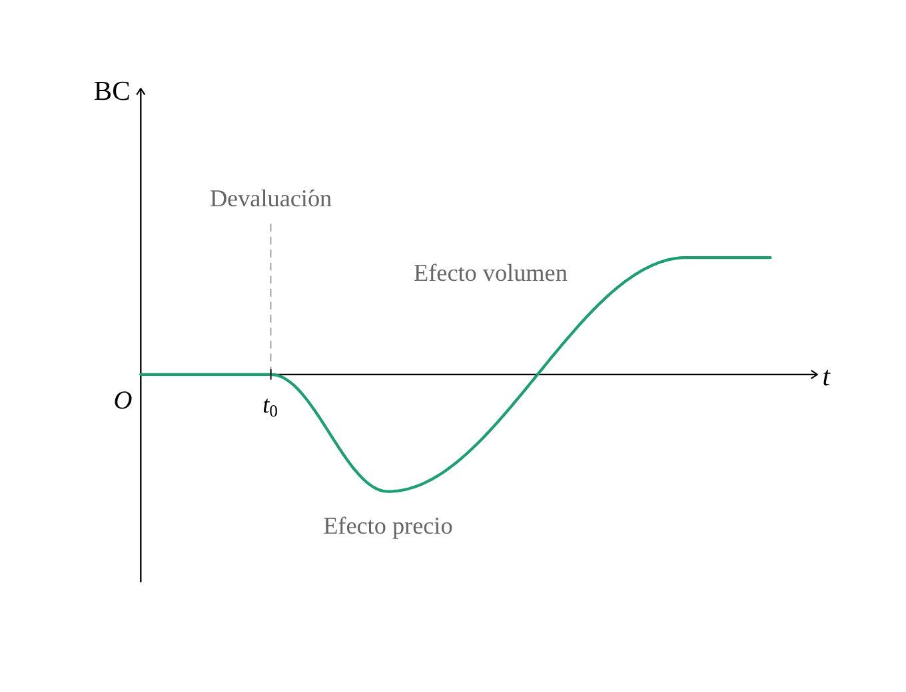
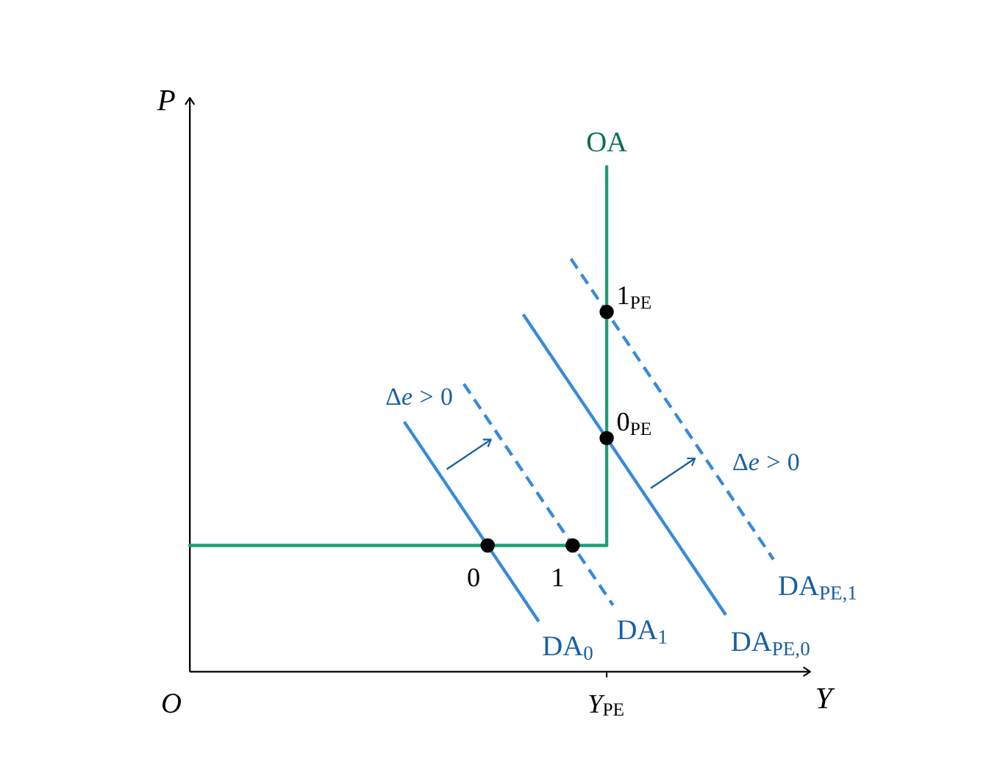
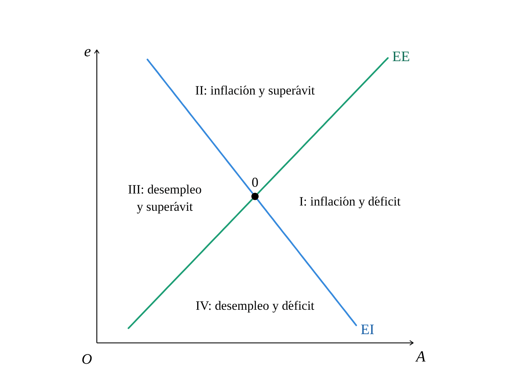
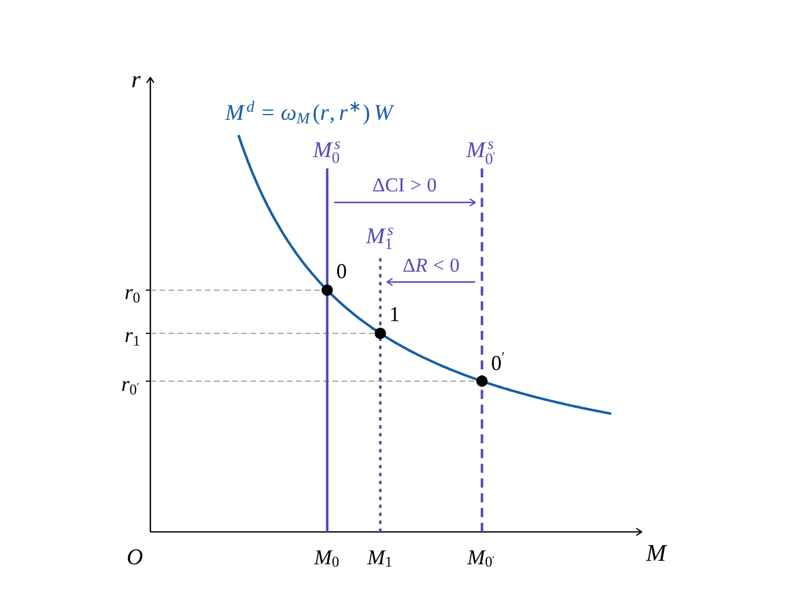
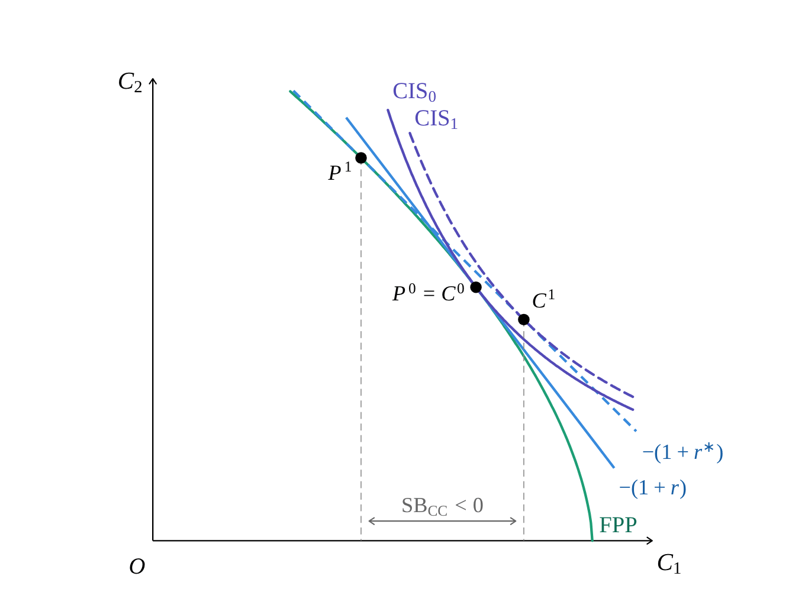
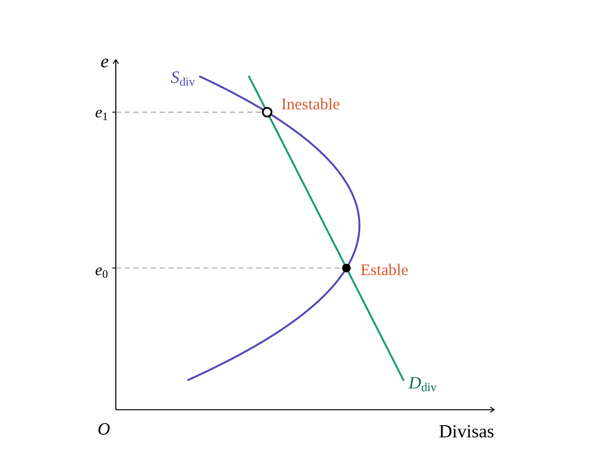

## Introducción

::: {.callout-note appearance="simple" icon=false}

:::

De esos desequilibrios nace una amplia literatura sobre el **ajuste de la balanza de pagos**, es decir, sobre los mecanismos que devuelven a una economía a una posición exterior sostenible. Cada enfoque sitúa el origen del desequilibrio en un lugar distinto y propone, por ello, una vía de corrección distinta.

Los enfoques de la cuenta corriente lo buscan en los precios relativos o en la renta. Por la vía de los precios, una devaluación mejora la balanza comercial si se cumple la **condición de Marshall-Lerner**, que exige que las exportaciones y las importaciones sean suficientemente sensibles a los precios, aunque a corto plazo puede empeorarla antes de mejorarla, como describe la **curva J**. Por la vía de la renta, el **enfoque de la absorción** de Alexander (1952) recuerda que el saldo exterior es la diferencia entre la producción y el gasto interior, de modo que solo mejora si el gasto cae en relación con la renta. Por su parte, el **enfoque monetario** (Johnson, 1958, 1972) ve en el desequilibrio la contrapartida de un desequilibrio del mercado de dinero, y el **enfoque intertemporal** trata la cuenta corriente como el resultado de decisiones de ahorro e inversión, lo que traslada la pregunta a la sostenibilidad del déficit.

En la periferia del euro, España llegó a registrar en 2007 un déficit por cuenta corriente cercano al 10 % del PIB y, sin tipo de cambio propio, lo corrigió mediante la contracción de la demanda interna y la moderación de los costes. En 2013 obtuvo capacidad de financiación frente al exterior por primera vez desde 1997 (Banco de España, 2014).

Existe consenso en que un tipo de cambio flexible no garantiza el ajuste externo, por su volatilidad, sus efectos inflacionistas, la incertidumbre sobre los precios extranjeros y sus posibles desalineamientos respecto de los fundamentos. Por ello, el objetivo de este tema es el estudio de las teorías sobre el ajuste de la balanza de pagos en un régimen cambiario fijo, que se organizan en tres bloques:

- *Ajuste de la cuenta corriente*: vía tipo de cambio real, en línea con los autores clásicos y neoclásicos, y vía renta, en línea con la teoría keynesiana (sección 1).

- *Enfoque activos*: las teorías basadas en la cuenta financiera, desarrolladas en los años sesenta y setenta (sección 2).

- *Enfoque intertemporal*: el modelo intertemporal de la balanza de pagos y el análisis de la sostenibilidad del déficit exterior (sección 3).

## 1. Teorías sobre el ajuste de la cuenta corriente

Los fundamentos de las teorías modernas se encuentran en las aportaciones de los autores clásicos, neoclásicos y keynesianos.

### 1.1. Enfoques de tipo de cambio real

En esta categoría se encuadran dos aportaciones de los autores clásicos y neoclásicos, el mecanismo flujo-especie de Hume y el enfoque de elasticidades de Marshall y Lerner. En ambos, el saldo exterior se corrige a través del tipo de cambio real.

#### 1.1.1. Enfoque de flujo-especie (Hume, 1752)

**Origen**: el *mecanismo flujo-especie* se debe a la obra del filósofo y economista británico David Hume en *Of the Balance of Trade* (1752).

**Idea**: la balanza comercial se ajusta automáticamente en respuesta a *shocks* sin necesidad de que el tipo de cambio nominal varíe.

**Supuestos**:

- *Entorno*: mundo neoclásico sin imperfecciones en el que se cumple la teoría cuantitativa del dinero[^b12-1].

- *Sector exterior*: la balanza de pagos se reduce a la balanza comercial y los desequilibrios se saldan mediante movimientos de metal (especie), sin movimientos autónomos de capital. El sistema de tipos de cambio se considera fijo con convertibilidad estricta[^b12-2] (la oferta monetaria tiene que estar respaldada totalmente por reservas, p. ej. oro). La convertibilidad estricta se garantiza a través de intervenciones no esterilizadas, es decir, se admite que la oferta monetaria varíe con las variaciones de reservas internacionales.

**Razonamiento**: el mecanismo flujo-especie opera en cuatro etapas:

1. *Déficit comercial y drenaje de reservas*: si un país se enfrenta a un déficit de balanza comercial persistente, las reservas internacionales (p. ej. oro) tienden a disminuir, puesto que salen más de las que entran.

2. *Caída de la oferta monetaria*: como se quiere mantener el tipo de cambio nominal, la oferta monetaria del país cae al caer las reservas.

3. *Deflación*: por la teoría cuantitativa del dinero, la caída de la oferta monetaria provoca una caída proporcional en los precios nacionales.

4. *Ganancia de competitividad-precio exterior*: dado que el tipo de cambio nominal permanece fijo, esta caída del nivel general de precios provoca una depreciación del tipo de cambio real que hará al país más competitivo. Por ello, se producirá un aumento de sus exportaciones netas y se corregirá el déficit.

*Corolario I*: si un país presenta superávit comercial, se dará la situación contraria. Por lo tanto, la balanza de pagos se ajusta de modo automático a través de ajustes reales del tipo de cambio ante cualquier desequilibrio externo.

*Corolario II*: la única variable (nominal) de ajuste es, pues, el nivel general de precios. No se necesita el tipo de cambio nominal para equilibrar la balanza de pagos.

**Conclusiones**:

- *Aspectos positivos*: la teoría del mecanismo flujo-especie fue fundamental como base teórica para la defensa del sistema de tipo de cambio fijo del patrón oro. Este sistema, nacido en Inglaterra a comienzos del siglo XIX, se extendió internacionalmente a partir de la década de 1870.

- *Limitaciones*: la teoría presenta dos:

    - *Asimetría del ajuste*: un país deficitario debe restringir su base monetaria para mantener su oferta monetaria respaldada, pero un país superavitario no tiene por qué expandir su base monetaria, por lo que podría acumular reservas de forma indefinida.

    - *Evidencia histórica*: durante la Gran Depresión (1929-1933), los problemas exteriores de los países ligados al patrón oro ponen en duda que el ajuste sea automático. Gana terreno entonces la idea de que corregir el saldo exterior puede requerir decisiones deliberadas de política económica, en particular devaluaciones. La oleada de devaluaciones posterior no mejoró, sin embargo, las balanzas de pagos en su conjunto, porque las devaluaciones de unos países tendían a anular las de otros. Con todo, quienes devaluaron o salieron antes del patrón oro también se recuperaron antes (Eichengreen y Sachs, 1985).

#### 1.1.2. Enfoque de elasticidades (Marshall, 1923; Lerner, 1944)

**Origen**: a raíz de estas limitaciones surgen las aportaciones de Abba Lerner (1944), inspiradas en la obra de Alfred Marshall (1923).

**Idea**: los dos autores estudian en qué condiciones una devaluación mejora la balanza de pagos. La respuesta de la balanza comercial depende de cuán elásticas sean exportaciones e importaciones.

Ambos autores identifican dos efectos contrapuestos de la devaluación, que mejora la balanza comercial cuando el primero domina al segundo:

- *Efecto volumen* (+): aumenta la cantidad de las exportaciones nacionales y disminuye la cantidad de importaciones.

- *Efecto precio o valor* (−): las importaciones se encarecen en moneda nacional, de modo que, para un mismo volumen importado, aumenta el gasto en importaciones.

**Supuestos**:

- *Entorno*:

    - *Renta extranjera dada*: economía abierta cuya evolución no influye en la renta extranjera, que se mantiene constante (no hay efectos de repercusión).

    - *Precios fijos*: el supuesto se aplica tanto al nivel general de precios nacional como al extranjero. Las fluctuaciones del tipo de cambio nominal se trasladan así al tipo de cambio real y, con él, a la competitividad-precio.

- *Sector exterior*:

    - *Balanza comercial*: la balanza de pagos solo recoge intercambios comerciales[^b12-4] y está inicialmente en equilibrio.

    - *Demanda de exportaciones*: no es infinitamente elástica ($\partial P_X^*/\partial e < 0$, donde $P_X^*$ es el precio de las exportaciones expresado en divisa).

    - *Ofertas infinitamente elásticas*: lo son la oferta de exportaciones y la de importaciones, respecto a su precio. Esto implica que el precio de las exportaciones (en moneda nacional) y el precio de las importaciones (en divisa) son constantes: $\partial P_X/\partial e = 0$, $\partial P_M^*/\partial e = 0$. Aquí, $P_X$ y $P_M^*$ son índices de precios de los bienes exportados e importados, no niveles generales de precios.

    - *Variaciones cambiarias*: las del tipo de cambio real son infinitesimales.

**Razonamiento**: la condición se obtiene en cinco pasos:

1. *Equilibrio inicial*: se parte de una balanza comercial en equilibrio, $\text{BC}=X-eM^*=0$, donde $X$ son los ingresos por exportaciones en moneda nacional, $e$ es el tipo de cambio real directo y $M^*$ es el gasto en importaciones en divisa.

2. *Diferenciación*: el efecto de una devaluación se obtiene derivando el saldo respecto al tipo de cambio real directo:

    $$\frac{\partial \text{BC}}{\partial e} = \frac{\partial X}{\partial e} - M^* - e\frac{\partial M^*}{\partial e}$$

3. *Normalización*: se divide por el gasto en importaciones:

    $$\frac{1}{M^*}\frac{\partial \text{BC}}{\partial e} = \frac{1}{M^*}\frac{\partial X}{\partial e} - 1 - \frac{e}{M^*}\frac{\partial M^*}{\partial e}$$

4. *Elasticidades*: en el equilibrio se cumple que $M^* = X/e$. Sustituyendo y expresando en términos de las elasticidades (definidas en valor absoluto):

    $$\frac{1}{M^*}\frac{\partial \text{BC}}{\partial e} = \frac{e}{X}\frac{\partial X}{\partial e} - 1 - \frac{e}{M^*}\frac{\partial M^*}{\partial e} = \varepsilon_{Xe} + \varepsilon_{Me} - 1$$

5. *Condición de Marshall-Lerner*: de la expresión anterior se deduce cuándo $\partial \text{BC} / \partial e > 0$, resultado conocido como la *condición de Marshall-Lerner*:

    $$\frac{\partial \text{BC}}{\partial e} > 0 \leftrightarrow \varepsilon_{Xe} + \varepsilon_{Me} > 1$$

Es decir, una devaluación o una depreciación mejora el saldo comercial siempre que la suma de las elasticidades-tipo de cambio real de las exportaciones y las importaciones sea superior a la unidad. Si ambas demandas son suficientemente sensibles al tipo de cambio, el efecto volumen domina al efecto precio.

La sensibilidad de la balanza comercial a ambos efectos depende de la magnitud de esas elasticidades, que a su vez depende, entre otros factores, de los siguientes:

- *Estructura competitiva de mercados internacionales*: cuanta más competencia, mayor elasticidad.

- *Grado de diferenciación*: cuanto menor diferenciación, mayor elasticidad.

- *Grado de sustituibilidad*: cuanto mayor sustituibilidad, mayor elasticidad.

*Corolario (política económica)*: si no se cumple la condición de Marshall-Lerner, el mercado de divisas puede ser inestable (anexo) y una devaluación empeoraría el saldo comercial, lo que justificaría la intervención en los mercados de divisas para garantizar la estabilidad del sistema.

**Conclusiones**:

- *Aspectos positivos*: ofrece una mayor microfundamentación del vínculo entre la balanza comercial y el tipo de cambio real.

- *Limitaciones*: la experiencia de la Gran Depresión puso en duda su validez, pues las devaluaciones aplicadas resultaron ineficaces, lo que llevó a cuestionar que las elasticidades fuesen lo suficientemente altas como para cumplir la condición. De hecho, los primeros estudios estadísticos, durante las décadas de 1930 y 1940, mostraban elasticidades entre 0 y 0,5. Esto provocó lo que Fritz Machlup llamó *pesimismo de las elasticidades*, la creencia en la ineficacia de las devaluaciones.

### 1.2. Extensiones al análisis de elasticidades

Surgen además una serie de aportaciones, algunas anteriores a Lerner, que tratan de explicar estas limitaciones y ampliar el enfoque, en concreto la generalización de Joan Robinson (1937) y los trabajos que profundizan en los efectos de una devaluación.

#### 1.2.1. Contribución de Joan Robinson (1937)

**Origen**: Joan Robinson (1937) generaliza el análisis. Para ello levanta dos supuestos del enfoque de elasticidades, la elasticidad infinita de las curvas de oferta de exportaciones e importaciones y el equilibrio inicial de la balanza.

**Idea**: el efecto de una devaluación no depende solo de las dos elasticidades de demanda, sino de cuatro elasticidades, las de demanda y las de oferta de exportaciones e importaciones. La condición resultante es la de Bickerdike-Robinson-Metzler, de la que Marshall-Lerner es el caso particular con ofertas infinitamente elásticas y comercio inicialmente equilibrado.

**Razonamiento**: con ofertas de elasticidad finita, parte de la devaluación se compensa con cambios de precios (suben los de exportación en moneda nacional y bajan los de importación en divisa), lo que amortigua la ganancia de competitividad. Si, además, se parte de un déficit inicial, aparece un efecto valoración, por el que el resultado difiere según la moneda en que se mida, de modo que el saldo puede mejorar en divisa y empeorar en moneda nacional.

**Conclusiones**:

- *Aspectos positivos*: gana realismo y generalidad, y muestra que la condición de Marshall-Lerner es un caso límite.

- *Limitaciones*: el precio de la generalidad es la ambigüedad, pues la condición resultante apenas ofrece guía operativa, y el enfoque sigue siendo de equilibrio parcial.

#### 1.2.2. Profundización en los efectos de una devaluación

**Efecto J** (Magee, 1973): desde una perspectiva dinámica y empírica, explica que el efecto precio puede manifestarse de forma inmediata, mientras que el efecto volumen presenta retardos[^b12-6]. Al principio, los volúmenes importados y exportados, fijados en contratos multiperiodo, no varían, pero el precio en moneda nacional de las importaciones facturadas en moneda extranjera aumenta. Por ello, la mejora de la balanza comercial no solo depende de las elasticidades, sino también del horizonte temporal considerado.

Si la condición de Marshall-Lerner no se cumple a corto plazo pero sí a medio y largo plazo, el saldo de la balanza comercial empeora en el corto plazo para luego recuperarse y mejorar respecto al punto inicial[^b12-8]. La velocidad del ajuste dependerá de la capacidad para ajustarse a los nuevos precios. Sin embargo, la evidencia empírica es mixta. De hecho, la revisión de Bahmani, Harvey y Hegerty (2013) concluye que la condición de Marshall-Lerner no se cumple en cerca de la mitad de los casos estudiados, de modo que la recuperación que dibuja el efecto J no está garantizada.

Gráficamente, en el plano tiempo-balanza comercial (figura -@fig-b123-efecto-j), la *curva J* recoge el saldo comercial antes y después de la devaluación en $t_0$. El efecto precio lo reduce de inmediato y el efecto volumen, con retardo, lo eleva después por encima del nivel inicial.

::: {#fig-b123-efecto-j}

::: {.content-visible when-format="html"}
```{=html}
<div class="graph-frame">
<iframe src="../graphs/b123_Efecto_J.html" style="height:560px" loading="lazy" title="fig-b123-efecto-j"></iframe>
</div>
```
:::

::: {.content-visible unless-format="html"}

:::

Curva J. Tras una devaluación la balanza comercial empeora a corto plazo antes de mejorar.
:::

::: {.callout-tip collapse="true" appearance="simple" title="Ejemplo: Marshall-Lerner a corto y a largo plazo"}
Un país parte del equilibrio comercial, con exportaciones de 100 en moneda nacional e importaciones de 100 en divisa ($e = 1$), y devalúa un 10 %. Las elasticidades-tipo de cambio real de las exportaciones y las importaciones son de 0,2 y 0,3 en el primer año y de 0,8 y 0,7 a largo plazo.

- *Corto plazo*: $\varepsilon_{Xe} + \varepsilon_{Me} = 0{,}5 < 1$. Las exportaciones suben a 102 y las importaciones bajan a 97 en divisa, que cuestan ahora $1{,}1 \cdot 97 = 106{,}7$ en moneda nacional, así que $\text{BC} = -4{,}7$. Domina el efecto precio.

- *Largo plazo*: $\varepsilon_{Xe} + \varepsilon_{Me} = 1{,}5 > 1$. Las exportaciones suben a 108 y las importaciones bajan a 93, que cuestan 102,3, y $\text{BC} = 5{,}7$. Domina el efecto volumen.

- *Lectura*: la misma devaluación empeora primero el saldo y lo mejora después. La curva J aparece porque las elasticidades crecen con el tiempo, a medida que vencen los contratos y los compradores cambian de proveedor.
:::

**Efecto *pass-through* limitado** (Krugman, 1987b): tras una devaluación, los exportadores tienden a resistirse a que disminuya el precio de sus productos expresado en moneda extranjera. El porcentaje de devaluación que se traslada a los precios de exportación en divisa (el coeficiente *pass-through*) no tiene entonces por qué ser del 100 %. Por ello, el efecto sobre la balanza comercial es ambiguo, ya que los exportadores amplían sus márgenes en moneda nacional, pero el aumento del volumen exportado es menor que con una traslación completa.

Este porcentaje dependerá de varios factores:

- *Poder de mercado*: el de los exportadores.

- *Predictibilidad*: la de las variaciones en el tipo de cambio (cuanto más predecible, más se trasladará a precios).

- *Magnitud*: la de la variación del tipo de cambio.

- *Persistencia*: la permanencia o transitoriedad del *shock* (cuanto menos dure, menos se trasladará a precios).

- *Apertura*: la de la economía. 

**Efecto inflacionista de la devaluación**: el enfoque de equilibrio parcial considera los precios fijos, y así la devaluación nominal se traduce en una devaluación real. Sin embargo, una devaluación con frecuencia provoca inflación[^b12-9] y, por lo tanto, una depreciación nominal no se traslada plenamente al tipo de cambio real, que podría incluso llegar a apreciarse.

**Conclusiones**:

- *Aspectos positivos*: los tres efectos explican por qué la respuesta del saldo comercial a una devaluación es lenta e incompleta, y concilian el pesimismo de las elasticidades con los casos en que la condición de Marshall-Lerner se cumple a medio plazo.

- *Limitaciones*: en el plano metodológico, el enfoque de elasticidades es, en su conjunto, de equilibrio parcial. Deja fuera cómo repercute la mejora comercial en las demás variables de la economía, empezando por la renta, laguna que da origen a los enfoques siguientes.

### 1.3. Enfoques de la renta

El enfoque contrapuesto al enfoque elasticidades pone énfasis en la renta como mecanismo de ajuste, en línea con la teoría de ciclos. El multiplicador del comercio exterior se remonta a Roy Harrod (1933).

#### 1.3.1. Enfoque del multiplicador keynesiano del comercio exterior (Machlup, 1943)

**Origen**: Fritz Machlup (1943) aplica el principio del multiplicador al comercio exterior, lo que incorpora el mercado de bienes y servicios al análisis del ajuste de la balanza de pagos.

**Idea**: la mejora de la balanza comercial depende no solo de la sensibilidad de las importaciones y de las exportaciones al tipo de cambio, sino también de las propensiones marginales a consumir y a importar de los individuos.

**Supuestos**: son muy similares a los del enfoque elasticidades (corto plazo con precios rígidos, balanza de pagos reducida a la balanza comercial…), con dos precisiones:

- *Metodología*: este enfoque puede formularse con el mercado de bienes del modelo IS-LM-BP (desarrollado con posterioridad, en los años sesenta), si bien adopta dos supuestos simplificadores para obtener la ecuación fundamental del modelo:

    - *Imposición*: los impuestos son de suma fija ($T_0$).

    - *Importaciones*: dependen exclusivamente de la renta nacional. Esto supone un alejamiento fundamental del modelo IS-LM-BP canónico, simplificación que permite aislar el efecto renta.

- *Sector exterior*: se cumple la condición de Marshall-Lerner, de modo que una devaluación mejora el saldo comercial. Como en el modelo las importaciones no dependen del tipo de cambio, ello equivale a suponer $\partial X/\partial e>0$.

**Planteamiento**: el modelo parte de la condición de equilibrio en el mercado de bienes:

$$Y = C_0 + c(Y - T_0) + I_0 - vr + G_0 + X(e) - mY, \qquad c \in (0, 1)$$

donde $C_0$ es el componente autónomo de la función de consumo agregada, $c\in (0, 1)$ es la propensión marginal a consumir de la economía, $Y$ es la renta, $T_0$ los impuestos de suma fija, $I_0$ el componente autónomo de la función de inversión agregada, $v>0$ la sensibilidad de la inversión agregada al tipo de interés, $r$ el tipo de interés, $G_0$ el gasto público, $X(e)$ las exportaciones de la economía (que sí dependen del tipo de cambio $e$) y $m>0$ la propensión marginal a importar de la economía. 

**Estática comparativa** (*efecto renta-exportación*): reordenando, se obtiene que el efecto de una mejora de las exportaciones sobre la renta de la economía es:

$$Y = \frac{1}{1-c+m}(A_0 + X) \rightarrow \frac{\partial Y}{\partial X} = \frac{1}{1-c+m} > 0$$

donde $A_0=C_0-cT_0+I_0-vr+G_0$ recoge todos los componentes autónomos de las funciones agregadas. El *multiplicador del comercio exterior* es, típicamente, superior a la unidad, si bien menor que el multiplicador de una economía cerrada, pues la propensión a importar constituye una filtración adicional.

*Efecto balanza comercial-exportación (efecto total)*: considerando exclusivamente el término correspondiente a la balanza comercial, $\text{BC}\equiv X -mY$, se tiene que el efecto de una mejora de las exportaciones sobre la balanza comercial de la economía es: 

$$\text{BC} = X - mY \rightarrow \frac{\partial \text{BC}}{\partial X} = 1 - m\frac{\partial Y}{\partial X} = \frac{1-c}{1-c+m} = \frac{s}{s+m} \in (0, 1)$$

donde $s=1-c\in (0, 1)$ es la propensión marginal al ahorro de los hogares de la economía. Es decir, un aumento de las exportaciones (p. ej. inducido por una devaluación) mejora el saldo comercial, pero menos que uno a uno, ya que la renta adicional se reparte entre consumo, ahorro e importaciones, y la parte que se filtra hacia importaciones minora la mejora. El efecto será mayor cuanto mayor sea la propensión marginal a ahorrar, que reduce el multiplicador y, con él, las importaciones inducidas, o menor la propensión marginal a importar.

**Conclusiones**:

- *Aspectos positivos*:

    - *Propensiones marginales*: amplía el enfoque elasticidades al considerar las propensiones marginales de los individuos.

    - *Recursos ociosos*: en la medida en que los precios son rígidos, supone que existen recursos ociosos y que, por tanto, la economía puede atender la demanda externa mediante el aumento de su producción sin que aumenten los precios.

- *Limitaciones*: el auge económico vivido tras la Segunda Guerra Mundial, conocido como la “edad dorada del capitalismo” (1945-1973), invitaba a abandonar el supuesto de recursos ociosos, sobre el que descansa todo el resultado. Además, el modelo ignora los efectos monetarios y de precios de la devaluación, supone cumplida la condición de Marshall-Lerner en lugar de derivarla y omite las repercusiones sobre la renta del resto del mundo, relevantes para países grandes.

#### 1.3.2. Enfoque absorción (Alexander, 1952)

**Origen**: en este contexto, Sidney Alexander (1952) desarrolla el enfoque absorción de la balanza de pagos.

**Idea**: la mejora de la balanza de pagos depende de la situación de empleo de recursos de la economía.

**Supuestos**: son similares a los anteriores, salvo en los precios, que se consideran rígidos si existen recursos ociosos y flexibles en el pleno empleo.

**Planteamiento**: el modelo parte de la ecuación básica de la demanda agregada: $Y = C + I + G + (X - M) \rightarrow Y = A + \text{BC}$[^b12-12], donde $A$ es la *absorción interna* y refleja la demanda total de bienes finales de una economía, independientemente de su origen.

La absorción interna, a su vez, tiene un componente autónomo y un componente que depende de la renta: $A=A_0+cY$, donde $c\in (0, 1)$ es un parámetro constante y exógeno que refleja la propensión marginal a consumir[^b12-14] al igual que antes.

*Balanza comercial y absorción*: reordenando, se obtiene el saldo de la balanza comercial en términos de la absorción interna:

$$\text{BC} = Y - A \rightarrow \text{BC} = Y - (A_0 + cY) \rightarrow \text{BC} = (1-c)Y - A_0$$

*Efecto balanza comercial-tipo de cambio*: derivando con respecto al tipo de cambio real, se obtiene el efecto de su variación sobre la balanza comercial:

$$\frac{\partial \text{BC}}{\partial e} = (1-c)\frac{\partial Y}{\partial e} - \frac{\partial A_0}{\partial e}$$

La expresión anterior muestra que una variación del tipo de cambio produce dos efectos: 

- *Efecto renta* (+): recogido en el primer término del lado derecho de la ecuación. Refleja cómo las devaluaciones (o depreciaciones) permiten mejorar el saldo de la balanza comercial al aumentar las exportaciones y, con ellas, la renta, teniendo en cuenta que parte de ese aumento de renta se filtrará en forma de consumo.

- *Efecto absorción* (signo ambiguo): recogido en el segundo término del lado derecho (incluido el signo negativo). Refleja cómo una devaluación (o depreciación) reduce el saldo de la balanza comercial si eleva directamente la absorción autónoma ($A_0$) y lo mejora si la reduce, como ocurre en pleno empleo a través de los canales monetario y redistributivo.

En consecuencia, el efecto total de una devaluación sobre la balanza comercial dependerá de cuál predomine, lo que varía con la situación de empleo de la economía:

*Desempleo*: si existen recursos ociosos, el efecto será positivo siempre que la propensión marginal a consumir sea inferior a la unidad (y tanto mayor cuanto más alejada esté de ella), porque el efecto renta será mayor que el efecto absorción[^b12-15]. La devaluación permite entonces que la producción nacional cubra la demanda interna y la externa sin que aumenten los precios y, por tanto, sin afectar a la absorción autónoma. Ello podría explicar por qué muchos países recurrieron a devaluaciones competitivas en los años treinta.

*Pleno empleo*: si no existe desempleo, el efecto renta será nulo[^b12-17], puesto que no quedan recursos disponibles para atender la demanda total de bienes nacionales, tanto interna como externa. Por tanto, el efecto total sobre la balanza comercial dependerá del efecto absorción. Alexander contempla dos canales por los que la devaluación reduce directamente la absorción y puede, así, mejorar el saldo comercial:

- *Canal monetario*: recoge dos efectos:

    - *Efecto Keynes*: para una oferta monetaria dada, la inflación reduce la oferta real de dinero, lo que eleva el tipo de interés y disminuye la absorción: $\uparrow e \rightarrow \uparrow P \rightarrow \downarrow(M^s/P) \rightarrow \uparrow i \rightarrow \downarrow C, \downarrow I \rightarrow \downarrow A$. 

    - *Efecto Pigou o efecto saldos reales*: para una oferta monetaria dada, la inflación deteriora la riqueza real de los individuos. De esta forma, decidirán ahorrar más y consumir menos, lo cual reducirá la absorción: $\uparrow e \rightarrow \uparrow P \rightarrow \downarrow C \rightarrow \uparrow S \rightarrow \downarrow A$.

- *Canal redistributivo*: recoge otros dos:

    - *Rémora fiscal, progresividad en frío o progresión fría* (*fiscal drag*): si existe un sistema de impuestos progresivos y este no se actualiza, la inflación y los aumentos salariales nominales harán que una mayor proporción de gente se encuentre en los tramos altos del impuesto. Mientras el Estado no amplíe su gasto, el resultado es un trasvase de renta de los agentes privados a las arcas públicas: $\uparrow e \rightarrow \uparrow P \rightarrow \uparrow w \rightarrow \uparrow \tau w \rightarrow \downarrow C \rightarrow \downarrow A$. 

    - *No indexación de los salarios*: cuando los salarios nominales suben menos que los precios, porque su indexación es imperfecta, la renta real pasa de los asalariados a los perceptores de beneficios. Como estos ahorran, por hipótesis, una fracción mayor de su renta, la absorción interna cae.

**Desarrollo gráfico**: el enfoque absorción se representa en el plano renta-precios (figura -@fig-b122-alexander-absorcion):

1. *Oferta agregada* (OA): recoge la producción que la economía ofrece a cada nivel de precios y presenta dos tramos. Es horizontal mientras existen recursos ociosos, con precios rígidos, y vertical en la renta de pleno empleo, $Y_{\text{PE}}$, donde los precios son flexibles y no quedan recursos para producir más.

2. *Demanda agregada* (DA): recoge las combinaciones de renta y precios con las que la producción iguala la demanda de bienes nacionales, $A + \text{BC}$. Tiene pendiente negativa porque una subida de los precios reduce la absorción por los efectos Keynes y Pigou y, con el tipo de cambio nominal fijo, aprecia el tipo de cambio real y reduce las exportaciones netas. Su posición depende de la absorción autónoma y de las exportaciones.

3. *Equilibrio*: en el corte de ambas curvas. Con desempleo, la demanda agregada ($\text{DA}_0$) corta el tramo horizontal en el punto 0. En pleno empleo, la demanda agregada ($\text{DA}_{\text{PE},0}$) corta el tramo vertical en el punto $0_{\text{PE}}$.

**Estática comparativa**: una devaluación ($\Delta e > 0$) eleva las exportaciones y desplaza la demanda agregada a la derecha. Su efecto depende del tramo de la oferta agregada:

- *Desempleo*: la demanda pasa de $\text{DA}_0$ a $\text{DA}_1$ y la economía, del punto 0 al 1. La producción y, por ende, la renta nacional aumentan sin que suban los precios.

- *Pleno empleo*: la demanda pasa de $\text{DA}_{\text{PE},0}$ a $\text{DA}_{\text{PE},1}$ y la economía, del punto $0_{\text{PE}}$ al $1_{\text{PE}}$. La devaluación solo produce inflación, porque en el tramo vertical de la oferta la producción no puede aumentar.

::: {#fig-b122-alexander-absorcion}

::: {.content-visible when-format="html"}
```{=html}
<div class="graph-frame">
<iframe src="../graphs/b122_Alexander_absorcion.html" style="height:560px" loading="lazy" title="fig-b122-alexander-absorcion"></iframe>
</div>
```
:::

::: {.content-visible unless-format="html"}

:::

Enfoque absorción (Alexander, 1952). La devaluación mejora la balanza solo si la producción crece más que la absorción.
:::

**Extensiones**: en términos de política económica, una devaluación podría ser insuficiente e incluso ineficaz para corregir la balanza comercial, por lo que debería combinarse con programas de contención o reducción del gasto interno. La combinación óptima depende de las características del país (p. ej. la propensión a absorber o la rigidez del mercado de trabajo), y el diagrama de Swan la formaliza.

**Conclusiones**:

- *Aspectos positivos*: integra la situación de empleo de la economía en el análisis y desplaza el foco del equilibrio parcial al equilibrio de la demanda agregada. De este modo muestra que una devaluación solo funciona si libera recursos reales (si la producción puede crecer o la absorción caer).

- *Limitaciones*: los canales que reducen la absorción en pleno empleo (Keynes, Pigou, redistributivos) son empíricamente débiles y lentos, y la cuenta financiera sigue ausente del análisis. Además, el enfoque tiende a presentarse como sustituto del de elasticidades cuando, en realidad, ambos son complementarios.

#### 1.3.3. Diagrama de Swan (Swan, 1955; Salter, 1959)

**Origen**: Trevor Swan expone el diagrama en su trabajo escrito en 1955 y publicado en 1963. Por su parte, Wilfred Salter (1959) desarrolla el mismo análisis, con bienes comerciables y no comerciables.

**Idea**: en un régimen de cambio fijo pero ajustable, la política económica persigue dos objetivos, el equilibrio interno (pleno empleo sin inflación) y el equilibrio externo (un saldo por cuenta corriente objetivo). Para ello necesita dos instrumentos, la absorción interna y el tipo de cambio real, ninguno de los cuales basta por separado.

**Planteamiento**: el tipo de cambio real es $e = EP^*/P$, de modo que un aumento de $e$ es una depreciación. Sin rentas ni transferencias, el saldo por cuenta corriente coincide con la balanza comercial, que mejora con $e$ (se supone cumplida la condición de Marshall-Lerner) y empeora con la absorción, $A$, por las importaciones. Cada objetivo define una curva.

**Desarrollo gráfico**: los equilibrios interno y externo se representan en el plano absorción-tipo de cambio real (figura -@fig-b125-swan):

1. *Equilibrio interno* (EI): combinaciones con las que la demanda de producción nacional, $A + \text{BC}$, iguala la producción de pleno empleo, $\bar Y$. Su pendiente es negativa, porque una absorción mayor solo es compatible con el pleno empleo sin inflación si una apreciación desvía demanda hacia bienes extranjeros. Por encima de la curva hay inflación y, por debajo, desempleo.

2. *Equilibrio externo* (EE): combinaciones con las que la balanza comercial alcanza su objetivo, $\text{BC} = \text{BC}^T$. Su pendiente es positiva, porque una absorción mayor eleva las importaciones y exige una depreciación que restablezca el saldo. Por encima de la curva hay superávit y, por debajo, déficit.

3. *Equilibrio*: las dos curvas se cortan en el punto 0, el único que cumple ambos objetivos, y dividen el plano en cuatro zonas de desequilibrio. Esas zonas son la I, de inflación y déficit, la II, de inflación y superávit, la III, de desempleo y superávit, y la IV, de desempleo y déficit.

::: {#fig-b125-swan}

::: {.content-visible when-format="html"}
```{=html}
<div class="graph-frame">
<iframe src="../graphs/b125_Swan.html" style="height:560px" loading="lazy" title="fig-b125-swan"></iframe>
</div>
```
:::

::: {.content-visible unless-format="html"}

:::

Diagrama de Swan. Las curvas de equilibrio interno EI y de equilibrio externo EE se cortan en el punto 0 y delimitan cuatro zonas de desequilibrio, que combinan inflación o desempleo con déficit o superávit.
:::

**Estática comparativa**: con un solo instrumento, el ajuste no alcanza en general los dos objetivos.

- *Solo absorción*: la economía se desplaza en horizontal. En las zonas I y III la absorción corrige los dos desequilibrios a la vez (en I, reducir el gasto modera la inflación y el déficit). En las zonas II y IV, en cambio, cada objetivo pide un movimiento opuesto (en IV, el desempleo exige más gasto y el déficit, menos).

- *Solo tipo de cambio*: la economía se desplaza en vertical. En las zonas II y IV el tipo de cambio corrige ambos desequilibrios, pues en IV una devaluación reduce el desempleo y el déficit y en II una revaluación modera la inflación y el superávit, y en las zonas I y III se enfrenta al mismo dilema.

Incluso en las zonas favorables, el instrumento único alcanza una curva antes que la otra y solo lleva al punto 0 si la economía parte de la misma altura que el punto 0 (con la absorción como instrumento) o de la misma abscisa (con el tipo de cambio). El resultado ilustra la *regla de Tinbergen* (1952), según la cual alcanzar dos objetivos independientes exige al menos dos instrumentos independientes.

**Extensiones**: si cada instrumento se encomienda a un objetivo, el ajuste converge cuando cada uno se asigna al objetivo sobre el que tiene mayor efecto relativo (principio de clasificación efectiva de los mercados, Mundell, 1962). Por ejemplo, con una propensión a importar reducida, la absorción se asigna al equilibrio interno y el tipo de cambio, al externo. La misma lógica, aplicada a las políticas monetaria y fiscal, se trata en el tema [A40](a40-interrelacion.qmd), apartado 1.3, y los dos objetivos como criterio de elección del régimen cambiario, en el tema [B15](b15-regimenes-cambiarios.qmd), apartado 1.1.

**Conclusiones**:

- *Aspectos positivos*: integra los enfoques de elasticidades y de absorción al distinguir las políticas que modifican el nivel del gasto de las que lo desvían entre bienes nacionales y extranjeros, y muestra con sencillez por qué el ajuste exterior exige combinar instrumentos.

- *Limitaciones*: es un análisis estático que ignora la cuenta financiera y trata el tipo de cambio real como instrumento, cuando la autoridad solo controla el nominal, cuyo efecto real se erosiona si la devaluación eleva precios y salarios.

### 1.4. Conclusiones

Hasta los años setenta, el consenso atribuía, por lo general, a la cuenta corriente la causa de los desequilibrios exteriores. Al fin y al cabo, todos los enfoques de esta sección surgieron cuando los flujos de capitales apenas empezaban a expandirse.

Desde esa década, sin embargo, la apertura gradual de las cuentas de capital ha llevado a buscar en los flujos financieros la causa última de los desequilibrios. De ahí la objeción principal a los enfoques anteriores, que desatienden los flujos financieros que hacen de contrapartida de la balanza comercial y no contemplan, entre otros, los movimientos autónomos de capital.

## 2. Teorías basadas en el desequilibrio en la cuenta financiera: enfoque activos

Así nace el **enfoque de la balanza de pagos cabeza abajo** (o enfoque activos), cuyo nombre alude a que lee la balanza de pagos al revés. Los desequilibrios comerciales pasan a verse como efecto de los financieros y no como su causa, con lo que la causalidad se invierte.

Intuitivamente, con libre circulación de capitales, la oferta y la demanda de divisas responden no solo a su uso como medio de cambio internacional, sino también a su uso como depósito de valor (dinero u otros activos).

El caso de Tailandia lo ilustra. En 1995-1996, antes de que estallara la crisis asiática, su déficit por cuenta corriente rondaba el 8 % del PIB y respondía a la llegada masiva de *hot money*, es decir, de inversión especulativa a corto plazo.

Estas ideas se ilustran con dos modelos. El **modelo monetario** se centra en el dinero como activo financiero y el **modelo de cartera** considera un espectro más amplio de activos financieros.

### 2.1. Modelo monetario (Johnson, 1958, 1972)

**Origen**: el economista canadiense Harry Johnson formuló el enfoque monetario de la balanza de pagos en 1958 y lo sistematizó en 1972, revitalizando las ideas que David Hume había anticipado con el mecanismo flujo-especie.

**Idea**: los desequilibrios exteriores nacen en el mercado monetario, y los propios flujos monetarios devuelven la balanza de pagos al equilibrio de forma automática.

#### 2.1.1. Supuestos

**Entorno**: país pequeño y abierto, régimen de cambio fijo, libre circulación de capitales y mundo neoclásico (comercio sin restricciones y pleno empleo), por lo que el nivel de renta viene determinado por factores reales exógenos.

Además, se cumple la ley del precio único entre países, tanto para activos financieros como para mercancías: $i=i^*$, $P=E \cdot P^*$. Existe plena sustituibilidad de bienes y activos nacionales y extranjeros.

**Agentes**: el multiplicador monetario es unitario, por lo que base monetaria y oferta monetaria se usan indistintamente.

#### 2.1.2. Modelo

**Planteamiento**: el modelo consta de dos ecuaciones del mercado de dinero:

- *Demanda de dinero*: es proporcional a la renta nominal, $M^{d}=kPY$, con $P = E \cdot P^*$ por la ley del precio único. Como la renta la fijan factores reales y el tipo de interés es el internacional, ante un cambio del crédito interno la demanda no varía, $M^{d}=M^{d}_{0}$.

- *Oferta de dinero*: es endógena, pues, aunque la autoridad monetaria controla el crédito interno, las reservas se ajustan a través de la balanza de pagos. Se recoge en una identidad basada en el balance del banco central, cuyo activo está formado por el crédito interno y las reservas internacionales (activos netos frente al exterior)[^b12-23]: $M^{s}=\text{CI}+R$.

**Equilibrio**: el mercado de dinero se equilibra cuando $M^{d}=M^{s}\rightarrow M^{d}_{0}=M^{s}$. De esta condición y de la identidad de la oferta de dinero se derivan el mecanismo de ajuste del modelo y sus principales resultados:

$$M^d = \text{CI} + R \rightarrow \Delta R = \Delta M^d - \Delta \text{CI}$$

Con la demanda de dinero dada, $\Delta R = -\Delta \text{CI}$, y los cambios en las reservas internacionales se deben a cambios en el crédito interno (*shocks* monetarios). Así, el nivel de reservas ajusta la balanza de pagos ante los *shocks* que desequilibran el mercado monetario.

**Estática comparativa** (política monetaria expansiva): un aumento del crédito interno actúa en dos pasos:

1. *Mercado monetario interno*: partiendo del equilibrio, un aumento del crédito interno crea un exceso de oferta de saldos reales, pues la demanda de dinero y los precios no varían: $\uparrow M^s \leftrightarrow \uparrow \text{CI} \rightarrow M^s > M^d$.

2. *Mercado de bienes y sector exterior*: los agentes tratan de eliminar ese exceso adquiriendo bienes y activos. Con pleno empleo y precios fijos, el exceso de demanda solo puede cubrirse con bienes y activos extranjeros[^b12-24]. Esa compra provoca una salida de reservas de la misma cuantía que el aumento del crédito interno y un déficit de balanza de pagos de igual magnitud (por cuenta corriente y cuenta financiera, excluidos los activos de reserva). De ahí que se hable de enfoque de la BP “cabeza abajo”: $\text{DA} > \text{OA} \rightarrow \uparrow \text{DA}^* \rightarrow \downarrow R$. Por tanto, los desequilibrios externos son un fenómeno monetario. Si la autoridad esteriliza la pérdida de reservas con nuevo crédito interno, el drenaje se prolonga.

**Estática comparativa** (crecimiento de la renta y devaluación): cuando lo que cambia es la demanda de dinero, el modelo da dos predicciones que lo distinguen de los enfoques de la sección 1 (Frenkel y Johnson, 1976):

- *Crecimiento de la renta*: eleva la demanda de saldos, $\Delta M^d = kP\,\Delta Y$, que, con el crédito interno dado, solo puede atenderse con una entrada de reservas. El crecimiento produce así superávit, al contrario que en el multiplicador del comercio exterior (apartado 1.3.1), en el que más renta significa más importaciones.

- *Devaluación*: con $P = E \cdot P^*$, eleva los precios internos y, con ellos, la demanda nominal de dinero, $\Delta M^d = kYP^*\,\Delta E$. Para recomponer sus saldos reales, los agentes gastan menos de lo que ingresan y la balanza registra un superávit con entrada de reservas. Sin embargo, el superávit es transitorio y se agota cuando la oferta monetaria ha crecido en la misma proporción que los precios, de modo que la devaluación no mejora la balanza de forma permanente.

**Extensiones**: las implicaciones de política económica son dos:

- *Política monetaria activa*: no tiene efectos sobre el equilibrio interno, puesto que la economía se sitúa en el pleno empleo, y solo afecta transitoriamente al equilibrio externo (déficit). Deja, no obstante, una pérdida permanente de reservas, ya que los cambios en el crédito interno se contrarrestan con los cambios en las reservas y la oferta monetaria vuelve a su nivel inicial[^b12-25]. Por lo tanto, una política monetaria activa no es recomendable, porque el ajuste es automático y una política expansiva puede agotar las reservas.

- *Programación del crédito interno*: si la autoridad monetaria conoce la demanda de dinero y las reservas de la economía, sí puede fijar un crecimiento del crédito interno compatible con el equilibrio exterior. De ahí que muchos programas de estabilización del FMI para los países en desarrollo (PED) se basen en límites al crecimiento del crédito interno para evitar salidas de reservas, según el modelo de Polak (1957) que se estudia en el tema [B22](b22-fmi.qmd), apartado 3.2.

#### 2.1.3. Conclusiones

**Aspectos positivos**: ofrece una explicación teórica a situaciones en las que los desequilibrios externos se generan por desequilibrios en el mercado monetario.

**Limitaciones**: se dirigen, principalmente, a la adopción de la ley del precio único:

- *Bienes*: existen bienes no comerciables en los que no tiene por qué cumplirse la ley del precio único. 

- *Activos*: el grado de sustituibilidad entre activos nacionales y extranjeros no es perfecto, relajación que da lugar al modelo de cartera.

### 2.2. Modelo de cartera (McKinnon, 1969)

**Origen**: Ronald McKinnon (1969) desarrolla un modelo basado en la aplicación de la teoría de la selección de carteras de Harry Markowitz al estudio de la balanza de pagos.

**Idea**: los desequilibrios en la balanza de pagos siguen siendo causados por los desequilibrios en el mercado monetario, si bien los desequilibrios monetarios también se verán influidos por las decisiones de cartera de los agentes económicos.

#### 2.2.1. Supuestos

**Entorno**: los supuestos son similares (país pequeño y abierto, precios fijos, libertad de movimiento de capital), con la salvedad de que existe *sustituibilidad imperfecta* entre los activos nacionales y extranjeros[^b12-26]. Esto se debe a factores tales como información imperfecta, riesgo cambiario o riesgo político, entre otros. Se definen tres activos financieros:

- *Dinero* ($M$): activo que no ofrece rendimiento alguno.

- *Bonos nacionales* ($B$): activos que otorgan un rendimiento[^b12-27], $r$, no comerciables internacionalmente ni canjeables por bonos extranjeros. De ello se deriva, como consecuencia fundamental para el modelo, que el flujo de capital financiero entre el país y el resto del mundo se determina exclusivamente por el flujo de bonos extranjeros.

- *Bonos extranjeros* ($B^*$): estos también otorgan un rendimiento, $r^*$, y, a diferencia de los bonos nacionales, sí son comerciables internacionalmente.

#### 2.2.2. Modelo

**Planteamiento**: la demanda de activos financieros se reparte entre el mercado de dinero y el de bonos, y su oferta determina la riqueza:

- *Demanda de dinero*: se demanda una proporción de la riqueza, tal que $M^d=\omega_M W$, con $\omega_M=f(r^{-},r^{*-})$.

- *Demanda de bonos*: igualmente, se demandará una proporción de la riqueza en bonos nacionales, $B^{d}=\omega_B W$, con $\omega_B=f(r^{+},r^{*-})$, y en bonos extranjeros, $B^{d*}=\omega_{B^*} W$, con $\omega_{B^*}=f(r^{-},r^{*+})$, es decir, cada proporción aumenta con el rendimiento propio y disminuye con el del activo alternativo.

- *Oferta de activos o riqueza*: la riqueza de la economía vendrá dada por la oferta de activos financieros: $W=M^{s}+B^{s}+E \cdot B^{s*}$, donde, al ser fijo el tipo de cambio, $E$ puede normalizarse a la unidad ($E = 1$), lo que reduce la expresión a $W=M^{s}+B^{s}+B^{s*}$.

**Equilibrio**: la restricción de riqueza implica (ley de Walras) que la suma de los excesos de demanda es nula:

$$(M^{d} - M^{s}) + (B^{d} - B^{s}) + (B^{d*} - B^{s*}) = 0$$

Así, si los mercados nacionales (dinero y bonos nacionales) presentan en conjunto un desequilibrio, el mercado de bonos extranjeros presenta un desequilibrio compensador. Si presentan en conjunto un exceso de demanda, existirá un exceso de oferta en el mercado de activos extranjeros y viceversa.

**Desarrollo gráfico**: el equilibrio del mercado de dinero se representa en el plano dinero-tipo de interés, $M$-$r$ (figura -@fig-b126-mckinnon):

1. *Demanda de dinero* ($M^d = \omega_M(r, r^*)\,W$): con $W$ y $r^*$ dados, tiene pendiente negativa, porque la proporción de la riqueza que se mantiene en dinero disminuye con el rendimiento de los bonos nacionales.

2. *Oferta monetaria* ($M^s_0$): es vertical, porque la fijan el crédito interno y las reservas ($M^s = \text{CI} + R$), no el tipo de interés.

3. *Equilibrio*: en el punto 0, con el tipo de interés $r_0$, las carteras tienen su composición óptima y no hay flujos de reservas.

**Estática comparativa** (política monetaria expansiva): las implicaciones del modelo, sobre todo para la política económica, se aprecian al analizar una política monetaria expansiva:

- *Caída del tipo de interés*: cuando aumenta la oferta monetaria por una expansión del crédito interno ($\Delta \text{CI} > 0$, de $M^s_0$ a $M^s_{0'}$), el tipo de interés nacional desciende de $r_0$ a $r_{0'}$ (punto 0′) y, así, sube el precio de los bonos nacionales.

- *Reajuste de carteras*: los individuos compran bonos extranjeros y se deshacen de dinero y de bonos nacionales. Por la ley de Walras, el exceso de oferta de dinero tiene como contrapartida un exceso de demanda de bonos extranjeros, que el país pequeño satisface adquiriéndolos en el mercado internacional. La compra provoca una salida de reservas y un déficit de balanza de pagos por la salida de capital financiero nacional.

- *Fin del ajuste*: la salida de reservas ($\Delta R < 0$) reduce la oferta monetaria, de $M^s_{0'}$ a $M^s_1$, hasta que las carteras alcanzan su nueva composición óptima en el punto 1. Al tratarse de un ajuste de *stocks*, la salida de capital se agota y desaparece el desequilibrio externo.

::: {#fig-b126-mckinnon}

::: {.content-visible when-format="html"}
```{=html}
<div class="graph-frame">
<iframe src="../graphs/b126_McKinnon.html" style="height:560px" loading="lazy" title="fig-b126-mckinnon"></iframe>
</div>
```
:::

::: {.content-visible unless-format="html"}

:::

Modelo de cartera (McKinnon, 1969). Una expansión del crédito interno reduce el tipo de interés (0 → 0′) y la salida de reservas reduce la oferta monetaria sin devolverla a su nivel inicial (0′ → 1), a diferencia del ajuste completo del modelo monetario.
:::

En resumen, las implicaciones son similares a las del modelo monetario, dado que la idea fundamental es la misma. No obstante, existe una diferencia esencial, y es que un desequilibrio en el mercado monetario puede ser compensado, al menos parcialmente, por un desequilibrio en el mercado de bonos nacionales, al no ser sustitutivos perfectos de los bonos extranjeros.

En consecuencia, el desequilibrio en el mercado monetario puede tener mayor magnitud que el desequilibrio externo y, por lo tanto, el desequilibrio monetario no se corregirá exclusivamente vía reservas, sino también con variaciones en las cantidades demandadas de los distintos activos. La oferta monetaria final queda entre la inicial y la ampliada ($M^s_0 < M^s_1 < M^s_{0'}$), con $r_1 < r_0$, mientras que en el modelo monetario, con $\Delta R = -\Delta \text{CI}$, volvería a $M^s_0$. Esto hace que la política monetaria tenga un mayor grado de autonomía para corregir desequilibrios internos.

#### 2.2.3. Conclusiones

**Aspectos positivos**: gana realismo al admitir la sustituibilidad imperfecta entre activos, restaura un margen de autonomía para la política monetaria y constituye el fundamento de los modelos de cartera del tipo de cambio (tema [B14](b14-tipo-cambio.qmd), apartado 2.3).

**Limitaciones**: es un modelo estático, sin expectativas ni valoración del riesgo explícita, cuyos resultados dependen del menú de activos considerado, y mantiene los supuestos de precios fijos y renta dada.

### 2.3. Conclusiones

El enfoque activos invierte la causalidad de la sección 1, pues, con libre circulación de capitales, el desequilibrio exterior es la contrapartida de un desequilibrio en el mercado de dinero o de activos. En el modelo monetario, con sustituibilidad perfecta, una expansión del crédito interno se traduce en una pérdida de reservas de igual cuantía. La oferta monetaria vuelve así a su nivel inicial, y la política monetaria carece de autonomía duradera (trilema de Mundell-Fleming). El modelo de cartera admite, en cambio, que los bonos nacionales y extranjeros no son sustitutivos perfectos. Por ello, parte del desequilibrio monetario se absorbe en el mercado de bonos nacionales y la política monetaria recupera un margen de autonomía.

Con tipo de cambio fijo, ambos modelos advierten además de que los desequilibrios persistentes anticipan crisis de balanza de pagos, intuición que desarrollan los modelos de crisis cambiarias (tema [B17](b17-crisis-bp.qmd), apartado 1). No obstante, el límite común de ambos modelos es el carácter estático del análisis, que el enfoque intertemporal de la sección 3 viene a superar.

## 3. Enfoque intertemporal y sostenibilidad del déficit y de la deuda exterior

Los modelos de la balanza de pagos presentados hasta ahora son estáticos, es decir, no tienen en cuenta explícitamente el factor temporal. Sin embargo, la balanza de pagos recoge fenómenos dinámicos, lo que motivó el cambio de enfoque de los años ochenta.

Según los modelos neoclásicos de comercio internacional (p. ej. el modelo de Haberler), la liberalización comercial hace posible desvincular intratemporalmente las decisiones de producción y de consumo. Por su parte, los modelos de equilibrio intertemporal introducen la liberalización financiera, con la que esas decisiones pueden desvincularse también intertemporalmente, pues cabe prestar y endeudarse en el exterior[^b12-28].

De este modo se entiende que los movimientos de bienes y de capitales se produzcan de forma simultánea. Solo es posible sostener en el tiempo un saldo deudor en la cuenta corriente si la cuenta financiera registra un saldo de igual magnitud y signo, es decir, si entran capitales. Sin acceso al mercado de capitales, los déficits corrientes solo podrían cubrirse mediante transferencias de capital recibidas, la venta de activos no financieros no producidos (licencias, marcas…) o la de reservas internacionales.

Por ello, una acumulación continuada de déficits por cuenta corriente puede desembocar en problemas de sostenibilidad de la deuda, en la medida en que las obligaciones frente al exterior podrían ser tales que la economía no tenga recursos para satisfacerlas.

### 3.1. Modelo intertemporal de la balanza de pagos (Sachs, 1981; Obstfeld y Rogoff, 1995)

**Origen**: Jeffrey Sachs (1981) aplicó el análisis de la elección intertemporal a la cuenta corriente de una economía abierta, y Maurice Obstfeld y Kenneth Rogoff (1995) lo sistematizaron como enfoque intertemporal de la cuenta corriente.

**Idea**: con acceso al mercado internacional de capitales, el consumo y la inversión de un país dejan de estar restringidos por su producción corriente, de modo que el saldo por cuenta corriente emerge como resultado de la optimización intertemporal de los agentes.

::: {.callout-note appearance="simple" icon=false}
La ecuación de Euler, el consumidor-productor con el teorema de separación de Fisher y el problema de horizonte infinito con la condición de no-Ponzi, en los que se apoya el modelo, se desarrollan en el tema [A29](a29-mhi-mgs.qmd), apartados 1.4.1, 2.4.2 y 3.1. Los determinantes de los flujos internacionales de capital que se derivan del modelo se estudian en el tema [B18](b18-globalizacion.qmd), apartado 3.1.1, y su aplicación a la financiación de los países en desarrollo, en el tema [B29](b29-fod-aod.qmd), apartado 1.
:::

#### 3.1.1. Supuestos

**Entorno**: la economía es pequeña, con mercados perfectos y completos, información perfecta (plena certeza sobre la renta futura) y horizonte infinito en tiempo discreto.

**Agentes**: economía de agente representativo que maximiza su utilidad intertemporal según el altruismo intergeneracional puro.

**Tecnología**:

- *Bien único*: se produce un único bien de consumo con una función de producción con un único factor productivo (capital) con productividad marginal positiva ($f'(K)>0$) pero decreciente ($f''(K)<0$): $Y_t=f(K_t)$.

- *Naturaleza dual*: el factor productivo es, a su vez, bien de consumo, de modo que se utiliza para producir y para consumir.

- *Sin depreciación*: no existe depreciación del capital, por lo que la ley de acumulación de capital de la economía es $K_{t+1}=K_t+I_t$, donde $I_t$ es la inversión bruta.

**Sector exterior**: 

- *Cuenta corriente*: constituye, junto con la función de producción y la ley de acumulación del capital, una de las restricciones de recursos de la economía. Todo el déficit por cuenta corriente se financia con deuda exclusivamente (otras formas de financiación, como las acciones, no se tienen en cuenta). Por tanto, el saldo de la cuenta corriente será $\text{SB}_{\text{CC},t}=B_{t+1}-B_t$, donde $B_t$ son los activos netos frente al exterior en forma de deuda. Si el saldo de la cuenta corriente es positivo, la economía mostrará capacidad de financiación, lo que se traducirá en un cambio positivo en la posición neta respecto al resto del mundo y viceversa.

- *Transversalidad*: se impone una condición que evita que se dé un juego de Ponzi y se originen sendas explosivas de deuda. De lo contrario, el país podría endeudarse indefinidamente sin verse obligado en ningún momento a devolver la cuantía recibida.

#### 3.1.2. Modelo

**Planteamiento** (economía cerrada): el análisis parte del modelo en autarquía y muestra después los efectos de la apertura exterior. El modelo de autarquía se puede resumir en el programa de maximización del planificador benevolente, que maximiza la utilidad social de acuerdo con una función continua, aditivamente separable, creciente y cóncava, sujeto a las restricciones de recursos de la economía:

$$\max_{\{C_t, I_t\}} U = \sum_{t=0}^{\infty} \beta^t u(C_t), \qquad \beta \in (0, 1)$$
$$\text{s.a.:} \begin{cases} C_t + I_t = Y_t = f(K_t) \\ K_{t+1} = K_t + I_t \\ K_0 \text{ dado} \end{cases}$$

donde $C_t$, $I_t$ e $Y_t$ son el consumo, la inversión y la renta de cada periodo, $K_t$ el factor de producción, con $K_0$ dado, $\beta = 1/(1+\rho) \in (0, 1)$ el factor de descuento intertemporal y $\rho > 0$ la tasa de descuento subjetiva[^b12-33]. En economía cerrada no existe acceso al ahorro exterior, por lo que los bonos están en oferta neta nula y el tipo de interés, $r$, es endógeno (tipo de interés de autarquía).

La cuenta corriente no aparece como restricción separada. En economía cerrada es nula en todo periodo ($B_t = 0$) y, en economía abierta, queda consolidada en la restricción intertemporal, que resulta de iterar la restricción por periodos $B_{t+1}=(1+r^*)B_t+Y_t-C_t-I_t$, con $\text{SB}_{\text{CC},t}=B_{t+1}-B_t$. El saldo corriente de cada periodo emerge, así, como resultado endógeno de las decisiones óptimas, y la única exigencia externa genuina es la condición de solvencia.

**Planteamiento** (economía abierta): si la economía se abre comercial y financieramente al exterior, cambian dos cosas:

- *Financiación exterior*: la economía puede endeudarse al tipo de interés internacional, que le viene dado por tratarse de un país pequeño.

- *Contrapartida financiera*: un exceso del gasto interno (consumo más inversión) sobre la producción en un periodo ($C_t+I_t>Y_t$) da lugar a un déficit comercial en ese periodo, y un exceso del ahorro sobre la inversión ($C_t+I_t<Y_t$), a un superávit. En ambos casos, los movimientos comerciales tienen una contrapartida financiera directa.

Formalmente, la restricción de recursos por periodos se sustituye por la restricción presupuestaria intertemporal de la economía abierta, en la que $B_t$ pasa a recoger los activos netos frente al exterior en forma de deuda:

$$\sum_{t=0}^{\infty} \frac{C_t + I_t}{(1+r^*)^t} = (1+r^*)B_0 + \sum_{t=0}^{\infty} \frac{Y_t}{(1+r^*)^t}, \qquad \lim_{t \rightarrow \infty} \frac{B_{t+1}}{(1+r^*)^t} = 0$$

donde $r^*$ es el tipo de interés mundial, dado para el país pequeño, $B_0$ los activos netos iniciales frente al exterior, y la condición de no-Ponzi garantiza que no se producen sendas explosivas de deuda.

**CPO**: en economía cerrada y con solución interior, el método de los multiplicadores de Lagrange[^b12-34] da las condiciones de primer orden:

$$\frac{du}{dC_t} = \frac{du}{dC_{t+1}}\frac{1+r}{1+\rho} \;\Rightarrow\; \frac{du/dC_t}{du/dC_{t+1}} = \frac{1+r}{1+\rho} \tag{1}$$

$$\underbrace{\frac{df}{dK_{t+1}}}_{\text{Pmg}_{K}} = r \tag{2}$$

$$(1 + \frac{df}{dK_{t+1}})= \frac{1}{\beta} \cdot \frac{du/dC_t}{du/dC_{t+1}} \tag{3}$$

La condición (1), la ecuación de Euler, iguala el cociente de utilidades marginales, $(du/dC_t)/(du/dC_{t+1})$, al rendimiento bruto del ahorro, $1+r$, corregido por el factor de descuento intertemporal, $\beta=1/(1+\rho)$. Por tanto, el perfil temporal del consumo depende de cómo se sitúe el tipo de interés, $r$, frente a la tasa subjetiva de descuento, $\rho$. La senda es creciente si $r > \rho$, decreciente si $r < \rho$ y constante si $r = \rho$ (tema [A29](a29-mhi-mgs.qmd), apartado 1.4.1).

La condición (2), de inversión, iguala la productividad marginal del capital al tipo de interés. Dado que $r=df/dK$, la condición (3) iguala la relación marginal de transformación intertemporal (la tasa de traslado de renta entre periodos vía inversión) a la relación marginal de sustitución intertemporal (la tasa de traslado vía ahorro), $(du/dC_t)/[\beta\, du/dC_{t+1}]$.

En economía abierta, las condiciones (1) a (3) se mantienen, pero con el tipo de interés mundial, $r^*$, en lugar del nacional. De ello se sigue el *teorema de separación de Fisher* (tema [A29](a29-mhi-mgs.qmd), apartado 2.4.2). Como la economía, pequeña y abierta, puede prestar y endeudarse a $r^*$, la inversión se fija donde $df/dK = r^*$ con independencia de las preferencias, y el consumo se elige después sobre la restricción intertemporal. En economía cerrada, en cambio, el tipo de interés es endógeno y debe garantizar $S = I$, de modo que consumo e inversión se determinan conjuntamente.

**CSO**: la concavidad estricta de $u$ y la de $f$ ($f''(K)<0$) hacen cóncavo el objetivo y convexo el conjunto factible. Con la condición de transversalidad, las condiciones de primer orden son necesarias y suficientes. La apertura conserva esta propiedad, porque la restricción intertemporal es lineal en $C_t$ e $I_t$.

**Desarrollo gráfico**: con dos periodos, el modelo intertemporal se representa en el plano consumo presente-consumo futuro, $C_1$-$C_2$ (figura -@fig-b124-intertemporal-apertura):

1. *Frontera de posibilidades de producción intertemporal* (FPP): recoge las combinaciones de consumo presente y futuro alcanzables trasladando recursos mediante la inversión, y es cóncava por los rendimientos decrecientes de $f$.

2. *Curvas de indiferencia sociales* ($\text{CIS}_0$, $\text{CIS}_1$): recogen las combinaciones de consumo presente y futuro que dan a la economía el mismo bienestar. Estas curvas son decrecientes, porque renunciar a consumo presente exige más consumo futuro, y convexas, porque la relación marginal de sustitución intertemporal disminuye a medida que aumenta $C_1$.

3. *Recta presupuestaria*: refleja la restricción presupuestaria intertemporal de la economía. El valor presente del consumo no puede exceder el valor presente de la producción neta de inversión. La pendiente de la recta es $-(1+r)$ en autarquía y $-(1+r^*)$ con la apertura (recta mundial), porque cada unidad de consumo presente a la que se renuncia rinde $1+r$, o $1+r^*$, unidades de consumo futuro.

4. *Equilibrio*: en autarquía, el punto de triple tangencia entre las tres, en el que producción y consumo coinciden ($P^0 = C^0$)[^b12-35], sobre la curva $\text{CIS}_0$. La pendiente común, $-(1+r)$, define el tipo de interés de autarquía. El consumo presente está limitado por la producción corriente, y la inversión (la producción de mañana) está limitada por el ahorro nacional, porque la economía solo dispone de sus propios recursos.

**Estática comparativa**: a partir del equilibrio de autarquía, la apertura se analiza en tres etapas:

1. *Apertura*: la economía se abre comercial y financieramente en condiciones de escasez de capital, de modo que el tipo de interés nacional es superior al extranjero, $r = f'(K) > r^*$, y el país resulta, *a priori*, atractivo para los inversores extranjeros. Gráficamente, la recta mundial es más plana que la de autarquía, y el equilibrio se desdobla en dos tangencias separadas sobre ella (teorema de separación). En el punto de producción $P^1$, la frontera de posibilidades de producción es tangente a la recta mundial ($f'(K)=r^*$, con más inversión que en autarquía), y en el punto de consumo $C^1$ lo es la curva de indiferencia social más alta alcanzable.

2. *Efectos a corto plazo* ($t=1$): la brecha horizontal entre $C^1$ y $P^1$ en el primer periodo es el déficit por cuenta corriente ($\text{SB}_{\text{CC}} < 0$). Suben el consumo y la inversión y, con ello, la absorción interna. Como la renta se mantiene constante, se genera un déficit corriente[^b12-36] financiado con la entrada de capital, que aumenta los pasivos frente al exterior.

3. *Efectos a medio plazo* ($t=2$): la inversión del primer periodo eleva la producción (la diferencia vertical entre $P^1$ y $P^0$), lo que permite el repago del servicio de la deuda (principal más intereses) y revierte el signo de los saldos. La ganancia de bienestar de la apertura se aprecia en que $C^1$ se sitúa sobre una curva de indiferencia, $\text{CIS}_1$, superior a la de autarquía, $\text{CIS}_0$.

::: {#fig-b124-intertemporal-apertura}

::: {.content-visible when-format="html"}
```{=html}
<div class="graph-frame">
<iframe src="../graphs/b124_Intertemporal_apertura.html" style="height:560px" loading="lazy" title="fig-b124-intertemporal-apertura"></iframe>
</div>
```
:::

::: {.content-visible unless-format="html"}

:::

Modelo intertemporal de la balanza de pagos. La apertura financiera permite separar consumo y producción intertemporales y financiar un déficit corriente.
:::

**Extensiones**: del análisis se infieren tres resultados principales:

- *Movimientos de capital*: la dirección de los flujos internacionales de capital, que en el modelo adoptan la forma de deuda, depende exclusivamente de la diferencia entre el tipo de interés de autarquía y el mundial. Así, los países con mayores tipos de interés de autarquía (por una mayor productividad marginal del capital o una mayor impaciencia) reciben capital, y viceversa (tema [B18](b18-globalizacion.qmd), apartado 3.1.1).

- *Balanza de pagos*: un déficit comercial no es necesariamente negativo desde el punto de vista del bienestar, pues puede resultar de la optimización intertemporal de los agentes, al financiar inversión productiva o suavizar el consumo ante *shocks* transitorios (tema [B11](b11-balanza-pagos.qmd), apartado 3.2.2).

- *Perturbaciones transitorias y permanentes*: si $r^* = \rho$, la ecuación de Euler hace constante el consumo, que se sitúa en $C_t = r^* B_t + Y_t^P - I_t^P$, donde $X_t^P = \frac{r^*}{1+r^*} \sum_{s \geq t} X_s/(1+r^*)^{s-t}$ es el valor permanente (la anualidad) de cada variable. Llevado a la restricción por periodos, ese consumo da la *ecuación fundamental de la cuenta corriente* (Obstfeld y Rogoff, 1995), $\text{SB}_{\text{CC},t} = (Y_t - Y_t^P) - (I_t - I_t^P)$, de modo que el país solo presta o se endeuda en la medida en que la producción o la inversión se apartan de su nivel permanente. Una caída transitoria de la producción genera así un déficit, porque el país se endeuda para suavizar el consumo. Una caída permanente, en cambio, reduce el consumo en la misma cuantía y deja inalterada la cuenta corriente. Por último, una mejora esperada de la productividad del capital genera un déficit, porque eleva hoy la inversión y la renta permanente.

#### 3.1.3. Conclusiones

**Aspectos positivos**: el modelo dota a la balanza por cuenta corriente de microfundamentos. Con ello explica fenómenos que los enfoques tradicionales no captan, como que la valoración de un déficit corriente dependa de la naturaleza, transitoria o permanente, de las perturbaciones.

**Limitaciones**: sus predicciones chocan con dos regularidades empíricas. En primer lugar, el *puzzle* de Feldstein y Horioka (1980) muestra que el ahorro y la inversión nacionales están mucho más correlacionados de lo que predice un modelo con perfecta movilidad de capitales. En segundo lugar, la paradoja de Lucas (1990) consiste en que el capital fluye poco hacia los países pobres. Ello apunta a riesgo de impago, fricciones informativas y diferencias institucionales, que el modelo básico ignora al suponer un único tipo de interés mundial y ausencia de restricciones al endeudamiento.

### 3.2. Desarrollos posteriores del enfoque intertemporal

Tres desarrollos posteriores retoman las limitaciones empíricas del modelo intertemporal para explicar la dirección de los flujos internacionales de capital, a partir del capital humano, del ahorro precautorio y de las características demográficas.

#### 3.2.1. La importancia del capital humano (Lucas, 1990)

A la luz del modelo anterior, se podría pensar que el capital tenderá a desplazarse de los países ricos hacia los países pobres. La razón es que los países pobres, con un menor *stock* de capital por trabajador, tendrían en principio una mayor productividad marginal del capital y, por tanto, ofrecerían una mayor rentabilidad.

Sin embargo, el capital no fluye hacia los PED tanto como cabría esperar. Es más, en conjunto, los países desarrollados han sido con frecuencia importadores netos de capital. Entre los propios PED se produce, además, lo que Pierre-Olivier Gourinchas y Olivier Jeanne denominan “**rompecabezas de la asignación**” (*allocation puzzle*), es decir, que el capital fluye menos hacia los países con mayor crecimiento de la productividad[^b12-37].

Uno de los factores explicativos puede encontrarse en el trabajo de Robert Lucas *Why Doesn’t Capital Flow from Rich to Poor Countries?* (1990), donde concluye que el capital humano desempeña un papel fundamental.

Lucas demuestra[^b12-38] cómo una función neoclásica agregada predice una productividad marginal del capital en la India 58 veces superior a la productividad marginal del capital en Estados Unidos. Esa diferencia debería atraer hacia la India entradas de capital mucho más fuertes que hacia EE. UU. Sin embargo, nada de esto concuerda con los datos, ni en términos de productividad, ni en términos de flujos internacionales de capital.

Lucas señala que la función de producción del modelo neoclásico es inadecuada si no tiene en cuenta el capital humano. En efecto, cuando se introduce el capital humano, la ratio de productividades se reduce de 58 a 5, y cuando se consideran las externalidades de dicho capital humano, la ratio se reduce a la unidad. Todo ello permite explicar por qué el capital no se traslada masivamente de los países ricos a los PED.

#### 3.2.2. La importancia del ahorro precautorio (Bewley, 1986; Aiyagari, 1994)

Por otro lado, a partir de los modelos de Truman Bewley y S. Rao Aiyagari, Mendoza, Quadrini y Ríos-Rull (2009) destacan la incidencia del **ahorro precautorio** en los países en desarrollo. Con mercados financieros poco desarrollados, el riesgo idiosincrático (riesgo individual no asegurable por la incompletitud de los mercados) eleva las tasas de ahorro precautorio[^b12-39], pues los agentes tratan de “autoasegurarse”.

La consideración del ahorro precautorio conlleva que el tipo de interés de autarquía se encuentra por debajo del que prevalecería con mercados completos (en estado estacionario, la tasa de descuento subjetiva, $\rho$). Los diferenciales en los tipos de interés de autarquía entre países vendrán determinados, así, por su distinto grado de desarrollo financiero, del que depende la capacidad de cada país para asegurar el riesgo idiosincrático.

En este contexto, el capital tenderá a fluir desde los PED, que ofrecen menores tipos de interés debido a su mayor propensión a autoasegurarse, hacia los países desarrollados, en los que existe mayor desarrollo financiero.

#### 3.2.3. La importancia de las características demográficas (Bernanke, 2005)

Finalmente, también es relevante la estructura demográfica del país. Según la hipótesis del ciclo vital (tema [A33](a33-demanda-consumo.qmd), apartado 2.2), la cohorte de jubilados ahorra menos y la cercana a la jubilación ahorra en previsión de esta. Por ello, un mayor peso de la primera tiende a elevar el tipo de interés, y el de la segunda, a reducirlo.

Por su parte, Ben Bernanke (2005) atribuye el exceso global de ahorro (*global saving glut*) en parte al elevado ahorro de las economías avanzadas con poblaciones envejecidas, que ahorran en previsión de la jubilación. Sin embargo, la causa principal es, para él, el giro de las economías emergentes hacia superávits por cuenta corriente y acumulación de reservas. Ello contribuye a explicar el déficit por cuenta corriente de EE. UU. y el bajo nivel de los tipos de interés reales a largo plazo.

### 3.3. Análisis de la sostenibilidad del déficit y de la deuda exterior

Que el déficit exterior pueda ser eficiente no garantiza que sea sostenible, porque el exceso de endeudamiento exterior puede plantear problemas de solvencia y de liquidez. Un modelo sencillo basado en la balanza de pagos permite analizar la sostenibilidad de la deuda exterior.

#### 3.3.1. Consideraciones

El enfoque intertemporal presenta el endeudamiento exterior como una decisión racional, fruto de una optimización entre periodos. No obstante, un comportamiento racional no asegura que cualquier volumen de deuda sea óptimo, y surgen dificultades, en particular, cuando:

- *Impaciencia*: el déficit exterior que se genera es abultado y financia sobre todo el consumo, no la inversión, porque los agentes valoran en exceso el consumo presente (su tasa de descuento subjetiva es muy alta).

- *Mala planificación*: afecta a los proyectos de inversión.

- *Incertidumbre*: es elevada, por las dudas sobre la viabilidad de los proyectos o la falta de credibilidad institucional.

Todas estas situaciones pueden derivar en un **exceso de endeudamiento exterior** que, a su vez, puede dar lugar a dos tipos de problemas: 

**Problemas de solvencia**: se refieren a las dificultades de un país para hacer frente al servicio de la deuda en el largo plazo, según sus fundamentos. Se habla de *sostenibilidad de la deuda* cuando un país puede atender ese servicio de manera continuada, sin necesidad de financiación extraordinaria ni de un ajuste interno de gran magnitud, y el modelo que sigue lo concreta en una ratio deuda externa-PIB constante. En una situación de insolvencia, el país no podrá atender el servicio de la deuda sin reducir su *stock*.

**Problemas de liquidez**: se refieren a las dificultades para hacer frente a los vencimientos de la deuda en el periodo en curso, por la asincronía entre ingresos y pagos. En una situación de iliquidez, el país no puede atender el servicio de su deuda sin reprogramarla, es decir, sin aplazar parte de los vencimientos del periodo corriente.

Por todo ello, desde el punto de vista de política económica, el acceso a la financiación externa aporta ganancias de bienestar, pero debe ir acompañado de una política de endeudamiento prudente.

#### 3.3.2. Modelo de sostenibilidad de la deuda exterior basado en la BP

**Origen**: la dinámica de la deuda exterior se analiza con la misma aritmética que Domar (1944) aplicó a la deuda pública (tema [A39](a39-deficit.qmd), apartado 2.1), a partir de la identidad contable de la balanza de pagos. Milesi-Ferretti y Razin (1996) sistematizaron ese análisis como criterio de sostenibilidad de la cuenta corriente.

**Idea**: como el crecimiento diluye la carga de la deuda exterior, basta para estabilizar su ratio sobre el PIB un superávit comercial por unidad de deuda que compense lo que el tipo de interés real excede a la tasa de crecimiento.

**Supuestos**:

- *Metodología*: análisis contable de la dinámica de la deuda, a partir de la identidad de la balanza de pagos.

- *Entorno*: país pequeño abierto al exterior ($i=i^*$), que crece a una tasa constante y exógena $g_Y$, con libre movimiento de capital.

- *Agentes*: los consumidores son propietarios del factor de producción y de la tecnología. Entre sus tenencias de riqueza se encuentra deuda pública nacional, deuda pública extranjera y participaciones en empresas.

- *Tecnología*: se produce exclusivamente a partir del capital productivo, el cual no se deprecia: $Y=f(K)$.

- *Sector exterior*: no existen transferencias corrientes redistributivas (p. ej. cotizaciones sociales o subsidios), de modo que no hay rentas secundarias. Se cumple la ecuación de Fisher, es decir, la relación entre los tipos de interés nominal y real y la inflación es tal que $1 + r^* = (1+i^*)/(1+\pi^*)$. Además, se supone que la inflación nacional coincide con la extranjera ($\pi=\pi^*$), como ocurre con tipo de cambio fijo y paridad del poder adquisitivo (PPA). El déficit se cubre exclusivamente con deuda pública o privada, sin inversión directa ni en acciones.

**Planteamiento**: el punto de partida es la identidad contable de la balanza de pagos, $\text{SB}_{\text{CC},t} + \text{SB}_{\text{CK},t} = \text{SB}_{\text{CF},t}$, donde $B_t$ denota ahora el *stock* de deuda externa neta al inicio del periodo. Desagregando el comportamiento de cada cuenta se obtiene:

- *Cuenta corriente*: su saldo comprende la balanza comercial, $\text{BC}_t = X_t - M_t$, y las rentas primarias, que aquí son los intereses de la deuda externa acumulada: $\text{SB}_{\text{CC},t} = \text{BC}_t - i^*B_t$.

- *Cuenta de capital*: su saldo es nulo, al no considerarse transferencias de capital: $\text{SB}_{\text{CK},t} = 0$.

- *Cuenta financiera*: su saldo viene dado por la variación del *stock* de deuda externa neta, es decir, por el nuevo endeudamiento: $\text{SB}_{\text{CF},t} = -(B_{t+1} - B_t)$, negativo cuando entran capitales.

Sustituyendo en la identidad, se obtiene la ecuación dinámica de la deuda en términos nominales:

$$\text{BC}_t - i^*B_t = -(B_{t+1} - B_t) \rightarrow B_{t+1} = (1+i^*)B_t - \text{BC}_t$$

Es decir, la deuda del periodo siguiente es la deuda viva capitalizada al tipo de interés, minorada por el superávit comercial que se destina a su servicio.

Para llegar a la ecuación dinámica de la deuda en proporción del PIB basta con dividir por el PIB nominal del periodo siguiente, $P_{t+1}Y_{t+1} = P_tY_t(1+\pi^*)(1+g_Y)$, utilizar la ecuación de Fisher y operar:

$$b_{t+1} = \frac{1+i^*}{(1+\pi^*)(1+g_Y)}b_t - \text{bc}_{t+1} = \frac{1+r^*}{1+g_Y}b_t - \text{bc}_{t+1}$$

donde las minúsculas denotan ratios sobre el PIB ($b_t \equiv B_t/(P_tY_t)$ y $\text{bc}_{t+1} \equiv \text{BC}_t/(P_{t+1}Y_{t+1})$) y $r^*$ es el tipo de interés real mundial que da la ecuación de Fisher.

**Equilibrio**: la condición de sostenibilidad de la deuda establece que la ratio deuda exterior-PIB sea estable, es decir, $b_{t+1}=b_t$, de donde:

$$b_t = \frac{1+r^*}{1+g_Y}b_t - \text{bc}_{t+1} \rightarrow \text{bc}_{t+1} = \left(\frac{1+r^*}{1+g_Y} - 1\right)b_t \rightarrow \frac{\text{bc}_{t+1}}{b_t} = \frac{r^* - g_Y}{1+g_Y}$$

La última igualdad traduce la sostenibilidad exterior en un objetivo de saldo comercial. En concreto, el superávit ($\text{bc}_{t+1}$) ha de igualar el coste efectivo de la deuda exterior viva ($r^*b_t$), una vez descontada la parte que diluye el crecimiento ($g_Y\,b_t$) y con el ajuste del factor $(1+g_Y)$.

**Estática comparativa**: con deuda positiva, el superávit comercial que estabiliza la ratio aumenta con el tipo de interés real mundial, $r^*$, y disminuye con la tasa de crecimiento, $g_Y$, porque el crecimiento del PIB diluye la deuda en proporción del PIB. El signo de $r^* - g_Y$ separa dos casos:

- *$g_Y>r^*$*: el país puede registrar un déficit comercial proporcional a la diferencia entre ambas tasas sin que su ratio de deuda aumente, de modo que el déficit comercial es sostenible.

- *$g_Y<r^*$*: el país debe registrar un superávit comercial proporcional a la diferencia entre ambas tasas para que su ratio de deuda no aumente, y ese superávit es mayor cuanto mayor sea la deuda heredada, $b_t$.

Un ejemplo ilustrativo de los problemas de sostenibilidad exterior es el caso de la periferia de la zona del euro. Varias economías periféricas (Grecia, Portugal o España) acumularon en la década de 2000 elevados déficits por cuenta corriente, financiados con entradas de capital procedentes del resto de la zona. Conforme al análisis expuesto, esos déficits no eran sostenibles. La corrección posterior, durante la crisis de deuda soberana (2010-2014), exigió un ajuste severo de la absorción interna y una reducción de costes y precios relativos (la llamada *devaluación interna*), que devolvió las cuentas corrientes de esas economías al equilibrio o al superávit.

**Extensiones**: más allá de la condición formal, la sostenibilidad del déficit depende de varios factores:

- *Volumen de deuda*: una deuda más abultada pone más en riesgo su propia sostenibilidad, por dos razones principales:

    - *Prima de riesgo*: el riesgo de impago aumenta con la deuda acumulada y, en consecuencia, los prestamistas exigen una prima más alta.

    - *Riesgo cambiario*: si la deuda exterior se ha contraído en divisa, cualquier depreciación de la moneda propia aumenta su importe en moneda nacional.

- *Tasa de crecimiento*: el destino del capital financiero exterior es decisivo. Si se invierte en actividades productivas, y no en consumo, impulsa el crecimiento, y un mayor crecimiento aligera la carga de la deuda y la hace más sostenible.

- *Evolución de los tipos de interés*: si el tipo de interés sube con fuerza, la sostenibilidad también se resiente, de modo que cuentan la capacidad del país para negociar en los mercados de capitales exteriores y su credibilidad.

- *Expectativas*: aunque no aparecen explícitamente en la fórmula, condicionan tanto la capacidad de endeudamiento del país, que se reduce si la economía no cubre las expectativas del mercado, como la llegada de inversión directa productiva y, con ella, el crecimiento[^b12-40].

- *Absorción interna*: si es elevada, desvía hacia el consumo o la inversión recursos reales que podrían destinarse al servicio de la deuda.

- *Controles de capitales*: cerrar al país el acceso a la financiación internacional, o encarecérsela hasta tipos muy altos, le deja menos recursos para pagar su deuda. El motivo es que el crédito exterior constituye una fuente de financiación que le permite liberar los medios con que saldar los compromisos adquiridos con sus acreedores[^b12-41].

**Conclusiones**:

- *Aspectos positivos*: el modelo ofrece una regla operativa y parsimoniosa (la relación entre $r^*$, $g_Y$ y el superávit comercial) que constituye la base de los análisis de sostenibilidad de la deuda del FMI.

- *Limitaciones*:

    - *Financiación exclusiva con deuda*: el modelo supone que el déficit se cubre por entero con aumentos de los pasivos financieros netos[^b12-43]. Deja fuera la financiación con capital (inversión directa y en acciones), que no obliga a pagar intereses fijos, y otras fuentes de recursos exteriores. Unos ingresos netos por rentas primarias del trabajo, los que perciben los trabajadores residentes por trabajar para empleadores no residentes, ayudarían a sostener el déficit. Asimismo, las rentas secundarias, transferencias como las remesas o la ayuda oficial al desarrollo, pueden pesar mucho, sobre todo en los PED. Por último, vender activos no financieros no producidos (derechos sobre recursos naturales, licencias o marcas) mejora la cuenta de capital y, por esa vía, la capacidad de financiación del país.

    - *Nivel de la ratio*: el criterio habitual de sostenibilidad, que la ratio deuda externa-PIB no crezca, se queda corto, ya que nada dice del nivel en que esa ratio se estabiliza.

### 3.4. Conclusiones

La evidencia disponible confirma el papel de los determinantes examinados, si bien con capacidad explicativa desigual. Diversos estudios (p. ej. Chinn y Prasad, 2003) encuentran que la posición fiscal, el nivel de desarrollo, la posición acreedora o deudora neta y la estructura demográfica explican una parte sustancial de la variación de los saldos por cuenta corriente entre países. En cambio, el tipo de cambio real presenta una asociación más débil e inestable de lo que sugiere el análisis teórico.

Dos regularidades tienen especial relevancia para la política económica. La primera es que los desequilibrios exteriores presentan una elevada persistencia, lo que apunta a determinantes estructurales antes que cíclicos. La segunda regularidad es la paradoja de Lucas, que se atribuye a las diferencias de capital humano, a la calidad institucional, al riesgo de expropiación y a la acumulación preventiva de reservas.

## Conclusiones

Los enfoques tradicionales del ajuste, pensados para un régimen de cambio fijo con escasa movilidad de capitales, sitúan el origen del desequilibrio en la cuenta corriente. Lo corrigen mediante el tipo de cambio real (flujo-especie de Hume, elasticidades y condición de Marshall-Lerner) o mediante la renta (multiplicador del comercio exterior y absorción). Con la liberalización financiera de los años setenta, el enfoque activos invierte la causalidad y hace de los desequilibrios externos la contrapartida de desequilibrios en los mercados de dinero y de activos. Desde los años ochenta, el enfoque intertemporal dota a la cuenta corriente de microfundamentos y muestra que un déficit transitorio puede reflejar decisiones óptimas de ahorro e inversión. Por ello, la pregunta relevante deja de ser cómo evitarlo y pasa a ser en qué condiciones es sostenible, lo que, cuando $r^* > g_Y$, exige un superávit comercial que cubra el coste efectivo de la deuda exterior corregido por el crecimiento.

Los enfoques del ajuste dan contenido de comportamiento a los saldos de la balanza de pagos (tema [B11](b11-balanza-pagos.qmd)). El enfoque monetario y el de cartera son las versiones con cambio fijo de los modelos de activos del tipo de cambio (tema [B14](b14-tipo-cambio.qmd)), y la incompatibilidad que señalan entre una paridad fija y la expansión del crédito interno es el mecanismo de las crisis de primera generación (tema [B17](b17-crisis-bp.qmd)). Por su parte, el mecanismo de ajuste que deja cada régimen cambiario es uno de los criterios para elegirlo (tema [B15](b15-regimenes-cambiarios.qmd)). Por último, la absorción y el enfoque monetario inspiran el diseño de los programas del FMI, que combinan la reducción de la demanda interna con el cambio en los precios relativos (tema [B22](b22-fmi.qmd)).

La facturación en dólares de buena parte del comercio mundial pone en duda la eficacia de la devaluación que supone el enfoque de elasticidades. Gopinath et al. (2020) muestran que, por ello, los precios y los volúmenes comerciales responden más al tipo de cambio del dólar que al bilateral. Sigue abierto, además, el debate sobre el origen de los desequilibrios globales. Frente al exceso global de ahorro de Bernanke (2005), expuesto en el apartado 3.2.3, Borio y Disyatat (2011) objetan que los saldos netos ocultan los flujos brutos que financiaron el auge del crédito. Atribuyen la crisis a un exceso de elasticidad del sistema monetario y financiero internacional, no de ahorro.

## Anexo. Condición de Marshall-Lerner como condición de estabilidad

Además de indicar cuándo una devaluación mejora el saldo comercial (apartado 1.1.2), la condición de Marshall-Lerner es una **condición de estabilidad del mercado de divisas**. Su lectura depende del sistema de intercambio:

- *Sistema de intercambio comercial monetario*: si la oferta y la demanda de divisas derivan exclusivamente de las operaciones comerciales, una perturbación que incline al país hacia el déficit genera un exceso de demanda de divisas que aprecia la divisa (deprecia la moneda nacional). El equilibrio será estable si esa depreciación corrige el déficit, lo que ocurre precisamente cuando se cumple la condición de Marshall-Lerner. Si no se cumple, la depreciación amplía el déficit y el sistema se aleja del equilibrio, lo que, en un régimen fijo, puede conducir al agotamiento de las reservas.

- *Sistema de intercambio comercial puro (trueque)*: sin dinero ni mercado de divisas, el análisis se formula con las curvas de oferta recíproca de Marshall, y el precio relevante es la relación real de intercambio. Estas curvas pueden cortarse en varios puntos, con equilibrios alternativamente estables e inestables. Un equilibrio es estable si la suma de las elasticidades de las demandas recíprocas supera la unidad (condición análoga a la de Marshall-Lerner). En ese caso, ante un exceso de oferta de las exportaciones de un país, el deterioro de su relación real de intercambio restablece el equilibrio. En los equilibrios inestables, en cambio, la relación real de intercambio se aleja de ellos hacia el equilibrio estable más próximo.

Gráficamente, en el plano divisas-tipo de cambio (figura -@fig-b121-marshalllerner-estabilidad), el primer caso se representa con dos curvas:

1. *Demanda de divisas* ($D_{\text{div}}$): procede de las importaciones y tiene pendiente negativa, porque una depreciación las encarece.

2. *Oferta de divisas* ($S_{\text{div}}$): procede de las exportaciones. Con una demanda de exportaciones inelástica, a partir de cierto tipo de cambio la depreciación reduce los ingresos en divisas y la curva se vuelve hacia atrás.

3. *Equilibrio*: las curvas se cortan dos veces. En $e_0$ (Estable) se cumple la condición de Marshall-Lerner, y un exceso de demanda de divisas, al depreciar la moneda, se corrige. En $e_1$ (Inestable) la suma de las elasticidades no supera la unidad, y la depreciación amplía el exceso de demanda y aleja el tipo de cambio del equilibrio.

::: {#fig-b121-marshalllerner-estabilidad}

::: {.content-visible when-format="html"}
```{=html}
<div class="graph-frame">
<iframe src="../graphs/b121_MarshallLerner_estabilidad.html" style="height:560px" loading="lazy" title="fig-b121-marshalllerner-estabilidad"></iframe>
</div>
```
:::

::: {.content-visible unless-format="html"}

:::

Condición de Marshall-Lerner y estabilidad del mercado de divisas. Con una demanda de exportaciones inelástica, la oferta de divisas se vuelve hacia atrás. El equilibrio superior, en el que la suma de las elasticidades no supera la unidad, es inestable.
:::

[^b12-1]: Los supuestos son los habituales del pensamiento clásico. Hay competencia perfecta y plena flexibilidad de precios y salarios en los mercados de bienes y de trabajo, y la igualdad entre ahorro e inversión asegura, junto con lo anterior, el pleno empleo. La velocidad de circulación es estable, de modo que se cumple la teoría cuantitativa del dinero.

[^b12-2]: La convertibilidad en sentido estricto implica que debe existir un compromiso ilimitado e irrevocable por parte de la autoridad monetaria de atender las desviaciones de reservas, por pequeñas que sean. Esto implica que la autoridad monetaria no debe crear dinero sin respaldo en reservas exteriores y el sistema bancario privado tampoco, lo cual se podría garantizar mediante la prohibición de sistemas de reserva fraccionaria.

[^b12-4]: Esto implica que se prescinde de las rentas, las transferencias y los flujos de capital.

[^b12-6]: Helen Junz y Rudolf Rhomberg (1973) distinguen cinco tipos de retardos. El de reconocimiento (*recognition lag*) es el tiempo que tardan compradores y vendedores en darse cuenta de que la situación competitiva ha cambiado, y es menor cuanto mayor sea la interconexión entre los mercados. El de decisión (*decision lag*) es el tiempo que tardan en darse nuevas órdenes de compra y venta, y depende de la flexibilidad de los agentes para tomar decisiones y reajustar sus contratos. El de entrega (*delivery lag*) va desde que se recibe la orden de compra hasta que el bien está listo para su entrega, y crece con el periodo de producción de los sectores exportadores (cuanto más larga la cadena de valor, mayor es). El de sustitución (*replacement lag*) es el tiempo que tardan los importadores extranjeros en agotar sus inventarios y amortizar sus equipos importados, y depende de la gestión de inventarios y de la vida económica de la maquinaria importada. Por último, el de producción (*production lag*) es el tiempo que tardan los exportadores en establecer nuevas líneas de negocio.

[^b12-8]: Se distinguen tres fases. La primera va de la devaluación ($t_0$) al vencimiento de los contratos negociados antes de ella. En esta fase, el efecto de la devaluación no es necesariamente negativo (la curva J puede partir de un punto por encima o por debajo del eje), porque depende de la moneda en que estén denominados los contratos de exportación e importación. Cuanto mayor sea el porcentaje de contratos de exportación en moneda extranjera y menor el de contratos de importación en esa moneda, más probable es que el efecto inicial sea positivo. En la segunda fase se ajustan los precios internacionales de los contratos negociados después de la devaluación, y en ella se produce el *pass-through* limitado, de modo que el efecto, de nuevo ambiguo, depende del coeficiente de traslación. En la tercera se produce el ajuste en cantidades, sujetas a mayores retardos.

[^b12-9]: Una devaluación genera inflación por tres canales. El primero es el aumento del precio nacional de las importaciones. Si son bienes finales, pesa tanto más cuanto mayor sea su peso en la cesta de consumo, y, si son bienes intermedios, eleva los costes de producción, que acaban trasladándose a los precios. El segundo es la menor competencia internacional, que da mayor poder de negociación a los productores nacionales y les permite ampliar sus márgenes. El tercero es el traslado de la subida de precios a reivindicaciones salariales más elevadas, que puede desencadenar una espiral inflacionista (efectos de segunda ronda).

[^b12-12]: Aquí se abstrae de las rentas primarias y secundarias.

[^b12-14]: Si se considerase que la demanda de inversión y las compras del Gobierno dependen de la renta, se hablaría de propensión marginal a absorber.

[^b12-15]: En la teoría de ciclos se contempla que la propensión marginal a consumir supere la unidad (p. ej. por endeudamiento). En ese caso, la balanza comercial no mejoraría con el aumento de la producción.

[^b12-17]: No obstante, este podría ser positivo en dos casos. El primero se da si el país es grande y puede afectar a la relación real de intercambio (RRI). Al devaluar, cae su demanda de importaciones y, con ella, su precio, y si esta caída es mayor que la del precio de las exportaciones provocada por la devaluación, mejora la RRI, lo que eleva la renta real aunque no aumente la producción. El segundo se da si el tipo de cambio está desalineado (sobreapreciado), porque la devaluación corrige la distorsión.

[^b12-23]: En un régimen de cambio fijo, las variaciones de $R$ son la contrapartida del saldo neto de todas las transacciones con el exterior, es decir, del saldo de la balanza de pagos: $\Delta R = X - M + F$, donde $F$ son las entradas netas de capital.

[^b12-24]: Con todo, la carga del ajuste tiende a recaer sobre los movimientos de capital, por la mayor facilidad de realizar transacciones internacionales de capital.

[^b12-25]: En este contexto aparece el trilema de Mundell-Fleming (trinidad imposible), según el cual no se puede garantizar simultáneamente tipo de cambio fijo, libre circulación de capitales y una política monetaria autónoma (tema [A32](a32-precios-output.qmd), apartado 1.3.4).

[^b12-26]: La sustituibilidad imperfecta se observa en la realidad incluso en países con libre circulación de capitales, como muestra el sesgo doméstico (*home bias*) de los bancos de la zona del euro respecto a los bonos soberanos.

[^b12-27]: Los bonos ofrecen un tipo de interés nominal $i$, que, con precios fijos, coincide con su rendimiento $r$.

[^b12-28]: En los modelos neoclásicos de comercio internacional, la economía no se endeuda con el exterior. Puede consumir más de lo que produce de un bien a cambio de consumir menos de lo que produce del otro, de modo que el exceso de consumo de un bien se intercambia por el déficit de consumo del otro.

[^b12-33]: Las diferencias de $\rho$ entre países dan distinta forma a sus curvas de indiferencia intertemporales, con mayor sesgo hacia el consumo presente en unos y hacia el futuro en otros.

[^b12-34]: Los programas de optimización dinámicos se resuelven, con carácter general, mediante ecuaciones de Bellman. No obstante, en el caso de problemas sencillos en certidumbre, como el presente (incluso con horizonte infinito, junto con la condición de transversalidad), basta con aplicar el método de Lagrange o el método de sustitución.

[^b12-35]: Como el modelo incluye inversión, incluso en autarquía el país produce más de lo que consume (la diferencia es la inversión). En puridad, los puntos P no representan la producción, sino la producción neta de inversión, es decir, los recursos nacionales disponibles para el consumo. En los modelos estáticos de comercio (p. ej. Haberler), sin inversión, los puntos P sí son la producción.

[^b12-36]: Gráficamente, con $r^* < r$ es imposible que el país registre un superávit corriente en el primer periodo (que salgan capitales), pues ello supondría consumir a la izquierda de $P^1$, y la curva $\text{CIS}_1$ cortaría a la $\text{CIS}_0$.

[^b12-37]: Gourinchas y Jeanne (2013) muestran que las importaciones netas de capital de los PED están negativamente correlacionadas con el crecimiento de su productividad, patrón que se explica en gran parte por los flujos de capital del sector público.

[^b12-38]: Para ello, se apoya en el trabajo de Robert Summers y Alan Heston (1988), según el cual la producción por trabajador de EE. UU. es unas 15 veces la de la India, y Lucas supone una participación del capital en la renta de 0,4 ($\alpha = 0{,}4$).

[^b12-39]: Estas tasas, a su vez, vendrán determinadas por la propensión a la prudencia de los hogares y la volatilidad de los *shocks* de riesgo idiosincrático.

[^b12-40]: Durante los años setenta, muchos países en desarrollo destinaron buena parte de los préstamos exteriores a grandes proyectos de inversión sin viabilidad económica. Además, un cambio de expectativas puede adelantar una crisis de deuda o incluso provocarla, en particular cuando los inversores muestran comportamientos de rebaño.

[^b12-41]: No obstante, estos préstamos también aumentan el volumen de deuda, de modo que pueden aliviar un problema de liquidez a corto plazo pero generar uno de solvencia a largo plazo, salvo que la confianza en el país se mantenga y el país siga recibiendo financiación.

[^b12-43]: El “aumento de los pasivos financieros netos” recoge tanto aumentos de la deuda exterior como disminuciones de las reservas.
