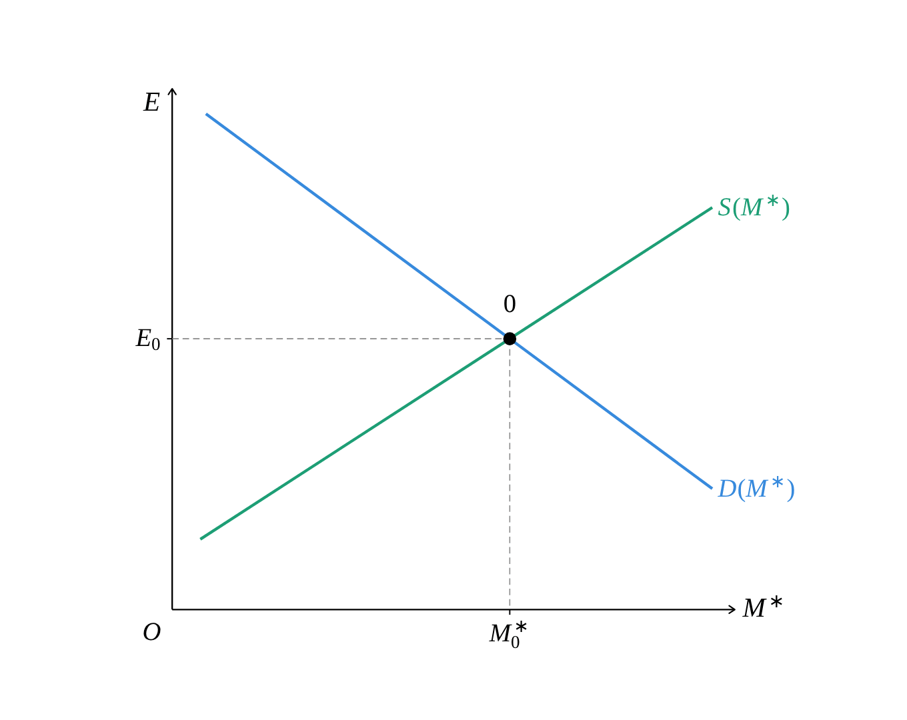

## Introducción



El tema se ocupa del mercado de divisas como mercado, es decir, de quién opera en él, con qué contratos y con qué grado de eficiencia. Su negociación es descentralizada y extrabursátil, no se interrumpe durante los días laborables, se canaliza a través de bancos creadores de mercado y plataformas electrónicas y está muy concentrada, pues el dólar interviene en el 89,2 % de las operaciones (BIS, 2025). Sus buenas prácticas descansan, sobre todo, en un código de adhesión voluntaria, el Código Global de Conducta del mercado de divisas (2017).

El tema estudia el mercado de divisas según el esquema siguiente:

- *Concepto, características y agentes*: concepto de mercado de divisas, sus características y los agentes que operan en él.

- *Instrumentos y operaciones*: los contratos que se negocian y las operaciones que se hacen con ellos.

- *Eficiencia y regulación*: la eficiencia del mercado de divisas y su regulación.

## 1. Mercado de divisas: concepto, características y agentes

El estudio del mercado parte de lo que en él se negocia, la divisa, y de su precio, el tipo de cambio, para describir después cómo funciona y quiénes operan en él.

### 1.1. Divisa y tipo de cambio

El **mercado de divisas** es el marco organizativo en el que agentes de todo el mundo intercambian moneda extranjera y en el que se forma su precio, el tipo de cambio. Conviene precisar antes ambos conceptos.

#### 1.1.1. Concepto de divisas

**Definición**: las *divisas* son los medios de pago denominados en moneda extranjera que se aceptan con carácter general para saldar operaciones internacionales. En sentido amplio, además de los billetes y monedas extranjeros de curso legal, incluyen los depósitos bancarios denominados en moneda extranjera y los documentos que dan derecho a disponer de ellos (p. ej. cheques, talones o tarjetas de crédito)[^b13-1]. No incluyen, en cambio, los instrumentos de deuda en moneda extranjera.

**Tipos**: por su grado de convertibilidad, se distinguen tres clases de divisas:

1. *Plenamente convertibles*: se intercambian sin restricciones, al contado (*spot*) y a plazo (*forward*), tanto si el tipo de cambio lo fija el mercado como si lo fija la autoridad. Son ejemplos de esta clase:

    - *Majors*[^b13-2]: las cinco principales, el dólar estadounidense, el euro, el yen, la libra esterlina y el franco suizo (USD, EUR, JPY, GBP y CHF).

    - *Minors*: el dólar canadiense, el australiano y el neozelandés (CAD, AUD y NZD), a los que se suman las tres coronas escandinavas.

    - *Exóticas*: algunas de ellas (p. ej. el peso mexicano o el *rand* sudafricano).

2. *Parcialmente convertibles*: la conversión está limitada a ciertas operaciones[^b13-22] o a ciertos agentes, con el renminbi chino[^b13-3] como ejemplo paradigmático. Según quién pueda convertir libremente la moneda, se habla de dos variantes:

    - *Convertibilidad externa*: solo la tienen los no residentes.

    - *Convertibilidad interna*: solo la tienen los residentes.

3. *No convertibles* (*blocked currencies*): los controles de cambio impiden cambiarlas libremente, así que la moneda circula solo en las transacciones internas y no se negocia abiertamente en el mercado de divisas.

Algunos de los motivos por los cuales puede imponerse la no convertibilidad son las dificultades de balanza de pagos, el temor a que se produzcan fugas masivas de capitales hacia ubicaciones *offshore* o la elevada volatilidad debida a la especulación.

Sin llegar a ese extremo, el real brasileño, el peso argentino o la rupia india tienen restringida la plena convertibilidad por razones históricas, por lo que buena parte de su negociación exterior se articula mediante instrumentos *non-deliverable*.

#### 1.1.2. Concepto de tipo de cambio

**Definición**: el *tipo de cambio* es el precio relativo de un par de monedas (p. ej. USD/EUR). La primera moneda es la moneda base (*base currency*) y la segunda moneda es la moneda de cotización (*quote currency*). Obsérvese que esta notación de mercado sigue el orden opuesto al de la notación algebraica (cociente) que emplea el libro, pues el par USD/EUR expresa euros por dólar, es decir, $\text{EUR}/\text{USD}$ en forma de cociente.

**Tipos**: a partir de esta definición se distinguen cuatro:

1. *Tipo de cambio nominal* ($E$): es el precio relativo o tasa de cambio de dos monedas y, por tanto, no tiene en cuenta su poder adquisitivo. Se distinguen tres cotizaciones, dos según que la moneda base sea la extranjera o la nacional y una tercera entre dos monedas extranjeras:

    - *Tipo de cambio directo o continental*: precio de una unidad de moneda extranjera expresado en moneda nacional, $E = M/M^*$ ($\uparrow E \rightarrow$ depreciación). Este tema y el resto del libro siguen esta convención.

    - *Tipo de cambio inverso o americano*: precio de una unidad de moneda nacional expresado en moneda extranjera, $1/E = M^*/M$ ($\uparrow 1/E \rightarrow$ apreciación). El *Financial Times*, por ejemplo, utiliza esta cotización.

    - *Tipo de cambio cruzado*: el tipo de cambio entre dos monedas en el que ninguna de ellas es la moneda del país, obtenido a partir de las cotizaciones de ambas frente a una tercera moneda vehicular (generalmente, el dólar).

2. *Tipo de cambio real* ($e$): corrige el tipo nominal por los niveles de precios de los dos países y mide cuántas unidades de bienes nacionales cuesta una unidad de bienes extranjeros, $e = E \cdot (P^*/P)$[^b13-5].

3. *Tipo de cambio efectivo nominal*: promedio geométrico de los tipos nominales bilaterales frente a los socios comerciales, ponderados por la importancia de cada uno en el comercio del país.

Por ejemplo, el BCE publica índices de tipos de cambio efectivos nominales del euro frente a tres grupos de socios comerciales, cuya composición se ajusta con cada ampliación de la zona del euro (la última, la entrada de Bulgaria en enero de 2026):

- *Grupo estrecho* (TCE-12): frente a los principales socios comerciales.

- *Grupo ampliado* (TCE-17): añade al anterior otros socios relevantes, como China y varios Estados miembros de la UE ajenos a la zona del euro.

- *Grupo amplio* (TCE-40): añade un conjunto más extenso de países y es el índice de referencia del BCE.

4. *Tipo de cambio efectivo real*: resulta de multiplicar el tipo de cambio efectivo nominal, en cotización directa, por una media ponderada de precios o costes externos (p. ej. costes laborales unitarios) relativa a los precios o costes del propio país, como en $e = E \cdot (P^*/P)$. Los índices que publican el BCE y el FMI usan, sin embargo, la cotización inversa, de modo que en ellos un aumento indica apreciación (véase el tema [A30](a30-magnitudes-cn.qmd)).

### 1.2. Características del mercado de divisas

El mercado de divisas abarca tanto la infraestructura física como el conjunto de instituciones necesarias para negociar. Desde el punto de vista descriptivo, ha experimentado una gran transformación y hoy presenta los siguientes rasgos:

**Dimensión**: además de ser el mayor del mundo (véase la introducción), es un mercado profundo y líquido. Es también intertemporal, pues tiene un segmento de operaciones *spot* (entrega prácticamente inmediata) y otro de operaciones *forward* (entrega a plazo).

**Composición y estructura**:

- *Concentración*: pocas divisas y pocas plazas reúnen la mayor parte del volumen, según la encuesta trienal del BIS de 2025:

    - *Por divisas*: el dólar, presente en el 89,2 % de las operaciones, representa el 44,6 % del volumen negociado[^b13-7]. A distancia se sitúan el euro, con el 14,5 %, y el yen, con el 8,4 %.

    - *Por ubicación geográfica*: el 38 % de la negociación se realiza en el Reino Unido y el 19 %, en EE. UU.

- *Carácter interbancario*: la negociación se desarrolla sobre todo entre bancos y otras instituciones financieras, que concentran en torno al 95 % del volumen según la encuesta trienal del BIS de 2025. Las operaciones con clientes no financieros, más ligadas al comercio y la inversión real, son, por el contrario, una fracción mínima (el reparto por agentes se detalla en el apartado 1.3).

**Regulación y funcionamiento**:

- *Mercado OTC*: se trata de un mercado no organizado u *over-the-counter* (OTC), descentralizado, sin cámara de compensación y con contratos a medida[^b13-10].

- *Mercado continuo*: la negociación no se interrumpe en todo el día porque se desplaza con los husos horarios. Empieza en Asia (Tokio y Hong Kong), pasa por Oriente Medio (Baréin) a Europa (Fráncfort y Londres) y acaba en América (Nueva York y San Francisco), donde enlaza con la apertura asiática siguiente. Como las sesiones se solapan, el arbitraje entre plazas mantiene una única cotización.

**Infraestructura y tecnología**: la innovación financiera ha automatizado casi todo el ciclo de una operación, que descansa en tres tipos de sistemas:

- *Sistemas de información*: difunden en tiempo real los precios y las noticias que mueven el mercado. Las plataformas más extendidas son LSEG Workspace (heredera de Refinitiv Eikon, antes Reuters) y Bloomberg.

- *Sistemas de casación automática*: emparejan electrónicamente las órdenes de compra y de venta de cualquier plaza sin intervención de un operador. La negociación electrónica interbancaria al contado se concentra en EBS (integrado hoy en CME Group) y en LSEG FX Matching (antiguo Reuters Matching).

- *Sistemas de compensación y liquidación*: en algunos mercados y para parte de las operaciones, los sistemas de pago y compensación, como CHIPS en EE. UU. o T2 (antes TARGET2) en la zona del euro, limitan el riesgo de contrapartida. Específicamente para las divisas, el sistema CLS (Continuous Linked Settlement, 2002) elimina el riesgo de liquidación (el llamado *riesgo Herstatt*) mediante el mecanismo de pago contra pago.

### 1.3. Agentes que participan en el mercado de divisas

Históricamente, los participantes en el mercado de divisas eran comerciantes de bienes y servicios. Sin embargo, la liberalización de los mercados de capitales del s. XX y la innovación financiera han dado lugar a la participación de un número mucho mayor de agentes.

#### 1.3.1. Creadores de mercado (*market makers* o *dealers*)

Los **creadores de mercado** (*market makers* o *dealers*) son típicamente grandes bancos comerciales e instituciones financieras encargadas de proveer liquidez a los mercados[^b13-12]. Dicho de otro modo, garantizan un volumen de intercambios suficiente para que los demás participantes operen de manera continuada, y actúan por ello como mayoristas.

Su remuneración procede de las comisiones y del diferencial (*spread*) entre el precio al que el creador de mercado compra (*bid*) y el precio al que vende (*ask*).

La encuesta trienal del BIS recoge los datos de más de 1100 *dealers* declarantes de 52 jurisdicciones, pero la creación de mercado está en manos de unos pocos grandes bancos, entre ellos BNP Paribas, Deutsche Bank o UBS. Según la encuesta trienal del BIS de 2025, los *dealers* declarantes representan en torno al 46 % del volumen de negocio, algo menos que el 47 % de 2022 y más que el 38 % de 2019[^b13-14].

#### 1.3.2. Corredores o intermediarios de mercado (*brokers*)

Los **intermediarios** o *brokers* ponen en contacto a los creadores de mercado con quienes quieren comprar o vender divisas. Facilitan la liquidez sin proveerla, porque no operan por cuenta propia ni mantienen nunca una **posición abierta**, es decir, una operación con ganancias o pérdidas todavía no realizadas (en una posición cerrada ya se han materializado).

Como no asumen riesgo, a diferencia de los *dealers*, solo ingresan comisiones o, en su lugar, un margen fijo de puntos sobre el *spread* natural del mercado (Anexo A.1). Reciben a la vez las cotizaciones de compra (*bid*) y de venta (*ask*) de muchos *dealers* y trasladan a cada cliente la más favorable, de modo que también los inversores pequeños operan a precios que por su cuenta no obtendrían.

#### 1.3.3. Resto de agentes: instituciones financieras no creadoras y agentes no financieros

Tradicionalmente, los agentes privados que acudían al mercado de divisas en busca de liquidez eran las **instituciones financieras no creadoras de mercado** y las **sociedades no financieras**. No obstante, en los últimos años se ha incorporado un elevado número de operadores minoristas y de empresas de negociación algorítmica por cuenta propia (*proprietary trading firms*, PTF).

**Instituciones financieras**: las no creadoras de mercado concentran en torno al 50 % de las operaciones en 2025 (frente al 55 % de 2019). Su composición es diversa, pues en el lado privado figuran bancos comerciales y de inversión, fondos de pensiones, aseguradoras y *hedge funds*, y en el oficial, bancos centrales y fondos soberanos.

Las instituciones privadas operan en el mercado de divisas para invertir en el exterior y diversificar sus carteras, para cubrir el riesgo de cambio de esas inversiones y, en el caso de los *hedge funds*, para tomar posiciones especulativas.

Las instituciones oficiales apenas suman en torno al 1 % de las operaciones. Aun así, los bancos centrales influyen en el mercado por sus funciones de regulación, supervisión y señalización. Sus compras y ventas solo alcanzan un volumen relevante en episodios puntuales, como las intervenciones de Japón en 2010-2011, 2022, 2024 y 2026. Al estar ligada sobre todo a la política cambiaria, su actuación varía según el régimen cambiario.

**Agentes no financieros**: incluyen, sobre todo, a las sociedades no financieras y a los Gobiernos, así como a los inversores minoristas o particulares, y representan en torno al 5 % restante de las operaciones. Los inversores minoristas, históricamente irrelevantes, han ganado peso con las plataformas de agregación minorista (*retail aggregators*).

### 1.4. Conclusiones

La divisa sirve de medio de pago en las transacciones internacionales y su convertibilidad va de la plena a la nula. Su precio, el tipo de cambio, admite cotizaciones nominales, reales y efectivas. El mercado en que se negocia, el mayor del mundo, es OTC, continuo y muy informatizado, y se concentra en el dólar, en el Reino Unido y en las operaciones entre instituciones financieras. La concentración alcanza también a los agentes, entre los que unos pocos grandes bancos actúan como creadores de mercado, que proveen liquidez y asumen riesgo a cambio del *spread*, mientras que los *brokers* median sin tomar posiciones abiertas. Las demás instituciones financieras privadas acuden al mercado para invertir, cubrirse o especular. Los bancos centrales, en cambio, influyen por sus funciones de regulación y señalización, con un volumen de operaciones pequeño.

Entendido qué se negocia, dónde y quién lo hace, la sección 2 estudia primero los instrumentos, que son las herramientas de las operaciones, y después las operaciones mismas.

## 2. Instrumentos y operaciones

La sección presenta los instrumentos, del contado a las opciones, y las operaciones de obtención de liquidez, cobertura, arbitraje, especulación e intervención oficial. Los instrumentos son esencialmente contratos entre las partes. Desde el punto de vista histórico, se distinguen los instrumentos tradicionales (el contado y el plazo, tan antiguos como el propio comercio internacional) y los instrumentos fruto de la innovación financiera desarrollada desde la década de los setenta, que operó en dos vertientes:

**Innovación de proceso**: las telecomunicaciones y la informática abarataron y aceleraron las operaciones, y con ello integraron las distintas plazas en un mercado mundial.

**Innovación de producto**: la libertad de movimientos de capitales trajo necesidades nuevas de cobertura y de financiación, a las que respondieron instrumentos como los *swaps* y las opciones.

En todos los casos, los porcentajes de volumen se refieren a la cuota de cada instrumento sobre el volumen medio diario negociado en el mercado mundial de divisas[^b13-19].

### 2.1. Instrumentos

En el mercado se negocian cinco instrumentos, de la compraventa al contado a los derivados. Son los contratos *spot*, los de futuros y a plazo, los *swaps* de tipos de cambio, los *swaps* de divisas y las opciones.

::: {.callout-note appearance="simple" icon=false}
El concepto, el mecanismo, la valoración y las estrategias de futuros, *forwards*, opciones y *swaps* se desarrollan en el tema [B25](b25-derivados.qmd), secciones 1 a 3. Aquí se recoge solo lo propio del mercado de divisas: el peso de cada instrumento, su uso en las operaciones con divisas y los FX *swaps*, instrumento característico de este mercado que el tema B25 solo resume.
:::

#### 2.1.1. Contratos *spot* (31 % del volumen)

El cambio de monedas al contado es tan antiguo como el comercio entre comunidades monetarias distintas, de los cambistas medievales a la banca moderna. Sin embargo, el mercado *spot* contemporáneo, interbancario y continuo, se articuló con el telégrafo. Así, el primer cable trasatlántico duradero (1866) permitió al tipo de cambio GBP/USD cotizar simultáneamente en Londres y Nueva York, y de ahí que el par libra-dólar se siga denominando *cable*.

**Definición**: los contratos *spot* o al contado son acuerdos de compraventa entre dos partes para su ejecución inmediata. Pactada la operación en *t*, la liquidación (*settlement*), es decir, el pago y la entrega de las divisas, se produce en la fecha *spot*, por lo general en *t+2* como máximo.

**Tipos**: el contado no tiene modalidades propias y solo se distingue por la fecha valor, que puede ser el mismo día de la contratación (*t*), el día hábil siguiente (*t+1*) o la fecha *spot* estándar (*t+2*). La encuesta del BIS computa las tres como contado[^b13-20].

**Funcionamiento**: son los contratos de compraventa de divisas más sencillos y se negocian en el segmento *spot* del mercado. En el segmento interbancario, la negociación electrónica se concentra en los sistemas de casación automática (EBS y LSEG FX Matching), y la liquidación puede hacerse por pago contra pago en CLS (apartado 1.2). Los contratos *spot* representan en torno al 31 % del volumen y se utilizan sobre todo en operaciones comerciales y de obtención de liquidez.

**Conclusiones**:

- *Aspectos positivos*: su sencillez y la entrega inmediata los convierten en el instrumento natural para disponer de la divisa en el momento en que se necesita.

- *Limitaciones*: no protegen frente a la variación del tipo de cambio de los cobros y pagos aplazados, cuya cobertura exige el segmento *forward*. Si las dos monedas no se entregan a la vez, los contratos *spot* exponen además al riesgo de liquidación (riesgo Herstatt), que elimina CLS.

#### 2.1.2. Contratos de futuros (*futures*) y contratos a plazo (*forward*) (19 % del volumen)

Los acuerdos de entrega futura a precio pactado son antiquísimos, y sus antecedentes como mercados organizados (Ámsterdam en el s. XVII, Dōjima en 1730) se recogen en el tema [B25](b25-derivados.qmd), apartado 1.1.1. Para el mercado de divisas, el hito es 1972, cuando el CME (Chicago Mercantile Exchange) creó el IMM (International Monetary Market), cuyos futuros sobre divisas fueron los primeros futuros financieros.

**Definición**: a diferencia de los contratos *spot*, los futuros y los *forwards* fijan hoy el precio y la obligación de una compraventa de divisas en una fecha futura.

**Tipos**: según el mercado en que se negocian, se distinguen dos, cuyo concepto, mecanismo y diferencias se desarrollan en el tema [B25](b25-derivados.qmd), apartados 1.1.1 a 1.1.3:

- *Futuros*: contratos estandarizados que se negocian en mercados organizados con cámara de compensación.

- *Forwards*: contratos bilaterales y a medida que se negocian en mercados OTC.

**Funcionamiento**: el tipo de cambio pactado, el tipo *forward*, refleja el diferencial de intereses entre las dos monedas (paridad cubierta de intereses). Dado el carácter OTC del mercado de divisas, en él domina el *forward*, con en torno al 19 % del volumen que mide la encuesta del BIS. Los futuros sobre divisas, negociados en mercados organizados (p. ej. el CME) y ajenos a esa encuesta, suponen, en cambio, una fracción marginal. Los *forwards* se utilizan sobre todo para cobertura y especulación.

**Conclusiones**:

- *Aspectos positivos*: fijan hoy el tipo de cambio de un cobro o pago futuro y eliminan el riesgo de cambio con más eficacia que las opciones, sin exigir prima.

- *Limitaciones*: obligan a liquidar al tipo pactado aunque el tipo de cambio evolucione favorablemente. Los *forwards*, bilaterales y sin cámara de compensación, conservan además el riesgo de contrapartida, y los futuros exigen márgenes y liquidación diaria de pérdidas.

#### 2.1.3. Contratos de *swaps* de tipos de cambio (Forex o FX *swaps*) (42 % del volumen)

Los FX *swaps* se generalizaron como instrumento interbancario de gestión de la liquidez y la financiación en divisas tras el colapso de Bretton Woods y la generalización de la flotación (1973), y su uso se multiplicó con la globalización financiera de las décadas siguientes.

**Definición**: los *swaps de tipos de cambio* son contratos de permuta entre dos partes con dos patas de intercambio acordadas simultáneamente:

- *Spot* o *near leg*: una parte compra a la otra, o le vende, una cantidad de divisas al tipo *spot* del día.

- *Forward* o *far leg*: en la fecha pactada, las partes deshacen ese intercambio por la misma cantidad al tipo *forward* que fijaron al contratar.

**Tipos**: según la fecha de la pata cercana, la encuesta del BIS distingue los *swaps spot/forward*, con esa pata al contado, y los *forward/forward*, con las dos patas a plazo. Incluye también los *swaps* a muy corto plazo (*overnight*, *tomorrow/next*, *spot/next*), con los que se renuevan de un día para otro las posiciones de contado[^b13-21].

**Funcionamiento**: económicamente, un FX *swap* equivale a un préstamo garantizado, en el que cada parte presta temporalmente su moneda y recibe la otra como colateral. Con en torno al 42 % del volumen, es el instrumento más negociado del mercado y se utiliza, generalmente, en operaciones de cobertura, financiación y gestión de la liquidez en divisas. No debe confundirse con los *swaps* de divisas o *currency swaps*.

::: {.callout-tip collapse="true" appearance="simple" title="Ejemplo: un FX *swap* a seis meses"}
Scotiabank (un banco canadiense) necesita euros y un banco de la zona del euro necesita dólares canadienses. Ambos acuerdan usar un *swap* de tipo de cambio con vencimiento a seis meses. La pata *spot* se fija en 1 M€ por 1,25 M\$CA, es decir, CAD/EUR = 0,8. La pata *forward* se fija en 0,79 CAD/EUR, tipo *forward* que refleja el diferencial de intereses entre ambas monedas (paridad cubierta de intereses).

Así, hoy, Scotiabank recibe 1 M€ del banco de la zona del euro y le entrega 1,25 M\$CA y, en seis meses, Scotiabank devuelve 1 M€ y recibe 1,27 M\$CA (1 M€ · (1/0,79) = 1,2658 M\$CA), lo cual le permite cubrir el riesgo de cambio.
:::

**Conclusiones**:

- *Aspectos positivos*: como préstamo garantizado, apenas presenta riesgo de crédito, y combina en una sola operación la cobertura y la obtención de liquidez temporal en la otra divisa.

- *Limitaciones*: subsisten el riesgo de reposición, si la contraparte incumple antes de la pata *forward* y hay que rehacer la operación a los precios del momento, y el de liquidación, hoy mitigado por sistemas como CLS.

#### 2.1.4. Contratos de *swaps* de divisas (*currency swaps*) (2 % del volumen)

El antecedente de los *swaps* de divisas son los préstamos paralelos (*parallel loans*) con los que las empresas sorteaban los controles de cambios británicos en los años setenta. El primer *currency swap* moderno, entre IBM y el Banco Mundial en 1981, se describe en el tema [B25](b25-derivados.qmd), apartado 3.1.

**Definición**: los *swaps de divisas* son contratos de permuta en los que las partes se pagan intereses en monedas distintas durante el plazo pactado y, por lo general, intercambian los principales al vencimiento a un tipo de cambio fijado de antemano. A diferencia de los FX *swaps*, en los que el diferencial de intereses queda incorporado en el tipo de la pata *forward*, en ellos sí hay pagos periódicos de intereses.

**Tipos**: como el interés de cada moneda puede ser fijo o variable, caben tres combinaciones, fijo contra fijo, fijo contra variable y variable contra variable, que el tema [B25](b25-derivados.qmd) recoge en el apartado 3.1.1.

**Funcionamiento**: su uso típico es el de una empresa que se endeuda en su moneda y permuta los flujos para financiarse en otra. El tema [B25](b25-derivados.qmd) ilustra ese caso en el apartado 3.1 y desarrolla su valoración en el 3.2. En comparación con los FX *swaps*, los *swaps* de divisas, de mayor plazo, representan apenas en torno al 2 % del volumen negociado.

**Conclusiones**:

- *Aspectos positivos*: como los FX *swaps*, eliminan el riesgo de cambio, en su caso el de una financiación a más largo plazo en otra moneda, pues el tipo de cambio al que se devuelven los principales se fija de antemano.

- *Limitaciones*: a diferencia de los FX *swaps*, presentan un riesgo de impago apreciable.

#### 2.1.5. Contratos de opciones (7 % del volumen)

Las primeras opciones sobre divisas cotizadas se listaron en la Bolsa de Filadelfia (PHLX) en 1982, y el mercado OTC se desarrolló durante esa misma década, apoyado en la adaptación del modelo de Black-Scholes a las divisas realizada por Garman y Kohlhagen (1983).

**Definición**: una opción sobre divisas da a quien la compra el derecho, sin obligación alguna, de comprar o de vender una divisa a un tipo de cambio pactado, el precio de ejercicio (*strike price*), en una fecha determinada o hasta ella (vencimiento).

**Tipos**: según el derecho que otorgan, se distinguen dos, a los que se suman modalidades más complejas (sus tipos, su mecanismo y su valoración se desarrollan en el tema [B25](b25-derivados.qmd), apartados 2.1 y 2.2):

- *Call* (opción de compra): da derecho a comprar la divisa al precio de ejercicio.

- *Put* (opción de venta): da derecho a venderla al precio de ejercicio.

- *Otras opciones*: las *average rate options*, las *barrier options*, los *swaptions* de divisas y los *currency warrants*.

**Funcionamiento**: a cambio del derecho, el comprador paga una prima y ejerce la opción solo si el tipo de cambio evoluciona a su favor. Las opciones representan en torno al 7 % del volumen (incluidas las modalidades más complejas), frente al 4 % de 2022. Su volumen se ha más que duplicado en el último trienio, impulsado por la volatilidad cambiaria. Como los *forwards*, se utilizan sobre todo para cobertura y especulación.

**Conclusiones**:

- *Aspectos positivos*: protegen frente a una evolución desfavorable del tipo de cambio sin renunciar a la favorable, pues no obligan a ejercer.

- *Limitaciones*: exigen el pago de una prima y cubren el riesgo con menos eficacia que los *forwards* y los futuros, porque generan ratios de cobertura volátiles.

### 2.2. Operaciones

Vistos los instrumentos, queda por estudiar qué operaciones realizan con ellos los agentes. Las operaciones se clasifican según dos criterios.

**Según la fecha de entrega de la divisa**:

- *Operaciones al contado o spot*: con entrega en un máximo de dos días hábiles (*t+2*), se realizan en el segmento *spot* del mercado apoyándose en los contratos al contado.

- *Operaciones a plazo o forward*: con entrega posterior a *t+2*, se realizan en el segmento *forward* mediante *forwards*, *swaps* y opciones, y concentran el resto del volumen. Su peso se ha mantenido relativamente estable, en torno a dos tercios del volumen, en las dos últimas décadas.

**Según su fin**: se distinguen cinco categorías, que estructuran el resto de la sección:

- *Obtención o disposición de liquidez*: ligadas a la actividad comercial y de inversión internacional.

- *Cobertura*: cierran posiciones abiertas para eliminar el riesgo cambiario.

- *Arbitraje*: explotan sin riesgo los desajustes transitorios de precios y rentabilidades.

- *Especulativas*: toman posiciones abiertas sobre la base de expectativas, a cambio de asumir riesgo.

- *Oficiales*: mediante ellas, las autoridades monetarias intervienen en el mercado.

#### 2.2.1. Operaciones de obtención o disposición de liquidez

**Definición**: las *operaciones de obtención o disposición de liquidez* son las más elementales del mercado. Son compraventas de divisa cuyo fin, transaccional y no financiero, es disponer de la moneda extranjera necesaria para atender pagos (o convertir a moneda nacional los cobros recibidos en divisa). Constituyen la función original del mercado de divisas, la que lo conecta con la economía real.

**Tipos**: según su motivo, se distinguen dos:

- *Actividad comercial*: la necesidad de divisa por parte de una sociedad no financiera en el curso de su actividad comercial internacional.

- *Repatriación*: la necesidad de repatriar fondos denominados en divisa, tanto por parte de sociedades no financieras como financieras.

**Funcionamiento**: estas operaciones persiguen obtener liquidez inmediata en divisa en el segmento *spot* del mercado, donde se realizan las compraventas. La dinámica entre los agentes de este segmento se ilustra con un modelo sencillo de balanza de pagos en el plano $(M^*, E)$, con la cantidad de divisas en el eje horizontal y el tipo de cambio directo en el vertical (figura -@fig-b131-mercado-divisas):

1. *Demanda de divisas*, $D(M^*)$: la generan las importaciones de bienes y servicios y las inversiones en el exterior (p. ej. inversión directa), que exigen disponer de divisa. Tiene pendiente negativa en el plano $(M^*, E)$ porque una depreciación de la moneda nacional ($\uparrow E$) encarece lo importado, reduce las compras al exterior y, con ellas, las divisas que se piden.

2. *Oferta de divisas*, $S(M^*)$: la generan las exportaciones y las entradas de inversión extranjera, cuyos perceptores quieren convertir en moneda nacional la divisa recibida. Tiene pendiente positiva si la demanda extranjera de exportaciones es elástica, porque entonces una depreciación ($\uparrow E$) eleva el volumen exportado en mayor proporción de lo que baja su precio en divisas, y crecen los ingresos en divisa que se ofrecen.

3. *Equilibrio*: en el punto 0, donde se cortan ambas curvas, la interacción de las dos fuerzas fija el tipo de cambio, $E_0$, y el volumen de divisas intercambiado, $M^*_0$. Si el equilibrio es estable[^b13-23], a un tipo de cambio superior a $E_0$ la oferta de divisas excede a la demanda y la moneda nacional se aprecia hasta volver al punto 0, mientras que a un tipo inferior el exceso de demanda la deprecia.

::: {#fig-b131-mercado-divisas}

::: {.content-visible when-format="html"}
```{=html}
<div class="graph-frame">
<iframe src="../graphs/b131_Mercado_divisas.html" style="height:560px" loading="lazy" title="fig-b131-mercado-divisas"></iframe>
</div>
```
:::

::: {.content-visible unless-format="html"}

:::

Equilibrio en el mercado de divisas. La oferta y la demanda de divisas determinan el tipo de cambio nominal $E_0$ y la cantidad de divisas intercambiada $M^*_0$.
:::

**Conclusiones**:

- *Aspectos positivos*: este tipo de operaciones son sencillas y permiten obtener la liquidez en el momento necesario.

- *Limitaciones*: muchos flujos comerciales internacionales suponen un intercambio aplazado y se puede incurrir en un riesgo de cambio. Por ejemplo, un exportador europeo que cierra hoy una venta por 1 M de dólares, que cobrará dentro de un año, queda expuesto hasta entonces a las fluctuaciones del tipo de cambio dólar-euro. Ese riesgo puede cubrirse con los instrumentos del segmento *forward*.

#### 2.2.2. Operaciones de cobertura

**Definición**: las *operaciones de cobertura* buscan mitigar el riesgo cambiario adoptando una posición contraria a la posición abierta. Para ello, el agente acude al segmento *forward* y lleva a cabo una cobertura mediante alguno de los instrumentos anteriores[^b13-24].

**Tipos**: según el instrumento, se distinguen tres:

- *Con contratos a plazo*: lo más habitual es utilizar un *forward* de divisas[^b13-25]. En el ejemplo del exportador, cabe distinguir dos posiciones:

    - *Exportador*: puede vender un *forward* para asegurarse un precio de venta fijo (el tipo *forward*) dentro de un año. En el plano tipo de cambio *spot*-beneficio, la función de beneficios de la posición *forward* es decreciente en el tipo de cambio *spot*, es decir, la posición pierde con la depreciación del euro ($\uparrow E$).

    - *Importador*: compra, en cambio, un *forward* para fijar de antemano su precio de compra. La función de beneficios de su posición es creciente en el tipo de cambio *spot*, porque una depreciación del euro encarece la divisa que debe comprar y revaloriza el compromiso de comprarla al tipo pactado.

- *Con* swaps *de tipos de cambio*: los FX *swaps* combinan en una sola operación una pata *spot* y una pata *forward* de signo contrario. Se emplean cuando, además de cubrirse, el agente necesita liquidez temporal en la otra divisa o quiere desplazar en el tiempo (*roll over*) una cobertura ya contratada.

- *Con opciones*: la estrategia básica consiste en adoptar una posición protectora frente a la posición primaria. Así, el importador compra una *call* para cubrir el riesgo de apreciación de la divisa, es decir, de depreciación de la moneda nacional, y el exportador, una *put* para cubrir el de depreciación de la divisa. Las estrategias más elaboradas, complejas o de diferenciales, se desarrollan en el tema [B25](b25-derivados.qmd), apartado 2.3.

**Funcionamiento**: las operaciones de cobertura son juegos de suma cero, pues la ganancia del agente que se cubre es la pérdida de su contraparte (véase el tema [B25](b25-derivados.qmd), apartado 1.1.2). La cobertura perfecta exige que la cantidad, la fecha y el par de divisas sean idénticos, para que la posición en el segmento *forward* “case” perfectamente con la posición *spot*.

**Conclusiones**:

- *Aspectos positivos*: permiten eliminar el riesgo de cambio y reducen la incertidumbre en cuanto a los flujos de caja futuros. Todo ello, a su vez, facilita el acceso al crédito en los mercados financieros y puede ayudar a la planificación empresarial. Las operaciones de cobertura han aumentado desde la crisis financiera.

- *Limitaciones*: son operaciones más sofisticadas que pueden requerir más conocimientos técnicos y, en algunos casos, hacer frente a flujos de caja negativos importantes (p. ej. en el caso de los *forwards*).

#### 2.2.3. Operaciones de arbitraje o arbitraje *puro*: arbitraje espacial y paridad cubierta de intereses

**Definición**: las *operaciones de arbitraje* usan los mismos instrumentos para buscar beneficios. Son estrategias que aprovechan los desajustes transitorios en el valor de las divisas, dado por su tipo de cambio o por su rentabilidad. En sentido estricto, el arbitraje es sin riesgo (y autofinanciado), y se denomina frecuentemente *arbitraje puro*.

**Tipos**: el arbitraje puro, el arbitraje propiamente dicho, puede ser espacial, si explota diferencias de tipo de cambio entre plazas, o temporal, si explota diferencias de rentabilidad. En cambio, la expresión “arbitraje con riesgo”, heredada de la literatura clásica, designa en realidad una operación especulativa, pues quien la realiza toma una posición abierta sobre la base de sus expectativas. Por ello se estudia dentro de las operaciones especulativas, donde el término se conserva por su valor didáctico como puente entre ambas categorías.

**Arbitraje espacial sin riesgo o arbitraje puro espacial**: consiste en comprar una divisa en la plaza donde cotiza más barata y venderla en el mismo instante en otra donde cotiza más cara. Como las dos operaciones son simultáneas, en ningún momento queda una posición abierta ni se asume riesgo de cambio. La estrategia se limita al segmento *spot* y solo atiende al tipo de cambio nominal[^b13-29].

- *Supuestos*: el único relevante es la ausencia de costes de transacción. En su presencia, el arbitraje solo se activa cuando el diferencial de cotización supera dichos costes (una banda de no arbitraje en lugar de una igualdad exacta).

- *Funcionamiento*: el arbitraje espacial se lleva a cabo de dos formas, con condiciones ligeramente diferentes, y en ambas garantiza el cumplimiento de la ley del precio único en el plano espacial:

    - *Bilateral*: la operación implica dos plazas[^b13-30], dos monedas y su tipo de cambio. Existe oportunidad de arbitraje si $E^A \neq E^B$, es decir, si el tipo de cambio entre las monedas $M^*$ y $M$ en las plazas $A$ y $B$ no coincide. Su explotación conduce al equilibrio $E^A = E^B$, en el que la misma divisa cotiza igual en todas las plazas.

    - *Triangular*: la operación implica tres plazas[^b13-31], tres monedas y el tipo de cambio cruzado. Existe oportunidad si $E_{M'/M}^A \neq E_{M^*/M}^B \cdot E_{M'/M^*}^C$, y el equilibrio impone la coherencia de los tipos cruzados, $E_{M'/M}^A = E_{M^*/M}^B \cdot E_{M'/M^*}^C$, con la que desaparecen las oportunidades de arbitraje.

- *Conclusiones*:

    - *Aspectos positivos*: el arbitraje espacial hace que la ley del precio único se cumpla casi al instante. De hecho, con el desarrollo de las operaciones de alta frecuencia[^b13-33] y la negociación algorítmica, en el mundo real las posibilidades de llevar a cabo este tipo de arbitraje duran apenas milisegundos[^b13-35].

    - *Limitaciones*: con costes de transacción, la igualdad de cotizaciones solo se cumple dentro de una banda de no arbitraje, y la brevedad de las oportunidades las reserva a los operadores con sistemas de negociación algorítmica, capaces de explotar ventajas de latencia.

**Arbitraje temporal sin riesgo o arbitraje puro temporal: la condición de paridad cubierta de intereses (PCI)**: el tipo de cambio no agota el valor de una divisa. En sentido amplio, mantener riqueza en una moneda rinde además el tipo de interés de los depósitos denominados en ella. Puede compararse, entonces, la rentabilidad total de invertir en una u otra moneda, formada por el tipo de interés que cada una paga más la variación cambiaria entre el momento de la inversión y el del vencimiento. El arbitraje temporal aprovecha las diferencias entre ambas rentabilidades y elimina el riesgo de cambio mediante la contratación de un *forward*. Las operaciones que las explotan conducen a la paridad cubierta de intereses.

- *Supuestos*: agentes racionales (no es preciso suponer neutralidad al riesgo, pues la operación cubierta no entraña riesgo cambiario), que tienen en cuenta el tipo de cambio nominal y el tipo de interés nominal de los depósitos con vencimiento a un año. Se supone también perfecta movilidad de capitales (sin controles ni costes de transacción), cobertura *forward* total[^b13-37] y ausencia de endeudamiento o apalancamiento despreciable.

- *Funcionamiento*: un residente dispone de 1 u.m. nacional (p. ej. un euro) para colocarla un año en un depósito y puede elegir entre dos alternativas:

    - *Activo nacional*: el depósito en moneda nacional le devuelve al cabo del año $r_{\text{€}}^A = 1 \cdot (1+i)$ u.m. nacionales brutas.

    - *Activo extranjero*: la colocación en el exterior exige tres pasos:
        1. *Cambio*: hoy cambia su u.m. nacional al tipo *spot* vigente y recibe $1/E_t^s$ u.m. extranjeras.
        2. *Inversión*: deposita esa cantidad en el extranjero y al cabo del año dispone de $r_\$^B = (1/E_t^s)(1+i^*)$ u.m. extranjeras.
        3. *Conversión*: pasa ese importe a moneda nacional y obtiene $r_{\text{€}}^B = (E_{t+1}^s / E_t^s)(1+i^*)$.

- *Diferencial de rentabilidades*: *ex post*, vendrá dado por $r_{\text{€}} \equiv r_{\text{€}}^B - r_{\text{€}}^A \rightarrow r_{\text{€}} = (E_{t+1}^s / E_t^s)(1+i^*) - (1+i)$ (1). Si la rentabilidad bruta del depósito extranjero en moneda nacional es superior a la del depósito nacional, el diferencial es positivo y existen ganancias del arbitraje para el residente.

- *Aproximación*: la expresión se reduce[^b13-40] a $r_{\text{€}} \approx (E_{t+1}^s - E_t^s)/E_t^s + (i^* - i) \rightarrow r_{\text{€}} \approx g_E + (i^* - i)$ (2), donde $g_E$ es la tasa de depreciación observada de la moneda nacional (tasa de depreciación *ex post*).

- *Cobertura forward*: ahora bien, en el momento de invertir ($t$), el agente no conoce $E_{t+1}^s$. Si no quiere asumir riesgo cambiario, contratará hoy un *forward*[^b13-41] que le permita convertir su retorno futuro a un tipo predeterminado, el tipo de cambio *forward* o a plazo, $E_t^f$, obteniendo así una ganancia con cobertura total.

- *Margen forward*: en estas condiciones, la tasa de depreciación en (2) pasa a ser el margen *forward*, $\mu_f = (E_t^f - E_t^s)/E_t^s$, que indica el porcentaje en que el precio *forward* supera o está por debajo del precio *spot*. Así, si $\mu_f > 0$ la moneda nacional cotiza al descuento en el mercado *forward*[^b13-42], si $\mu_f < 0$ cotiza a premio y si $\mu_f = 0$ cotiza a la par. Existen, pues, oportunidades de arbitraje temporal sin riesgo cuando el diferencial de tipos de interés, $(i^* - i)$, difiere del margen *forward* con signo contrario ($r_{\text{€}} \neq 0$).

- *Ajuste hacia el equilibrio*: la explotación de estas ganancias se ilustra con dos casos, partiendo de una situación en la que ambas monedas cotizan a la par ($E_t^s = E_t^f$, $\mu_f = 0$):

    - *Depósito extranjero atractivo* ($i < i^* + \mu_f \rightarrow \Delta\mu_f < 0$): con un interés extranjero mayor que el nacional, a los residentes les conviene comprar hoy divisa y depositarla en el exterior. El rendimiento llegará en divisa, pero los residentes no necesitan esperar al tipo *spot* futuro para convertirlo, porque pueden fijar hoy su conversión con un *forward*. Las compras de divisa al contado deprecian la moneda nacional ($\uparrow E_t^s$) y reducen el margen *forward* ($\downarrow \mu_f$) hasta que desaparece el arbitraje sin riesgo ($r_{\text{€}} = 0$).

    - *Depósito nacional atractivo* ($i > i^* + \mu_f \rightarrow \Delta\mu_f > 0$): con un interés nacional mayor, son los no residentes quienes compran hoy moneda nacional y aseguran con un *forward* la conversión a divisa de su rendimiento, en un razonamiento simétrico al anterior. La moneda nacional se aprecia al contado ($\downarrow E_t^s$) y el margen *forward* sube ($\uparrow \mu_f$) hasta que el diferencial de rentabilidades se anula ($r_{\text{€}} = 0$).

- *Equilibrio*: en el límite, en ambos casos el diferencial de rentabilidades es nulo y se cumple la paridad cubierta de intereses, $r_{\text{€}} = 0 \leftrightarrow i = i^* + \mu_f$. Con ella, el arbitraje sin riesgo garantiza que se cumple la ley del precio único en el mercado de divisas, ahora en el plano temporal[^b13-44].

- *Conclusiones*:

    - *Aspectos positivos*: la evidencia empírica respalda la paridad cubierta, cuyo cumplimiento avanzó con la liberalización de capitales. Así, el Reino Unido y Japón aún mantenían controles en 1979, y a finales de los años ochenta la liberalización financiera había eliminado casi por completo los diferenciales cubiertos de intereses a corto plazo entre las principales economías industrializadas (Frankel, 1991). Hoy la negociación electrónica permite arbitrar con cobertura *forward* de forma continua y precisa. Por ello, en condiciones normales, una desviación de la paridad desaparece en pocos minutos (Akram, Rime y Sarno, 2008, y tema [B14](b14-tipo-cambio.qmd), apartado 1.3.5), salvo las desviaciones persistentes observadas desde 2008.

    - *Limitaciones*: antes de 2008, las desviaciones de la PCI se explicaban por los controles de cambio y los costes de transacción. Desde la crisis financiera de 2008, sin embargo, se observan desviaciones persistentes (la llamada base de los *swaps* de divisas o *cross-currency basis*), incluso entre monedas de economías avanzadas sin controles de capital. Se atribuyen a las restricciones de balance de los intermediarios tras la reforma regulatoria. En todo caso, el grado de cumplimiento de la paridad cubierta se sigue usando, hoy en día, como medida del grado de movilidad internacional del capital (más que medidas como la correlación inversión-ahorro o los diferenciales de tipos de interés reales).

#### 2.2.4. Operaciones especulativas: paridad descubierta de intereses, *carry trade*, especulación en el *forward* y *prop trading*

**Definición**: las *operaciones especulativas* asumen deliberadamente el riesgo de cambio y mantienen posiciones abiertas basadas en las expectativas del agente. En ellas desemboca el arbitraje temporal cuando no hay instrumentos *forward* (como en muchos países en desarrollo) o el agente decide asumir ese riesgo.

**Tipos**: se distinguen cuatro operaciones, que se presentan por orden de relevancia analítica. La primera es el arbitraje con riesgo, que da lugar a la paridad descubierta de intereses, central en la teoría del tipo de cambio. Siguen el *carry trade*, su explotación práctica más importante, la especulación con derivados y, por último, el *trading* propietario.

**Arbitraje con riesgo: condición de paridad descubierta de intereses (PDI)**: consiste en replicar la lógica del arbitraje temporal sin cobertura *forward*. El agente toma una posición abierta en la divisa que ofrece mayor rentabilidad esperada y asume el riesgo de cambio sobre la base de sus expectativas.

- *Supuestos*: los del arbitraje temporal, a los que se añade la neutralidad al riesgo (los agentes no exigen prima por invertir en un sitio o en otro), y las expectativas del agente sobre el tipo de cambio futuro sustituyen a la cobertura *forward*.

- *Funcionamiento*: quien no se cubre convierte su rendimiento al tipo *spot* que rija al vencimiento, que desconoce al invertir. Decide, por tanto, con el tipo *spot* esperado para esa fecha, $E_t^e \equiv \mathbb{E}_t[E_{t+1}^s]$, y la tasa de depreciación en (2) pasa a ser la esperada, $g_E^e = (E_t^e - E_t^s)/E_t^s$. Las oportunidades que surgen son de ganancia con riesgo, y su explotación conduce en teoría a la paridad descubierta de intereses por un mecanismo similar al anterior[^b13-45].

- *Equilibrio*: si se cumple la PDI, $\mathbb{E}_t[r_{\text{€}}] = 0 \leftrightarrow i = i^* + g_E^e$, el diferencial de rentabilidades esperadas es nulo y se han eliminado todas las oportunidades de ganancia con riesgo[^b13-46]. Su incumplimiento, en cambio, está estrechamente relacionado con el *puzzle* de Fama, paradoja del margen *forward* o anomalía de la prima *forward* (apartado 3.2). Implica, además, que es posible obtener ganancias asumiendo riesgos, en lo que se basan estrategias como el *carry trade*.

- *Conclusiones*:

    - *Aspectos positivos*: la paridad descubierta es la condición de equilibrio del mercado de divisas con la que trabajan las teorías de determinación del tipo de cambio (véase el tema [B14](b14-tipo-cambio.qmd)), lo que la convierte en la más relevante analíticamente de las condiciones de paridad.

    - *Limitaciones*: la evidencia empírica muestra que la PDI no se cumple a corto plazo, aunque tiende a cumplirse a horizontes largos (Chinn y Meredith, 2004). Por tanto, existen, por lo general, oportunidades de ganancia con riesgo en los mercados de divisas. El incumplimiento de la PDI puede deberse a tres causas, entre otras:
        - *Dificultad de predicción*: pese a los desarrollos tecnológicos, los agentes anticipan mal la evolución de los tipos de cambio.
        - *Aversión al riesgo*: con agentes aversos, invertir en el exterior solo compensa si la rentabilidad esperada supera la nacional en una prima, $\mathbb{E}_t[r_{\text{€}}^B] = r_{\text{€}}^A + \rho$.
        - *Expectativas sesgadas*: con datos de encuestas, Froot y Frankel (1989) no hallan prima de riesgo alguna en el sesgo de la prima *forward* y lo atribuyen a errores sistemáticos de expectativas. Esos errores pueden deberse a expectativas sesgadas o, aun siendo estas racionales, a que el suceso que el mercado esperaba no llega a producirse en la muestra, como en el caso de los *peso problems*[^b13-47].

**Arbitraje con riesgo y apalancamiento: el *carry trade***: consiste en tomar prestado en una divisa de tipo de interés bajo (divisa de financiación, p. ej. el yen) para invertir en activos de otra con tipo alto (divisa de destino, p. ej. el dólar). La estrategia explota de forma apalancada el incumplimiento sistemático de la PDI[^b13-48].

- *Supuestos*: la estrategia solo es rentable si la divisa de destino no se deprecia (frente a la de financiación) en la cuantía que la PDI predice, lo que exige que esta paridad no se cumpla en el horizonte de la inversión.

- *Funcionamiento*: el beneficio de la estrategia es el diferencial de intereses, $i^{\text{destino}} - i^{\text{financiación}}$, menos la depreciación observada de la divisa de destino. Mientras el tipo de cambio permanece estable, la estrategia rinde el *carry*. Sin embargo, su principal riesgo es el desmantelamiento súbito de posiciones (*unwinding*) ante episodios de aversión al riesgo, que provoca movimientos cambiarios bruscos y pérdidas amplificadas por el apalancamiento. En la jerga, el *carry trade* “sube por la escalera y baja en ascensor”.

- *Conclusiones*:

    - *Aspectos positivos*: la estrategia explota de forma sistemática el incumplimiento de la PDI a corto plazo. Por ello se ha aplicado durante décadas con el yen japonés como divisa de financiación, dados los tipos de interés muy reducidos de Japón, para comprar activos en dólares, euros o deuda emergente[^b13-50]. Análogamente, es común financiarse en países desarrollados para invertir en deuda de emergentes con rentabilidades más altas.

    - *Limitaciones*: el apalancamiento amplifica las pérdidas cuando un episodio de aversión al riesgo obliga a deshacer las posiciones. Ese riesgo se materializó en agosto de 2024. La subida de tipos del Banco de Japón a finales de julio, unida a unos datos de empleo estadounidenses peores de lo esperado, desencadenó un desmantelamiento masivo de posiciones de *carry* en yenes, con una apreciación abrupta de la divisa japonesa y turbulencias bursátiles globales.

**Especulación en el segmento *forward***: además de cubrir posiciones, los derivados permiten especular con posiciones abiertas (sin posición contraria en el subyacente asociada a una operación comercial) basadas en las expectativas cambiarias propias.

- *Supuestos*: el especulador confía en su expectativa sobre el tipo de cambio futuro y acepta el riesgo de la posición abierta. Su contraparte (p. ej. un agente que se cubre) toma la posición contraria, en un juego de suma cero.

- *Funcionamiento*: con expectativas bajistas (*bearish*) sobre la divisa, el especulador vende un *forward* (posición corta), cuyo beneficio es decreciente en el tipo *spot* al vencimiento, porque gana si este queda por debajo del tipo pactado. Con expectativas alcistas (*bullish*), lo compra (posición larga), con un beneficio creciente en el tipo *spot*. Los perfiles de ambas posiciones se representan en el tema [B25](b25-derivados.qmd), apartado 1.1.2.

- *Ejemplo*: el caso más conocido de especulación cambiaria en corto es el ataque de George Soros a la libra esterlina en 1992:

    - *Contexto*: Soros consideraba que la libra estaba sobrevalorada con respecto al marco alemán, dado que el Gobierno británico, del que dependía entonces el BoE (Bank of England), renunciaba a devaluarla por su pertenencia al Mecanismo de Cambios e Intervención (MCI) del Sistema Monetario Europeo (SME).

    - *Primera fase*: Soros tomaba prestado en libras y las vendía para comprar marcos, causando presión depreciatoria sobre la libra y apreciatoria sobre el marco, lo cual intensificaba la divergencia entre ambas monedas.

    - *Segunda fase*: Soros anticipaba que el BoE no podría soportar la divergencia, pues defender la paridad exigía mantener tipos de interés muy elevados (en línea con los del Bundesbank tras la reunificación alemana) en plena recesión británica. Con esa expectativa abrió una posición corta sobre la libra por valor de 10.000 M\$, a la que siguieron, por comportamiento de rebaño, otras posiciones cortas.

    - *Desenlace*: el BoE no pudo aguantar la presión depreciatoria. Así, el 16 de septiembre de 1992, el “miércoles negro”, el Reino Unido tuvo que abandonar el MCI del SME.

- *Conclusiones*:

    - *Aspectos positivos*: el especulador da contrapartida a los agentes que se cubren, pues asume el riesgo cambiario del que estos se desprenden, y con un *forward* puede tomar posición sobre sus propias expectativas sin pagar prima.

    - *Limitaciones*: la posición queda abierta a ganancias o pérdidas en un juego de suma cero, y el comportamiento de rebaño puede amplificar la presión sobre una paridad, como en 1992. Por ello, en la práctica, estas operaciones suelen articularse con alguna cobertura parcial mediante otro derivado.

**Negociación por cuenta propia (*prop trading*)**: consiste en la asunción directa de riesgos por parte de las instituciones financieras, que utilizan recursos propios (no de clientes) exclusivamente para operaciones especulativas, incluido el arbitraje con riesgo a gran escala. Esta práctica, también llamada *trading* propietario, abarca los mercados financieros en general, no solo los de divisas.

- *Conclusiones*:

    - *Aspectos positivos*: al incluir arbitraje con riesgo a gran escala, empuja las rentabilidades esperadas hacia la paridad descubierta y aporta liquidez a los mercados.

    - *Limitaciones*: es una práctica de elevado riesgo y, por lo general, menos transparente que otras, pues muchas instituciones no ofrecen información abierta sobre el volumen de su operativa propietaria. En los bancos ha perdido relevancia a raíz de la Gran Recesión (2008-2014), con la aparición de nueva regulación al respecto[^b13-52], aunque la han ganado las empresas de negociación algorítmica por cuenta propia (apartado 1.3.3).

#### 2.2.5. Operaciones oficiales: intervención directa e indirecta

::: {.callout-note appearance="simple" icon=false}
Sobre los regímenes cambiarios y la política de intervención, véase el tema [B15](b15-regimenes-cambiarios.qmd), y sobre la determinación del tipo de cambio, el tema [B14](b14-tipo-cambio.qmd).
:::

**Definición**: se habla de intervención cuando las autoridades monetarias actúan para influir en el tipo de cambio, como un operador más en el mercado de divisas o por otras vías. La intervención incluye medidas de distinto tipo (p. ej. anuncios, compraventas…) dirigidas a suavizar los vaivenes del tipo de cambio y a ganar credibilidad. Los controles de cambio también alteran los flujos de divisas, pero no son intervención, sino regulación (apartado 3.3.2).

La intervención también engloba la gestión de reservas, es decir, el proceso de garantizar que los activos en divisas o reservas exteriores de los que dispone el sector público tienen un volumen adecuado y están disponibles en el momento necesario. Las reservas son, en efecto, un seguro frente a *shocks* financieros y paradas súbitas (*sudden stops*) en el acceso a los mercados de capitales, así como un medio para mejorar la credibilidad de la política monetaria.

**Tipos**: la intervención puede ser directa o indirecta:

- *Intervención directa*: consiste en la compraventa de divisas contra moneda nacional en el mercado, con cargo a las reservas internacionales. Puede ser, a su vez, de dos tipos:

    - *Intervención esterilizada*: el banco central compensa el efecto de la operación sobre la base monetaria mediante operaciones de mercado abierto de signo contrario, de modo que la intervención altera la composición de los activos en manos del público, pero no la oferta monetaria.

    - *Intervención no esterilizada*: la operación se traslada íntegramente a la base monetaria, por lo que equivale, *de facto*, a una operación de política monetaria.

- *Intervención indirecta*: el banco central influye sobre el tipo de cambio sin operar directamente en el mercado de divisas. Puede hacerlo por dos vías:

    - *Política monetaria*: variaciones del tipo de interés que alteran los flujos de capital.

    - *Intervención verbal* (*oral intervention*): los anuncios y declaraciones buscan orientar las expectativas del mercado (efecto señalización).

**Funcionamiento**: la finalidad de la intervención depende del régimen cambiario:

- *Cambio fijo*: la intervención busca mantener la paridad deseada y, con ella, la estabilidad total del tipo de cambio.

- *Cambio flexible*: busca contrarrestar los movimientos del tipo de cambio a corto plazo, en lo que se conoce como *lucha contra el viento* (*leaning against the wind*), y garantizar así su estabilidad parcial.

**Conclusiones**:

- *Aspectos positivos*: frente al consenso de los años ochenta, que la tenía por ineficaz, la revisión de Sarno y Taylor (2001) concluye que la intervención puede ser eficaz. Lo es sobre todo como señal de las intenciones futuras de la autoridad, cuando es pública, concertada entre varios bancos centrales (p. ej. los Acuerdos del Plaza de 1985 y del Louvre de 1987) y coherente con la orientación de la política monetaria.

- *Limitaciones*: el efecto directo de la intervención esterilizada es limitado, dada la magnitud del mercado en relación con las reservas disponibles.

### 2.3. Conclusiones

Los instrumentos van del contado a los derivados que trajo la innovación financiera desde los años setenta, y el más negociado es hoy el FX *swap*. Con ellos, las operaciones han pasado de servir al comercio a sostener estrategias complejas. La obtención de liquidez conecta el mercado con la economía real, y la cobertura elimina el riesgo de cambio al trasladarlo a una contraparte. El arbitraje sin riesgo impone la ley del precio único entre plazas y, en el plano temporal, la paridad cubierta de intereses. La especulación, en cambio, toma posiciones abiertas según las expectativas, y el *carry trade* obtiene beneficio porque la paridad descubierta no se cumple a corto plazo. La intervención oficial, por último, es eficaz sobre todo como señal de las intenciones de la autoridad.

La innovación financiera ha producido, así, un cambio estructural en este mercado y un escenario propicio a una mayor volatilidad de los tipos de cambio, con efectos sobre la economía real. La sección 3 examina si un mercado así es eficiente y si debe regularse.

## 3. Eficiencia y regulación del mercado de divisas

Falta saber si el mercado de divisas es eficiente[^b13-53], lo que exige definir antes la eficiencia, contrastarla y examinar el debate sobre su regulación.

### 3.1. La hipótesis de eficiencia (Bachelier, 1900; Samuelson, 1965; Fama, 1970)

**Origen**: diversos autores han definido la eficiencia de los mercados financieros, entre ellos Louis Bachelier (1900) y Paul Samuelson (1965), pero la definición de referencia es la de Eugene Fama (1970), Premio Nobel en 2013.

**Idea**: un mercado es *eficiente* o de juego justo[^b13-55] si los precios reflejan plenamente toda la información disponible. En ese caso, la cotización es una estimación fiable del valor intrínseco del activo y ningún agente obtiene de forma sistemática ganancias extraordinarias.

#### 3.1.1. Supuestos

Fama (1970) enuncia tres condiciones suficientes, aunque no necesarias, de eficiencia, que pueden agruparse en dos:

**Entorno**: no existen costes de transacción ni restricciones a los precios o a la compraventa de activos (p. ej. intervención oficial) y el mercado provee toda la información sin coste.

**Agentes**: son racionales y tienen expectativas homogéneas. Se supone que los agentes interpretan la información de forma idéntica y actúan en consecuencia.

#### 3.1.2. Razonamiento

Fama distingue tres niveles de eficiencia, según la información que contienen los precios:

- *Eficiencia débil*: los precios recogen toda la información pasada relevante, la contenida en las series históricas de precios. Como corolario, los inversores no pueden predecir los precios actuales o futuros a partir de los precios pasados y, así, obtener un rendimiento superior al rendimiento normal de mercado usando series históricas, pero sí usando información adicional (pública o privada). Dicho de otro modo, si se cumple la eficiencia débil, el mercado “no tiene memoria”, en el sentido de que la serie histórica no permite predecir rendimientos extraordinarios (el paseo aleatorio es solo un caso particular).

- *Eficiencia semifuerte*: los precios recogen toda la información pasada y pública. Por ello, con información pública no es posible conseguir rendimientos anormalmente altos, aunque sí cabe alcanzarlos disponiendo de información privada, privilegiada o confidencial (relativa a la empresa o a la coyuntura económica en general).

- *Eficiencia fuerte*: los precios recogen toda la información (pasada, pública y privilegiada). Ningún inversor puede, entonces, obtener rentabilidades superiores a la normal de forma sistemática, ni siquiera utilizando información privilegiada.

#### 3.1.3. Conclusiones

**Aspectos positivos**: la hipótesis ofrece una definición operativa y contrastable de la eficiencia, con tres niveles anidados (la eficiencia fuerte contiene a la semifuerte y esta, a su vez, a la débil). Además, si se verifica, la competencia entre agentes racionales basta para que el precio de cada activo refleje en todo momento su valor intrínseco.

**Limitaciones**: sus condiciones suficientes no se dan en la práctica, y la hipótesis solo puede contrastarse de forma conjunta con un modelo de equilibrio, que en el mercado de divisas reúne la PDI y la neutralidad al riesgo[^b13-58]. El rechazo de esa hipótesis conjunta se estudia a continuación.

### 3.2. Contraste de la hipótesis de eficiencia: la paradoja del margen *forward* o *puzzle* de Fama (Fama, 1984)

Diversos estudios posteriores rechazan la hipótesis conjunta de eficiencia y neutralidad al riesgo en el mercado de divisas. Se expone primero el contraste de referencia y después las explicaciones de su resultado.

#### 3.2.1. Desarrollo

Entre esos estudios destaca el artículo de Eugene Fama (1984), que contrasta la hipótesis estimando la regresión $g_E = \alpha + \beta\,\mu_f + \varepsilon$, donde la hipótesis nula de eficiencia (junto con la PDI y la neutralidad al riesgo) implica $\alpha = 0$ y $\beta = 1$[^b13-62].

Si la hipótesis nula se cumple, el diferencial entre el tipo de cambio *forward* y el tipo de cambio *spot* (el margen *forward*) será un predictor insesgado de la variación (*ex post*) del tipo de cambio *spot* entre $t$ y $t+1$.

Las estimaciones de $\beta$, sin embargo, se sitúan de forma reiterada más cerca de $-1$ que de $+1$, un hecho estilizado de la literatura[^b13-63]. De ahí que el tipo *forward* se considere un mal predictor del tipo *spot* futuro[^b13-64]. El tipo *forward* falla en la magnitud de la variación (*ex post*) del tipo *spot* e incluso en su signo.

Este resultado se conoce como **paradoja del margen *forward*, *puzzle* de Fama, anomalía de los precios (o prima) *forward***, una de las paradojas clásicas de la literatura sobre el mercado de divisas, junto con la de Meese y Rogoff (1983) del tema [B14](b14-tipo-cambio.qmd), apartado 2.4.

Se trata de una paradoja porque, aunque los tipos de interés de un país sean superiores a los de otro y se cumpla la paridad cubierta de intereses, la moneda del país con tipos altos tiende a apreciarse. En cambio, si se cumpliese la hipótesis nula (la PCI junto con la PDI), se depreciaría.

#### 3.2.2. Explicaciones a la paradoja

Algunas de las teorías explicativas de la paradoja son:

**Expectativas heterogéneas** (Frankel y Froot, 1990; De Grauwe y Grimaldi, 2006): en el mercado conviven *chartistas*, que extrapolan la tendencia reciente, y fundamentalistas, que esperan el regreso del tipo de cambio a su valor de equilibrio. Cuando pesan más los primeros, el tipo de cambio puede alejarse de los fundamentos durante periodos largos. El modelo se desarrolla en el tema [B14](b14-tipo-cambio.qmd), apartado 3.2.1.

**Agentes aversos al riesgo**: el margen *forward* puede recoger, además de la depreciación esperada, una prima de riesgo, la rentabilidad adicional que se exige por mantener la divisa, que crece con la volatilidad de su tipo de cambio. Para explicar $\beta < 0$, esa prima debe variar más que la depreciación esperada de la divisa y estar negativamente correlacionada con ella (Fama, 1984).

**Interpretación incorrecta**: la paradoja podría desvanecerse si se atiende también al término independiente de la regresión, $\alpha$. En rigor, un $\beta$ negativo indica que la depreciación esperada es menor cuanto mayor es el descuento de la moneda nacional (cuanto mayor es $\mu_f$), no que la moneda a descuento vaya a apreciarse.

Con un $\alpha$ positivo y suficientemente grande, la moneda nacional a descuento puede tener todavía una depreciación esperada. Sin embargo, el argumento no resuelve la paradoja con carácter general, porque el signo y la magnitud estimados de $\alpha$ cambian de un par de divisas a otro.

### 3.3. La situación de la regulación en el mercado de divisas

El rechazo de la hipótesis conjunta no prueba por sí solo que el mercado de divisas sea ineficiente, pues puede reflejar una prima de riesgo variable. Queda abierta, con todo, la cuestión de si debe regularse. El punto de partida es su escasa regulación, frente a la cual se sitúan los controles de cambio y la propuesta de la tasa Tobin.

::: {.callout-note appearance="simple" icon=false}
Este apartado enlaza el tema con el [B15](b15-regimenes-cambiarios.qmd), sobre regímenes cambiarios, y con el [B27](b27-regulacion-financiera.qmd), sobre regulación financiera.
:::

#### 3.3.1. Contexto: la ausencia de regulación en el mercado de divisas

La mayoría de las operaciones del mercado de divisas están poco reguladas, a diferencia de los mercados de acciones y bonos, y la regulación de cada instrumento corresponde a cada país.

Prácticas que la mayoría de los mercados organizados regulan exhaustivamente, como la inversión ventajista[^b13-66] o *front running*, se consideran aquí malas prácticas. Las desalienta el Código Global de Conducta del mercado de divisas (*FX Global Code*, 2017), un conjunto de principios de adhesión voluntaria que mantiene el Comité Global de Divisas (GFXC) y que no constituye regulación. Estas prácticas carecen, por tanto, de una prohibición específica equivalente, aunque pueden perseguirse como fraude o abuso.

En consecuencia, los creadores de mercado tienen una gran facilidad para desplazarse por los distintos mercados que componen el mercado de divisas. Sin embargo, la ausencia de regulación no supone, *a priori*, un problema, dada la naturaleza especial de este mercado. Por ejemplo, las restricciones a las ventas en corto que existen en otros mercados no tienen encaje como tal en el mercado de divisas, puesto que la venta en corto de una moneda implica la compra de otra.

No obstante, la escasa regulación del mercado de divisas hace que la información disponible sea insuficiente, pues no se conoce con exactitud el volumen de transacciones de un día concreto. La fuente de información más amplia es el informe trienal del BIS, que complementan las encuestas semestrales de los comités de divisas de las principales plazas (p. ej. Londres o Nueva York) y los datos de liquidación de CLS.

#### 3.3.2. Regulación y controles de cambio

La regulación de los mercados de cambios va de la legislación de base a los límites a los movimientos de capitales, que pueden mover el tipo de cambio porque alteran los flujos de divisas. Se justifica por la teoría del *second best*, según la cual, con fallos de mercado, una restricción adicional a la movilidad del capital puede aumentar el bienestar. La regulación se concreta en los controles de capitales, cuantitativos o basados en precios (como el encaje chileno de 1991, un depósito no remunerado), los tipos de cambio múltiples y los impuestos sobre las transacciones, cuya versión de referencia es la tasa Tobin.

::: {.callout-note appearance="simple" icon=false}
La justificación, los tipos de regulación con sus ejemplos y su valoración se desarrollan en el tema [B15](b15-regimenes-cambiarios.qmd), apartado 3.2.
:::

#### 3.3.3. La tasa Tobin (1972)

**Origen**: James Tobin la propuso en 1972, en unas conferencias en la Universidad de Princeton, poco después de la suspensión de la convertibilidad del dólar.

**Idea**: gravar las transacciones cambiarias con una tasa cuya incidencia efectiva sea inversamente proporcional a la duración de la operación, para “echar arena en las ruedas” de la especulación a corto plazo, en expresión del propio Tobin (1978).

**Razonamiento**: como la tasa se paga en cada operación, apenas encarece las inversiones a largo plazo, mientras que las operaciones de ida y vuelta a muy corto plazo soportan un gravamen anualizado mucho mayor. En consecuencia, desincentiva los flujos especulativos y, con ellos, la volatilidad del tipo de cambio.

**Extensiones**: acogida al principio con escaso éxito, la propuesta ganó popularidad desde los años noventa en el debate sobre los mecanismos alternativos de financiación de los gobiernos, y se ha planteado también para las transacciones financieras en general.

**Conclusiones**:

- *Aspectos positivos*: sus partidarios defienden que permitiría reducir la volatilidad de los flujos y obtener importantes ingresos sin alterar notablemente la operativa del mercado. Así, con el volumen actual del mercado de divisas (unos 9,6 billones de dólares diarios, según la encuesta trienal del BIS de 2025), una tasa mundial del 0,05 % recaudaría del orden de 1,2 billones de dólares al año si ese volumen se mantuviera constante. No obstante, la recaudación efectiva sería muy inferior, pues la propia tasa reduciría el volumen negociado.

- *Limitaciones*: sus detractores aducen que es difícil de implementar, porque exige una cooperación internacional intensa, sin la cual las transacciones se desviarían en gran medida hacia las jurisdicciones que no la aplicasen, y que produciría distorsiones en el mecanismo de los precios.

## Conclusiones

El mercado de divisas es el mayor mercado financiero del mundo, un mercado OTC global, profundo y concentrado en un núcleo de creadores de mercado, con transacciones sobre todo financieras y con instrumentos que van del contado a los derivados. La cobertura traslada el riesgo de cambio a quien está dispuesto a asumirlo. El arbitraje hace cumplir la ley del precio único entre plazas y, en el plano temporal, da lugar a la paridad cubierta de intereses. La especulación toma posiciones abiertas y obtiene beneficio del incumplimiento de la paridad descubierta, como el *carry trade*, con el riesgo de amplificar la volatilidad cuando se apalanca con derivados OTC, cuya opacidad agravó la crisis financiera global. El contraste de la hipótesis de eficiencia desemboca en el *puzzle* de Fama, porque el margen *forward* predice mal incluso el signo de la depreciación. Queda abierta la regulación de un mercado poco regulado y mal medido, con los controles de cambio y la tasa Tobin como respuestas posibles.

La paridad descubierta es la condición de equilibrio de las teorías de determinación del tipo de cambio, y las expectativas heterogéneas que explican el *puzzle* de Fama reaparecen en ellas (tema [B14](b14-tipo-cambio.qmd)). Las operaciones oficiales y los controles de cambio son, respectivamente, instrumentos de la intervención y de la regulación con que se gestionan los regímenes cambiarios (tema [B15](b15-regimenes-cambiarios.qmd)), y la especulación contra una paridad, que puede forzar su abandono aunque los fundamentos sean sanos, es el mecanismo de las crisis de segunda generación (tema [B17](b17-crisis-bp.qmd)). Por último, los derivados que se negocian en este mercado tienen su propia teoría de valoración (tema [B25](b25-derivados.qmd)), y su opacidad motivó la reforma regulatoria posterior a 2008 (tema [B27](b27-regulacion-financiera.qmd)).

Desde 2008, la paridad cubierta presenta desviaciones persistentes entre las monedas del G10, que Du, Tepper y Verdelhan (2018) documentan y atribuyen a los costes de balance que la regulación poscrisis impone a los bancos que arbitran. Sigue en debate, además, el sentido del *puzzle* de Fama. Brunnermeier, Nagel y Pedersen (2008) interpretan el rendimiento del *carry trade* como compensación por el riesgo de desplomes cambiarios bruscos. Por su parte, Bussière, Chinn, Ferrara y Heipertz (2022) encuentran que el coeficiente de Fama se vuelve positivo y elevado a partir de la crisis financiera, un “nuevo *puzzle*” ligado sobre todo a cambios en la covarianza entre los errores de expectativas y los diferenciales de intereses.

## Anexo

### A.1. Cómo operan los creadores de mercado

Los creadores de mercado (apartado 1.3.1) cotizan simultáneamente un precio de compra (*bid*) y un precio de venta (*ask*) y operan en ambos lados del mercado con posiciones propias, a diferencia de los *brokers* (apartado 1.3.2). El inversor que quiere vender recibirá el precio *bid*, ligeramente inferior al precio medio de mercado, mientras que el que quiere comprar pagará el precio *ask*, ligeramente superior. El diferencial entre ambos (el *spread*) es un coste para quien opera y una ganancia para el creador de mercado, porque este compra la divisa al *bid* y la vende al *ask*. Esa ganancia le compensa por el servicio de liquidez y de búsqueda que presta.

**Ejemplo: el *spread* como coste de la operación**

1. *Orden de compra*: un inversor quiere comprar el par GBP/USD cuando la cotización es 1,2756/1,2758. Como compra, el precio de referencia es el *ask*, 1,2758.

2. *Posición inicial*: nada más ejecutarse la operación, su posición está en −2 puntos, porque para deshacerla debe vender, y entonces el precio de referencia es el *bid*, 1,2756.

3. *Coste de la operación*: el inversor ha pagado al creador de mercado 2 puntos, el *spread*.

El *spread* es un coste cada vez más relevante en el mercado de divisas, debido a la proliferación de las operaciones de alta frecuencia y de muy corto plazo gracias al desarrollo de las nuevas tecnologías. Cuando se hacen muchas operaciones en el corto plazo, el coste del *spread* pesa mucho en el beneficio del inversor.

Sin embargo, no debe confundirse el *spread* con la comisión que cobra el *broker*. Cuando se opera en mercados de acciones, la comisión tiene dos tramos, la comisión que cobra el *broker* por el servicio y el canon de bolsa. El canon de bolsa es variable según el importe de la operación y el coste del *broker* puede ser proporcional o fijo. En el caso de las divisas, en cambio, al operarse en un mercado OTC, la comisión solo tiene el tramo del *broker*.

Es común, no obstante, que los *brokers* del mercado de divisas no cobren comisión. En ese caso, suelen cobrar una cantidad fija de puntos que suman al *spread* natural del mercado, y por ello se denominan *brokers* de *spread* fijo. A diferencia de estos, los *brokers* que operan con *spreads* flexibles suelen cobrar una comisión que habrá que sumar al *spread* para calcular el coste real de la operación.

### A.2. Obtención de la paridad *cubierta* de intereses (PCI)

**Punto de partida**: la paridad cubierta de intereses se puede expresar como:

$$0 = \frac{E^f}{E^s}(1+i^*) - (1+i) \rightarrow (1+i) = \frac{E^f}{E^s}(1+i^*) \rightarrow \frac{1+i}{1+i^*} = \frac{E^f}{E^s}$$

**Resta de la unidad**: sustrayendo 1 de ambos miembros se obtiene:

$$\frac{E^f}{E^s} - 1 = \frac{1+i}{1+i^*} - 1 \rightarrow \frac{E^f - E^s}{E^s} = \frac{i - i^*}{1+i^*}$$

**Aproximación**: el término $\frac{E^f - E^s}{E^s} \cdot i^*$ toma valores muy pequeños, por lo que se aproxima a cero por simplicidad. Operando se obtiene:

$$\frac{E^f - E^s}{E^s} + \underbrace{\frac{E^f - E^s}{E^s} \cdot i^*}_{\approx 0} = i - i^* \rightarrow \mu_f \approx i - i^*$$

**Ejemplo: magnitud del término de segundo orden**

Con $E^f = 0{,}9$, $E^s = 0{,}87$ e $i^* = 0{,}03$: $\mu_f = (0{,}9 - 0{,}87)/0{,}87 \approx 0{,}034$, y el término omitido es $\mu_f \cdot i^* \approx 0{,}034 \cdot 0{,}03 \approx 0{,}001$, es decir, un 0,1 % frente a un margen *forward* del 3,4 %.

[^b13-1]: Como incluyen depósitos, el tipo de interés ya no es solo un coste de oportunidad de la divisa, sino también una fuente de rentabilidad de esta.

[^b13-2]: No deben confundirse con las monedas de “libre uso” del Convenio Constitutivo del FMI (art. XXX, f). Estas son hoy las cinco de la cesta del derecho especial de giro (DEG): USD, EUR, CNY, JPY y GBP, lista que incluye el renminbi y no el franco suizo.

[^b13-3]: Vinculado al dólar hasta 2005 (y de nuevo entre 2008 y 2010), flota desde entonces dentro de una banda estrecha con referencia a una cesta de divisas. Es convertible por cuenta corriente desde 1996, pero no plenamente por cuenta financiera, y forma parte de la cesta del DEG desde 2016.

[^b13-5]: Obsérvese que, si cada país está especializado en un único bien ($P = P_X$ y $E P^* = P_M$), el tipo de cambio real es la inversa de la relación real de intercambio (Bajo y Monés, 2000, p. 474).

[^b13-7]: En el informe trienal del BIS las cuotas son el doble porque cada operación se computa una vez por cada una de sus dos monedas, de modo que suman el 200 %.

[^b13-10]: Ser OTC no lo convierte en un mercado opaco en sus precios, porque gracias a la tecnología todos los participantes acceden a cotizaciones en tiempo real.

[^b13-12]: Cotizan precios de compra y de venta a cualquier contraparte y en todo momento, aunque sin obligación formal de hacerlo, porque dejar de proveer liquidez tendría para ellos elevados costes reputacionales.

[^b13-14]: Fuente: BIS (2025), *Triennial Central Bank Survey*, https://www.bis.org/statistics/rpfx25_fx.htm

[^b13-19]: Salvo indicación en contrario, las cuotas son las de abril de 2025, según la encuesta trienal del BIS (*Triennial Central Bank Survey*, 2025), que no incluye los derivados negociados en mercados organizados. Fue un mes de volatilidad excepcional por el episodio arancelario estadounidense.

[^b13-20]: Fuente: BIS (2022), *Triennial Central Bank Survey of Foreign Exchange and OTC Derivatives Markets. Reporting guidelines for turnover in April 2022*, apartado 5.1, https://www.bis.org/statistics/triennialrep/2022survey_guidelinesturnover.pdf. En cambio, las operaciones a muy corto plazo del tipo *tomorrow/next*, *overnight* o *spot/next* no se computan como contado, sino como FX *swaps* (apartado 2.1.3), y tampoco las patas *spot* de estos.

[^b13-21]: Fuente: BIS (2022), *Triennial Central Bank Survey of Foreign Exchange and OTC Derivatives Markets. Reporting guidelines for turnover in April 2022*, apartado 5.1, https://www.bis.org/statistics/triennialrep/2022survey_guidelinesturnover.pdf.

[^b13-22]: El Convenio Constitutivo del FMI prohíbe, salvo aprobación del Fondo o al amparo del régimen transitorio del art. XIV, las restricciones a los pagos y transferencias por transacciones internacionales corrientes (art. VIII, sección 2), pero admite los controles de capitales (art. VI, sección 3).

[^b13-23]: De acuerdo con la tradición marshalliana, este será estable (cualquier desajuste de la balanza de pagos conducirá de nuevo a él) siempre que se cumpla la condición de Marshall-Lerner.

[^b13-24]: Otras vías de cobertura son abrir posiciones contrarias en pares de divisas correlacionados o mantener cuentas en distintas divisas, en el propio país o en el extranjero.

[^b13-25]: En la jerga, el exportador, que recibirá divisas, “está largo” de divisa en el mercado *spot* y se cubre abriendo “un corto” en el mercado *forward*.

[^b13-29]: Se omiten otros factores que podrían influir en la decisión (liquidez, riesgo de crédito, inflación o tipo de interés). El tipo de interés se incorpora en el arbitraje temporal.

[^b13-30]: *Ejemplo*: si el dólar cotiza a 0,93 euros en Fráncfort y a 0,90 en Nueva York (tipo continental), quien compre dólares en Nueva York y los venda a la vez en Fráncfort gana 0,03 euros por dólar sin riesgo. Esas compras encarecen el dólar en Nueva York y las ventas lo abaratan en Fráncfort hasta igualar ambas cotizaciones.

[^b13-31]: *Ejemplo*: sean $E_{\text{€}/L}^{\text{FRA}} = 0{,}95$ (euros por libra en Fráncfort), $E_{\text{€}/\text{¥}}^{\text{TK}} = 0{,}0077$ (euros por yen en Tokio) y $E_{\text{¥}/L}^{\text{NY}} = 121$ (yenes por libra en Nueva York). Si $0{,}95 \neq 0{,}0077 \cdot 121 = 0{,}9317$, existe oportunidad de arbitraje triangular. Solo si $0{,}95 = 0{,}0077 \cdot 123{,}38$ desaparece dicha oportunidad.

[^b13-33]: El año 2003 fue decisivo para la popularización de este tipo de operativa, cuando EBS comenzó a ofrecer una interfaz plenamente automatizada a los bancos.

[^b13-35]: El aprovechamiento del retraso entre el envío de una señal de compraventa por un servidor y su recepción por otro se conoce como *arbitraje por latencia*.

[^b13-37]: En la práctica, la cobertura nunca es perfecta, aunque en mercados profundos y líquidos se aproxima mucho.

[^b13-40]: Escribiendo $E_{t+1}^s/E_t^s = 1 + g_E$ en (1), se tiene $r_{\text{€}} = (1+g_E)(1+i^*) - (1+i) = g_E + (i^* - i) + g_E \cdot i^*$, y para variaciones pequeñas el último término, de segundo orden, es despreciable, de donde se obtiene la aproximación $r_{\text{€}} \approx g_E + (i^* - i)$.

[^b13-41]: Nótese que esta operación requiere un contrato *spot* y un contrato *forward*, por lo que ambos podrían combinarse en un FX *swap* o *swap* de tipos de cambio (Mascareñas, 2013, p. 48).

[^b13-42]: *Ejemplo*: si el par USD/EUR cotiza (tipo continental) a 0,9 en el *spot* y a 0,93 en el *forward*, el margen *forward* es positivo ($\mu_f > 0$). Así, dado que se requieren más euros para adquirir el mismo dólar, el euro cotiza al descuento (con menor poder de compra).

[^b13-44]: El diferencial de rentabilidades es nulo aunque no lo sean necesariamente el diferencial de intereses ni el margen *forward*. Además, el tipo *forward* se deduce de tres variables observables (Mascareñas, 2013, p. 48), $E_t^f = E_t^s(1+i)/(1+i^*)$, lo que ilustra por qué el *forward* es un derivado, pues su precio se deriva del precio del subyacente. La fórmula es el caso cambiario del coste de mantenimiento del tema [B25](b25-derivados.qmd), apartado 1.2.2.

[^b13-45]: La diferencia reside en que en el ejemplo anterior ya no subirá o bajará el margen *forward* hasta anular el diferencial de rentabilidades, sino la tasa de depreciación esperada.

[^b13-46]: Si se cumple la paridad descubierta de intereses, se dispone también de una teoría sobre la determinación del tipo de cambio *spot* (Mascareñas, 2013, p. 52), $E_t^s = E_t^e(1+i^*)/(1+i)$, en la que una de las variables, el tipo de cambio *spot* esperado $E_t^e \equiv \mathbb{E}_t[E_{t+1}^s]$, no es observable.

[^b13-47]: Este término deriva de la evolución del peso mexicano entre 1955 y 1976. El peso estaba fijado a un tipo de cambio constante con el dólar, pero se vendía al descuento en el mercado a plazo, lo cual sugería que el mercado esperaba una fuerte devaluación, la cual se produjo finalmente en 1976. Esto validó las predicciones del mercado, pero dicha devaluación no se podía predecir utilizando la muestra entre 1955 y 1976 dado que en ese periodo no se había producido ninguna devaluación.

[^b13-48]: A diferencia del arbitraje cubierto, el *carry trade* no contrata un *forward* (si lo hiciera, la paridad cubierta eliminaría la ganancia).

[^b13-50]: *Ejemplo*: con un tipo de 108 yenes por dólar y un tipo de interés nulo en Japón, se toman prestados 2.000.000 de yenes, se cambian por 18.519 dólares y se invierten en un bono estadounidense al 2,2 %, que devuelve 18.926 dólares. Si el tipo de cambio no varía, tras devolver el préstamo queda una ganancia de unos 44.000 yenes (2,2 %). Si el yen se aprecia, la ganancia se reduce o se convierte en pérdida.

[^b13-52]: Por ejemplo, la regla Volcker de la Ley Dodd-Frank (2010) en EE. UU.

[^b13-53]: La eficiencia se entiende aquí en el sentido financiero y no en el sentido propio de la economía del bienestar.

[^b13-55]: Un juego (actuarialmente) justo es aquel cuyo valor esperado coincide con su coste.

[^b13-58]: Con neutralidad al riesgo, la eficiencia financiera puede entenderse como una condición de equilibrio en la que se cumplen ambas paridades: $(E_t^f - E_t^s)/E_t^s = (E_t^e - E_t^s)/E_t^s \rightarrow E_t^f = E_t^e$, es decir, el tipo *forward* coincide con el tipo *spot* esperado.

[^b13-62]: Con $\beta = 1$, cada punto de margen se traduce, en promedio, en un punto de depreciación (una simple correlación positiva exigiría solo $\beta > 0$).

[^b13-63]: Kenneth Froot y Richard Thaler (1990) encuentran que el coeficiente medio de 75 estimaciones publicadas es próximo a −0,88.

[^b13-64]: Por mal predictor se entiende que presenta sesgos estadísticos y que no necesariamente es el de menor varianza (no es eficiente u óptimo estadísticamente).

[^b13-66]: El creador de mercado compra por cuenta propia justo antes de ejecutar una orden de compra de un cliente, anticipándose a la subida de precio que esta provocará y obteniendo un beneficio a su costa.
