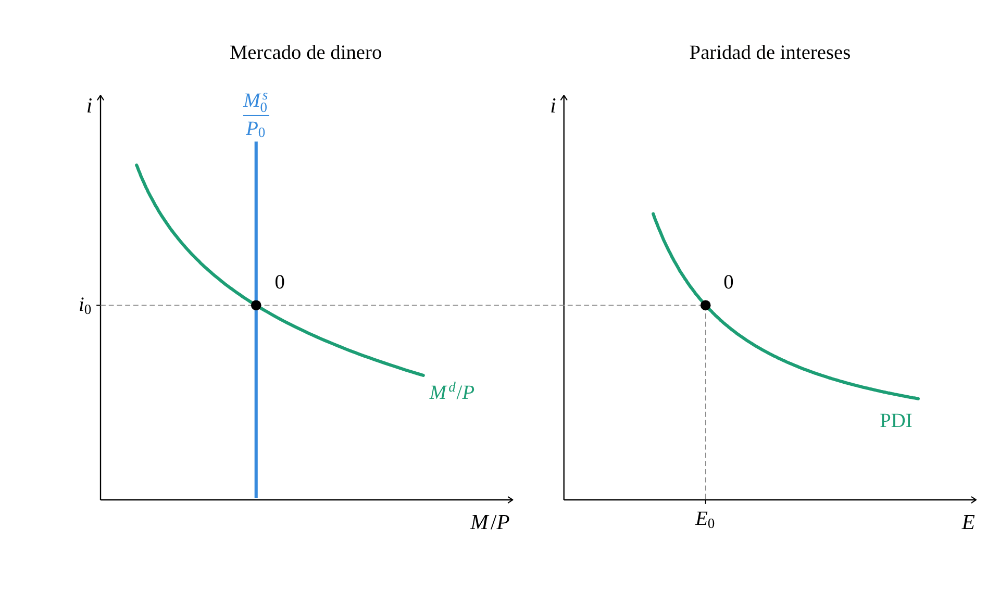
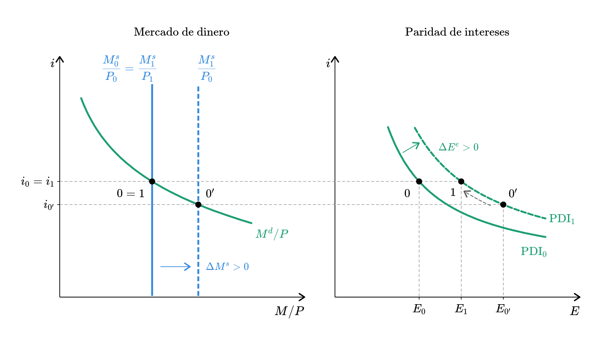
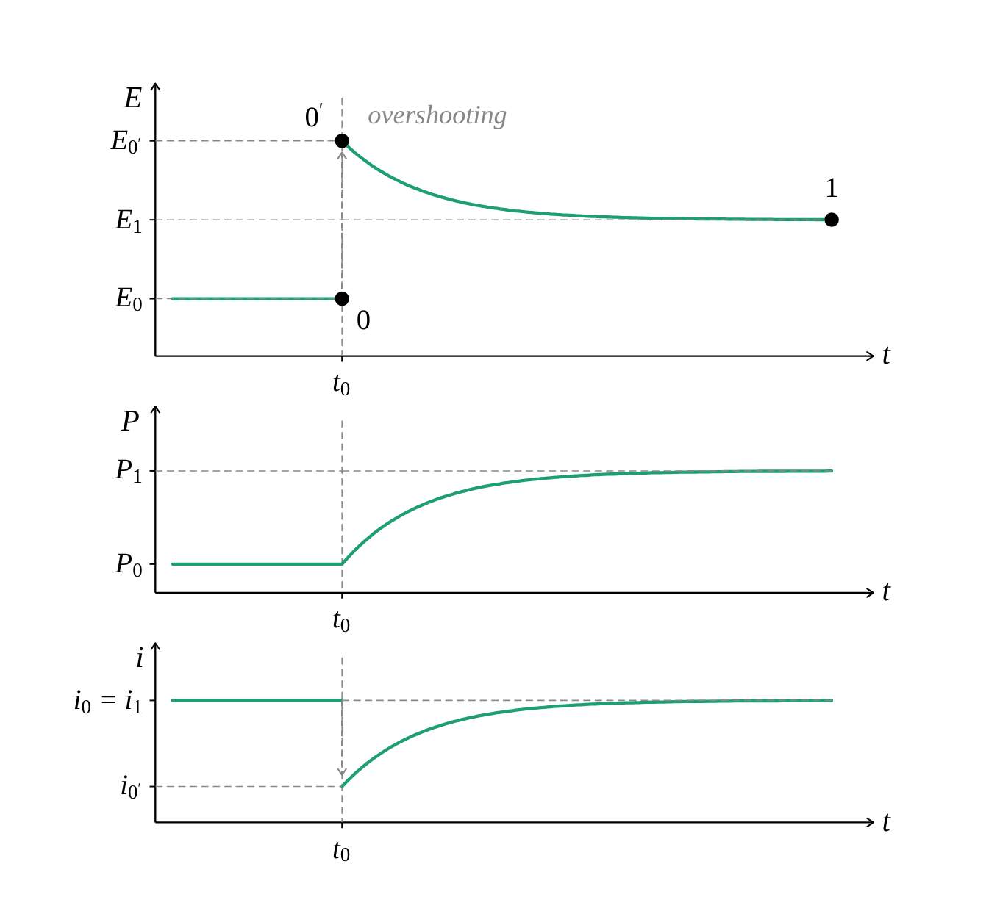

## Introducción

::: {.callout-note appearance="simple" icon=false}

:::

La **determinación del tipo de cambio** es uno de los problemas más difíciles de la macroeconomía abierta. Las teorías tradicionales la explicaron por los flujos comerciales y por la paridad del poder adquisitivo. Con la libertad de movimientos de capital, los modelos de activos pasaron a tratar el tipo de cambio como el precio de un activo financiero, que depende de las expectativas, y Dornbusch (1976) explicó, con precios rígidos, por qué sobrerreacciona ante una perturbación monetaria (*overshooting*). Sin embargo, Meese y Rogoff (1983) mostraron que, a horizontes cortos, ninguno de esos modelos predice el tipo de cambio mejor que un paseo aleatorio. Esa **desconexión** entre el tipo de cambio y sus fundamentos (Obstfeld y Rogoff, 2000) orienta todavía la investigación, que busca su origen en las expectativas, la microestructura del mercado y las primas de riesgo de los intermediarios financieros.

A partir del artículo de Michael Mussa (1979), pueden sintetizarse cinco regularidades empíricas de los tipos de cambio flexibles que los sucesivos modelos han tratado de explicar:

1. *Imprevisibilidad*: las variaciones mensuales de los tipos de cambio nominales *spot* son grandes y casi enteramente imprevisibles[^b14-2].

2. *Tipo de contado y tipo esperado*: las variaciones del tipo de cambio de contado se corresponden bastante de cerca con las del tipo de contado futuro esperado, de modo que los tipos de contado y a plazo se mueven juntos.

3. *Tipo nominal y tipo real*: a corto plazo, las variaciones de los tipos de cambio nominales y reales están muy correlacionadas, lo que indica que los niveles de precios apenas compensan los movimientos del tipo nominal.

4. *Balanza de pagos*: no existe una relación fuerte y sistemática entre los movimientos de los tipos de cambio, nominales o reales, y los saldos por cuenta corriente.

5. *Oferta monetaria e inflación*: los movimientos de los tipos de cambio no guardan una relación estrecha con los diferenciales de expansión monetaria, salvo, quizá, en economías de inflación muy alta. A largo plazo, en cambio, las monedas de los países con inflación elevada tienden a depreciarse aproximadamente al ritmo del diferencial de inflación, en línea con la paridad del poder adquisitivo relativa.

El tema estudia los mecanismos de determinación del tipo de cambio en los mercados de divisas en tres etapas:

- *Teorías tradicionales*: el tema parte de las teorías basadas en los modelos de flujos.

- *Desarrollos posteriores*: siguen las teorías basadas en los modelos de activos.

- *Desarrollos recientes*: la última parte se ocupa de los modelos basados en las expectativas, la microestructura del mercado y la intermediación financiera.

## 1. Teorías tradicionales: teorías basadas en los modelos de flujos de la balanza de pagos

Hasta la década de 1970 se consideraba que las operaciones en divisas se debían a los flujos entre países, principalmente de bienes y servicios y, en mucha menor medida, a los flujos de capital. Esta perspectiva se articula en tres modelos, el de balanza de pagos, el de la paridad del poder adquisitivo (PPA) y el de la paridad de intereses.

### 1.1. Modelos basados en el ajuste de la balanza de pagos

**Origen**: el enfoque de flujos carece de un autor único y se construye sobre la llamada *aproximación de las elasticidades*. Su genealogía se remonta a Marshall (1923) y Lerner (1944), de quienes toma su nombre la condición de estabilidad del modelo. La formalización posterior del mercado de divisas se debe a Joan Robinson (1937) y a Machlup (1939), y su integración en el análisis del equilibrio interno y externo, a Meade (1951).

**Idea**: el tipo de cambio nominal se determina por la interacción de las fuerzas de mercado internacionales que actúan para ajustar las balanzas de pagos de los diferentes países.

El modelo de balanza de pagos permite ilustrar la determinación del tipo de cambio en su forma más simple, es decir, cuando se realizan transacciones *spot* (al contado) en los mercados de divisas para la obtención de moneda.

#### 1.1.1. Supuestos

**Entorno**: rige un régimen de cambio flexible y no hay barreras al comercio.

**Mercados**: se cumple la condición de Marshall-Lerner (estabilidad del equilibrio).

#### 1.1.2. Modelo

**Planteamiento**: el tipo de cambio nominal es el precio que vacía el mercado de divisas (tema [B13](b13-mercado-divisas.qmd), apartado 2.2.1), en el que concurren dos fuerzas:

- *Demanda de divisas*: procede de quienes necesitan divisas para pagar importaciones de bienes y servicios y de los no residentes que repatrían fondos y han de convertirlos en divisa. Al depreciarse la moneda nacional ($\uparrow E$) se importa menos y se necesitan menos divisas, por lo que la demanda decrece con el tipo de cambio.

- *Oferta de divisas*: la aportan quienes obtienen divisas con sus exportaciones y desean deshacerse de esa liquidez, y los residentes que repatrían fondos y los convierten a moneda nacional. Crece con el tipo de cambio siempre que la demanda exterior de exportaciones sea elástica. En tal caso, una depreciación de la moneda nacional ($\uparrow E$) eleva las exportaciones en mayor proporción de lo que cae su precio en divisas, y la oferta de divisas aumenta.

**Equilibrio**: de la interacción de ambas fuerzas se determina el tipo de cambio que equilibra la balanza de pagos. De acuerdo con la tradición marshalliana, este equilibrio es estable siempre que se cumpla la condición de Marshall-Lerner, que garantiza que las cantidades responden a las variaciones del tipo de cambio con la elasticidad suficiente.

**Desarrollo gráfico**: la figura -@fig-b145-mercado-divisas representa el mercado en el plano $(M^*, E)$, con la cantidad de divisas en el eje horizontal y el tipo de cambio directo en el vertical. La curva $D(M^*)$ recoge la demanda de divisas de los importadores y de los no residentes que repatrían fondos, y es decreciente porque una depreciación ($\uparrow E$) encarece las importaciones. La curva $S(M^*)$ recoge la oferta de divisas de los exportadores y de los residentes que repatrían fondos, y es creciente si la demanda exterior de exportaciones es elástica. El corte de ambas curvas, el punto 0, fija el tipo de cambio $E_0$ y la cantidad intercambiada $M^*_0$. A un tipo $E'$ superior, la oferta de divisas excede a la demanda (superávit), y a un tipo $E''$ inferior la demanda excede a la oferta (déficit). Las flechas grises indican el sentido en que se corrige cada desequilibrio.

::: {#fig-b145-mercado-divisas}

::: {.content-visible when-format="html"}
```{=html}
<div class="graph-frame">
<iframe src="../graphs/b145_Mercado_divisas.html" style="height:560px" loading="lazy" title="fig-b145-mercado-divisas"></iframe>
</div>
```
:::

::: {.content-visible unless-format="html"}

:::

Mercado de divisas y tipo de cambio. La demanda, $D(M^*)$, y la oferta de divisas, $S(M^*)$, fijan el tipo de cambio $E_0$ que equilibra la balanza de pagos (punto 0). A un tipo superior ($E'$) hay exceso de oferta de divisas (superávit) y la moneda nacional se aprecia, y a uno inferior ($E''$), exceso de demanda (déficit) y se deprecia.
:::

**Estática comparativa**: todo lo que altera, a un tipo de cambio dado, las importaciones, las exportaciones o los fondos repatriados desplaza una curva del plano $(M^*, E)$ y mueve el equilibrio desde el punto 0:

- *Aumento de la demanda de divisas* (más importaciones o más fondos repatriados por no residentes): $D(M^*)$ se desplaza a la derecha, el tipo de cambio sube ($\uparrow E$, depreciación de la moneda nacional) y la cantidad intercambiada aumenta.

- *Aumento de la oferta de divisas* (más exportaciones o más fondos repatriados por residentes): $S(M^*)$ se desplaza a la derecha, el tipo de cambio baja ($\downarrow E$, apreciación) y la cantidad aumenta.

El modelo predice así que la moneda de un país cuyas importaciones crecen más que sus exportaciones tiende a depreciarse, relación que los datos no confirman de forma sistemática.

**Dinámica**: fuera del equilibrio, el mecanismo de ajuste opera como sigue:

1. *Superávit comercial*: si $\text{BC} > 0$ (las exportaciones superan a las importaciones), existe un exceso de oferta de divisas, de modo que la divisa se deprecia y, por extensión, la moneda nacional se aprecia ($\downarrow E$) hasta restablecer el equilibrio.

2. *Déficit comercial*: si $\text{BC} < 0$, existe un exceso de demanda de divisas y, a la inversa, la divisa se aprecia y la moneda nacional se deprecia ($\uparrow E$).

#### 1.1.3. Conclusiones

**Aspectos positivos**: el modelo, muy intuitivo, liga la determinación del tipo de cambio a los flujos comerciales y muestra que la estabilidad del mercado de divisas depende de la condición de Marshall-Lerner.

**Limitaciones**: omite muchas variables relevantes en la determinación del tipo de cambio (p. ej. la relación de precios). Choca, además, con la cuarta regularidad de Mussa, pues no se observa una relación fuerte y sistemática entre los movimientos del tipo de cambio y los saldos por cuenta corriente. Tampoco explica por qué países desarrollados como Estados Unidos mantienen importantes déficits comerciales sin ver una depreciación sostenida de su moneda.

### 1.2. Modelos basados en la paridad del poder adquisitivo de la moneda

**Origen**: el nombre y la formulación moderna se deben a Gustav Cassel (1918a), pero la idea aparece ya en la Escuela de Salamanca[^b14-4].

**Idea**: el tipo de cambio nominal refleja el poder de compra relativo de las monedas.

#### 1.2.1. Paridad del poder adquisitivo absoluta (Cassel, 1918a)

**Origen**: Cassel (1918a) llama paridad del poder adquisitivo al cociente entre el poder de compra de las monedas de dos países, la formulación original de la que parte la versión absoluta.

**Idea**: medida en una misma moneda, una cesta de bienes cuesta igual en todos los países, como ocurre si el precio de cada bien, convertido al tipo de cambio, coincide entre países (ley del precio único).

**Supuestos**:

- *Entorno*: dos países, sin barreras al comercio y con mercados perfectamente competitivos. Los bienes son homogéneos y comerciables, y ambos países los intercambian.

**Razonamiento**: sin imperfecciones, el arbitraje internacional neutraliza de inmediato cualquier diferencia en el tipo de cambio nominal del par de monedas entre plazas o en el precio del bien entre países, y agota así toda oportunidad de beneficio.

Por ello, el tipo de cambio nominal del par de monedas es el mismo en todas las plazas en que se negocia: $E^A = E^B$, con $E$ el tipo de cambio nominal y $A \neq B$ las plazas.

Dado ese tipo de cambio único, el arbitraje de bienes garantiza que se cumpla la *ley del precio único internacional* o *condición de paridad del poder adquisitivo absoluta*. Según esa condición, el precio del bien, ajustado por el tipo de cambio, es el mismo en todos los países:

$$P_i = E \cdot P_i^*$$

donde $P_i$ es el precio nacional del bien $i$, $E$ es el tipo de cambio nominal idéntico para ambos países y $P_i^*$ es el precio del mismo bien en el extranjero.

Esta ley constituye una condición de equilibrio, según la cual una unidad de moneda nacional tiene el mismo poder de compra en el propio país que en el extranjero, una vez convertida en divisa al tipo de cambio vigente.

De esta condición de equilibrio se deducen dos ecuaciones de determinación del tipo de cambio:

*Tipo de cambio nominal PPA*: es el tipo de cambio nominal que verifica esta condición, igual a la relación de precios:

$$E = P_i / P_i^*$$

El tipo de cambio nominal acompaña, pues, a la relación de precios. Así, un país con precios más altos que los del extranjero necesita una moneda más depreciada para que esta conserve su poder adquisitivo.

Esta relación también se puede plantear en términos de índices de precios, simplemente aplicando una suma ponderada:

$$\sum_{i=1}^n \alpha_i P_i = E \sum_{i=1}^n \alpha_i P_i^* \;\rightarrow\; P = E \cdot P^* \;\rightarrow\; E = P/P^*$$

*Tipo de cambio real PPA*: de todo esto se deduce que es constante e igual a la unidad:

$$e = E \cdot P^*/P = (P/P^*) \cdot (P^*/P) = 1$$

**Conclusiones**:

- *Aspectos positivos*: ofrece un ancla sencilla para el tipo de cambio, basada solo en el arbitraje de bienes, y es la referencia de las comparaciones internacionales de renta y precios en paridad de poder adquisitivo.

- *Limitaciones*: sus supuestos rara vez se dan. Hay costes de transporte, bienes heterogéneos y bienes no comerciables, y cada país pondera su cesta de forma distinta (problema de agregación).

#### 1.2.2. Paridad del poder adquisitivo relativa (Cassel, 1918a)

**Origen**: el propio Cassel (1918a), ante las limitaciones de la versión absoluta, planteó la misma idea en su versión relativa, que exige una condición menos estricta para la equivalencia del poder de compra de las monedas.

**Idea**: si las imperfecciones que impiden la versión absoluta (costes de transporte, barreras al comercio, problemas de agregación) son estables en el tiempo, no afectan a las variaciones del tipo de cambio, que dependen entonces del diferencial de inflación.

**Razonamiento**: si el tipo de cambio real permanece fijo en un nivel $\bar{e}$, que no tiene por qué ser la unidad, el *tipo de cambio nominal de PPA relativa* cumple:

$$\begin{aligned} &E = \bar{e} \cdot P/P^* \;(\bar{e} \text{ constante}) \;\rightarrow\; \ln E = \ln \bar{e} + \ln P - \ln P^* \\ &\rightarrow\; g_E = g_P - g_{P^*} \;\rightarrow\; g_E = \pi - \pi^* \end{aligned}$$

La moneda nacional se deprecia, por tanto, al ritmo en que la inflación nacional supera a la extranjera, y las monedas de los países más inflacionistas que el resto del mundo pierden valor. Para el *tipo de cambio real de PPA relativa*, la consecuencia inmediata es que no varía: $g_e = g_E + \pi^* - \pi = 0$. En suma, la PPA hace depender el tipo de cambio nominal del nivel relativo de precios en su versión absoluta y del diferencial de inflación en la relativa.

**Conclusiones**:

- *Aspectos positivos*: exige supuestos menos estrictos que la versión absoluta y explica la tendencia del tipo de cambio a largo plazo y en las hiperinflaciones.

- *Limitaciones*: el supuesto de que las imperfecciones se mantengan constantes en el tiempo sigue siendo exigente, y la evidencia solo respalda la versión relativa a largo plazo.

#### 1.2.3. Explicaciones al incumplimiento de la PPA (I): hipótesis de Balassa-Samuelson (1964)

**Origen**: Béla Balassa (1964) y Paul Samuelson (1964) explicaron, de forma independiente, por qué los niveles de precios son más altos en los países ricos. Su *hipótesis de Balassa-Samuelson*, o sesgo de productividad de la PPA, es una de las explicaciones de por qué no se cumple la paridad del poder adquisitivo.

**Idea**: las diferencias de productividad en la producción de bienes comerciables entre países permiten explicar los diferenciales de inflación y, en último término, las diferencias en los tipos de cambio reales.

**Supuestos**:

- *Entorno*: dos países abiertos al exterior, con libre movimiento de capital entre países y libre movilidad del trabajo entre sectores, sin fallos de mercado y con dos tipos de bienes, comerciables y no comerciables.

- *Agentes*: la ponderación para la agregación de bienes es idéntica en ambos países (preferencias idénticas).

- *Tecnología*: funciones de producción con rendimientos constantes a escala y la misma participación del trabajo en ambos sectores. En todo momento, la competencia iguala el salario al valor de la productividad marginal del trabajo y la movilidad intersectorial iguala los salarios entre sectores.

- *Sector exterior*: se cumple la PPA para los bienes comerciables: $E = P_C/P_C^* \rightarrow s = p_C - p_C^*$ (en logaritmos).

**Razonamiento**: un aumento de la productividad en el sector comerciable eleva los salarios de dicho sector, puesto que el precio del bien comerciable está fijado internacionalmente (por la ley del precio único) y la competencia iguala el salario al valor del producto marginal. Por la libre movilidad intersectorial del trabajo, la subida salarial se extiende al sector no comerciable y eleva su coste marginal. Sube así el precio de ese sector y, con él, el nivel general de precios, y el tipo de cambio real se aprecia.

Formalmente, el índice de precios (en logaritmos) es una suma ponderada de los índices de precios de cada sector, $p = \alpha p_N + (1-\alpha) p_C$, donde $N$ es el sector del bien no comerciable y $C$ el de los comerciables. Del supuesto tecnológico se deduce que el precio relativo de los bienes no comerciables viene dado por el diferencial de productividades entre sectores:

$$p_N - p_C = a_C - a_N$$

donde $a_C$ y $a_N$ son los logaritmos de la productividad del trabajo en cada sector. Es decir, el precio relativo del bien no comerciable fluctúa en la misma proporción que el diferencial de productividad. Si aumenta la productividad del sector comerciable, sube el precio relativo del no comerciable. Ese encarecimiento relativo tiene efectos sobre la competitividad, que se analizan a través del tipo de cambio real (en logaritmos), $q = s + p^* - p$. Sustituyendo los índices de precios y la PPA de los comerciables:

$$q = \alpha\left[(p_C - p_N) - (p_C^* - p_N^*)\right] = -\alpha\left[(a_C - a_N) - (a_C^* - a_N^*)\right]$$

El tipo de cambio real es, pues, función del diferencial entre países de la productividad relativa entre sectores, y los países con un mayor crecimiento relativo de la productividad en el sector comerciable ven apreciarse su tipo de cambio real ($\partial q / \partial a_C < 0$).

Con ello, el modelo da cuenta de la relación positiva entre la renta per cápita y el nivel de precios. En los países ricos, la mayor productividad relativa del sector comerciable eleva salarios y precios y aprecia el tipo de cambio real, en contra de la PPA. El efecto sobre el nivel de precios es proporcional al peso $\alpha$ del sector no comerciable.

**Conclusiones**:

- *Aspectos positivos*: ofrece una explicación de las desviaciones persistentes de la PPA basada en factores reales, la productividad relativa entre sectores, y no en perturbaciones monetarias. Permite, además, distinguir una apreciación real de equilibrio, sin pérdida de competitividad, de la que refleja desajustes, una distinción necesaria para interpretar los diferenciales de inflación de una unión monetaria (tema [B16](b16-integracion-monetaria.qmd), apartado 1.3.4).

- *Limitaciones*: descansa en supuestos fuertes, como la plena movilidad del trabajo entre sectores y el cumplimiento de la PPA en los bienes comerciables, que el *pricing to market* cuestiona. Además, su evidencia es más sólida para las diferencias de nivel de precios entre países de distinto desarrollo que para los movimientos del tipo de cambio real a corto plazo, dominados por los del tipo de cambio nominal.

#### 1.2.4. Explicaciones al incumplimiento de la PPA (II): fijación de precios según mercado o *pricing to market* (Krugman, 1987b; Dornbusch, 1987)

**Origen**: Krugman (1987b) y Dornbusch (1987) la propusieron ante la escasa traslación a los precios de importación estadounidenses de la fuerte apreciación del dólar en la primera mitad de los años ochenta.

**Idea**: en competencia oligopolística con mercados segmentados, un mismo bien puede ofrecerse a distintos precios en países diferentes, lo que genera desviaciones persistentes de la ley del precio único y, por extensión, de la PPA.

**Razonamiento**: cada empresa fija un precio distinto en cada mercado según la elasticidad de su demanda local. Ante una variación del tipo de cambio, absorbe en sus márgenes parte del cambio para no perder cuota, de modo que el precio en moneda local varía menos que el tipo de cambio (traslado o *pass-through* incompleto).

**Conclusiones**:

- *Aspectos positivos*: explica por qué la ley del precio único falla incluso en bienes comerciables y por qué el traslado del tipo de cambio a los precios de importación es incompleto, como muestra la evidencia.

- *Limitaciones*: exige competencia imperfecta y mercados segmentados, en los que el arbitraje de los consumidores sea limitado.

#### 1.2.5. Conclusiones

**Aspectos positivos**: Jacob Frenkel (1978) encuentra que la PPA explicaba bien el tipo de cambio durante la hiperinflación alemana, y concluye que se cumple, sobre todo, cuando predominan los *shocks* monetarios frente a los reales. Los contrastes con muestras más largas y técnicas de panel apoyan, además, el cumplimiento de la PPA relativa en el largo plazo. A ese horizonte, la depreciación nominal acompaña al diferencial de inflaciones y el tipo de cambio real revierte hacia su media.

**Limitaciones**: la volatilidad de los tipos de cambio nominales, comparada con la relativa estabilidad de los índices generales de precios, muestra que el tipo de cambio real no es estable y que la PPA no se cumple de manera continua en el corto plazo. Los primeros contrastes econométricos del periodo posterior a Bretton Woods no lograban rechazar que el tipo de cambio real fuese no estacionario, es decir, que no convergiese hacia ningún nivel de equilibrio, y los posteriores descartan que la PPA, absoluta o relativa, se cumpla a corto plazo. La reversión del tipo real es, además, lenta, con vidas medias estimadas de entre tres y cinco años (Rogoff, 1996).

### 1.3. Modelos basados en la paridad de intereses

**Origen**: a diferencia de los modelos anteriores, centrados en los flujos de bienes, la paridad de intereses atiende a los flujos de capitales. Keynes ya había formulado la paridad cubierta en *A Tract on Monetary Reform* (1923), pero estos modelos solo cobraron protagonismo con el aumento de los flujos de capitales en la segunda mitad del s. XX, sobre todo tras el abandono de Bretton Woods y la liberalización de las cuentas de capital.

**Idea**: el tipo de cambio nominal se mueve hasta que invertir en activos nacionales o extranjeros rinde lo mismo, medido en una misma moneda.

#### 1.3.1. Supuestos

**Entorno**: no hay fallos de mercado y la movilidad de capitales es perfecta (sin controles ni costes de transacción), con mercados eficientes y completos. Existe sustituibilidad perfecta entre activos nacionales y extranjeros (no hay prima por mantener una divisa u otra)[^b14-10].

**Agentes**: son racionales. La paridad descubierta exige, además, que sean neutrales al riesgo (no exigen prima por invertir en un depósito nacional o extranjero). La cubierta no lo exige, pues la operación cubierta no entraña riesgo cambiario (tema [B13](b13-mercado-divisas.qmd), apartado 2.2.3).

#### 1.3.2. Modelo

Un inversor que posee una unidad de moneda nacional (p. ej. euros) elige, con horizonte de un año, la opción de mayor rendimiento entre un activo nacional, que le rinde $1+i$, y un activo extranjero. Para invertir en el activo extranjero, compra divisa hoy al tipo *spot* $E_t^s$, la invierte al tipo $i^*$ y convierte el rendimiento a moneda nacional al tipo de cambio del vencimiento. La derivación paso a paso del diferencial de rentabilidades se desarrolla en el tema [B13](b13-mercado-divisas.qmd), apartado 2.2.3. En forma aproximada[^b14-12], ese diferencial es:

$$r_{\text{€}} \approx g_E + (i^* - i)$$

donde $r_{\text{€}}$ es el diferencial de rentabilidades *ex post* del activo extranjero frente al nacional, medido en moneda nacional, y $g_E = (E_{t+1}^s - E_t^s)/E_t^s$ es la tasa de depreciación observada de la moneda nacional.

El rendimiento relativo de invertir fuera suma, por tanto, dos términos, el diferencial de intereses, $i^* - i$, y la depreciación de la moneda nacional, $g_E$. Si los mercados son lo bastante eficientes, los agentes aprovechan las diferencias de rentabilidad hasta anularlas ($r_{\text{€}} = 0$), es decir, hasta que se cumple la condición de no arbitraje:

$$E_{t+1}^s = E_t^s \cdot \frac{1+i}{1+i^*} \;\rightarrow\; i \approx g_E + i^*$$

Sin embargo, en el momento de invertir (momento $t$) el agente no conoce $E_{t+1}^s$, por lo que existe riesgo de tipo de cambio. La interpretación de esta condición depende, entonces, de si el agente cubre o no ese riesgo, y solo la operación cubierta da lugar a una condición de no arbitraje en sentido estricto.

#### 1.3.3. Condición de paridad cubierta de intereses

Si el agente cubre todo el riesgo de cambio con un contrato *forward*, que le permite convertir su retorno al tipo de cambio *forward* o a plazo, $E_t^f$, la operación es de arbitraje temporal puro o sin riesgo. La condición de no arbitraje se denomina entonces **paridad cubierta de intereses** (PCI). La tasa de depreciación pasa a ser el margen *forward*, $\mu_f = (E_t^f - E_t^s)/E_t^s$. Si $\mu_f > 0$, la divisa cotiza a premio y la moneda nacional al descuento, y si $\mu_f < 0$ ocurre lo contrario. La PCI exige que el margen *forward* compense el diferencial de tipos de interés, $r_{\text{€}} = 0 \leftrightarrow i = i^* + \mu_f$, la condición del tema [B13](b13-mercado-divisas.qmd), apartado 2.2.3, donde se explica el ajuste hacia ella.

En su forma exacta, la PCI da una teoría de la determinación del tipo de cambio *forward*, que se calcula a partir de las otras tres variables:

$$E_t^f = E_t^s \cdot \frac{1+i}{1+i^*}$$

Así se fija en la práctica el tipo *forward* en el mercado de divisas, lo que ilustra por qué un *forward* es un derivado, pues su precio se deriva del precio del subyacente.

#### 1.3.4. Condición de paridad descubierta de intereses

Si el agente no cubre el riesgo de cambio, estructura la operación solo con contratos *spot* y decide con el tipo de cambio *spot* esperado, $E_t^e \equiv \mathbb{E}_t[E_{t+1}^s]$. La condición resultante es la **paridad descubierta de intereses** (PDI), en la que la tasa de depreciación es una tasa esperada, $g_E^e = (E_t^e - E_t^s)/E_t^s$. Con agentes neutrales al riesgo, se cumple $\mathbb{E}_t[r_{\text{€}}] = 0 \leftrightarrow i = i^* + g_E^e$. Este tipo de operación la llevan a cabo, generalmente, especuladores que aceptan el riesgo cambiario a cambio de la posibilidad de obtener ganancias (tema [B13](b13-mercado-divisas.qmd), apartado 2.2.4).

En su forma exacta, la PDI da también una teoría de la determinación del tipo de cambio *spot*:

$$E_t^s = E_t^e \cdot \frac{1+i^*}{1+i}$$

Sin embargo, la evidencia empírica muestra que la paridad descubierta no se cumple a corto plazo (Fama, 1984). Entre sus explicaciones (tema [B13](b13-mercado-divisas.qmd), apartado 2.2.4) destacan tres:

- *Aversión al riesgo*: si los agentes son aversos al riesgo, solo asumen el riesgo cambiario si la rentabilidad esperada de los activos extranjeros supera a la de los nacionales en una prima $\rho$, es decir, si $i^* + g_E^e = i + \rho$.

- *Expectativas sesgadas*: con datos de encuestas sobre las expectativas, Froot y Frankel (1989) no hallan prima de riesgo alguna en el incumplimiento y lo atribuyen a errores sistemáticos de expectativas.

- *Peso problems*: compatibles con expectativas racionales, son episodios en los que los agentes asignan durante largos periodos una probabilidad positiva a un suceso extremo (p. ej. una devaluación) que tarda en materializarse, lo que sesga en la muestra los errores de predicción.

::: {.callout-tip collapse="true" appearance="simple" title="Ejemplo: PPA relativa y paridades de intereses con cifras"}
El tipo de cambio al contado es de 0,90 euros por dólar. La inflación esperada a un año es del 2 % en la zona del euro y del 4 % en Estados Unidos, y los tipos de interés a un año son del 3 % y del 5 %.

- *PPA relativa*: el euro, menos inflacionista, debe apreciarse en torno a un 2 %, $g_E = \pi - \pi^* = -2$ %, hasta unos 0,882 euros por dólar.

- *Paridad cubierta*: el tipo *forward* a un año es $E_t^f = 0{,}90 \cdot 1{,}03/1{,}05 \approx 0{,}8829$ euros por dólar, con un margen *forward* de $-1{,}9$ %. El dólar cotiza a plazo con descuento porque rinde más intereses.

- *Paridad descubierta*: con agentes neutrales al riesgo, la apreciación esperada del euro es la misma, en torno al 1,9 %, y coincide casi con la que predice la PPA, porque los tipos de interés reales de las dos áreas son iguales, del 1 %.
:::

#### 1.3.5. Conclusiones

**Aspectos positivos**: hasta la crisis financiera global, la evidencia empírica mostraba que la paridad cubierta se cumplía de forma continua y con mucha precisión entre las principales monedas. La razón es que el elevado grado de tecnificación de los mercados de divisas hace que los diferenciales de rentabilidad duren, de media, entre medio minuto y cuatro minutos (Akram, Rime y Sarno, 2008). Los incumplimientos de la paridad cubierta se asociaban a los controles de capital y desaparecieron con la liberalización financiera de los años ochenta (tema [B13](b13-mercado-divisas.qmd), apartado 2.2.3). La paridad descubierta, por su parte, tiende a cumplirse a largo plazo (Chinn y Meredith, 2004). A ese horizonte, la tasa de depreciación se aproxima al diferencial de tipos de interés entre las dos economías.

**Limitaciones**: desde 2008 se observan desviaciones persistentes de la paridad cubierta (la llamada base de los *swaps* de divisas o *cross-currency basis*). Du, Tepper y Verdelhan (2018) las atribuyen a las restricciones de balance de los intermediarios financieros, que encarecen el arbitraje, y a los desequilibrios entre la demanda de inversión y la oferta de financiación en las distintas monedas. La paridad descubierta registra, además, desviaciones importantes a corto plazo, entre ellas el “*puzzle* de la prima *forward*” (Fama, 1984), objeto del apartado 3.4.2.

### 1.4. Conclusiones

Los modelos de flujos derivan el tipo de cambio de las transacciones que lo originan. En el modelo de balanza de pagos, los flujos comerciales alimentan el mercado de divisas, cuyo precio de vaciado es el tipo de cambio, y el equilibrio es estable si se cumple la condición de Marshall-Lerner. La PPA lo ancla, en cambio, en el poder de compra de las monedas. Su versión absoluta exige supuestos muy restrictivos, y la relativa, que liga la depreciación al diferencial de inflación, solo se sostiene a largo plazo. La hipótesis de Balassa-Samuelson y la fijación de precios según mercado explican sus desviaciones persistentes. Finalmente, la paridad de intereses traslada el análisis a los flujos de capitales. La cubierta, que fija el tipo *forward*, se cumplía con precisión hasta la crisis financiera global, mientras que la descubierta solo tiende a cumplirse a largo plazo.

Los tres modelos atienden a los flujos y no a los *stocks* de dinero y de activos financieros, cuyo peso creció con la liberalización de capitales, y de ese límite parten los modelos de activos de la sección 2.

## 2. Desarrollos posteriores: teorías basadas en los modelos de activos (*stocks*) de la balanza de pagos

Frente a las teorías tradicionales, los modelos de activos tienen en cuenta el efecto sobre el tipo de cambio de los *stocks* de dinero y de activos financieros, y no solo de sus variaciones, y se agrupan en dos familias. Los modelos monetarios hacen depender el tipo de cambio principalmente del *stock* de dinero, y los modelos de cartera consideran un espectro más amplio de activos financieros.

### 2.1. Antecedentes de los modelos monetarios: la teoría cuantitativa del dinero y el mecanismo flujo-especie (Hume, 1752)

**Origen**: los antecedentes de estos modelos se hallan en el mecanismo flujo-especie de David Hume (1752) y en la teoría cuantitativa del dinero.

**Idea**: ambas teorías ponían ya el énfasis en la oferta de dinero como determinante de los precios y, con ellos, del saldo exterior (con patrón oro, como en Hume) o del tipo de cambio (con tipo flexible).

**Supuestos**: mundo neoclásico internacional en el que:

- *Mercados*: el mercado de bienes es competitivo, con un bien homogéneo y libre movilidad de bienes, de modo que se cumple la PPA absoluta. El mercado monetario es perfecto, con libre movilidad de capitales, agentes neutrales al riesgo y sustituibilidad perfecta, por lo que se cumple la paridad de intereses.

**Razonamiento**: en cada país rige la ecuación de cambio, $MV = PY$ y $M^*V^* = P^*Y^*$. Según la teoría cuantitativa, que la lee en sentido causal, la velocidad y la renta no dependen a largo plazo de la cantidad de dinero, y el nivel de precios de cada país queda fijado por su oferta monetaria. A través de la PPA, el tipo de cambio de largo plazo hereda esa dependencia, lo que da la ecuación básica del enfoque monetario del tipo de cambio:

$$E = \frac{P}{P^*} = \frac{M \cdot V \cdot Y^*}{M^* \cdot V^* \cdot Y} \;\rightarrow\; E = f(M^+, V^+, Y^{*+}, M^{*-}, V^{*-}, Y^-)$$

Así, la oferta de dinero y la velocidad de circulación, variables monetarias, influyen en la determinación del tipo de cambio. Un aumento de la oferta monetaria o de la velocidad de circulación nacionales deprecia la moneda, y un aumento de la renta nacional la aprecia.

**Conclusiones**:

- *Aspectos positivos*: la política monetaria y cambiaria británica hasta la primera mitad del s. XIX estuvo marcada por estas teorías, que se utilizaban para explicar desde los desequilibrios externos y las variaciones de precios hasta la determinación de los tipos de cambio.

- *Limitaciones*: carecen del formalismo matemático de la literatura posterior.

### 2.2. Modelos monetarios

**Origen**: los modelos monetarios formalizan, desde mediados de los años setenta, esos antecedentes. Se desarrollan en dos vertientes, la de precios flexibles (Frenkel, 1976; Mussa, 1976) y la de precios rígidos (Dornbusch, 1976), y en una síntesis de ambas (Frankel, 1979).

**Idea**: en todas ellas, el equilibrio del mercado monetario de cada país determina el tipo de cambio nominal, que depende así de las ofertas y demandas relativas de dinero.

#### 2.2.1. Precios flexibles: modelo de Frenkel (1976) y Mussa (1976)

**Origen**: Frenkel (1976) y Mussa (1976) formularon la versión de precios flexibles del enfoque monetario.

**Idea**: con precios plenamente flexibles y PPA continua, el tipo de cambio nominal queda determinado por el equilibrio del mercado monetario de cada país, es decir, por los diferenciales de oferta monetaria, renta y tipo de interés.

**Supuestos**:

- *Entorno*: dinámico, en el que se cumplen los supuestos anteriores (mundo neoclásico, PPA y paridad de intereses) de manera continua. Se añaden bonos perfectamente sustitutivos entre ambos países[^b14-16].

- *Agentes*: la demanda de dinero se modela según una función de elasticidad constante respecto a la renta y semielasticidad constante respecto al tipo de interés, con parámetros idénticos en ambos países.

**Planteamiento**: se parte de la ley de Walras en los mercados de bonos y de dinero de ambos países, $(M^d - M^s) + (B^d - B^s) = 0$, según la cual, si se vacía el mercado de dinero, también se vacía el de bonos. Basta, por tanto, con analizar el mercado de dinero. La función de demanda de saldos reales se representa por $M^d/P = Y^k \exp(-hi)$ y la condición de equilibrio exige $M^s/P = M^d/P$. Al tomar logaritmos neperianos se llega a la condición de equilibrio monetario de cada economía (en minúscula, el logaritmo de cada variable en mayúscula, salvo el tipo de interés, que va en nivel):

$$m - p = ky - hi \tag{1}$$

$$m^* - p^* = ky^* - hi^* \tag{2}$$

Dado que se cumple la PPA absoluta ($E = P/P^*$), el logaritmo del tipo de cambio nominal es $s \equiv \ln E = p - p^*$ (3). El tipo de cambio queda así ligado a los niveles de precios, que las condiciones (1) y (2) fijan a partir de la oferta y la demanda de dinero de cada país.

**Equilibrio**: restando (1) y (2) y sustituyendo (3) en la ecuación resultante, se llega a la ecuación básica del modelo monetario:

$$s = (m - m^*) - k(y - y^*) + h(i - i^*)$$

El tipo de cambio nominal depende, por tanto, de los diferenciales de masa monetaria, renta y tipo de interés entre los países. La paridad descubierta ($g_E^e = i - i^*$) y la PPA relativa en términos esperados ($g_E^e = \pi^e - \pi^{*e}$) implican juntas $i - i^* = \pi^e - \pi^{*e}$, con lo que la ecuación básica puede escribirse con la inflación esperada:

$$s = (m - m^*) - k(y - y^*) + h(\pi^e - \pi^{*e})$$

**Estática comparativa**: de la ecuación básica se derivan las siguientes predicciones:

- *Oferta monetaria*: un aumento relativo de la oferta monetaria nacional debilita la moneda. El aumento eleva en la misma proporción el nivel de precios nacional, de modo que la moneda nacional pierde poder adquisitivo, lo que, según la PPA, se traduce en una depreciación del tipo de cambio nominal.

- *Renta*: un aumento relativo de la renta nacional fortalece la moneda. Al aumentar la renta, sube la demanda de dinero y, con la oferta dada, el equilibrio monetario exige un nivel de precios menor, que, por la PPA, se traduce en una apreciación nominal.

- *Tipo de interés*: un aumento relativo del tipo de interés nominal nacional también debilita la moneda. Intuitivamente, un mayor tipo de interés nominal refleja, vía relación de Fisher, una mayor inflación esperada, que reduce la demanda de dinero, eleva el nivel de precios y, por la PPA, deprecia la moneda hoy.

- *Inflación*: un aumento relativo de la inflación provoca, de acuerdo con la PPA, una depreciación.

**Extensiones** (formas alternativas de expresar la ecuación básica): definiendo la demanda de dinero (en logaritmos y excluido el nivel de precios) como $l \equiv ky - hi$, la ecuación básica se puede reescribir de dos formas ilustrativas:

- *Ofertas y demandas relativas*: $s = (m - m^*) - (l - l^*)$ indica que el tipo de cambio depende positivamente del diferencial de ofertas monetarias y negativamente del diferencial de demandas de dinero. Cuanto más aumente la oferta monetaria nacional frente a la extranjera, más se depreciará la moneda, al ser menos escasa, y cuanto más aumente la demanda de moneda nacional, más se apreciará.

- *Excesos de oferta*: $s = (m - l) - (m^* - l^*)$ muestra que el tipo de cambio depende positivamente del exceso de oferta monetaria nacional, que deprecia la moneda, y negativamente del exceso de oferta monetaria extranjera, que deprecia la divisa y, por tanto, aprecia la moneda nacional.

**Conclusiones**:

- *Aspectos positivos*: el modelo explica la parte de largo plazo de la quinta regularidad de Mussa, según la cual las monedas de los países con inflación elevada, fruto de un fuerte crecimiento monetario, tienden a depreciarse aproximadamente al ritmo del diferencial de inflación.

- *Limitaciones*: bajo este enfoque, un diferencial creciente de tipos de interés nominales va asociado a una moneda cada vez más débil, predicción contraria a la evidencia, salvo durante episodios de inflación excepcionalmente alta. Tampoco se observa, fuera de esos episodios, la relación estrecha entre el tipo de cambio y los diferenciales de expansión monetaria que el modelo predice (quinta regularidad de Mussa). Además, el modelo, atractivo por su sencillez, se apoya en supuestos muy exigentes (vaciado continuo de mercados, PPA continua), lo cual fue el punto de partida de las teorías posteriores.

#### 2.2.2. Precios rígidos: modelo de Dornbusch (1976)

**Origen**: Rudiger Dornbusch (1976), ante las limitaciones del modelo de Frenkel-Mussa, levanta el supuesto de precios flexibles y admite así desviaciones de la PPA a corto plazo, que explican la volatilidad del tipo de cambio nominal.

**Idea**: mientras los precios de los bienes se ajustan con lentitud, el tipo de cambio nominal, como el resto de precios financieros, responde casi al instante. Por ello, ante un cambio de los fundamentos del tipo de cambio (aquí, la oferta monetaria), la variable rápida compensa la inercia de la lenta, y el tipo de cambio se mueve a corto plazo más de lo que exige su nuevo nivel de largo plazo (sobrerreacción u *overshooting*).

**Supuestos**: los mismos que en el modelo de precios flexibles, con dos salvedades:

- *Entorno*: los precios son rígidos a corto plazo y flexibles a largo plazo, por lo que la PPA solo se cumple en el largo plazo.

- *Agentes*: los agentes forman sus expectativas racionalmente (hipótesis de expectativas racionales).

**Planteamiento**: el mercado de dinero se vacía según la condición (1), con la producción fija en su nivel de pleno empleo $y$ y el nivel de precios exterior normalizado a cero ($p^* = 0$). El modelo añade dos relaciones:

$$i = i^* + \eta\,(\bar s - s), \qquad \eta > 0 \tag{4}$$

$$\dot p = \kappa\,(y^d - y), \qquad y^d = a_0 + \phi\,(s - p) + c\,y - v\,i \tag{5}$$

donde $\bar s$ es el tipo de cambio de largo plazo, $\eta$ la velocidad a la que los agentes esperan que el tipo de cambio converja hacia él, $\kappa > 0$ la velocidad de ajuste de los precios (la pendiente de una curva de Phillips), $y^d$ la demanda de producción nacional, $a_0$ el logaritmo del gasto autónomo, $s - p = q$ el tipo de cambio real y $\phi$, $c$ y $v$ las sensibilidades de la demanda al tipo de cambio real, a la renta y al tipo de interés, como en la IS abierta del tema [A32](a32-precios-output.qmd), apartado 1.2.1. La condición (4) es la paridad descubierta con *expectativas regresivas*, pues la depreciación esperada es proporcional a la distancia entre el tipo de cambio de largo plazo y el actual. La condición (5) recoge el ajuste lento de los precios, que suben solo en la medida en que la demanda supera a la producción.

**Equilibrio**: a largo plazo, $\dot p = 0$, $s = \bar s$ e $i = i^*$, de modo que la condición (1) fija $\bar p = m - ky + hi^*$ y, por la PPA, $\bar s$ varía en la misma proporción que $\bar p$. A corto plazo, en cambio, con $p$ dado, el mercado de activos se vacía de forma instantánea. Restando a la condición (1), evaluada con (4), su versión de largo plazo, se obtiene

$$s = \bar s - \frac{1}{h\eta}\,(p - \bar p) \tag{6}$$

donde $p - \bar p$ es la distancia entre el nivel de precios y su valor de largo plazo. La ecuación (6) indica que, mientras los precios estén por debajo de ese valor, el tipo de cambio está más depreciado que a largo plazo. Con expectativas racionales, $\eta$ coincide con la velocidad de convergencia efectiva de la economía[^b14-19].

**Desarrollo gráfico**: el equilibrio inicial del modelo se representa en el plano saldos reales-tipo de interés (mercado de dinero) y en el plano tipo de cambio-tipo de interés (paridad de intereses), que comparten el eje vertical (figura -@fig-b141-dornbusch-i):

1. *Oferta de saldos reales* ($M^s_0/P_0$): refleja la cantidad de dinero en términos reales, es decir, la oferta nominal que fija el banco central dividida por el nivel de precios. Es vertical porque no depende del tipo de interés, y a corto plazo, con los precios rígidos, solo se desplaza si cambia la oferta nominal.

2. *Demanda de saldos reales* ($M^d/P$): refleja la cantidad de dinero en términos reales que los agentes desean mantener para cada tipo de interés, dada la renta, según la condición (1). Es decreciente porque el tipo de interés es el coste de oportunidad de mantener dinero en lugar de bonos.

3. *Paridad descubierta de intereses* (PDI): recoge las combinaciones de tipo de interés y tipo de cambio actual con las que los bonos nacionales y extranjeros rinden lo mismo. Dado el tipo de cambio esperado, es decreciente, como indica la condición (4), porque un tipo de cambio actual más depreciado reduce la depreciación esperada y, con ella, el tipo de interés que exige la paridad.

4. *Equilibrio*: en el punto 0, la oferta y la demanda de saldos reales fijan el tipo de interés $i_0$ (panel izquierdo). La PDI asocia a ese tipo de interés el tipo de cambio $E_0$ (panel derecho), con el que los bonos nacionales y extranjeros rinden lo mismo.

::: {#fig-b141-dornbusch-i}

::: {.content-visible when-format="html"}
```{=html}
<div class="graph-frame wide">
<iframe src="../graphs/b141_Dornbusch_i.html" style="--r:1.655" loading="lazy" title="fig-b141-dornbusch-i"></iframe>
</div>
```
:::

::: {.content-visible unless-format="html"}

:::

Equilibrio inicial del modelo de Dornbusch (1976) en el mercado de dinero y en la paridad descubierta de intereses.
:::

**Estática comparativa**: se supone un aumento de la oferta monetaria nacional no anticipado y permanente[^b14-21], $dm > 0$. A largo plazo, $d\bar p = d\bar s = dm$ (neutralidad del dinero). A corto plazo, con $dp = 0$, la ecuación (6) da el resultado de sobrerreacción:

$$\frac{ds}{dm} = 1 + \frac{1}{h\eta} > 1 \tag{7}$$

donde el primer sumando es la depreciación de largo plazo y el segundo, el exceso de depreciación en el impacto. Por la condición (1), el tipo de interés cae en $di = -dm/h$. La sobrerreacción (7) es mayor cuanto menor es $h$, porque el tipo de interés debe caer más para que el mercado de dinero absorba la nueva oferta. También es mayor cuanto menor es $\eta$, porque una convergencia esperada más lenta exige una desviación mayor para generar la misma apreciación esperada. En la figura -@fig-b142-dornbusch-ii, el tipo de cambio pasa de $E_0$ a $E_{0'}$ en el impacto y a $E_1$ a largo plazo.

**Dinámica**:

- *Largo plazo*: con el tiempo, los precios suben en la misma proporción que la masa monetaria. Los saldos reales vuelven así a su nivel ($M^s_0/P_0 = M^s_1/P_1$), y con ellos el tipo de interés ($i_0 = i_1$). Por la PPA, en cambio, el tipo de cambio de largo plazo queda más depreciado que el inicial. Desde cualquier tipo de cambio actual, la depreciación esperada hacia ese nuevo nivel es entonces mayor ($\Delta E^e > 0$), y la PDI pasa de $\text{PDI}_0$ a $\text{PDI}_1$, desplazada hacia la derecha. El punto 1, con el tipo de cambio $E_1$, es el nuevo equilibrio de largo plazo.

- *Corto plazo*: como los precios no se mueven, la expansión monetaria eleva los saldos reales (de $M^s_0/P_0$ a $M^s_1/P_0$) y, para que el mercado de dinero siga equilibrado, el tipo de interés baja hasta $i_{0'}$. Con un $i$ menor, la PDI solo se cumple si la depreciación esperada se reduce, es decir, si el mercado pasa a anticipar una apreciación futura.

- *Sobrerreacción*: esa apreciación esperada solo es posible si la moneda se deprecia hoy ($\uparrow E$) por encima de su nuevo nivel de largo plazo, hasta un punto desde el cual el mercado espera que se aprecie gradualmente. Como ese nivel de largo plazo ya está más depreciado que el original, la depreciación de impacto supera a la de largo plazo, como muestra (7), y la economía salta al punto 0′ (figura -@fig-b142-dornbusch-ii).

- *Medio plazo*: tras el salto, la subida gradual de los precios reduce los saldos reales y devuelve $i$ a su nivel previo, mientras la moneda se aprecia poco a poco. El tipo de cambio converge así a $E_1$, situado entre el inicial y el de impacto, y la economía pasa del punto 0′ al 1 (figura -@fig-b143-dornbusch-iii).

::: {#fig-b142-dornbusch-ii}

::: {.content-visible when-format="html"}
```{=html}
<div class="graph-frame wide">
<iframe src="../graphs/b142_Dornbusch_ii.html" style="--r:1.655" loading="lazy" title="fig-b142-dornbusch-ii"></iframe>
</div>
```
:::

::: {.content-visible unless-format="html"}

:::

*Overshooting* del tipo de cambio en el modelo de Dornbusch ante una expansión monetaria no anticipada.
:::

La figura -@fig-b143-dornbusch-iii representa las trayectorias temporales de las tres variables, con el tiempo en el eje horizontal y la expansión monetaria en $t_0$. En el panel superior, el tipo de cambio salta en $t_0$ de $E_0$ a $E_{0'}$ y se aprecia después de forma gradual hasta $E_1$, más depreciado que $E_0$ y menos que $E_{0'}$. La distancia entre $E_{0'}$ y $E_1$ mide la sobrerreacción. En el panel central, el nivel de precios no varía en el impacto y sube poco a poco de $P_0$ a $P_1$. En el panel inferior, el tipo de interés cae en el impacto de $i_0$ a $i_{0'}$ y vuelve gradualmente a su nivel inicial ($i_1 = i_0$).

::: {#fig-b143-dornbusch-iii}

::: {.content-visible when-format="html"}
```{=html}
<div class="graph-frame">
<iframe src="../graphs/b143_Dornbusch_iii.html" style="height:660px" loading="lazy" title="fig-b143-dornbusch-iii"></iframe>
</div>
```
:::

::: {.content-visible unless-format="html"}

:::

Trayectorias temporales del tipo de cambio, los precios y el tipo de interés tras el *shock* monetario en el modelo de Dornbusch.
:::

::: {.callout-tip collapse="true" appearance="simple" title="Ejemplo: cuánto sobrerreacciona el tipo de cambio"}
El banco central aumenta por sorpresa y de forma permanente la oferta monetaria un 10 % ($dm = 0{,}1$). La semielasticidad de la demanda de dinero al tipo de interés es $h = 5$, es decir, un punto más de tipo de interés reduce los saldos reales demandados un 5 %, y los agentes esperan que cada año se cierre la mitad de la distancia al tipo de cambio de largo plazo ($\eta = 0{,}5$).

- *Largo plazo*: los precios y el tipo de cambio suben un 10 %, $d\bar p = d\bar s = 0{,}1$.

- *Impacto*: por (7), $ds = [1 + 1/(5 \cdot 0{,}5)] \cdot 0{,}1 = 0{,}14$. La moneda se deprecia un 14 %, cuatro puntos más que a largo plazo, y el tipo de interés cae dos puntos, $di = -0{,}1/5 = -0{,}02$.

- *Coherencia*: con $s - \bar s = 0{,}04$, la condición (4) implica una apreciación esperada de $\eta \cdot 0{,}04 = 0{,}02$ al año, justo lo que compensa los dos puntos menos de interés.
:::

**Conclusiones**:

- *Aspectos positivos*: muestra que un tipo de cambio muy volátil a corto plazo puede ser coherente con sus fundamentos, pues esa volatilidad es la respuesta de equilibrio a los cambios de estos cuando los precios son rígidos. La misma rigidez traslada al tipo real, a corto plazo, las variaciones del nominal, lo que explica la tercera regularidad de Mussa, la estrecha correlación entre ambos. Para la política económica, la consecuencia es que un movimiento brusco del tipo de cambio puede ser racional y no prueba, por sí solo, que haya especulación desestabilizadora.

- *Limitaciones*: son cuatro las principales:

    - *Parámetros*: la magnitud de la sobrerreacción depende críticamente de parámetros difíciles de estimar, señaladamente la semielasticidad de la demanda de dinero al tipo de interés y la velocidad de ajuste de los precios.

    - *Producción fija*: la sobrerreacción solo está asegurada si la producción no responde a corto plazo. Si responde, el propio Dornbusch (1976) muestra que la sobrerreacción deja de ser necesaria y que el tipo de cambio puede depreciarse menos que la oferta monetaria.

    - *Sustituibilidad perfecta*: este supuesto elimina por construcción la prima de riesgo cambiario, que es precisamente lo que el modelo de cartera incorpora.

    - *Evidencia empírica*: el contraste empírico del *overshooting* ha resultado esquivo, pues la evidencia sugiere que la máxima depreciación se alcanza con retardo y no de forma instantánea (*delayed overshooting*, según Eichenbaum y Evans, 1995).

#### 2.2.3. Síntesis: diferencial de intereses reales (Frankel, 1979)

**Origen**: Jeffrey Frankel (1979) parte de que los dos modelos anteriores predicen signos opuestos para el diferencial de intereses nominales. En el de precios flexibles, un diferencial mayor deprecia la moneda, mientras que en el de Dornbusch la aprecia.

**Idea**: el efecto del diferencial depende de su origen. Si refleja una política monetaria restrictiva, que eleva el tipo de interés real, la moneda se aprecia, y si refleja una mayor inflación esperada, se deprecia.

**Planteamiento**: Frankel añade a las expectativas regresivas de la condición (4) el diferencial de inflación esperada a largo plazo,

$$g_E^e = \eta\,(\bar s - s) + (\pi^e - \pi^{*e}) \tag{8}$$

donde $\pi^e$ y $\pi^{*e}$ son las inflaciones esperadas nacional y extranjera. Igualando (8) a la PDI ($g_E^e = i - i^*$) y tomando como $\bar s$ la ecuación básica con inflación, resulta

$$s = (m - m^*) - k(y - y^*) - \frac{1}{\eta}\,(i - i^*) + \left(\frac{1}{\eta} + h\right)(\pi^e - \pi^{*e}) \tag{9}$$

donde el diferencial de intereses nominales entra con signo negativo y el de inflación esperada, con signo positivo. Agrupando términos, (9) equivale a $s - \bar s = -\tfrac{1}{\eta}\,[(i - \pi^e) - (i^* - \pi^{*e})]$. Dicho de otro modo, la moneda se aprecia respecto de su nivel de largo plazo en proporción al diferencial de tipos de interés reales, de donde toma su nombre el modelo. Además, (9) anida los dos modelos anteriores, pues con ajuste instantáneo ($\eta \to \infty$) se obtiene el de precios flexibles con inflación y, sin inflación esperada ($\pi^e = \pi^{*e} = 0$), el de Dornbusch.

**Conclusiones**:

- *Aspectos positivos*: reconcilia en un solo marco contrastable los signos opuestos de los modelos monetarios, y su estimación para el marco alemán frente al dólar (1974-1978) obtuvo los signos previstos.

- *Limitaciones*: con el nombre de modelo de Dornbusch-Frankel, figura entre los que Meese y Rogoff (1983) contrastaron sin que esos modelos superaran al paseo aleatorio. Como los demás modelos monetarios, deja además sin explicar la elevada impredecibilidad de corto plazo del tipo de cambio, es decir, la primera regularidad de Mussa, lo que motiva los modelos de expectativas de la sección 3.

### 2.3. Modelo de cartera (McKinnon y Oates, 1966; Branson, 1968, 1977)

**Origen**: Ronald McKinnon (con Wallace Oates, 1966) y William Branson (1968) desarrollaron una serie de modelos basados en la aplicación de la teoría de selección de carteras de Harry Markowitz (1952) al estudio de la balanza de pagos. La versión de McKinnon se plantea con tipo de cambio fijo, de modo que los desequilibrios se reflejan en la balanza de pagos y en las reservas. El desarrollo gráfico, con tipo de cambio flexible y las curvas DD, BB y B\*B\*, corresponde en cambio a la versión de Branson (1977).

**Idea**: los desequilibrios de la balanza de pagos (con tipo de cambio fijo) o las variaciones del tipo de cambio (con tipo flexible) siguen estando causados por los desequilibrios del mercado monetario. Con todo, los desequilibrios monetarios se ven influidos también por las decisiones de cartera de los agentes económicos.

#### 2.3.1. Supuestos

**Entorno**: el país es pequeño y abierto, con precios fijos y libre movimiento de capitales. A diferencia de la paridad de intereses (apartado 1.3.1) y de los modelos monetarios, existe sustituibilidad imperfecta entre los activos nacionales y extranjeros[^b14-22], debida a factores como la información imperfecta, el riesgo cambiario o el riesgo político. Se definen tres activos financieros:

- *Dinero*: $M$, que no ofrece rendimiento alguno.

- *Bonos nacionales*: $B$, que otorgan un rendimiento[^b14-23] $i$ y cumplen dos características. No son comerciables internacionalmente, es decir, son irrelevantes para los compradores extranjeros, de modo que los flujos de capital vienen determinados exclusivamente por los flujos de bonos extranjeros. Tampoco son canjeables por bonos extranjeros. Por ello, un aumento de bonos extranjeros se compensa reduciendo la cantidad de dinero y no la de bonos nacionales.

- *Bonos extranjeros*: $B^*$, que otorgan un rendimiento $i^*$ y sí son comerciables.

#### 2.3.2. Modelo

**Planteamiento**: la demanda de activos financieros se divide entre el mercado de dinero y los mercados de bonos, y de cada activo se demanda una proporción de la riqueza, que viene dada por la oferta de activos:

- *Demanda de dinero*: $M^d = \omega_M \cdot W$, con $\omega_M = f(i^-, i^{*-})$.

- *Demanda de bonos nacionales*: $B^d = \omega_B \cdot W$, con $\omega_B = f(i^+, i^{*-})$.

- *Demanda de bonos extranjeros*: $B^{d*} = \omega_{B^*} \cdot W$, con $\omega_{B^*} = f(i^-, i^{*+})$.

- *Oferta de activos*: la riqueza de la economía viene dada por la oferta de activos financieros, valorada en moneda nacional: $W = M^s + B^s + E \cdot B^{s*}$.

**Equilibrio**: por la restricción de riqueza se cumple la ley de Walras, $(M^d - M^s) + (B^d - B^s) + (B^{d*} - E \cdot B^{s*}) = 0$. Así, un exceso de demanda en el conjunto de los mercados nacionales se corresponde con un exceso de oferta en el de bonos extranjeros, y viceversa.

**Desarrollo gráfico**: en el plano tipo de interés nacional-tipo de cambio (figura -@fig-b144-cartera), cada curva reúne las combinaciones de tipo de interés y tipo de cambio que vacían uno de los tres mercados:

1. *Curva de dinero* (DD): corresponde al mercado de dinero. Es creciente porque una depreciación ($\uparrow E$) revaloriza en moneda nacional la cartera de bonos extranjeros y, con ella, la riqueza. Con más riqueza se desea más dinero y, con la oferta monetaria fija, solo un tipo de interés más alto, el coste de oportunidad de mantenerlo, restablece el equilibrio.

2. *Curva de bonos nacionales* (BB): corresponde al mercado de bonos nacionales. Es decreciente porque el mismo efecto riqueza de una depreciación aumenta también la demanda de estos bonos. Con su oferta fija, la mayor demanda sube su precio y, por tanto, reduce su rentabilidad, $i$.

3. *Curva de bonos extranjeros* (B\*B\*): corresponde al mercado de bonos extranjeros. Es decreciente, porque la depreciación eleva en la misma cuantía el valor en moneda nacional de la oferta de bonos extranjeros y la riqueza. La demanda de estos bonos, en cambio, solo aumenta en la fracción $\omega_{B^*} < 1$ de ese aumento de riqueza[^b14-25]. Surge así un exceso de oferta de bonos extranjeros, que solo se absorbe si disminuye el tipo de interés nacional, lo que los hace relativamente más atractivos. Ahora bien, como la demanda de bonos extranjeros es menos sensible al tipo de interés nacional que la de bonos nacionales, la curva B\*B\* presenta menor pendiente que la BB. Ante una misma variación del tipo de cambio, la rentabilidad debe variar en mayor medida.

4. *Equilibrio*: en el punto 0, la intersección de las tres curvas ($\text{DD}_0$, $\text{BB}_0$ y $\text{B}^*\text{B}^*_0$) determina el tipo de interés $i_0$ y el tipo de cambio $E_0$ a corto plazo. En realidad, si dos de estos mercados están en equilibrio, por la ley de Walras también debe estarlo el tercero[^b14-27].

::: {#fig-b144-cartera}

::: {.content-visible when-format="html"}
```{=html}
<div class="graph-frame">
<iframe src="../graphs/b144_Cartera.html" style="height:520px" loading="lazy" title="fig-b144-cartera"></iframe>
</div>
```
:::

::: {.content-visible unless-format="html"}

:::

Modelo de equilibrio de cartera. El corte de las curvas de dinero (DD), bonos nacionales (BB) y bonos extranjeros (B\*B\*) determina el tipo de interés y el tipo de cambio a corto plazo (0). Una expansión monetaria reduce el tipo de interés y deprecia la moneda nacional (0 → 1).
:::

**Estática comparativa**: las implicaciones de política económica son diversas:

- *Política monetaria expansiva*: con más dinero, el mercado monetario solo se vacía, para cada tipo de cambio, con un tipo de interés menor, y DD se desplaza hacia la izquierda. La mayor oferta monetaria es también más riqueza[^b14-28], que se dirige en parte a los bonos. La demanda adicional de bonos nacionales sube su precio y baja su rentabilidad, lo que lleva BB hacia la izquierda. La de bonos extranjeros exige vender moneda nacional a cambio de divisa, lo que deprecia la moneda y eleva B\*B\*. El resultado es un tipo de interés menor y una moneda nacional más depreciada, y la economía pasa del punto 0 al 1 ($i_1$, $E_1$).

- *Política fiscal expansiva financiada con deuda*: la emisión de nuevos bonos nacionales los abarata y eleva su rentabilidad, y BB se desplaza hacia la derecha. Los nuevos bonos son también riqueza, con la que crece la demanda de dinero y de bonos extranjeros. La demanda de bonos extranjeros presiona hacia la depreciación y eleva B\*B\*, y la de dinero sube el tipo de interés y lleva DD hacia la derecha. El tipo de interés sube, pero el efecto sobre el tipo de cambio es ambiguo. El efecto riqueza empuja hacia la depreciación, al estimular la demanda de bonos extranjeros, y el mayor tipo de interés nacional, hacia la apreciación, al desviar demanda de los bonos extranjeros a los nacionales.

#### 2.3.3. Conclusiones

**Aspectos positivos**: las implicaciones son similares a las del modelo monetario, pero, al no ser los bonos nacionales sustitutivos perfectos de los extranjeros, un desequilibrio monetario puede compensarse en parte en el mercado de bonos nacionales. En la versión de tipo fijo de McKinnon, ese desequilibrio no se traslada íntegramente al saldo externo ni se corrige solo vía reservas, sino también mediante el tipo de interés, lo que otorga a la política monetaria un mayor grado de autonomía para corregir los desequilibrios internos.

**Limitaciones**: el modelo mantiene los precios fijos y las expectativas estáticas, por lo que no explica la dinámica de sobrerreacción ni la impredecibilidad de corto plazo, lo que da paso a los modelos de expectativas.

### 2.4. El contraste empírico: la paradoja de Meese-Rogoff y el tipo de cambio real de equilibrio

**La paradoja de Meese y Rogoff** (1983): el contraste sistemático de los modelos estructurales examinados arrojó un resultado muy desfavorable para ellos. Meese y Rogoff compararon su capacidad predictiva fuera de muestra con la de un simple *paseo aleatorio*, es decir, con la regla de predecir que el tipo de cambio de mañana será el de hoy. Concluyeron que ninguno de ellos lo superaba a horizontes de uno a doce meses, ni siquiera alimentándolos con los valores efectivamente observados de los fundamentos, lo que elimina el error de previsión de estos como explicación. El resultado ha resistido cuatro décadas de réplicas y constituye el punto de partida de la literatura posterior.

La paradoja se refiere, en todo caso, al corto plazo. A horizontes largos, algunos estudios (Mark, 1995) encuentran que los modelos basados en fundamentos sí superan al paseo aleatorio, aunque este resultado es menos robusto, de modo que el problema parece ser de horizonte más que de irrelevancia de los fundamentos.

**El tipo de cambio real de equilibrio**: la dificultad para predecir no impide preguntarse si una moneda está desalineada respecto del valor compatible con los fundamentos, cuestión de primer orden para la vigilancia multilateral que ejercen el FMI y la Comisión Europea. Se emplean con este fin dos enfoques complementarios:

- *FEER* (*fundamental equilibrium exchange rate*, Williamson, 1983): enfoque normativo que define el tipo de cambio de equilibrio como aquel compatible con el equilibrio interno (pleno empleo con inflación estable) y con el equilibrio externo (un saldo por cuenta corriente sostenible). Su dificultad es que exige fijar previamente cuál es ese saldo sostenible, lo que introduce un elemento de juicio.

- *BEER* (*behavioural equilibrium exchange rate*, Clark y MacDonald, 1998): enfoque positivo que estima econométricamente la relación histórica entre el tipo de cambio real y un conjunto de fundamentos (posición de inversión internacional neta, diferencial de productividad, relación real de intercambio, diferencial de tipos de interés). Considera desalineamiento la desviación respecto del valor ajustado.

En el marco del FMI, ambos enfoques se integran en la metodología del *External Balance Assessment*, que combina la estimación de saldos por cuenta corriente y de tipos de cambio reales de equilibrio para evaluar los desequilibrios externos de sus miembros.

### 2.5. Conclusiones

Los modelos de activos determinan el tipo de cambio por el equilibrio de *stocks*. Sus antecedentes (flujo-especie y teoría cuantitativa) hacían depender los precios, y con ellos el tipo de cambio, de la oferta de dinero. Con precios flexibles, Frenkel y Mussa lo ligan a los diferenciales de masa monetaria, renta y tipo de interés, lo que explica la depreciación a largo plazo de las monedas con inflación elevada. Con precios rígidos, Dornbusch obtiene la sobrerreacción del tipo de cambio ante un *shock* monetario, y Frankel concilia ambos modelos mediante el diferencial de intereses reales. El modelo de cartera introduce, por último, la sustituibilidad imperfecta entre activos, de modo que un desequilibrio monetario se compensa en parte en el mercado de bonos nacionales.

Ninguno de estos modelos supera, sin embargo, a un paseo aleatorio a corto plazo (Meese y Rogoff, 1983), aunque a horizontes largos algunos estudios dan ventaja a los fundamentos. La dificultad para predecir no impide estimar tipos de cambio reales de equilibrio para medir desalineamientos. De la impredecibilidad a corto plazo parten los modelos de expectativas de la sección 3.

## 3. Desarrollos recientes: expectativas, microestructura e intermediación financiera

La paradoja de Meese-Rogoff desplaza la pregunta fundamental sobre determinación de tipos de cambio. Si los fundamentos no explican el tipo de cambio a corto plazo, hay que atender a cómo se forman las expectativas y a cómo se negocia efectivamente en el mercado. Los desarrollos que siguen relajan, cada uno, un supuesto distinto de los modelos anteriores.

### 3.1. Expectativas racionales: noticias y burbujas

El primer bloque conserva la hipótesis de expectativas racionales y muestra que es compatible con un tipo de cambio impredecible a corto plazo, por la llegada de noticias, e incluso con desviaciones respecto de los fundamentos, por la formación de burbujas racionales.

#### 3.1.1. El papel de la nueva información (Frenkel y Mussa, 1980)

**Origen**: Frenkel y Mussa (1980) parten de las grandes fluctuaciones de los tipos de cambio entre las principales monedas desde la generalización de la flotación en 1973, que interpretan con la teoría de los mercados de activos.

**Idea**: solo lo que el mercado no esperaba mueve el tipo de cambio, y lo mueve de forma brusca e inmediata. Esa nueva información son las “noticias” sobre sus fundamentos, como una decisión de tipos de interés del banco central que sorprende al mercado.

**Razonamiento**: en el enfoque de activos (sección 2), el tipo de cambio es un precio de activos y, como tal, descuenta hoy lo que los agentes esperan de sus fundamentos. Lo ya anticipado está, por tanto, en la cotización actual, que solo cambia cuando la información nueva obliga a revisar esas expectativas.

**Conclusiones**:

- *Aspectos positivos*: explica la impredecibilidad de corto plazo sin abandonar la racionalidad, pues si el tipo de cambio solo se mueve ante lo no anticipado, su variación es por construcción imprevisible.

- *Limitaciones*: es la lectura más benévola de la paradoja de Meese-Rogoff, porque no explica por qué los modelos fallan incluso con los valores observados de los fundamentos (apartado 2.4).

#### 3.1.2. Burbujas especulativas racionales (Blanchard y Watson, 1982)

**Origen**: Blanchard y Watson (1982) se preguntan si las burbujas de los precios de los activos son compatibles con la hipótesis de expectativas racionales y si pueden detectarse estadísticamente.

**Idea**: las expectativas de los agentes pueden desviarse de los fundamentos y dar lugar a *burbujas* sin que los agentes dejen de formarlas racionalmente.

**Razonamiento**: que la burbuja llegue a formarse depende de lo que los agentes sepan sobre su estallido:

- *Fecha de estallido conocida*: no cabe burbuja, pues nadie querría mantener el activo sobrevalorado en el momento del estallido y, por inducción hacia atrás, tampoco en ningún momento anterior, de modo que no llegaría a formarse.

- *Estallido estocástico*: en cambio, sí es posible una burbuja que en cada periodo sobrevive con una probabilidad dada y estalla con la complementaria. Mientras dura, la burbuja crece a un ritmo suficiente para compensar a sus tenedores por el riesgo de estallido, de modo que resulta racional mantener el activo aunque todos los agentes, con la misma información, sepan que está sobrevalorado.

**Conclusiones**:

- *Aspectos positivos*: demuestra que desviación respecto de los fundamentos y racionalidad no son incompatibles, de modo que la existencia de burbujas no obliga a abandonar el marco de expectativas racionales ni a suponer información imperfecta.

- *Limitaciones*: la idea de que los agentes, sin saber cuándo estallará la burbuja, entran en el mercado confiando en salir antes del estallido no cabe en este marco y exige un desarrollo posterior con información asimétrica.

### 3.2. Expectativas heterogéneas: chartistas, fundamentalistas y caos

El segundo bloque relaja la homogeneidad de los agentes y la linealidad de la dinámica. La heterogeneidad de expectativas entre chartistas y fundamentalistas explica la persistencia de los desalineamientos, y el caos determinista ofrece otra lectura de la impredecibilidad del tipo de cambio.

#### 3.2.1. Expectativas heterogéneas (Frankel y Froot, 1990)

**Origen**: Frankel y Froot (1990) parten de la apreciación del dólar entre 1980 y comienzos de 1985, cuya última fase atribuyen a una burbuja especulativa que los fundamentos no explican.

**Idea**: el mercado reúne dos clases de predictores. Los *chartistas* extrapolan la tendencia reciente de la cotización y los *fundamentalistas* esperan su vuelta al valor que dictan los fundamentos.

**Razonamiento**: los gestores de cartera, que toman las posiciones y fijan con ellas el tipo de cambio, combinan ambas predicciones y dan más peso a la del grupo que mejor ha acertado recientemente. Por ello, si la apreciación se prolonga, los chartistas ganan peso y alejan aún más el tipo de cambio de su valor fundamental. Los fundamentalistas, que prevén esa conducta de los chartistas, pueden no confiar en una corrección próxima y dejar de apostar por ella.

**Conclusiones**:

- *Aspectos positivos*: explica la persistencia de los desalineamientos, es decir, por qué el tipo de cambio puede separarse de los fundamentos durante periodos prolongados sin que el arbitraje lo corrija, y anticipa el enfoque de las finanzas conductuales aplicado al mercado de divisas.

- *Limitaciones*: sus resultados dependen de las reglas de predicción, en parte *ad hoc*, que se atribuyen a cada grupo de agentes.

#### 3.2.2. Caos determinista (De Grauwe y Dewachter, 1993)

**Origen**: De Grauwe y Dewachter (1993) construyen un modelo monetario del tipo de cambio en el que interactúan los chartistas y los fundamentalistas.

**Idea**: el tipo de cambio puede responder a una dinámica de *caos determinista*, en la que pequeñas variaciones de las condiciones iniciales generan grandes diferencias en el comportamiento futuro, y parecer por ello aleatorio.

**Razonamiento**: en apariencia, el tipo de cambio nominal es un paseo aleatorio, cuyo mejor predictor es el valor de hoy. Sus perturbaciones no están correlacionadas, pero tampoco son independientes entre sí, y esa dependencia sugiere una dinámica no lineal. En el modelo, la interacción entre ambos tipos de agentes es no lineal y genera movimientos caóticos que reproducen algunos hechos estilizados del tipo de cambio.

**Conclusiones**:

- *Aspectos positivos*: ofrece una explicación alternativa de la paradoja de Meese-Rogoff, pues una serie generada por reglas deterministas no lineales resulta en la práctica indistinguible de una aleatoria. La impredecibilidad no probaría entonces la ausencia de estructura, sino su complejidad.

- *Limitaciones*: por esa misma razón, la hipótesis es difícil de contrastar con las muestras disponibles.

### 3.3. Microestructura del mercado de divisas (Evans y Lyons, 2002)

**Origen**: Evans y Lyons (2002) desplazan el foco desde los fundamentos macroeconómicos hacia la microestructura del mercado. Estiman su modelo con las operaciones entre creadores de mercado del marco alemán y el yen frente al dólar (sistema de Reuters, de mayo a agosto de 1996).

**Idea**: el *flujo de órdenes* (*order flow*), es decir, la presión compradora o vendedora neta que llega a los creadores de mercado, es el determinante inmediato de las variaciones diarias del tipo de cambio.

**Razonamiento**: los clientes trasladan a los creadores de mercado cambios de cartera que no son de conocimiento común. Los creadores de mercado observan el flujo de órdenes que intercambian entre sí, infieren esos cambios y ajustan sus cotizaciones. Como los activos en distintas monedas no son sustitutivos perfectos, el tipo de cambio se mueve hasta que el público absorbe la nueva cartera. Con esta variable, el modelo explica el 64 % de las variaciones diarias del marco frente al dólar y el 45 % de las del yen, una fracción muy superior a la que explican las variables macroeconómicas.

**Conclusiones**:

- *Aspectos positivos*: identifica el mecanismo por el que la información dispersa y heterogénea de los agentes se incorpora al precio, y con ello el eslabón que faltaba entre los fundamentos y la cotización observada.

- *Limitaciones*: el flujo de órdenes es él mismo una variable endógena, de modo que explica el cómo pero no el porqué último de los movimientos.

### 3.4. Desconexión, primas de riesgo e intermediación financiera

Desde la década de 2000, la literatura explica, sin abandonar los fundamentos, por qué un tipo de cambio que depende de ellos puede comportarse como un paseo aleatorio y apenas relacionarse con la economía real. Este fenómeno se conoce como *desconexión del tipo de cambio* (*exchange rate disconnect*, Obstfeld y Rogoff, 2000).

#### 3.4.1. Fundamentos y paseo aleatorio (Engel y West, 2005)

**Origen**: Engel y West (2005) reexaminan la paradoja de Meese-Rogoff (apartado 2.4) en los modelos de activos, en los que el tipo de cambio es el valor presente de los fundamentos esperados.

**Idea**: si los fundamentos siguen un paseo aleatorio y el factor de descuento es próximo a uno, el tipo de cambio se comporta casi como un paseo aleatorio, aunque dependa de ellos.

**Razonamiento**: en el modelo de precios flexibles, sustituyendo la PDI ($i - i^* = \mathbb{E}_t s_{t+1} - s_t$) en la ecuación básica y resolviendo hacia delante, sin burbujas, se obtiene

$$s_t = (1 - \beta)\sum_{j=0}^{\infty} \beta^j\, \mathbb{E}_t f_{t+j}, \qquad \beta = \frac{h}{1 + h} \tag{10}$$

donde $f_t = (m_t - m_t^*) - k(y_t - y_t^*)$ recoge los fundamentos y $\beta$ es el factor de descuento. Por (10), con fundamentos integrados de orden uno y $\beta$ próximo a uno, la variación del tipo de cambio responde sobre todo a revisiones de expectativas sobre fundamentos lejanos y es casi impredecible.

**Conclusiones**:

- *Aspectos positivos*: reconcilia la paradoja de Meese-Rogoff con los modelos de fundamentos y explica por qué el tipo de cambio, como precio de un activo, ayuda a predecir los fundamentos, como confirman los datos.

- *Limitaciones*: el resultado exige un factor de descuento muy próximo a uno y deja sin explicar por qué el tipo de cambio es mucho más volátil que los fundamentos observados.

#### 3.4.2. El *puzzle* de la prima *forward* y el *carry trade* (Fama, 1984; Burnside et al., 2011)

**Origen**: la regresión de Fama (1984), con nueve monedas frente al dólar entre 1973 y 1982, muestra que las monedas con tipos de interés altos tienden a apreciarse, en lugar de depreciarse como exige la PDI, de modo que el *carry trade* obtiene en promedio rendimientos positivos. El *puzzle* y la estrategia se desarrollan en el tema [B13](b13-mercado-divisas.qmd), apartados 3.2 y 2.2.4.

**Idea**: la PDI fallaría porque omite una prima de riesgo cambiario, ligada a un suceso raro, y no por irracionalidad de los agentes.

**Razonamiento**: Burnside, Eichenbaum, Kleshchelski y Rebelo (2011) muestran que esos rendimientos son elevados y no están correlacionados con los factores de riesgo tradicionales. Más que a pérdidas muy grandes de la estrategia, los atribuyen a un *problema del peso* (*peso problem*, apartado 1.3.4), un suceso raro, apenas presente en las muestras, en el que el factor de descuento estocástico es muy elevado.

**Conclusiones**:

- *Aspectos positivos*: interpreta el incumplimiento de la PDI como una prima de riesgo, compatible con la racionalidad.

- *Limitaciones*: un suceso raro es por definición difícil de observar, de modo que la explicación es difícil de contrastar.

#### 3.4.3. Intermediación financiera (Gabaix y Maggiori, 2015; Itskhoki y Mukhin, 2021)

**Origen**: Gabaix y Maggiori (2015) proponen una teoría del tipo de cambio basada en los flujos de capital en mercados financieros imperfectos, cuyas fricciones había puesto de relieve la crisis financiera global. Itskhoki y Mukhin (2021) buscan explicar con un solo modelo los *puzzles* del tipo de cambio.

**Idea**: el tipo de cambio lo determinan intermediarios financieros con capacidad limitada para asumir riesgo, que absorben los desequilibrios entre la oferta y la demanda de divisas a cambio de una rentabilidad esperada. En consecuencia, la PDI deja de cumplirse y los flujos financieros mueven el tipo de cambio.

**Razonamiento**:

- *Gabaix y Maggiori (2015)*: los intermediarios exigen una rentabilidad esperada mayor cuanto mayor es la posición en divisas que absorben y cuanto menor es su capacidad de asumir riesgo. Por ello, los flujos comerciales y de cartera afectan al nivel y a la volatilidad del tipo de cambio, el *carry trade* remunera ese riesgo y la intervención en el mercado de divisas es eficaz (tema [B15](b15-regimenes-cambiarios.qmd), apartado 3.1). Con capacidad ilimitada, en cambio, se recupera la PDI.

- *Itskhoki y Mukhin (2021)*: integran el mecanismo en un modelo de equilibrio general. Las demandas de divisas de inversores ajenos a los fundamentos (*noise traders*), absorbidas por arbitrajistas aversos al riesgo, generan perturbaciones financieras que dominan la variación del tipo de cambio y que, por el sesgo doméstico del consumo, apenas afectan a la producción y al consumo. El modelo reproduce así la desconexión, la paradoja de Meese-Rogoff y el *puzzle* de la prima *forward*.

**Conclusiones**:

- *Aspectos positivos*: explican la desconexión y el *puzzle* de la prima *forward* con un único mecanismo y devuelven a los flujos de capital, como el modelo de cartera (apartado 2.3), un papel en la determinación del tipo de cambio.

- *Limitaciones*: las perturbaciones financieras son en buena medida exógenas, de modo que estos modelos, como el flujo de órdenes, desplazan la pregunta hacia el origen de esas demandas.

### 3.5. Conclusiones

Los desarrollos recientes permiten dar cuenta de la primera regularidad de Mussa, la elevada impredecibilidad de corto plazo, que los modelos de flujos y de activos dejaban sin explicar. Lo hacen relajando supuestos distintos de los modelos anteriores, como la información completa (Frenkel-Mussa), la ausencia de burbujas (Blanchard-Watson), la homogeneidad de los agentes (Frankel-Froot), la linealidad (De Grauwe-Dewachter), la irrelevancia de la estructura del mercado (Evans-Lyons) o la capacidad ilimitada de los intermediarios para asumir riesgo (Gabaix-Maggiori, Itskhoki-Mukhin). La mayoría conserva la racionalidad de los agentes, que los modelos de chartistas y fundamentalistas sustituyen por reglas de predicción en parte *ad hoc*.

Su carácter fragmentario es, sin embargo, su principal debilidad, pues no constituyen un cuerpo unificado sino explicaciones parciales y en parte alternativas del mismo fenómeno. Ninguno de ellos ofrece, además, una capacidad predictiva sistemáticamente superior al paseo aleatorio, de modo que aciertan al explicar por qué el tipo de cambio es impredecible pero no consiguen predecirlo.

## Conclusiones

Los modelos de flujos (balanza de pagos, paridad del poder adquisitivo y paridad de intereses) explican, a través de la PPA relativa, la regularidad de largo plazo identificada por Mussa, la depreciación de las monedas con inflación elevada. Las desviaciones persistentes de la PPA se explican por la hipótesis de Balassa-Samuelson y por la fijación de precios según mercado. Los modelos de activos (monetarios y de cartera) incorporan los *stocks* y, con el *overshooting* de Dornbusch, la sobrerreacción del tipo de cambio. Sin embargo, la paradoja de Meese y Rogoff (1983) muestra que, a horizontes cortos, ninguno de ellos predice el tipo de cambio mejor que un paseo aleatorio, ni siquiera conociendo *ex post* los fundamentos. Los modelos de expectativas y de microestructura abordan esa impredecibilidad. Los enfoques son, así, complementarios, porque las paridades y los modelos monetarios anclan el largo plazo y las expectativas, las noticias y el flujo de órdenes gobiernan el corto.

Las teorías del tipo de cambio parten de las paridades de intereses, que relacionan el mercado de contado con el de plazo y el tipo de cambio con los rendimientos de los activos (tema [B13](b13-mercado-divisas.qmd)). Comparten, además, la condición de Marshall-Lerner y los enfoques monetario y de cartera con las teorías del ajuste de la balanza de pagos, de las que los modelos de activos son la versión con tipo de cambio flexible (tema [B12](b12-ajuste-bp.qmd)). Por su parte, la hipótesis de Balassa-Samuelson explica por qué una unión monetaria puede sufrir diferenciales de inflación persistentes entre sus miembros (tema [B16](b16-integracion-monetaria.qmd)). Por último, la dificultad de predecir y de gestionar el tipo de cambio condiciona la elección del régimen cambiario (tema [B15](b15-regimenes-cambiarios.qmd)).

Itskhoki y Mukhin (2021) atribuyen la desconexión entre el tipo de cambio y sus fundamentos (el *exchange rate disconnect puzzle*) a perturbaciones financieras que separan el tipo de cambio de la paridad descubierta (apartado 3.4.3). Su modelo reproduce, además, la lenta reversión del tipo de cambio real hacia la PPA. Sigue abierto, sin embargo, si la desconexión persiste. Lilley, Maggiori, Neiman y Schreger (2022) encuentran que, desde la crisis financiera global, las compras de activos extranjeros por los inversores estadounidenses explican una parte apreciable de los movimientos del dólar, una “reconexión” con variables financieras que antes no se observaba.

[^b14-2]: Concretamente, el tipo de cambio (en logaritmos) se aproxima a un paseo aleatorio: $s_t = s_{t-1} + \varepsilon_t$.

[^b14-4]: En particular, Martín de Azpilcueta (*Comentario resolutorio de cambios*, 1556), que vinculó la llegada de metales preciosos americanos con la subida de los precios en Castilla y explicó los cambios entre plazas por el distinto valor del dinero según su abundancia o escasez.

[^b14-10]: Así, los depósitos nacional y extranjero solo difieren en su moneda de denominación, lo que permite un análisis de equilibrio parcial.

[^b14-12]: Desarrollando $(1+g_E)(1+i^*) - (1+i)$ y despreciando el producto $g_E \cdot i^*$, de segundo orden, se obtiene $r_{\text{€}} \approx g_E + (i^* - i)$. La condición de no arbitraje $i \approx g_E + i^*$ resulta de igualar la expresión exacta a cero y aproximar $(1+i)/(1+i^*) \approx 1 + i - i^*$.

[^b14-16]: Dado que los bonos de ambos países son sustitutivos perfectos, pueden agregarse en uno solo.

[^b14-21]: Si el aumento de la oferta monetaria fuese anticipado y permanente, los resultados cambiarían. Si la expansión se anuncia en $t_0$, se aplica en $t_1$ y el estado estacionario se alcanza en $t_n$, el tipo de cambio se deprecia instantáneamente con el anuncio. Después continúa depreciándose hasta la implementación (momento en el que alcanza su punto de sobrerreacción) y, a partir de ahí, se aprecia gradualmente hasta el nuevo nivel de largo plazo, más depreciado que el original.

[^b14-22]: Se observa incluso entre países con libre circulación de capitales, como muestra el sesgo doméstico (*home bias*) de los bancos de la zona del euro hacia la deuda soberana de su propio país.

[^b14-23]: Los bonos ofrecen un tipo de interés nominal, $i$ para los nacionales e $i^*$ para los extranjeros, que, en un contexto de precios fijos, coincide con su rendimiento real.

[^b14-25]: Formalmente, la condición de equilibrio del mercado de bonos extranjeros es $E \cdot B^{s*} = \omega_{B^*}(i^-, i^{*+}) \cdot W$, con $W = M^s + B^s + E \cdot B^{s*}$. Una depreciación $dE > 0$ eleva la oferta, valorada en moneda nacional, en $B^{s*} \cdot dE$, y la demanda solo en $\omega_{B^*} \cdot B^{s*} \cdot dE$. Como $\omega_{B^*} < 1$, surge un exceso de oferta $(1 - \omega_{B^*}) \cdot B^{s*} \cdot dE$ que exige una caída de $i$ para restablecer el equilibrio.

[^b14-27]: Aquí hay vaciado de mercado porque se supone plena flexibilidad de los precios de los activos y del tipo de interés nacional.

[^b14-28]: La riqueza aumenta porque el dinero forma parte de ella ($W = M^s + B^s + E \cdot B^{s*}$). Ello presupone un aumento neto de la oferta monetaria, ya que, si la expansión se instrumentase mediante una operación de mercado abierto (compra de bonos nacionales con dinero), cambiaría la composición de la riqueza, pero no su volumen.

[^b14-19]: Sustituyendo (4) y (6) en (5) se obtiene $\dot p = -\nu\,(p - \bar p)$, con $\nu = \kappa\,[\phi/(h\eta) + \phi + v/h]$, y, por (6), $\dot s = -\nu\,(s - \bar s)$. Las expectativas regresivas son racionales si $\eta = \nu$, es decir, si $\eta = \tfrac{\kappa}{2}\left(\tfrac{v}{h} + \phi\right) + \sqrt{\tfrac{\kappa^2}{4}\left(\tfrac{v}{h} + \phi\right)^2 + \tfrac{\kappa\phi}{h}}$, raíz positiva de la ecuación de segundo grado resultante (Dornbusch, 1976).
