## Introducción

::: {.callout-note appearance="simple" icon=false}

:::

El **régimen cambiario** o sistema de tipos de cambio de una economía es el conjunto de reglas con el que un país ordena la relación entre el valor de su moneda y el de las demás divisas.

Desde el punto de vista teórico, existen dos regímenes cambiarios puros o polares:

- *Tipo de cambio fijo*: la autoridad monetaria anuncia una paridad o tipo de cambio nominal[^b15-1] frente a una divisa o una cesta de referencia y asume el compromiso de sostenerla.

- *Tipo de cambio flexible*: la autoridad monetaria no se fija ningún objetivo cambiario, y el tipo de cambio nominal lo determinan libremente la oferta y la demanda de divisas.

Los regímenes observados (*de facto*)[^b15-2] adoptan, sin embargo, con frecuencia formas intermedias, como el tipo de cambio reptante o las bandas objetivo.

La libertad de elección del régimen cambiario que reconocieron los Acuerdos de Jamaica (1976) ha llevado a algunos autores, como John Williamson (1976), a hablar de un “no sistema”. Esa libertad tiene, no obstante, límites, pues cada país debe notificar su régimen al FMI y respetar las obligaciones generales del artículo IV de su Convenio Constitutivo, entre ellas evitar la manipulación del tipo de cambio para obtener ventajas competitivas desleales.

Como consecuencia de esa libertad se observan dos fenómenos:

- *Tendencia hacia la flexibilidad*: respecto de Bretton Woods, han ganado peso los regímenes de tipo de cambio más flexibles. Aunque solo en torno a un tercio de los países tiene un régimen de cambio flexible (apartado 2.3.2), esos países concentran la mayor parte del PIB mundial.

- *Crisis cambiarias*: desde la década de los noventa se han producido diversas crisis cambiarias que ponen de manifiesto la relevancia de la política cambiaria en la estabilización de las variables macroeconómicas.

La elección entre unos regímenes y otros se ordena en torno al **trilema de Mundell-Fleming**, según el cual un país no puede tener a la vez un tipo de cambio fijo, libertad de movimientos de capital y una política monetaria autónoma. Tras las crisis de los años noventa, Fischer (2001) sostuvo que solo los extremos, la vinculación fuerte o la flotación, eran sostenibles con libertad de capitales. Rey (2013) ha matizado incluso esa conclusión, al mostrar que el ciclo financiero mundial limita la autonomía monetaria también de los países con tipo de cambio flexible.

Por todos estos motivos, el objetivo de este tema es el estudio comparado de los distintos regímenes cambiarios, en tres partes:

- *Regímenes teóricos*: el tema compara primero los regímenes teóricos o polares.

- *Regímenes observados*: se analizan después los regímenes observados (*de facto*).

- *Intervención y regulación*: la última parte estudia la intervención y la regulación en los mercados de cambio.

## 1. Análisis comparado de los regímenes cambiarios teóricos

La comparación parte de los dos regímenes polares, el fijo y el flexible, y del problema que plantea elegir entre ellos. Después se contrastan sus efectos por el lado de la oferta, por el de la demanda y en el ajuste externo.

### 1.1. El problema de la elección del régimen de cambio

Al elegir un régimen cambiario entre los dos polos teóricos, el flexible y el fijo, las autoridades económicas persiguen, generalmente, el doble objetivo de garantizar simultáneamente el equilibrio interno y el equilibrio externo de la economía.

Por **equilibrio interno** se entiende mantener la actividad económica en un nivel próximo a la producción potencial, es decir, con una brecha de producción (*output gap*) reducida, de manera que se garanticen el pleno empleo de los recursos y una inflación estable. Por **equilibrio externo** se entiende mantener el saldo de las transacciones autónomas de la balanza de pagos en una posición equilibrada y sostenible. Para lograr estos objetivos, más allá del recurso a la política fiscal y la política monetaria, las autoridades utilizan la **política cambiaria** (o política de tipos de cambio), que es la que establece, en última instancia, un régimen cambiario u otro.

Estas decisiones remiten al **trilema de Mundell-Fleming** (trinidad imposible), pues en un contexto abierto al exterior existen limitaciones a la aplicación y selección de dichas políticas, especialmente desde el punto de vista monetario. Concretamente, el trilema, formulado a partir de los trabajos de Mundell y Fleming, postula que un país no puede disfrutar simultáneamente de un tipo de cambio fijo, de libre movilidad de capitales y de una política monetaria autónoma. Siempre hay que renunciar a uno de los tres vértices.

El país puede, por tanto, elegir entre tres combinaciones:

- *Tipo fijo y libre movilidad de capitales*: pierde la autonomía monetaria (el caso de los miembros de la zona del euro).

- *Autonomía monetaria y libre movilidad*: debe dejar flotar su moneda (el caso de EE. UU. o el Reino Unido).

- *Tipo fijo y autonomía monetaria*: debe restringir los movimientos de capitales (el caso de China durante décadas).

La elección del régimen cambiario es, pues, inseparable de la elección sobre la apertura financiera y el uso de la política monetaria[^b15-3].

De todo lo anterior se desprende que no existe una combinación unívoca que convenga a todos los países, sino que la decisión sobre el régimen cambiario depende de las características de cada economía. Por ello, los apartados siguientes comparan cada régimen y los factores que las autoridades pueden tener en cuenta al elegir, por el lado de la oferta, por el de la demanda y en el ajuste de la balanza de pagos.

### 1.2. Lado de la oferta

Desde el punto de vista de la oferta, los efectos del régimen cambiario se dejan notar, en especial, en el mercado de trabajo, ya que la apertura exterior afecta a la estructura económica, de la que el mercado de trabajo es parte fundamental.

#### 1.2.1. Régimen cambiario flexible

En el corto plazo, los efectos de las variaciones del tipo de cambio sobre el empleo dependen, esencialmente, de tres aspectos:

1. *Existencia de rigideces*: en ausencia de rigideces nominales, una variación del tipo de cambio nominal se traslada íntegramente a precios y salarios, deja inalterado el tipo de cambio real y resulta neutral sobre el empleo. Con precios rígidos, en cambio, las variaciones nominales se trasladan de forma casi unitaria al tipo de cambio real y con notable persistencia, alterando la competitividad-precio y, con ella, la demanda de trabajo de los sectores expuestos a la competencia exterior.

2. *Duración de las perturbaciones*: si las variaciones son transitorias, el efecto recae sobre el componente cíclico del empleo (p. ej. una apreciación puede elevar el desempleo en los sectores exportadores por la caída de las ventas internacionales)[^b15-4]. Si, por el contrario, las variaciones son lo suficientemente persistentes como para alterar el tipo de cambio real de equilibrio, pueden afectar al desempleo estructural, e incluso a las decisiones de localización de las empresas.

3. *Volatilidad cambiaria*: cuando es elevada, genera incertidumbre sobre el rendimiento esperado de los proyectos y puede reducir la inversión extranjera y, en último término, el empleo, si bien la evidencia empírica al respecto no es concluyente, en parte por la disponibilidad de instrumentos de cobertura.

En el largo plazo, el nivel de empleo viene determinado por factores reales e institucionales, que fijan la tasa de desempleo estructural o tasa de paro que no acelera la inflación (NAIRU), y no por el tipo de cambio nominal. Este resulta neutral una vez que precios y salarios se han ajustado. El tipo de cambio conserva, no obstante, un papel en la asignación de recursos, ya que su libre determinación por las fuerzas del mercado facilita el ajuste de la economía ante perturbaciones reales y la reasignación de factores hacia sus usos más productivos. La condición es que no concurran distorsiones que impidan ese ajuste.

#### 1.2.2. Régimen cambiario fijo

En el corto plazo, desde el punto de vista de la oferta, un régimen de tipo de cambio fijo ofrece una doble ventaja:

1. *Anclaje de expectativas en la negociación salarial*: las organizaciones empresariales, los sindicatos y demás agentes implicados en la fijación salarial saben que el mantenimiento de la paridad restringe las posibilidades de aplicar una política monetaria expansiva y otras medidas inflacionistas. Por ello, pueden anclar sus expectativas de inflación. La moderación salarial resultante contiene los costes laborales unitarios y, con ellos, la tasa de desempleo estructural.

2. *Disciplina competitiva*: al no disponer de la devaluación como instrumento, las ganancias de competitividad han de proceder de la productividad y de la contención de costes, lo que puede incentivar mejoras en la eficiencia productiva.

Ambas ventajas están, con todo, condicionadas a la credibilidad del compromiso cambiario. Si los agentes no internalizan la restricción y la inflación doméstica supera a la del país ancla, se produce una apreciación real que erosiona la competitividad sin que quepa corregirla por la vía nominal.

En el largo plazo, el principal coste es la renuncia al tipo de cambio como mecanismo de ajuste ante perturbaciones reales asimétricas, de modo que el ajuste recae sobre el empleo y la devaluación interna.

### 1.3. Lado de la demanda: perturbaciones y eficacia de las políticas

Las ventajas e inconvenientes de cada régimen por el lado de la demanda se resumen en su respuesta ante perturbaciones y en la eficacia de las políticas de demanda en el modelo de Mundell-Fleming con perfecta movilidad del capital. Se compara primero la respuesta de cada régimen ante *shocks* reales y monetarios, y después, la eficacia de las políticas de demanda con tipo flexible y con tipo fijo. La tabla -@tbl-b15-flexible-fijo recoge sus resultados. Con movilidad imperfecta, en cambio, la eficacia de la política fiscal disminuye con la movilidad en régimen flexible y aumenta con ella en régimen fijo.

::: {.callout-note appearance="simple" icon=false}
El modelo IS-LM-BP, los cuatro casos de referencia y la tabla de los dieciséis casos según régimen y movilidad se desarrollan en el tema [A32](a32-precios-output.qmd), apartado 1.3.
:::

#### 1.3.1. Respuesta ante *shocks* reales y monetarios

En función del régimen cambiario, la economía tiene mayor o menor capacidad para estabilizar la producción ante un *shock* real de demanda. Un ejemplo es el desplome de la inversión por el deterioro de las expectativas, como el asociado a la crisis financiera global de 2008 o a la pandemia de COVID-19.

***Shock* real con régimen cambiario flexible**: gráficamente, en el plano renta-tipo de interés del modelo IS-LM-BP (figura -@fig-b151-shock-real-flexible), la curva IS refleja las combinaciones de renta y tipo de interés que equilibran el mercado de bienes. Tiene pendiente negativa, porque un tipo de interés menor estimula la inversión y la demanda. La LM refleja las que equilibran el mercado de dinero y tiene pendiente positiva, porque una renta mayor eleva la demanda de dinero y, con la oferta dada, el tipo de interés. La BP refleja las que equilibran la balanza de pagos y es horizontal en $i = i^*$ por la perfecta movilidad del capital. La economía parte del punto 0, en el corte de las tres curvas, y el *shock* ($\Delta I_0 < 0$) desplaza la IS a la izquierda, de $\text{IS}_0$ a $\text{IS}_1$:

- *Efecto contractivo interno (desplazamiento de 0 a 0′)*: el *shock* provoca una reducción de la inversión debido a las malas expectativas, lo que supone una caída de la demanda agregada y, con ello, de la renta nacional, hasta $Y_{0'}$. Paralelamente, el tipo de interés se ajusta a la baja en el mercado de dinero, hasta $i_{0'}$, para acomodar el *shock*.

- *Efecto expansivo externo (desplazamiento de 0′ a 1)*: la caída de la renta causa un descenso de las importaciones, que mejora la balanza comercial. Además, la caída del tipo de interés provoca, *ceteris paribus*, una salida de capitales del país, por el cumplimiento de la paridad de intereses, lo que supone una depreciación de la moneda nacional ($\Delta E > 0$) con la consiguiente mejora de la competitividad-precio de las exportaciones. La IS vuelve a $\text{IS}_0$ y el punto 1 coincide con el 0.

Con un régimen de cambio flexible y perfecta movilidad del capital, la economía es capaz de absorber el *shock*. La razón es que el tipo de cambio flexible lo aísla, al permitir que la mejora de la balanza comercial compense el desequilibrio interno.

::: {#fig-b151-shock-real-flexible}

::: {.content-visible when-format="html"}
```{=html}
<div class="graph-frame">
<iframe src="../graphs/b151_Shock_real_flexible.html" style="height:560px" loading="lazy" title="fig-b151-shock-real-flexible"></iframe>
</div>
```
:::

::: {.content-visible unless-format="html"}
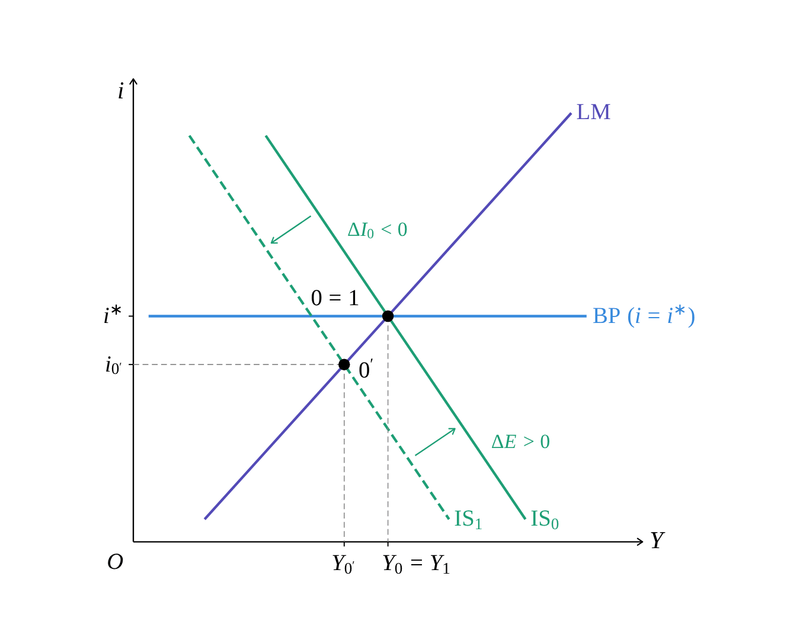
:::

*Shock* real negativo con tipo de cambio flexible. La depreciación compensa la caída de la demanda y la producción vuelve a su nivel inicial.
:::

***Shock* real con régimen cambiario fijo**: en el mismo plano (figura -@fig-b152-shock-real-fijo), el *shock* desplaza de nuevo la curva IS de $\text{IS}_0$ a $\text{IS}_1$:

- *Efecto contractivo interno (desplazamiento de 0 a 0′)*: como en el caso anterior, la caída de la inversión reduce la demanda agregada y la renta hasta $Y_{0'}$, y el tipo de interés baja hasta $i_{0'}$.

- *Efecto contractivo externo (desplazamiento de 0′ a 1)*: la caída del tipo de interés genera una salida de capitales y presiones depreciatorias sobre la moneda. Para defender la paridad, la autoridad monetaria debe vender divisas y comprar moneda nacional ($\Delta R < 0$), lo que contrae la oferta monetaria, desplaza la LM de $\text{LM}_0$ a $\text{LM}_1$ y agrava la caída de la renta, hasta $Y_1$.

Un régimen de cambio fijo no es, pues, capaz de aislar el *shock*, debido al efecto contractivo de la política monetaria de defensa de la paridad.

::: {#fig-b152-shock-real-fijo}

::: {.content-visible when-format="html"}
```{=html}
<div class="graph-frame">
<iframe src="../graphs/b152_Shock_real_fijo.html" style="height:560px" loading="lazy" title="fig-b152-shock-real-fijo"></iframe>
</div>
```
:::

::: {.content-visible unless-format="html"}
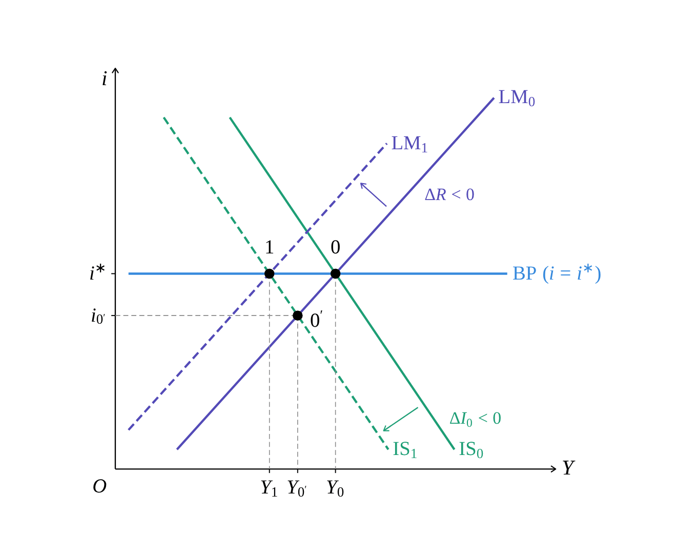
:::

*Shock* real negativo con tipo de cambio fijo. El ajuste recae íntegramente sobre producción y empleo.
:::

***Shock* monetario**: ante una perturbación monetaria interna, el resultado se invierte. En el mismo plano (figuras -@fig-b153-shock-monetario-flexible y -@fig-b154-shock-monetario-fijo), un aumento de la demanda de dinero ($\Delta M^d > 0$) desplaza la curva LM a la izquierda, de $\text{LM}_0$ a $\text{LM}_1$. La economía pasa del punto 0 al 0′, con un tipo de interés $i_{0'}$ superior a $i^*$ y una renta $Y_{0'}$. El ajuste posterior depende del régimen:

- *Tipo de cambio flexible*: la entrada de capitales aprecia la moneda ($\Delta E < 0$), la IS se desplaza de $\text{IS}_0$ a $\text{IS}_1$ y la renta cae hasta $Y_1$ (punto 1).

- *Tipo de cambio fijo*: el banco central compra divisas para defender la paridad ($\Delta R > 0$), la LM vuelve a $\text{LM}_0$ y la economía regresa al punto de partida (0 = 1).

El tipo de cambio fijo aísla la producción de los *shocks* monetarios internos, porque la variación de reservas acomoda la oferta monetaria a la demanda de dinero. El flexible, en cambio, traslada la perturbación al tipo de cambio y, a través de él, a la producción.

::: {#fig-b153-shock-monetario-flexible}

::: {.content-visible when-format="html"}
```{=html}
<div class="graph-frame">
<iframe src="../graphs/b153_Shock_monetario_flexible.html" style="height:560px" loading="lazy" title="fig-b153-shock-monetario-flexible"></iframe>
</div>
```
:::

::: {.content-visible unless-format="html"}
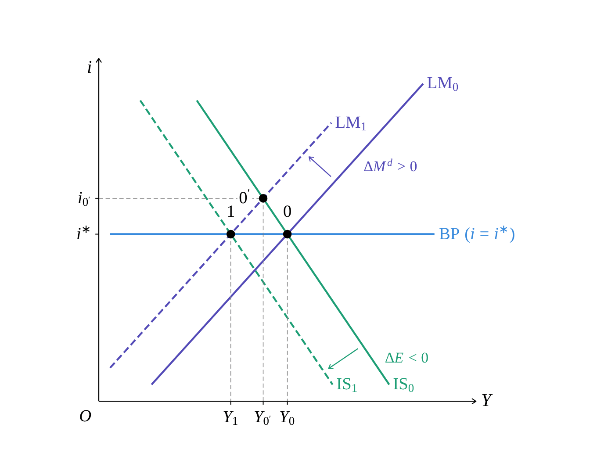
:::

*Shock* monetario con tipo de cambio flexible. La perturbación se transmite al tipo de cambio y, a través de él, a la producción.
:::

::: {#fig-b154-shock-monetario-fijo}

::: {.content-visible when-format="html"}
```{=html}
<div class="graph-frame">
<iframe src="../graphs/b154_Shock_monetario_fijo.html" style="height:560px" loading="lazy" title="fig-b154-shock-monetario-fijo"></iframe>
</div>
```
:::

::: {.content-visible unless-format="html"}
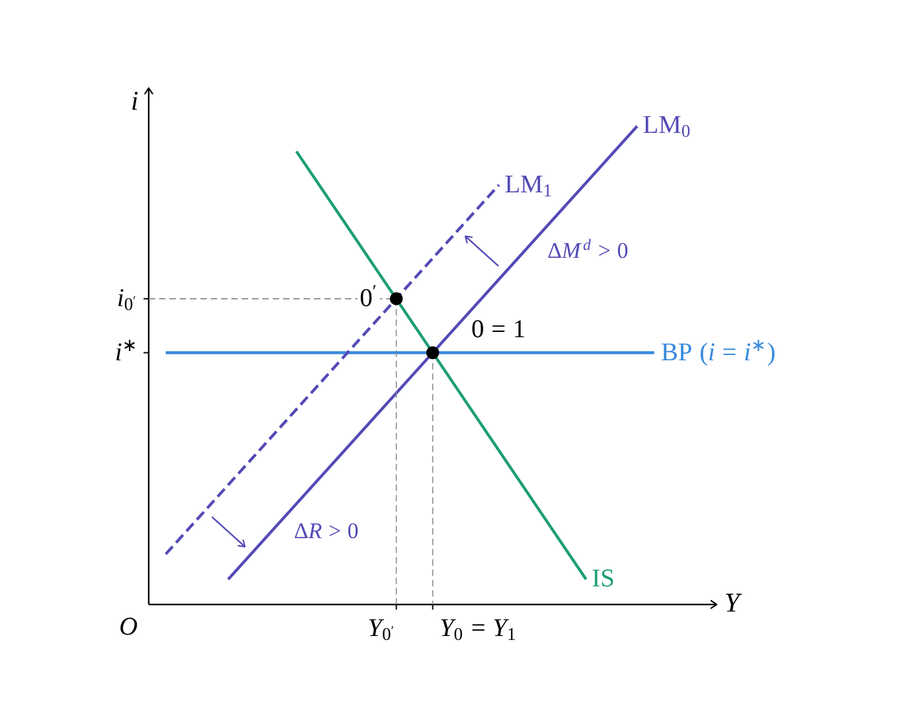
:::

*Shock* monetario con tipo de cambio fijo. La variación de reservas aísla a la producción de la perturbación.
:::

#### 1.3.2. Políticas de demanda con régimen cambiario flexible

**Política monetaria**: gráficamente, en el plano renta-tipo de interés (figura -@fig-b155-pm-tc-flexible), con las curvas IS, LM y BP ya descritas, una expansión monetaria ($\Delta M^s > 0$) traslada la curva LM a la derecha, de $\text{LM}_0$ a $\text{LM}_1$:

- *Efecto expansivo interno (desplazamiento de 0 a 0′)*: el aumento de la masa monetaria desplaza la curva LM. La consiguiente disminución del tipo de interés nominal estimula la inversión, lo que aumenta la demanda agregada y la renta nacional (desplazamiento sobre la curva IS).

- *Efecto expansivo externo (desplazamiento de 0′ a 1)*: la caída del tipo de interés provoca, *ceteris paribus*, una salida de capitales que deprecia la moneda nacional ($\Delta E > 0$), abaratando relativamente las exportaciones y generando una ganancia de competitividad-precio que refuerza la expansión. La IS se desplaza de $\text{IS}_0$ a $\text{IS}_1$ y la renta alcanza $Y_1$.

En resumen, con un tipo de cambio flexible y libertad de movimiento de capitales, la política monetaria es eficaz, debido al efecto depreciatorio que supone la caída del tipo de interés nacional y al cumplimiento de la condición de paridad de intereses.

::: {#fig-b155-pm-tc-flexible}

::: {.content-visible when-format="html"}
```{=html}
<div class="graph-frame">
<iframe src="../graphs/b155_PM_tc_flexible.html" style="height:560px" loading="lazy" title="fig-b155-pm-tc-flexible"></iframe>
</div>
```
:::

::: {.content-visible unless-format="html"}
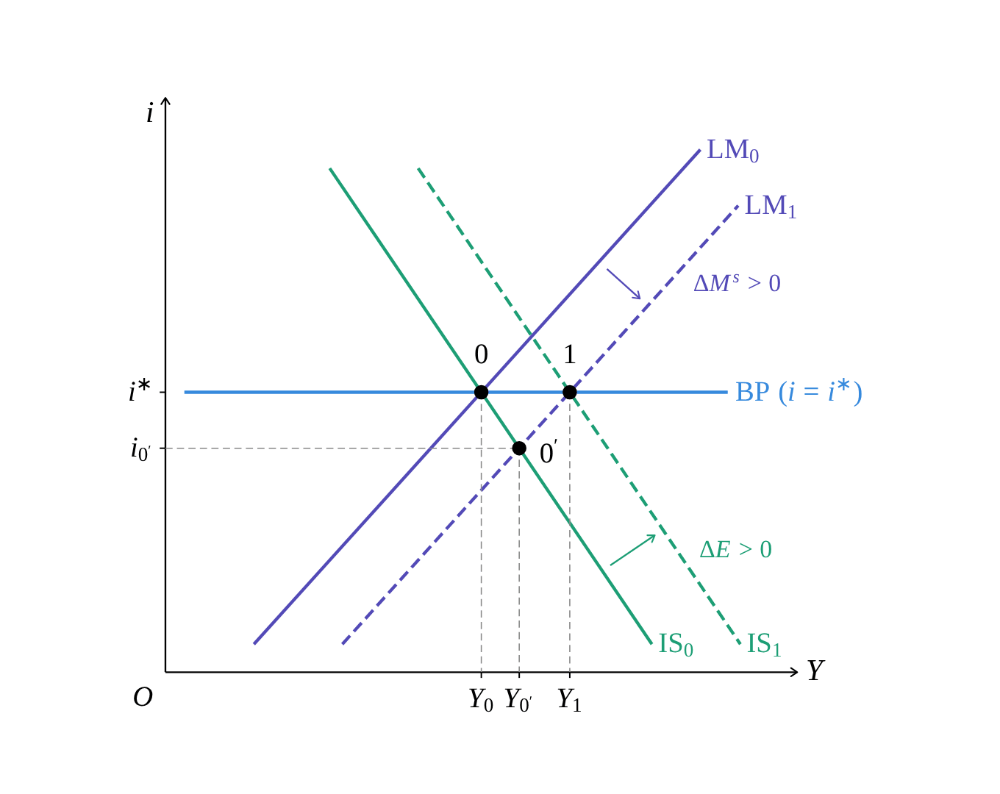
:::

Política monetaria con tipo de cambio flexible. La depreciación la hace plenamente eficaz.
:::

**Política fiscal**: en el mismo plano (figura -@fig-b157-pf-tc-flexible), el aumento del gasto público ($\Delta G_0 > 0$) desplaza la curva IS a la derecha, de $\text{IS}_0$ a $\text{IS}_1$:

- *Efecto expansivo interno (desplazamiento de 0 a 0′)*: el aumento de las compras del Gobierno supone un estímulo a la demanda agregada[^b15-5], que da lugar a un aumento de la renta nacional, con el consiguiente aumento del tipo de interés para equilibrar el mercado financiero.

- *Efecto contractivo externo (desplazamiento de 0′ a 1)*: el aumento de la renta provoca un aumento de las importaciones, sin que las exportaciones varíen[^b15-6], lo que deteriora la balanza comercial. Además, el aumento del tipo de interés provoca, *ceteris paribus*, una entrada de capitales que aprecia la moneda nacional. La apreciación ($\Delta E < 0$) encarece relativamente las exportaciones, con la consiguiente pérdida de competitividad-precio. La balanza comercial se deteriora aún más y el estímulo inicial queda compensado. La IS vuelve a $\text{IS}_0$ y el punto 1 coincide con el 0.

En resumen, con un tipo de cambio flexible y libertad de movimiento de capitales, la política fiscal es ineficaz. La apreciación que provoca la entrada de capitales reduce la demanda exterior neta en la misma cuantía en que el gasto público eleva la demanda interna.

::: {#fig-b157-pf-tc-flexible}

::: {.content-visible when-format="html"}
```{=html}
<div class="graph-frame">
<iframe src="../graphs/b157_PF_tc_flexible.html" style="height:560px" loading="lazy" title="fig-b157-pf-tc-flexible"></iframe>
</div>
```
:::

::: {.content-visible unless-format="html"}
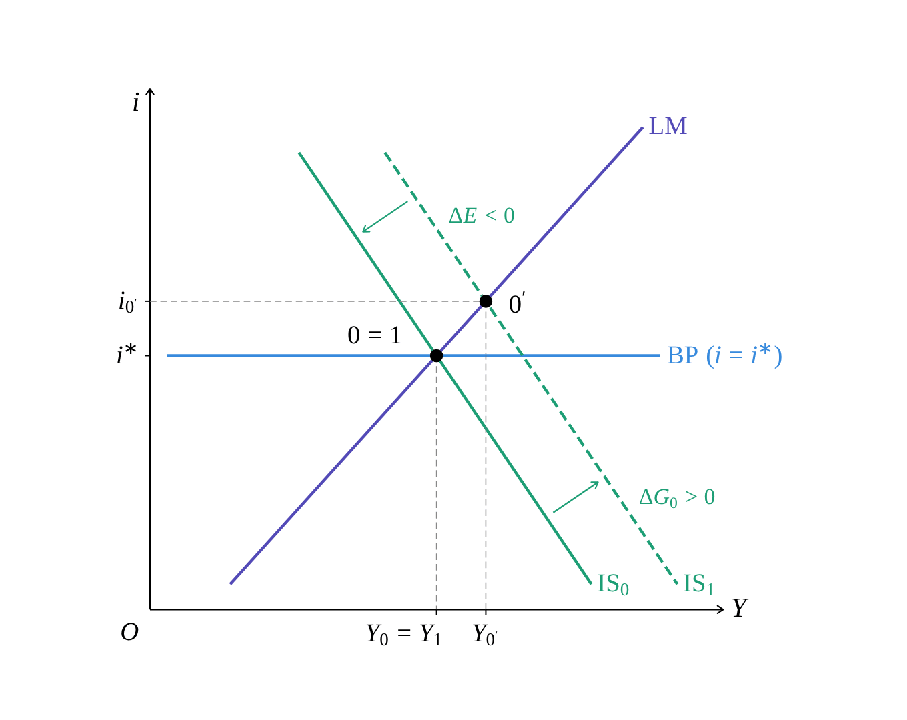
:::

Política fiscal con tipo de cambio flexible. La apreciación y el efecto expulsión exterior la hacen ineficaz.
:::

**Riesgo de indisciplina y *overshooting***: precisamente porque la política monetaria es eficaz, el Gobierno y el banco central pueden verse tentados a usarla de forma discrecional para reactivar la economía a corto plazo, con un sesgo inflacionista (efecto indisciplina).

Además, la propia dinámica de la política monetaria bajo cambio flexible genera volatilidad cambiaria. Así lo muestra la hipótesis del *overshooting* de Rudiger Dornbusch (1976), según la cual, si los precios de los bienes se ajustan más lentamente que los mercados financieros, el tipo de cambio sobrerreacciona en el corto plazo ante los cambios en la oferta monetaria. Ante una expansión, se deprecia inicialmente por encima de su nuevo nivel de largo plazo, hacia el que converge después apreciándose.

::: {.callout-note appearance="simple" icon=false}
El modelo de *overshooting* de Dornbusch se desarrolla en el tema [B14](b14-tipo-cambio.qmd).
:::

#### 1.3.3. Políticas de demanda con régimen cambiario fijo

**Política monetaria**: gráficamente, en el plano renta-tipo de interés (figura -@fig-b156-pm-tc-fijo), la expansión monetaria ($\Delta M^s > 0$) traslada de nuevo la curva LM a la derecha, de $\text{LM}_0$ a $\text{LM}_1$:

- *Efecto expansivo interno (desplazamiento de 0 a 0′)*: el aumento de la masa monetaria y la consiguiente disminución del tipo de interés estimulan la inversión, la demanda agregada y la renta nacional.

- *Efecto contractivo externo (desplazamiento de 0′ a 1)*: la caída del tipo de interés provoca una salida de capitales y, con ella, presiones depreciatorias sobre la moneda nacional, reforzadas por el aumento de las importaciones que induce la mayor renta. Para defender la paridad, la autoridad monetaria debe vender divisas y comprar moneda nacional ($\Delta R < 0$), drenando la liquidez que había inyectado, de modo que la oferta monetaria retorna a su nivel inicial y el estímulo se desvanece. La LM vuelve a $\text{LM}_0$ y el punto 1 coincide con el 0.

En resumen, con un tipo de cambio fijo y libertad de movimiento de capitales, la política monetaria es ineficaz, porque el compromiso cambiario obliga a revertir la expansión.

Una política monetaria expansiva solo podría influir en el nivel de renta si la movilidad del capital fuera imperfecta y las autoridades esterilizaran los flujos de reservas exteriores (p. ej. mediante compras adicionales de títulos públicos en operaciones de mercado abierto). El efecto monetario de la pérdida de reservas se compensaría así total o parcialmente y se mantendría el efecto expansivo (es decir, se evitaría que la LM se desplazase hacia la izquierda)[^b15-7].

::: {#fig-b156-pm-tc-fijo}

::: {.content-visible when-format="html"}
```{=html}
<div class="graph-frame">
<iframe src="../graphs/b156_PM_tc_fijo.html" style="height:560px" loading="lazy" title="fig-b156-pm-tc-fijo"></iframe>
</div>
```
:::

::: {.content-visible unless-format="html"}
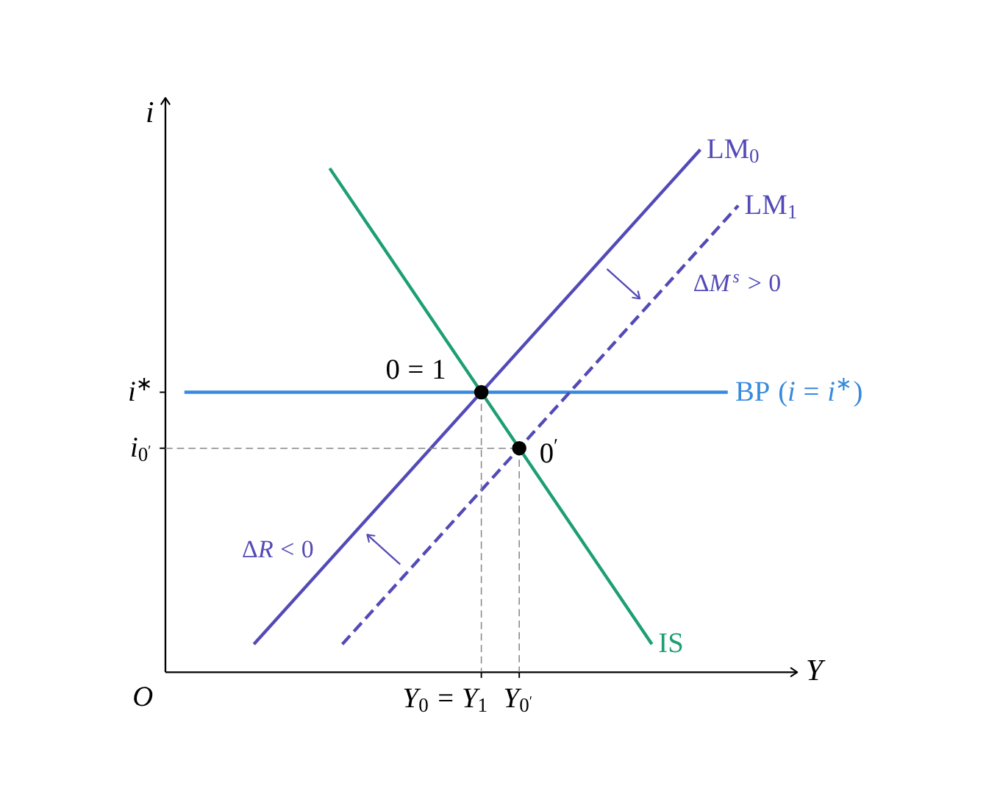
:::

Política monetaria con tipo de cambio fijo. La pérdida de reservas la hace ineficaz.
:::

**Política fiscal**: en el mismo plano (figura -@fig-b158-pf-tc-fijo), el aumento del gasto público ($\Delta G_0 > 0$) desplaza la curva IS a la derecha, de $\text{IS}_0$ a $\text{IS}_1$:

- *Efecto expansivo interno (desplazamiento de 0 a 0′)*: de nuevo, las compras del Gobierno estimulan la demanda agregada y, con ello, la renta nacional, hasta $Y_{0'}$, y el tipo de interés sube hasta $i_{0'}$.

- *Efecto expansivo externo (desplazamiento de 0′ a 1)*: la subida del tipo de interés atrae capitales y genera presiones apreciatorias sobre la moneda nacional. Dado que la autoridad monetaria debe mantener la paridad, acomoda estas presiones interviniendo en el mercado de divisas. Compra divisas y vende (es decir, emite) moneda nacional, en una intervención no esterilizada ($\Delta R > 0$) que equivale a una política monetaria expansiva de acompañamiento y desplaza la LM de $\text{LM}_0$ a $\text{LM}_1$, de modo que la renta alcanza $Y_1$ (punto 1).

En consecuencia, con un tipo de cambio fijo y libertad de movimiento de capitales, la política fiscal es muy eficaz, debido a que la defensa de la paridad obliga a la autoridad monetaria a una intervención que equivale a una expansión monetaria.

::: {#fig-b158-pf-tc-fijo}

::: {.content-visible when-format="html"}
```{=html}
<div class="graph-frame">
<iframe src="../graphs/b158_PF_tc_fijo.html" style="height:560px" loading="lazy" title="fig-b158-pf-tc-fijo"></iframe>
</div>
```
:::

::: {.content-visible unless-format="html"}
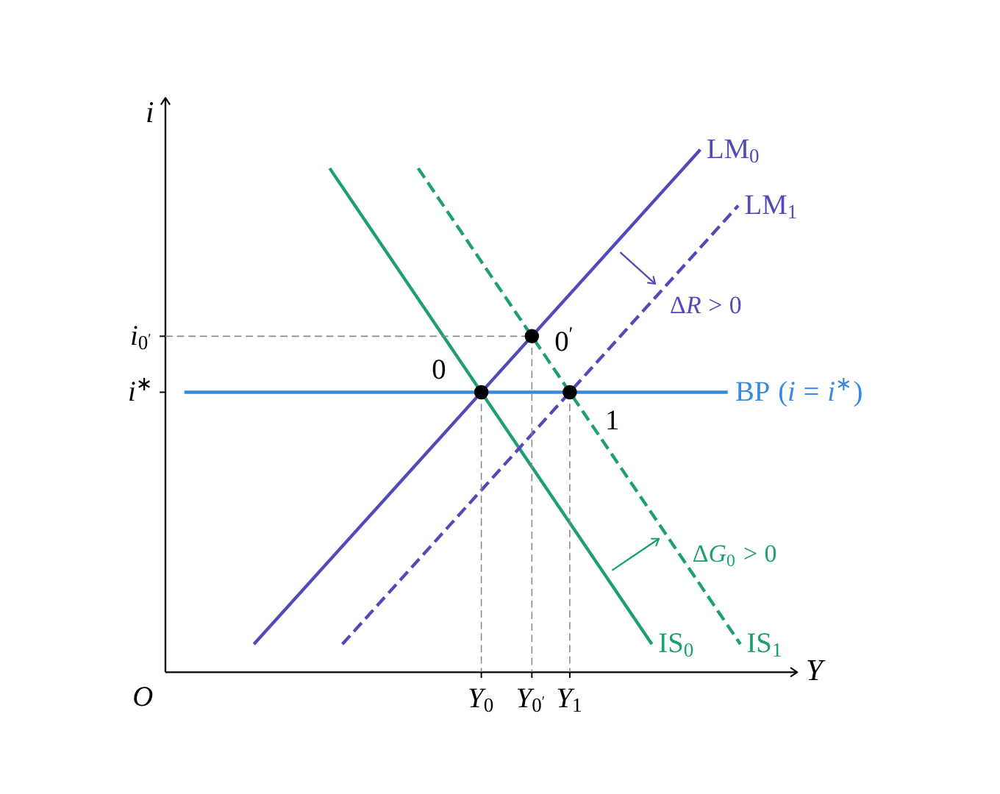
:::

Política fiscal con tipo de cambio fijo. La acomodación monetaria la hace plenamente eficaz.
:::

### 1.4. Diferencias en el ajuste externo

**Régimen de cambio flexible**:

- *Ajuste*: el ajuste de la balanza de pagos es más rápido y automático que en un régimen de cambio fijo, puesto que recae sobre el propio tipo de cambio. Así, un déficit exterior genera presiones depreciatorias que abaratan las exportaciones y encarecen las importaciones, corrigiendo el desequilibrio sin necesidad de intervención. Ahora bien, ese automatismo está sujeto, por un lado, a que se cumpla la condición de Marshall-Lerner y, por otro, a que haya transcurrido el tiempo suficiente para que las cantidades reaccionen. El plazo es necesario porque, en un primer momento, el efecto precio domina sobre el efecto cantidad y la balanza comercial se deteriora (efecto curva J).

- *Cuenta corriente*: con un sistema de tipo de cambio flexible, el comercio de bienes y servicios no tiene por qué verse excesivamente afectado por las fluctuaciones del tipo de cambio, siempre y cuando estas sean transitorias y de escasa magnitud. Una volatilidad elevada y persistente, en cambio, opera como un coste añadido para el comercio, si bien atenuado por la disponibilidad de instrumentos de cobertura.

- *Cuenta financiera*: bajo este tipo de régimen, el país no incurre en el coste de oportunidad de mantener reservas para defender una paridad, aunque en la práctica muchas economías con flotación acumulan reservas por motivos de precaución. Sin embargo, la flotación no evita otros problemas, como las fugas de capitales, las paradas súbitas (*sudden stops*) o el *pecado original* (Eichengreen y Hausmann, 1999). El término designa la imposibilidad del país de endeudarse en el exterior en su propia moneda, con el consiguiente riesgo de haberse endeudado sin cobertura cambiaria adecuada[^b15-8]. En este último caso, por ejemplo, la depreciación podría dejar de ser expansiva, ya que, al elevar el valor en moneda nacional de los pasivos exteriores, deteriora los balances de empresas, bancos y sector público, y puede resultar contractiva.

**Régimen de cambio fijo**:

- *Ajuste*: el ajuste de la balanza de pagos es más lento y costoso, puesto que el tipo de cambio nominal deja de operar como variable de ajuste. La corrección discurre entonces por dos vías. La primera es automática y opera a través de las reservas. Así, un déficit exterior obliga al banco central a vender divisas para sostener la paridad, lo que, si no se esteriliza, contrae la oferta monetaria, reduce la demanda interna y los precios y restablece la competitividad. La segunda vía es la *devaluación interna*, es decir, el ajuste a la baja de precios y salarios nominales, proceso lento por la rigidez a la baja de estos últimos y que recae sobre el empleo. Solo cuando el desequilibrio resulta insostenible se recurre a una devaluación o revaluación de la paridad, que no es propiamente un mecanismo de ajuste, sino una modificación del régimen.

- *Asimetría del ajuste*: estos regímenes reparten de forma desigual la carga del ajuste entre países. Los países con déficit exterior se enfrentan a una restricción dura, pues sus reservas son finitas, mientras que los superavitarios pueden acumular reservas indefinidamente. La carga del ajuste recae, por tanto, sobre los primeros.

- *Cuenta corriente*: la mayor certidumbre sobre la evolución futura del tipo de cambio puede reducir los costes de información y el riesgo de cambio, lo que puede estimular las operaciones comerciales[^b15-10] y la inversión extranjera. El efecto es tanto mayor cuanto más elevado sea el peso del país ancla en el comercio exterior del país que fija, pues el anclaje elimina la volatilidad bilateral, pero no necesariamente la efectiva.

- *Cuenta financiera*: el mantenimiento de un volumen de reservas, generalmente invertidas en activos exteriores de bajo rendimiento, supone un coste de oportunidad[^b15-11], y pueden producirse crisis cambiarias si el compromiso no resulta creíble, debido a ataques especulativos que fuercen el abandono de la paridad. Ahora bien, según evidencian los modelos de crisis de primera y segunda generación, lo problemático no es el tipo de cambio fijo como tal, sino aquellos factores que restan credibilidad a ese compromiso.

### 1.5. Conclusiones

La tabla -@tbl-b15-flexible-fijo resume, por bloques temáticos, las ventajas comparativas de cada régimen polar, a partir de lo examinado por el lado de la oferta, por el de la demanda y en el ajuste externo.

| Dimensión | Tipo de cambio flexible | Tipo de cambio fijo |
|---|---|---|
| **Anclaje nominal e inflación** | Sin ancla externa: la credibilidad antiinflacionista ha de proceder de la propia política monetaria (p. ej. objetivos de inflación) | **Ventaja**: la paridad ancla las expectativas y disciplina la negociación salarial y la política monetaria |
| **Autonomía monetaria** (trilema) | **Ventaja**: se conserva con libre movilidad de capitales | Se renuncia a ella, salvo que se restrinjan los movimientos de capital |
| **Política monetaria** | **Eficaz**: la depreciación inducida refuerza el estímulo | *Ineficaz*: la defensa de la paridad revierte la expansión |
| **Política fiscal** | *Ineficaz*: la apreciación inducida compensa el estímulo | **Muy eficaz**: la intervención no esterilizada acompaña al estímulo |
| ***Shocks* reales asimétricos** | **Ventaja**: el tipo de cambio absorbe la perturbación y aísla el producto | El ajuste recae sobre cantidades (empleo) y devaluación interna |
| ***Shocks* monetarios internos** | La perturbación se traslada al tipo de cambio y, a través de él, a la producción (figura -@fig-b153-shock-monetario-flexible) | **Ventaja**: la intervención automática acomoda la oferta monetaria a la demanda de dinero y aísla la producción (figura -@fig-b154-shock-monetario-fijo) |
| **Certidumbre, comercio e inversión** | Volatilidad cambiaria como coste añadido, atenuable con cobertura | **Ventaja**: menor riesgo de cambio frente a la moneda ancla, lo que favorece comercio e inversión extranjera directa |
| **Ajuste externo** | **Ventaja**: rápido y automático, sujeto a Marshall-Lerner y a la curva J | Lento y asimétrico, a través de reservas y devaluación interna |
| **Reservas** | **Ventaja**: no se precisan para defender una paridad | Coste de oportunidad de mantener un volumen suficiente |
| **Riesgo de crisis** | **Ventaja**: no cabe ataque especulativo contra una paridad, aunque sí depreciaciones bruscas | Riesgo de crisis cambiaria si el compromiso no es creíble |
| **Asignación de recursos a largo plazo** | **Ventaja**: los precios relativos reflejan las condiciones del mercado y facilitan la reasignación de factores | Los precios relativos pueden desalinearse si la paridad se aleja del equilibrio |

: Ventajas comparativas del tipo de cambio flexible y del fijo. {#tbl-b15-flexible-fijo}

Ningún régimen domina, pues, al otro en todas las dimensiones, y la elección suele atender a cuatro criterios:

- *Naturaleza de los shocks*: el tipo de perturbaciones (reales o monetarias) que predomina en el país.

- *Credibilidad institucional*: su historial de credibilidad e inflación, que determina el valor del anclaje externo.

- *Grado de apertura*: el peso del comercio exterior y la integración comercial con el país ancla, criterio que remite a la teoría de las áreas monetarias óptimas ([B16](b16-integracion-monetaria.qmd)).

- *Descalce*: el desajuste entre la moneda de denominación de los activos y la de los pasivos de sus balances, que condiciona el signo de los efectos de una depreciación.

En la práctica, además, la distinción entre ambos polos es menos nítida de lo que sugiere el análisis teórico, como muestra el miedo a flotar (apartado 2.3.2), y ello da paso a los regímenes intermedios (apartado 2.2).

## 2. Análisis comparado de los regímenes cambiarios observados

En la realidad no se dan regímenes cambiarios en su forma pura, sino que existen innumerables variantes según el grado de fijación, la frecuencia de las revisiones, la publicidad o el grado de compromiso.

Los regímenes observados se pueden clasificar en tres categorías, de mayor a menor rigidez: **regímenes de vinculación fuerte**, **regímenes intermedios** o de vinculación débil y **regímenes flotantes**. El criterio que separa a los primeros de los segundos no es el grado de fijación de la paridad, que puede ser idéntico, sino la dificultad de salida. En los regímenes de vinculación fuerte, el abandono exige una reforma legal, un tratado internacional o la reintroducción de una moneda propia. En los intermedios, en cambio, basta una decisión administrativa de la autoridad monetaria.

Los regímenes pueden compararse atendiendo a cuatro dimensiones: flexibilidad, independencia de la política monetaria, credibilidad y capacidad de control de la inflación.

### 2.1. Regímenes cambiarios de vinculación fuerte (*hard pegs*)

Este grupo comprende la unión monetaria, la dolarización o euroización y la junta monetaria. Los tres regímenes comparten el rasgo de hacer costosa o directamente imposible la reversión, que es lo que dota de credibilidad al compromiso, y de renunciar a la política monetaria autónoma. Esa renuncia pesa sobre todo cuando hay asincronías de ciclo con el área o con el país emisor o ancla, porque su política monetaria puede no ser entonces la adecuada para el país.

#### 2.1.1. Unión monetaria

::: {.callout-note appearance="simple" icon=false}
Sobre la teoría de las áreas monetarias óptimas y la integración monetaria, véase el tema [B16](b16-integracion-monetaria.qmd).
:::

**Definición**: varios países comparten una moneda única y una política monetaria común, que dirige un banco central común o un sistema que integra a los bancos centrales nacionales. Los tipos de cambio entre los miembros quedan fijados de forma irrevocable y sus monedas, si las tenían, se sustituyen por la común. Solo queda el tipo de cambio de la moneda común frente a terceras monedas, que los miembros fijan o dejan flotar en común.

**Ejemplos**: la zona del euro, con veintiún miembros desde la entrada de Bulgaria el 1 de enero de 2026, es la mayor unión monetaria, pero no la única. Funcionan también la Unión Monetaria del Caribe Oriental, cuyo dólar está anclado al dólar estadounidense, y las dos uniones del franco CFA, cuyas monedas están ancladas al euro. Estas dos uniones son la Unión Económica y Monetaria de África Occidental y la Comunidad Económica y Monetaria de África Central (tema [B35](b35-no-comunitarios.qmd), apartado 2.4.5). En la clasificación *de facto* del FMI, los miembros de una unión monetaria figuran en el régimen de su moneda común. Así, los de la zona del euro están en libre flotación, los del Caribe Oriental en junta monetaria y los del franco CFA en tipo fijo convencional.

**Conclusiones**:

- *Aspectos positivos*: su credibilidad supera la de cualquier paridad fija, porque deshacer una unión monetaria cuesta mucho más que abandonar una paridad. Además, a diferencia de la dolarización, los países miembros participan, a través de sus bancos centrales nacionales, en la política monetaria común, que se decide de forma colegiada, y en el reparto del señoraje.

- *Limitaciones*: obliga a los miembros a coordinar sus políticas económicas.

#### 2.1.2. Dolarización o euroización (*exchange arrangements with no separate legal tender*)

**Definición**: un país utiliza como moneda de curso legal la de otro. La decisión es en principio reversible, aunque revertirla obliga a reconstruir la credibilidad, con un coste elevado. La dolarización es oficial cuando la ley da curso legal a la divisa, por acuerdo con el país emisor o unilateralmente. Es extraoficial (*de facto*) cuando, aunque subsista la moneda nacional, el público hace con la divisa la mayor parte de sus pagos.

**Ejemplos**: este régimen lo ilustran la dolarización oficial de Ecuador, Panamá y El Salvador; la euroización unilateral de Kosovo y Montenegro; y, ya fuera de la vinculación fuerte, la dolarización extraoficial o *de facto* de economías con historial inflacionista, como Perú o Argentina.

**Conclusiones**:

- *Aspectos positivos*: es más creíble que una paridad fija y estabiliza mejor los precios. Elimina además por completo el riesgo de cambio frente al país emisor y, con él, la prima de riesgo cambiario incorporada a los tipos de interés.

- *Limitaciones*: supone una renuncia total a la política monetaria propia, dado que la oferta monetaria pasa a depender del saldo exterior (p. ej. del superávit comercial o de la recepción de remesas). A ello se añaden dos costes de primer orden, la pérdida del señoraje y la desaparición del prestamista de última instancia, puesto que la autoridad monetaria no puede crear la moneda en la que están denominados los depósitos del sistema bancario.

#### 2.1.3. Régimen de junta monetaria, panel de convertibilidad o caja de conversión (*currency board arrangements*)

**Definición**: una junta monetaria asume, por mandato legal explícito, la obligación de cambiar la moneda nacional por una divisa concreta (la moneda ancla) a un tipo fijo. Los países la adoptan, sobre todo, para dar credibilidad a una política antiinflacionista.

Su establecimiento implica la eliminación de las funciones tradicionales del banco central:

- *Respaldo*: la moneda nacional solo puede emitirse contra la moneda ancla, es decir, la base monetaria debe estar respaldada al 100 % por reservas de la moneda ancla. Por ello, aunque se admite la doble circulación monetaria, no puede haber emisión de moneda fiduciaria discrecional. El respaldo íntegro se predica, con todo, de la base monetaria y no de los agregados amplios. El sistema bancario sigue creando depósitos por la vía del multiplicador, de modo que el pasivo bancario excede en todo caso al volumen de reservas.

- *Independencia*: el banco central tiene la prohibición expresa de comprar o mantener títulos del Gobierno, lo que implica que no puede financiar al Gobierno.

- *No prestamista de última instancia*: el banco central no puede conceder liquidez de urgencia a las entidades de crédito[^b15-16]. En el modelo ortodoxo de junta monetaria, tampoco regula las reservas mínimas que estas deben mantener, aunque algunas juntas, como las de Estonia, Lituania o Bulgaria, sí fijaron coeficientes de reservas obligatorias. Carece, por tanto, de margen de actuación para el control monetario.

**Ejemplos**: las juntas monetarias tienen su origen en las colonias británicas del s. XIX y principios del XX, con el antecedente doctrinal de la Bank Charter Act británica de 1844. El régimen perdió peso a lo largo del s. XX y volvió a atraer interés en los años noventa. Lo impulsaron los buenos resultados de Hong Kong (desde 1983), de Argentina en sus primeros años (su junta resistió la crisis del Tequila de 1994-1995)[^b15-17] y de exrepúblicas soviéticas como Estonia (1992) y Lituania (1994). Ambas repúblicas la mantuvieron hasta su ingreso en la zona del euro (2011 y 2015, respectivamente). Bulgaria, con junta monetaria desde 1997, la mantuvo también hasta su ingreso, el 1 de enero de 2026.

**Conclusiones**:

- *Aspectos positivos*: el respaldo legal refuerza la credibilidad y, con ella, el control de la inflación. Asimismo, como el país mantiene su moneda y el señoraje, salir del régimen resulta menos costoso que abandonar la dolarización.

- *Limitaciones*: su eficacia depende del origen de la inflación. Funciona cuando la inflación nace de expectativas desancladas, pero puede servir de poco cuando responde a causas institucionales, como sindicatos con gran poder de negociación. Además, la imposibilidad de actuar como prestamista de última instancia hace que las crisis cambiarias puedan derivar en crisis bancarias, precisamente porque el respaldo íntegro de la base monetaria no alcanza a los depósitos.

### 2.2. Regímenes cambiarios intermedios o de vinculación débil (*soft pegs*)

A diferencia de los anteriores, estos regímenes fijan el tipo de cambio sin comprometerse a la irrevocabilidad de la paridad, que la autoridad monetaria puede modificar. Ganan con ello flexibilidad y una válvula de escape ante perturbaciones adversas, a costa de una menor credibilidad, que es justamente lo que los hace vulnerables a los ataques especulativos.

#### 2.2.1. Tipo de cambio fijado a una divisa o a una cesta de divisas (*fixed peg* o *basket peg*)

**Definición**: se fija un tipo de cambio contra una divisa o una cesta de divisas sin compromiso de irrevocabilidad de la paridad. En la clasificación *de facto* del FMI, el tipo de cambio puede fluctuar en un margen inferior a ±1 % alrededor de un tipo central, o bien sus valores máximo y mínimo deben mantenerse dentro de un margen del 2 % durante al menos seis meses.

**Ejemplos**: este régimen lo ilustran la corona danesa, vinculada al euro en el marco del mecanismo de tipos de cambio II (MTC II) con una banda estrecha; las monedas de los países exportadores de petróleo del Golfo (Arabia Saudí, Emiratos Árabes Unidos, Catar), fijadas al dólar; y, entre los anclajes a una cesta, el dólar fiyiano, referenciado desde 1975 a una cesta de monedas ponderada por el comercio.

**Conclusiones**:

- *Aspectos positivos*: proporciona un ancla nominal y reduce el riesgo de cambio frente a la moneda ancla, con los efectos ya examinados sobre el comercio, la inversión y la negociación salarial. Lo consigue, además, sin exigir la renuncia institucional que imponen los regímenes de vinculación fuerte, pues el país conserva su banco central, el señoraje y la función de prestamista de última instancia, y puede realinear la paridad si una perturbación adversa lo hace necesario. El anclaje a una cesta presenta, además, la ventaja de estabilizar el tipo de cambio efectivo, en lugar de un único tipo bilateral, lo que resulta preferible cuando el comercio exterior está diversificado.

- *Limitaciones*: la reversibilidad que le da flexibilidad es también lo que le resta credibilidad. Al ser conocido que la paridad puede modificarse, el régimen queda expuesto a ataques especulativos cuando los fundamentos se deterioran (modelos de primera generación) o incluso por expectativas que se autocumplen (modelos de segunda generación). Exige, además, mantener un volumen de reservas suficiente para defender la paridad, y con libre movilidad de capitales implica la pérdida de la autonomía monetaria por aplicación del trilema. Si el anclaje es a una cesta cuya composición no se hace pública, se gana margen de maniobra a costa de transparencia y, por tanto, de eficacia del anclaje de expectativas.

#### 2.2.2. Tipo de cambio reptante o deslizante (*crawling peg*)

**Definición**: la paridad se corrige en pequeños pasos, a un ritmo fijado de antemano (p. ej. un porcentaje mensual) o en función de indicadores cuantitativos preestablecidos (p. ej. diferenciales de inflación). Según la referencia del ajuste, hay dos tipos:

- *Pasivo* (*backward looking*): la paridad sigue a la inflación pasada o a la evolución de las reservas.

- *Activo* (*forward looking*): la paridad sigue una senda anunciada con antelación o la inflación prevista, con el fin de guiar las expectativas.

**Ejemplos**: este régimen lo adoptan países que quieren anclar su moneda a la de otro sin poder igualar la inflación de este, como Nicaragua hasta 2023 o Botsuana, con anclaje a una cesta.

**Conclusiones**:

- *Aspectos positivos*: es más flexible que una paridad fija. Al corregir el tipo nominal al ritmo del diferencial de inflación, preserva el tipo de cambio real y, con él, la competitividad, y deja a la política monetaria algo más de margen.

- *Limitaciones*: ese margen monetario es, con todo, estrecho. La variante pasiva presenta, además, el inconveniente de indiciar el tipo de cambio a la inflación pasada, con lo que puede realimentar la inercia inflacionista en lugar de corregirla.

#### 2.2.3. Regímenes basados en bandas

**Definición**: la autoridad monetaria establece un suelo y un techo para el tipo de cambio, que fluctúa libremente dentro de ese intervalo. Las variantes del régimen difieren en cuatro elementos de diseño:

- *Frecuencia de las realineaciones*: a mayor frecuencia, menor riesgo de desvío respecto de los fundamentos, pero menor efectividad del régimen para controlar la inflación, promover el comercio y lograr los demás efectos de un tipo fijo[^b15-19].

- *Amplitud*: al ampliar la banda operan dos fuerzas opuestas. Por un lado, la ampliación tiende a aumentar la volatilidad y, por otro, tiende a aumentar la credibilidad y, con ella, a reducir la volatilidad, como sucedió en el SME en 1993. Esto último puede deberse a que los agentes prevén que, al darle más autonomía al banco central, la política monetaria será más adecuada, o a que la moneda se acerca con menos frecuencia a las bandas, lo que reduce la volatilidad.

- *Moneda de referencia*: la fijación puede ser respecto a una moneda o a una cesta. Para cumplir mejor el objetivo de inflación conviene anclarse a una moneda, mientras que para atender mejor a las variables de los principales socios comerciales es preferible una cesta[^b15-20].

- *Grado de publicidad*: por ejemplo, la composición de la cesta puede ser pública o no.

**Ejemplos**: estos regímenes los ilustran el patrón oro con los puntos del oro, el sistema de Bretton Woods con bandas de ±1 % frente al dólar o el Sistema Monetario Europeo. En realidad, todos los regímenes cambiarios pueden interpretarse como sistemas más o menos estrictos de bandas.

**Conclusiones**:

- *Aspectos positivos*: los límites fijan las expectativas sobre el tipo de cambio, lo que modera su volatilidad, y la anchura de la banda deja algún margen a la política monetaria. Krugman (1991c) formalizó ese anclaje en su modelo de zonas objetivo, cuyo resultado depende de la credibilidad del compromiso:

    - *Compromiso creíble*: la mera expectativa de intervención en los límites estabiliza el tipo de cambio sin necesidad de intervención efectiva (efecto luna de miel o *honeymoon*). Además, el tipo de cambio se vuelve insensible a los fundamentos al aproximarse a los límites (*smooth pasting*), y la banda actúa como un estabilizador automático.

    - *Compromiso no creíble*: la aproximación a los límites desestabiliza el tipo de cambio (efecto divorcio, en la expresión de Bertola y Caballero, 1992).

- *Limitaciones*: los cambios de la banda o de su centro pueden añadir volatilidad. Los límites de la banda ofrecen, además, un blanco preciso a la especulación, al identificar el nivel exacto en el que la autoridad monetaria habrá de intervenir.

### 2.3. Regímenes cambiarios flotantes

Dado que el régimen de cambio flexible puro no se da plenamente en la realidad, conviene distinguir dos categorías dentro de la flotación, según la intensidad de la intervención de la autoridad monetaria.

#### 2.3.1. Libre flotación (*free floating*)

**Definición**: el tipo de cambio se determina en los mercados de divisas y la intervención es meramente excepcional, dirigida a corregir situaciones de desorden. El FMI aplica un criterio cuantitativo para reconocer esta categoría, según el cual la intervención no puede producirse en más de tres ocasiones durante seis meses, y ninguna de ellas puede prolongarse más de tres días hábiles.

**Ejemplos**: el FMI reserva esta categoría, dentro de su clasificación *de facto*, a un número reducido de economías, principalmente avanzadas, entre las que se cuentan Estados Unidos, la zona del euro, Japón o el Reino Unido.

La clasificación descansa, no obstante, en la información que aportan las propias autoridades. Si estas no facilitan datos que confirmen que la intervención se ha mantenido dentro de ese umbral, el régimen se clasifica como flotante (*floating*) y no como de libre flotación. Además, en la práctica algunos de estos países han intervenido de forma no marginal, como Japón, cuyas autoridades han actuado en el mercado de divisas en distintas ocasiones para sostener el yen. La frontera con la categoría inmediatamente inferior (*floating*) es, por tanto, menos nítida de lo que sugiere el criterio cuantitativo.

**Conclusiones**:

- *Aspectos positivos*: maximiza las dos propiedades examinadas en el apartado 1, la autonomía de la política monetaria y la capacidad del tipo de cambio para absorber las perturbaciones reales asimétricas, pues se ajusta de forma continua y sin coste de reservas.

- *Limitaciones*: el tipo de cambio queda expuesto a una volatilidad elevada y a desalineamientos persistentes respecto de sus fundamentos, dado que la mayor parte de las operaciones del mercado de divisas responde a movimientos de capital y no a transacciones comerciales. Ello impone costes de cobertura y de información a los operadores.

#### 2.3.2. Flotación dirigida o sucia (*managed float*)

**Definición**: el tipo de cambio flota, pero la autoridad monetaria interviene con regularidad para suavizar sus movimientos, la llamada *lucha contra el viento* (*leaning against the wind*). Aun así, la autoridad no se compromete con ninguna paridad ni senda predeterminada. Lo que separa este régimen de la libre flotación es la frecuencia de esa intervención, superior al umbral señalado.

Aun bajo flotación, el país debe elegir un ancla nominal que oriente la política monetaria y construya la credibilidad de la autoridad. Históricamente lo fueron el precio del oro o los agregados monetarios[^b15-22]. En cambio, hoy predominan los objetivos directos de inflación (*inflation targeting*), como en Australia, Canadá, Noruega, Polonia, Suecia o el Reino Unido, o los esquemas que atienden a varias variables al diseñar la política monetaria (como en Estados Unidos o la zona del euro)[^b15-23].

**Ejemplos**: Brasil, Colombia, Corea del Sur, Indonesia o Sudáfrica figuran en la categoría de flotación (*floating*) de la clasificación *de facto* del FMI, la que corresponde a este régimen. Según la clasificación preliminar del FMI a 30 de abril de 2026, esa categoría reúne 34 economías, frente a 31 en libre flotación. Los regímenes intermedios o de vinculación débil siguen siendo, con todo, el grupo más numeroso, con 92 de las 195 economías clasificadas (191 miembros y cuatro territorios, como Hong Kong y Macao), frente a 27 de vinculación fuerte y 11 en otros regímenes administrados.

Guillermo Calvo y Carmen Reinhart (2002) atribuyen el recurso a estos regímenes al fenómeno del *miedo a flotar* (*fear of floating*). Muchas economías, especialmente las de países en desarrollo que han sufrido crisis financieras recientes, tienen regímenes cambiarios flexibles *de iure*, pero aplican regímenes intervenidos *de facto* por temor a los efectos de las depreciaciones sobre la inflación y sobre los balances endeudados en divisa.

**Conclusiones**:

- *Aspectos positivos*: la política monetaria conserva un amplio margen propio[^b15-24], y el especulador pierde la apuesta en un solo sentido. Al no existir paridad que defender, el tipo de cambio puede moverse en ambos sentidos, de modo que la posición especulativa incorpora un riesgo de pérdida del que carece frente a un compromiso cambiario.

- *Limitaciones*: como la depreciación es siempre posible, las expectativas de inflación pueden quedar mal ancladas, y el riesgo cambiario que subsiste obliga a cubrirse. La intervención discrecional y no anunciada resta, además, transparencia a la política monetaria.

### 2.4. Conclusiones

Aplicando a los regímenes examinados las cuatro dimensiones anunciadas al comienzo del apartado, se obtiene la comparación de la tabla -@tbl-b15-regimenes.

| Régimen | Flexibilidad | Independencia monetaria | Credibilidad | Control de la inflación |
|---|---|---|---|---|
| Unión monetaria | Nula | Nula (compartida) | Máxima | Máximo (delegado) |
| Dolarización | Nula | Nula | Muy alta | Muy alto (importado) |
| Junta monetaria | Muy baja | Muy baja | Alta | Alto |
| Fijo convencional | Baja | Baja | Media | Medio-alto |
| Reptante | Media-baja | Baja | Media-baja | Medio |
| Bandas | Media | Media | Media (depende de la amplitud) | Medio |
| Flotación dirigida | Alta | Alta | Depende del ancla nominal | Depende del ancla nominal |
| Libre flotación | Máxima | Máxima | Depende del ancla nominal | Depende del ancla nominal |

: Comparación de los regímenes cambiarios observados. {#tbl-b15-regimenes}

Del cuadro se desprende la disyuntiva fundamental que atraviesa todo el apartado. Flexibilidad e independencia monetaria, por un lado, y credibilidad del anclaje, por otro, se mueven en sentidos opuestos, y ningún régimen las maximiza simultáneamente. En los regímenes flotantes, además, la credibilidad no desaparece, sino que se traslada, puesto que deja de descansar en el tipo de cambio y pasa a depender del ancla nominal interna que se adopte, típicamente un objetivo de inflación.

Esta constatación alimentó, tras las crisis cambiarias de los años noventa, la llamada **hipótesis de las soluciones de esquina** o del vaciamiento de los regímenes intermedios (*hollowing out*), formulada por Barry Eichengreen (1994) y popularizada por Stanley Fischer (2001) como “visión bipolar”. Según esta hipótesis, con libre movilidad de capitales, los regímenes intermedios serían insostenibles, por ofrecer un blanco identificable a la especulación sin la protección que da un compromiso irrevocable, de modo que los países se verían empujados hacia uno de los dos extremos.

La tesis fue matizada posteriormente, tanto por la evidencia (una proporción muy elevada de países mantiene regímenes intermedios) como por la observación de que la libre flotación tampoco es plena, según muestra el miedo a flotar. La conclusión que mejor resume el apartado es la de Frankel (1999), según la cual ningún régimen cambiario resulta adecuado para todos los países, ni para un mismo país en todo momento.

## 3. Intervención y regulación en los mercados de cambio

Una vez que las autoridades económicas de un país han elegido un régimen cambiario, establecen relaciones con el mercado de divisas, en cuyo seno aparecen la intervención y la regulación de dichos mercados. Ambos instrumentos son, en el fondo, las dos vías por las que un país gestiona su posición dentro del trilema examinado en el apartado 1.1. La intervención esterilizada es el intento de conservar simultáneamente el objetivo cambiario y la autonomía monetaria sin restringir los movimientos de capital. De ahí que su eficacia sea limitada y condicionada. La regulación, por su parte, actúa directamente sobre el tercer vértice, el de la libre movilidad de capitales.

::: {.callout-note appearance="simple" icon=false}
Sobre la estructura del mercado de divisas, véase el tema [B13](b13-mercado-divisas.qmd). Sobre la determinación del tipo de cambio, véase el tema [B14](b14-tipo-cambio.qmd).
:::

### 3.1. Intervención

Que las autoridades actúen como un agente más en el mercado de divisas obliga a precisar en qué consiste esa actuación, por qué se justifica en cada régimen y con qué instrumentos se lleva a cabo. La experiencia de América Latina, Estados Unidos, Japón y China ilustra después su práctica.

#### 3.1.1. Definición

Hay **intervención** cuando las autoridades monetarias toman parte en el mercado de divisas con acciones y medidas de diverso tipo (anuncios, compraventas, etc.) encaminadas a influir en el nivel del tipo de cambio o a amortiguar sus oscilaciones. La intervención engloba también la gestión de reservas, el proceso de garantizar que las divisas o reservas exteriores de las que dispone la autoridad monetaria tienen un volumen adecuado y están disponibles en el momento necesario.

Para cada país y para cada momento existe un nivel óptimo de reservas. Para concretarlo, la práctica internacional maneja varios criterios de suficiencia de reservas, como son:

- *Cobertura trimestral*: el nivel de reservas debe ser equivalente a tres meses de importaciones, criterio orientado a economías con acceso limitado a los mercados de capitales.

- *Regla de Guidotti-Greenspan*: las reservas deben cubrir la totalidad de la deuda externa a corto plazo por vencimiento residual, es decir, la que habría que refinanciar en el plazo de un año.

- *Métrica compuesta del FMI* (para economías emergentes): pondera exportaciones, agregados monetarios amplios, deuda a corto plazo y otros pasivos, y sitúa el rango de adecuación entre el 100 % y el 150 % de dicho indicador.

Según las medidas o acciones aplicadas, la intervención se clasifica en **intervención directa** e **intervención indirecta**.

#### 3.1.2. Justificación

**Régimen cambiario**: el objetivo de la intervención depende del régimen:

- *Regímenes de cambio fijo*: el objetivo es sostener la paridad y, con ella, la estabilidad completa del tipo de cambio.

- *Regímenes de cambio flexible*: el objetivo es frenar las oscilaciones de corto plazo sin oponerse a la tendencia, en la *lucha contra el viento*, que da una estabilidad solo parcial.

**Acumulación de reservas**: entre los motivos que pueden llevar a la intervención y a la acumulación de reservas están:

- *Confianza*: fomentar la confianza de los inversores, dado que el país podrá hacer frente a sus pagos en divisas.

- *Importación*: seguir pagando las importaciones, incluso cuando no sea posible acceder a financiación para ello.

- *Liquidez*: realizar operaciones de gestión de liquidez, dado que los activos en divisas se utilizan con frecuencia como aval o colateral. También podrían realizarse para conceder liquidez al sector bancario en una situación de emergencia.

- *Servicio de la deuda*: asegurar que el Estado puede hacer frente a su deuda pública emitida en moneda extranjera.

- *Rentabilidad*: invertir las reservas en exceso y obtener, así, una rentabilidad. Este caso es menos habitual y, generalmente, va acompañado de la existencia de fondos soberanos (*sovereign wealth funds*).

#### 3.1.3. Tipos de intervención

La intervención puede ser directa (vía compraventas) o indirecta (vía anuncios o variaciones del tipo de interés oficial).

**Intervención directa**: la autoridad opera en el mercado de divisas con su propio balance. Para frenar una apreciación de la moneda nacional, la vende a cambio de divisas ($\uparrow R$), y para frenar una depreciación, la compra con cargo a sus reservas ($\downarrow R$).

En cualquiera de los casos, las compraventas de divisas suponen una variación de los activos netos mantenidos frente al exterior (ANFE, $R$) en el balance de la autoridad monetaria y, en consecuencia, pueden suponer una variación de la base monetaria. La autoridad monetaria debe decidir, entonces, si esteriliza o no esa variación, es decir, si permite o no que la base monetaria se mueva. Ambas opciones se pueden ilustrar mediante un doble diagrama.

**Intervención (directa) no esterilizada**: se permite que la base monetaria varíe junto con las reservas exteriores[^b15-27]. Gráficamente, la intervención no esterilizada se representa en el plano cantidad de dinero-tipo de interés y en el plano rendimiento-tipo de cambio (figura -@fig-b159-intervencion-no-esterilizada), que recogen el mercado de dinero nacional (izquierda) y el equilibrio en el mercado cambiario (derecha):

1. *Oferta monetaria* ($M^s_0$): refleja la cantidad de dinero en circulación y es vertical, porque la fija la autoridad monetaria con independencia del tipo de interés.

2. *Demanda de dinero* ($M^d(Y_0)$): refleja la cantidad de dinero que los agentes desean mantener. Es decreciente en el tipo de interés, que es el coste de oportunidad de mantener dinero, y se desplaza a la derecha cuando aumenta la renta, porque crecen las transacciones.

3. *Paridad descubierta de intereses* (PDI): refleja las combinaciones de rendimiento de los activos nacionales y tipo de cambio nominal con las que los activos nacionales y extranjeros ofrecen la misma rentabilidad esperada. Es decreciente, porque un tipo de interés mayor atrae capitales y aprecia la moneda.

4. *Equilibrio*: en el punto 0, el mercado de dinero fija el tipo de interés $i_0$, que la recta vertical del panel derecho traslada al mercado de divisas, y, a ese rendimiento, la PDI determina el tipo de cambio nominal $E_0$.

A partir de esa situación, la intervención se desarrolla en dos pasos:

1. *Presión apreciatoria (punto 0′)*: una subida de la renta ($\Delta Y > 0$, p. ej. por una política fiscal expansiva) eleva la demanda de dinero, que pasa de $M^d(Y_0)$ a $M^d(Y_1)$. Como la oferta no cambia, el tipo de interés se eleva hasta $i_{0'}$. Con el tipo extranjero dado y sin trabas a la entrada de capital, el diferencial atrae fondos y la moneda se aprecia hasta $E_{0'}$.

2. *Intervención (punto 1)*: para sostener el tipo de cambio, la autoridad compra divisas con moneda nacional de nueva emisión, que no retira después. La oferta monetaria crece de $M^s_0$ a $M^s_1$ hasta que, en el punto 1, el tipo de interés y el tipo de cambio recuperan $i_0$ y $E_0$. La operación equivale a una expansión monetaria, con sus efectos inflacionistas.

::: {#fig-b159-intervencion-no-esterilizada}

::: {.content-visible when-format="html"}
```{=html}
<div class="graph-frame wide">
<iframe src="../graphs/b159_Intervencion_no_esterilizada.html" style="--r:1.92" loading="lazy" title="fig-b159-intervencion-no-esterilizada"></iframe>
</div>
```
:::

::: {.content-visible unless-format="html"}
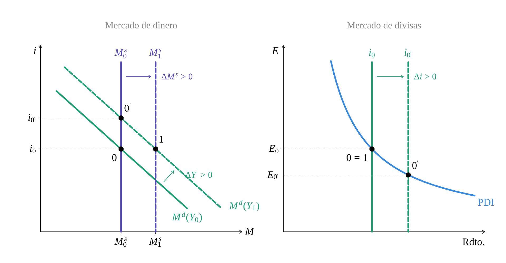
:::

Intervención no esterilizada. La compra de divisas amplía la base monetaria y devuelve el tipo de interés y el tipo de cambio a su nivel inicial.
:::

En el caso simétrico de presiones depreciatorias, se venden divisas y se drena moneda nacional, lo que equivale a una política monetaria restrictiva de efectos antiinflacionistas. La intervención no esterilizada es, en consecuencia, una política monetaria por otro nombre, eficaz sobre el tipo de cambio precisamente porque renuncia a la autonomía monetaria.

**Intervención (directa) esterilizada**: en este caso no se admiten variaciones de la base monetaria y, por ello, la intervención se acompaña de una esterilización[^b15-29]. Por esterilización se entiende la operación de mercado abierto que provoca sobre la oferta monetaria nacional un efecto de signo contrario al que se deriva de la intervención de la autoridad monetaria en el mercado cambiario. La cuestión relevante es entonces si una intervención que deja inalterada la base monetaria puede, aun así, mover el tipo de cambio. La literatura identifica tres canales de transmisión:

- *Canal de cartera* (*portfolio balance*): solo funciona si los activos nacionales y extranjeros son sustitutivos imperfectos. Con sustitución perfecta, a los inversores les es indiferente la composición de su cartera, y una intervención que deja intacta la oferta monetaria no altera el tipo de cambio. Con sustitución imperfecta, en cambio, la venta de bonos en moneda nacional con la que se esteriliza la compra de divisas eleva el peso de esos bonos en las carteras privadas. Los inversores, más expuestos ahora a una depreciación, solo los retienen a cambio de una prima de riesgo, $\rho$. La prima se suma a la paridad descubierta de intereses, $i = i^* + \frac{E^e - E}{E} + \rho$, y desplaza la curva hacia la derecha, porque para cada tipo de cambio los inversores exigen más rentabilidad.

    En las economías avanzadas, donde los activos son muy sustituibles entre sí, la evidencia atribuye la eficacia de la intervención más al canal de señalización que a este (Sarno y Taylor, 2001). En las emergentes, por el contrario, la intervención suele mover el nivel y la volatilidad del tipo de cambio, porque sus bancos centrales disponen de reservas elevadas, no siempre esterilizan por completo y cuentan con controles de capital (Menkhoff, 2013).

- *Canal de señalización*: la intervención transmite información sobre la orientación futura de la política monetaria, alterando las expectativas de los agentes y, con ellas, el tipo de cambio esperado, $E^e$. La señal resulta creíble porque la autoridad compromete su propio balance. Al tomar una posición en divisas, se expone a pérdidas si su política posterior no resulta coherente con lo señalado, lo que distingue la intervención de una mera declaración.

- *Canal de microestructura*: el mercado de divisas es descentralizado y la información sobre los flujos de órdenes es privada ([B13](b13-mercado-divisas.qmd)). Por ello, una intervención de volumen apreciable modifica el conjunto de información de los operadores y puede desencadenar ajustes de posiciones superiores a la operación inicial.

Gráficamente, en los mismos planos (figura -@fig-b1510-intervencion-esterilizada), el aumento de la renta del caso anterior ($\Delta Y > 0$) desplaza la demanda de dinero de $M^d(Y_0)$ a $M^d(Y_1)$. Como la oferta monetaria, $M^s$, no varía, el tipo de interés sube de $i_0$ a $i_{0'}$ y la moneda se aprecia hasta $E_{0'}$ (punto 0′). Por el canal de cartera, la prima de riesgo ($\Delta \rho > 0$) desplaza la paridad de $\text{PDI}_0$ a $\text{PDI}_1$ y, con el tipo de interés $i_1 = i_{0'}$, el tipo de cambio vuelve a $E_1 = E_0$ (punto 1).

::: {#fig-b1510-intervencion-esterilizada}

::: {.content-visible when-format="html"}
```{=html}
<div class="graph-frame wide">
<iframe src="../graphs/b1510_Intervencion_esterilizada.html" style="--r:1.846" loading="lazy" title="fig-b1510-intervencion-esterilizada"></iframe>
</div>
```
:::

::: {.content-visible unless-format="html"}
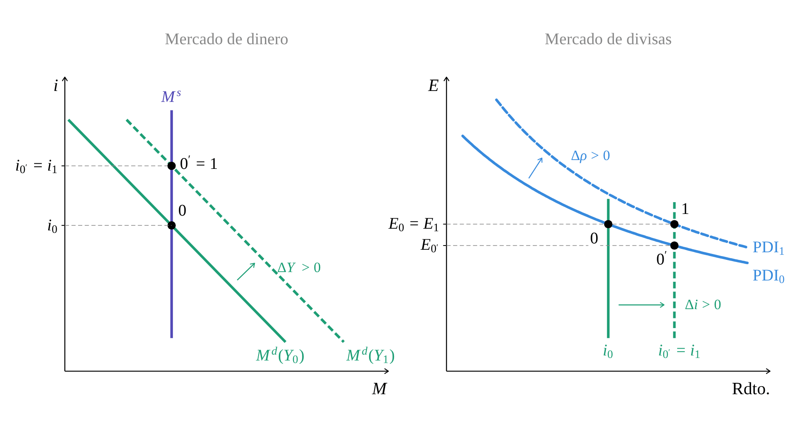
:::

Intervención esterilizada. La operación de mercado abierto compensadora mantiene inalterada la oferta monetaria, y la intervención solo actúa vía primas de riesgo o señales.
:::

**Intervención indirecta** (anuncios, comunicaciones y gestión de expectativas): en un marco de incertidumbre sobre la orientación de la política económica del país, las autoridades pueden recurrir a anuncios públicos o a variaciones del tipo de interés oficial. Una variación del tipo oficial altera el diferencial de intereses y, con él, el tipo de cambio. Ninguna de las dos vías exige operar en el mercado de divisas. Por ello, la intervención indirecta se distingue de la directa, o intervención propiamente dicha, en que no compromete recursos, lo que la abarata pero también la debilita. La intervención indirecta expone, además, a la autoridad monetaria o al sector público a un problema de credibilidad si sus actuaciones no son consecuentes con lo anunciado.

Gráficamente, en los mismos planos (figura -@fig-b1511-intervencion-indirecta), si se anuncia, por ejemplo, una política fiscal expansiva que pueda generar presiones inflacionistas, el anuncio afecta a las expectativas de los agentes y eleva el tipo de cambio esperado ($\Delta E^e > 0$). La paridad se desplaza de $\text{PDI}_0$ a $\text{PDI}_1$ y, con el tipo de interés $i_0$ dado, la moneda se deprecia de $E_0$ a $E_1$ (del punto 0 al 1), sin intervención cambiaria directa.

::: {#fig-b1511-intervencion-indirecta}

::: {.content-visible when-format="html"}
```{=html}
<div class="graph-frame wide">
<iframe src="../graphs/b1511_Intervencion_indirecta.html" style="--r:1.846" loading="lazy" title="fig-b1511-intervencion-indirecta"></iframe>
</div>
```
:::

::: {.content-visible unless-format="html"}
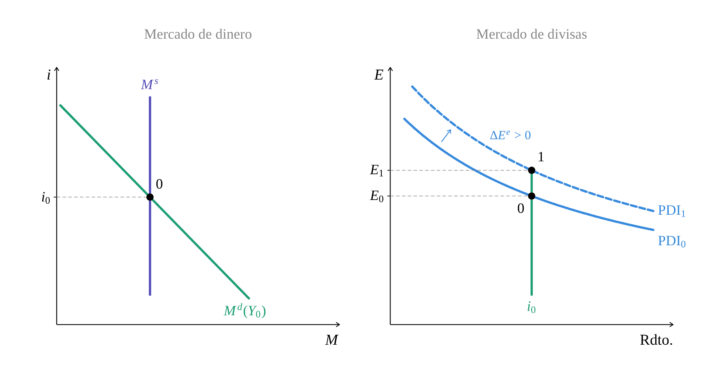
:::

Intervención indirecta. Un anuncio que eleva el tipo de cambio esperado ($E^e$) desplaza la curva de paridad y deprecia la moneda sin intervenir en el mercado de divisas.
:::

#### 3.1.4. Evidencia empírica sobre la intervención: América Latina (1982), EE. UU. (2008-2014), Japón (2010) y China (2015)

::: {.callout-note appearance="simple" icon=false}
Sobre los modelos de crisis de balanza de pagos, véase el tema [B17](b17-crisis-bp.qmd).
:::

**La incompatibilidad de objetivos** (crisis de deuda latinoamericana, 1982): la crisis de deuda latinoamericana ilustra la incompatibilidad entre el objetivo cambiario y el resto de objetivos de política económica. Durante los años setenta, numerosos países de la región mantenían tipos de cambio fijos o reptantes frente al dólar mientras financiaban déficits fiscales persistentes con creación de dinero y endeudamiento exterior barato en dólares. El endurecimiento monetario de la Reserva Federal a partir de 1979 (el “*shock* Volcker”) elevó los tipos de interés mundiales, encareció el servicio de la deuda y revirtió los flujos de capital. Con ello, la defensa de las paridades exigió cuantiosas pérdidas de reservas, cuyo agotamiento desembocó en devaluaciones forzadas y en la suspensión de pagos de México en agosto de 1982, que se extendió por la región.

El episodio se ajusta a la lógica de los modelos de crisis de primera generación (Krugman, 1979a). Según esa lógica, un tipo de cambio fijo es insostenible cuando la política fiscal y monetaria interna es incompatible con la paridad, y la intervención solo pospone (y encarece) el ajuste.

**El caso de Estados Unidos** (2008-2014): un debate surgido tras la crisis financiera global es si los países ricos (p. ej. Estados Unidos) intervienen en los mercados de divisas con objetivos cambiarios de manera heterodoxa. Un país grande y de moneda fuerte puede utilizar la expansión cuantitativa (*quantitative easing*, QE) para depreciar su moneda y estabilizar el ciclo. Según sus críticos, ello daría lugar a políticas de empobrecimiento del vecino equivalentes a las devaluaciones competitivas que prohíbe el artículo IV del Convenio del FMI, si bien la política monetaria orientada a objetivos internos no se considera manipulación cambiaria[^b15-31].

**El caso de Japón** (2010): en septiembre de 2010, el Ministerio de Finanzas japonés ordenó al Banco de Japón una venta de 2,12 billones de yenes (unos 25.000 M\$) para debilitar la moneda, que se depreció un 3 % el mismo día. La operación superaba el importe agregado de las intervenciones estadounidenses en el mercado de divisas desde mediados de los años noventa[^b15-32]. El contraste ilustra hasta qué punto la práctica de la intervención difiere entre economías avanzadas formalmente clasificadas en el mismo régimen cambiario.

**El caso de China** (2015): hasta 2014, ante las presiones apreciatorias que generaban sus persistentes superávits por cuenta corriente y las entradas de capital, China intervino de forma masiva y esterilizada para contener la apreciación del yuan frente al dólar. La operación tenía dos fases:

1. *Compra de activos en dólares*: en primer lugar, el banco central compraba activos denominados en dólares entregando yuanes a cambio ($\uparrow R$ con $\uparrow H$), lo que contenía la apreciación del yuan pero expandía la base monetaria. Además, dado que los bonos del Tesoro estadounidense son sustitutivos casi perfectos del dólar por su elevada liquidez, ello suponía retirar liquidez en dólares del mercado internacional.

2. *Esterilización*: en segundo lugar, esterilizaba la operación vendiendo títulos propios denominados en yuanes y elevando el coeficiente de reservas obligatorias de la banca ($\downarrow \text{CI}$ neto con $\downarrow H$, y menor multiplicador monetario), lo que devolvía la oferta monetaria a su nivel inicial. El objetivo era neutralizar esa expansión monetaria y sus efectos inflacionistas, y no contener presión depreciatoria alguna.

La cantidad de yuanes en el sistema no variaba, pero la liquidez *de facto* en dólares disminuía, al haberse retirado de la circulación activos en dólares muy líquidos. El “drenaje” de los activos denominados en dólares no es, además, comparable con la “inyección” de activos denominados en yuanes, ya que a estos se les exige una prima por su mayor riesgo.

El propio año 2015 ilustra, sin embargo, la asimetría del ajuste señalada en el apartado 1.4. Tras la devaluación de agosto y el cambio en el mecanismo de fijación de la paridad central, las presiones se invirtieron. Las salidas de capital obligaron al banco central a realizar la operación contraria, es decir, a vender reservas para sostener el yuan. Entre 2014 y 2016 sus reservas exteriores se redujeron en torno a una cuarta parte, y se endurecieron además los controles de capitales.

#### 3.1.5. Conclusiones

**Aspectos positivos**: la intervención no esterilizada es eficaz sobre el tipo de cambio, aunque a costa de la autonomía monetaria. La esterilizada lo es sobre todo por el canal de señalización en las economías avanzadas, y en las emergentes la intervención suele mover el nivel y la volatilidad del tipo de cambio. Las reservas acumuladas sostienen, además, la confianza de los inversores y los pagos exteriores del país.

**Limitaciones**: frente a esos beneficios, la acumulación de reservas tiene dos costes, el de oportunidad y, cuando se esteriliza, el cuasifiscal.

El **coste cuasifiscal** surge porque la autoridad monetaria remunera los títulos que emite en moneda nacional para drenar la liquidez mientras percibe la rentabilidad, habitualmente inferior, de los activos exteriores en que materializa las reservas. El diferencial constituye una pérdida recurrente que soporta, en última instancia, el sector público.

En todo caso, la decisión de intervención y gestión de reservas está sujeta a múltiples condicionantes. Entre ellos figuran las restricciones institucionales, el entorno histórico, el posible conflicto con el objetivo último o con los estatutos de la institución monetaria, y la reputación del banco central y su relación con el Gobierno. A ellos se suman las normas internacionales, implícitas y explícitas, sobre el comportamiento de los bancos centrales.

### 3.2. Regulación

La regulación actúa sobre el tercer vértice del trilema, la libre movilidad de capitales. Su estudio sigue el mismo orden que el de la intervención, desde la definición y la justificación hasta los tipos de regulación.

#### 3.2.1. Definición

La **regulación** reúne las normas que rigen la actividad de los mercados de cambios, desde la legislación general hasta los límites a la entrada y salida de capitales. Estos límites influyen en el tipo de cambio a través de los flujos de divisas que permiten o impiden.

#### 3.2.2. Justificación

El fundamento de la regulación cambiaria procede de la economía del bienestar. Si los mercados fueran perfectamente competitivos y no hubiera fallos de mercado, la libre circulación de capitales sería óptima. En cambio, cuando existen distorsiones que no pueden eliminarse, la teoría del *second best* (Lipsey y Lancaster, 1956) muestra que añadir otra restricción, como un límite a los flujos de capital, puede mejorar el bienestar. Como la competencia perfecta es la excepción, el control de capitales puede estar justificado en casos concretos.

La literatura reciente, con Bianchi (2011) y Korinek (2011), ha precisado el argumento, dentro de la misma economía del bienestar, por la vía de las **externalidades pecuniarias**. Los agentes que se endeudan en divisa no internalizan que su decisión eleva la vulnerabilidad agregada de la economía ante una reversión de los flujos, puesto que la depreciación consiguiente deteriora los balances de todos los demás. Existe, por tanto, un endeudamiento exterior socialmente excesivo, y una restricción que lo corrija mejora el bienestar.

#### 3.2.3. Tipos de regulación

Los movimientos de capitales pueden limitarse de varias maneras, y tres son las más frecuentes[^b15-35]: las restricciones cuantitativas (controles de capitales), los impuestos y los tipos de cambio múltiples.

**Restricciones cuantitativas o controles de capitales**: limitan el volumen de capital que puede entrar en el país o salir de él, para evitar flujos masivos que lo desestabilicen. Recaen sobre todo en los flujos de corto plazo, como la inversión de cartera, y menos en la inversión extranjera directa.

- *Controles a la entrada*: suelen consistir en límites cuantitativos o en requisitos que encarecen la entrada. Por ejemplo, Malasia limitó en 1994 los pasivos exteriores de sus bancos y las operaciones de *swap* con no residentes. Chile impuso en 1991 el “encaje”, un depósito no remunerado, inicialmente del 20 % de los nuevos créditos externos y del 30 % desde 1992, que operaba como un impuesto implícito más que como un tope.

- *Controles a la salida*: pueden fijar topes anuales o imponer una espera mínima desde que se solicita la repatriación del capital hasta que se autoriza. El caso más citado es el de Malasia en 1998, que en plena crisis asiática fijó el ringgit frente al dólar e impuso un periodo mínimo de permanencia al capital de cartera. La medida, entonces muy criticada, fue después revalorizada por buena parte de la literatura. China, por su parte, limita a 50.000 dólares anuales por persona la compra de divisas, cupo que no puede destinarse a inversión en el exterior. Por encima del cupo, la operación debe justificarse documentalmente ante la autoridad cambiaria.

**Impuestos**: gravan las transacciones de capital, en la línea de la tasa sobre las operaciones cambiarias que propuso James Tobin en 1972 para penalizar la especulación a muy corto plazo ([B13](b13-mercado-divisas.qmd), apartado 3.3.3). Al restar rentabilidad a la especulación, pueden moderar la volatilidad del tipo de cambio, y aportan además recaudación. Sin un acuerdo internacional amplio, sin embargo, las operaciones se trasladan a las plazas que no los aplican.

La experiencia europea ilustra bien ambos extremos. El impuesto sobre transacciones financieras propuesto por la Comisión en 2011 (y reformulado en 2013 como cooperación reforzada entre once Estados) permaneció bloqueado en el Consejo durante más de una década, al exigir unanimidad entre los Estados participantes, sin llegar a aplicarse, y la Comisión retiró formalmente la propuesta en octubre de 2026.

Las figuras nacionales adoptadas entretanto, como las de Francia (2012), Italia (2013) o España (2021), ilustran la otra cara del problema, ya que, aplicadas unilateralmente, gravan sobre todo, con tipos reducidos, la adquisición de acciones de sociedades nacionales cotizadas de gran capitalización. La base resultante es estrecha, y el propio impuesto tiende a erosionarla al reducir el volumen negociado.

**Tipos de cambio múltiples**: la autoridad aplica tipos de cambio distintos según la clase de operación. Lo habitual es un tipo preferente para las importaciones consideradas esenciales o para el servicio de la deuda y otro depreciado para las demás. Constituyen una práctica de tipos de cambio múltiples sujeta a la aprobación del FMI conforme al artículo VIII de su Convenio Constitutivo. En la práctica, generan oportunidades de arbitraje entre segmentos, actividades de búsqueda de rentas y, con frecuencia, la aparición de un mercado paralelo o informal cuya cotización se aleja progresivamente de la oficial. Han sido empleados, entre otros, por Venezuela, Argentina y Nigeria.

#### 3.2.4. Conclusiones

**Aspectos positivos**: la regulación encarece la especulación, lo que puede moderar la volatilidad cambiaria, y concede a las autoridades tiempo para corregir sus desequilibrios internos, como en China. En el caso del encaje chileno, el resultado empírico más robusto es que alargó el plazo de las entradas de capital y redujo así la vulnerabilidad del país (De Gregorio, Edwards y Valdés, 2000).

**Limitaciones**: la inversión se resiente, porque rinde menos y se vuelve más incierta. Además, los controles no distinguen entre la especulación desestabilizadora y el arbitraje, que integra los mercados de divisas y hace cumplir la ley del precio único, y frenan los dos. Distorsionan, por último, las decisiones intertemporales de ahorro e inversión.

En el caso chileno, además, no se aprecian efectos claros y duraderos sobre el volumen total de entradas ni sobre el tipo de cambio real. A ello se añade la constatación de que los controles tienden a erosionarse con el tiempo, a medida que los agentes encuentran vías para eludirlos, salvo que se actualicen al mismo ritmo. Por eso hoy se consideran un instrumento de corto plazo, combinable con otros.

## Conclusiones

Elegir un régimen cambiario supone administrar varias disyuntivas, entre credibilidad y flexibilidad, entre estabilidad cambiaria y autonomía monetaria, y entre el aislamiento frente a unos *shocks* y la exposición a otros, bajo la restricción del trilema de Mundell-Fleming. Entre los regímenes polares, el flexible aísla mejor de las perturbaciones reales y refuerza la política monetaria, mientras que el fijo ancla las expectativas y hace muy eficaz la política fiscal. Ningún régimen observado maximiza a la vez la flexibilidad y la credibilidad del anclaje. Los intermedios agrupan a casi la mitad de los países, en contra de la “visión bipolar” (Fischer, 2001), y el *miedo a flotar* (Calvo y Reinhart, 2002) explica que la flotación tampoco sea plena. La intervención y la regulación completan el cuadro, con un nivel óptimo de reservas propio de cada economía y unos controles que alteran sobre todo la composición de los flujos. Como resumió Frankel (1999), ningún régimen es adecuado para todos los países ni para todos los momentos.

La comparación de los regímenes polares aplica el modelo IS-LM-BP y el trilema de Mundell-Fleming (tema [A32](a32-precios-output.qmd)), y la intervención se apoya en las operaciones oficiales del mercado de divisas (tema [B13](b13-mercado-divisas.qmd)). En el extremo de la vinculación fuerte, la unión monetaria renuncia por completo al tipo de cambio (tema [B16](b16-integracion-monetaria.qmd)), mientras que las paridades ajustables quedan expuestas a ataques especulativos (tema [B17](b17-crisis-bp.qmd)). Por último, la historia del sistema monetario internacional, del patrón oro a Bretton Woods y a la flotación, muestra cómo ha cambiado la forma de resolver esas disyuntivas (temas [B20](b20-sei-hasta-bw.qmd) y [B21](b21-sei-despues-bw.qmd)).

Con el ciclo financiero global se discute el alcance del trilema y, con él, el caso clásico a favor de la flotación. Para Rey (2013), ese ciclo reduce el trilema a un dilema (apartado 1.1). Obstfeld, Ostry y Qureshi (2019) encuentran, en cambio, que en las economías emergentes el régimen sigue importando, porque las de tipo fijo transmiten con más intensidad las condiciones financieras globales. Sigue abierta también la discusión sobre la capacidad aislante del tipo de cambio, ya que, con el comercio facturado en dólares, la depreciación apenas estimula las exportaciones (Gopinath et al., 2020). Por su parte, el marco integrado de políticas del FMI (Basu et al., 2020) concluye que, con mercados cambiarios poco profundos o descalces de moneda, la intervención, los controles de capital y las medidas macroprudenciales pueden complementar a la política monetaria.

[^b15-1]: La paridad se entiende aquí como valor comparativo de una moneda con otra (Real Academia Española), no como igualdad, sentido que tiene en la paridad del poder adquisitivo.

[^b15-2]: La clasificación *de facto* de los regímenes cambiarios del FMI puede consultarse en el *Annual Report on Exchange Arrangements and Exchange Restrictions* (AREAER), que publica anualmente.

[^b15-3]: Una actualización influyente del trilema es la de Rey (2013), según la cual la existencia de un ciclo financiero global convierte el trilema en un dilema, porque sin gestión de los flujos de capitales la política monetaria pierde autonomía incluso bajo tipos de cambio flexibles.

[^b15-4]: Con costes de ajuste de plantilla, sin embargo, las empresas no ajustan el empleo ante variaciones transitorias del tipo de cambio, lo que atenúa este efecto.

[^b15-5]: En una economía abierta el estímulo será siempre menor que en una economía cerrada, ya que parte de la demanda interior es de bienes extranjeros.

[^b15-6]: Las exportaciones dependen de la renta exterior y del tipo de cambio real, no de la renta nacional.

[^b15-7]: En todo caso, la esterilización de las pérdidas de reservas no puede mantenerse indefinidamente si no se toman al mismo tiempo medidas de ajuste del déficit exterior. Mientras este persista, continuará la salida de reservas hasta que un ataque especulativo liquide las restantes antes de su agotamiento gradual, lo que dará lugar a una crisis cambiaria de primera generación.

[^b15-8]: Endeudarse en divisa (en dólares en la mayor parte del mundo, en euros en el este de Europa) suele ser más barato y, con mercados financieros locales poco desarrollados, a veces es la única vía de financiación. A cambio, una devaluación puede desencadenar una crisis de deuda soberana, una crisis bancaria o ambas. Incluso el mero aumento del riesgo percibido de devaluación (o de redenominación, como en la crisis de deuda soberana europea) puede provocar una huida de capitales que deprime el crédito y deteriora las cuentas públicas.

[^b15-10]: Es más, Rose (2000), a través de un modelo gravitacional aplicado a las uniones monetarias, encuentra que los miembros de una unión monetaria comercian entre sí en torno a tres veces más. Incluso excluyendo el componente de la unión monetaria, concluye que la variabilidad cambiaria influye de manera significativa en el comercio entre los países.

[^b15-11]: Rodrik (2006) sitúa el coste de oportunidad de las reservas excesivas en torno al 1 % del PIB de los países en desarrollo, y otros cálculos lo elevan hasta cerca del 2 %.

[^b15-16]: En el balance de la autoridad monetaria, $H = \text{CI} + R$, el respaldo íntegro exige $R \geq H$. Un préstamo de urgencia eleva el crédito interno ($\text{CI}$) y, con él, la base monetaria sin aumentar las reservas, y parte de la moneda quedaría sin respaldo. La junta solo puede prestar con el exceso de reservas sobre la base, si lo tiene.

[^b15-17]: El caso argentino ilustra, sin embargo, los límites del régimen. La Ley de Convertibilidad (1991) logró abatir una hiperinflación y sostuvo la paridad uno a uno con el dólar durante una década. Con todo, la apreciación real acumulada, la devaluación brasileña de 1999, la rigidez fiscal y la imposibilidad de asistir a un sistema bancario en dificultades desembocaron en la crisis de 2001-2002. La crisis supuso la restricción de la disponibilidad de depósitos (*corralito*), el abandono de la paridad y la suspensión de pagos de la deuda soberana. La enseñanza que suele extraerse es que la credibilidad que aporta el compromiso legal no sustituye a la coherencia de la política fiscal ni resuelve el problema del prestamista de última instancia.

[^b15-19]: Así, el Sistema Monetario Europeo (SME, 1979) funcionó en sus primeros años más como un *crawling peg* que como un régimen de bandas, debido a la frecuencia de las realineaciones.

[^b15-20]: Conviene que la cesta incluya al principal socio comercial. Por ejemplo, anclada solo al dólar, Argentina perdió competitividad frente a Brasil tras la depreciación del real a finales de los noventa, una de las causas de la quiebra de su junta monetaria.

[^b15-22]: Los agregados monetarios, sobre todo en los años setenta y ochenta.

[^b15-23]: Una propuesta más reciente, que no ha llegado a aplicarse, es la del objetivo de crecimiento de la renta nominal (*nominal GDP targeting*).

[^b15-24]: Se requiere, con todo, una elevada credibilidad del banco central para que la financiación exterior sea estable.

[^b15-27]: En términos del balance del banco central, $H = \text{CI} + R$, la intervención no esterilizada traslada íntegramente la variación de los activos netos frente al exterior a la base monetaria ($\Delta R \rightarrow \Delta H$), al mantenerse constante el crédito interno.

[^b15-29]: En términos del balance, la esterilización compensa $\Delta R$ con $\Delta \text{CI} = -\Delta R$, de modo que la base monetaria no se mueve (p. ej. compra de divisas, $\uparrow R$, y venta de títulos nacionales de la cartera del banco central, $\downarrow \text{CI}$).

[^b15-31]: En 2010, el ministro de Hacienda de Brasil, Guido Mantega, denunció una “guerra de divisas”, pues la expansión monetaria de la Reserva Federal, justificada por la estabilización del ciclo interno, perseguiría en realidad depreciar el dólar.

[^b15-32]: Desde agosto de 1995, Estados Unidos solo había intervenido en junio de 1998, en apoyo del yen, y en septiembre de 2000, en la actuación concertada en apoyo del euro. Después participó en la venta coordinada de yenes del G7 de marzo de 2011.

[^b15-35]: Otras formas incluirían los controles de precios o los requisitos de solicitud de licencia.
