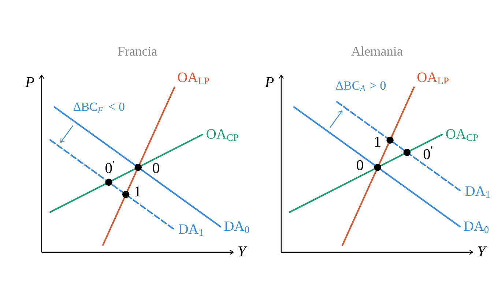
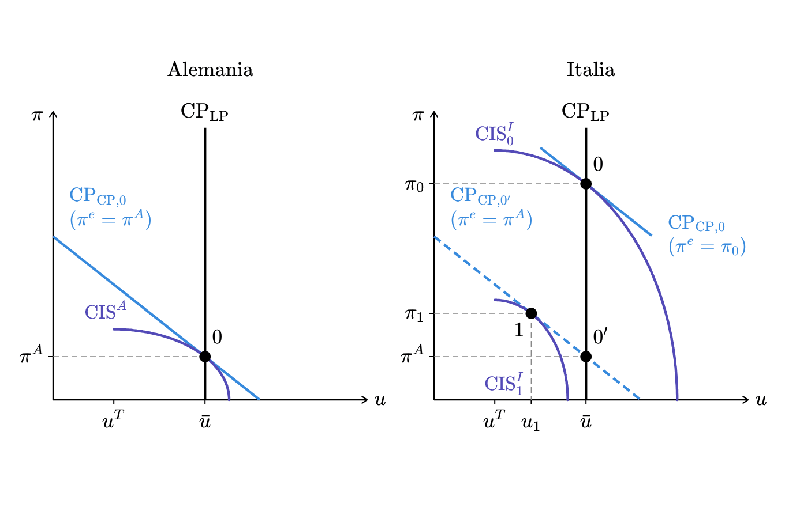
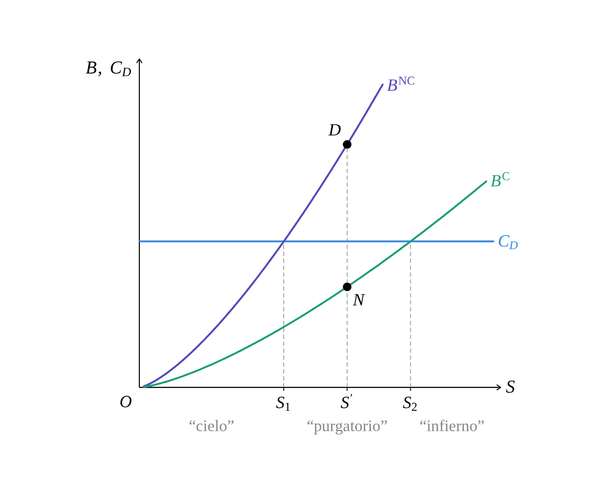

## Introducción

::: {.callout-note appearance="simple" icon=false}

:::

En la escala de integración descrita, la **integración monetaria** constituye, antes de la unión fiscal y política, el nivel más avanzado y tiene tres características principales:

1. *Política monetaria común*: los países miembros abandonan su autonomía en materia monetaria y cambiaria, cuyo ejercicio suele trasladarse a una autoridad monetaria común encargada de conducir la política monetaria de la unión.

2. *Libre circulación de capitales*: los capitales pueden desplazarse sin restricciones entre la totalidad de los países que integran la unión monetaria.

3. *Tipos de cambio fijos*: el establecimiento de una relación fija entre los tipos de cambio, que puede realizarse mediante:

    - *Tipos fijos irrevocables*: la fijación de un sistema de tipos de cambio fijos e irrevocables que garantice la convertibilidad de las divisas, o

    - *Moneda única*: la adopción de una moneda única, lo cual suele dotar de mayor credibilidad al proceso de integración.

Su referencia práctica es la zona del euro, que con la entrada de Bulgaria en 2026 reúne a 21 Estados miembros. La teoría que la juzga es la de las **áreas monetarias óptimas**, iniciada por Mundell (1961) y desarrollada por McKinnon (1963) y Kenen (1969), que buscan los criterios, como la movilidad de los factores, la apertura o la diversificación productiva, que permiten a un grupo de países renunciar al tipo de cambio sin grandes costes. La crisis de deuda soberana mostró, además, que una **unión monetaria incompleta**, sin Unión Bancaria ni prestamista de última instancia para los Estados, es vulnerable a crisis que se alimentan a sí mismas (De Grauwe, 2011).

La teoría de la integración monetaria pone en la balanza lo que cuestan y lo que aportan estos procesos para saber cuándo conviene una unión monetaria. El análisis de la optimalidad de un área monetaria ha pasado por tres etapas:

1. *Primera etapa (años sesenta)*: ve en la integración en un área monetaria, sobre todo, un coste de estabilización.

2. *Segunda etapa (años setenta)*: nace con la publicación del *Informe Werner* (1970), que presentaba las líneas maestras para la creación de una unión monetaria en Europa[^b16-1], y con la revolución de la hipótesis de expectativas racionales (HER). Pone mayor énfasis en los beneficios.

3. *Tercera etapa (años ochenta en adelante)*: pone énfasis en el estudio de los procesos de creación de uniones monetarias y de la fragilidad de estas mediante el análisis coste-beneficio.

Este tema repasa las teorías de la integración monetaria en tres partes:

- *Costes*: la teoría de las áreas monetarias óptimas trata la integración monetaria como un coste.

- *Beneficios*: los desarrollos posteriores ponen el acento en sus beneficios.

- *Construcción de una unión monetaria*: el tema termina con ese proceso, sus retos y sus soluciones.

## 1. Teoría de las áreas monetarias óptimas: la integración monetaria como coste

La sección parte de los antecedentes de la teoría de las áreas monetarias óptimas. En su formulación inicial, la teoría mide sobre todo el coste de renunciar al tipo de cambio, y de ahí deriva los criterios que permiten reducirlo.

### 1.1. Antecedentes

**Debate sobre regímenes cambiarios**: la teoría de las áreas monetarias óptimas reformula el debate de los años cincuenta sobre el régimen cambiario. En ese debate, Milton Friedman (1953) y James Meade defendían que los tipos flexibles permiten absorber las perturbaciones exteriores sin deflación ni desempleo. Frente a ellos, los partidarios de los tipos fijos subrayaban la disciplina antiinflacionista y la menor incertidumbre. Sin embargo, ambos bandos compartían el supuesto, nunca examinado, de que el ámbito de circulación de una moneda coincide con la frontera nacional.

**Debate sobre uniones monetarias**: si bien existían precedentes prácticos de unión monetaria en el siglo XIX, no existía una teoría que explicase qué determina el tamaño óptimo de un espacio monetario. Robert Mundell aborda ese vacío en 1961, invirtiendo el planteamiento del debate. En lugar de preguntarse qué régimen cambiario conviene a un país dado, se pregunta sobre qué territorio conviene que circule una moneda única, con independencia de las fronteras políticas. En su ejemplo de Norteamérica, si las perturbaciones relevantes separan al este del oeste del continente antes que a Canadá de Estados Unidos, la frontera nacional es el lugar equivocado para situar el límite monetario. En ese caso, ni los tipos fijos ni los flexibles entre ambos países resolverían el problema de ajuste.

### 1.2. El coste de renunciar al tipo de cambio

La postura inicial de Mundell en los años sesenta es que la integración monetaria supone un coste desde el punto de vista de la estabilización macroeconómica[^b16-3]. El coste nace de que cada miembro ya no puede recurrir a su tipo de cambio ni a una política monetaria propia para ajustarse. No se trata, sin embargo, de un coste que deba minimizarse sin más, porque el criterio de optimalidad surge del equilibrio entre dos fuerzas opuestas. De un lado, la moneda única priva a cada miembro de esos instrumentos frente a perturbaciones asimétricas. De otro, fragmentar el espacio monetario hasta hacer coincidir cada área con una región elevaría los costes de transacción y erosionaría las funciones del dinero como unidad de cuenta y medio de pago.

Por **área monetaria óptima** se entiende una entidad con varias regiones y moneda única que permite aproximarse simultáneamente al equilibrio interno (pleno empleo y estabilidad de precios) y al equilibrio externo (posición sostenible de la balanza de pagos). Es óptima, en consecuencia, el área que hace mínimo el coste de estabilización, neto de lo que gana en eficiencia con la moneda común. La magnitud de ese coste vendrá determinada por la capacidad de respuesta que tengan el tipo de cambio y la política monetaria propia ante *shocks* reales asimétricos.

#### 1.2.1. Escenario base: modelo de oferta y demanda agregada en economía abierta

Los efectos de la integración monetaria pueden ilustrarse con el modelo OA-DA en economía abierta, que determina a la vez la producción y el nivel de precios de cada país.

::: {.callout-note appearance="simple" icon=false}
El modelo de oferta y demanda agregadas en economía abierta, y la autoría de la curva de oferta agregada, se desarrollan en el tema [A32](a32-precios-output.qmd), apartado 2.
:::

Gráficamente, en el plano renta-precios (figura -@fig-b161-pm-union), el modelo se aplica a dos países, Francia (panel izquierdo) y Alemania (panel derecho), siguiendo el ejemplo clásico de De Grauwe:

1. *Demanda agregada* ($\text{DA}_0$): refleja las combinaciones de renta y precios que equilibran los mercados de bienes y de dinero. Tiene pendiente negativa porque unos precios más altos reducen la oferta real de dinero y elevan el tipo de interés, lo que contrae la inversión, y aprecian el tipo de cambio real, lo que deteriora la balanza comercial.

2. *Oferta agregada a corto plazo* ($\text{OA}_{\text{CP}}$): refleja la producción que ofrecen las empresas a cada nivel de precios con los salarios nominales fijados en los contratos. Tiene pendiente positiva porque, con el salario nominal fijo, una subida de precios abarata el trabajo en términos reales y las empresas producen más.

3. *Oferta agregada a largo plazo* ($\text{OA}_{\text{LP}}$): refleja la producción una vez que las expectativas de precios se cumplen y los salarios se han ajustado a ellas. Tiene mayor pendiente que la $\text{OA}_{\text{CP}}$ porque ese ajuste deja el salario real casi inalterado, y no llega a ser vertical porque, en economía abierta, los salarios se negocian según el IPC, que sube menos que el deflactor.

4. *Equilibrio*: cada país parte de un equilibrio aislado en el punto 0, donde se cortan las tres curvas, con la producción en su nivel de largo plazo, sin presiones sobre los precios y con la balanza comercial equilibrada.

Sobre ese equilibrio incide un *shock* asimétrico de demanda. Un cambio de preferencias de los consumidores conduce a un mayor consumo de productos alemanes en detrimento de los franceses, y cada economía sufre un doble desequilibrio:

- *Economía francesa*:

    - *Desequilibrio interno*: la demanda agregada se desplaza hacia la izquierda, de $\text{DA}_0$ a $\text{DA}_1$ (punto 0′), con lo que caen la producción y los precios y aumenta el desempleo.

    - *Desequilibrio externo*: la caída de la demanda de sus bienes reduce las exportaciones netas ($\Delta \text{BC}_F < 0$) y genera un déficit comercial.

- *Economía alemana*:

    - *Desequilibrio interno*: la demanda agregada se desplaza hacia la derecha, de $\text{DA}_0$ a $\text{DA}_1$ (punto 0′), con lo que aumentan la producción y los precios (presiones inflacionistas).

    - *Desequilibrio externo*: el aumento de la demanda de sus bienes eleva las exportaciones netas ($\Delta \text{BC}_A > 0$) y genera un superávit comercial.

El problema lo genera la asimetría del *shock*. En cambio, ante una perturbación simétrica, que afectase a ambas economías en el mismo sentido y con la misma intensidad, una autoridad monetaria común respondería para el conjunto y no existiría coste alguno derivado de compartir la moneda. A partir de aquí, el mecanismo de ajuste depende de la forma de integración entre ambos países.

#### 1.2.2. Mecanismo de ajuste sin unión monetaria

Si ambos países no integran una unión monetaria, conservarán la política monetaria y cambiaria para hacer frente al *shock*:

**Tipos de cambio flexibles**: el ajuste opera, en primer término, de forma automática. La caída de la demanda de bienes franceses reduce la demanda de su moneda en el mercado de divisas y provoca su depreciación, que abarata las exportaciones francesas y encarece las importaciones francesas procedentes de Alemania, corrigiendo simultáneamente el desequilibrio interno y el externo. La política monetaria refuerza ese mecanismo, no lo sustituye:

- *Francia*: el banco central francés aplicará una política monetaria expansiva para estimular la demanda agregada, cuyo efecto sobre el tipo de cambio se suma a la depreciación ya en curso.

- *Alemania*: el Bundesbank aplicará una política monetaria contractiva para mitigar los efectos inflacionistas, lo que apreciará el marco y reforzará el ajuste en sentido contrario.

El resultado final será un desplazamiento de la demanda agregada francesa hacia la derecha y de la alemana hacia la izquierda, con lo que se restauran ambos equilibrios.

**Tipos de cambio fijos**: el ajuste ya no es automático y exige una decisión discrecional de las autoridades:

- *Francia*: el banco central francés realizará una devaluación para promover la competitividad de las exportaciones francesas. A diferencia del caso anterior, se trata de un reajuste discreto de la paridad que, en un sistema de tipos fijos negociado, requiere el acuerdo de los demás miembros, lo que limita su disponibilidad efectiva como instrumento.

- *Alemania*: el Bundesbank podrá seguir recurriendo a la política monetaria contractiva para mitigar los efectos de la inflación, si bien lo hará por su condición de país ancla del sistema, y no por conservar autonomía cambiaria. Conforme al trilema de Mundell-Fleming, un régimen de tipos fijos con libertad de movimientos de capital obliga a renunciar a la política monetaria autónoma. En un sistema asimétrico, esa renuncia recae sobre los países periféricos, que importan la política del ancla, y no sobre este.

En ambos regímenes, la no integración permite a los dos países estabilizar el ciclo, de forma automática con tipos flexibles y mediante decisiones discrecionales con tipos fijos (la devaluación francesa y la política monetaria del país ancla).

#### 1.2.3. Mecanismo de ajuste con unión monetaria

Si ambas economías formasen una unión monetaria, ninguno de los dos países podría favorecer el ajuste mediante el uso autónomo de su política cambiaria ni monetaria, al compartir la misma moneda. En su artículo original, Robert Mundell señalaba precisamente este coste como el principal. El ajuste recae entonces sobre precios y salarios, y cada economía pasa del punto 0′ al 1, sobre la oferta agregada a largo plazo, con precios más bajos en Francia y más altos en Alemania (figura -@fig-b161-pm-union).

::: {#fig-b161-pm-union}

::: {.content-visible when-format="html"}
```{=html}
<div class="graph-frame wide">
<iframe src="../graphs/b161_PM_union.html" style="--r:1.692" loading="lazy" title="fig-b161-pm-union"></iframe>
</div>
```
:::

::: {.content-visible unless-format="html"}

:::

Ajuste ante un *shock* asimétrico en una unión monetaria. Sin tipo de cambio propio, el ajuste recae sobre precios y salarios.
:::

El modelo supone que la variación del tipo de cambio nominal se traduce en una variación del tipo de cambio real, lo que exige rigidez nominal de precios y salarios, y que se cumple la condición Marshall-Lerner. Si los salarios se ajustasen con rapidez, la devaluación quedaría erosionada y el instrumento del que se prescinde valdría menos de lo que aquí aparenta. Por tanto, el modelo ofrece una estimación de máximos del coste de la integración monetaria, cuestión que el propio Mundell revisará en 1973 y que se aborda en el apartado 2.1.1.

### 1.3. Determinantes de la optimalidad

Diversos autores han planteado distintos determinantes que minimizan los costes que supone la integración monetaria. Los siete criterios proceden de los años sesenta y setenta, y cada uno se contrasta con la experiencia de la zona del euro.

#### 1.3.1. Condiciones institucionales del mercado laboral (Mundell, 1961)

**Origen**: en primer lugar, la propuesta de Mundell en su artículo original es que la flexibilidad de precios y salarios o la libertad de movimiento del factor trabajo permitirán reducir los costes de la integración.

**Idea**: el autor argumenta que si el mercado de trabajo cumple al menos una de estas características, se puede dar un proceso de ajuste automático que no haga necesaria la intervención. Por lo tanto, el factor determinante en la minimización del coste de la integración son las condiciones institucionales del mercado laboral. Mundell se refiere a la movilidad del factor trabajo y no a la movilidad del capital, que no es un sustituto equivalente, pues permite financiar el desequilibrio pero no corregirlo.

**Razonamiento**: en el ejemplo anterior, cada condición corrige el doble desequilibrio por una vía distinta:

- *Flexibilidad de precios y salarios en ambos países*: el tipo de cambio real puede depreciarse sin que lo haga el nominal. El ajuste pasa así por los precios de los bienes, no por el de las monedas. En el ejemplo, los precios bajan en Francia y suben en Alemania:

    - *Economía francesa*:

        - *Ajuste interno*: el desempleo generado por la caída de la demanda, a los salarios iniciales, hace descender el salario, con lo que la oferta agregada y el empleo aumentan y los precios bajan.

        - *Ajuste externo*: la caída de los precios deprecia el tipo de cambio real, y la consiguiente ganancia de competitividad eleva las exportaciones netas y reequilibra el déficit comercial.

    - *Economía alemana*: ocurre lo contrario.

        - *Ajuste interno*: al crecer la demanda agregada, las empresas contratan más y pagan salarios más altos, lo que contrae la oferta agregada y eleva los precios.

        - *Ajuste externo*: el tipo de cambio real se aprecia y, con él, caen las exportaciones y se corrige el superávit exterior, aunque al precio de una inflación más alta.

- *Libertad de movilidad del factor trabajo entre ambos países*:

    - *Economía francesa*:

        - *Ajuste interno*: el paro francés baja porque parte de los desempleados emigra a Alemania, donde el *shock* ha dejado más vacantes que candidatos. Quienes se van dejan de consumir en Francia, con lo que la absorción cae. En cambio, la producción, a la que los emigrantes no contribuían por estar parados, no varía.

        - *Ajuste externo*: con una producción que no cambia, la menor absorción recorta el déficit exterior.

    - *Economía alemana*: los trabajadores franceses que llegan cubren las vacantes pendientes y contienen así la subida de salarios y de precios. No obstante, los migrantes pasan a consumir en Alemania, lo que eleva adicionalmente la absorción, con un efecto ambiguo sobre el superávit exterior.

En el país al que el *shock* real de demanda favoreció en un principio, la flexibilidad corrige el superávit a costa de más inflación, y el efecto de la movilidad del trabajo sobre el saldo exterior es ambiguo. En el perjudicado, en cambio, los dos rebajan el paro y el déficit por cuenta corriente.

**Extensiones**:

- *Diferencias institucionales en el mercado laboral* (Calmfors y Driffill, 1988): la relación entre la centralización de la negociación colectiva y los resultados salariales tiene forma de joroba. Como los países difieren en ese grado de centralización, un mismo *shock* real de oferta afecta de forma distinta a la inflación de cada país, lo que eleva el coste de integración (véase el tema [A27](a27-salarios.qmd), apartado 2.1.2).

- *Ajuste regional en la práctica* (Blanchard y Katz, 1992; Decressin y Fatás, 1995): ante *shocks* regionales de demanda, en los estados de Estados Unidos la migración interestatal es el mecanismo de ajuste dominante. En las regiones europeas, en cambio, el ajuste discurre sobre todo por la variación de la tasa de actividad (la salida de trabajadores del mercado laboral).

- *Evidencia empírica (zona del euro)*:

    - *Flexibilidad laboral*: en agosto de 2011, en vísperas de empezar a comprar deuda española, el BCE pidió por carta a España que flexibilizara su mercado laboral, una reforma que buena parte de la zona del euro, sobre todo el sur, sigue sin completar.

    - *Movilidad del trabajo*: pese a que la libre circulación de personas permite en teoría una movilidad laboral amplia, las barreras de lengua y cultura, ausentes en Estados Unidos, la restringen notablemente.

**Conclusiones**:

- *Aspectos positivos*: identifica los mecanismos que corrigen el desequilibrio, y no solo lo financian, como haría la movilidad del capital. El criterio es, además, endógeno a las instituciones, porque la flexibilidad salarial no es un dato sino un objetivo de política económica, como ilustra la condicionalidad impuesta durante la crisis de deuda soberana.

- *Limitaciones*: es el criterio más exigente, pues requiere que el mercado de trabajo sustituya por completo la función estabilizadora del tipo de cambio, y el que la zona del euro cumple con mayor dificultad. Sus efectos sobre el país beneficiado inicialmente por el *shock* son, por otra parte, ambiguos.

#### 1.3.2. Integración fiscal (Kenen, 1969; Informe MacDougall, 1977)

**Origen**: Peter Kenen (1969) sostiene que la integración fiscal es condición necesaria de una unión monetaria viable.

**Idea**: renunciar a la política monetaria propia costaría menos si todos los miembros de la unión monetaria compartieran un presupuesto central, porque este redistribuiría recursos de forma automática hacia los afectados por un *shock* asimétrico. El mecanismo opera como un seguro mutuo, dado que la unión fiscal transforma un riesgo idiosincrásico, que cada miembro habría de soportar en solitario, en un riesgo compartido por el conjunto.

**Razonamiento**: en el ejemplo anterior, el *shock* asimétrico eleva la recaudación fiscal en Alemania (y la reduce en Francia) a través de los estabilizadores automáticos. En el contexto de la integración fiscal, estos recursos podrían transferirse a Francia mediante menores impuestos y mayores transferencias (p. ej. prestaciones por desempleo), con carácter automático y sin necesidad de decisión política *ad hoc*.

**Extensiones**:

- *Cuantificación del presupuesto necesario*: el Informe MacDougall (1977), elaborado por encargo de la Comisión Europea, constituye el primer intento de cuantificar el criterio. Sus autores estimaron que un presupuesto común del orden del 5 al 7 % del PIB comunitario podría bastar para aportar la nivelación territorial y la amortiguación de perturbaciones necesarias para sostener una unión monetaria, frente al 20-25 % de las federaciones existentes. La conclusión del informe fue que la Comunidad no estaba entonces en condiciones de sostener una moneda única, y su recomendación quedó sin aplicación.

- *Estabilización federal en Estados Unidos*: Sala-i-Martin y Sachs (1992) estiman que el presupuesto federal, mediante impuestos y transferencias, absorbe una fracción significativa de las perturbaciones de renta de los estados. Sin embargo, estudios posteriores, como el de Asdrubali, Sørensen y Yosha (1996), han revisado esa estimación a la baja. Para 1963-1990, estos autores sitúan en el 13 % la parte de los *shocks* de los estados que absorbe el presupuesto federal (tema [B44](b44-politica-financiera-ue.qmd), apartado 3.3). La comparación sigue ilustrando, con todo, la magnitud de la carencia europea.

- *Evidencia empírica (zona del euro)*: la centralización presupuestaria no se cumple. El presupuesto de la Unión, reducido en relación con el PIB comunitario, queda muy lejos del 5-7 % que estimaba necesario el Informe MacDougall, y el refuerzo que ha supuesto NextGenerationEU es temporal y carece de la naturaleza de un presupuesto federal permanente.

::: {.callout-note appearance="simple" icon=false}
Sobre el presupuesto de la Unión (en torno al 1 % de la renta nacional bruta), el marco financiero plurianual y la financiación de NextGenerationEU, véase el tema [B37](b37-finanzas-ue.qmd). La gobernanza fiscal de la Unión Económica y Monetaria (UEM), con el Pacto de Estabilidad y Crecimiento (PEC), el Semestre Europeo y el Mecanismo Europeo de Estabilidad (MEDE), y el debate sobre su capacidad fiscal se desarrollan en el tema [B45](b45-politica-fiscal-ue.qmd).
:::

**Conclusiones**:

- *Aspectos positivos*: el presupuesto común actúa como un seguro mutuo automático, a través de los estabilizadores y sin decisión política *ad hoc*, y su dimensión necesaria admite una cuantificación (Informe MacDougall, 1977).

- *Limitaciones*: la integración fiscal es el criterio cuya ausencia resulta más visible en el diseño de la zona del euro, creada con moneda y banco central únicos sobre una unión fiscal inexistente, con reglas de disciplina presupuestaria nacional en lugar de seguro mutuo. El ajuste ante perturbaciones asimétricas recae así sobre el presupuesto del país afectado, precisamente cuando se deteriora su capacidad de endeudamiento, lo que introduce un sesgo procíclico.

#### 1.3.3. Integración comercial (McKinnon, 1963)

**Origen**: Ronald McKinnon (1963) plantea que el criterio relevante es el *grado de apertura* de la economía, que el autor mide por la proporción de bienes comerciables respecto de los no comerciables y que suele aproximarse mediante el índice $(X+M)/Y$.

**Idea**: una economía muy integrada comercialmente pierde menos al abandonar su política monetaria y cambiaria propia. Hay para ello dos razones principales:

1. *Efectividad de las devaluaciones*: la integración comercial la reduce.

2. *Esfuerzo fiscal*: con más apertura basta un ajuste fiscal menor para corregir la cuenta corriente, con lo que el equilibrio externo depende menos de la política monetaria.

Adviértase que el argumento de McKinnon opera de forma distinta al de Mundell. El coste de la unión monetaria es menor no porque se disponga de un mecanismo sustitutivo, sino porque el instrumento al que se renuncia tenía de partida escasa eficacia.

**Razonamiento**: la devaluación pierde efectividad por su efecto inflacionario. Cuanto más abierta esté una economía, mayor será la proporción de bienes intermedios importados utilizados en el proceso de producción y también la proporción de bienes comerciables, es decir, bienes potencialmente exportables o importables[^b16-5]. En este contexto, una devaluación provoca un doble efecto:

- *Costes*: encarece los bienes intermedios importados, elevando los costes de producción y, con ellos, los precios interiores.

- *Precios de consumo*: eleva el precio en moneda nacional de los bienes comerciables, que se trasladará rápidamente al índice de precios de consumo (y, después, a los salarios vía indexación).

El índice de precios combina bienes comerciables y no comerciables, así que el impacto inflacionista de una devaluación crece con la ponderación que tengan los primeros. Cuanto mayor sea esa ponderación, antes se desvanecerá también la ganancia de competitividad real que se buscaba con la devaluación.

El esfuerzo fiscal necesario para equilibrar la cuenta corriente también disminuye con la apertura. Ante un déficit, una política fiscal restrictiva lo recorta al contraer la demanda y, con ella, la renta nacional, que a su vez arrastra a la baja las importaciones. El efecto sobre la renta viene dado por el multiplicador del gasto público, que depende de la propensión marginal a consumir ($c$), y el efecto sobre la cuenta corriente, por la propensión marginal a importar ($m$):

$$\Delta Y = \frac{1}{1-c+m} \Delta G$$

$$\text{BC} = X - mY \rightarrow \Delta \text{BC} = -m \Delta Y = \frac{-m}{1-c+m} \Delta G$$

Las economías más abiertas suelen tener una propensión marginal a importar ($m$) más alta, y cuanto mayor es $m$, más mejora el saldo exterior con cada unidad monetaria que se recorta del gasto público. Con una integración comercial elevada, la política monetaria resulta, en consecuencia, menos necesaria como instrumento de estabilización.

Gráficamente, en el plano grado de apertura-costes y beneficios en porcentaje del PIB (figura -@fig-b163-costes-beneficios-union), el criterio de McKinnon da una curva de costes decreciente con la apertura, $(X+M)/Y$. Los beneficios de la moneda única, como la reducción de los costes de transacción (apartado 2.2.1), crecen en cambio con ella, y el corte de ambas curvas fija un grado de apertura crítico, $T^*$, a partir del cual la unión monetaria compensa.

::: {#fig-b163-costes-beneficios-union}

::: {.content-visible when-format="html"}
```{=html}
<div class="graph-frame">
<iframe src="../graphs/b163_Costes_beneficios_union.html" style="height:560px" loading="lazy" title="fig-b163-costes-beneficios-union"></iframe>
</div>
```
:::

::: {.content-visible unless-format="html"}

:::

Costes y beneficios de la unión monetaria según el grado de apertura. Los costes de renunciar al tipo de cambio decrecen con la apertura, $(X+M)/Y$ (criterio de McKinnon), y los beneficios, como la reducción de los costes de transacción, crecen con ella. A la derecha de su corte, en la apertura crítica $T^*$, conviene la unión.
:::

**Extensiones**: en la zona del euro este requisito sí se cumple, y es el criterio que la unión satisface con mayor holgura. Una parte muy sustancial del comercio de los Estados miembros es comercio intracomunitario, lo que eleva el grado de apertura relevante a efectos del criterio de McKinnon.

::: {.callout-note appearance="simple" icon=false}
Sobre la integración comercial y sus efectos, véase el tema [B10](b10-integracion.qmd).
:::

**Conclusiones**:

- *Aspectos positivos*: el grado de apertura se mide con facilidad, y el criterio muestra que la renuncia al tipo de cambio cuesta menos cuando el instrumento tenía de partida escasa eficacia.

- *Limitaciones*: el cumplimiento del criterio no es concluyente, pues Paul Krugman (1993) advierte de que la integración comercial impulsada por economías de escala tiende a concentrar geográficamente las actividades industriales, lo que aumenta la especialización regional y la probabilidad de perturbaciones asimétricas. La integración comercial reduciría así el coste del ajuste al tiempo que incrementa la frecuencia con que resulta necesario, de modo que su efecto neto es ambiguo. El argumento constituye el reverso de la tesis de la endogeneidad (apartado 2.1.3).

#### 1.3.4. Productividad e inflación (Balassa-Samuelson, 1964; Magnifico, 1971)

**Origen**: en una cuarta línea de aportaciones destacan las de Béla Balassa y Paul Samuelson (1964), Gottfried Haberler (1970), Marcus Fleming (1971) y Giovanni Magnifico (1971), que ponen de manifiesto la importancia de los diferenciales de inflación.

**Idea**: la estabilidad de los tipos de cambio reales entre los miembros de la unión monetaria aumenta a medida que se estrechan sus diferenciales de inflación, y con ella se contienen los desequilibrios externos.

**Razonamiento**: según el efecto Balassa-Samuelson, si la productividad crece más deprisa en el sector comerciable, sus salarios suben sin que lo hagan sus precios, fijados en el mercado mundial. La movilidad intersectorial del trabajo traslada esa subida salarial al sector no comerciable, cuyos precios aumentan. Por tanto, el país con mayor crecimiento relativo de la productividad en el sector expuesto registra un diferencial de inflación estructural y una apreciación real sin pérdida de competitividad. Cuanto menores sean las diferencias de crecimiento de la productividad entre los miembros, menores serán los diferenciales de inflación y el coste de renunciar a políticas monetarias autónomas.

::: {.callout-note appearance="simple" icon=false}
El modelo de Balassa-Samuelson (supuestos, ecuaciones y la expresión del tipo de cambio real en función de los diferenciales sectoriales de productividad) se desarrolla en el tema [B14](b14-tipo-cambio.qmd), apartado 1.2.3.
:::

**Extensiones**:

- *Preferencia nacional entre inflación y desempleo* (Magnifico, 1971): cada país presenta una *propensión nacional a la inflación* diferente, resultado de sus instituciones laborales, de su estructura productiva y de las preferencias sociales sobre el reparto entre inflación y desempleo. No obstante, una unión monetaria impone a todos sus miembros, a medio plazo y salvo diferenciales estructurales, una misma tasa de inflación. Los miembros cuyo óptimo nacional difiera de la media soportarán, por ello, un coste en términos de bienestar aun cuando no se produzca perturbación asimétrica alguna. El coste, en este caso, no procede del ajuste ante *shocks*, sino de la propia uniformidad del resultado.

- *Evidencia empírica (zona del euro)*: el criterio solo se cumple en parte. Antes de la crisis financiera la inflación divergía mucho entre países, y la dispersión se redujo de forma notable después[^b16-6]. Volvió a ampliarse con fuerza, sin embargo, en el episodio inflacionista de 2021-2023, pues en 2022 la inflación media osciló entre cerca del 6 % en Francia o Malta y casi el 20 % en Estonia.

**Conclusiones**:

- *Aspectos positivos*: la convergencia de la inflación reduce el coste de la integración al estabilizar el tipo de cambio real y evitar desequilibrios externos.

- *Limitaciones*: la misma convergencia aumenta el coste en el sentido de Magnifico, pues, mientras exista una disyuntiva entre inflación y desempleo, los miembros no pueden situarse en distintos puntos de la curva de Phillips. Además, por el efecto Balassa-Samuelson, un diferencial de inflación puede ser de equilibrio y no síntoma de pérdida de competitividad, lo que resta precisión al criterio.

#### 1.3.5. Diversificación: sincronización de ciclos (Kenen, 1969)

**Origen**: Peter Kenen, en el mismo artículo en que formula el criterio de integración fiscal (1969), sostiene que una economía con una producción diversificada depende menos del tipo de cambio como instrumento de ajuste. La razón es que las perturbaciones propias de cada sector tienden a compensarse entre sí y rara vez se traducen en un *shock* agregado asimétrico.

**Idea**: una misma política monetaria para todos, de talla única (*one size fits all*), resulta menos costosa, en términos de renuncia a la política monetaria propia, cuando los ciclos de los miembros están sincronizados, porque todos atraviesan entonces la misma coyuntura.

**Razonamiento**: la sincronía de los ciclos exige que se dé al menos una de estas tres condiciones:

1. *Diversificación económica*: que los países presenten tejidos productivos muy diversificados. Cuanto más diverso sea el tejido productivo de cada economía, mayor será la posibilidad de que un *shock* sectorial específico afecte a todos los países a la vez, puesto que en todos ellos ese sector forma parte de su economía.

2. *Concentración sectorial*: a falta de diversificación, que todas las economías se especialicen en un mismo sector, con lo que cualquier *shock* afecta a todas por igual.

3. *Especialización cíclicamente correlacionada*: si no se da ninguna de las anteriores, que los sectores en que se especializa cada país tengan ciclos correlacionados (p. ej. el turismo en un país y la producción de vino en otro).

Las principales fuentes de desincronización del ciclo económico de los países son:

- *Existencia de política fiscal descentralizada*: si la unión monetaria no va acompañada de una coordinación fiscal, las autoridades fiscales de cada país podrían mantener políticas fiscales de distinto tono y ciclicidad y provocar, así, *shocks* asimétricos.

- *Heterogeneidad de las instituciones económicas*: estas diferencias pueden hacer que, ante una misma coyuntura económica o *shock* simétrico, se activen fases expansivas en unos países y fases recesivas en otros. Estas diferencias se suelen reflejar en la divergencia de sus capacidades competitivas.

**Extensiones**: en la zona del euro el cumplimiento es parcial. Las economías de la zona del euro se parecen bastante entre sí, pero algunas del sur han dependido en exceso de sectores concretos (p. ej. el turismo).

**Conclusiones**:

- *Aspectos positivos*: el criterio de Kenen señala que la asimetría relevante no es la de los países, sino la de los sectores en que cada uno se especializa.

- *Limitaciones*: es el más ambiguo de los criterios, pues admite tres configuraciones contradictorias entre sí, lo que lo hace difícil de contrastar empíricamente.

#### 1.3.6. Grado de integración financiera (Ingram, 1973)

**Origen**: James Ingram (1973) estudia la importancia de la integración financiera.

**Idea**: unos mercados financieros bien integrados entre los miembros abaratan la renuncia a la política monetaria propia, ya que permiten financiar los desequilibrios exteriores sin mover el tipo de cambio.

**Razonamiento**: las entradas de capital bastan para financiar el desequilibrio por cuenta corriente que provoca un *shock* si la integración financiera es elevada, y el tipo de cambio no necesita ajustarse. En el mismo ejemplo, el ahorro alemán financiaría el déficit exterior francés mientras dura la perturbación.

**Extensiones**:

- *Diferencias institucionales en el mercado financiero*: la integración financiera exige, además, cierta homogeneidad de las estructuras financieras nacionales. Ante un mismo *shock* (p. ej. un aumento del tipo de interés), los mercados hipotecarios reaccionan de manera distinta según predominen los préstamos a tipo fijo o a tipo variable. El predominio de la banca o de los mercados de capitales determina, a su vez, si el impulso se transmite sobre todo por el canal del crédito, con riesgo de racionamiento (*credit crunch*), o por el efecto riqueza.

- *Evidencia empírica (zona del euro)*: este requisito se cumple con matices. La Unión Bancaria y la Unión de los Mercados de Capitales, relanzada como Unión de Ahorros e Inversiones, han impulsado la integración financiera, con el objetivo de diversificar las fuentes de financiación, reducir la dependencia bancaria y eliminar los obstáculos a la inversión transfronteriza.

::: {.callout-note appearance="simple" icon=false}
La Unión Bancaria y la Unión de los Mercados de Capitales, hoy Unión de Ahorros e Inversiones, se desarrollan en el tema [B44](b44-politica-financiera-ue.qmd), apartados 2 y 3.
:::

**Conclusiones**:

- *Aspectos positivos*: la integración financiera permite financiar los desequilibrios por cuenta corriente sin ajustes del tipo de cambio y, cuando se apoya en el capital, reparte además el riesgo entre los miembros, lo que justifica el impulso a la Unión de los Mercados de Capitales.

- *Limitaciones*: la crisis de deuda soberana cambió la lectura del criterio de Ingram. La integración financiera previa a 2008 fue intensa pero de naturaleza bancaria y de corto plazo, de modo que ante la perturbación no absorbió el *shock* sino que lo amplificó. Los flujos se revirtieron con brusquedad (*sudden stop*) y se estableció el círculo vicioso entre bancos y soberanos (*doom loop*, apartado 3.2.1). De ahí que la literatura posterior distinga entre integración por deuda, que financia pero no comparte el riesgo, e integración por capital, la única que cumple la función estabilizadora que Ingram atribuía al criterio.

#### 1.3.7. Diferenciales en las tasas de crecimiento (Magnifico, 1971)

**Origen**: queda por considerar la relación entre integración monetaria y crecimiento económico, cuestión abordada por Giovanni Magnifico (1971).

**Idea**: un crecimiento parecido entre los miembros limita los desequilibrios externos dentro de la unión y abarata, por tanto, lo que a cada país le cuesta renunciar a una política monetaria autónoma.

**Razonamiento**: supóngase una unión monetaria de A y B en la que A crece más deprisa que B. Si la elasticidad-renta de las importaciones es la misma en los dos países, las compras de A al exterior aumentan más que las de B a medida que la renta de A gana peso relativo, y la cuenta corriente de A se deteriora de forma progresiva.

**Extensiones**:

- *Matizaciones al argumento*: el razonamiento anterior descansa en supuestos restrictivos que conviene explicitar:

    - *Propensiones marginales a importar*: no tienen por qué coincidir en los dos países.

    - *Volúmenes de importación*: lo que cada país importa del otro puede diferir en cuantía.

    - *Crecimiento y elasticidad-renta*: el crecimiento rápido suele ir unido a una oferta de productos más diferenciados, cuyas exportaciones tienen mayor elasticidad-renta, lo que protege la cuenta corriente del deterioro (Krugman, 1989). Esta matización enlaza con la ley de Thirlwall (véase el tema [B28](b28-desarrollo.qmd), apartado 2.1.3). El problema no es el diferencial de crecimiento en sí, sino la composición de la especialización que lo sustenta.

- *Evidencia empírica (zona del euro)*: la zona del euro no satisface este requisito, ya que sus diferenciales de crecimiento han sido mayores que los de Estados Unidos, sobre todo durante la crisis de deuda soberana (2010-2014). Después repuntaron con la pandemia y la invasión de Ucrania, antes de volver a niveles relativamente bajos.

**Conclusiones**:

- *Aspectos positivos*: el criterio resulta relevante por su carácter acumulativo. Un diferencial persistente de crecimiento, con elasticidades-renta de las importaciones similares, genera un desequilibrio exterior que se agrava con el tiempo. Sin tipo de cambio, solo puede corregirse mediante devaluación interna o sostenerse mediante financiación exterior continuada, como ilustró la zona del euro entre 1999 y 2010.

- *Limitaciones*: es el menos formalizado de los siete criterios y descansa en supuestos restrictivos, como la igualdad de las propensiones a importar y de los volúmenes de importación. Krugman (1989) cuestiona, además, que el crecimiento deteriore la cuenta corriente, pues los países que más crecen elevan la elasticidad-renta de sus exportaciones.

### 1.4. Conclusiones

**Aportación teórica**: los costes de la integración monetaria dependen del punto de partida de cada país en los siete criterios anteriores, cuya elevada exigencia dio lugar a una visión pesimista de la integración.

Los siete criterios no son independientes entre sí ni conmensurables. Unos proporcionan mecanismos sustitutivos del tipo de cambio (movilidad del trabajo, integración fiscal y financiera), otros reducen el valor del instrumento perdido (apertura comercial) y otros disminuyen la probabilidad de que la perturbación sea asimétrica (diversificación, convergencia de inflación y de crecimiento). La teoría no ofrece, en consecuencia, un umbral cuantitativo que permita dictaminar si un área es óptima, sino una lista de condiciones cuyo cumplimiento es siempre parcial. A ello se añade su carácter estático, que la literatura posterior corregirá al mostrar que varios de estos criterios son endógenos a la propia unión monetaria.

**La zona del euro como área monetaria óptima**: difícilmente puede afirmarse que la zona del euro sea un área monetaria óptima, principalmente porque incumple dos de los requisitos de mayor peso, la flexibilidad del mercado laboral y la integración fiscal. Además, el balance por criterios resulta desigual:

- *Criterios que satisface*: la integración comercial, con holgura, y, con matices, la integración financiera y la convergencia de la inflación.

- *Criterios que incumple*: la flexibilidad y la movilidad del trabajo, la integración fiscal y la convergencia de las tasas de crecimiento.

- *Criterio de resultado ambiguo*: la diversificación.

Esa combinación explica por qué la zona del euro ha podido funcionar sin dificultad ante perturbaciones simétricas y ha atravesado, en cambio, una crisis que llegó a poner en duda su continuidad ante la primera perturbación marcadamente asimétrica.

## 2. Desarrollos posteriores: los beneficios de la integración monetaria

Los costes de la integración se producen, fundamentalmente, en la dimensión macroeconómica (apartado 1). Sin embargo, los beneficios se sitúan tanto en la dimensión macroeconómica como en la microeconómica y en la geopolítica.

### 2.1. Beneficios macroeconómicos

La revisión de la teoría empezó por su propio fundador. A la visión más optimista del Mundell de los setenta se suman el argumento de la credibilidad, que nace de la inconsistencia dinámica de la política monetaria, y la tesis de que los criterios de optimalidad son endógenos a la unión.

#### 2.1.1. Visión optimista de Mundell (1973)

**Origen**: las primeras revisiones en la década de los setenta de la teoría de las áreas monetarias óptimas se deben al propio Mundell (1973), que alcanza conclusiones más optimistas acerca de los costes de conformar una unión monetaria.

**Idea**: el tipo de cambio estabiliza peor de lo que suponía la visión tradicional, por lo que renunciar a él cuesta menos, y la moneda común aporta, además, beneficios propios.

**Razonamiento**: en su revisión, Mundell añade dos beneficios de las uniones monetarias:

1. *Sistema de aseguramiento privado*: el autor plantea que los flujos de capital, como mecanismo de transmisión de recursos entre los países miembros, permitirían una respuesta más eficiente de la unión ante *shocks* asimétricos[^b16-11].

2. *Reducción de la volatilidad cambiaria*: la capacidad de las políticas cambiarias para absorber los *shocks* asimétricos es menor de lo que apuntaba la visión tradicional. De hecho, en un contexto de información imperfecta, la evolución de los tipos de cambio es más bien una fuente de *shocks* asimétricos que un medio para estabilizarlos. Esto se debe a que dicha evolución se guía, en muchas ocasiones, por factores psicológicos que no necesariamente responden a los fundamentos.

**Conclusiones**:

- *Aspectos positivos*: la revisión desplaza el eje del argumento del propio fundador de la teoría. Si el tipo de cambio no es un instrumento fiable de estabilización, el coste de renunciar a él es menor de lo estimado, y la discusión se traslada de los costes del ajuste a los beneficios de compartir moneda.

- *Limitaciones*: la revisión admite al menos dos críticas.

    1. *Sistema de aseguramiento*: el aseguramiento a través del endeudamiento en los mercados de capitales solo es viable ante *shocks* temporales. En cambio, si el *shock* es permanente, el endeudamiento solo pospone (y encarece) un ajuste que resulta inevitable. Incluso en el caso de que el *shock* fuese temporal, la capacidad estabilizadora o aseguradora de los mercados de capitales desaparecería si estos desconfiasen de uno o más países miembros de la unión monetaria, como confirmó la crisis de deuda soberana.

    2. *Volatilidad cambiaria*: si bien esta puede ser una fuente de *shocks* asimétricos, los *shocks* profundos y persistentes pueden ser más fácilmente gestionados fuera de una unión monetaria (p. ej. a través de medidas depreciatorias o devaluaciones) que dentro de ella.

#### 2.1.2. Inconsistencia dinámica de la política monetaria (Kydland y Prescott, 1977; Barro y Gordon, 1983a)

**Origen**: los problemas de inconsistencia dinámica se han utilizado también para mostrar los beneficios de la unión monetaria. Por *inconsistencia dinámica* se entiende la situación en que una política óptima *ex ante*, cuando se anuncia, deja de serlo *ex post*, una vez que los agentes han formado sus expectativas sobre la base de ese anuncio. Puesto que los agentes anticipan racionalmente el incentivo a desviarse, el compromiso carece de credibilidad desde el primer momento.

**Idea**: la delegación de la política monetaria en una autoridad común independiente y creíble permite superar los problemas de inconsistencia dinámica, pues los países renuncian a la tentación de políticas monetarias inflacionistas. La ganancia es de credibilidad, no de imposibilidad de expandir, pues la autoridad común conserva esa capacidad. El argumento se ilustra mediante el modelo de Barro y Gordon (1983a), del que aquí interesa su extensión a dos países.

**Supuestos**:

- *Entorno*: juego de una sola vez (modelo estático), autoridad monetaria discrecional, sin mecanismos de compromiso creíble, y economía neoclásica con plena flexibilidad de precios y salarios a largo plazo.

- *Agentes*: la sociedad forma sus expectativas de inflación según la HER, $\pi_t^e = \mathbb{E}_{t-1}[\pi_t]$, y sobre ellas fija sus contratos de precios y salarios. El Gobierno (autoridad monetaria), por su parte, minimiza la función de pérdida social $L = a(u - u^T)^2 + b(\pi - \pi^T)^2$, con un objetivo de desempleo inferior a la tasa natural ($u^T < \bar u$) por entender que esta resulta ineficientemente elevada. Esa discrepancia origina el sesgo inflacionista. Si $u^T$ coincidiese con $\bar u$, el compromiso antiinflacionista sería creíble. Las autoridades son miopes, es decir, actúan racionalmente, pero dan prioridad absoluta al corto plazo debido a los costes políticos.

- *Restricciones*: la curva de Phillips ampliada por las expectativas, que implica una disyuntiva entre inflación y desempleo a corto plazo, ante cambios imprevistos, pero no a largo plazo.

::: {.callout-note appearance="simple" icon=false}
El modelo de Barro y Gordon en economía cerrada (planteamiento, solución con discrecionalidad y con regla, y las soluciones al problema de credibilidad) se desarrolla en el tema [A06](a06-nmc.qmd), apartado 3.1.2. Sobre reglas monetarias, credibilidad y banquero central conservador, véanse los temas [A36](a36-politica-monetaria-i.qmd) y [A37](a37-politica-monetaria-ii.qmd); sobre el diseño institucional del Sistema Europeo de Bancos Centrales, el tema [B43](b43-politica-monetaria-ue.qmd).
:::

**Planteamiento**: el Gobierno elige la inflación que minimiza la pérdida social, dadas la curva de Phillips ampliada y las expectativas de la sociedad, en tres escenarios:

- *Economía cerrada: el sesgo inflacionista*: la autoridad que anuncia una inflación baja ($\pi = \pi^T$, con $u = \bar u$) tiene incentivos a generar una inflación sorpresa que reduzca transitoriamente el desempleo. Sin embargo, bajo la HER los agentes lo anticipan, y el equilibrio discrecional de Nash, en la tangencia entre la curva de indiferencia social (CIS) y la curva de Phillips a corto plazo ($\text{CP}_{\text{CP}}$), presenta el mismo desempleo natural con una inflación superior a $\pi^T$ sin contrapartida real. El sesgo es tanto mayor cuanto más blando sea el Gobierno (*wet*, $a$ elevado, con CIS alargadas verticalmente, frente a *hard-nosed*, $b$ elevado, con CIS aplanadas). La discrecionalidad no produce menos desempleo, sino más inflación.

- *Economía abierta sin integración monetaria*: el marco se replica para dos países con preferencias distintas, Italia (Gobierno blando, con CIS alargadas verticalmente) y Alemania (Gobierno duro, con CIS aplanadas). Se añade, además, un instrumento adicional, el tipo de cambio, cuya fijación, por la vía de la paridad del poder adquisitivo relativa, iguala la tasa de inflación del país que fija a la del país ancla.

- *Economía abierta con integración monetaria*: Italia puede, en vez de fijar un tipo de cambio, integrarse en una unión monetaria con Alemania cuya autoridad monetaria común siga los principios del antiguo Bundesbank (en la que prevalezca la política monetaria del país duro). En ese caso, la restricción del modelo se modifica, porque la moneda nacional deja de existir y, con ella, la opción de devaluar por sorpresa.

**Desarrollo gráfico**: el modelo de Barro y Gordon se representa en el plano desempleo-inflación de cada país (figura -@fig-a162-barro-gordon):

1. *Curva de Phillips a largo plazo* ($\text{CP}_{\text{LP}}$): refleja las combinaciones de desempleo e inflación con expectativas cumplidas ($\pi = \pi^e$). Es vertical en la tasa natural de desempleo, $\bar u$, porque sin sorpresas de inflación el empleo no varía.

2. *Curvas de Phillips a corto plazo* ($\text{CP}_{\text{CP}}$): reflejan la disyuntiva entre inflación y desempleo para una inflación esperada dada, $\pi^e$, con la que se han fijado los contratos. Tienen pendiente negativa porque una inflación mayor que la esperada reduce transitoriamente el desempleo, y cada una corta la $\text{CP}_{\text{LP}}$ en $\pi = \pi^e$.

3. *Curvas de indiferencia social* ($\text{CIS}^A$ y $\text{CIS}^I$): recogen las combinaciones de desempleo e inflación con igual pérdida social y son elipses centradas en los objetivos ($u^T$, $\pi^T$), con menor pérdida cuanto más cerca de ellos. Las de Italia, Gobierno blando ($a$ elevado), son alargadas verticalmente y las de Alemania, Gobierno duro ($b$ elevado), aplanadas, porque cada Gobierno cede menos en el objetivo que más pesa en su pérdida, $L$.

4. *Equilibrio*: por sus preferencias, Italia parte de un equilibrio discrecional con inflación elevada, $\pi_0$, y desempleo natural (punto 0 de Italia, tangencia de $\text{CIS}^I_0$ con $\text{CP}_{\text{CP},0}$). Alemania, con la credibilidad añadida del Bundesbank, parte de otro equilibrio con inflación reducida, $\pi^A$, y el mismo desempleo (punto 0 de Alemania).

::: {#fig-a162-barro-gordon}

::: {.content-visible when-format="html"}
```{=html}
<div class="graph-frame wide">
<iframe src="../graphs/a162_Barro_Gordon.html" style="--r:1.478" loading="lazy" title="fig-a162-barro-gordon"></iframe>
</div>
```
:::

::: {.content-visible unless-format="html"}

:::

Inconsistencia dinámica en dos países (Barro-Gordon). Con un banco central más averso a la inflación, Alemania alcanza un equilibrio con menor sesgo inflacionista que Italia. La unión monetaria permite a Italia importar credibilidad.
:::

**Estática comparativa**: a partir del equilibrio discrecional 0, Italia puede recurrir al tipo de cambio:

- *Fijación del tipo de cambio (0 → 0′)*: Italia vincula su moneda a la alemana con un tipo de cambio fijo para resolver su falta de credibilidad y reducir su inflación. Importa con ello, en la práctica, la tasa de inflación alemana, $\pi^A$. La economía italiana se sitúa así en el punto 0′, sobre la curva $\text{CP}_{\text{CP},0'}$.

- *Devaluación por sorpresa (0′ → 1)*: sin embargo, esta regla no es creíble porque, una vez situada la economía italiana en 0′, el Gobierno tendría de nuevo incentivos para devaluar por sorpresa su moneda. La devaluación produciría inflación y situaría a la economía en el punto 1, con inflación $\pi_1$ y desempleo $u_1$, en la tangencia con $\text{CIS}^I_1$.

El argumento descansa en que un tipo de cambio fijo es una regla reversible, puesto que el Gobierno conserva la facultad de abandonarla. Como los agentes lo saben, anticipan la devaluación, por lo que la economía italiana no llega a estabilizarse en 0′ y permanece en el equilibrio discrecional 0.

Con integración monetaria, en cambio, el desplazamiento de 0′ a 1 deja de estar disponible y el equilibrio 0′ resulta sostenible. Desaparecería así la inconsistencia dinámica y los objetivos de inflación anunciados ganarían credibilidad.

**Bienestar**: la pérdida social de Italia disminuirá, puesto que conservará su tasa de desempleo previa con una inflación (y una prima de riesgo) más bajas. El compromiso resulta creíble no porque el Gobierno italiano se haya vuelto más disciplinado, sino porque ha perdido el instrumento con el que podía incumplirlo, es decir, se ha atado las manos (*tying one's hands*, Giavazzi y Pagano, 1988).

**Conclusiones**:

- *Aspectos positivos*: el modelo ofrece una justificación de la unión monetaria distinta de las examinadas hasta aquí, pues el beneficio procede de la credibilidad y no del ajuste ante perturbaciones. Explica también, mejor que ninguna otra aportación, el diseño institucional de la zona del euro. El mandato de estabilidad de precios y la independencia del BCE responden a la exigencia de que la unión no diluyese la credibilidad de los países que ya la tenían. Con una autoridad común de representación paritaria, en cambio, la inflación resultante sería menor que la italiana inicial pero mayor que la alemana.

- *Limitaciones*: la integración monetaria no es imprescindible para resolver el problema, pues bastaría con un banquero central nacional independiente y conservador en la línea de Rogoff (1985), o con la reputación que genera un juego repetido un número indeterminado de veces. Además, su predicción central, un sesgo inflacionista sistemático, encaja bien con los años setenta y mucho peor con las décadas posteriores, en las que numerosos bancos centrales han incumplido su objetivo por defecto y no por exceso.

#### 2.1.3. La endogeneidad de los criterios: integración y simetría de los *shocks* (Comisión Europea, 1990; Frankel y Rose, 1998)

**Origen**: el estudio *One Market, One Money* (1990) de la Comisión Europea sostiene que los *shocks* asimétricos de demanda son menos frecuentes dentro de una unión monetaria. Jeffrey Frankel y Andrew Rose, en *The Endogeneity of the Optimum Currency Area Criteria* (1998), formalizan esa intuición.

**Idea**: la aportación cuestiona el propio marco del apartado 1. Los criterios de optimalidad no serían un dato previo que determina si conviene integrarse, sino un resultado que la integración misma contribuye a producir. Un área puede, en consecuencia, no ser óptima *ex ante* y llegar a serlo *ex post*.

**Razonamiento**: el comercio entre los miembros es predominantemente intraindustrial, es decir, de bienes similares dentro de los mismos sectores. Cuando los países intercambian variedades de un mismo producto en lugar de especializarse en sectores distintos, una perturbación sectorial afecta simultáneamente a todos ellos. Lo que sería un *shock* asimétrico entre economías especializadas se convierte así en uno simétrico, gestionable con una política monetaria común.

En la formulación de Frankel y Rose, al eliminar el riesgo de tipo de cambio y los costes de transacción, la moneda común intensifica el comercio entre sus miembros y, con él, la correlación de sus ciclos económicos. Para un panel de países industrializados, los autores obtienen una relación positiva y significativa entre intensidad comercial y correlación cíclica.

La implicación de política económica es que se invierte la carga de la prueba. El incumplimiento inicial de los criterios deja de ser un argumento decisivo contra la adhesión, pues la propia pertenencia contribuiría a satisfacerlos. Este argumento se esgrimió en el debate previo a la tercera fase de la Unión Económica y Monetaria.

**Conclusiones**:

- *Aspectos positivos*: se trata del único beneficio de carácter dinámico de cuantos recoge el tema, ya que la unión monetaria genera con el tiempo las condiciones de su propia viabilidad. Ello reconcilia la teoría con la práctica de la integración europea, que avanzó sin cumplir los criterios que la propia teoría exigía, y explica que la correlación de los ciclos entre los miembros de la zona del euro haya aumentado efectivamente desde su creación.

- *Limitaciones*: el argumento descansa por entero en la magnitud del efecto de la moneda común sobre el comercio. Las estimaciones iniciales de Rose (2000), que apuntaban a incrementos muy elevados, fueron revisadas a la baja de forma sustancial en los trabajos posteriores centrados en el euro, donde el efecto resulta modesto. De ahí que, si el canal comercial es débil, también lo sea la endogeneidad que se apoya en él. A ello se añade la objeción de Krugman, examinada en el apartado 1.3.3, según la cual la integración puede favorecer la especialización interindustrial y, con ella, la asimetría, de modo que el signo del efecto es una cuestión empírica antes que teórica.

    En esa misma línea escéptica se sitúa la *visión americana* del euro (Friedman, 1997; Feldstein, 1997). Según esa visión, sin unión política, movilidad del trabajo ni integración fiscal, una moneda única entre economías heterogéneas convertiría los *shocks* asimétricos en conflictos políticos y tendría costes superiores a sus beneficios.

### 2.2. Beneficios microeconómicos

Junto a los beneficios macroeconómicos, la moneda única mejora el funcionamiento de los mercados, porque reduce los costes de transacción, hace más transparentes los precios y refuerza la competencia.

#### 2.2.1. Reducción de los costes de transacción

La moneda única reduce los costes de transacción[^b16-15] al eliminar la necesidad de cambiar una moneda por otra. Asimismo, los mercados se fragmentan menos, lo que impulsa su integración y facilita que se cumpla la ley del precio único.

Conviene precisar el alcance de esta ganancia. Lo que el usuario deja de pagar en comisiones de cambio es, en primera instancia, un ingreso que el sistema financiero deja de percibir, es decir, una transferencia antes que una ganancia neta de eficiencia. El beneficio social propiamente dicho se materializa, en cambio, en el medio y largo plazo, conforme los recursos humanos y técnicos empleados en la actividad de cambio se relocalizan hacia actividades de mayor valor añadido.

Se trata, en todo caso, del beneficio más seguro de cuantos se atribuyen a la unión monetaria, por ser permanente e independiente de la coyuntura, si bien también el de menor cuantía. Su relevancia es mayor para las economías pequeñas y abiertas que para las grandes.

#### 2.2.2. Transparencia de precios y atenuación de los problemas de información asimétrica

**Mayor transparencia en precios**: una misma moneda de referencia reduce los costes de comparar precios en diferentes monedas. Este efecto induce una mayor competencia, con lo que se reducen las ineficiencias que derivan de la discriminación de precios.

**Atenuación de los efectos de la información asimétrica**: la unión monetaria no mejora aquí el estado de la información. Atenúa, en cambio, las consecuencias de la asimetría preexistente por una vía indirecta, la caída de los tipos de interés nominales. Esta caída sí es atribuible a la moneda única, puesto que la desaparición del riesgo de cambio entre los miembros elimina tanto la prima por dicho riesgo como la expectativa de devaluación que los tipos nacionales incorporaban. Conforme a la lógica del racionamiento del crédito de Stiglitz y Weiss, unos tipos más bajos mitigan la selección adversa (los prestatarios más seguros dejan de retirarse del mercado) y el riesgo moral (los ya financiados no se ven empujados hacia proyectos más arriesgados).

::: {.callout-note appearance="simple" icon=false}
El modelo de racionamiento del crédito de Stiglitz y Weiss (1981), con la selección adversa y el riesgo moral que induce una subida de los tipos de interés, se desarrolla en el tema [A42](a42-ciclos.qmd), apartado 2.3.1.
:::

Esta convergencia de tipos resultó, no obstante, excesiva en la experiencia europea, ya que la práctica desaparición de las primas de riesgo entre 1999 y 2007 alimentó auges crediticios e inmobiliarios y desequilibrios exteriores en la periferia. La reversión brusca de esos auges y desequilibrios a partir de 2010 convirtió el beneficio en coste.

#### 2.2.3. Efectos procompetitivos

La transparencia de precios y la desaparición del riesgo de cambio facilitan el arbitraje entre mercados nacionales e intensifican la competencia entre empresas de distintos Estados miembros, con efectos precio (menores márgenes), no precio (diferenciación e innovación) y de reducción de la ineficiencia-X.

Estos efectos son, sin embargo, atribuibles en buena medida al mercado único antes que a la moneda única, de la que reciben un refuerzo pero no su causa principal. Su alcance efectivo depende, además, de que se eliminen las barreras no monetarias a la competencia transfronteriza, cuestión especialmente pendiente en el sector servicios.

::: {.callout-note appearance="simple" icon=false}
Los efectos procompetitivos de la integración económica (efecto precio, efectos no precio y reducción de la ineficiencia-X) se desarrollan en el tema [B10](b10-integracion.qmd), apartado 2.2, y la hipótesis de la ineficiencia-X (Leibenstein, 1966), en el tema [A15](a15-toi.qmd), apartado 1.1.
:::

### 2.3. Beneficios geopolíticos

La integración monetaria tiene también una dimensión geopolítica, que opera en tres planos distintos:

1. *Moneda de reserva internacional*: una moneda respaldada por un área económica amplia y por mercados de deuda profundos puede pasar a ser utilizada por terceros países como activo de reserva, unidad de denominación del comercio y moneda de refugio. Ese uso reporta señoraje internacional y la posibilidad de financiar déficits exteriores en moneda propia.

2. *Autonomía estratégica*: una moneda propia con proyección internacional reduce la dependencia de las infraestructuras de pago y de compensación controladas por terceros, cuestión relevante conforme el sistema financiero internacional se ha convertido en instrumento de política exterior mediante las sanciones.

3. *Peso negociador*: la unión monetaria proporciona a sus miembros una representación conjunta y un mayor peso político en las instituciones económicas internacionales, especialmente para las economías de menor tamaño.

Estos beneficios son, sin embargo, en buena medida potenciales antes que efectivos. El euro es la segunda divisa internacional, muy por detrás del dólar, lo que suele atribuirse a la ausencia de un activo seguro común de dimensión comparable a la deuda del Tesoro estadounidense. De ahí que el debate sobre la emisión de deuda común no sea únicamente un problema de estabilización interna, sino también una condición del papel internacional de la moneda.

::: {.callout-note appearance="simple" icon=false}
Sobre las monedas de reserva, el señoraje internacional y la configuración del sistema monetario internacional, véanse los temas [B20](b20-sei-hasta-bw.qmd) y [B21](b21-sei-despues-bw.qmd), apartado 2, y, sobre el papel internacional del euro y el proyecto de euro digital, el tema [B43](b43-politica-monetaria-ue.qmd), apartado 3.3.1.
:::

### 2.4. Conclusiones

Frente a los costes de la sección 1, los beneficios de compartir moneda se reparten en tres planos. En el macroeconómico, el propio Mundell (1973) rebaja el coste de renunciar al tipo de cambio, que con información imperfecta es más una fuente de *shocks* asimétricos que un instrumento de estabilización. La delegación de la política monetaria en una autoridad común creíble suprime, además, la opción de devaluar por sorpresa y permite importar credibilidad. La endogeneidad de los criterios añade una dimensión dinámica, pues el comercio que impulsa la moneda común sincroniza los ciclos, si bien el efecto estimado del euro sobre el comercio es modesto.

En el plano microeconómico, la reducción de los costes de transacción es el beneficio más seguro pero también el menor, y los efectos procompetitivos se deben en buena medida al mercado único. Los beneficios geopolíticos son, por su parte, más potenciales que efectivos mientras falte un activo seguro común. La sección 3 estudia los retos de una unión monetaria sin unión fiscal y sus soluciones, entre ellas la deuda común que proporcionaría ese activo.

## 3. El proceso de construcción de una unión monetaria: retos y soluciones

Dado lo exigentes que son las condiciones de éxito de una unión monetaria, los retos de su construcción pueden derivar, de manera muy simplificada, en uniones monetarias completas o incompletas.

- *Unión monetaria completa*: aquella que va acompañada de una unión fiscal (y, en última instancia, política), con un presupuesto común significativo y capacidad de emisión de deuda común.

- *Unión monetaria incompleta*: aquella en la que no existe unión fiscal. En esta situación, las políticas fiscales de los miembros se llevan a cabo de manera autónoma, si bien estos emiten deuda soberana en una moneda común y tienen un banco central común.

La distinción es relevante porque de ella se deriva la vulnerabilidad característica de la segunda. Un Estado que emite deuda en su propia moneda puede, en último término, monetizarla, de modo que un problema de liquidez nunca se transforma mecánicamente en uno de solvencia. Al integrarse en una unión monetaria incompleta, en cambio, el Estado pasa a emitir deuda en una divisa sobre la que no tiene control, y con ello queda expuesto a que una retirada súbita de los inversores lo aboque al impago aun siendo solvente. Esta asimetría explica por qué economías con niveles de deuda comparables, como el Reino Unido y España en 2011, afrontaron condiciones de financiación radicalmente distintas.

### 3.1. Unión monetaria incompleta: modelo de equilibrios múltiples (De Grauwe, 2011)

**Origen**: Paul De Grauwe (2011) aplica a una unión monetaria incompleta la lógica de las crisis autocumplidas y los equilibrios múltiples[^b16-17].

**Idea**: la fragilidad de una unión monetaria incompleta se puede mostrar a través de un modelo sencillo de equilibrios múltiples, que pone de manifiesto la importancia de las expectativas de los agentes económicos.

#### 3.1.1. Supuestos

**Entorno**: la unión monetaria está abierta al exterior, la componen varias regiones o países y la información es asimétrica. Se considera que los Gobiernos tienen ventajas informacionales respecto al resto de agentes, es decir, conocen sus presupuestos y situación fiscal real en detalle.

**Agentes**: intervienen una única autoridad monetaria, varios Gobiernos con sus propios presupuestos e inversores privados. Esto supone que la deuda soberana se emite en una moneda común sobre la cual los Gobiernos no tienen control directo, lo que puede dar lugar a una situación de equilibrios múltiples.

#### 3.1.2. Modelo

**Planteamiento**: uno de los miembros de la unión monetaria sufre un *shock* exógeno asimétrico (p. ej. de solvencia o de pérdida de competitividad), que lleva al Gobierno a plantearse si impagar la deuda o no. El Gobierno no contempla otras alternativas de consolidación fiscal para hacer frente al *shock* debido a sus costes políticos y sociales. Las decisiones se toman en dos etapas:

1. *Inversores*: los agentes privados toman sus decisiones de inversión en deuda soberana antes de que el Gobierno del país tome su decisión de estabilización. Así, forman sus expectativas sobre si el Gobierno impagará la deuda soberana (*default*) o no. Conocen, no obstante, la función de pérdida del Gobierno, es decir, los costes y beneficios que el impago supone para él, y pueden, así, anticipar cómo responderá este a sus expectativas.

2. *Gobierno*: toma su decisión óptima sobre si impagar o no dadas las expectativas de los agentes. Para ello, compara los costes y los beneficios del impago, que dependen de los desequilibrios macroeconómicos que comprometen la estabilidad.

**Desarrollo gráfico**: el modelo de equilibrios múltiples se representa en el plano intensidad del *shock*-costes y beneficios del *default* (figura -@fig-b162-obstfeld):

1. *Coste del impago* ($C_D$): dejar de pagar la deuda soberana supone para el Gobierno una pérdida de reputación y de credibilidad que lo excluirá de los mercados de financiación. Esta pérdida se modeliza como un coste fijo, independiente del deterioro de la solvencia del Gobierno, por lo que su curva es horizontal.

2. *Beneficios del impago* ($B$): se vinculan a la reducción de los gastos asociados al servicio de la deuda o a evitar la aplicación de políticas de austeridad para hacer frente al *shock*. Su curva tiene pendiente positiva, es decir, cuanto mayor sea la intensidad del *shock*, mayores serán los beneficios de impagar, puesto que se evita la aplicación de políticas de austeridad con costes políticos y económicos a corto plazo. Además, los beneficios serán mayores cuanto mayor sea el nivel de deuda inicial, cuanto menor sea la confianza en el Gobierno nacional y cuanto menor sea la eficiencia del sistema tributario.

3. *Beneficios según las expectativas* ($B^{\text{NC}}$ y $B^{\text{C}}$): se distinguen, a su vez, dos curvas de beneficios. La curva $B^{\text{NC}}$ refleja los beneficios del impago si los inversores anticipan el impago, es decir, no confían, y la curva $B^{\text{C}}$, los beneficios si no lo anticipan, es decir, si confían. Si no confían, los inversores venderán bonos masivamente sin esperar al deterioro efectivo de la solvencia del Gobierno. Esto elevará los costes de financiación y el déficit del Gobierno y, por ello, hará más atractivo el *default* para cualquier intensidad del *shock*. Por este motivo, la curva $B^{\text{NC}}$ queda por encima de la curva $B^{\text{C}}$.

4. *Equilibrio*: los equilibrios del modelo dependen de la intensidad relativa[^b16-19] del *shock*, $S$:

    - *Shocks de intensidad baja ($S < S_1$)*: los costes del impago son superiores a los beneficios del impago, cualesquiera que sean las expectativas de los inversores, pues incluso la curva $B^{\text{NC}}$ se sitúa por debajo de $C_D$. Por tanto, no se producirá la venta masiva de bonos soberanos, y el equilibrio sin *default*, el “cielo en la tierra”, será sostenible en el tiempo. Este podría ser el caso de Alemania o Países Bajos durante la crisis de deuda soberana europea (2010-2014).

    - *Shocks de intensidad alta ($S > S_2$)*: los beneficios del impago son superiores a su coste, cualesquiera que sean las expectativas de los inversores, pues incluso la curva $B^{\text{C}}$ se sitúa por encima de $C_D$. Por lo tanto, el impago de deuda resulta inevitable y se produce el “infierno en la tierra”. En un marco de HER, los inversores se anticiparán al impago y venderán masivamente sus bonos soberanos, lo que causará una fuerte crisis de liquidez de la economía.

    - *Shocks de intensidad media ($S_1 < S < S_2$)*: en este tramo la curva $B^{\text{C}}$ queda por debajo del coste y la curva $B^{\text{NC}}$ por encima, de modo que se llega a un estado de indeterminación (el “purgatorio”) en el que existen equilibrios múltiples. Para una intensidad $S'$, el equilibrio que evita el *default* (el “bueno”) es el punto $N$ (*no default*), en el cual los inversores confían en el Gobierno, por lo que no anticipan el impago de la deuda y no venden masivamente. El equilibrio que lleva al *default* (el “malo”) es el punto $D$ (*default*), en el que los inversores anticipan el impago de la deuda soberana.

::: {#fig-b162-obstfeld}

::: {.content-visible when-format="html"}
```{=html}
<div class="graph-frame">
<iframe src="../graphs/b162_Obstfeld.html" style="height:560px" loading="lazy" title="fig-b162-obstfeld"></iframe>
</div>
```
:::

::: {.content-visible unless-format="html"}

:::

Unión monetaria incompleta (De Grauwe, 2011). El mercado de deuda soberana tiene equilibrios múltiples, uno bueno con confianza y otro malo con expectativas de impago.
:::

En el tramo intermedio, el que se alcance uno u otro equilibrio dependerá completamente de las expectativas de los agentes, que actúan como **profecías autocumplidas**. Si esperan un *default*, efectivamente se producirá, y si no lo esperan, no se producirá. Aunque los inversores conocen la función de pérdida del Gobierno, ambos equilibrios son coherentes con ella, y la selección del equilibrio queda, por ello, en manos del sentimiento de mercado. Así, pequeños cambios en este sentimiento pueden llevar a que se pase de una situación a otra. Este podría ser el caso de España e Italia durante la crisis de deuda soberana (2010-2014).

Ello muestra la fragilidad intrínseca de la unión monetaria incompleta, cuyo funcionamiento termina dependiendo de las expectativas de los agentes privados. La unión monetaria puede ser frágil en ausencia de una unión fiscal o de al menos una coordinación fiscal adecuada. La fragilidad no procede del nivel de deuda en sí, sino de la ausencia de un prestamista de última instancia en el mercado de deuda soberana, ausencia que abre el tramo de equilibrios múltiples y convierte un problema de liquidez en uno de solvencia.

**Estática comparativa**: si la unión monetaria incluye una *cláusula de expulsión* del país miembro que impague la deuda, aumenta el coste reputacional del impago y la curva de costes, $C_D$, se desplaza hacia arriba. En consecuencia, la zona de incertidumbre, entre $S_1$ y $S_2$, se desplaza hacia la derecha, y los niveles de deterioro de la solvencia necesarios para que se desencadenen profecías autocumplidas son mayores.

#### 3.1.3. Conclusiones

**Aspectos positivos**: el valor del modelo reside en mostrar que la fragilidad es estructural y no atribuible al comportamiento de un Gobierno concreto.

**Limitaciones**: el modelo descansa en tres simplificaciones:

- *Ausencia de alternativas*: supone que el Gobierno no dispone de alternativas de consolidación fiscal, cuando en la práctica el ajuste es siempre una opción, si bien costosa.

- *Coste fijo del impago*: lo supone invariable, cuando depende de la exposición del propio sistema bancario nacional a la deuda soberana.

- *Contagio*: no modeliza explícitamente el contagio entre miembros, que fue determinante en la experiencia europea.

::: {.callout-note appearance="simple" icon=false}
Los modelos de crisis de balanza de pagos y las crisis autocumplidas se desarrollan en el tema [B17](b17-crisis-bp.qmd), apartado 2, y el relato de la crisis de deuda soberana europea, en el tema [B43](b43-politica-monetaria-ue.qmd).
:::

### 3.2. Soluciones a las uniones monetarias incompletas

Para superar los retos que plantea la ausencia de una política fiscal común en una unión monetaria, se han formulado, entre otras, tres líneas de solución.

#### 3.2.1. Unión bancaria

En los casos anteriores de purgatorio “malo” e infierno se produce una venta masiva de bonos soberanos que provoca una caída de su precio. Puesto que los bancos privados nacionales son a la vez los principales tenedores y vendedores de deuda soberana, esa venta masiva deteriora su balance. Existe, así, un vínculo entre riesgo soberano y riesgo bancario.

El vínculo, además, opera en ambos sentidos, y de ahí que se lo conozca como **círculo vicioso entre bancos y soberanos** (*doom loop*), también llamado *bucle diabólico*. De un lado, el deterioro de la solvencia soberana daña el balance bancario por la vía descrita. De otro, el rescate de una banca en dificultades recae sobre el presupuesto nacional y agrava la posición fiscal del Estado, lo que realimenta la desconfianza sobre su deuda. Así sucedió en Irlanda en 2010, donde un rescate bancario transformó una posición fiscal saneada en una crisis soberana.

Junto con las tensiones de liquidez, toda esta situación puede provocar que las crisis de deuda soberana se conviertan en crisis bancarias. Por ello, una posible solución es la creación de una **Unión Bancaria** que traslade la supervisión y la resolución al nivel supranacional, sustituya los esquemas nacionales de garantía de depósitos por uno común y rompa así el círculo vicioso.

**Evidencia empírica (zona del euro)**: la Unión Bancaria, puesta en marcha a partir de 2012, descansa hoy sobre dos pilares operativos, el Mecanismo Único de Supervisión (MUS) y el Mecanismo Único de Resolución (MUR). En cambio, el tercer pilar, el Sistema Europeo de Garantía de Depósitos (SEGD), sigue pendiente por la resistencia a mutualizar el riesgo antes de reducir la exposición bancaria a la deuda soberana nacional, y la Comisión anunció en noviembre de 2026 la retirada de su propuesta de 2015. El círculo vicioso, por tanto, se ha atenuado pero no se ha roto.

::: {.callout-note appearance="simple" icon=false}
El código normativo único, el MUS, el MUR y la propuesta de SEGD se desarrollan en el tema [B44](b44-politica-financiera-ue.qmd), apartado 2.
:::

#### 3.2.2. Banco central común como prestamista de última instancia

*A priori*, parece razonable que la autoridad monetaria común también pueda desempeñar el papel de **prestamista de última instancia**. Podrá entonces dotar de toda la liquidez necesaria a los mercados de deuda si los inversores venden masivamente sus bonos. Así, se podrán prevenir las crisis de liquidez soberana y, con ellas, su contagio a la banca.

La eficacia del instrumento, sin embargo, no depende de su uso efectivo. Si el compromiso resulta creíble, la mera existencia del respaldo elimina el equilibrio “malo” del modelo anterior, pues los inversores dejan de tener motivo para anticipar el impago.

Con todo, hay que tener en cuenta diversas objeciones:

- *Riesgo de inflación*: se ha argumentado que la actuación del banco central como prestamista de última instancia de los soberanos tendría sesgos proinflacionistas, al aumentar la base monetaria. La objeción es discutible, pues la expansión de la base no se traslada mecánicamente a los agregados amplios cuando el multiplicador se contrae, como tras la crisis financiera. El riesgo relevante es, más bien, la deriva hacia la dominancia fiscal.

- *Riesgo moral*: como en todos los mecanismos de aseguramiento, la actuación del banco central como prestamista de última instancia puede incentivar a los Gobiernos a llevar a cabo políticas fiscales poco disciplinadas, con persistentes déficits públicos y abultados niveles de deuda pública[^b16-20]. La solución habitual consiste en condicionar el respaldo al cumplimiento de un programa de ajuste, de modo que el seguro no se active de forma automática.

**Evidencia empírica (zona del euro)**: el anuncio de las operaciones monetarias de compraventa (OMT) por el BCE en 2012, tras el “whatever it takes” de Mario Draghi, bastó para reducir sustancialmente las primas de riesgo periféricas sin comprar un solo bono. El resultado es coherente con la lógica de las profecías autocumplidas del modelo de equilibrios múltiples. Las OMT incorporaban, además, la respuesta al riesgo moral, pues su activación quedaba condicionada a un programa de la Facilidad Europea de Estabilización Financiera (FEEF) o del MEDE, y la lógica se reiteró en 2022 con el Instrumento para la Protección de la Transmisión (TPI).

::: {.callout-note appearance="simple" icon=false}
El papel del BCE como prestamista de última instancia, los programas de compras de activos, las OMT y el TPI se desarrollan en el tema [B43](b43-politica-monetaria-ue.qmd), apartado 3.3, y el MEDE, en el tema [B45](b45-politica-fiscal-ue.qmd), apartado 2.4.
:::

#### 3.2.3. Reformas fiscales y unión política

**Emisión de deuda común**: la creación de una autoridad fiscal común que emitiera deuda pública en la divisa controlada por el banco central mutualizaría el riesgo soberano y, sobre todo, eliminaría la raíz de la fragilidad ya descrita. Esa raíz es que los Estados emiten deuda en una moneda sobre la que carecen de control. Un activo seguro común sustraería la deuda de los miembros a los escenarios de restricción de liquidez que abocan a crisis soberanas y bancarias, y proporcionaría además a la unión el activo de reserva del que hoy carece.

**Coordinación de políticas presupuestarias y económicas**: la contrapartida de la mutualización es el riesgo moral, al incentivarse que los Estados fiscalmente menos disciplinados emitan mayores niveles de deuda soberana. Para evitarlo se requieren marcos presupuestarios nacionales más disciplinados, más homogéneos y vinculados a la puesta en marcha de reformas estructurales que persigan eliminar las diferencias institucionales entre los Estados miembros.

En resumen, completar una unión monetaria exige emitir deuda pública común que internalice los efectos externos nacionales y establecer marcos y reglas fiscales coherentes y creíbles. Estas propuestas exceden, no obstante, el terreno técnico, pues la mutualización de la deuda implica una cesión de soberanía fiscal que exige legitimación democrática, y el obstáculo determinante es, por ello, político.

**Evidencia empírica (zona del euro)**: la zona del euro ha optado hasta ahora por la coordinación mediante reglas (Pacto de Estabilidad y Crecimiento y sus reformas, Semestre Europeo) antes que por la centralización presupuestaria, sustituyendo el seguro mutuo por la disciplina nacional supervisada. La excepción es NextGenerationEU (2020), que, tras el ensayo del instrumento SURE (2020), es la mayor emisión de deuda común de la Unión, si bien temporal y finalista, lo que deja abierta la cuestión de si constituye un precedente o una singularidad.

::: {.callout-note appearance="simple" icon=false}
La gobernanza fiscal de la UEM (PEC y su reforma de 2024, Semestre Europeo, MEDE) y el debate sobre la capacidad fiscal tras NextGenerationEU se desarrollan en el tema [B45](b45-politica-fiscal-ue.qmd); el presupuesto de la Unión y la financiación de NextGenerationEU, en el tema [B37](b37-finanzas-ue.qmd).
:::

## Conclusiones

La teoría de las áreas monetarias óptimas nace como un análisis de costes. Mundell (1961) muestra que compartir moneda obliga a renunciar al tipo de cambio y a la política monetaria como instrumentos de ajuste, de modo que un área es óptima si dispone de mecanismos sustitutivos ante los *shocks* asimétricos. Los criterios posteriores no ofrecen un umbral cuantitativo, y la zona del euro cumple con holgura el de integración comercial pero no los de movilidad del trabajo e integración fiscal. Los desarrollos posteriores añaden los beneficios, como el aseguramiento a través de los mercados de capitales (Mundell, 1973), la credibilidad antiinflacionista (Barro y Gordon, 1983a) y los menores costes de transacción. La endogeneidad de los criterios (Frankel y Rose, 1998) sugiere que una unión puede llegar a ser óptima *ex post*, aunque la especialización que anticipa Krugman (1993) apunta en sentido contrario. La crisis de deuda soberana mostró que una unión monetaria incompleta es vulnerable a equilibrios múltiples (De Grauwe, 2011), y de ahí sus tres soluciones, la Unión Bancaria, un prestamista de última instancia y la deuda común con reglas fiscales creíbles.

La unión monetaria culmina la escala de integración económica (tema [B10](b10-integracion.qmd)) y es el extremo de vinculación fuerte entre los regímenes cambiarios (tema [B15](b15-regimenes-cambiarios.qmd)). Su beneficio de credibilidad aplica la inconsistencia dinámica, porque delegar la política monetaria en un banco central creíble elimina el sesgo inflacionista (tema [A37](a37-politica-monetaria-ii.qmd)), y su vulnerabilidad a equilibrios múltiples traslada a la deuda soberana la lógica de las crisis de segunda generación (tema [B17](b17-crisis-bp.qmd)). Por último, las soluciones europeas a esa vulnerabilidad se estudian en la política monetaria del BCE (tema [B43](b43-politica-monetaria-ue.qmd)), la Unión Bancaria (tema [B44](b44-politica-financiera-ue.qmd)) y el marco fiscal, con el MEDE y la capacidad fiscal (tema [B45](b45-politica-fiscal-ue.qmd)).

Completar la unión obliga a combinar el reparto de riesgos con la disciplina de mercado. Bénassy-Quéré et al. (2018) proponen avanzar a la vez en ambos frentes, con un seguro común de depósitos, un fondo de estabilización ante *shocks* grandes, reglas fiscales más sencillas y una vía ordenada de reestructuración de deuda, frente a quienes exigen reducir antes los riesgos nacionales. Sigue abierto, además, el diseño de un activo seguro europeo. Brunnermeier et al. (2016) proponen títulos respaldados por una cartera de deuda soberana de la zona del euro, sin garantía conjunta, cuyo tramo preferente serviría de activo seguro y debilitaría el círculo vicioso entre cada banca y su soberano.

[^b16-1]: Concretamente, se preveía la fijación irrevocable de los tipos de cambio y la plena liberalización de los movimientos de capitales, así como, preferiblemente, la sustitución de las monedas nacionales por una moneda única. Sin embargo, en lugar de un banco central europeo único, contemplaba un sistema comunitario de bancos centrales.

[^b16-3]: Este enfoque nace con la aportación de Robert Mundell en *A Theory of Optimum Currency Areas* (1961).

[^b16-5]: Al estar sometidos a la competencia exterior, los precios interiores de los bienes comerciables no pueden desviarse mucho de los mundiales. Por ello, los diferenciales de inflación entre países proceden sobre todo de los bienes y servicios no comerciables.

[^b16-6]: Para el criterio de convergencia de precios (art. 140 del Tratado de Funcionamiento de la Unión Europea y Protocolo n.º 13), la referencia son los Estados miembros con mejores resultados en estabilidad de precios, hasta un máximo de tres. La inflación del candidato no puede superar la de ese grupo en más de 1,5 puntos porcentuales. Los informes de convergencia usan en la práctica la media de esos países y descartan los valores atípicos.

[^b16-11]: En el ejemplo del tema, los consumidores franceses, ante una caída temporal de su renta, podrían endeudarse con los alemanes, cuya renta ha aumentado, a través de mercados de capitales integrados, y mantener así su consumo.

[^b16-15]: Según *One Market, One Money* (Comisión Europea, 1990), entre el 0,25 % y el 0,5 % del PIB comunitario.

[^b16-17]: La lógica de las crisis autocumplidas y los equilibrios múltiples se remonta a Obstfeld (1986), para las crisis cambiarias, y a Calvo (1988), para la deuda soberana.

[^b16-19]: Se entiende que la intensidad es relativa a la fragilidad o robustez de la economía que sufre el *shock*.

[^b16-20]: Además de reglas fiscales que limiten la emisión de deuda, puede separarse institucionalmente la provisión de liquidez (autoridad monetaria) de la supervisión del cumplimiento de esas reglas (autoridad fiscal independiente).
