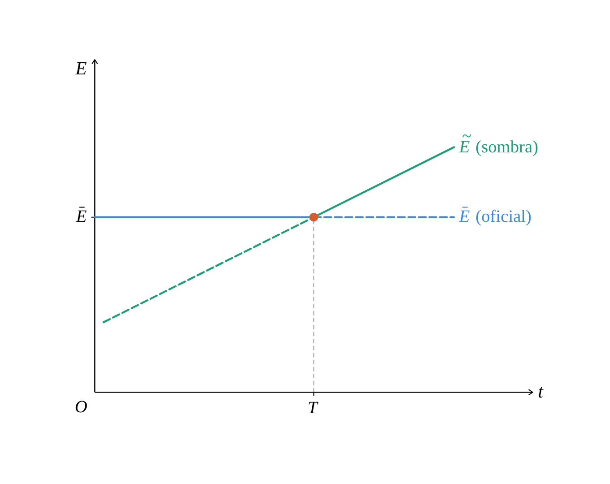

## Introducción

::: {.callout-note appearance="simple" icon=false}

:::

Las **crisis cambiarias** son tan antiguas como los tipos de cambio fijos, pero su teoría nació de episodios concretos, y cada generación de modelos respondió a la incapacidad de la anterior para explicar el siguiente. Los colapsos de tipos fijos en varios países en desarrollo durante los años setenta y ochenta dieron lugar a los modelos de primera generación (Krugman, 1979a; Flood y Garber, 1984). Después, la crisis del Sistema Monetario Europeo (1992-1993), que alcanzó a países con fundamentos sólidos como el Reino Unido, llevó a los modelos de crisis autocumplidas (Obstfeld, 1994). Por último, la crisis asiática (1997-1998), en economías con cuentas públicas saneadas, situó el foco en los balances privados y en los descalces de moneda (Krugman, 1999). La lección común es que la prevención depende del origen de la crisis, y por ello sigue abierto el debate sobre las reservas, los controles de capital y la red de seguridad financiera internacional.

El tema estudia las diferentes teorías sobre las crisis monetarias y financieras conforme a la clasificación por generaciones de modelos, cuya terminología se remonta a Eichengreen, Rose y Wyplosz (1995) y que la literatura posterior ha ampliado:

- *Modelos de primera generación* (crisis de los fundamentos): estudian cómo una política económica inconsistente puede ir erosionando los fundamentos de la economía hasta desencadenar una crisis cambiaria.

- *Modelos de segunda generación* (crisis autocumplidas): la crisis cambiaria puede producirse aunque los fundamentos no se hayan deteriorado hasta volverla inevitable. Basta un giro pesimista en las expectativas de los agentes, que termina validándose a sí mismo.

- *Modelos de tercera generación* (crisis gemelas): analizan cómo las crisis cambiarias y las crisis bancarias se retroalimentan.

La crisis financiera global (2008-2014) ha dado lugar, además, a los llamados *modelos de cuarta generación*, cuyo encaje en esta tipología se discute en el apartado 3.4.2.

En todos los casos se exponen la idea principal, el origen, la transmisión y las consecuencias de las crisis, así como las posibles soluciones y los episodios históricos que las ilustran. Además, un rasgo recurrente de muchas de las crisis monetarias y financieras recientes es su rápida transmisión entre países, lo cual ha suscitado un notable interés en la literatura por el estudio del **contagio**[^b17-4]. Por ello, en cada generación se examinan los canales de contagio que el modelo correspondiente permite explicar. En adelante, las crisis monetarias se denominan crisis cambiarias y, entre las financieras, el tema se ocupa sobre todo de las bancarias.

## 1. Modelos de primera generación: modelo de Krugman (1979a) y Flood y Garber (1984). El problema de la incompatibilidad

**Origen**: los modelos de primera generación tratan de explicar el colapso de los sistemas de tipo de cambio fijo que tuvo lugar durante los años setenta y ochenta en varios países en desarrollo. El modelo canónico se debe a Paul Krugman en *A Model of Balance-of-Payments Crises* (1979a), si bien aquí se sigue la versión linealizada de Flood y Garber (1984) para ilustrar el caso de una monetización del déficit.

**Idea**: las crisis cambiarias se producen porque la política monetaria y la cambiaria son incompatibles. Un tipo de cambio fijo exige que la política monetaria se dedique ante todo a sostener la paridad. El banco central puede tener, sin embargo, otra prioridad que le lleve a expandir el crédito interno, ya sea cubrir el déficit del Gobierno o apuntalar una banca frágil.

### 1.1. Supuestos

**Entorno**:

- *Economía*: pequeña, abierta y sin imperfecciones, que comercia con otro país. Existen dos monedas sustitutivas, la nacional y la extranjera.

- *Sistema de tipo de cambio*: el país mantiene un tipo de cambio fijo y permite la libre circulación de capitales.

- *Cotización directa del tipo de cambio*: un aumento del tipo de cambio equivale a una depreciación de la moneda nacional. La paridad del poder adquisitivo relativa se cumple, y $P^*$, el nivel de precios exterior, se toma como fijo y normalizado a la unidad. Por tanto, mientras se mantenga el tipo fijo, $g_E = \pi - \pi^* = 0 \rightarrow \pi = \pi^* = 0$.

**Agentes**:

- *Agentes privados*: tienen expectativas racionales, que les permiten calcular de antemano el tipo de cambio sombra y anticipar la inflación.

- *Gobierno*: su déficit viene dado desde fuera del modelo y lo monetiza el banco central.

- *Banco central*: su balance es $H = \text{CI} + R$, es decir, el pasivo o base monetaria equivale a su activo, dado por el crédito interno y las reservas exteriores que mantiene. El objetivo principal de su política monetaria es la financiación del déficit. En este régimen, solo cabe incidir en el tipo de cambio nominal interviniendo (comprando y vendiendo moneda nacional), y no a través de una regulación basada en controles de capital.

### 1.2. Modelo

**Planteamiento**: las autoridades económicas de este país tratarán de alcanzar dos objetivos simultáneamente:

1. *Política cambiaria*: la autoridad monetaria querrá mantener constante el tipo de cambio, $\bar{E}$. Para ello, el banco central deberá poseer un volumen de divisas suficiente.

2. *Política monetaria*: tendrá como objetivo principal financiar el déficit, es decir, atender $\uparrow \text{AFG}$ (activos del banco central frente al Gobierno, parte de $\text{CI}$), para lo cual dispone de dos opciones:

    - *Dejar crecer la base monetaria*: si quiere comprar bonos del Gobierno, deberá permitir que la base monetaria y, por ende, la oferta monetaria se muevan con dichas compras ($\uparrow \text{AFG} \leftrightarrow \uparrow H$).

    - *Compensar con venta de divisas*: si quiere comprar bonos del Gobierno sin que se mueva la base monetaria, deberá comprar moneda nacional y vender divisas ($\uparrow \text{AFG}$, $H$ constante $\leftrightarrow \downarrow R$).

El objetivo es mantener constante el tipo de cambio, y dejar crecer la base monetaria elevaría la inflación y, por el cumplimiento de la paridad del poder adquisitivo relativa, la depreciación. Por ello, el banco central compensará cada compra de bonos con venta de divisas.

Se entienden así los problemas a los que da lugar la búsqueda simultánea de ambos objetivos, pues el proceso provoca una pérdida paulatina de reservas hasta que estas se agotan.

Esta situación supone un deterioro muy notable de los fundamentos y afecta a la propia política de monetización. Como la prioridad sigue siendo financiar el déficit público, una vez agotadas las reservas internacionales solo cabe atenderlo ampliando la oferta monetaria. Sin reservas con las que sostener el tipo fijo, el país ha de abandonarlo y su moneda se deprecia. Esta transmisión íntegra del aumento de la oferta monetaria al tipo de cambio se debe a que se ha supuesto el cumplimiento de la paridad del poder adquisitivo relativa y que $\pi^* = 0$ (nivel de precios exterior constante).

Los agentes privados, capaces de prever esta situación gracias a sus expectativas racionales, saben que las políticas del Gobierno conducirán inexorablemente al agotamiento de las reservas. Por consiguiente, con el fin de evitar pérdidas, actuarán como especuladores. Se desharán de sus tenencias de moneda nacional y comprarán masivamente bonos extranjeros antes de que las reservas se agoten, lo que precipitará el colapso del sistema cambiario.

**Equilibrio**: el momento concreto del colapso, $T$, vendrá determinado por la relación entre dos magnitudes. El *tipo de cambio sombra*, $\tilde{E}$, es el que regiría si, agotadas las reservas, el tipo de cambio flotase libremente, es decir, el determinado por los fundamentos. El tipo sombra es creciente porque el crédito interno no deja de expandirse para financiar el déficit[^b17-6]. El tipo de cambio oficial, $\bar{E}$, es, en cambio, el tipo intervenido, que se mantiene fijo.

Una vez que el tipo sombra queda más depreciado que el oficial, especular resultaría rentable y la moneda nacional se depreciaría. Al banco central todavía se le pueden comprar divisas al tipo oficial, y esas divisas podrían revenderse luego al tipo sombra[^b17-8], ya que, sin el régimen fijo, el mercado las pagaría por encima de lo que costaron.

Como cada especulador quiere hacerse con esa ganancia antes que los demás, con previsión perfecta se cumplen dos condiciones:

- *Beneficio nulo*: la carrera por adelantarse sitúa el ataque, y con él el colapso, justo en $T$, cuando el tipo sombra alcanza al oficial y la ganancia del especulador es exactamente cero.

- *Agotamiento de reservas*: los especuladores saben que las reservas internacionales se van perdiendo poco a poco y no esperan a que se acaben por esa vía. En $T$ adquieren de una sola vez todas las que aún quedan.

::: {.callout-note appearance="simple" icon=false}
La versión lineal se desarrolla para que se entienda de dónde salen el tipo sombra, el momento del ataque y el salto de las reservas que muestran las dos figuras que siguen. Para la exposición basta con explicar el modelo gráficamente y enunciar su estática comparativa.
:::

En la *versión lineal* de Flood y Garber (1984), el modelo se resuelve con cinco ecuaciones, el balance del banco central, la demanda de dinero, la PPA, la paridad descubierta de intereses con previsión perfecta y la regla de crecimiento del crédito interno:

$$\begin{aligned} &H_t = \text{CI}_t + R_t, \qquad H_t - P_t = -h\, i_t, \qquad P_t = E_t \\ &i_t = i^* + \dot{E}_t, \quad i^* = 0, \qquad \dot{\text{CI}}_t = \mu \end{aligned}$$

donde $h > 0$ es la semielasticidad de la demanda de dinero al tipo de interés y $\mu > 0$ el crecimiento del crédito interno. Mientras dura el tipo fijo, $\dot{E}_t = 0$ y el tipo de interés es nulo, de modo que la demanda de dinero es constante, $H_t = \bar{E}$, y cada unidad de crédito nuevo se compensa con una pérdida de reservas, $\dot{R}_t = -\mu$. Si las reservas se agotasen y el tipo flotase, la base monetaria sería solo crédito interno y la moneda se depreciaría al ritmo $\dot{E} = \mu$, con lo que el tipo de interés pasaría a ser $\mu$. El tipo sombra es, por tanto,

$$\tilde{E}_t = \text{CI}_t + h\mu$$

y el ataque se produce cuando el tipo sombra alcanza al oficial, $\tilde{E}_T = \bar{E} = \text{CI}_0 + R_0$, es decir, en

$$T = \frac{R_0 - h\mu}{\mu}$$

La fórmula explica el salto de las reservas. En $T$, la depreciación esperada pasa de cero a $\mu$, el tipo de interés sube en esa cuantía y la demanda de dinero cae en $h\mu$. Esa caída es exactamente el *stock* de reservas que queda, $R_T = R_0 - \mu T = h\mu$, y que los especuladores compran en el ataque. En cambio, sin sensibilidad de la demanda de dinero al tipo de interés ($h = 0$), el colapso llegaría en $R_0/\mu$, cuando las reservas se agotasen solas.

**Desarrollo gráfico**: la determinación del momento del colapso se representa en el plano tiempo-tipo de cambio (figura -@fig-b172-tipo-sombra):

1. *Tipo de cambio sombra* ($\tilde{E}$): refleja el tipo de cambio que regiría si, agotadas las reservas, la moneda flotase libremente, el que determinan los fundamentos. Tiene pendiente positiva porque el crédito interno no deja de expandirse para financiar el déficit.

2. *Tipo de cambio oficial* ($\bar{E}$): refleja la paridad que el banco central defiende comprando y vendiendo moneda nacional. Su curva es horizontal porque el tipo intervenido se mantiene fijo mientras queden reservas.

3. *Equilibrio*: ambas curvas se cortan en $T$, donde el beneficio del ataque es nulo. A la izquierda de $T$, el tipo sombra queda por debajo del oficial y el ataque daría pérdidas, mientras que a su derecha daría beneficios. Por tanto, hasta $T$ rige el tipo oficial y, desde ese momento, el tipo sombra.

::: {#fig-b172-tipo-sombra}

::: {.content-visible when-format="html"}
```{=html}
<div class="graph-frame">
<iframe src="../graphs/b172_Tipo_sombra.html" style="height:560px" loading="lazy" title="fig-b172-tipo-sombra"></iframe>
</div>
```
:::

::: {.content-visible unless-format="html"}

:::

Determinación del momento de colapso. Con previsión perfecta, el ataque ocurre exactamente en $T$, cuando el tipo de cambio sombra iguala al oficial y el beneficio del especulador es nulo.
:::

Gráficamente, la evolución de las reservas se representa en el plano tiempo-reservas (figura -@fig-b171-reservas-ataque):

1. *Reservas* ($R(t)$): la curva continua refleja el volumen de divisas en poder del banco central en cada momento. Parte de $R_0$ y cae de forma paulatina por la venta de divisas con que se compensa la financiación del déficit.

2. *Senda sin ataque*: la línea discontinua refleja la evolución que seguirían las reservas si los especuladores esperasen a que se agotaran por esa vía. Prolonga la caída hasta el agotamiento, en un momento posterior a $T$.

3. *Equilibrio*: en $T$, el ataque especulativo liquida de golpe las reservas restantes y la curva cae en vertical hasta cero. El colapso se adelanta así respecto a la senda sin ataque, que solo agotaría las reservas más tarde.

::: {#fig-b171-reservas-ataque}

::: {.content-visible when-format="html"}
```{=html}
<div class="graph-frame">
<iframe src="../graphs/b171_Reservas_ataque.html" style="height:560px" loading="lazy" title="fig-b171-reservas-ataque"></iframe>
</div>
```
:::

::: {.content-visible unless-format="html"}

:::

Modelo de primera generación (Krugman, 1979a; Flood y Garber, 1984). La financiación del déficit, compensada con venta de divisas, agota paulatinamente las reservas. En $T$ el ataque especulativo compra de golpe las restantes y adelanta el colapso respecto a la senda sin ataque.
:::

**Estática comparativa**: el ataque se producirá antes (el punto de cruce se situará más a la izquierda) cuanto:

- *Mayor* sea el crecimiento del crédito interno, lo que se traduce en una curva del tipo de cambio sombra con más pendiente.

- *Más apreciado* esté el tipo de cambio oficial, porque estará más cerca del tipo de cambio sombra, que hasta $T$ se sitúa por debajo de él. Gráficamente, la curva del tipo oficial estará más próxima al eje de abscisas.

- *Menor* sea el nivel de reservas internacionales de partida.

- *Más sensible* al tipo de interés sea la demanda de dinero ($h$), porque mayor es la caída de esa demanda en el momento del colapso y, con ella, el *stock* de reservas que el ataque compra de una vez.

### 1.3. Contagio: los vínculos comerciales

Los modelos de primera generación permiten explicar el contagio cuando existen **vínculos comerciales**[^b17-9]. En estos casos, el mecanismo de transmisión va desde la crisis cambiaria hasta la producción de los socios comerciales. Si los precios internos se ajustan con retraso, la depreciación de la moneda nacional resta competitividad-precio a los productos de los socios frente a los del país en crisis, lo que reduce la producción de los socios y, por tanto, su renta.

### 1.4. Evidencia empírica: experiencia histórica

Tres episodios históricos pueden leerse desde la óptica de los modelos de primera generación: la ruptura de Bretton Woods, la crisis de México de los años ochenta y las presiones sobre el yuan entre 2015 y 2017. En los tres, la política monetaria atendía a un objetivo interno incompatible con la paridad.

#### 1.4.1. Ruptura de Bretton Woods (1967-1971)

**Causas**: la posición exterior estadounidense se deterioró durante los años sesenta a causa del gasto de la guerra de Vietnam y de los programas de la Gran Sociedad, financiados con expansión monetaria mientras el dólar mantenía su convertibilidad fija en oro. El resultado fue una inconsistencia entre el ancla nominal y la política interna, agravada por el dilema de Triffin, según el cual la liquidez internacional exigía déficits estadounidenses que erosionaban la propia confianza en la paridad.

**Estallido**: la libra esterlina fue atacada primero y hubo de devaluarse en noviembre de 1967. Las presiones se trasladaron después al dólar, cuya cobertura en oro resultaba cada vez más insuficiente, hasta que en agosto de 1971 Estados Unidos suspendió unilateralmente la convertibilidad.

**Consecuencias**: el Acuerdo del Smithsonian (diciembre de 1971) intentó restablecer paridades ajustadas, pero no resistió, y en 1973 las principales monedas pasaron a flotar.

**Soluciones**: se abandonó el propio régimen, y los Acuerdos de Jamaica (1976) formalizaron ese abandono al legalizar la flotación y suprimir el papel monetario del oro.

**Conclusiones**: el episodio ilustra la lógica del modelo, pues la presión sobre la paridad nace de una política monetaria expansiva al servicio de objetivos internos. El episodio muestra, además, que, mientras persiste esa incompatibilidad, el reajuste de las paridades solo aplaza la crisis. Su encaje es, con todo, parcial, porque la moneda sometida a presión era la de reserva del sistema y el dilema de Triffin, un problema estructural del propio régimen, queda fuera del modelo.

::: {.callout-note appearance="simple" icon=false}
El diseño de Bretton Woods, el dilema de Triffin y el proceso que condujo a su ruptura se desarrollan en el tema [B20](b20-sei-hasta-bw.qmd); el sistema resultante, en el tema [B21](b21-sei-despues-bw.qmd). Aquí interesa el episodio como ilustración temprana de la lógica de primera generación.
:::

#### 1.4.2. Crisis de México (1982-1989)

**Causas**: México, donde se inició la crisis de deuda latinoamericana, sostuvo durante la segunda mitad de los años setenta una paridad fija frente al dólar mientras financiaba un déficit público creciente, en parte monetizado. La financiación descansaba en unos ingresos petroleros que se daban por permanentes. La combinación de políticas (*policy mix*) era, por tanto, internamente inconsistente en los términos del modelo, con una expansión del crédito interno incompatible con el mantenimiento de la paridad.

**Estallido**: el endurecimiento monetario de la Reserva Federal bajo Volcker elevó los tipos de interés internacionales y apreció el dólar, al tiempo que la recesión mundial de 1981 hundía los precios de las materias primas. Con ello, la pérdida de reservas fue continua y obligó al banco central a devaluar en febrero de 1982. En agosto, sin reservas ya, el Gobierno mexicano comunicó que no estaba en condiciones de pagar el servicio de su deuda externa.

**Consecuencias**: la crisis cambiaria se propagó al conjunto de la región por vínculos comerciales y, sobre todo, por la retirada simultánea del crédito bancario sindicado. Así, lo que había empezado como una crisis cambiaria en un solo país acabó en una crisis de deuda de alcance sistémico. La crisis de deuda dio paso a lo que se llamó “década perdida del desarrollo”, unos años ochenta en los que la renta real por habitante retrocedió en muchos países latinoamericanos y africanos.

**Soluciones**: la respuesta se articuló en tres fases sucesivas. La inmediata consistió en préstamos puente del FMI y del Banco de Pagos Internacionales condicionados a programas de ajuste con enfoque de absorción. Después, el Plan Baker (1985) seguía viendo en la crisis una falta de liquidez y ofreció financiación adicional a cambio de reformas estructurales, sin resultados apreciables. Solo el Plan Brady (1989) reconoció el problema como de solvencia y articuló una quita efectiva mediante el canje de la deuda bancaria por bonos con principal garantizado.

**Conclusiones**: el episodio se ajusta a las dos predicciones centrales del modelo, que una expansión del crédito interno incompatible con la paridad hace inevitable la crisis y que la paridad cae antes de que se agoten las reservas. Se aparta de él, en cambio, en la forma, porque el desenlace fue una pérdida continua de reservas y no el ataque único que, en la versión con previsión perfecta, liquida de golpe las restantes. Muestra también un límite del modelo, que no recoge cómo la crisis cambiaria se transforma en una crisis de deuda externa con efectos reales duraderos.

::: {.callout-note appearance="simple" icon=false}
La vertiente de deuda externa de este episodio (sostenibilidad, enfoque de liquidez, Plan Baker, Plan Brady y bonos Brady) se desarrolla en el tema [B29](b29-fod-aod.qmd), apartado 3.1. El papel del FMI en la gestión del episodio se aborda en el tema [B22](b22-fmi.qmd), apartado 3.3.1.
:::

#### 1.4.3. Caso de China (2015-2017)

**Causas**: China mantiene un régimen cambiario administrado frente a una cesta de divisas mientras la prioridad de su política monetaria es la estabilidad del PIB y no la del tipo de cambio. Esa jerarquía de objetivos, combinada con una apertura parcial de la cuenta financiera, reproduce la inconsistencia que describe el modelo, pues, si los tipos de interés se fijan atendiendo a la coyuntura interna, no pueden simultáneamente sostener la paridad.

**Estallido**: entre 2015 y 2017 el yuan sufrió fuertes presiones depreciatorias por tres motivos concurrentes: la necesidad de diversificación de los inversores chinos, la incertidumbre asociada a la desaceleración del crecimiento y la campaña anticorrupción. El banco central respondió comprando yuanes contra reservas en el mercado de divisas. Esas intervenciones sostuvieron la cotización a costa del volumen de reservas.

**Consecuencias**: entre agosto de 2015 y enero de 2017 el banco central perdió del orden de 600.000 M\$ en la defensa de la moneda, si bien sus reservas se han estabilizado desde entonces por encima de 3 billones de dólares.

**Soluciones**: la autoridad optó por no elevar los tipos de interés, para no comprometer la inversión, y recurrió en su lugar al refuerzo de los controles de capital, la tercera vía del trilema de Mundell-Fleming (trinidad imposible).

**Conclusiones**: el caso muestra que, con reservas abundantes y controles de capital, la inconsistencia que describe el modelo puede contenerse sin que llegue a producirse el ataque. No obstante, la tensión sigue latente, porque, si persistiera la depreciación del tipo de cambio sombra, el agotamiento previsible de las reservas volvería a hacer racional el ataque. El modelo señala así la fuente de vulnerabilidad, pero no permite anticipar el desenlace, que depende del volumen de reservas y de la vía del trilema que elija la autoridad.

### 1.5. Conclusiones

El balance de los modelos de primera generación reúne sus resultados, las soluciones que proponen frente a este tipo de crisis y una valoración de sus aciertos y limitaciones.

**Resultados**:

- *Causas*: las crisis nacen de que las políticas monetaria y cambiaria persiguen objetivos incompatibles, y esa incompatibilidad erosiona los fundamentos.

- *Papel de las expectativas*: resulta esencial, y la depreciación esperada puede hacer que la crisis estalle antes.

- *Predictibilidad*: la crisis puede anticiparse con total exactitud, pero no evitarse, porque las reservas acaban agotándose.

**Soluciones**: pasan por la aplicación de la *regla de Tinbergen*, según la cual por cada objetivo de política económica debe existir al menos un instrumento disponible. Ello obliga a sacrificar uno de los tres vértices del trilema de Mundell-Fleming:

1. *Régimen cambiario*: dejar flotar la moneda en lugar de sostener el tipo fijo, sin restringir los movimientos de capital.

2. *Política monetaria*: poner la política monetaria al servicio del objetivo cambiario, a costa de su autonomía, sin restringir tampoco los movimientos de capital.

3. *Movilidad de capitales*: limitar la movilidad de capitales, manteniendo el régimen cambiario y la autonomía de la política monetaria, lo que dificulta el ataque, pero solo aplaza la crisis si persiste la monetización del déficit.

**Aspectos positivos**: el modelo explica con precisión el momento del colapso y demuestra que el ataque especulativo no es un fenómeno irracional ni desestabilizador, sino la consecuencia lógica de una política interna insostenible. La crisis no la causan los especuladores, sino que estos se limitan a anticipar lo que de todos modos habría ocurrido.

**Limitaciones**:

- *Asimetría en el tratamiento de los agentes*: los agentes privados anticipan con racionalidad plena, mientras que la autoridad sigue una pauta fija y nunca se plantea alternativas a ella. Podría, por ejemplo, endeudarse en los mercados internacionales para cubrir el déficit o subir el tipo de interés para sostener la paridad.

- *Evidencia empírica posterior*: estos modelos no explican los ataques especulativos que sufrió el Reino Unido en la crisis del Sistema Monetario Europeo (1992), puesto que el país no presentaba problemas permanentes en sus fundamentos.

## 2. Modelos de segunda generación: modelo de equilibrios múltiples (Obstfeld, 1994). Profecías autocumplidas

**Origen**: los modelos de segunda generación tratan de explicar, fundamentalmente, la crisis del Sistema Monetario Europeo de 1992-1993. Destaca la aportación de Maurice Obstfeld (1994), que formaliza la idea de crisis autocumplidas que él mismo había planteado en 1986.

**Idea**: abandonar la paridad no es un desenlace forzoso, sino una elección racional del Gobierno[^b17-13]. La autoridad dispone aquí de más instrumentos que en la primera generación y podría, por ello, defender el tipo fijo indefinidamente sin agotar sus reservas. Le cabe corregir el desequilibrio exterior con políticas de ajuste (austeridad) y, además, imponer controles de capital o establecer tipos de cambio múltiples.

Cuando el Gobierno renuncia al tipo fijo, lo hace porque mantenerlo le resulta más caro que dejarlo, y, como ese coste varía con lo que esperen los agentes privados, cabe la posibilidad de *profecías autocumplidas*.

### 2.1. Supuestos

**Entorno**: se mantiene el del caso anterior, si bien ahora el Gobierno decide después que los agentes privados, de modo que conoce el *shock* y las expectativas de los agentes antes de actuar.

**Agentes**: el cambio decisivo está en la modelización del comportamiento del Gobierno, que ya no trata de monetizar el déficit y cuyo objetivo es minimizar la pérdida social. Para ello pondera factores como la estabilidad de la brecha de producción (*output gap*), la inflación, los costes de establecer un régimen cambiario u otro, la credibilidad de sus decisiones y los costes políticos y sociales que de ellas se derivan.

### 2.2. Modelo

**Planteamiento**: un país abierto al exterior con régimen cambiario fijo sufre un *shock* exógeno asimétrico que deteriora su cuenta corriente, por ejemplo una pérdida de competitividad. Ello lleva al Gobierno a plantearse si abandonar o no el régimen. Se supone que no contempla la contracción de la masa monetaria como alternativa, dados sus costes políticos y sociales.

Los agentes privados toman sus decisiones de compraventa de divisas antes de que el Gobierno adopte las suyas de estabilización, de modo que forman sus expectativas de inflación antes de conocer la inflación efectiva. Conocen, no obstante, la función de pérdida del Gobierno y pueden, así, anticipar cómo responderá este a sus expectativas.

Después, el Gobierno toma su decisión óptima sobre si devaluar o no dadas las expectativas de los agentes, mediante un análisis coste-beneficio basado en los desequilibrios macroeconómicos que comprometen la estabilidad.

Una versión mínima del modelo (Obstfeld, 1996) formaliza ese cálculo. La producción depende de la inflación no anticipada, porque los salarios se fijan con la inflación esperada, y el Gobierno minimiza una pérdida que penaliza la inflación y la desviación de la producción respecto a un objetivo superior a su nivel natural:

$$L = (y - y^*)^2 + \omega\,\pi^2, \qquad y = \bar{y} + \gamma\,(\pi - \pi^e) - S, \qquad y^* > \bar{y},\; \gamma > 0,\; \omega > 0$$

donde $y$ es la producción, $\bar{y}$ su nivel natural, $y^*$ su objetivo, $\pi$ la tasa de devaluación, igual a la inflación por la PPA, $\pi^e$ la esperada, $\gamma$ la sensibilidad de la producción a la inflación no anticipada, $\omega$ el peso de la inflación en la pérdida y $S$ el *shock*. A la pérdida se suma el coste fijo $C_D$ si el Gobierno devalúa. Con el tipo fijo, $\pi = 0$ y la pérdida es $(y^* - \bar{y} + \gamma\,\pi^e + S)^2$, que crece con el *shock* y con la inflación esperada, porque unos salarios fijados con $\pi^e > 0$ reducen la producción si la paridad se mantiene. Si devalúa, el Gobierno elige la $\pi$ que minimiza la pérdida, y el beneficio de devaluar, es decir, la pérdida que evita sin contar $C_D$, es:

$$B = \frac{\gamma^2}{\gamma^2 + \omega}\,\left(y^* - \bar{y} + \gamma\,\pi^e + S\right)^2$$

El Gobierno devalúa si $B > C_D$. Como $B$ crece con $\pi^e$, la expectativa de devaluación encarece la defensa de la paridad y puede justificar por sí sola su abandono.

**Equilibrio**: el Gobierno devalúa cuando lo que gana con ello supera lo que le cuesta, y la ganancia depende de lo que esperen los agentes. Por eso el ataque especulativo puede producirse o no, y el modelo presenta equilibrios múltiples y no linealidades. La paridad puede volverse insostenible sin que los fundamentos se hayan deteriorado hasta forzar su abandono. Incluso una economía que podría sostener la paridad puede tener incentivos para dejar el tipo fijo si los agentes esperan lo peor, y ese pesimismo acaba así confirmándose. En el tramo de *shocks* de intensidad media ($S_1 < S < S_2$), la sola expectativa de una devaluación basta para provocarla.

**Desarrollo gráfico**: la decisión de devaluar se representa en el plano intensidad del *shock*-costes y beneficios de la devaluación (figura -@fig-b173-obstfeld):

1. *Coste de devaluar* ($C_D$): refleja la pérdida de reputación y credibilidad que sufre el Gobierno si devalúa. Esta pérdida se modeliza como un coste fijo, independiente del deterioro de la cuenta corriente, y por eso su curva es horizontal.

2. *Beneficios de devaluar* ($B^{\text{NC}}$ y $B^{\text{C}}$): reflejan el ahorro que supone para el Gobierno evitar las políticas de austeridad con que habría que hacer frente al *shock*. Su pendiente es positiva, porque cuanto más intenso es el *shock*, más costoso es el ajuste que la devaluación evita. Su posición depende de las expectativas de los agentes:

    - $B^{\text{NC}}$: recoge los beneficios si los inversores no confían y anticipan la devaluación. En ese caso, los salarios se fijan con una inflación esperada positiva, por lo que mantener la paridad reduce más la producción y devaluar resulta más atractivo para cualquier intensidad del *shock*. Por eso la curva $B^{\text{NC}}$ se sitúa por encima de $B^{\text{C}}$.

    - $B^{\text{C}}$: recoge los beneficios si los inversores confían y no anticipan la devaluación.

3. *Equilibrio*: según cuáles sean los fundamentos y las expectativas, esta secuencia puede desembocar en más de un equilibrio:

    - *Shocks de intensidad baja* ($S < S_1$): con un *shock* así, abandonar el tipo fijo cuesta más que mantenerlo, piensen lo que piensen los agentes. La solidez de los fundamentos basta para disuadir cualquier ataque especulativo. Por tanto, el equilibrio es único y se denomina *cielo en la tierra*.

    - *Shocks de intensidad alta* ($S > S_2$): aunque los agentes esperen que se mantenga la paridad ($\pi^e = 0$), el *shock* la hace insostenible. El deterioro de los fundamentos es tan grave que atacar la moneda resulta racional. El equilibrio vuelve a ser único, pero ahora se trata del *infierno en la tierra*.

    - *Shocks de intensidad media* ($S_1 < S < S_2$): se llega a un estado de indeterminación, el *purgatorio*, en el que existen equilibrios múltiples. En el equilibrio que evita la devaluación (el “bueno”), los agentes esperan una inflación nula ($\pi^e = 0$), confían en el Gobierno, no anticipan la devaluación y no venden masivamente, de modo que lo racional es mantener el régimen cambiario (punto $N$, para una intensidad $S'$). En el que lleva a la devaluación (el “malo”), esperan una inflación positiva ($\pi^e > 0$), anticipan la devaluación y venden, y lo racional es entonces abandonar el régimen (punto $D$, de devaluación).

::: {#fig-b173-obstfeld}

::: {.content-visible when-format="html"}
```{=html}
<div class="graph-frame">
<iframe src="../graphs/b173_Obstfeld.html" style="height:560px" loading="lazy" title="fig-b173-obstfeld"></iframe>
</div>
```
:::

::: {.content-visible unless-format="html"}

:::

Modelo de Obstfeld (1994). El gráfico representa el coste fijo reputacional $C_D$ y los beneficios de devaluar según las expectativas ($B^{\text{NC}}$ si los inversores no confían, $B^{\text{C}}$ si confían). Para $S_1 < S < S_2$ existen equilibrios múltiples. La profecía autocumplida lleva al punto $D$.
:::

**Estática comparativa**: el deterioro de los fundamentos, medido por la ampliación de la brecha de producción negativa, eleva la probabilidad de que el tramo de indeterminación se alcance y de que el ataque llegue a producirse. Gráficamente, equivale a un *shock* más intenso, que sitúa la economía más a la derecha en el eje de abscisas, primero en el tramo de indeterminación ($S_1 < S < S_2$) y, si es grave, en el de devaluación segura ($S > S_2$).

### 2.3. Contagio: los comportamientos de rebaño

Los modelos de segunda generación, al poner el énfasis en las expectativas, resultan especialmente útiles para explicar los **comportamientos de rebaño**. Como la información es imperfecta y obtenerla cuesta, abundan los inversores poco informados, que suelen imitar las decisiones de un grupo reducido mejor informado.

El mecanismo de transmisión es, en este caso, la retirada de capitales de un país por parte de un grupo de inversores, no por el deterioro de los fundamentos del país, sino por otras razones, como necesidades de liquidez o motivos especulativos. Esa retirada desencadena una reacción en cadena.

### 2.4. Evidencia empírica: experiencia histórica

Dos episodios históricos pueden leerse desde la óptica de los modelos de segunda generación: la crisis del Sistema Monetario Europeo (1992-1993) y la crisis del Tequila (1994-1995). En ambos, el ataque siguió a sucesos políticos que alteraron las expectativas. En el primero, el rechazo danés al Tratado de la Unión Europea hizo temer el de Francia, y en el segundo, el levantamiento de Chiapas y el asesinato del candidato Colosio precipitaron la salida de capitales.

#### 2.4.1. Crisis del Sistema Monetario Europeo (1992-1993)

::: {.callout-note appearance="simple" icon=false}
El diseño del Sistema Monetario Europeo, el Mecanismo de Cambios e Intervención y las cuatro etapas de su evolución se desarrollan en el tema [B43](b43-politica-monetaria-ue.qmd), apartados 1.2 a 1.4. Aquí interesa el episodio como contraste empírico del modelo de segunda generación.
:::

**Causas**: el gasto ligado a la reunificación alemana generó tensiones inflacionistas a las que el Bundesbank respondió con subidas de tipos, y los demás países del mecanismo, aunque estaban en recesión, tuvieron que acompañarle. Surgió así el dilema que describe el modelo, pues la defensa de la paridad pedía una política monetaria restrictiva que chocaba con la coyuntura interna. A todo ello se añadió la incertidumbre política, porque en 1992 los daneses habían rechazado en referéndum el Tratado de la Unión Europea y se temía que Francia hiciera lo mismo.

**Estallido**: los ataques especulativos se desataron en vísperas de la consulta francesa. Francia ratificó finalmente el Tratado, pero con un margen tan estrecho que la presión no cedió. El episodio más conocido es el ataque de George Soros sobre la libra esterlina en septiembre de 1992, articulado mediante una posición corta que anticipaba la depreciación.

**Consecuencias**: la primera moneda en dejarse flotar fue el marco finlandés, que estaba ligado al ecu por decisión unilateral y no formaba parte del mecanismo. En septiembre de 1992 salieron de este la libra esterlina y la lira italiana. Las presiones siguieron de forma intermitente, con nuevos realineamientos de la peseta y el escudo (noviembre de 1992 y mayo de 1993) y de la libra irlandesa (enero de 1993), hasta recrudecerse en julio de 1993.

**Soluciones**: la salida inmediata fue el acuerdo de agosto de 1993, que ensanchó al ±15 % las bandas de fluctuación, y en la práctica el mecanismo dejó de funcionar como se había diseñado. La solución de fondo llegaría por la vía de la integración, con la sustitución del régimen de paridades ajustables por la moneda única.

**Conclusiones**: el Reino Unido no presentaba una expansión monetaria incompatible con la paridad. Su problema era, en cambio, una recesión que encarecía la defensa de la paridad. Por eso este episodio es el contraste empírico decisivo frente a los modelos de primera generación y el argumento central a favor de la lógica autocumplida.

#### 2.4.2. Crisis del Tequila (1994-1995)

**Causas**: en 1987 México puso en marcha su propio plan de estabilización, el Pacto de Solidaridad Económica, un programa heterodoxo respaldado desde 1989 por un acuerdo ampliado con el FMI. Bajo el Pacto, las políticas monetaria y fiscal eran restrictivas, y salarios y precios se concertaban con los agentes sociales. El peso servía de ancla nominal, primero con un tipo fijo, desde 1989 con un deslizamiento anunciado de antemano y desde finales de 1991 dentro de una banda cuyo techo se desplazaba, y el sector exterior se abría al comercio y a los capitales.

Al principio el programa funcionó y atrajo capital extranjero. Con todo, al empezar la década de 1990 la economía mexicana tenía dos puntos débiles:

- *Déficit exterior*: un déficit por cuenta corriente próximo al 7 % del PIB, derivado del aumento de la absorción interna.

- *Pecado original*: a lo largo de 1994, buena parte del déficit pasó a financiarse con tesobonos (emitidos desde 1989), deuda a corto plazo indexada al dólar[^b17-17]. El país incurría así en lo que Barry Eichengreen y Ricardo Hausmann (1999) denominaron *pecado original*, la incapacidad de usar la moneda propia para endeudarse en el exterior o, incluso dentro del país, a largo plazo. Eichengreen, Hausmann y Panizza (2005) restringieron después el término a la dimensión exterior y lo midieron.

**Estallido**: la salida de capitales arrancó en 1994 a raíz de dos sucesos. En enero se produjo el levantamiento del Ejército Zapatista de Liberación Nacional en Chiapas, y en marzo fue asesinado el candidato presidencial Luis Donaldo Colosio. Ambos episodios provocaron una fuga de capitales amplificada por los comportamientos de rebaño y por el hecho de que la mayor parte de la inversión extranjera en México era inversión en cartera, con un peso elevado de capital especulativo a corto plazo (*hot money*). Además, el endurecimiento monetario de la Reserva Federal a lo largo de 1994 agravó la reversión de los flujos.

**Consecuencias**: en diciembre de 1994, con el peso sometido a presiones depreciatorias cada vez más intensas y las reservas muy mermadas, las autoridades tuvieron que renunciar a la banda y dejar flotar la moneda. México sufrió en 1995 una profunda recesión, aunque el producto volvió a crecer con fuerza ya en 1996[^b17-18]. La denominación del episodio como *efecto tequila* procede del contagio a Argentina y Brasil, transmitido por comportamientos de rebaño y no por vínculos reales.

**Soluciones**: México emprendió un programa de reformas estructurales financiado por el FMI y por Estados Unidos, con un paquete de rescate del orden de 50.000 M\$, entonces sin precedentes por su magnitud. El episodio motivó además la creación de nuevos instrumentos de financiación de emergencia en el FMI y el debate sobre la arquitectura financiera internacional.

**Conclusiones**: el episodio responde a la lógica de segunda generación, pues el ataque lo desencadenaron sucesos políticos que alteraron las expectativas y lo amplificaron los comportamientos de rebaño. Sin embargo, el déficit exterior y la deuda a corto plazo indexada al dólar muestran que los fundamentos no eran ajenos a la crisis y anticipan los problemas de hoja de balance que formalizan los modelos de tercera generación.

### 2.5. Conclusiones

Como en la primera generación, el cierre presenta los resultados del modelo de Obstfeld, las soluciones a las crisis autocumplidas y la valoración del enfoque.

**Resultados**:

- *Causas*: la crisis cambiaria ya no se explica por una política económica inconsistente ni exige un deterioro previo de los fundamentos que la vuelva inevitable. Surge, por el contrario, de la decisión racional con la que el Gobierno responde al pesimismo de los agentes.

- *Predictibilidad*: al revés que en la primera generación, la crisis no puede anticiparse pero sí evitarse, porque las reservas internacionales no llegan a agotarse.

**Soluciones**: dado que el origen de la crisis está en las expectativas y no solo en los fundamentos, la solución pasa por la construcción de credibilidad institucional. Para ello hace falta una política económica ortodoxa que asegure la estabilidad macroeconómica y sirva de ancla a las expectativas de inflación y, por extensión, a las de depreciación. A ello se añaden dos vías complementarias. Una es la acumulación preventiva de reservas, que eleva el coste del ataque y estrecha el tramo de indeterminación, y la otra, el acceso a líneas de liquidez preventivas de carácter multilateral, que operan como respaldo creíble sin necesidad de ser utilizadas.

**Aspectos positivos**: los modelos de segunda generación explican episodios que la primera generación no podía abordar (señaladamente el ataque sobre la libra esterlina en 1992), y trasladan el análisis desde el automatismo de los fundamentos hacia la interacción estratégica entre autoridad y mercado.

**Limitaciones**: sin embargo, estos modelos explicaban mal la crisis asiática de 1997, por dos razones. La primera es que el modelo requiere un Gobierno con incentivos para abandonar la paridad, y en aquellas economías, con cuentas públicas equilibradas, inflación baja y sin paro elevado, no los había. En cambio, su vulnerabilidad estaba en el déficit exterior y en el balance de bancos y empresas (apartado 3.4.1). La segunda razón es que estos modelos apenas atienden a la interacción con una crisis financiera que estalle al mismo tiempo. Hay, además, una limitación de método, porque el modelo no determina qué equilibrio se alcanza dentro del tramo de indeterminación, de modo que su capacidad predictiva es, por construcción, limitada.

## 3. Modelos de tercera generación: modelo de crisis gemelas (Krugman, 1999). Efectos de hoja de balance

**Origen**: los modelos de tercera generación surgen de las dificultades de los anteriores para explicar la crisis del sudeste asiático (1997-1998). Se apoyan en los trabajos de Douglas Diamond y Philip Dybvig (1983), cuyo modelo de pánicos bancarios se desarrolla en el tema [B26](b26-crisis-financieras.qmd), apartado 1.2.4, y de Paul Krugman (1999), cuyo modelo se sigue aquí.

**Idea**: las crisis financieras y las cambiarias son fenómenos interrelacionados y deben abordarse conjuntamente. La causalidad entre ambas no va en un solo sentido, y de esa interacción surgen las *crisis gemelas*:

1. *Shock financiero*: los problemas del sistema financiero pueden acabar en una crisis cambiaria. Ocurre p. ej. cuando el banco central, como prestamista de última instancia, se ve obligado a crear dinero para salvar a entidades en dificultades.

2. *Shock cambiario*: una crisis cambiaria puede causar una crisis financiera, por ejemplo si la depreciación de la moneda nacional provoca un fuerte aumento del valor en moneda nacional de la deuda denominada en divisas[^b17-19].

3. *Shock exógeno*: las dos pueden tener un mismo origen, p. ej. una liberalización desordenada.

La literatura distingue tres variantes de tercera generación, que explican rasgos distintos de la crisis asiática y no se excluyen entre sí:

1. *Riesgo moral y sobreendeudamiento* (McKinnon y Pill, 1996; Corsetti, Pesenti y Roubini, 1999): las garantías públicas implícitas sobre los pasivos de bancos y empresas animan a endeudarse en exceso y a invertir en proyectos arriesgados, lo que infla los precios de los activos y acumula pérdidas latentes. La crisis estalla cuando los acreedores anticipan que el coste fiscal del rescate es incompatible con la paridad. Esta variante explica el auge inmobiliario y bursátil previo y el colapso de las compañías financieras tailandesas.

2. *Iliquidez internacional* (Radelet y Sachs, 1998; Chang y Velasco, 2001): la banca se endeuda a corto plazo en divisas y presta a largo plazo. Si sus pasivos exteriores a corto plazo superan los activos líquidos en divisas del país, un pánico de los acreedores es un equilibrio posible, como en el modelo de Diamond y Dybvig, y con tipo fijo el banco central no puede actuar como prestamista de última instancia en divisas sin agotar sus reservas. Esta variante explica la brusca retirada de los préstamos bancarios en 1997, cuando la deuda externa a corto plazo superaba las reservas en Corea, Indonesia y Tailandia.

3. *Hoja de balance* (Krugman, 1999): la depreciación encarece la deuda en divisas de las empresas, erosiona su riqueza neta y reduce su capacidad de invertir, lo que deprecia aún más la moneda nacional. Esta variante explica la profundidad de la recesión posterior a las devaluaciones, sobre todo en Indonesia, y es la que se formaliza aquí.

En el modelo de Krugman, una reversión de los flujos de capital extranjero puede provocar crisis gemelas por la vía de los *efectos de hoja de balance*. La caída de la inversión deprecia el tipo de cambio real, encarece la deuda en divisas y erosiona la riqueza neta de los empresarios, que pierden capacidad de endeudarse.

### 3.1. Supuestos

**Entorno**: la economía es abierta y pequeña, con libertad de circulación de capitales. Los mercados financieros son imperfectos, con información asimétrica, y los prestamistas tienen en cuenta el grado de apalancamiento de los inversores.

El límite máximo a la capacidad de endeudamiento e inversión es la inversión financiable, $I \leq I_f = (1+\theta)W$, donde $W$ es la riqueza neta de los empresarios. El parámetro $\theta > 0$, constante y exógeno, refleja el grado de apalancamiento del sector nacional de empresarios-inversores.

**Agentes**: los trabajadores destinan toda su renta al consumo y los empresarios, toda la suya al ahorro y la inversión[^b17-21].

- *Consumo e inversión*: los bienes nacional y extranjero son sustitutivos imperfectos, con $\sigma_{ij} = 1$. Del gasto en consumo y del gasto en inversión, una parte $m \in (0, 1)$ se importa y el resto, $1-m$, se dirige al bien nacional, de modo que $m$ es la propensión marginal a importar de la economía[^b17-22].

- *Riqueza neta de los empresarios*: es lo que poseen menos lo que deben, $W = \alpha Y - D - eD^*$, donde $e > 0$ es el tipo de cambio real. Su activo es la parte del producto que les corresponde, $\alpha Y$, y su pasivo es la deuda neta real, con un tramo en moneda nacional, $D$, y otro en divisa, $D^*$.

**Tecnología**: función de producción Cobb-Douglas, $Y = K^\alpha L^{1-\alpha}$, que obtiene un único bien homogéneo a partir de dos factores, el capital y el trabajo. El capital se remunera a $\alpha Y$ y tiene una duración de un periodo[^b17-23], y el trabajo se remunera a $(1-\alpha)Y$[^b17-24].

### 3.2. Modelo

**Planteamiento**: el modelo encadena tres efectos de una caída de la inversión (sobre el tipo de cambio real, sobre la riqueza neta de los empresarios y sobre la inversión financiable), cuya conjunción da lugar a las crisis gemelas. El punto de partida es la condición de equilibrio en el mercado de bienes y servicios, que exige que la oferta del bien nacional iguale a su demanda:

$$Y = (1-m)C + (1-m)I + eX^*$$

donde $C$ e $I$ son el consumo y la inversión privados reales y $X^*$ las exportaciones reales, expresadas en unidades del bien extranjero y convertidas al bien nacional mediante el tipo de cambio real directo, $e$.

El consumo procede solo de los trabajadores, que gastan toda su renta, así que $C = (1-\alpha)Y$ y la condición queda:

$$Y = (1-m)(1-\alpha)Y + (1-m)I + eX^*$$

**Equilibrio**: despejando $e$ se obtiene la ecuación fundamental del modelo, el tipo de cambio real que equilibra el mercado de bienes:

$$e = \frac{Y - (1-m)(1-\alpha)Y - (1-m)I}{X^*} \rightarrow e = f(m^+, \alpha^+, Y^+, I^-, X^{*-}) \tag{1}$$

La ecuación (1) muestra que cuanto mayor es la inversión, menor es el tipo de cambio real. Por ello, una pérdida de confianza repentina que conlleve una caída de la inversión ($\downarrow I$) puede provocar una depreciación real ($\uparrow e$). La intuición es la del problema de transferencia. La caída de la inversión reduce la demanda del bien nacional (en la fracción $1-m$ que recaía sobre él). Con el producto dado, solo una depreciación real, que eleva el valor de las exportaciones en términos del bien nacional, restablece el equilibrio del mercado de bienes.

**Estática comparativa**: de (1) se desprenden también las relaciones del tipo de cambio real con el resto de variables:

1. *Propensión marginal a importar* ($m$): cuanto mayor sea, mayor será la demanda de divisas por parte de los residentes y, por extensión, menor la demanda de moneda nacional, lo que debilita la moneda.

2. *Participación relativa de los empresarios* ($\alpha$): cuanto mayor sea su participación en el producto, menor es la parte de la renta que se destina al consumo, $(1-\alpha)$, y, con ella, la demanda del bien nacional. Para equilibrar el mercado, el tipo de cambio real ha de estar entonces más depreciado.

3. *Renta* ($Y$): cuanto mayor sea la renta, más se destina al consumo de bienes extranjeros, de modo que la oferta del bien nacional crece más que su demanda interna, lo que exige un tipo de cambio real más depreciado para equilibrar el mercado.

4. *Exportaciones* ($X^*$): cuanto mayores sean las exportaciones, mayor será la demanda de moneda nacional en los mercados de divisas, lo que fortalece la moneda.

**Dinámica**: la caída de la inversión y la depreciación real ponen en marcha una secuencia de efectos encadenados. Su primer eslabón es el efecto de hoja de balance, un deterioro de la riqueza neta de los empresarios ($\downarrow W$) que se transmite por dos canales:

1. *Activo*: al caer la inversión cae la renta nacional del periodo siguiente y, con ella, la renta que los empresarios obtienen de la producción, $\alpha \downarrow Y$. Como el producto de cada periodo está predeterminado por el capital instalado, el efecto inmediato sobre la riqueza neta se transmite únicamente a través del pasivo, como recoge la derivada (2).

2. *Pasivo*: al depreciarse la moneda nacional, el valor en moneda nacional de la deuda denominada en divisas aumenta, $\uparrow eD^*$.

Se produce, por todo ello, un deterioro importante de la riqueza neta empresarial. La cadena de acontecimientos va así más allá de la depreciación real y alcanza el balance de las empresas.

La caída de la riqueza neta de los inversores reduce a su vez la inversión financiable ($\downarrow I_f$), debido al empeoramiento de la calidad crediticia de las empresas y a la pérdida de confianza de los bancos en un marco de información imperfecta. La secuencia se realimenta, porque una menor inversión provoca una depreciación real, esta erosiona los balances y unos balances más débiles recortan otra vez la inversión financiable.

La magnitud de la crisis gemela (la retroalimentación entre crisis cambiaria y crisis financiera por conjunción de todos los efectos anteriores) se estudia a partir de la derivada de la inversión financiable respecto de la inversión[^b17-25]:

$$\frac{\partial I_f}{\partial I} = (1+\theta)\frac{(1-m)D^*}{X^*} \rightarrow \frac{\partial I_f}{\partial I} = f(\theta^+, D^{*+}, m^-, X^{*-}) \tag{2}$$

Según (2), su magnitud depende de tres factores:

1. *Grado de apalancamiento* ($\theta$): cuanto mayor sea, mayor será el efecto contractivo sobre la inversión financiable. Así, tanto las economías del sudeste asiático antes de 1997 como el sistema financiero estadounidense antes de la caída de Lehman Brothers en 2008 presentaban grados de apalancamiento privado muy elevados.

2. *Endeudamiento exterior relativo* ($D^*/X^*$): cuanto más pese la deuda en divisas frente a las exportaciones, mayor será la pérdida de riqueza neta que causa la depreciación y, con ella, la contracción de la inversión financiable. Tailandia, p. ej., mantenía en 1996 una deuda externa a corto plazo superior a sus reservas, lo que la hizo especialmente vulnerable a la reversión de los flujos.

3. *Propensión marginal a importar* ($m$): cuanto mayor sea, menor será el *shock* sobre la inversión financiable, en la medida en que una mayor parte del ajuste se canaliza vía reducción de la demanda de bienes exteriores.

En consecuencia, pueden darse dos escenarios en función del tamaño del multiplicador:

1. *$\partial I_f / \partial I < 1$*: la salida de capitales podría generar restricciones crediticias adicionales (racionamiento), pero no una crisis gemela de magnitud significativa, porque el efecto de retroalimentación es decreciente.

2. *$\partial I_f / \partial I > 1$*: la salida de capitales podría generar una situación de equilibrios múltiples, con una senda explosiva de contracción del crédito, y sí podría dar lugar a una crisis, ya que la retroalimentación crece.

Gráficamente, en el plano inversión-inversión financiable (figura -@fig-b174-crisis-gemelas), la inversión financiable, $I_f(I)$, es nula con una inversión muy baja, porque los empresarios son insolventes, y plana con una muy alta, porque la restricción de financiación deja de ser activa. En el tramo intermedio su pendiente es (2), y si supera la unidad la curva corta tres veces a la recta de $45^\circ$ ($I_f = I$). Los cortes extremos son estables, el equilibrio alto (punto 0) y el de crisis con inversión nula (punto 1), y el intermedio ($A$) es inestable, de modo que una pérdida de confianza puede llevar la economía de 0 a 1.

::: {#fig-b174-crisis-gemelas}

::: {.content-visible when-format="html"}
```{=html}
<div class="graph-frame">
<iframe src="../graphs/b174_Crisis_gemelas.html" style="height:560px" loading="lazy" title="fig-b174-crisis-gemelas"></iframe>
</div>
```
:::

::: {.content-visible unless-format="html"}

:::

Crisis gemelas (Krugman, 1999). La inversión financiable, $I_f(I)$, es nula con inversión muy baja, porque los empresarios son insolventes, y plana con inversión muy alta, porque la restricción de financiación deja de ser activa, y en el tramo intermedio su pendiente supera la unidad. Corta a la recta de $45^\circ$ en el equilibrio alto (0), en uno intermedio inestable ($A$) y en el de crisis, con inversión nula (1), al que lleva una pérdida de confianza.
:::

### 3.3. Contagio: los vínculos financieros

Los modelos de tercera generación explican el contagio que se transmite por **vínculos financieros**. Cuando los inversores[^b17-26] tienen posiciones en varios países con fuerte integración financiera, la crisis de uno les lleva a retirar sus fondos tanto de ese país como de los que están ligados a él, porque temen que el problema se propague. Esa misma retirada acaba desencadenando la crisis en los segundos.

Los vínculos financieros dan lugar asimismo al **efecto prestamista común**[^b17-27]. Cuando existen bancos internacionales altamente expuestos a países en crisis, esos bancos cortan la financiación a otros países en circunstancias similares para cubrir pérdidas y preservar la calidad de sus carteras, lo que genera una crisis de liquidez. De ahí se deriva la consecuencia más importante, la justificación de los rescates de los organismos multilaterales, que, al frenar la propagación de la crisis, evitan una externalidad negativa.

El canal de los vínculos financieros explica que la crisis de las *subprime* llegara a Europa, cuya banca tenía en cartera deuda hipotecaria estadounidense. Como esos instrumentos eran opacos, no se sabía con certeza cuánto riesgo había asumido cada entidad, y esa incertidumbre paralizó el mercado interbancario y generó problemas de liquidez. Se contrajeron así el crédito y la actividad, a lo que se añadió una demanda agregada más débil por el efecto riqueza y el mayor desempleo, y el resultado fue una recesión en la economía real.

Europa sufrió la crisis con más dureza que Estados Unidos porque su economía dependía más del crédito bancario, mientras que la estadounidense podía recurrir a fuentes más variadas, como la emisión de acciones y bonos o el capital riesgo.

Una modalidad de contagio por vínculos financieros es el **efecto dominó**, es decir, los efectos mecánicos y prácticamente automáticos que se producen en cascada ante la crisis de una región. En este caso, la conexión no reside en la exposición recíproca entre las economías afectadas, que pueden carecer por completo de ella, sino en los balances de los inversores comunes a ambas. Destacan dos canales de transmisión:

- *Canal de liquidez*: el inversor apalancado que sufre pérdidas en una plaza necesita efectivo para reponer garantías o atender reembolsos, y lo obtiene liquidando posiciones en otras, sea cual sea la calidad de esos activos.

- *Canal de balance*: la caída del precio de los activos deteriora el patrimonio de los intermediarios expuestos, lo que reduce su capacidad de asumir riesgo y les lleva a reducir posiciones en el conjunto de sus mercados, propagando la perturbación.

### 3.4. Evidencia empírica: experiencia histórica

Dos episodios históricos pueden leerse desde la óptica de los modelos de tercera generación: la crisis del sudeste asiático (1997-1998), que motivó su formulación, y la crisis financiera global (2008-2014), cuyo encaje en esta generación se discute. En ambos operó el efecto de hoja de balance.

#### 3.4.1. Crisis del sudeste asiático (1997-1998)

**Causas**: a mediados de los años noventa, las economías del sudeste asiático presentaban unos fundamentos internos sólidos, con la inflación contenida, un crecimiento rápido, un paro estable, unas cuentas públicas equilibradas y una deuda pública reducida. Esa base, unida a una apertura financiera precipitada que alentó el FMI y al relato del milagro asiático, atrajo mucho capital exterior, sobre todo capital especulativo a corto plazo. Había, no obstante, dos puntos frágiles:

- *Regulación*: el marco de control y supervisión financiera era débil, lo que permitió a los bancos asumir un riesgo cambiario excesivo, tomando prestado en dólares y en yenes y prestando en moneda nacional.

- *Descalce y reservas*: los países mantenían regímenes de tipo de cambio fijo junto a déficits exteriores crecientes y reservas insuficientes frente a su deuda externa a corto plazo.

El resultado fue un elevado endeudamiento a corto plazo en moneda extranjera[^b17-28], que, alimentado por el riesgo moral, generaba fragilidad financiera y exposición de hoja de balance. Existía, por tanto, una vinculación muy estrecha entre la situación financiera y la cambiaria, especialmente acusada en Tailandia, cuyo déficit por cuenta corriente rondaba el 8 % del PIB en 1996.

**Estallido**: la secuencia se inició con el colapso de las compañías financieras tailandesas a comienzos de 1997 (p. ej. Finance One), que evidenció la magnitud de la exposición inmobiliaria del sistema. La pérdida de confianza derivó en ataques especulativos sobre el baht que agotaron las reservas y forzaron al Banco de Tailandia a dejar flotar la moneda en julio de 1997.

**Consecuencias**: el abandono de las paridades se extendió a la región. La depreciación elevó con fuerza el valor en moneda nacional de la deuda denominada en divisas, deteriorando los balances y provocando pánicos bancarios y racionamiento del crédito en Malasia, Indonesia, Filipinas y Corea del Sur. El contagio alcanzó después a Rusia (1998) y a Brasil (1999) y contribuyó a la caída de los precios del petróleo, desde unos 18,5 \$ por barril de Brent a mediados de 1997 hasta un mínimo próximo a 10 \$ a finales de 1998, con efectos sobre los países de la Organización de Países Exportadores de Petróleo (OPEP).

**Soluciones**: la respuesta se canalizó a través del FMI mediante paquetes de rescate de volumen sin precedentes, condicionados a un fuerte ajuste basado en el enfoque de absorción y a la elevación de los tipos de interés para frenar la salida de capitales. La medida buscaba cerrar el canal cambiario, pero agravó el real, al deprimir la inversión y el producto[^b17-29]. De hecho, el propio FMI reconoció posteriormente que el ajuste fiscal exigido fue excesivo, al no anticipar la magnitud de la contracción.

**Conclusiones**: a raíz de este episodio se impuso una gestión más cautelosa de la apertura de la cuenta financiera, una supervisión más estrecha del apalancamiento y la reforma de los instrumentos del FMI. La lección más duradera fue, sin embargo, la acumulación preventiva de reservas por parte de las economías emergentes, que alteraría los flujos financieros internacionales durante la década siguiente.

#### 3.4.2. Crisis financiera global (2008-2014)

::: {.callout-note appearance="simple" icon=false}
El análisis completo de la crisis financiera global, de los mecanismos de pánico bancario y de la gestión de riesgos se encuentra en el tema [B26](b26-crisis-financieras.qmd), apartados 2.2.1, 1.2.4 y 3. La respuesta regulatoria posterior se estudia en el tema [B27](b27-regulacion-financiera.qmd), apartado 3, y la crisis de deuda soberana europea, en el tema [B43](b43-politica-monetaria-ue.qmd), apartado 3.1. Aquí interesa únicamente su encaje en la tipología de modelos de crisis.
:::

**Causas**: desde el punto de vista teórico, cuatro factores concurrentes generaron la fragilidad previa a la crisis *subprime* (2007-2009), detonante de la crisis financiera global:

- *Riesgo moral*: las garantías implícitas asociadas a las entidades consideradas demasiado grandes para quebrar permitían a estas endeudarse a tipos reducidos y asumir riesgos elevados. En la zona del euro, la falta de credibilidad de la cláusula de no rescate produjo un efecto análogo, con fuertes entradas de capital en la periferia y convergencia de sus condiciones de financiación con las alemanas.

- *Desequilibrios exteriores*: la acumulación de reservas por parte de las economías emergentes tras la crisis asiática se canalizó hacia instrumentos de deuda estadounidense, elevando la liquidez disponible y presionando a la baja los estándares de calidad crediticia para colocar esa mayor oferta de fondos prestables.

- *Laxitud monetaria*: la Reserva Federal mantuvo tipos reducidos desde comienzos de los años dos mil tras el pinchazo de las puntocom y el 11-S. En la zona del euro, la política común resultó además asimétrica respecto de las necesidades de cada miembro.

- *Fragilidad de los mercados financieros*: la desregulación permitió el desarrollo del modelo de originar para distribuir mediante la titulización hipotecaria. Asimismo, la derogación parcial de la Glass-Steagall Act por la Ley Gramm-Leach-Bliley en 1999 permitió la afiliación de la banca comercial con la de inversión y con el negocio asegurador.

**Estallido**: la elevación de los tipos de interés por la Reserva Federal a partir de 2004 aumentó la morosidad hipotecaria y precipitó el pinchazo de la burbuja inmobiliaria. El pinchazo se transmitió al sector financiero a través de los productos estructurados y, desde este, a la economía real.

**Consecuencias**: el efecto de hoja de balance resultó particularmente intenso, dado que prácticamente todos los agentes mantenían exposición al sector inmobiliario, ya fuese mediante la compra directa de activos o mediante hipotecas titulizadas. La contracción del crédito se propagó al conjunto de la economía mundial.

**Soluciones**: la respuesta combinó rescates bancarios, política monetaria no convencional y estímulo fiscal coordinado en el marco del G20. Le siguió una reforma regulatoria de alcance, con Basilea III, la Ley Dodd-Frank y la Unión Bancaria europea, orientada a elevar los requisitos de capital y a establecer marcos de resolución que impusieran las pérdidas a accionistas y acreedores.

**Conclusiones** (encaje en la tipología): no existe consenso sobre la clasificación de la crisis financiera global como crisis de tercera generación.

- *A favor*: operan el efecto de hoja de balance y la interacción entre fragilidad financiera y macroeconómica.

- *En contra*: Estados Unidos no sufrió la fuga de capitales ni la depreciación brusca de su moneda que predice el modelo, precisamente por su condición de emisor de la divisa de reserva y destino del vuelo hacia la calidad.

De ahí que se hable de modelos de cuarta generación, anticipados por Krugman (2001) y basados en la pérdida de valor de los activos antes que en la depreciación del tipo de cambio real. Se consideran el marco más adecuado para explicar los problemas de hoja de balance en economías avanzadas.

### 3.5. Conclusiones

El cierre de la tercera generación sigue el mismo orden que los anteriores, con los resultados del modelo de crisis gemelas, sus soluciones y su valoración.

**Resultados**:

- *Causas*: las crisis surgen en el sistema financiero-cambiario. Los inversores retiran sus capitales del país en cuanto pierden de repente la confianza, y con esa retirada cae la inversión.

- *Segunda ronda*: la huida de capitales provoca una fuerte depreciación real. Como los agentes deben en moneda extranjera pero poseen activos en moneda nacional, su deuda vale más en moneda nacional y el efecto riqueza negativo deteriora sus balances.

- *Retroalimentación*: con balances más débiles, los agentes pueden endeudarse menos e invierten menos, y el proceso se alimenta a sí mismo. Estos modelos dan cuenta, así, de los graves efectos de la crisis sobre la economía real, que se deben a su impacto en la inversión productiva.

- *Predictibilidad*: las crisis son menos predecibles que las de primera generación, porque parten de unos fundamentos sólidos. El modelo explica cómo se amplifica la crisis, pero no cuándo estalla, porque el detonante es un cambio de expectativas exógeno (véanse las Limitaciones).

**Soluciones**:

- *Solución tradicional*: el FMI recomendaba subir el tipo de interés para retener los capitales. Si estos no salen, la moneda no se desploma y la crisis financiera no llega a convertirse en cambiaria. El remedio tiene, sin embargo, un efecto secundario, porque unos tipos más altos deprimen la inversión productiva, con ella la producción y finalmente la riqueza empresarial, así que el daño se propaga por otra vía con consecuencias similares.

- *Soluciones alternativas*: de ahí que se hayan propuesto medidas en dos planos:

    - *Medidas preventivas*: actúan sobre $\theta$, $m$, $D^*$ o $X^*$, o sobre lo que desencadena la crisis financiera. Entre ellas están una política económica creíble, que disuade la fuga de capitales, una apertura prudente de la cuenta financiera ($\downarrow \theta$, $\downarrow D^*$) y una supervisión financiera que impida el apalancamiento excesivo ($\downarrow \theta$, $\downarrow D^*$). También cuenta la liberalización de la cuenta corriente, que, al elevar las exportaciones, rebaja el peso relativo de la deuda exterior ($\uparrow X^*$). A ellas se suman la vigilancia de los descalces de moneda y de vencimientos y la acumulación preventiva de reservas.

    - *Medidas paliativas*: ayuda financiera multilateral que evite al país un ajuste interno desmedido.

**Aspectos positivos**: el modelo de hoja de balance explica por qué una depreciación, en vez de estimular la actividad, puede deprimirla (véanse los Resultados), algo que las dos generaciones anteriores no podían explicar. De ahí se siguen los equilibrios múltiples y la simultaneidad de crisis cambiarias y bancarias.

**Limitaciones**: el modelo describe el mecanismo de amplificación pero no determina el momento del colapso, que sigue dependiendo de un cambio de expectativas exógeno al modelo. Tampoco especifica por qué las economías se endeudan en moneda extranjera, cuestión que la literatura posterior aborda bajo la noción de pecado original (apartado 2.4.2).

## Conclusiones

Cada generación de modelos de crisis surge de la insuficiencia de la anterior para explicar un episodio concreto. Así, en la primera generación (Krugman, 1979a; Flood y Garber, 1984), la crisis es el desenlace predecible e inevitable de una política fiscal y monetaria incompatible con la paridad. La segunda (Obstfeld, 1994), en cambio, introduce una autoridad que compara los costes y los beneficios de defender la paridad, de modo que unos mismos fundamentos admiten equilibrios múltiples y la crisis puede ser una profecía autocumplida. Por su parte, la tercera (Krugman, 1999) se fija en el balance privado y explica por qué, con descalces de moneda y de vencimientos, la depreciación es contractiva y las crisis cambiaria y bancaria llegan juntas. Por ello, la prevención depende del origen de la crisis y pasa por la disciplina macroeconómica, por la credibilidad y las reservas o por la regulación prudencial y una apertura ordenada de la cuenta financiera. No obstante, en la práctica, los tres mecanismos rara vez actúan por separado.

Los modelos de crisis descansan en las operaciones del mercado de divisas (tema [B13](b13-mercado-divisas.qmd)) y en la intervención y la gestión de reservas, de cuyo nivel depende el éxito del ataque (tema [B15](b15-regimenes-cambiarios.qmd)). Además, la lógica de los equilibrios múltiples reaparece en una unión monetaria incompleta, donde la deuda soberana ocupa el lugar de la paridad (tema [B16](b16-integracion-monetaria.qmd)). Asimismo, los descalces de balance de la tercera generación anticipan la crisis financiera global (tema [B26](b26-crisis-financieras.qmd)) y la reforma regulatoria posterior (tema [B27](b27-regulacion-financiera.qmd)). Por último, la prevención y la resolución de las crisis son la razón de ser de los programas del FMI y de la red de seguridad financiera global (tema [B22](b22-fmi.qmd)).

La gestión de los flujos de capital ha ganado respaldo en el FMI. En su visión institucional de 2012, el Fondo aceptó los controles como instrumento temporal ante oleadas de entradas, y su revisión de 2022 permite aplicarlos de forma preventiva a las entradas de deuda cuando hay descalces de moneda elevados. En cambio, el reparto entre el autoseguro y el seguro colectivo sigue en discusión. Obstfeld, Shambaugh y Taylor (2009) muestran que en el pánico de 2008 las economías con reservas escasas en relación con su sistema financiero sufrieron depreciaciones mayores. Estos autores destacan, además, el papel de las líneas *swap* de la Reserva Federal. Queda abierto, así, si la red de seguridad debe descansar en reservas propias, que son costosas, o en las líneas entre bancos centrales, los acuerdos regionales y el FMI.

## Anexo. Contagio puro (Calvo y Reinhart, 1996)

Cada una de las tres generaciones de modelos explica un canal de contagio distinto: los vínculos comerciales en los de primera generación (§1.3), los comportamientos de rebaño en los de segunda (§2.3) y los vínculos financieros en los de tercera (§3.3). Existe, sin embargo, una modalidad que no se deja adscribir a ninguna de ellas y que la literatura ha tratado de forma autónoma, razón por la cual se recoge aquí.

Siguiendo la clasificación de Calvo y Reinhart (1996), se denomina **contagio puro** al que se transmite de una economía a otra por meros cambios en las expectativas, sin variación alguna en los fundamentos del país receptor ni vínculo real o financiero que lo justifique. Su relevancia analítica es considerable, porque si la crisis puede propagarse en ausencia de deterioro objetivo y de conexión económica, ni la disciplina macroeconómica ni la diversificación de los vínculos exteriores bastan para prevenirla. Ello refuerza el argumento a favor de las redes de seguridad financiera de carácter multilateral.

Los motivos que conducen al contagio puro son de carácter informativo. Las imperfecciones informativas dificultan la valoración de los fundamentos económicos y abarcan los fallos de extracción de señales, el efecto *wake-up call*[^b17-32] y las manchas solares. El efecto dominó, que a veces se incluye en esta categoría, opera en realidad a través de los balances de los inversores comunes y se ha tratado, por ello, entre los vínculos financieros (§3.3). La crisis de deuda soberana europea (2010-2014) ilustra, al menos en parte, el contagio puro.

[^b17-4]: Eichengreen et al. (1996) definen el contagio como una situación en la que la crisis de un país incrementa la probabilidad de ocurrencia de crisis en otros países. Ello significa que no basta con la simultaneidad, sino que es necesario que exista un vínculo de causalidad. Otras definiciones más amplias sí admiten la aparición de crisis simultáneas por una causa común.

[^b17-6]: Formalmente, es el tipo que equilibraría el mercado monetario con una base monetaria compuesta solo por crédito interno ($H = \text{CI}$).

[^b17-8]: *Ejemplo*: antes de $T$, $\tilde{E} = 1$ €/\$ y $\bar{E} = 2$ €/\$, por lo que el especulador podría comprar 0,5 \$ en el banco central a cambio de 1 €, pero si tratase de venderlos al tipo sombra solo obtendría 0,5 €, con pérdidas. Después de $T$, en cambio, $\tilde{E} = 4$ €/\$ y $\bar{E} = 2$ €/\$, de modo que compraría 0,5 \$ por 1 € y los vendería por 2 €, obteniendo beneficios.

[^b17-9]: Aquí se exponen vínculos comerciales bilaterales. Alternativamente, puede considerarse que los países compiten en un tercer mercado. Este sería el caso de la crisis de deuda latinoamericana de los años ochenta y de la crisis del sudeste asiático de los noventa.

[^b17-13]: El compromiso cambiario es estado-dependiente y admite una cláusula de escape, que permite devaluar o abandonar la paridad cuando el coste de defenderla resulta excesivo.

[^b17-17]: Ello derivaba, en parte, de la decisión gubernamental de 1994 de sustituir deuda denominada en pesos (cetes) por deuda a corto plazo indexada al dólar.

[^b17-18]: En 1995 el PIB de México cayó en torno a un 6 % y la inflación alcanzó el 52 %.

[^b17-19]: La deuda denominada en divisas no debe confundirse con la deuda externa, porque la primera se define por la moneda de denominación y la segunda por la residencia del acreedor, aunque en las economías emergentes ambas suelen solaparse.

[^b17-21]: Se supone implícitamente que los trabajadores carecen de acceso a los mercados de capital, a diferencia de los empresarios.

[^b17-22]: El problema de transferencia surge porque los residentes dedican al bien nacional una fracción de su gasto, $1-m$, mayor que la que le dedican los no residentes (apartado 3.2, ecuación 1).

[^b17-23]: Ello implica que $K_t = I_{t-1}$.

[^b17-24]: Estas remuneraciones resultan de pagar a cada factor su productividad marginal. Con rendimientos constantes a escala, $K \cdot \partial Y/\partial K = \alpha Y$ y $L \cdot \partial Y/\partial L = (1-\alpha)Y$, de modo que el producto se agota (teorema de Euler).

[^b17-25]: La derivada se obtiene componiendo el efecto de la inversión sobre la riqueza neta y el de esta sobre la inversión financiable: $\partial I_f / \partial I = (\partial I_f / \partial W)(\partial W / \partial I)$, donde $\partial I_f / \partial W = 1+\theta$.

[^b17-26]: Generalmente, entidades bancarias e inversores institucionales (fondos de inversión, fondos de pensiones y *hedge funds*) con carteras diversificadas internacionalmente.

[^b17-27]: Kaminsky y Reinhart (2000).

[^b17-28]: Yoshitomi y Ohno (1999) denominan este episodio crisis de la cuenta de capital (la cuenta financiera, en la terminología actual). Las entradas de capital privado, sobre todo préstamos a corto plazo, superan el déficit por cuenta corriente y lo impulsan, y no al revés, hasta su reversión súbita.

[^b17-29]: En 1998 el PIB de Corea cayó en torno a un 5 %, el de Tailandia un 7,6 % y el de Indonesia un 13 %.

[^b17-32]: Hace referencia a cómo la crisis de un país lleva a una revisión de los fundamentos de otros.
