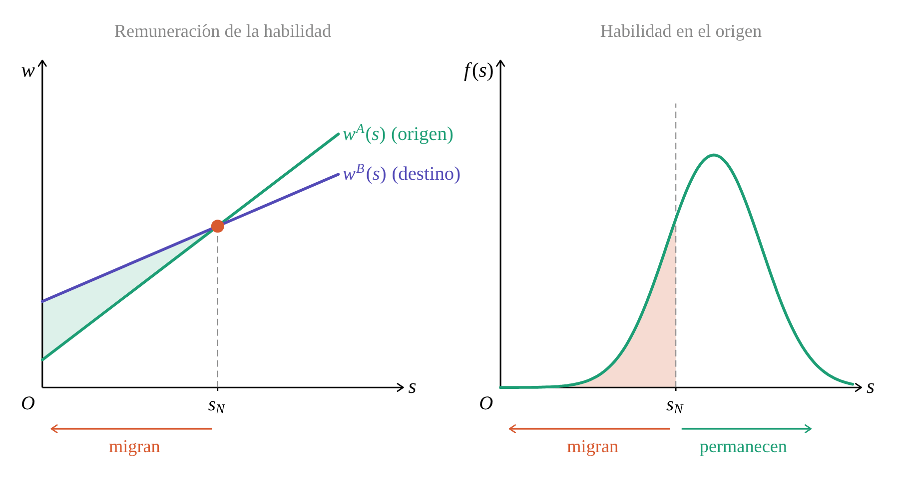
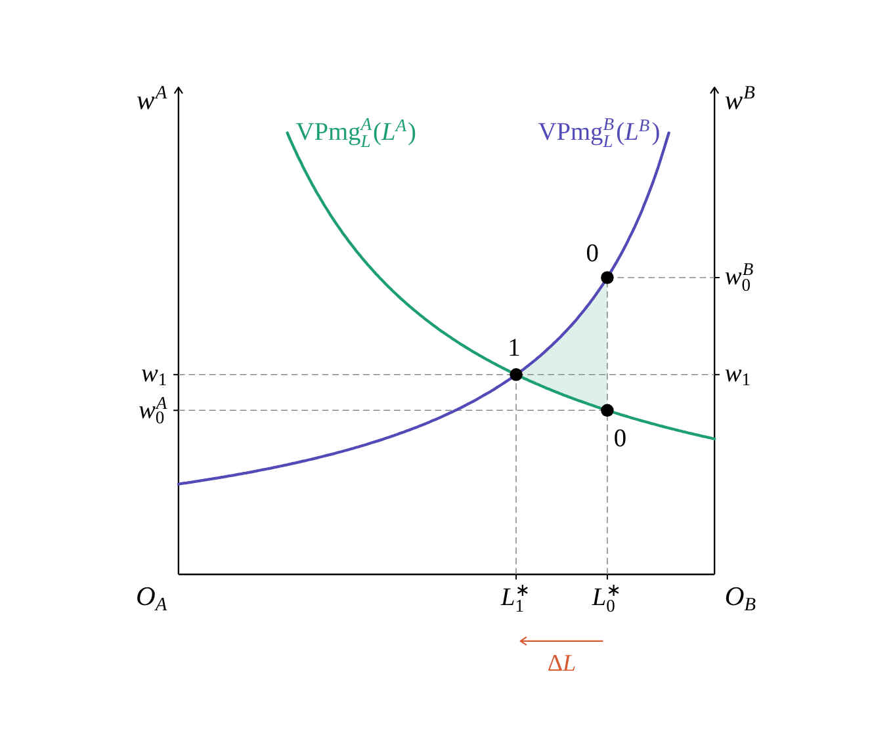

## Introducción



El estudio de los **movimientos internacionales de factores** comprende el análisis de los flujos entre países de trabajo, capital y otros factores productivos (p. ej. recursos naturales[^b18-1] o incluso la iniciativa empresarial y el conocimiento).

Generalmente, estos flujos internacionales ocurren de dos formas principales:

1. *Migraciones*: en el caso del factor trabajo, los flujos son desplazamientos geográficos de los trabajadores de un país a otro.

2. *Transferencias*: en el caso del factor capital, los flujos tienen lugar mediante transacciones con instrumentos financieros y contratos que, generalmente, implican la transmisión de derechos de propiedad.

Las fases de mayor apertura comercial han tendido a coincidir con las de mayor movilidad de los factores, con la salvedad de los controles de capital de Bretton Woods, y las de repliegue, con restricciones a ambas (tema [B21](b21-sei-despues-bw.qmd), apartado 1.2, y tema [B32](b32-perspectivas.qmd), apartado 1.1).

Richard Baldwin (2016) lee la globalización en términos de dos “desagregaciones” (*unbundlings*), analizadas en el apartado 1.3. La de producción y consumo, en la primera globalización, movilizó capital y trabajo hacia las economías de frontera. La segunda, la de las etapas de un mismo proceso productivo, en la tercera globalización, traslada tareas y capital productivo hacia los eslabones de menor coste y da lugar a las cadenas globales de valor.

Por todo ello, a menudo es difícil distinguir el comercio internacional de los movimientos internacionales de factores, ya que ambos están ligados y la teoría neoclásica del comercio los ha considerado sustitutivos (teorema de igualación del precio de los factores, tema [B05](b05-tnc-comercio.qmd), apartado 2.4.2). No obstante, los movimientos de factores plantean cuestiones de índole social que no están presentes en los de bienes y servicios.

Hoy, los flujos internacionales de factores están de máxima actualidad, porque la pandemia de COVID-19 desorganizó las cadenas globales de valor (CGV), y la guerra de Ucrania y la de Siria han generado desplazamientos forzosos masivos hacia Europa. Según el Alto Comisionado de las Naciones Unidas para los Refugiados (ACNUR), el número de desplazados forzosos en el mundo, incluidos los internos, alcanzó un máximo histórico de 123 millones a finales de 2024 y bajó a 117,8 millones a finales de 2025, primer descenso en una década.

El tema estudia las causas y efectos de los movimientos internacionales de factores productivos según el siguiente esquema:

- *Caracterización*: rasgos de la nueva globalización económica y financiera, situación de los flujos de factores y cadenas globales de valor.

- *Factor trabajo*: determinantes y efectos de sus movimientos internacionales.

- *Factor capital*: determinantes y efectos de sus movimientos internacionales, con especial atención a la inversión extranjera directa.

## 1. La nueva globalización económica y financiera y las cadenas globales de valor

La sección caracteriza la nueva globalización por sus rasgos, describe la situación actual de los flujos de trabajo, capital y energía y estudia las cadenas globales de valor.

### 1.1. Características de la nueva globalización

Cinco rasgos, que explican las características del sistema comercial y la paradoja de la integración financiera (mercados integrados, carteras marcadamente nacionales), distinguen la globalización nueva de las oleadas anteriores y condicionan el comportamiento de los factores productivos:

1. *Ventaja comparativa en eslabón*: el objeto del intercambio es a menudo la tarea y no el producto terminado, lo que da lugar a las cadenas globales de valor.

2. *Comercio electrónico*: una parte creciente de los intercambios se entrega por vía electrónica, de modo que la competencia internacional en el mercado de trabajo ya no exige el desplazamiento físico del trabajador cuando la tarea puede prestarse a distancia.

3. *Flujos de capital y organización*: el capital se desplaza también para organizar cadenas de suministro, y no solo para explotar diferenciales de rentabilidad, lo que altera la naturaleza de la inversión directa.

4. *Seguridad económica*: desde la segunda mitad de la década de 2010, la organización de la producción responde, además de a la eficiencia de costes, a criterios de seguridad y de afinidad geopolítica. La fragmentación por bloques se ha convertido en un determinante autónomo de los flujos.

5. *Globalización financiera*: las posiciones exteriores brutas, activos y pasivos, han crecido mucho más que el PIB y que los saldos netos (Lane y Milesi-Ferretti, 2018). Tras la crisis financiera global, la banca transfronteriza se retiró y ganaron peso la inversión en cartera y la intermediación no bancaria. Los flujos brutos se mueven, además, a la vez en todo el mundo, con la aversión al riesgo y la política monetaria de Estados Unidos (*ciclo financiero global*, Rey, 2013), lo que limita la autonomía monetaria aun con tipos de cambio flexibles (tema [B21](b21-sei-despues-bw.qmd), apartado 2.2.4).

::: {.callout-note appearance="simple" icon=false}
Las cuatro características del sistema comercial contemporáneo (desaceleración de la globalización, comercio intraindustrial e intraempresa, cadenas globales de valor y digitalización) y los cuatro rasgos del sistema financiero (digitalización de activos, paradoja de la integración, innovación financiera y endeudamiento) se desarrollan en el tema [B21](b21-sei-despues-bw.qmd) §1.1 y §3.1, y las disrupciones comerciales recientes, en su §1.2.3.
:::

### 1.2. Situación actual de los flujos

Con ese marco, los flujos actuales se describen por factores, primero el trabajo, después el capital y, por último, los recursos naturales, ilustrados con el caso de la energía.

#### 1.2.1. Flujos internacionales de factor trabajo

**Concepto**: los movimientos internacionales de factor trabajo comprenden los desplazamientos geográficos de personas, y se miden por el número de migrantes que entran y salen de un país durante un periodo determinado, generalmente un año.

**Tipos**: según la clasificación de las Naciones Unidas, la delimitación estadística distingue entre *movimientos a corto plazo*, con estancias de entre tres meses y un año, y *movimientos de largo plazo*, con estancias superiores al año. 

Desde el punto de vista teórico cabe distinguir además la *migración de retorno*, cuando el trabajador regresa a su país tras el desplazamiento, y la *migración repetida*, cuando reitera la salida. Una tercera clasificación, relevante para el análisis de los efectos, separa la migración cualificada de la no cualificada.

**Estructura geográfica**: conviene distinguir entre el *stock de migrantes*, es decir, las personas que residen fuera de su país de nacimiento en un momento dado, y los *flujos anuales de entrada y salida*, de magnitud muy inferior. Según el Departamento de Asuntos Económicos y Sociales de las Naciones Unidas (DAES), el *stock* de migrantes internacionales ascendía en 2024 a unos 304 millones de personas[^b18-4], en torno al 3,7 % de la población mundial, frente al 2,8 % del año 2000.

El principal corredor migratorio, medido igualmente en términos de *stock*, es México-Estados Unidos, con unos 11 millones de personas, seguido de los corredores Afganistán-Irán, Siria-Turquía[^b18-5], Rusia-Ucrania e India-Emiratos Árabes Unidos. El patrón dominante combina la migración económica hacia las economías avanzadas con desplazamientos forzosos de carácter regional y con corredores heredados de la historia política.

**Estructura sectorial**: la inserción laboral de los migrantes presenta una marcada polarización. Los menos cualificados se concentran en la agricultura, la construcción, la hostelería y los servicios de cuidados, actividades intensivas en trabajo y difícilmente automatizables. Los cualificados, por su parte, se dirigen a la sanidad, la investigación y los servicios tecnológicos y son objeto de políticas de captación selectiva por parte de los países receptores, lo que plantea a los de origen el problema de la fuga de cerebros. El segmento intermedio, por el contrario, está infrarrepresentado.

**Conclusiones**: la evolución reciente muestra un cambio cualitativo respecto de las migraciones masivas del s. XIX, dirigidas entonces a economías de frontera con abundancia de tierra. Hoy, en cambio, el desplazamiento responde a diferenciales de productividad y de renta antes que a la disponibilidad de recursos, y se orienta hacia trabajadores cualificados en una proporción creciente.

#### 1.2.2. Flujos internacionales de capital

El capital puede hacer referencia al capital físico productivo, al financiero o al humano. Desde el punto de vista empírico, los flujos de capital físico son de escasa magnitud, y el capital humano se desplaza incorporado al factor trabajo, de modo que los modelos se centran en el capital financiero. Este capital se canaliza a través de la cuenta financiera de la balanza de pagos en dos modalidades principales, la inversión extranjera en cartera y la inversión extranjera directa.

::: {.callout-note appearance="simple" icon=false}
Las magnitudes actuales de la inversión extranjera directa se recogen en el tema [B32](b32-perspectivas.qmd) §1.3. Los determinantes de los flujos de capital y sus efectos se desarrollan en la sección 3 de este mismo tema.
:::

**Inversión extranjera en cartera** (*foreign portfolio investment*): comprende la inversión transfronteriza en títulos de deuda o de participación en el capital distinta de la directa y de los activos de reserva, caracterizada por ser fácilmente negociable. Persigue optimizar el binomio rentabilidad-riesgo sin buscar un interés duradero y, por ello, tiene vocación de corto plazo. 

- *Tipos*: según el instrumento, cabe distinguir entre acciones, participaciones en fondos de inversión y títulos de deuda, tanto privados como públicos.

- *Estructura geográfica*: la inversión en cartera se concentra en las economías avanzadas con mercados de capitales profundos y en los centros financieros que domicilian fondos de inversión. Según el FMI, la posición mundial de activos de cartera alcanzaba a mediados de 2024 unos 71 billones de dólares. Estados Unidos es el primer destino, pues los no residentes poseían a mediados de 2025 valores estadounidenses por unos 35,3 billones[^b18-6]. Los cinco primeros tenedores de sus valores a largo plazo son el Reino Unido, las islas Caimán, Canadá, Japón y Luxemburgo, lo que refleja el papel de los centros financieros como intermediarios.

- *Estructura sectorial*: por instrumentos, las participaciones en el capital y en fondos de inversión sumaban unos 40 billones de dólares, algo más de la mitad de la posición mundial, y el resto correspondía a títulos de deuda. Entre estos, la deuda pública de las economías avanzadas actúa como activo seguro, y la del Tesoro estadounidense a largo plazo en manos de no residentes rondaba los 7,7 billones de dólares a mediados de 2025. Por tenedores, las instituciones oficiales extranjeras poseían en torno a una quinta parte de los valores estadounidenses en manos de no residentes, y los inversores privados, el resto.

- *Conclusiones*: la inversión en cartera es mucho más volátil y procíclica que la inversión directa y constituye, junto con los flujos bancarios (otra inversión), la principal vía de las interrupciones súbitas de capital (apartado 3.2.2).

**Inversión extranjera directa** (IED, *foreign direct investment*): comprende la inversión transfronteriza realizada por un residente de una economía con el objetivo de establecer un interés duradero (el control o un grado significativo de influencia en la gestión de una empresa no residente). Convencionalmente se emplea para ello el umbral del 10 % de los derechos de voto, conforme a la sexta edición del Manual de Balanza de Pagos del FMI (MBP6) y a las directrices de la OCDE. Sus principales actores son las grandes empresas multinacionales, las instituciones financieras y los fondos de capital privado.

- *Tipos*: cabe distinguir dos criterios de clasificación:

    - *Destino de los fondos*:
        - *Nueva planta* (*greenfield*)[^b18-7]: crea capacidad productiva adicional en el país receptor.
        - *Fusiones y adquisiciones* (*M&A*): la adquisición de empresas existentes transfiere la propiedad sin ampliar el capital instalado.

    - *Lógica de la operación*:
        - *Horizontal*: replica la producción en el mercado de destino para servirlo localmente.
        - *Vertical*: fragmenta el proceso productivo entre países según sus ventajas de coste, dando lugar a las cadenas globales de valor que se examinan a continuación.

- *Estructura geográfica*: según la Conferencia de las Naciones Unidas sobre Comercio y Desarrollo (UNCTAD, *World Investment Report* 2026), las economías en desarrollo recibieron en 2025 algo más de 900.000 M\$, más de la mitad del total mundial, y las desarrolladas, 723.000 M\$. Estados Unidos fue a la vez el primer receptor (277.000 M\$), por delante de Singapur, Hong Kong (China) y China, y el primer emisor (263.000 M\$), por delante de Japón y China. No obstante, una parte de los flujos transita por centros financieros sin contrapartida productiva (apartado 3.1.3), lo que obliga a leer con cautela los datos por país.

- *Estructura sectorial*: el valor de los proyectos de nueva planta anunciados en 2025 creció sobre todo por los centros de datos, seguidos del petróleo y el gas y de los semiconductores, mientras que retrocedieron las energías renovables, las demás infraestructuras y las manufacturas. Las fusiones y adquisiciones transfronterizas cayeron, en cambio, un 7 %. Esa composición refleja el peso creciente de la economía digital y de la seguridad de suministro en las decisiones de localización.

- *Conclusiones*: la IED es la forma más estable de financiación exterior y la que mayor transferencia de tecnología y de conocimiento organizativo genera, si bien su recuperación de 2025 ha sido desigual y muy concentrada, y la IED se reorienta hacia países políticamente afines[^b18-8].

#### 1.2.3. Flujos internacionales de recursos naturales: el caso de la energía

**Concepto**: junto al trabajo y al capital, los recursos naturales constituyen un tercer factor cuyos flujos internacionales condicionan de forma notable el comportamiento de las economías. A diferencia de aquellos, no se desplaza el factor sino su producto, de modo que el comercio de recursos opera como sustituto de una movilidad factorial imposible, porque el yacimiento no puede trasladarse.

**Tipos**: comprenden recursos energéticos, minerales industriales y metales, y minerales críticos y tierras raras, de relevancia estratégica creciente.

**Estructura geográfica**: es el rasgo definitorio de estos flujos y la fuente de su relevancia geoeconómica. La oferta presenta una concentración muy superior a la de cualquier otro flujo internacional, tanto en los hidrocarburos, con la Organización de Países Exportadores de Petróleo (OPEP) y Rusia, como en los minerales críticos. En estos, China controla una proporción dominante de la capacidad de procesamiento con independencia de dónde se extraiga el mineral. La demanda, en cambio, está mucho más distribuida, asimetría que confiere a los productores una capacidad de influencia desproporcionada respecto de su peso económico.

**Estructura sectorial**: las elasticidades de sustitución de la demanda energética son muy reducidas a corto plazo, lo que explica la volatilidad de precios característica de este mercado.

**Conclusiones**: episodios como la guerra de Ucrania, que llevó a la UE a sustituir el gas ruso por gas natural licuado y renovables, han consolidado la seguridad de suministro, junto al coste, como criterio de política económica (véase [B21](b21-sei-despues-bw.qmd) §1.2.3).

### 1.3. Cadenas globales de valor

**Concepto**: una CGV es una cadena formada por etapas que van desde la producción de un bien o servicio hasta la venta al cliente final, de tal manera que dicha cadena tiene al menos dos eslabones en países distintos. Se dice que una empresa participa en una cadena global de valor si realiza al menos una etapa de dicha cadena. El rasgo distintivo de una CGV es que el objeto del comercio pasa a ser la tarea, y no el producto terminado.

Desde 1990 hasta 2008 se produce un avance muy significativo de la globalización, acompañado de la fragmentación de los procesos productivos a raíz de fenómenos como la subcontratación internacional (*outsourcing*) y la expansión de las franquicias. Como resultado, se han ido configurando cadenas cada vez más largas y complejas (p. ej. la fabricación de aviones o de teléfonos inteligentes).

**Causas**: la fragmentación internacional de la producción responde a la caída de los costes de transporte y, sobre todo, al abaratamiento de la coordinación a distancia que explica Baldwin (2016). A ello se sumaron la liberalización comercial y de la inversión, la incorporación al comercio mundial de grandes economías con abundante mano de obra y la posibilidad de aprovechar la ventaja comparativa en cada tarea, y no ya en el producto completo.

- *Desagregaciones* (Baldwin, 2016): las dos de la Introducción responden a restricciones distintas. La caída de los costes de transporte en el s. XIX separó la producción del consumo, pero no las etapas de la producción, porque coordinar procesos complejos exigía proximidad. Solo cuando las tecnologías de la información y las comunicaciones abarataron la coordinación a distancia, a partir de 1990, pudieron las empresas del G7 trasladar etapas a países de salarios bajos, llevando consigo su conocimiento técnico y organizativo. Esa deslocalización del conocimiento explica la “gran convergencia”. La participación de los actuales países ricos en la renta mundial, que había pasado de en torno al 20 % en 1820 a casi el 70 % en 1990, ha retrocedido desde entonces, según Baldwin (2016), a su nivel de 1900.

- *Comercio de tareas* (Grossman y Rossi-Hansberg, 2008): cada factor realiza un continuo de tareas más o menos fáciles de trasladar. La empresa deslocaliza la tarea $i$ si $w^* c_i < w$, donde $w$ y $w^*$ son el salario nacional y el extranjero del factor que la realiza y $c_i \geq 1$ el coste de deslocalizarla, mayor cuanto más exige proximidad o trato personal. Al caer esos costes, el ahorro que permite la deslocalización actúa como una mejora de la productividad del factor cuyas tareas se trasladan con más facilidad, y ese *efecto productividad* puede elevar su remuneración. Abaratar el comercio de tareas puede beneficiar, así, a todos los factores nacionales, a diferencia del conflicto distributivo que acompaña al abaratamiento del comercio de bienes.

- *Fabricar o comprar* (Antràs, 2003; Antràs y Helpman, 2004): decidida la localización, la empresa elige entre producir el insumo en una filial propia (integración, que en el exterior adopta la forma de IED vertical y genera comercio intraempresa) o comprarlo a un proveedor independiente (externalización). Con contratos incompletos, sede y proveedor realizan inversiones específicas de la relación, y la propiedad conviene a quien más aporta. Así, la integración predomina en los sectores intensivos en capital, en los que pesa más la inversión de la sede.

    Antràs y Helpman (2004) añaden la heterogeneidad de las empresas y cruzan propiedad y localización en cuatro formas organizativas (integración o externalización, en el país o en el exterior). Como los costes fijos son mayores en el exterior y con integración, en los sectores intensivos en servicios centrales y con una ventaja salarial del exterior suficiente, solo las empresas más productivas integran en el exterior mediante IED vertical. Esta ordenación por productividad traslada a la IED vertical la jerarquía de Helpman, Melitz y Yeaple (apartado 3.1.3) y la ventaja de internalización de Dunning.

- *Otros determinantes*: la localización de cada eslabón depende, además, de cuatro factores:

    - *Costes laborales*: atrae a los eslabones intensivos en trabajo un coste laboral unitario bajo (el salario corregido por la productividad), no el salario bajo sin más.

    - *Instituciones*: los países que hacen cumplir los contratos se especializan en los bienes cuyos insumos exigen inversiones específicas.

    - *Acuerdos comerciales*: como los aranceles se acumulan cada vez que un insumo cruza una frontera, su eliminación y los acuerdos profundos (inversión, servicios, reglas de origen) favorecen la fragmentación.

    - *Logística*: la producción “justo a tiempo” exige entregas rápidas y fiables, de modo que los retrasos en frontera y en puerto penalizan la participación en las cadenas.

- *Riesgo geopolítico*: el riesgo de interrupción del suministro por aranceles, controles a la exportación, sanciones o conflictos entra en el coste esperado de cada localización. Por ello, la mejor opción deja de ser simplemente la más barata y pasa a ser la que mejor combina coste y seguridad del suministro, lo que favorece a los países próximos (*nearshoring*) o afines (*friendshoring*). Las disrupciones recientes han desplazado el paradigma del “justo a tiempo” al “por si acaso”, con diversificación de proveedores (p. ej. la estrategia *China+1*) más que relocalización (*reshoring*), lo que alarga en apariencia las cadenas sin desglobalización sustantiva. Los efectos de esa reconfiguración sobre los flujos se examinan en los temas [B21](b21-sei-despues-bw.qmd), apartado 1.1.3, y [B32](b32-perspectivas.qmd), apartados 3.1 y 1.3.1.

::: {.callout-note appearance="simple" icon=false}
El modelo de Antràs y Helpman (2004) se desarrolla en el tema [B06](b06-nueva-teoria.qmd), apartado 3.2.2. Aquí se recoge su papel en la organización de las cadenas globales de valor.
:::

**Tipos**: las CGV pueden configurarse de maneras muy distintas. Las más destacables son:

1. *Araña* (*spider*): los componentes fabricados en varios países se envían a una única planta de ensamblaje (p. ej. la automoción).

2. *Serpiente* (*snake*): el valor añadido se genera de forma secuencial, a medida que la fabricación se encadena en eslabones situados en diferentes países.

**Magnitud**: según el Grupo Banco Mundial (GBM, 2020), el comercio vinculado a las CGV creció con rapidez entre 1990 y 2008, año en que alcanzó su máximo, en torno al 52 % del comercio mundial. Desde entonces se ha estancado en torno a la mitad del total[^b18-9].

- *Medición de la participación*: existen varios indicadores:

    - *Participación hacia atrás* (*backward*): mide el valor añadido extranjero incorporado en las exportaciones del país (cuánto importa un país para poder exportar). Esta participación es característica de las economías situadas “aguas abajo” (ensamblaje).

    - *Participación hacia delante* (*forward*): mide el valor añadido nacional incorporado en las exportaciones de terceros países (cuánto exporta un país en forma de insumos que otros incorporan a sus propias exportaciones). Esta participación es característica de las economías situadas “aguas arriba” (proveedores de materias primas o de bienes intermedios).

    - *Medición agregada*: la suma de la participación hacia atrás y hacia delante ofrece un índice global de participación en las CGV, mientras que la relación entre ambas (índice de posición) permite situar a cada país en la cadena.

- *Participantes*: según el GBM (2020), forman cuatro grupos principales:

    - *Exportadores de materias primas* (p. ej. Rusia): participan sobre todo “hacia delante”, suministrando recursos naturales y bienes primarios que otros incorporan a sus exportaciones.

    - *Manufactura e industria limitada* (p. ej. Argentina): integrados en tareas de ensamblaje y manufactura básica, con participación “hacia atrás” y valor añadido nacional reducido.

    - *Manufacturas avanzadas y servicios* (p. ej. China): producen bienes complejos y servicios especializados y captan tramos de mayor valor añadido.

    - *Actividades innovadoras* (p. ej. EE. UU.): concentran el mayor valor añadido en los extremos de la “curva de la sonrisa” y ejercen de empresas líderes de las cadenas.

**Efectos**: la fragmentación internacional de la producción afecta al reparto del valor añadido entre las etapas y opera en dos planos, el microeconómico y el macroeconómico:

- *Curva de la sonrisa y gobernanza*: el valor añadido no se reparte de forma homogénea a lo largo de la cadena. La “curva de la sonrisa” (atribuida a Stan Shih, de Acer) describe, en el plano etapas de la cadena-valor añadido (figura -@fig-b186-curva-sonrisa), cómo las etapas situadas en los extremos, la preproducción (I+D, diseño, propiedad intelectual) y la posproducción (marca, mercadotecnia, servicios posventa), concentran la mayor parte del valor añadido. La fabricación y el ensamblaje intermedios, más fácilmente deslocalizables, generan, en cambio, el menor. Gereffi, Humphrey y Sturgeon (2005) complementan este análisis con una tipología de la gobernanza de las cadenas (de mercado, modular, relacional, cautiva y jerárquica), según el grado de coordinación y de asimetría de poder entre empresas líderes y proveedores.

::: {#fig-b186-curva-sonrisa}

::: {.content-visible when-format="html"}
```{=html}
<div class="graph-frame">
<iframe src="../graphs/b186_Curva_sonrisa.html" style="height:560px" loading="lazy" title="fig-b186-curva-sonrisa"></iframe>
</div>
```
:::

::: {.content-visible unless-format="html"}

:::

Curva de la sonrisa. El valor añadido de cada etapa de una cadena global de valor es máximo en los extremos, la preproducción (I+D, diseño, propiedad intelectual) y la posproducción (marca, mercadotecnia, servicios posventa), y mínimo en la fabricación y el ensamblaje, las etapas más fáciles de deslocalizar.
:::

- *Efectos microeconómicos* (sectoriales): especialización más fina y por tareas, apertura del comercio internacional a las pymes al reducir la escala mínima necesaria para participar en él, establecimiento de relaciones duraderas cliente-proveedor, difusión tecnológica y efectos sobre la desigualdad salarial.

- *Efectos macroeconómicos*: se manifiestan en varios frentes:

    - *Interdependencia*: generación de interdependencias entre países, con transmisión prácticamente inmediata de las perturbaciones, pues la interrupción de un eslabón detiene el conjunto de la cadena.

    - *Inflación*: intensificación de la sincronización internacional de la inflación (p. ej. guerra de Ucrania).

    - *Comercio bilateral*: intensificación de los flujos comerciales bilaterales (p. ej. China-EE. UU.).

    - *Medio ambiente*: efectos sobre la sostenibilidad medioambiental (p. ej. los *pollution havens* o refugios de contaminación).

    - *Fiscalidad*: retos para la recaudación tributaria (el problema de los precios de transferencia).

::: {.callout-note appearance="simple" icon=false}
Este tema es la fuente del análisis de las cadenas globales de valor. Su recapitulación como característica del sistema comercial contemporáneo figura en el tema [B21](b21-sei-despues-bw.qmd) §1.1.3.
:::

### 1.4. Conclusiones

La globalización actual se distingue de las anteriores en que el objeto del intercambio es a menudo la tarea y no el producto terminado, y en que el capital se desplaza también para organizar cadenas de suministro. La seguridad económica compite, además, con la eficiencia de costes en la localización. Los flujos de cada factor reflejan ese cambio. Así, las migraciones se dirigen menos que en el s. XIX a economías con tierra abundante y cuentan con una proporción creciente de trabajadores cualificados. La volatilidad de la inversión en cartera contrasta con la estabilidad de la directa, y los recursos naturales, inmóviles, circulan a través del comercio de su producto, con una oferta muy concentrada.

Las cadenas globales de valor condensan esa transformación. El abaratamiento de la coordinación a distancia permitió trasladar etapas y conocimiento a países de salarios bajos, y el riesgo geopolítico pesa, junto al coste laboral unitario, en la localización de cada eslabón. Detrás de estos flujos operan determinantes económicos, geográficos e institucionales, que la sección 2 analiza para el trabajo y la sección 3, para el capital.

## 2. Determinantes y efectos de los movimientos internacionales de factor trabajo

El estudio del factor trabajo contrasta primero la predicción neoclásica con los hechos y examina después qué determina los flujos de trabajadores y qué efectos producen.

### 2.1. El punto de partida teórico: la sustituibilidad neoclásica (Mundell, 1957)

**Origen**: Robert Mundell (1957) estudia en el modelo de Heckscher-Ohlin la relación entre el comercio de bienes y la movilidad internacional de los factores.

**Idea**: el punto de partida es la *sustituibilidad* entre comercio de bienes y movilidad de factores que se deriva del marco neoclásico (Mundell, 1957).

::: {.callout-note appearance="simple" icon=false}
El teorema de igualación del precio de los factores, del que la sustituibilidad de Mundell constituye el reverso, se desarrolla en el tema [B05](b05-tnc-comercio.qmd) §2.4.2. Aquí interesa su lectura en clave de movilidad de factores.
:::

**Razonamiento**: en el marco neoclásico, bajo sus supuestos[^b18-11] y en ausencia de especialización completa, el libre comercio de bienes iguala los precios de los factores entre países aun cuando estos no se muevan. Mundell formalizó la relación inversa, según la cual, si un obstáculo (p. ej. un arancel) impide el comercio de bienes, la movilidad de factores tiende a suplirlo. Comercio de bienes y movilidad de factores son así sustitutivos perfectos, y el estudio separado de los movimientos de factores resultaba redundante.

**Conclusiones**:

- *Aspectos positivos*: el resultado de Mundell sirve de referencia para contrastar los desarrollos posteriores y anticipa que los obstáculos al comercio estimulan la movilidad de factores, la lógica que recogen las teorías comerciales y de localización de la IED (apartado 3.1.3).

- *Limitaciones*: la realidad contradice la predicción de sustituibilidad, ya que los flujos comerciales coexisten con las migraciones y con los flujos de capital, en lugar de sustituirlos. En el plano teórico, Markusen (1983) mostró que la relación se invierte cuando el comercio no se debe a diferencias de dotaciones, sino de tecnología, de rendimientos a escala o de impuestos, porque entonces la movilidad de factores amplía el comercio (tema [B05](b05-tnc-comercio.qmd), apartado 3.3.3). Esa discrepancia motiva los desarrollos que siguen, basados en el levantamiento de los supuestos neoclásicos (información imperfecta, costes de transporte, heterogeneidad y dinámica intertemporal).

### 2.2. Determinantes de los flujos internacionales de trabajadores

Los flujos de trabajadores responden a diferencias salariales, que formaliza el modelo de Roy y Borjas, y a factores socioeconómicos y geográficos.

#### 2.2.1. Determinantes económicos: diferencias salariales (Hicks, 1932; Roy, 1951; Borjas, 1987)

**Origen**: *Self-Selection and the Earnings of Immigrants* (1987), de George Borjas, analiza las causas y la composición de los movimientos migratorios internacionales a partir de la heterogeneidad de las habilidades individuales.

**Idea**: los migrantes realizan un análisis coste-beneficio, comparando el salario que obtendrían en cada país dadas sus habilidades, para tomar su decisión.

**Supuestos**:

- *Entorno*: dos países o regiones, el de origen de la migración, $A$ (p. ej. Ucrania), y el de destino, $B$ (p. ej. Polonia).

- *Agentes*: se supone que la decisión de migración es irreversible y, dada la heterogeneidad de habilidades en la población, los salarios se comportan como una variable aleatoria. El modelo considera además que existen unos costes de migración entendidos en sentido amplio, $c > 0$. Estos incluyen desde los *costes directos* de transporte de pertenencias y personas hasta los *costes de oportunidad* de renuncia a ingresos durante la migración o los *costes psicológicos* derivados de la desutilidad de dejar atrás a la familia y a los amigos.

**Planteamiento**: el modelo adopta la estructura del modelo de Roy (1951), en la que el salario que un individuo obtendría en el país $j$, $w^{e,j}$, se descompone en dos componentes. El primero, observable y común a todos los residentes, es el salario medio del país, $\bar{w}^j$. El segundo, individual y no observable, $\varepsilon^j$, recoge la remuneración que ese país concede a las habilidades del individuo:

$$w^{e,j} = \bar{w}^j + \varepsilon^j, \qquad \varepsilon^j \sim N(0, (\sigma^j)^2), \qquad j = A, B$$

donde $\bar{w}^A \neq \bar{w}^B$ son los salarios medios de cada país y $\varepsilon^j$ es una perturbación aleatoria de media nula. Su varianza, $(\sigma^j)^2$, es específica de cada país, pues mide cuánto premia cada uno la habilidad (el rendimiento de la cualificación). Precisamente esa asimetría entre $\sigma^A$ y $\sigma^B$ gobierna los resultados de selección que se obtienen en el apartado 2.3.1.

Se sigue de ello que a cada individuo le importa el salario que prevé obtener dadas sus propias habilidades, y no el salario medio *per se*.

La decisión de migrar sigue la lógica de la obra de John Hicks (1932), según la cual los trabajadores deciden si migrar o no sobre la base de los diferenciales salariales. En este modelo, el trabajador decide emigrar desde $A$ hacia $B$ si:

$$(\bar{w}^B - \bar{w}^A) + (\varepsilon^B - \varepsilon^A) > c$$

**Equilibrio**: de esa condición se obtiene la probabilidad de migrar, que mide la proporción de trabajadores de $A$ que emigran:

$$p_m = P\big(\bar{w}^B - \bar{w}^A + \varepsilon^B - \varepsilon^A - c > 0\big)$$

Se tipifica la expresión anterior definiendo la variable $z \equiv \dfrac{\bar{w}^A - \bar{w}^B + c}{\sigma}$, con lo que se obtiene:

$$p_m = 1 - \Phi(z) = 1 - \Phi\!\left(\frac{\bar{w}^A - \bar{w}^B + c}{\sigma}\right)$$

donde $\Phi$ denota la función de distribución de una normal tipificada y $\sigma$ mide la dispersión del diferencial de habilidades, es decir, la desviación típica de $(\varepsilon^B - \varepsilon^A)$. La tipificación no es un mero recurso de cálculo, ya que, al reducir los cuatro parámetros del modelo a un único índice $z$, muestra que solo importan las magnitudes relativas. Así, un aumento proporcional del diferencial salarial, del coste de migrar y de la dispersión deja inalterada la probabilidad de migrar.

**Estática comparativa**: de todo lo anterior se desprende que la probabilidad de migrar se puede resumir en la función:

$$p_m = p_m\big(\bar{w}^B - \bar{w}^A,\ \sigma,\ c\big)$$

Según el modelo, los determinantes de los flujos internacionales de trabajo son:

1. *Brecha salarial*: diferencia de salario medio entre destino y origen, $\bar{w}^B - \bar{w}^A$ (signo positivo). Cuanto mayor es, mayor es la probabilidad de migrar.

2. *Dispersión del diferencial de habilidades*: $\sigma$ (signo ambiguo). Al situarse en el denominador de $z$, un aumento de la dispersión acerca $z$ a cero y, por tanto, $p_m$ a 0,5, de modo que eleva la probabilidad de migrar cuando el diferencial salarial no la hacía atractiva y la reduce en caso contrario. Su efecto principal recae, por ello, sobre la composición de los migrantes antes que sobre su volumen, cuestión que se desarrolla en el apartado 2.3.1.

3. *Costes de migración*: $c$ (signo negativo). En el país de origen pueden existir restricciones de crédito o trampas de pobreza que impidan afrontar el coste migratorio pese a que migrar sea deseable. En sentido contrario, el tamaño de la colonia de migrantes en el país de destino puede contribuir a reducir los costes, gracias a la información, el alojamiento y la intermediación laboral que esta proporciona (efecto red o efecto diáspora, coloquialmente “efecto llamada”).

**Conclusiones**:

- *Aspectos positivos*: el marco de Hicks-Borjas ordena en una sola expresión los determinantes de la decisión migratoria y deriva de forma explícita la probabilidad de migrar. Su anclaje en el modelo de Roy permite además determinar quiénes migran.

- *Limitaciones*: el modelo trata la decisión como irreversible e individual, dejando fuera la migración de retorno, la repetida y la decisión familiar. Tampoco incorpora los determinantes no económicos ni las restricciones legales de entrada, que en muchos corredores son vinculantes antes que los diferenciales salariales.

#### 2.2.2. Otros determinantes: factores socioeconómicos y geográficos

Influyen también factores no estrictamente económicos, como las razones políticas, la proximidad cultural, la búsqueda de seguridad jurídica o la reunificación familiar[^b18-17].

Por último, intervienen los factores geográficos. Según los modelos gravitatorios (§3.1.1), que también se aplican a las migraciones, los flujos bilaterales de personas crecen con el tamaño de las poblaciones de origen y destino y decrecen con la distancia, entendida en sentido amplio (física, cultural, lingüística e institucional). A ello se añade el efecto red, que perpetúa los corredores históricos (dependencia de la trayectoria), muchos de ellos nacidos de vínculos coloniales, lingüísticos o fronterizos.

### 2.3. Efectos de las migraciones internacionales

Explicada la decisión de migrar, sus consecuencias se ordenan desde la composición de los flujos (selección) hasta los efectos redistributivos y los específicos sobre el país de destino y sobre el de origen.

#### 2.3.1. Efectos de selección: autoselección positiva y negativa (Roy, 1951; Borjas, 1987)

**Origen**: el modelo de Andrew Roy (1951), concebido para explicar la elección entre ocupaciones, que Borjas traslada a la elección entre países. En él importa no solo la media del salario en cada país, sino la distribución completa de las remuneraciones a la habilidad y la correlación entre las capacidades del individuo en el origen y en el destino.

**Idea**: el apartado anterior determina cuántos trabajadores migran, y este, quiénes lo hacen y de qué tramo de la distribución de habilidades del país de origen proceden. De ese tramo dependen tanto el efecto sobre el origen como la inserción laboral en el destino.

**Supuestos**:

- *Entorno*: se mantienen los supuestos del modelo de diferencias salariales, con las desviaciones típicas de cada país, y se añade un parámetro.

- *Rendimiento de la habilidad*: por un lado, $\sigma^A$ y $\sigma^B$, las desviaciones típicas de los componentes de habilidad en cada país, que miden el rendimiento de la cualificación.

- *Correlación*: por otro, $\rho$, el coeficiente de correlación entre ambos componentes, que recoge en qué medida las capacidades valoradas en el origen lo son también en el destino.

**Planteamiento**: de los parámetros anteriores se obtiene la varianza del diferencial, cuya desviación típica aparece en el denominador de la variable tipificada:

$$\sigma^2 = \operatorname{Var}(\varepsilon^B - \varepsilon^A) = (\sigma^A)^2 + (\sigma^B)^2 - 2\rho\,\sigma^A\sigma^B$$

**Equilibrio**: de esta expresión se derivan los tres casos de selección que contempla el modelo:

1. *Autoselección positiva*: se produce cuando la remuneración de la habilidad es mayor en el destino ($\sigma^B > \sigma^A$) y la correlación de capacidades es suficientemente alta ($\rho > \sigma^A/\sigma^B$). Quienes más ganan con la migración son entonces los trabajadores situados en la cola superior de la distribución, los más cualificados. Este caso corresponde a las migraciones desde países igualitarios hacia países desiguales.

2. *Autoselección negativa*: se produce cuando la remuneración de la habilidad es mayor en el origen ($\sigma^A > \sigma^B$), manteniéndose una correlación suficientemente alta ($\rho > \sigma^B/\sigma^A$). Los que más ganan migrando son los de la cola inferior, que en su país están “penalizados” por la elevada dispersión salarial. Un país de origen muy desigual “retiene” así a sus trabajadores más capaces, que allí obtienen una prima elevada, y “expulsa” a los de menor cualificación, que en un destino más igualitario mejoran su posición relativa.

3. *Selección de refugiados* (*refugee sorting*): se produce cuando la correlación es baja (inferior al menor de los cocientes $\sigma^A/\sigma^B$ y $\sigma^B/\sigma^A$), es decir, cuando las habilidades que se premian en el origen y en el destino guardan poca relación entre sí. La selección es entonces negativa respecto del origen, sea cual sea el país de mayor dispersión. Emigran quienes ocupan posiciones bajas en la distribución del país de origen, que sin embargo pueden situarse en tramos altos de la del destino, precisamente porque uno y otro país valoran atributos distintos. Este caso describe los flujos originados por rupturas políticas o institucionales, en los que las capacidades valoradas en el origen pierden valor al cruzar la frontera.

**Desarrollo gráfico**: la autoselección se representa en el plano habilidad-salario (figuras -@fig-b181-seleccion-positiva y -@fig-b182-seleccion-negativa, panel izquierdo), con los niveles ($s$) de una habilidad laboral, que se supone perfectamente transferible entre ambos países, en el eje de abscisas:

1. *Rectas de remuneración* ($w^A(s)$ en el origen y $w^B(s)$ en el destino): para cada país, una recta que asocia a cada nivel de habilidad el salario que percibe el trabajador con ese nivel. Su pendiente mide la remuneración por unidad de habilidad, es decir, el rendimiento de la cualificación en ese país, y se corresponde con $\sigma^A$ y $\sigma^B$ respectivamente.

2. *Umbral*: el corte de ambas rectas define un umbral de habilidad, $s_P$ o $s_N$, en el que, sin contar el coste de migrar, el trabajador percibe el mismo salario en los dos países. Migran quienes quedan del lado del umbral en que la recta del destino va por encima de la del origen, y permanecen los demás. El área sombreada entre ambas rectas mide la ganancia salarial de los que migran.

3. *Distribución de la habilidad* (panel derecho): la densidad de la habilidad en el país de origen, $f(s)$, sobre el mismo eje y con el mismo umbral, muestra de qué tramo proceden los que migran (área sombreada), la cola superior con autoselección positiva y la inferior con autoselección negativa.

::: {#fig-b181-seleccion-positiva}

::: {.content-visible when-format="html"}
```{=html}
<div class="graph-frame wide">
<iframe src="../graphs/b181_Seleccion_positiva.html" style="--r:1.867" loading="lazy" title="fig-b181-seleccion-positiva"></iframe>
</div>
```
:::

::: {.content-visible unless-format="html"}

:::

Autoselección positiva (Roy-Borjas). El destino remunera más cada unidad de habilidad y migran los trabajadores con cualificación superior al umbral $s_P$ (panel izquierdo), es decir, la cola superior de la distribución de habilidades del país de origen (panel derecho).
:::

::: {#fig-b182-seleccion-negativa}

::: {.content-visible when-format="html"}
```{=html}
<div class="graph-frame wide">
<iframe src="../graphs/b182_Seleccion_negativa.html" style="--r:1.867" loading="lazy" title="fig-b182-seleccion-negativa"></iframe>
</div>
```
:::

::: {.content-visible unless-format="html"}

:::

Autoselección negativa. El origen remunera más la habilidad y migran los trabajadores con cualificación inferior al umbral $s_N$ (panel izquierdo), es decir, la cola inferior de la distribución de habilidades del país de origen (panel derecho).
:::

**Estática comparativa**: el signo de la selección depende de la inclinación relativa de las rectas:

- *Recta del destino más inclinada* (figura -@fig-b181-seleccion-positiva): migran quienes superan el umbral $s_P$ (autoselección positiva, p. ej. desde Suecia).

- *Recta del destino menos inclinada* (figura -@fig-b182-seleccion-negativa): migran quienes quedan por debajo de $s_N$ (autoselección negativa, la que el modelo predice desde países en desarrollo más desiguales que el destino).

**Extensiones**: además de la selección positiva y negativa, hay otros dos efectos:

1. *Ciclos*: los ciclos económicos pueden influir sobre los efectos de autoselección, ya que los auges y las recesiones provocan desplazamientos hacia arriba y hacia abajo de las rectas de remuneración de la habilidad.

2. *Selección de retorno*: una vez en el destino, no todos los migrantes permanecen indefinidamente, sino que muchos regresan a su país de origen. La extensión de Borjas y Bratsberg (1996) predice que los afectados por la selección de retorno serán aquellos que se encuentran en el margen (los que dudaban entre migrar y no migrar). Por ello, la migración de retorno intensifica los patrones iniciales de selección, al hacer más positiva la selección positiva y más negativa la negativa.

**Conclusiones**:

- *Aspectos positivos*: el modelo ofrece el marco de referencia para estudiar la selección de migrantes en el corredor bilateral México-Estados Unidos. La evidencia es, no obstante, discutida, pues unos estudios hallan selección negativa y otros, una selección intermedia o positiva en términos de cualificación observable. La mayor virtud analítica del modelo es haber demostrado que el signo de la selección no depende del nivel de desarrollo de los países implicados, sino de la desigualdad relativa entre ellos y de la correlación $\rho$. El resultado es contraintuitivo y de considerable alcance para el diseño de las políticas migratorias.

- *Limitaciones*:

    - *Otros determinantes*: el modelo no contempla determinantes distintos de la educación (p. ej. motivos políticos, guerras o la edad). Empíricamente, los migrantes son en su gran mayoría jóvenes de entre 16 y 49 años.

    - *Selección en países en desarrollo*: se le ha criticado que, en muchos países en desarrollo en los que el rendimiento de la educación es mayor en el origen que en el destino, la selección no es negativa, sino positiva. Por ello, Chiquiar y Hanson (2005) sostienen que los costes migratorios (p. ej. las restricciones de crédito) influyen mucho más de lo que supone el modelo, pues, al pesar más sobre los menos cualificados, favorecen una selección intermedia o positiva.

    - *Transferibilidad de la habilidad*: supone que la habilidad es perfectamente transferible, cuando la evidencia muestra una depreciación sustancial del capital humano al cruzar la frontera (Friedberg, 2000), por el idioma, el reconocimiento de titulaciones o la especificidad de la experiencia. Esa depreciación puede invertir el signo de la selección observada respecto de la prevista.

#### 2.3.2. Efectos redistributivos: eficiencia y equidad (MacDougall, 1960)

**Origen**: Donald MacDougall (1960) analiza los efectos de la entrada de capital extranjero sobre el país receptor. Su modelo se aplica aquí, en versión simplificada, a los movimientos del factor trabajo.

**Idea**: además de la selección, interesa el impacto sobre el bienestar de los movimientos migratorios, que el modelo permite analizar en un solo gráfico.

**Supuestos**:

- *Entorno*: dos países (origen $A$ y destino $B$), inicialmente no integrados comercialmente, crean un mercado común y liberalizan los flujos internacionales de factor trabajo entre ellos (podría ser el caso de EE. UU. y México). Se considera que no hay fallos de mercado (competencia perfecta en todos los mercados). Las dotaciones factoriales no son necesariamente iguales, de modo que las productividades marginales (y, por ello, la posición de las curvas) pueden ser diferentes en cada país. La dotación de trabajo (la oferta de trabajo) se considera constante y exógena.

- *Tecnología*: cada país produce un bien ($X$, $Y$) con una tecnología no lineal neoclásica de buen comportamiento y dos factores de producción homogéneos, idénticos y perfectamente divisibles. Se supone un entorno de corto plazo en el que el factor capital permanece fijo en ambos países.

De todo ello se deriva que los factores productivos son remunerados de acuerdo con el valor de su producto marginal y que los resultados del modelo dependerán exclusivamente de las diferencias en dichos rendimientos entre los países.

**Planteamiento**: el modelo compara el equilibrio de autarquía con el del mercado común, y sus principales intuiciones se ilustran gráficamente.

**Desarrollo gráfico**: los efectos de la movilidad del trabajo se representan en el plano cantidad de empleo[^b18-20]-salario nominal (figura -@fig-b183-macdougall), con el empleo de cada país medido desde su origen ($O_A$ u $O_B$):

1. *Curva de oferta de trabajo*: al ser la oferta de trabajo exógena, es una recta vertical (no dibujada para facilitar la ilustración gráfica).

2. *Curva de demanda de trabajo* ($\text{VPmg}^A_L(L^A)$ y $\text{VPmg}^B_L(L^B)$): refleja, para cada nivel de empleo, el salario que las empresas de cada país están dispuestas a pagar, que en un entorno competitivo coincide con el valor de la productividad marginal del trabajo. Tiene pendiente negativa respecto de su propio origen, dado que la productividad marginal laboral es decreciente, y, con las tecnologías neoclásicas habituales (p. ej. Cobb-Douglas), es convexa. La curva de $B$, medida desde $O_B$, asciende por ello de izquierda a derecha en la figura.

3. *Equilibrio*: en autarquía, antes de la integración y apertura de los flujos de trabajadores (puntos 0), el salario mexicano es $w_0^A$, mientras que el salario en EE. UU. es $w_0^B$. El nivel de empleo en México es $(O_A, L_0^*)$ y en EE. UU., $(L_0^*, O_B)$. Los trabajadores mexicanos tienen un incentivo a desplazarse hacia EE. UU., pero todavía no lo hacen. El área sombreada mide la pérdida de eficiencia derivada de esa inmovilidad.

::: {#fig-b183-macdougall}

::: {.content-visible when-format="html"}
```{=html}
<div class="graph-frame">
<iframe src="../graphs/b183_MacDougall.html" style="height:580px" loading="lazy" title="fig-b183-macdougall"></iframe>
</div>
```
:::

::: {.content-visible unless-format="html"}

:::

Modelo de MacDougall (1960). La libre movilidad del trabajo produce convergencia salarial y recupera el triángulo de eficiencia.
:::

**Estática comparativa**: si se permite la movilidad internacional de trabajadores (integración en un mercado común), los mexicanos se desplazarán hacia EE. UU., dado que allí su productividad se remunera a un salario mayor. Así, $\Delta L = L_0^* - L_1^*$ es el flujo de trabajadores desde México hacia EE. UU., y los salarios convergen en $w_1$ (punto 1).

**Bienestar**: esos movimientos producen efectos de eficiencia y de distribución:

- *Efectos sobre la eficiencia*: en el agregado, y al margen del reparto de las remesas, se produce un aumento de la producción mundial (por el aprovechamiento de las ganancias potenciales de eficiencia) y convergencia salarial entre ambos países.

- *Efectos sobre la distribución*: esa ganancia agregada oculta, sin embargo, una redistribución de renta entre factores y entre países:

    - *México (país de origen)*: los trabajadores que se quedan ganan, los migrantes obtienen la masa salarial que perciben en el destino, los propietarios del capital pierden y la producción interna cae. Intuitivamente, los trabajadores ganan porque suben sus salarios, mientras que los propietarios del capital, que son demandantes de empleo, pierden por esa misma subida. El efecto neto sobre el bienestar de México depende de lo que ocurra con la masa salarial de los migrantes. Si vuelve al país en forma de remesas[^b18-24], se produce una ganancia neta de bienestar, y si no vuelve, una pérdida neta.

    - *EE. UU. (país de destino)*: los trabajadores estadounidenses pierden, los propietarios del capital ganan y la producción total sube.

En consecuencia, la libre movilidad del trabajo es eficiente, pues aumenta el bienestar global, pero da lugar a ganadores y perdedores, lo que solo desde el punto de vista de la equidad podría justificar las políticas de restricción de flujos.

**Extensiones**: como la ganancia de eficiencia es, en principio, suficiente para compensar a los perdedores (criterio de Kaldor-Hicks), el debate se traslada al terreno de la economía política. Si las transferencias compensatorias no se articulan, la resistencia de los perdedores puede bloquear una apertura globalmente eficiente. 

**Conclusiones**:

- *Aspectos positivos*: el modelo muestra en un único gráfico los efectos de eficiencia y redistributivos de los flujos migratorios. Además, el mismo esquema se puede aplicar a los movimientos de capital, sin más que reinterpretar los ejes en términos de productividad marginal y remuneración del capital.

- *Limitaciones*: parte de supuestos muy restrictivos, por lo que no recoge algunos efectos observados:

    - *Homogeneidad*: al considerar trabajadores homogéneos, no tiene en cuenta las diferencias en la cualificación, siendo así que la composición del flujo determina buena parte de sus efectos, como muestran los efectos de selección.

    - *Tratamiento de las remesas*: el modelo trata el destino de la masa salarial de los emigrantes como un supuesto binario (vuelve o no vuelve) y no analiza los efectos de las transferencias.

    - *Predicción salarial*: la caída del salario nativo que el modelo predice para el país de destino ha resultado, en el contraste empírico, menor de lo esperado en la mayoría de los estudios, cuestión que se examina a continuación.

#### 2.3.3. Efectos sobre el país de destino: salarios nativos e impacto fiscal

La predicción de MacDougall de que la inmigración deprime el salario de los nativos ha sido objeto de uno de los contrastes empíricos más intensos de la economía de las migraciones, con resultados discutidos.

**Efectos sobre los salarios**: el estudio de referencia, de David Card (1990), aprovecha como experimento natural el *éxodo del Mariel*, la llegada repentina de unos 125.000 cubanos a EE. UU. en 1980, cerca de la mitad de los cuales se estableció en Miami (con un aumento de la población activa local de en torno al 7 %). Sin embargo, Card no encuentra efecto apreciable sobre los salarios ni el empleo de los nativos. 

La controversia se abre con Borjas (2003), quien, al sustituir el enfoque de mercados locales por el de celdas nacionales de cualificación y experiencia, sí halla efectos negativos significativos. 

La conciliación más aceptada de ese debate procede de Ottaviano y Peri (2012), según la cual nativos e inmigrantes no son sustitutivos perfectos aun dentro de un mismo nivel formativo. Por ello, la inmigración deprime sobre todo el salario de los inmigrantes previos y resulta complementaria de buena parte del trabajo nativo.

Con todo, el propio Borjas (2017) reabrió la cuestión al hallar caídas salariales acusadas en el Mariel para los varones sin estudios secundarios, resultado que trabajos posteriores atribuyen al reducido tamaño y a la composición de esa submuestra, de modo que el debate permanece abierto.

**Impacto fiscal**: se mide por el saldo entre lo que los inmigrantes aportan en impuestos y cotizaciones y lo que reciben en prestaciones y servicios. Ese saldo depende sobre todo de la estructura por edades, de la tasa de empleo de la población inmigrante y de la generosidad del Estado del bienestar. 

Las estimaciones comparadas de la OCDE (25 países, 2006-2018) sitúan ese saldo entre el −1 % y el +1 % del PIB en la mayoría de ellos, con una aportación media positiva, y muestran que la variable decisiva es la inserción laboral. El efecto es, por tanto, reducido y depende más de las políticas de integración que del volumen del flujo.

#### 2.3.4. Efectos sobre el país de origen: remesas y capital humano

Dos fenómenos determinan el efecto neto sobre el país emisor que el modelo de MacDougall deja abierto. Las remesas deciden si la masa salarial de los migrantes revierte en el origen, y la emigración cualificada altera, en un sentido u otro, su dotación de capital humano.

**Remesas**: tienen un impacto macroeconómico de primer orden sobre los países de origen. Según el *World Migration Report* 2024 de la Organización Internacional para las Migraciones (OIM), las remesas internacionales pasaron de 128.000 M\$ en 2000 a 831.000 M\$ en 2022, y superan ya a la inversión extranjera directa como fuente de financiación exterior para los países de renta baja y media.

Las remesas sostienen el consumo de los hogares, relajan las restricciones de crédito y financian educación y pequeños negocios, y presentan además una notable estabilidad anticíclica, al aumentar precisamente cuando la economía de origen se deteriora. Sus contrapartidas son la posibilidad de generar dependencia, la reducción de la oferta laboral de los hogares receptores y las presiones de apreciación real que pueden erosionar la competitividad de los sectores comerciables (síntomas de *enfermedad holandesa*).

**Fuga de cerebros y ganancia de cerebros**: cuando la selección es positiva, el país de origen pierde precisamente a los trabajadores en cuya formación ha invertido, con el consiguiente perjuicio en sectores críticos como la sanidad o la investigación (*brain drain*). Ante ello, Jagdish Bhagwati (1972, 1976, 1989) propuso la fijación de un *impuesto a la fuga de cerebros* (*brain-drain tax*), con el objetivo de repatriar institucionalmente la renta obtenida por los trabajadores cualificados que han debido emigrar. 

Frente a esta visión tradicional, parte de la literatura subraya la posibilidad de una ganancia de cerebros (*brain gain*). Según esta tesis, la perspectiva de emigrar eleva el rendimiento esperado de la educación e incentiva la formación de capital humano en el origen, parte del cual no llega a emigrar. A ello se suman los retornos de migrantes cualificados, que regresan con capital y experiencia acumulados, y la transferencia de conocimiento y de contactos a través de las diásporas.

### 2.4. Conclusiones

**Efectos**: la movilidad eleva el producto mundial pero genera ganadores y perdedores (MacDougall). La evidencia apunta a efectos sobre los salarios nativos menores que los del modelo, con el debate abierto, y a un impacto fiscal reducido que depende sobre todo del empleo de los inmigrantes.

**Magnitud potencial**: las estimaciones de Michael Clemens (2011) sitúan la ganancia de eficiencia derivada de una liberalización plena de los movimientos internacionales de trabajo en un orden de magnitud muy superior al de la liberalización comercial pendiente. La razón es que la brecha de productividad entre un mismo trabajador en origen y en destino (*place premium*[^b18-25]) supera con mucho a cualquier distorsión arancelaria subsistente.

## 3. Determinantes y efectos de los movimientos internacionales de capital

Al igual que las migraciones, los flujos de capital, en sus distintas modalidades (apartado 1.2.2), coexisten con el comercio en contra de la predicción neoclásica.

### 3.1. Determinantes

Algunos determinantes, como la rentabilidad y la distancia, actúan sobre cualquier flujo de capital. Otros son propios de la inversión en cartera o de la inversión extranjera directa.

#### 3.1.1. Determinantes comunes: rentabilidad y distancia

::: {.callout-note appearance="simple" icon=false}
El modelo intertemporal de la balanza de pagos (Obstfeld y Rogoff, 1995), la condición de sostenibilidad del déficit exterior y la paradoja de Lucas se desarrollan en el tema [B12](b12-ajuste-bp.qmd) §3, y los modelos gravitatorios y su formulación estructural, en el tema [B06](b06-nueva-teoria.qmd) §2.3.2.
:::

**Diferencial de rentabilidades**: el determinante económico fundamental de los flujos internacionales de capital es la diferencia de rendimiento esperado entre economías. Según el modelo intertemporal de la balanza de pagos (tema [B12](b12-ajuste-bp.qmd), apartado 3.1.2, y su figura), una economía con escasa dotación de capital presenta una productividad marginal, y por tanto una remuneración, superior a la internacional ($r > r^*$), lo que atrae inversión exterior. La apertura financiera permite entonces separar las decisiones de consumo e inversión, que en autarquía estaban ligadas por la restricción del ahorro nacional. Así, el país puede invertir por encima de su ahorro, financiar la diferencia con un déficit por cuenta corriente y devolver el préstamo con la mayor producción futura.

De ese planteamiento se derivan dos corolarios relevantes para este tema:

- *Dirección de los flujos*: el capital debería fluir de las economías abundantes en capital a las escasas, predicción que la evidencia contradice de forma sistemática (paradoja de Lucas). La discrepancia se atribuye a la calidad institucional, al riesgo de expropiación y a las diferencias de capital humano.

- *Sostenibilidad exterior*: depende de la relación entre el tipo de interés y la tasa de crecimiento, de modo que el endeudamiento que financia inversión productiva, y no consumo, puede atenderse con el crecimiento posterior.

**Fuerzas gravitatorias y distancia**: junto a la rentabilidad, los flujos bilaterales de capital responden a la misma lógica que los comerciales. El modelo gravitatorio predice que aumentan con el tamaño económico de origen y destino y disminuyen con la distancia, entendida no solo en sentido físico sino también informativo, cultural e institucional. Su aplicación a los flujos financieros tiene una implicación notable. Si el capital fuese perfectamente móvil, la distancia sería irrelevante, de modo que su significación estadística constituye una medida indirecta del grado efectivo de integración financiera y conecta con la paradoja de Feldstein-Horioka[^b18-26].

#### 3.1.2. Determinantes específicos de la inversión en cartera

::: {.callout-note appearance="simple" icon=false}
La teoría de selección de carteras (Markowitz, 1952; Tobin, 1958; Sharpe, 1963), el modelo de valoración de los activos de capital (CAPM) y la teoría de valoración de activos por arbitraje (APT) se desarrollan en el tema [B23](b23-renta-variable.qmd) §2 y §3.
:::

La inversión en cartera no persigue el control de la empresa participada, sino la optimización del binomio rentabilidad-riesgo, de modo que sus determinantes son los de cualquier decisión de cartera aplicados en un contexto internacional.

El riesgo de una cartera depende de la correlación entre sus componentes, y la diversificación lo reduce tanto más cuanto menor sea esta. De ahí el argumento clásico a favor de la **diversificación internacional**, según el cual los ciclos económicos nacionales no están perfectamente correlacionados y los activos extranjeros permiten desplazar la frontera eficiente.

Dos hechos matizan esa conclusión y explican la magnitud observada de los flujos:

- *Sesgo doméstico* (*home bias*): los inversores mantienen una proporción de activos nacionales muy superior a la que recomendaría la teoría, lo que se atribuye a los costes de información, al riesgo de tipo de cambio y a las barreras regulatorias. 

- *Correlación intermercados*: aumenta precisamente en los episodios de tensión, de modo que el beneficio de la diversificación se desvanece cuando más se necesita, lo que constituye una de las manifestaciones del contagio financiero.

**Factores de empuje y de atracción**: la literatura empírica y los análisis del FMI distinguen dos tipos de determinantes de los flujos de cartera hacia las economías emergentes (Calvo, Leiderman y Reinhart, 1993; Fernández-Arias, 1996). Los de *empuje* (*push*) son externos al país receptor, como los tipos de interés de las economías avanzadas, la aversión global al riesgo (medida, p. ej., por el índice VIX) y la liquidez mundial. Los de *atracción* (*pull*) son internos, como el crecimiento, la solidez macroeconómica y la calidad institucional. Forbes y Warnock (2012) muestran que los episodios extremos (oleadas, paradas súbitas, fugas y repliegues de capital) dependen sobre todo de factores globales, en especial del riesgo, lo que enlaza con el ciclo financiero global de Rey (2013; tema [B21](b21-sei-despues-bw.qmd), apartado 2.2.4).

#### 3.1.3. Determinantes específicos de la inversión extranjera directa

A diferencia de la inversión en cartera, la inversión directa busca el control y una relación estable con la empresa participada. La teoría debe responder, por ello, a dos preguntas. La primera es por qué una empresa produce en el exterior en lugar de exportar, y la segunda, por qué lo hace mediante filial propia en lugar de licenciar su tecnología a un productor local.

::: {.callout-note appearance="simple" icon=false}
Los desfases tecnológicos y el ciclo del producto, junto con su papel en la evolución dinámica de las ventajas comparativas, se desarrollan en el tema [B06](b06-nueva-teoria.qmd) §1.2.1.
:::

**Teorías tecnológicas** (Posner, 1961; Vernon, 1966): el primer grupo de explicaciones vincula la inversión directa a la ventaja tecnológica de la empresa que la realiza. Según Posner (1961), la innovación otorga al país innovador un monopolio temporal que se erosiona con la imitación (*imitation lag*). Vernon (1966) traslada esa intuición al ciclo de vida del producto (nuevo, maduro y estandarizado). En ese ciclo, la innovación, y con ella el origen de la IED, se concentra en los países desarrollados, y la producción se desplaza hacia economías de menor coste a medida que el producto se estandariza. Queda sin explicar, sin embargo, por qué hay IED bidireccional entre economías desarrolladas y por qué las empresas eligen invertir directamente antes que conceder licencias.

**Teorías de organización industrial** (Hymer, 1960; Caves, 1971; Buckley y Casson, 1976): el segundo grupo desplaza el foco desde la tecnología hacia las imperfecciones de mercado y las ventajas específicas de la empresa:

- *Poder de mercado*: según Hymer (1960), los flujos de IED obedecen al poder de mercado, ya que las empresas acceden a mercados extranjeros para proteger su cuota. Para ello se sirven de determinadas ventajas con las que contrarrestan los costes de entrada y que, por lo general, guardan relación con imperfecciones de mercado, como las economías de escala. Charles Kindleberger subrayó que esas ventajas específicas deben bastar para superar la “desventaja del extranjero” (lo que después se denominó *liability of foreignness*), es decir, el desconocimiento del marco institucional, cultural y comercial del país de destino frente a los competidores locales.

- *Información imperfecta*: Caves (1971) vincula la IED a la diferenciación de producto, pues la empresa dispone de un conocimiento sobre cómo servir el mercado que puede trasladar a otros países. Buckley y Casson (1976) explican, a su vez, por qué la empresa explota ese conocimiento mediante filiales propias. La fabricación exige combinar muchos activos intangibles, como las patentes, la marca, la reputación, el *know-how* o el capital humano, y con información imperfecta las partes no logran pactar el reparto de las rentas que generan. La empresa prefiere entonces invertir directamente a ceder licencias de fabricación (teoría de la internalización). Esta línea responde a la pregunta que Vernon dejaba abierta, la de por qué la empresa internaliza la operación en lugar de licenciarla.

**Teorías financieras y fiscales** (Aliber, 1970): el tercer grupo atiende no a dónde se produce, sino a dónde se financia la inversión y dónde se declaran sus beneficios:

- *Moneda fuerte*: según Robert Aliber (1970), las empresas domiciliadas en áreas de moneda fuerte se financian con una menor prima de riesgo cambiario y capitalizan los flujos de renta de sus filiales a un tipo de descuento inferior. De ahí que valoren una misma corriente de beneficios en el exterior más que las empresas de áreas de moneda débil. Ello explicaría oleadas históricas de IED asociadas a las monedas de referencia de cada época.

- *Disparidad fiscal*: cuando los sistemas tributarios difieren, las empresas invierten en el exterior para obtener el mayor beneficio neto de impuestos posible y sitúan sedes y filiales allí donde el impuesto sobre sociedades es más bajo. El mecanismo consiste no solo en trasladar actividad real, sino sobre todo beneficios, mediante los precios de transferencia y la localización de los activos intangibles. Por ello, una parte no menor de la IED registrada corresponde a flujos financieros de tránsito sin contrapartida productiva y el dato agregado debe interpretarse con cautela (apartado 1.2.2).

**Teorías comerciales y de localización** (Markusen, 2002): el cuarto grupo explica la IED como respuesta a los obstáculos al comercio, pues cuando exportar resulta caro por los aranceles o los costes de transporte, producir en destino se convierte en la alternativa. Estas barreras tienden, por ello, a estimular la IED horizontal, que replica plantas para atender cada mercado desde dentro, y a desincentivar la vertical, que divide el proceso productivo entre países según los precios de los factores y multiplica los cruces de frontera.

James Markusen sintetizó ambas formas en el modelo de “capital-conocimiento” (*knowledge-capital*), que hace depender la elección entre una y otra de tres características:

- *Tamaño y dotación*: su similitud entre países favorece la IED horizontal.

- *Precios de los factores*: sus diferencias favorecen la vertical.

- *Activos del conocimiento*: la intensidad de la empresa en activos de conocimiento fácilmente trasladables entre plantas.

La predicción principal del modelo es que la IED horizontal predomina entre países desarrollados de renta y tamaño similares, mientras que la vertical vincula economías con dotaciones dispares. La primera predicción concuerda con la evidencia de que el grueso de la IED mundial es Norte-Norte.

**Síntesis ecléctica de Dunning o teoría OLI** (1981): John Dunning reúne las explicaciones anteriores en un marco común. Una multinacional elige la IED cuando dispone a la vez de tres ventajas, que se designan con las iniciales de sus nombres en inglés (OLI):

1. *Propiedad* (*ownership*): la empresa posee activos intangibles de los que carecen las empresas del país de destino. Además, llevarlos a cualquier otro lugar le resulta fácil y barato, y como rinden lo mismo aunque se empleen una y otra vez en emplazamientos distintos, expandirse horizontalmente le cuesta muy poco.

2. *Localización* (*location*): producir en destino es preferible a exportar cuando la exportación resulta cara, p. ej. por los aranceles o el transporte.

3. *Internalización* (*internalization*): las dos ventajas anteriores podrían, en principio, aprovecharse mediante licencias. La empresa prefiere, sin embargo, producir ella misma, porque con información asimétrica es difícil vigilar al licenciatario y redactar un contrato completo que intercambie tecnología por rentas. Por la misma razón, cuesta mucho evitar que este actúe de forma oportunista (p. ej. copiando la tecnología).

En el marco de Dunning, las tres ventajas, combinadas, determinan cuál de las tres formas de servir un mercado exterior elige la empresa:

- *Solo propiedad*: cederá licencias.

- *Propiedad e internalización, sin localización*: exportará, produciendo en casa e internalizando.

- *Propiedad y localización, sin internalización*: cederá licencias a un productor local.

- *Triple ventaja*: solo cuando concurren las tres la IED domina a la exportación y a la licencia como modo de entrada.

Así, el paradigma ecléctico integra en un único esquema los grupos anteriores. Las teorías tecnológicas y el poder de mercado de Hymer explican la ventaja de propiedad. Las comerciales y de localización, junto con la disparidad fiscal, explican la de localización, y la información imperfecta (Buckley y Casson), la de internalización.

- *Conclusiones*:

    - *Aspectos positivos*: el paradigma responde a la vez a las dos preguntas del apartado, por qué producir en el exterior y por qué hacerlo con filial propia, y deduce de ellas el modo de entrada. Esa capacidad de síntesis lo ha convertido en el marco de referencia de la literatura sobre la empresa multinacional.

    - *Limitaciones*: las tres ventajas suelen identificarse después de observar la inversión, por lo que el paradigma funciona más como un esquema de clasificación que como un modelo con predicciones contrastables. Además, es estático y no explica por qué, dentro de un mismo sector, unas empresas invierten en el exterior y otras solo exportan, laguna que cubre la jerarquía de Helpman-Melitz-Yeaple.

::: {.callout-note appearance="simple" icon=false}
El modelo de competencia monopolística con heterogeneidad de empresas (Melitz, 2003) y su extensión a la elección entre exportar e invertir (Helpman, Melitz y Yeaple, 2004) se desarrollan en el tema [B06](b06-nueva-teoria.qmd) §3.1 y §3.2.1.
:::

**Heterogeneidad de las empresas y elección entre exportar e invertir** (Helpman, Melitz y Yeaple, 2004): la aportación más reciente desplaza el foco hacia la empresa individual. Como invertir exige costes fijos superiores a los de exportar pero suprime los costes variables de transporte y aranceles, resulta una *ordenación por niveles de productividad* (jerarquía de Helpman-Melitz-Yeaple). Según esa ordenación, las empresas menos productivas atienden solo el mercado interior, las intermedias exportan y solo las más productivas invierten en el exterior. Su implicación para este tema es que los flujos de inversión directa no responden únicamente a diferenciales de rentabilidad entre países, sino a la composición del tejido empresarial de origen. Una economía con pocas empresas de productividad elevada generará, por ello, escasa inversión exterior por muy atractivo que resulte el destino.

### 3.2. Efectos

Los efectos siguen la misma división, con unos comunes a todos los flujos y otros específicos de la inversión en cartera y de la inversión directa.

#### 3.2.1. Efectos comunes: balanza de pagos, localización y distribución

**Efectos sobre la balanza de pagos**:

- *Efecto positivo*: tanto el modelo de media-varianza como el intertemporal de la balanza de pagos indican que la movilidad del capital puede elevar el bienestar. Este último lo atribuye a que amplía las opciones para distribuir en el tiempo consumo e inversión, y el primero, a que facilita diversificar la cartera y rebajar su riesgo.

- *Efecto negativo*: el signo del efecto puede invertirse cuando la cuenta financiera se abre mientras la cuenta corriente sigue sin estar liberalizada de forma plena, porque, con aranceles vigentes, los precios internos dan una señal falsa sobre la ventaja comparativa del país. Si los capitales se mueven guiados por esas señales, pueden ahondar la mala asignación de los recursos y alejar todavía más la especialización del país de la que le sería óptima (argumento de *second best*).

**Efectos sobre la decisión de localización**: los flujos internacionales de capital inciden sobre la decisión de dónde localizar la producción. En presencia de economías de aglomeración y rendimientos crecientes, la nueva economía geográfica (Krugman, 1991a, desarrollada en el tema [B06](b06-nueva-teoria.qmd) §2.3.3) muestra que, por debajo de un umbral de costes de comercio, la actividad tiende a concentrarse en los núcleos ya industrializados (causación circular acumulativa). Ello explica por qué el capital no siempre fluye hacia la periferia pese a su menor dotación.

**Efectos redistributivos**: basta con poner el capital en lugar del trabajo en el esquema de MacDougall (figura -@fig-b183-macdougall, con el capital y su remuneración en los ejes) para obtener una conclusión paralela. La movilidad del capital aumenta el bienestar mundial, pero no todos salen beneficiados, pues en cada país ganan quienes ofrecen el factor abundante y pierden quienes ofrecen el escaso.

#### 3.2.2. Efectos de los flujos internacionales de inversión en cartera

**Beneficios de la liberalización**: a las ganancias de la diversificación se suma una asignación más eficiente del ahorro a escala mundial, puesto que la inversión se dirige hacia las combinaciones rentabilidad-riesgo óptimas.

**Profundidad de mercado como factor de atracción**: un mercado profundo, líquido y con un amplio abanico de activos poco correlacionados atrae capital por sí mismo, y este, a su vez, lo profundiza (círculo virtuoso). En cambio, los mercados poco desarrollados, con escasas oportunidades de diversificación, atraen menos. Ello explica la concentración de los flujos de cartera en un número reducido de plazas financieras, así como la dificultad de los mercados emergentes para retener capital estable.

**Volatilidad y comportamientos de rebaño**: la contrapartida es la inestabilidad. Al carecer de vocación de permanencia, la inversión en cartera es especialmente susceptible de comportamientos de rebaño, en los que los inversores imitan las decisiones ajenas en lugar de basarse en información propia. De ahí resultan fases de entrada masiva de capital (*bonanzas*) seguidas de interrupciones abruptas de esas entradas (*sudden stops*), así como la propagación del episodio entre países (contagio), a menudo con independencia de los fundamentos de la economía receptora.

::: {.callout-note appearance="simple" icon=false}
Los comportamientos de rebaño como mecanismo de contagio, y los vínculos comerciales y financieros a través de los que este opera, se desarrollan en el tema [B17](b17-crisis-bp.qmd) §1.3, §2.3 y §3.3. Los episodios históricos correspondientes se analizan en ese mismo tema.
:::

**Extensiones**: la evidencia de las crisis financieras ha matizado la visión benévola de la apertura. Las ganancias de la apertura dependen de forma crítica de la secuenciación y de la existencia de precondiciones (un sistema financiero interno sólido y bien supervisado, un marco macroeconómico estable y una regulación prudencial adecuada). Una apertura prematura puede amplificar la volatilidad, alimentar auges de crédito y exponer a la economía a reversiones súbitas. De ahí que los beneficios de liberalizar la IED y la inversión de cartera de largo plazo se consideren más claros que los de abrirse a los flujos de corto plazo. Por la misma razón, el FMI admite, en determinadas circunstancias, medidas de gestión de los flujos de capital (véase [B22](b22-fmi.qmd)).

#### 3.2.3. Efectos de la inversión extranjera directa

::: {.callout-note appearance="simple" icon=false}
Los efectos de selección, de productividad agregada y de aprendizaje (*learning by exporting*) que la apertura genera sobre el tejido empresarial se desarrollan en el tema [B06](b06-nueva-teoria.qmd) §3.1 y §3.4. Explican qué empresas llegan a invertir en el exterior, no los efectos de esa inversión, que son los que siguen.
:::

Los efectos de la inversión directa sobre las economías de origen y destino operan en cuatro planos:

- *Trabajo*: el impacto de la IED sobre el empleo del país receptor ha sido siempre objeto de debate. Para sus críticos, las multinacionales se instalan fuera para aprovecharse de la mano de obra local. Sus defensores sostienen, por el contrario, que la IED crea empleo y eleva los salarios, porque con más capital sube la productividad marginal del trabajo. En el país de origen, la IED es polémica cuando hay paro.

- *Balanza de pagos*: para el país de destino, la IED supone nuevos pasivos financieros y, con ellos, un menor saldo de la cuenta financiera. Baja también el saldo de la cuenta corriente, salvo que lo compensen otras partidas de la propia cuenta financiera, como las reservas. En el país de origen (emisor) el efecto es el inverso.

- *Estructura industrial*: la IED impulsa la industrialización del país de destino, aunque también puede crear multinacionales con mucho poder de mercado, que repiten sus plantas en numerosos países mediante inversión horizontal. Además, cuando la inversión es vertical (fragmenta la cadena de producción entre países), las actividades de mayor valor añadido tienden a permanecer en el país de origen.

- *Crecimiento económico*: la IED puede acelerar el crecimiento del país de destino gracias a sus externalidades positivas, como la difusión de tecnología, la acumulación de capital humano o la cesión de activos intangibles, sobre todo cuando ese país tiene suficiente capacidad de absorción. Para que esas externalidades se materialicen, muchos receptores han exigido que la inversión extranjera adopte la forma de empresas conjuntas (*joint ventures*) con socios locales (p. ej. China, que con la Ley de Inversión Extranjera de 2019, en vigor desde 2020, limitó ese requisito a los sectores de su lista negativa).

Todo ello sitúa a los Estados ante una tensión característica. El país receptor tiene incentivos a competir por atraer inversión mediante ventajas fiscales, lo que, llevado al extremo, degenera en una carrera a la baja de la imposición societaria. El emisor y la comunidad internacional, por su parte, afrontan el traslado artificial de beneficios vía precios de transferencia[^b18-27]. La respuesta multilateral ha sido el proyecto de la OCDE y el G20 contra la erosión de bases imponibles y el traslado de beneficios (BEPS), con el acuerdo de 2021 sobre un impuesto mínimo global (véase [B19](b19-coordinacion.qmd), apartado 3.2.2).

### 3.3. Conclusiones

**Efectos**: la liberalización mejora la asignación internacional del ahorro y permite suavizar el consumo ante perturbaciones transitorias, pero introduce volatilidad y riesgo de reversión súbita, especialmente en la inversión de cartera. La inversión directa presenta un perfil distinto, con mayor estabilidad y efectos de arrastre tecnológico y organizativo sobre la economía receptora.

Comparados ambos factores, el capital es hoy el factor más móvil internacionalmente y el trabajo el menos móvil, pese a que liberalizar la movilidad laboral reportaría las mayores ganancias potenciales (apartado 2.4), discrepancia que constituye la principal anomalía de la globalización contemporánea de los factores.

## Conclusiones

Los movimientos internacionales de factores coexisten con el comercio de bienes, en contra de la sustituibilidad neoclásica (Mundell, 1957). La decisión de migrar responde a la brecha salarial, a la remuneración relativa de la habilidad, que fija el signo de la autoselección (Roy y Borjas), y a la distancia y las redes. La movilidad eleva el producto mundial pero crea ganadores y perdedores (MacDougall), y su efecto sobre el país de origen depende de las remesas y de la fuga de cerebros. Los flujos de capital, por su parte, siguen al diferencial de rentabilidad corregido por la distancia, la cartera busca además diversificar el riesgo y la inversión directa combina ventajas de propiedad, localización e internalización. La liberalización mejora la asignación del ahorro a costa de volatilidad, mientras que la inversión directa aporta estabilidad y tecnología. De ahí una anomalía, pues el capital es hoy el factor más móvil y el trabajo, cuya liberalización daría las mayores ganancias, el menos móvil.

La coexistencia de los movimientos de factores con el comercio de bienes contradice la sustituibilidad que se deriva del teorema de igualación del precio de los factores, y la complementariedad que le opone Markusen (1983) amplía el modelo de dotaciones (tema [B05](b05-tnc-comercio.qmd)). La elección entre exportar e invertir en el exterior procede de la heterogeneidad de las empresas, porque solo las más productivas cubren el coste de establecer filiales (tema [B06](b06-nueva-teoria.qmd)). En los flujos de capital, el enfoque intertemporal explica el saldo exterior como reparto del ahorro entre países (tema [B12](b12-ajuste-bp.qmd)), y la diversificación de carteras, la inversión de cartera (tema [B23](b23-renta-variable.qmd)). Por último, las cadenas globales de valor y la integración financiera caracterizan el sistema posterior a Bretton Woods (tema [B21](b21-sei-despues-bw.qmd)), y la competencia fiscal por la inversión exige coordinación multilateral (tema [B19](b19-coordinacion.qmd)).

El efecto de la inmigración sobre los salarios nativos es objeto de controversia. Card (1990) no halla efectos apreciables y Borjas (2003, 2017) sí, con estimaciones que dependen del método y de la muestra (apartado 2.3.3). Tampoco está resuelto el peso de la geopolítica en la inversión directa. El FMI (2023) documenta que la parte de la IED entre economías geopolíticamente afines sigue creciendo, más que entre economías próximas, y que las emergentes y en desarrollo serían las más perjudicadas por esa fragmentación. La seguridad económica compite ya con la eficiencia como criterio de localización.

[^b18-1]: Aunque los recursos naturales son inmóviles, los derechos de propiedad y las licencias sobre ellos (p. ej. sobre zonas de extracción de crudo) sí se negocian internacionalmente.

[^b18-4]: DAES, *International Migrant Stock 2024*.

[^b18-5]: Turquía llegó a acoger a más de 3,5 millones de sirios, cifra que se redujo a unos 2,3 millones a finales de 2025 tras los retornos posteriores a la caída del régimen de Al Asad (diciembre de 2024).

[^b18-6]: FMI, *Portfolio Investment Positions by Counterpart Economy* (antigua Encuesta Coordinada de Inversión de Cartera, CPIS), datos de junio de 2024 ajustados por cobertura (marzo de 2025), y Departamento del Tesoro de EE. UU., *Foreign Portfolio Holdings of U.S. Securities as of June 30, 2025* (abril de 2026).

[^b18-7]: La matriz crea la filial desde cero, lo que supone mayor riesgo y compromiso que cualquier otra forma de IED.

[^b18-8]: *World Investment Report* 2026, de la Conferencia de las Naciones Unidas sobre Comercio y Desarrollo (UNCTAD). La IED mundial creció un 6 % en 2025, hasta 1,6 billones de dólares, y puso fin a dos años de descenso. Los flujos hacia las economías en desarrollo, sin embargo, solo aumentaron un 2 %, y más del 80 % del total se dirigió a las veinte principales economías receptoras, en un contexto de fragmentación geoeconómica y de política industrial.

[^b18-9]: Las bases de datos de CGV, como la TiVA de la OCDE y la OMC, construidas sobre tablas *input-output* globales, permiten analizar el comercio en términos de valor añadido. Las estadísticas oficiales en términos brutos sobreestiman el volumen real al contabilizar los bienes intermedios tantas veces como cruzan una frontera.

[^b18-11]: En especial, tecnologías idénticas, ausencia de reversiones en la intensidad factorial, ausencia de costes de transporte, rendimientos constantes a escala y competencia perfecta.

[^b18-17]: Entre los países de la OCDE, la migración familiar fue en 2024 el primer motivo de la migración permanente (OCDE, *International Migration Outlook 2025*).

[^b18-20]: La longitud del eje de abscisas ($O_A O_B$) es la población activa conjunta de ambos países. Con pleno empleo, coincide con el empleo total.

[^b18-24]: En el caso de los movimientos del factor capital, las remesas serían repatriaciones de rendimientos del capital en el extranjero.

[^b18-25]: Clemens, Montenegro y Pritchett (2019, *Review of Economics and Statistics*) hallan que un mismo trabajador puede multiplicar varias veces su salario por el mero hecho de cruzar una frontera hacia una economía de mayor renta.

[^b18-26]: La paradoja de Feldstein y Horioka (1980) constata que, entre los países de la OCDE, el ahorro y la inversión nacionales están fuertemente correlacionados, lo que sugiere una movilidad internacional del capital inferior a la que cabría esperar bajo integración financiera plena.

[^b18-27]: Precios de las transacciones entre entidades vinculadas de un mismo grupo (p. ej. matriz y filial), que determinan el reparto del beneficio entre países y pueden utilizarse para trasladarlo a jurisdicciones de menor tributación o para eludir aranceles. Su regulación internacional se coordina en el seno de la OCDE.
