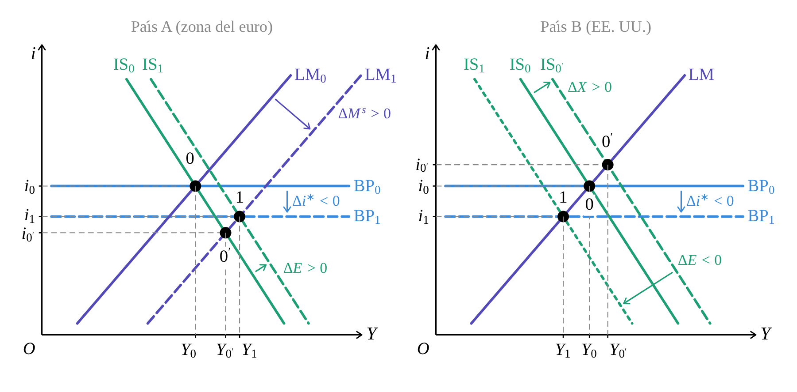
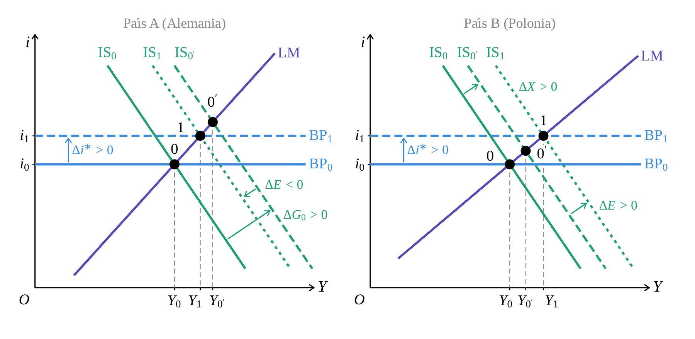
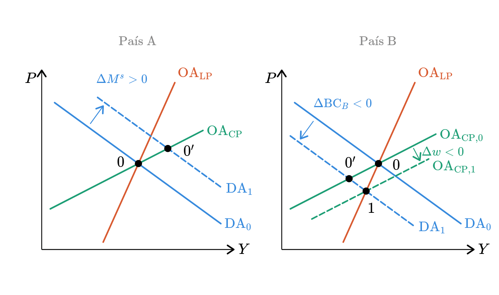
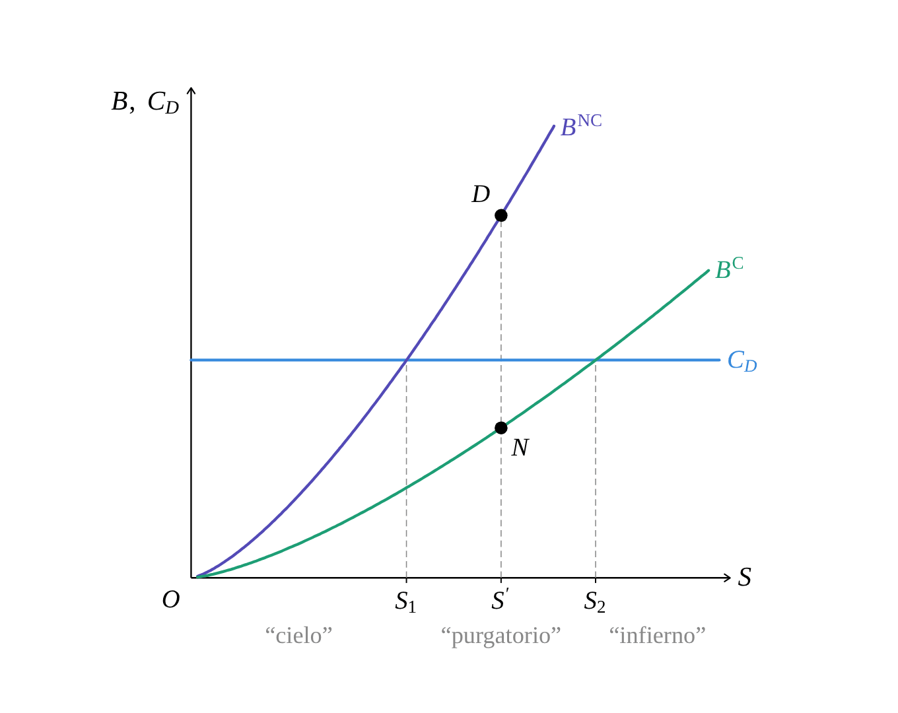
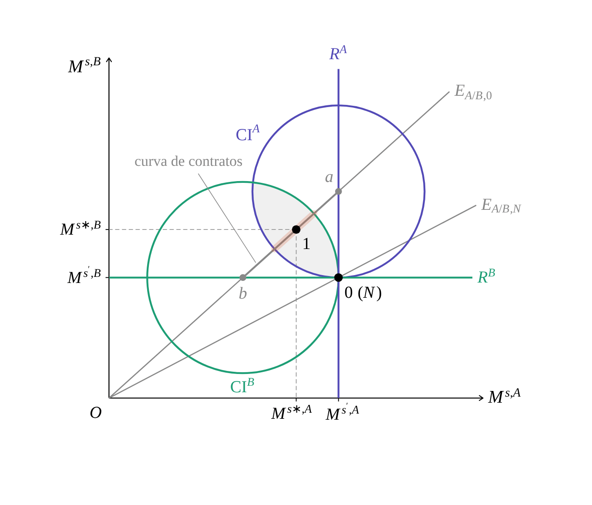

## Introducción

::: {.callout-note appearance="simple" icon=false}

:::

En su mensaje a la sesión inaugural de la Conferencia de Bretton Woods (1 de julio de 1944), Franklin Roosevelt señaló: “las enfermedades económicas son muy contagiosas y, por ello, la salud económica de cada país es asunto que concierne legítimamente a todos sus vecinos, próximos o lejanos”[^b19-1].

La **coordinación de políticas económicas** comprende modificaciones mutuamente acordadas de las políticas interiores de diferentes naciones debido a la interdependencia que existe entre ellas. En el campo macroeconómico involucra, generalmente, acuerdos explícitos sobre la conducta monetaria y fiscal de los países.

Es más rigurosa que la mera “cooperación”, pues la coordinación exige el ajuste mutuo de las políticas en un momento concreto y conforme a unos compromisos establecidos. La coordinación internacional puede dividirse en diferentes niveles:

1. *Intercambio de información*: los países se informan mutuamente de su situación coyuntural y de las políticas que aplican (p. ej. en los foros de la OCDE, el FMI o el G7).

2. *Coordinación temporal* o *ad hoc*: suele surgir como reacción ante una crisis (p. ej. los Acuerdos del Plaza de 1985, los Acuerdos del Louvre de 1987 o la cumbre de Londres de 2009[^b19-3]).

3. *Coordinación permanente*: es el caso de la Unión Europea.

Si se opta por la coordinación, existen dos enfoques para llevarla a cabo:

1. *Enfoque hegemónico*: se reconoce la existencia de un líder o de una autoridad capaz de imponer la coordinación y a la que los demás países subordinan parte de la autonomía de su política económica.

2. *Enfoque simétrico*: admite dos formas:

    - *Enfoque discrecional*: consiste en la actuación sin mecanismos de coacción[^b19-4]. Corresponde a los dos primeros niveles y permite una mayor flexibilidad de acción.

    - *Enfoque normativo*: consiste en establecer reglamentaciones que imponen una cierta disciplina a los países involucrados. Supone, en cambio, una reducción notable de la flexibilidad de actuación.

En los años setenta, con el desmoronamiento del sistema de Bretton Woods y una interdependencia mundial en aumento, la coordinación de las políticas económicas entre países suscitó un interés cada vez mayor. Aunque los resultados de los modelos son muy sensibles a sus supuestos, cada vez son más los sectores que la asocian con ganancias potenciales de bienestar para todos los implicados[^b19-5].

El tema responde al enunciado en tres secciones, dos dedicadas a los aspectos teóricos y una a los prácticos:

- *Fundamentos teóricos*: la interdependencia y los canales de transmisión de los efectos desbordamiento, de los que dependen las ganancias potenciales de coordinar.

- *Justificación teórica*: la teoría de juegos y la de los bienes públicos globales explican por qué esas ganancias exigen un diseño institucional, y la literatura señala los límites de la coordinación.

- *Aspectos prácticos*: las características de los acuerdos, el G20, la OCDE y otros foros internacionales (apartado 3.2), la experiencia y las dificultades del proceso.

## 1. Fundamentos teóricos: interdependencia y transmisión internacional

El análisis parte de la interdependencia y de los efectos desbordamiento que genera, y sigue con los canales por los que estos se transmiten, el de la renta y el monetario, el de la inflación y el de las expectativas.

### 1.1. Interdependencia, efecto desbordamiento y canales de transmisión

**Interdependencia y efecto desbordamiento**: al coordinar sus políticas, los países reconocen que dependen unos de otros. Las decisiones de cada uno generan externalidades sobre los demás, los llamados efectos desbordamiento (*spillover effects*), con tres consecuencias:

- *Eficacia de la política económica*: queda alterada en cada país.

- *Autonomía de las autoridades*: se reduce el margen de decisión de cada país.

- *Pérdida de eficiencia*: la actuación por separado conduce a resultados subóptimos, porque cada país decide atendiendo únicamente a los efectos que su política produce sobre sí mismo y desatendiendo los que produce sobre los demás. El problema se agrava en presencia de bienes públicos globales, como el libre comercio, la estabilidad cambiaria o un sistema financiero regulado, cuya naturaleza no excluyente y no rival genera incentivos al comportamiento de *free rider*. Ante esta situación, la coordinación no elimina las externalidades, que son consustanciales a la interdependencia, sino que permite internalizarlas en la decisión de cada país.

**Canales de transmisión**: los efectos desbordamiento se propagan internacionalmente por cuatro canales:

- *Canal de la renta*: permite que las economías con mayor peso relativo induzcan estímulos en la renta internacional a través del aumento de su propia renta nacional. La transmisión exterior opera, principalmente, a través de dos cuentas de la balanza de pagos:

    - *Cuenta corriente*: el aumento de la renta nacional supone un aumento de las importaciones de bienes y servicios, lo cual induce un aumento de las exportaciones de otros países y, por tanto, de la renta internacional.

    - *Cuenta financiera*: el deterioro de la balanza comercial tiene como contrapartida una entrada neta de capitales que lo financia, de modo que el impulso de renta se refleja simultáneamente en ambas cuentas.

- *Canal monetario*: los impulsos monetarios se transmiten internacionalmente a través de dos subcanales vinculados al mercado monetario y de divisas:

    - *Tipo de interés*: sus variaciones mueven los flujos de capitales, y estos repercuten en la inversión, nacional y extranjera, y en el tipo de cambio. Este subcanal actúa sobre todo por la cuenta financiera.

    - *Tipo de cambio nominal*: su influencia se transmite, a su vez, por dos vías, la cuenta corriente y la cuenta financiera:

        - *Cuenta corriente*: cuando se verifica la condición de Marshall-Lerner, la depreciación del tipo de cambio nominal, a precios dados, hace crecer las exportaciones netas, es decir, mejora la balanza comercial.
        - *Cuenta financiera*: quien cambia moneda nacional por divisa para comprar un activo extranjero obtiene, por una parte, el rendimiento de ese activo y, por otra, lo que varíe el tipo de cambio hasta el vencimiento. Bajo la paridad descubierta de intereses, la suma de ambos componentes iguala, en valor esperado, el tipo de interés nacional.

- *Canal de la inflación*: las variaciones de los precios relativos modifican el tipo de cambio real, que condiciona el comercio y los movimientos de capital. Su efecto se deja sentir, por ello, tanto en la cuenta corriente como en la financiera.

- *Canal de las expectativas*: opera a una escala más abstracta y amplia, en la medida en que los cambios en las expectativas de los agentes pueden desencadenar por sí solos crisis de deuda y cambiarias.

### 1.2. Canal de la renta y canal monetario: modelo IS-LM-BP

**Origen**: el modelo IS-LM-BP de Fleming (1962) y Mundell (1963), cuyo caso estándar de economía pequeña se desarrolla en el tema [A32](a32-precios-output.qmd), apartado 1, se aplica aquí a dos economías grandes.

**Idea**: el modelo ilustra de forma intuitiva los efectos que se transmiten por el canal de la renta y el canal monetario.

#### 1.2.1. Supuestos

**Entorno**: dos economías abiertas y grandes, $A$ y $B$, cuyas decisiones alteran las variables exteriores de la otra y, en particular, el tipo de interés mundial, $i^*$. El horizonte es el corto plazo, con precios fijos ($\bar P$), lo que tiene dos implicaciones:

- *Oferta horizontal*: la oferta de bienes es perfectamente elástica al nivel de precios dado y, por tanto, la renta queda determinada por la demanda agregada.

- *Inflación nula*: $\pi = 0$ y, por tanto, $i = r$. Además, el tipo de cambio nominal, $E$ (unidades de moneda nacional por unidad de moneda extranjera, de modo que un aumento de $E$ es una depreciación), y el real, $e = E P^*/P$, varían en la misma proporción.

**Agentes**: son neutrales al riesgo, de modo que no exigen prima de riesgo por mantener activos en distintas monedas, y mantienen expectativas estáticas sobre el tipo de cambio.

**Mercados**: el modelo incluye los de bienes (IS), dinero (LM) y sector exterior (BP). En el mercado financiero se comercian dinero y bonos, nacionales y extranjeros, que son sustitutivos perfectos. Con perfecta movilidad del capital se cumple la paridad descubierta de intereses, que, con expectativas estáticas, iguala en equilibrio el tipo de interés de cada país al mundial ($i = i^*$).

**Sector exterior**: la cuenta corriente se identifica con la balanza comercial ($\text{SB}_{\text{CC}} = \text{BC}$), sin rentas primarias ni secundarias ni cuenta de capital, y se cumple la condición Marshall-Lerner ($\varepsilon_X + |\varepsilon_M| > 1$)[^b19-10], de modo que una depreciación ($\uparrow E$) eleva las exportaciones netas.

#### 1.2.2. Modelo

**Planteamiento**: las curvas IS, LM y BP de cada país son las del tema [A32](a32-precios-output.qmd), apartado 1.2, con su misma notación. En el plano $(Y, i)$, la IS refleja las combinaciones de renta y tipo de interés que equilibran el mercado de bienes y tiene pendiente negativa, porque un menor tipo de interés estimula la inversión. La LM refleja las que equilibran el mercado de dinero y tiene pendiente positiva, porque una renta mayor eleva la demanda de dinero y, con una oferta dada, el tipo de interés. La BP refleja las que equilibran la balanza de pagos y es horizontal al nivel de $i^*$, por la perfecta movilidad del capital.

La diferencia con el caso estándar es que, al ser ambos países grandes, el tipo de interés mundial, $i^*$, responde a sus políticas, y con él se desplaza la BP de cada país.

**Estática comparativa** (política monetaria expansiva): el BCE aumenta la oferta monetaria ($\Delta M^s > 0$). Gráficamente, en el plano $(Y, i)$ de cada país (figura -@fig-b191-pm-empobrecimiento), ambos parten del punto 0, en el corte de las curvas IS, LM y BP.

- *Canal de la renta*:

    - *Zona del euro (país A)*: el aumento de la masa monetaria produce un desplazamiento hacia la derecha de la curva LM, de $\text{LM}_0$ a $\text{LM}_1$, y una caída del tipo de interés nominal. De esta forma aumenta la renta nacional y se pasa al punto 0′.

    - *EE. UU. (país B)*: el aumento de la renta nacional en A eleva las exportaciones de B a A ($\Delta X > 0$, de $\text{IS}_0$ a $\text{IS}_{0'}$), lo que aumenta la renta nacional de B y, con ella, el tipo de interés (punto 0′).

- *Canal monetario*: el desequilibrio entre el tipo de interés en la zona del euro y en EE. UU. ($i_{0'}^A < i_{0'}^B$) produce movimientos de capitales:

    - *Zona del euro (país A)*: la libre movilidad de capitales y el menor tipo de interés en la zona del euro que en EE. UU. dan lugar a una salida de capitales con dos efectos:

        - *Tipo de interés*: la salida de capitales se traduce en un aumento de la demanda de bonos estadounidenses, lo cual hace subir su precio y bajar el tipo de interés extranjero (dado que el país es grande). El descenso del tipo de interés extranjero desplaza hacia abajo la BP de ambos países, de $\text{BP}_0$ a $\text{BP}_1$ ($\Delta i^* < 0$)[^b19-13].

        - *Tipo de cambio*: la salida de capitales produce una depreciación de la moneda que permite obtener ganancias en la competitividad-precio de las exportaciones. Así, se produce un desplazamiento hacia la derecha de la curva IS ($\Delta E > 0$), de $\text{IS}_0$ a $\text{IS}_1$, y la economía pasa al punto 1, con una renta $Y_1$.

    - *EE. UU. (país B)*: la entrada de capitales provoca una apreciación de la moneda ($\Delta E < 0$), lo cual hace perder competitividad-precio a las exportaciones del país. En consecuencia, la IS se desplaza de $\text{IS}_{0'}$ a $\text{IS}_1$ y la renta de la economía cae hasta $Y_1$, inferior a la inicial (punto 1).

En resumen, una política monetaria expansiva con tipos de cambio flexibles, libre movilidad del capital e interdependencia produce un efecto empobrecimiento del vecino (*beggar-thy-neighbour*).

::: {#fig-b191-pm-empobrecimiento}

::: {.content-visible when-format="html"}
```{=html}
<div class="graph-frame wide">
<iframe src="../graphs/b191_PM_empobrecimiento.html" style="--r:2.027" loading="lazy" title="fig-b191-pm-empobrecimiento"></iframe>
</div>
```
:::

::: {.content-visible unless-format="html"}

:::

Efecto empobrecimiento del vecino de una política monetaria expansiva con dos países grandes.
:::

- *Otros casos*:

    - *A pequeño y B grande*: corresponde al caso estándar del modelo IS-LM-BP (tema [A32](a32-precios-output.qmd), apartado 1.3.1). En este caso, el punto de cruce entre la IS y la BP queda más hacia la derecha, porque la curva BP no se desplaza, dado que el país no tiene capacidad para alterar el tipo de interés del resto del mundo. En consecuencia, el hecho de que el país A sea más grande hace que la política monetaria expansiva pierda efectividad.

    - *A grande y B pequeño*: siguiendo la misma lógica, cuanto mayor sea el país A respecto de B, mayor será su capacidad para alterar el tipo de interés internacional y, con ella, mayor el efecto desbordamiento que genera. En el polo opuesto, si el país A es “enorme” con respecto al país B, determinará por sí solo el tipo de interés mundial y, por tanto, la efectividad de su política monetaria será equivalente a la de una economía cerrada.

**Estática comparativa** (política fiscal expansiva): si un país con margen presupuestario, como Alemania, aplica un estímulo fiscal, se da la situación opuesta. Gráficamente, en el plano $(Y, i)$ de cada país (figura -@fig-b192-pf-locomotora), con las curvas IS, LM y BP descritas en el Planteamiento, ambos parten de nuevo del punto 0.

- *Canal de la renta*:

    - *Alemania (país A)*: el estímulo fiscal ($\Delta G_0 > 0$) supone un aumento de la demanda agregada y de la renta nacional (de $\text{IS}_0$ a $\text{IS}_{0'}$), lo cual hace subir el tipo de interés (punto 0′).

    - *Polonia (país B)*: se produce un aumento de la renta nacional debido al aumento de las exportaciones netas hacia Alemania, en la medida en que el aumento de la renta en dicho país estimula la compra de productos polacos ($\Delta X > 0$, de $\text{IS}_0$ a $\text{IS}_{0'}$, punto 0′).

- *Canal monetario*:

    - *Alemania*: con libre movilidad de capitales, el diferencial de tipos de interés provoca una entrada masiva de capitales en el país. La consiguiente apreciación del euro da lugar a una pérdida de competitividad-precio de las exportaciones, que desplaza hacia la izquierda la curva IS ($\Delta E < 0$), de $\text{IS}_{0'}$ a $\text{IS}_1$, hasta el punto 1. Además, dado que el país es grande, la entrada masiva de capitales eleva el tipo de interés internacional ($\Delta i^* > 0$), lo que desplaza hacia arriba la BP, de $\text{BP}_0$ a $\text{BP}_1$.

    - *Polonia*: se da el efecto inverso, es decir, una salida de capitales que deprecia la moneda. Así, mejora la competitividad-precio de las exportaciones ($\Delta E > 0$, de $\text{IS}_{0'}$ a $\text{IS}_1$), lo que acaba expandiendo la renta nacional hasta $Y_1$ (punto 1).

En resumen, con tipos de cambio flexibles, la política fiscal expansiva de un país grande expande la renta de ambos países, lo que se conoce como efecto locomotora (*fiscal spillover* o *locomotive policy*).

::: {#fig-b192-pf-locomotora}

::: {.content-visible when-format="html"}
```{=html}
<div class="graph-frame wide">
<iframe src="../graphs/b192_PF_locomotora.html" style="--r:2.045" loading="lazy" title="fig-b192-pf-locomotora"></iframe>
</div>
```
:::

::: {.content-visible unless-format="html"}

:::

Efecto locomotora de una política fiscal expansiva con dos países grandes.
:::

Si, en lugar de aplicar estímulos de manera autónoma, los países coordinan sus políticas y es uno con suficiente peso relativo el que lleva a cabo el estímulo fiscal, pueden existir ganancias mutuas de bienestar. Esta lógica tuvo su principal aplicación en la cumbre de Bonn de 1978, cuyos límites se examinan en el apartado 3.3.1.

- *Otros casos*:

    - *A pequeño y B grande*: corresponde al caso estándar del modelo IS-LM-BP (tema [A32](a32-precios-output.qmd), apartado 1.3.1), en el que la política fiscal con tipos de cambio flexibles y perfecta movilidad del capital no es efectiva. En consecuencia, el hecho de que el país A sea más grande hace que la política fiscal expansiva gane efectividad.

    - *A grande y B pequeño*: cuanto mayor sea el tamaño de A en relación con B, mayor resultará la efectividad de la política para ambos países.

**Extensiones**: el signo y la intensidad del efecto desbordamiento dependen del régimen cambiario y del tamaño relativo de las economías. Por ejemplo, con tipos fijos, a diferencia de los casos anteriores, la expansión monetaria se transmite positivamente a través del canal de la renta.

#### 1.2.3. Conclusiones

**Aspectos positivos**: el modelo muestra que, cuanto mayor es la interdependencia, mayor es la divergencia entre el óptimo nacional y el óptimo conjunto y, con ella, la ganancia potencial de la coordinación. Muestra además que la asimetría de tamaños importa, porque un país pequeño apenas genera desbordamientos, mientras que las decisiones de una economía grande condicionan al resto sin que esta internalice el coste. Este resultado es el argumento central a favor de mecanismos formales de coordinación.

**Limitaciones**: hereda las del modelo IS-LM-BP (tema [A32](a32-precios-output.qmd), apartado 1.4). En particular, al suponer precios fijos y prescindir de las expectativas, ignora los canales de la inflación y de las expectativas, que se examinan a continuación.

### 1.3. Canal de la inflación: modelo de oferta y demanda agregadas

**Origen**: la evidencia empírica muestra que en muchos casos el efecto desbordamiento de la política monetaria expansiva de los países grandes sobre el resto del mundo es positivo (Dedola, Rivolta y Stracca, 2017, para la de EE. UU.). El resultado contradice el empobrecimiento del vecino que predice el modelo IS-LM-BP con tipos de cambio flexibles.

**Idea**: la explicación está, en parte, en el canal de la inflación, que el modelo anterior ignora. Al atenuar el desvío del gasto, este canal deja prevalecer el canal de la renta y el financiero (menores tipos de interés globales).

::: {.callout-note appearance="simple" icon=false}
Para ilustrarlo se recurre al modelo de oferta y demanda agregadas en economía abierta, desarrollado en el tema [A32](a32-precios-output.qmd) §2, en su representación de dos países, empleada en el tema [B16](b16-integracion-monetaria.qmd) §1.2.1 para un *shock* asimétrico de demanda en una unión monetaria. Aquí se aplica a una expansión monetaria con tipos de cambio flexibles.
:::

**Planteamiento**: se consideran dos economías abiertas de tamaño comparable, con tipos de cambio flexibles. El país $A$ adopta la política monetaria expansiva y el país $B$ sufre el efecto desbordamiento.

**Desarrollo gráfico**: en el plano $(Y, P)$ de cada país (figura -@fig-b195-oada-desbordamiento), el panel izquierdo representa el país $A$ y el derecho, el país $B$. En cada panel se distinguen:

1. *Demanda agregada* ($\text{DA}_0$): refleja las combinaciones de renta y nivel de precios que equilibran a la vez los mercados de bienes y de dinero. Tiene pendiente negativa porque un mayor nivel de precios reduce la oferta monetaria real, lo que eleva el tipo de interés y contrae la inversión, y porque el mayor nivel de precios aprecia el tipo de cambio real, lo que deteriora la balanza comercial.

2. *Oferta agregada a corto plazo* ($\text{OA}_{\text{CP}}$): refleja la producción que ofrecen las empresas a cada nivel de precios con los salarios nominales dados. Tiene pendiente positiva por la rigidez de esos salarios, pues un mayor nivel de precios reduce el salario real y estimula la contratación.

3. *Oferta agregada a largo plazo* ($\text{OA}_{\text{LP}}$): refleja la producción una vez que los salarios nominales se han ajustado a los precios. Tiene pendiente positiva y mayor que la de corto plazo, pero no es vertical, porque en economía abierta el deflactor y el IPC difieren (tema [A32](a32-precios-output.qmd), apartado 2.2.4).

4. *Equilibrio*: ambas economías parten del punto 0, donde se cortan las tres curvas, con un tipo de cambio real dado que determina su competitividad relativa.

::: {#fig-b195-oada-desbordamiento}

::: {.content-visible when-format="html"}
```{=html}
<div class="graph-frame wide">
<iframe src="../graphs/b195_OADA_desbordamiento.html" style="--r:1.692" loading="lazy" title="fig-b195-oada-desbordamiento"></iframe>
</div>
```
:::

::: {.content-visible unless-format="html"}

:::

Canal de la inflación con dos países. La expansión monetaria de $A$ contrae la demanda de $B$ (punto 0′), y la caída de precios y salarios en $B$ desplaza su oferta a corto plazo hacia la derecha (punto 1).
:::

**Estática comparativa**: la perturbación se propaga en cuatro momentos sucesivos:

1. *Impulso en A*: la expansión monetaria ($\Delta M^s > 0$) desplaza su demanda agregada de $\text{DA}_0$ a $\text{DA}_1$, con lo que aumentan su producción y sus precios (punto 0′), y deprecia su moneda.

2. *Efecto desbordamiento sobre B*: la apreciación de su moneda le hace perder competitividad-precio, por lo que sus exportaciones netas caen ($\Delta \text{BC}_B < 0$) y su demanda agregada se desplaza de $\text{DA}_0$ a $\text{DA}_1$, con menor producción y menores precios (punto 0′). Este es el efecto de empobrecimiento del vecino que predice el modelo IS-LM-BP, y en él se detiene aquel modelo.

3. *Ajuste vía precios en B*: la caída del nivel de precios en $B$ supone, para un tipo de cambio nominal dado, una depreciación de su tipo de cambio real, es decir, una recuperación parcial de la competitividad que acababa de perder. La pérdida inicial queda así amortiguada, y tanto más cuanto más flexibles sean los precios.

4. *Traslación a salarios*: si la caída de los precios se traslada además a los salarios nominales ($\Delta w < 0$), se reducen los costes laborales unitarios y la oferta agregada a corto plazo de $B$ se desplaza de $\text{OA}_{\text{CP},0}$ a $\text{OA}_{\text{CP},1}$ (punto 1). La apreciación nominal refuerza ese desplazamiento, porque reduce el IPC esperado (tema [A32](a32-precios-output.qmd), apartado 2.3.1), y la recuperación de la competitividad puede llegar así a compensar íntegramente el impulso negativo inicial.

**Conclusiones**:

- *Aspectos positivos*: el modelo muestra que el canal de la inflación opera en sentido contrario al canal monetario y atenúa el empobrecimiento del vecino, que puede llegar a neutralizar. Para que el desbordamiento sea positivo, como a menudo se observa, han de dominar además el canal de la renta y el financiero, que el modelo no recoge. Que domine el empobrecimiento del vecino o el canal de la inflación depende del grado de rigidez nominal de la economía receptora. Así, con precios y salarios muy rígidos prevalece el empobrecimiento del vecino, mientras que con precios y salarios flexibles el ajuste por la vía de los precios relativos neutraliza buena parte del impulso adverso. De ahí que la conveniencia de coordinar la política monetaria no pueda establecerse en abstracto, sino que dependa de las características estructurales de los países implicados.

- *Limitaciones*: hereda las del modelo de oferta y demanda agregadas (tema [A32](a32-precios-output.qmd), apartado 2.5), en particular que determina el nivel de precios y no la inflación y que trata la política monetaria como un control de la cantidad de dinero.

### 1.4. Canal de las expectativas: la fragilidad de una unión monetaria incompleta (De Grauwe, 2011)

**Origen**: el último canal opera a través de las expectativas de los agentes, que pueden por sí solas desencadenar una crisis sin que cambien los fundamentos, siempre que estos se sitúen en un tramo intermedio. Su ilustración más clara es el modelo de equilibrios múltiples de Paul De Grauwe (2011). La lógica de De Grauwe se remonta a los modelos de crisis autocumplidas de Obstfeld (1986) para las crisis cambiarias y de Calvo (1988) para la deuda soberana.

::: {.callout-note appearance="simple" icon=false}
El modelo se desarrolla íntegramente, con sus supuestos, su representación gráfica, sus limitaciones y las soluciones a las uniones monetarias incompletas, en el tema [B16](b16-integracion-monetaria.qmd) §3.1.
:::

**Idea**: en una unión monetaria sin unión fiscal, los Estados emiten deuda en una moneda sobre la que no tienen control, de modo que no pueden monetizarla y un problema de liquidez puede transformarse en uno de solvencia.

**Planteamiento**: el Gobierno de un país que sufre un *shock* decide si impaga comparando el coste reputacional del impago con sus beneficios, que dependen de que los inversores anticipen o no ese impago. De esa comparación se obtienen tres tramos de intensidad del *shock*.

**Desarrollo gráfico**: en el plano intensidad del *shock*-costes y beneficios del impago (figura -@fig-b194-obstfeld-default), la curva $C_D$ refleja ese coste, la exclusión de los mercados de financiación, y es horizontal porque se supone fijo. Las curvas de beneficios reflejan el ahorro en el servicio de la deuda y en el ajuste fiscal que permite el impago, y crecen con la intensidad del *shock*. Son mayores si los inversores anticipan el impago ($B^{\text{NC}}$), porque su desconfianza encarece la financiación, que si confían ($B^{\text{C}}$). Los cortes de ambas curvas de beneficios con la de costes, en $S_1$ y $S_2$, delimitan los tres tramos:

- *Cielo* (*heaven on Earth*, $S < S_1$): ante perturbaciones leves, el equilibrio sin impago es sostenible con independencia de lo que esperen los inversores (p. ej. Alemania y los Países Bajos durante la crisis de deuda soberana).

- *Infierno* (*hell on Earth*, $S > S_2$): ante perturbaciones graves, el impago resulta inevitable, también con independencia de las expectativas.

- *Purgatorio* (*purgatory*, $S_1 < S < S_2$): en un tramo intermedio existen **equilibrios múltiples**, de manera que el resultado depende enteramente de las expectativas de los inversores y se producen profecías autocumplidas (p. ej. España e Italia durante la misma crisis). Para una intensidad $S'$, el punto $N$ es el equilibrio con confianza y el punto $D$, el de impago.

::: {#fig-b194-obstfeld-default}

::: {.content-visible when-format="html"}
```{=html}
<div class="graph-frame">
<iframe src="../graphs/b194_Obstfeld_default.html" style="height:620px" loading="lazy" title="fig-b194-obstfeld-default"></iframe>
</div>
```
:::

::: {.content-visible unless-format="html"}

:::

Canal de las expectativas (De Grauwe, 2011, a partir de Obstfeld, 1986). Ante un *shock* de solvencia hay equilibrios múltiples, $N$ (confianza, sin impago) y $D$ (profecía autocumplida, *default*).
:::

**Conclusiones**:

- *Aspectos positivos*: el modelo muestra que el canal de las expectativas convierte la falta de coordinación fiscal en una fuente autónoma de inestabilidad, pues la fragilidad no procede del nivel de deuda de un país concreto, sino del diseño institucional del conjunto. Por tanto, su corrección no puede ser nacional, sino que exige mecanismos comunes, es decir, un prestamista de última instancia creíble en el mercado de deuda soberana y reglas fiscales que contengan el riesgo moral que aquel introduce.

- *Limitaciones*: supone un coste del impago fijo y ninguna alternativa de consolidación fiscal, y no modeliza el contagio entre los miembros de la unión (tema [B16](b16-integracion-monetaria.qmd), apartado 3.1.3).

### 1.5. Conclusiones

La interdependencia genera efectos desbordamiento que se propagan por cuatro canales de signo distinto. El de la renta transmite el impulso de forma positiva, mientras que el monetario puede invertirlo (empobrecimiento del vecino), según el régimen cambiario y el tamaño relativo de las economías. El de la inflación opera en sentido contrario al monetario, y el de las expectativas introduce una inestabilidad que depende del diseño institucional del conjunto y no solo de los fundamentos de cada país.

El impacto efectivo de estos efectos depende de la naturaleza de la perturbación y del grado de apertura de la economía, junto con las variables asociadas a ella (elasticidad de las importaciones y exportaciones, competitividad-precio, estructura exportadora…). Depende asimismo del grado de desarrollo y estabilidad de los mercados financieros, del grado de rigidez nominal y de la credibilidad del marco institucional[^b19-15].

De todo ello se desprende que la existencia de efectos desbordamiento es condición necesaria para que la coordinación resulte ventajosa, pero el análisis realizado hasta aquí ha supuesto implícitamente que los países no reaccionan ante las decisiones ajenas.

## 2. Justificación teórica de la coordinación

Queda por ver si esa condición necesaria es también suficiente. Para ello se considera de manera explícita la reacción de los países desde dos perspectivas complementarias, la teoría de juegos y la de los **bienes públicos globales**, y se examinan después los límites de la propia coordinación.

### 2.1. Perspectiva de la teoría de juegos

Se comienza por los juegos estáticos, en los que los jugadores deciden una sola vez y de forma simultánea, primero con estrategias discretas (dilema del prisionero) y después con estrategias continuas (modelo de Corden), y les siguen los juegos repetidos y los cooperativos.

::: {.callout-note appearance="simple" icon=false}
Los conceptos de solución que se aplican (equilibrio en estrategias dominantes, equilibrio de Nash, equilibrio de Nash perfecto en subjuegos, núcleo y valor de Shapley) se desarrollan en el tema [A14](a14-juegos.qmd), apartado 1.4, y el dilema del prisionero, en su apartado 2.1.1.
:::

#### 2.1.1. Juegos estáticos con estrategias discretas: el dilema del prisionero (Tucker, 1950)

**Planteamiento**: el dilema del prisionero, formulado por Albert Tucker (1950), es el marco de referencia para analizar por qué la coordinación fracasa. En esta aplicación, dos países sufren un *shock* y pueden escoger entre política fiscal restrictiva y política fiscal expansiva (laxa). Los pagos de la tabla -@tbl-b19-dilema-prisionero representan ganancias de bienestar, que pueden medirse como reducciones del índice de miseria de Okun[^b19-16], es decir, cuanto mayor es el pago, menor es el índice.

|  | PAÍS 2 |  |
| --- | --- | --- |
| **PAÍS 1** | Política fiscal laxa | Política fiscal restrictiva |
| **Política fiscal laxa** | A: (2,2) | B: (0,3) |
| **Política fiscal restrictiva** | C: (3,0) | D: (1,1) |

: Matriz de pagos del dilema del prisionero en la coordinación de la política fiscal. {#tbl-b19-dilema-prisionero}

**Equilibrio en estrategias dominantes** (EED): el país 1 elegirá siempre una política fiscal restrictiva, su *estrategia dominante*, porque le reporta una ganancia mayor sea cual sea la política del país 2, y, por simetría, el país 2 hará lo propio:

- *País 2 laxo*: el país 1 obtiene una mayor ganancia con una política fiscal restrictiva (3 frente a 2).

- *País 2 restrictivo*: el país 1 obtiene igualmente una mayor ganancia con una política fiscal restrictiva (1 frente a 0).

**Equilibrio de Nash** (EN): todo EED es un EN, y aquí es el único. La celda D es, por tanto, el único perfil en el que la estrategia de cada país es *mejor respuesta* a la del otro, de modo que ninguno tiene incentivos a modificar unilateralmente su decisión.

**Bienestar**: existe, sin embargo, una situación Pareto-superior al equilibrio de Nash. Si ambos países eligen una política fiscal laxa (es decir, celda A), ambos obtienen pagos superiores a los del equilibrio de Nash. Por ello, cuando los países actúan de acuerdo con su interés individual, se produce una pérdida de eficiencia.

**Conclusiones**: conviene precisar que no toda situación de coordinación fallida responde a esta estructura. En el dilema del prisionero el obstáculo es el incentivo a desviarse de un acuerdo mutuamente ventajoso, de modo que la solución pasa por hacer creíble el castigo. En otros juegos, en cambio, como la batalla de los sexos (tema [A14](a14-juegos.qmd), apartado 2.1.5), existen varios equilibrios y el problema no es disuadir la deserción, sino seleccionar entre ellos. Ello exige un mecanismo de comunicación o un liderazgo que actúe como punto focal antes que un régimen sancionador.

#### 2.1.2. Juegos estáticos con estrategias continuas: el modelo de Corden (1994)

**Origen**: el dilema anterior puede formalizarse con estrategias continuas, en lugar de una elección binaria, mediante el modelo de Corden (1994), que desarrolla el enfoque de Oudiz y Sachs (1984) y cuya representación gráfica se conoce como diagrama de Hamada (1976).

**Idea**: el modelo permite representar gráficamente tanto el coste de la no coordinación como el reparto de las ganancias de coordinar.

**Supuestos**:

- *Entorno*: dos países, $A$ y $B$, en un juego estático y no repetido.

- *Agentes*: cada país se enfrenta a una disyuntiva entre inflación y desempleo y minimiza una función de pérdidas definida sobre ambas variables. Se supone que $B$ presenta una mayor aversión a la inflación que $A$, que prioriza el empleo. Ambos países comparten un mismo tipo de cambio compatible con sus respectivos objetivos internos, $E_{A/B,0}$.

- *Restricciones*: en cada país, tanto la depreciación de su moneda como el aumento de su oferta monetaria elevan la inflación y reducen el desempleo.

- *Sector exterior*: rigen la paridad descubierta de intereses y el enfoque monetario, según el cual el tipo de cambio $E_{A/B}$ (unidades de la moneda de $A$ por unidad de la de $B$) es función del cociente entre ambas ofertas monetarias, $E_{A/B} = f(M^{s,A} / M^{s,B})$. La moneda de $A$ se deprecia cuando ese cociente aumenta.

**Planteamiento**: cada país elige su oferta monetaria, $M^{s,A}$ o $M^{s,B}$, para minimizar su función de pérdidas, dada la del otro. Como el tipo de cambio depende de ambas ofertas monetarias, la elección de cada país altera la inflación y el desempleo del otro.

**Desarrollo gráfico**: la interacción entre los dos países se representa en el plano de ofertas monetarias $M^{s,A}$-$M^{s,B}$ (figura -@fig-b193-hamada):

1. *Rayos vectores*: cada recta que parte del origen representa un tipo de cambio, determinado por el cociente entre ambas ofertas monetarias. Cuanto mayor es su pendiente, es decir, cuanto mayor es $M^{s,B}$ respecto de $M^{s,A}$, más apreciada está la moneda de $A$.

2. *Puntos de saturación*: el punto $a$ es la combinación que maximiza la utilidad de $A$, con ofertas monetarias holgadas en los dos países, que reducen el paro al precio de una inflación mayor. El punto $b$ es el óptimo de $B$, con una política más restrictiva. Los dos quedan sobre un mismo rayo vector, el de $E_{A/B,0}$, porque ambos países comparten el objetivo cambiario.

3. *Curvas de indiferencia* ($\text{CI}^A$ y $\text{CI}^B$): cada una reúne los pares de ofertas monetarias que dan a un país la misma utilidad. Son circunferencias concéntricas en torno a su punto de saturación y representan menor utilidad cuanto más se alejan de él.

4. *Curvas de reacción* ($R^A$ y $R^B$): dado que las curvas de indiferencia son circulares, a $A$ le conviene la misma oferta monetaria $M^{s',A}$ con independencia de lo que haga $B$. Por ello, la *función de reacción* de $A$ (o *función de mejor respuesta*, tema [A14](a14-juegos.qmd), apartado 1.3.3) es una recta vertical en el plano $(M^{s,A}, M^{s,B})$ y, por simetría, la de $B$ es una recta horizontal en $M^{s',B}$. Cada país tiene, por tanto, una estrategia dominante, exactamente como en el dilema del prisionero.

5. *Equilibrio*: de lo anterior se derivan dos soluciones posibles.

    - *Equilibrio no cooperativo*: corresponde al cruce de las dos funciones de reacción, el punto 0 ($N$ en la figura). Como cada país responde de la mejor forma posible a lo que hace el otro, se trata de un equilibrio de Nash, y es estable. Deja, sin embargo, margen para que los dos mejoren a la vez, porque el tipo de cambio que resulta, $E_{A/B,N}$, se aparta del objetivo común $E_{A/B,0}$. No es, por tanto, un óptimo de Pareto.

    - *Solución cooperativa*: las curvas de indiferencia trazadas por el punto 0 encierran una lente, y cualquier combinación situada dentro de ella acerca a los dos países a sus puntos de saturación, con lo que ambos ganan. El óptimo está en el *núcleo*, la parte de la *curva de contratos* que cae dentro de esa lente. La curva de contratos, formada por los pares de ofertas monetarias Pareto-eficientes, es el segmento recto que une $a$ y $b$, pues las curvas de indiferencia son concéntricas. Esa misma propiedad, junto con el objetivo cambiario común, hace que el bienestar conjunto alcance su máximo precisamente en $E_{A/B,0}$. Qué punto del núcleo se alcance, p. ej. el punto 1, con ofertas monetarias $M^{s*,A}$ y $M^{s*,B}$, depende del poder negociador de cada parte.

::: {#fig-b193-hamada}

::: {.content-visible when-format="html"}
```{=html}
<div class="graph-frame">
<iframe src="../graphs/b193_Hamada.html" style="height:620px" loading="lazy" title="fig-b193-hamada"></iframe>
</div>
```
:::

::: {.content-visible unless-format="html"}

:::

Modelo de Corden (diagrama de Hamada). Las curvas de reacción se cruzan en el equilibrio de Nash (punto 0, $N$). La solución cooperativa (punto 1) se sitúa en el núcleo (tramo sombreado de la curva de contratos $ab$) y mejora el bienestar de ambos.
:::

**Extensiones**: en una lectura fiscal, si se sustituyen las ofertas monetarias por el tono de la política fiscal, el equilibrio no cooperativo resulta excesivamente restrictivo, pues cada país prefiere recibir el impulso de la demanda de exportaciones del socio sin soportar el déficit propio. Esta lectura formaliza el efecto locomotora (apartado 1.2.2) y la lógica de la cumbre de Londres de 2009, cuando EE. UU. impulsó un estímulo fiscal concertado para acercarse a la solución de coordinación[^b19-17].

**Conclusiones**:

- *Aspectos positivos*: el modelo muestra que la pérdida de bienestar no procede de un error de política, sino de la propia interacción estratégica, pues cada país elige racionalmente y, precisamente por ello, ambos acaban en una posición peor de la alcanzable. Muestra además que la ganancia de la coordinación no es un punto sino un rango de reparto, lo que explica que las negociaciones internacionales versen tanto sobre cuánto se gana como sobre cómo se distribuye lo ganado.

- *Limitaciones*: la solución cooperativa no es un equilibrio de Nash y, por tanto, no es estable. En efecto, si $A$ coopera situándose en $M^{s*,A}$ (su oferta monetaria en la solución cooperativa, punto 1), $B$ obtiene mayor utilidad desviándose hacia $M^{s',B}$. Así, el modelo identifica como problema decisivo que no basta con demostrar que coordinar es ventajoso, sino que es preciso un mecanismo que haga cumplir el acuerdo. A ello se añaden el carácter estático del análisis y el supuesto de un objetivo cambiario común, que elimina por construcción el conflicto de intereses sobre el nivel deseado del tipo de cambio.

#### 2.1.3. Juegos dinámicos

La inestabilidad de la solución cooperativa puede resolverse si se abandona el supuesto de juego único y la relación se repite, de modo que la desviación de hoy pueda castigarse mañana. Ello hace posible la **estrategia del gatillo** (*trigger strategy*), en la que cada país coopera mientras el otro coopere y, ante una sola desviación, revierte para siempre al equilibrio no cooperativo.

::: {.callout-note appearance="simple" icon=false}
Los juegos repetidos, tanto en horizonte finito como infinito, y la estrategia del gatillo se desarrollan en el tema [A14](a14-juegos.qmd) §2.3.2 y §2.3.3. Aquí se recogen sus dos resultados, con la misma notación, y su traducción a la coordinación internacional.
:::

**Equilibrio de Nash perfecto en subjuegos** (horizonte finito): cuando el número de repeticiones es conocido y el juego de etapa tiene un único equilibrio de Nash, como el dilema del prisionero, la cooperación se desmorona por inducción hacia atrás y los acuerdos no se sostienen. El razonamiento parte del último periodo, en el que no existe futuro ni, por tanto, castigo creíble, y se extiende a todos los anteriores. Por ello, el único equilibrio de Nash perfecto en subjuegos consiste en $T$ repeticiones del equilibrio de Nash del juego de etapa.

La implicación directa para la coordinación internacional es que los acuerdos concebidos como respuesta puntual a una crisis, con una fecha de terminación conocida (p. ej. la propia cumbre de Londres de 2009), son estructuralmente frágiles. La razón es que cada participante anticipa el final del compromiso y, con él, la desaparición del castigo. De ahí un argumento de peso a favor de las instituciones permanentes frente a las cumbres *ad hoc*.

**Equilibrio de Nash perfecto en subjuegos** (horizonte infinito): si el juego se repite un número indeterminado de veces[^b19-18], la cooperación puede sostenerse (Friedman, 1971), porque los agentes pueden preferir la corriente de ganancias futuras de cumplir frente a la ganancia inmediata de incumplir. La estrategia del gatillo sostiene la cooperación como equilibrio de Nash perfecto en subjuegos si el factor de descuento, $\beta$, supera un umbral:

$$\beta \;\geq\; \frac{\pi_{nc,c} - \pi_{c,c}}{\pi_{nc,c} - \pi_{nc,nc}}$$

donde $\pi_{c,c}$ es el pago de cooperación mutua, $\pi_{nc,c}$ el de traicionar cuando el otro coopera y $\pi_{nc,nc}$ el del equilibrio no cooperativo. El numerador recoge la tentación de desviarse y el denominador suma a esa tentación la severidad del castigo, $\pi_{c,c} - \pi_{nc,nc}$. La cooperación es tanto más sostenible cuanto menor sea la ganancia de la traición, mayor la pérdida asociada a la represalia y más valoren los agentes el futuro.

**Ejemplo**: en el contexto de la coordinación internacional, la ruptura del acuerdo tácito puede dar lugar a guerras de divisas (temas [B15](b15-regimenes-cambiarios.qmd) y [B20](b20-sei-hasta-bw.qmd), apartado 1.2.2). Tras la crisis financiera global, la expansión cuantitativa (*quantitative easing*, QE) de la Reserva Federal (2008-2014) y las políticas excepcionalmente expansivas del Banco de Japón (*Abenomics*[^b19-19]) y del BCE (ampliación del programa de compras de activos, 2015) depreciaron sus monedas. La depreciación provocó la disconformidad de los socios comerciales. Brasil, por ejemplo, calificó esas políticas de empobrecimiento del vecino y Dilma Rousseff se refirió en 2012 a la expansión monetaria de los países desarrollados como un “tsunami monetario”.

**Conclusiones**: de los dos resultados se derivan los cuatro requisitos que debe satisfacer todo mecanismo de coordinación:

1. *Horizonte indefinido*: los participantes no deben conocer cuándo termina la relación.

2. *Supervisión*: debe poder detectarse la desviación, sin lo cual el castigo no puede activarse.

3. *Represalia creíble*: se excluyen las amenazas vacías y, en la práctica, también el castigo eterno, que ambas partes tendrían interés en renegociar, de modo que se recurre a una fase de castigo de duración limitada (el *castigo óptimo* del tema [A14](a14-juegos.qmd), apartado 2.3.3).

4. *Paciencia*: los participantes no deben descontar en exceso el futuro, condición que comprometen los ciclos políticos cortos.

#### 2.1.4. Juegos cooperativos: el reparto de las ganancias

Los apartados anteriores responden a si los países cooperan. Queda por responder cómo se reparten las ganancias, cuestión que el modelo de Corden deja abierta al remitirla al poder negociador de las partes y de la que se ocupa la teoría de juegos cooperativos, que presupone la existencia de acuerdos vinculantes.

::: {.callout-note appearance="simple" icon=false}
El núcleo y el valor de Shapley se desarrollan en el tema [A14](a14-juegos.qmd), apartados 1.4.2 y 2.4. Aquí se recoge su aplicación a la coordinación.
:::

**Núcleo** (Edgeworth, 1881; Gillies, 1959): conjunto de repartos eficientes que ninguna coalición de participantes puede bloquear. El modelo de Corden recurre a él al situar la solución cooperativa en el tramo de la curva de contratos interior a la lente. La limitación del núcleo es que suele ser amplio y no señala un punto concreto.

**Valor de Shapley** (Shapley, 1953): frente a esa indeterminación, ofrece un reparto único, que asigna a cada país una parte de la ganancia igual a su contribución marginal media al resultado conjunto sobre todos los órdenes posibles de incorporación a la coalición.

**Conclusiones**:

- *Aspectos positivos*: el enfoque ofrece un criterio de reparto equitativo al que apelar en la negociación y, con el valor de Shapley, concreta el reparto que el modelo de Corden deja al poder negociador de las partes.

- *Limitaciones*: su interés es más normativo que descriptivo, porque su supuesto central, el carácter vinculante de los acuerdos, no se satisface en un sistema de Estados soberanos, en el que no existe autoridad capaz de imponer su cumplimiento. Esa inaplicabilidad directa explica por qué la coordinación internacional descansa en el diseño institucional del apartado 3.2.

### 2.2. Perspectiva de los bienes públicos globales

Frente a la interacción estratégica entre dos autoridades, esta perspectiva atiende a la provisión de un recurso compartido por muchos países, los bienes públicos globales mencionados en el apartado 1.1. Como en la interacción estratégica, la actuación racional individual impide alcanzar el óptimo colectivo, pero el remedio que sugiere esta perspectiva es distinto, pues no descansa en el castigo sino en el diseño de las reglas de uso.

#### 2.2.1. La tragedia de los comunes y los límites de las soluciones tradicionales (Hardin, 1968)

**Origen**: la formulación clásica del problema es la *tragedia de los comunes*, propuesta por el ecólogo Garrett Hardin en *The Tragedy of the Commons* (*Science*, 1968). Se refiere a los problemas medioambientales que surgen del uso excesivo de recursos escasos de libre acceso (p. ej. caladeros de pesca o pastos para la ganadería).

**Idea**: ante un bien no excluible, rival y con una capacidad de regeneración limitada, un agente racional que persigue su propio interés puede terminar haciendo un uso por encima del socialmente óptimo, generando así una externalidad negativa.

**Razonamiento**: en el ejemplo de Hardin, un pasto comunal, la falta de coordinación agota inexorablemente el recurso, es decir, se alcanza un equilibrio de Nash que no es socialmente óptimo.

**Extensiones**:

- *Aplicación a la coordinación macroeconómica*: la analogía es estrecha. La estabilidad cambiaria, la disciplina fiscal en una unión monetaria o la integridad del sistema comercial multilateral son bienes públicos. Cada país tiene, sin embargo, incentivos a hacer de ellos un uso excesivo, como si fueran un recurso común (devaluar competitivamente, endeudarse en exceso, elevar aranceles), y el resultado es la degradación del bien del que todos dependen.

- *Límites de las soluciones tradicionales*: las propuestas convencionales se han agrupado en dos campos, ambos con graves dificultades en el plano internacional y ninguno basado en el acuerdo voluntario entre los propios afectados, el vacío que aborda Ostrom:

    - *Asignación de derechos de propiedad*: la principal dificultad reside en que el bien en cuestión suele ser demasiado extenso y, por tanto, resulta complicado definir el reparto de los derechos. En el ámbito internacional se añade que no existe una autoridad con competencia para asignarlos.

    - *Intervención pública*: supondría la regulación del acceso y el establecimiento de un sistema de supervisión. La objeción es aquí más radical, pues la intervención presupone la existencia de un poder coercitivo supranacional, que no existe en un sistema de Estados soberanos.

**Conclusiones**:

- *Aspectos positivos*: condensa en un ejemplo sencillo la divergencia entre la racionalidad individual y el resultado colectivo en el uso de los recursos comunes, y se ha convertido en una referencia habitual para analizar los problemas de acción colectiva a escala global, como el clima.

- *Limitaciones*: supone usuarios aislados, sin comunicación ni reglas de uso, y equipara el libre acceso con la propiedad comunal. De hecho, la evidencia reunida por Ostrom sobre comunidades que gestionan sus recursos comunes durante largos periodos muestra que la tragedia no es inexorable.

#### 2.2.2. La solución de Ostrom (1990)

**Origen**: Elinor Ostrom (*Governing the Commons*, 1990), premio Nobel en 2009, responde a Hardin con la evidencia de comunidades que gestionan sus recursos comunes durante largos periodos sin privatizarlos ni someterlos a una autoridad coercitiva.

**Idea**: el problema puede resolverse mediante acuerdos libres alcanzados de forma voluntaria entre los usuarios directos de los recursos comunes, siempre que dichos acuerdos cumplan ocho principios de diseño.

**Razonamiento**: los ocho principios son los siguientes:

1. *Delimitación*: definición de fronteras claras para la comunidad.

2. *Proporcionalidad*: debe existir una equivalencia proporcional entre beneficios y costes.

3. *Elección colectiva*: quienes fijan y modifican las reglas son los propios afectados.

4. *Supervisión*: debe existir una vigilancia continua del cumplimiento de las reglas.

5. *Sanciones graduales*: su aplicación depende de la gravedad del incumplimiento.

6. *Celeridad*: mecanismos rápidos y baratos de resolución de conflictos.

7. *Autonomía*: reconocimiento, por parte de otras autoridades, del derecho de la comunidad a organizarse.

8. *Gobernanza policéntrica* (*polycentric governance*): relaciones adecuadas con otros niveles de los organismos de decisión.

Estos principios son la traducción institucional de los requisitos del modelo de Friedman, de modo que ambas perspectivas convergen. Así, la supervisión continua cumple el requisito de detectar la desviación, las sanciones graduales sustituyen el castigo eterno por una respuesta proporcionada, y la elección colectiva y la autonomía dotan al acuerdo de la legitimidad que sostiene su cumplimiento voluntario.

**Conclusiones**:

- *Aspectos positivos*: describe con precisión el modo en que operan los foros examinados en el apartado 3, que combinan la deliberación entre iguales con mecanismos de evaluación mutua (*peer review*) antes que con sanciones formales.

- *Limitaciones*: sus principios proceden de comunidades pequeñas, cuyos usuarios se conocen e interactúan de forma repetida, de modo que su traslado a recursos comunes globales, compartidos por muchos Estados heterogéneos, no es inmediato.

### 2.3. Los límites de la coordinación

El análisis anterior podría sugerir que la coordinación es siempre preferible a la actuación autónoma y que el único obstáculo es hacerla sostenible. La literatura ha identificado, sin embargo, costes de la coordinación y circunstancias en las que resulta contraproducente.

**Coordinación contraproducente** (Rogoff, 1985): en presencia de inconsistencia dinámica, el comportamiento no cooperativo puede resultar preferible. La razón es que, actuando por separado, cada banco central se ve disciplinado por el temor a que una expansión monetaria deprecie su moneda y eleve los precios de las importaciones. En cambio, si todos se coordinan para expandir simultáneamente, esa restricción cambiaria desaparece, con lo que se refuerza el sesgo inflacionista analizado en el modelo de Barro-Gordon (véase [B16](b16-integracion-monetaria.qmd) §2.1.2). La ausencia de coordinación operaba, en este caso, como un mecanismo de compromiso, y su eliminación empeora el resultado.

**Ganancias reducidas** (Oudiz y Sachs, 1984): las estimaciones cuantitativas de los beneficios de la coordinación entre EE. UU., Japón y Alemania arrojan magnitudes inferiores al medio punto porcentual del PIB en EE. UU. y Alemania y en torno a un punto en Japón. Las cifras quedan muy por debajo de la importancia que el debate político atribuye a estos acuerdos y contrastan con el coste político y administrativo de negociarlos y sostenerlos.

**Incertidumbre sobre el modelo** (Frankel y Rockett, 1988): la coordinación exige que los Gobiernos compartan un diagnóstico común sobre cómo funciona la economía y sobre la magnitud de los efectos desbordamiento. Cuando cada uno opera con un modelo distinto, y ninguno es necesariamente el correcto, un acuerdo negociado sobre esa base puede dejar a los participantes en peor situación que la actuación autónoma, y el problema no es entonces de voluntad política, sino de conocimiento.

**Otros costes**: a lo anterior se añade la pérdida de autonomía en la fijación de los objetivos internos, que puede resultar especialmente costosa cuando las perturbaciones son asimétricas. Existe también el riesgo de que el compromiso internacional se emplee para eludir la responsabilidad ante el electorado nacional, atribuyendo a la coordinación decisiones impopulares.

### 2.4. Conclusiones

Ambas perspectivas responden a la pregunta que dejaba abierta el apartado 1. La existencia de efectos desbordamiento es condición necesaria pero no suficiente para que se produzca la coordinación. De ahí que la coordinación no surja espontáneamente del reconocimiento del beneficio mutuo, sino que requiera un diseño institucional que la sostenga. Los requisitos que identifican los modelos anteriores explican la forma que adoptan las instituciones examinadas en el apartado 3.2.

Conviene evitar, en todo caso, la conclusión de que más coordinación es siempre mejor, porque su valor depende de la naturaleza del problema. Así, el valor de la coordinación resulta indiscutible ante bienes públicos globales con fuertes externalidades (el sistema comercial multilateral, la estabilidad financiera, el clima) y mucho más discutible en la gestión coyuntural de la demanda, donde las ganancias medidas son reducidas y la incertidumbre sobre el modelo es elevada.

## 3. Aspectos prácticos de la coordinación internacional

Mostradas las ganancias de bienestar que puede reportar la coordinación, quedan sus aspectos prácticos. La sección examina las características de los acuerdos, el G20, la OCDE y otros foros, la experiencia acumulada y los obstáculos del proceso.

### 3.1. Características

Los acuerdos de coordinación presentan las siguientes características:

**Amplitud**: cantidad de materias que abarca la negociación. Una agenda extensa facilita el acuerdo, ya que, al negociar muchas cuestiones a la vez, cada parte puede compensar lo que cede en unas con lo que obtiene en otras, y aumentan así las opciones de beneficio mutuo[^b19-21]. El inconveniente es que una agenda muy amplia encarece la negociación.

**Profundidad**: nivel de detalle al que desciende la discusión de cada materia. Un acuerdo más detallado abarata su vigilancia y seguimiento posterior y hace más creíbles los compromisos asumidos, pero cuesta más negociarlo y deja menos flexibilidad.

**Grado de coordinación**: abarca desde el simple intercambio de información hasta la armonización plena de las políticas, con cesiones de soberanía y costes de negociación crecientes a medida que se profundiza.

**Frecuencia**: las reuniones frecuentes ayudan a aproximar posiciones y hacen menos probable el incumplimiento. Conviene, con todo, reservar algunas para las ocasiones en que el acuerdo sea muy probable (p. ej. las cumbres del G20).

**Tamaño**: cuantos más países participan, más externalidades quedan internalizadas, pero también resulta más costoso coordinarlos, como ilustra el contraste entre el G7, homogéneo, y el G20, más representativo.

**Enfoque**: el acuerdo puede descansar en la hegemonía o en la simetría (véase la Introducción). Con un hegemón el acuerdo es más fácil, ya que su poder le permite inclinar el resultado hacia sus preferencias. Un sistema simétrico, en cambio, conjura el peligro de que ese mismo poder lleve al líder a imponer una solución socialmente subóptima, como en la ruptura del sistema de Bretton Woods[^b19-23] o del Sistema Monetario Europeo[^b19-24].

### 3.2. El G20, la OCDE y otros foros internacionales

La coordinación se instrumenta a través de foros e instituciones de naturaleza muy distinta. Las organizaciones con capacidad de condicionar o sancionar y otros foros de cooperación se estudian en otros temas:

- *Instituciones de Bretton Woods y OMC*: el FMI, el Grupo Banco Mundial y la OMC, en los temas [B22](b22-fmi.qmd), [B30](b30-gbm-brsd.qmd) y [B33](b33-omc-gatt.qmd).

- *Otros foros*: los BRICS+, en el tema [B32](b32-perspectivas.qmd), apartado 2.3, y el Foro Económico Mundial y la Iniciativa de la Franja y la Ruta, en el tema [B35](b35-no-comunitarios.qmd) §3.

- *Marco general*: la evolución del sistema económico internacional que los enmarca, en los temas [B20](b20-sei-hasta-bw.qmd) y [B21](b21-sei-despues-bw.qmd).

A efectos de este tema interesa su tipología: foros de *coordinación negociada* con reglas y sanciones (FMI, OMC), foros de *concertación* sin capacidad coercitiva (G7/G20, OCDE) y foros *alternativos* surgidos de la insatisfacción con la gobernanza existente (BRICS+, nuevos bancos de desarrollo). Los de concertación, basados en la deliberación entre iguales y la evaluación mutua, son los que mejor responden a la lógica del apartado 2, y a ellos se dedican los tres subapartados siguientes. Como muestra el caso del G20 (apartado 3.2.1), su eficacia depende menos de su forma que de una emergencia que alinee los intereses de los participantes.

#### 3.2.1. El G20

**Definición**: es el foro principal de la cooperación económica internacional desde la cumbre de Pittsburgh (2009). Propuesto por la cumbre del G7 de Colonia (junio de 1999) tras las crisis asiática y rusa, nació en septiembre de 1999 como reunión de ministros de Finanzas y gobernadores de bancos centrales de los países de importancia sistémica. La crisis financiera global lo elevó al nivel de jefes de Estado y de Gobierno (cumbre de Washington, noviembre de 2008).

**Objetivos**: persigue la estabilidad financiera internacional y un crecimiento mundial “fuerte, sostenible y equilibrado”, con una agenda ampliada después al desarrollo, la fiscalidad, la salud y el clima.

**Miembros**: lo forman diecinueve países (Alemania, Arabia Saudí, Argentina, Australia, Brasil, Canadá, China, Corea del Sur, EE. UU., Francia, India, Indonesia, Italia, Japón, México, Reino Unido, Rusia, Sudáfrica y Turquía), la Unión Europea y, desde la cumbre de Nueva Delhi (2023), la Unión Africana. En conjunto, representan en torno al 85 % del PIB mundial y el 75 % del comercio internacional. España asiste como invitado permanente.

**Funcionamiento**: sin tratado constitutivo, personalidad jurídica ni secretaría permanente, decide por consenso mediante declaraciones no vinculantes. Una presidencia rotatoria anual fija la agenda y aporta una secretaría temporal, y la continuidad se confía a la *troika* (presidencias saliente, actual y entrante). El G20 trabaja en dos vías. La de sherpas prepara la cumbre y coordina los grupos sectoriales, y la financiera, de ministros y gobernadores, constituye su núcleo histórico.

A falta de burocracia propia, se apoya en el FMI, la OCDE y el Consejo de Estabilidad Financiera (FSB, por su sigla inglesa) para el análisis y el seguimiento. Así, en el *proceso de evaluación mutua* (Mutual Assessment Process, MAP), lanzado en Pittsburgh con el apoyo técnico del FMI, cada miembro somete sus políticas al examen de los demás.

**Evolución**: su etapa más eficaz fue la respuesta a la crisis financiera global. En Londres (abril de 2009) acordó, junto al estímulo fiscal concertado (apartado 2.1.2), triplicar los recursos del FMI hasta 750.000 M\$ y una asignación de derechos especiales de giro (DEG) de 250.000 M\$. Creó además el FSB, cuarto pilar de la arquitectura junto al FMI, el Banco Mundial y la OMC. En Seúl (2010) respaldó la reforma de cuotas del FMI, que trasladó más del 6 % de las cuotas a las economías emergentes y en desarrollo. Después, la concertación perdió intensidad, salvo en la fiscalidad y en la deuda de los países pobres durante la pandemia.

Su dependencia de la presidencia de turno se ha hecho patente desde 2025. EE. UU. boicoteó la cumbre de Johannesburgo (noviembre de 2025), la primera celebrada en África. La presidencia estadounidense de 2026 ha excluido a Sudáfrica de sus reuniones y de la cumbre de Miami (14 y 15 de diciembre de 2026), con lo que la presidencia saliente ha quedado fuera de la troika. Tampoco contó con España, invitado permanente, en el arranque de sus reuniones preparatorias.

**Conclusiones**: el G20 gana en representatividad frente al G7, pero, sin reglas ni sanciones, su eficacia depende de una emergencia compartida y de la presidencia de turno, como anticipaba el apartado 2.1.3. Su aportación más duradera es el mandato a los organismos técnicos para convertir compromisos políticos en estándares sometidos a evaluación mutua.

#### 3.2.2. La OCDE

::: {.callout-note appearance="simple" icon=false}
La financiación de la OCDE y los acuerdos que se negocian en su seno, de los Códigos de liberalización al Consenso sobre crédito oficial a la exportación, se recogen en el tema [B35](b35-no-comunitarios.qmd), apartado 3.1. Aquí se desarrolla la organización como foro de coordinación de políticas.
:::

**Definición**: la Organización para la Cooperación y el Desarrollo Económicos es un organismo intergubernamental creado por el Convenio de París (1960), en vigor desde 1961, como heredero de la Organización Europea de Cooperación Económica (OECE, 1948).

**Objetivos**: además de promover el crecimiento, el empleo y el comercio, su Convenio obliga a los miembros a mantenerse informados, consultarse de forma continua y cooperar estrechamente, con una acción coordinada “cuando proceda” (art. 3). Esas obligaciones corresponden a los dos primeros niveles de coordinación de la Introducción.

**Miembros**: la forman 38 países, el último Costa Rica (2021). La OCDE tiene, además, ocho candidatos a la adhesión: Argentina, Brasil, Bulgaria, Croacia, Perú y Rumanía, desde 2022, e Indonesia y Tailandia, desde 2024. Como deja fuera a China y a la India, colabora estrechamente con el G20 y abre algunos de sus marcos a países no miembros.

**Funcionamiento**: el Consejo decide por acuerdo mutuo, el trabajo se realiza en comités y el método es el *examen entre pares* (*peer review*). El Comité de Examen Económico y de Desarrollo (EDRC, por su sigla inglesa) discute aproximadamente cada dos años el estudio económico de cada miembro. El Grupo de Trabajo n.º 3 del Comité de Política Económica analiza desde los años sesenta las políticas macroeconómicas y los desequilibrios exteriores de las principales economías.

**Evolución**: donde más ha avanzado desde el intercambio de información hacia los compromisos es la fiscalidad. A petición del G20, lanzó en 2013 el proyecto contra la erosión de bases imponibles y el traslado de beneficios (Base Erosion and Profit Shifting, BEPS), aplicado desde 2016 a través del Marco Inclusivo, abierto a países no miembros (148 jurisdicciones en 2026). Su acuerdo de octubre de 2021 tiene dos pilares:

- *Pilar 1*: reasigna parte de los beneficios de las mayores multinacionales a los países de mercado. Su Importe A sigue bloqueado, ya que su convenio multilateral no se ha abierto a la firma y EE. UU. se desvinculó del acuerdo en enero de 2025. En cambio, el Importe B, un enfoque simplificado de precios de transferencia, es aplicable de forma opcional desde 2025.

- *Pilar 2*: impone una tributación efectiva mínima del 15 % a los grupos con ingresos de al menos 750 M€, aplicada desde 2024 en la mayor parte de la UE y en más de cincuenta jurisdicciones. Sin embargo, en enero de 2026, un régimen “lado a lado” (*side-by-side*) eximió de parte de sus reglas a los grupos con matriz en países con un impuesto mínimo equivalente, como EE. UU.

**Conclusiones**: la OCDE es el ejemplo más acabado de coordinación por presión entre pares, la solución de Ostrom (apartado 2.2.2) aplicada a las políticas públicas. El Pilar 2 muestra también su límite, ya que un acuerdo sobre un recurso común ha tenido que acomodarse a la retirada de su principal miembro.

#### 3.2.3. Otros foros: G7, Consejo de Estabilidad Financiera y BIS

Completan la arquitectura de concertación un núcleo político de economías avanzadas, el G7, y dos redes técnicas de autoridades financieras, el FSB y el BIS. Ninguno adopta decisiones vinculantes, y su influencia descansa en el consenso y en la presión entre pares.

**G7** (1975): nacido en la cumbre de Rambouillet tras el fin de Bretton Woods y el primer *shock* del petróleo, reúne a Alemania, Canadá (desde 1976), EE. UU., Francia, Italia, Japón y el Reino Unido, con participación de la UE. Rusia lo integró entre 1997 y 2014 (G8). La homogeneidad del G7 facilita el acuerdo, como mostraron los acuerdos del Plaza, en el G5, y del Louvre, en el G6, pero le resta representatividad, por lo que el G7 cedió la primacía al G20 en 2009. Conserva, aun así, un papel de impulso, como muestra su acuerdo de junio de 2025, que abrió el camino al régimen “lado a lado” del Pilar 2.

::: {.callout-note appearance="simple" icon=false}
El FSB y el BIS se desarrollan, como instituciones de la regulación financiera internacional, en el tema [B27](b27-regulacion-financiera.qmd), apartado 2.1.1. Aquí se recoge su papel en la coordinación.
:::

**Consejo de Estabilidad Financiera** (FSB, 2009): se creó en la cumbre de Londres a partir del Foro de Estabilidad Financiera del G7 (1999). Reúne a ministerios de Finanzas, bancos centrales y supervisores de 24 jurisdicciones, entre ellas España, y de la UE, junto con las instituciones financieras internacionales y los organismos que fijan estándares. Decide por consenso y rinde cuentas al G20. Sus miembros se comprometen a aplicar los estándares internacionales y a someterse a exámenes entre pares y, cada cinco años, al Programa de Evaluación del Sector Financiero (FSAP) del FMI y el Banco Mundial.

**Banco de Pagos Internacionales** (BIS, por su sigla inglesa, 1930): reúne a 63 bancos centrales. Sus reuniones bimestrales de gobernadores son el principal foro de intercambio de información entre bancos centrales. No fija estándares por sí mismo, pero alberga los comités que los elaboran, como el de Supervisión Bancaria de Basilea, y la secretaría del FSB.

**Conclusiones**: estos foros completan una gobernanza en red que separa el impulso político (G7, G20), la elaboración de estándares (los comités con sede en el BIS, como el de Basilea, y la OCDE, coordinados por el FSB) y la vigilancia de su aplicación (FMI, FSB). Apoyada en la presión entre pares, esa gobernanza ha logrado una notable armonización regulatoria sin tratados vinculantes.

### 3.3. Experiencia y perspectivas de la coordinación

La experiencia de la coordinación se recorre en el tiempo, desde los acuerdos históricos y la evidencia empírica sobre ellos hasta el consenso y el marco actuales y las tensiones que condicionarán su futuro.

#### 3.3.1. El pasado: experiencia histórica y evidencia empírica sobre la coordinación

**Regulación cambiaria**: ningún vínculo entre países es tan visible como el tipo de cambio, y por eso la mayoría de los acuerdos de coordinación han girado en torno a él y a la balanza de pagos. La necesidad de cooperar en este terreno quedó clara tras la Gran Depresión (1929-1933), cuando se multiplicaron las políticas de empobrecimiento del vecino.

::: {.callout-note appearance="simple" icon=false}
El sistema económico internacional anterior a 1944 y el propio sistema de Bretton Woods se desarrollan en el tema [B20](b20-sei-hasta-bw.qmd); los acuerdos posteriores a su colapso, en el tema [B21](b21-sei-despues-bw.qmd); y la integración monetaria europea, en el tema [B43](b43-politica-monetaria-ue.qmd). Aquí se recapitulan como experiencias de coordinación.
:::

- *El patrón oro* (1870-1914): constituye una coordinación implícita más que negociada, pues el contenido en oro de cada moneda determinaba las paridades bilaterales sin acuerdo formal ni institución supervisora. La disciplina la imponía el mecanismo de flujo-especie, a costa de subordinar la política monetaria interna al equilibrio exterior.

- *Los Acuerdos de Bretton Woods* (1944-1971): primera coordinación cambiaria explícita y multilateral, con paridades fijas pero ajustables frente al dólar, convertibilidad de este en oro y una institución encargada de supervisar el cumplimiento y de proveer liquidez, el FMI. Su colapso ilustra que la coordinación no es sostenible cuando el país emisor de la moneda de reserva afronta un conflicto entre sus objetivos internos y su obligación externa (el dilema de Triffin).

- *La Serpiente Europea* (1972-1979): tras la ruptura del sistema, los países de la Comunidad Económica Europea intentaron preservar la estabilidad cambiaria intraeuropea limitando al 2,25 % el margen máximo de fluctuación bilateral entre sus monedas. La experiencia fracasó por la ausencia de una coordinación efectiva de las políticas monetarias nacionales, de modo que las monedas más débiles abandonaron el mecanismo sucesivamente.

- *Sistema Monetario Europeo* (1979-1998): coordinación cambiaria regional articulada sobre una moneda cesta, la unidad de cuenta europea (ECU), y un mecanismo de bandas con intervención obligatoria. Funcionó como importación de credibilidad antiinflacionista desde el Bundesbank y se quebró en 1992-1993 cuando la asimetría del ajuste, agravada por la reunificación alemana, hizo insostenible la defensa simultánea de varias paridades.

- *Los Acuerdos del Plaza* (1985): acuerdo del G5 para depreciar de forma concertada un dólar sobrevalorado mediante intervención coordinada en los mercados de divisas. Constituye el ejemplo canónico de coordinación eficaz en materia cambiaria, ya que el dólar se depreció con intensidad frente al yen y al marco en los dos años siguientes.

- *Los Acuerdos del Louvre* (1987): acuerdo del G6 (el G7 sin Italia, que no lo suscribió) para detener la depreciación desencadenada en el Plaza y estabilizar los tipos de cambio en torno a bandas de referencia no publicadas. Ilustra la dificultad simétrica de la coordinación, que consiste en frenar un movimiento previamente inducido, y suele señalarse su contribución a la política monetaria expansiva japonesa que alimentó la burbuja de finales de los ochenta.

- *Zona del euro* (1999-): la forma más intensa de coordinación posible, en la que la política monetaria deja de coordinarse para unificarse. Elimina el problema de coordinación en el ámbito monetario, pero lo traslada al fiscal, donde persisten veintiuna autoridades nacionales (tras la incorporación de Bulgaria en 2026) sujetas a reglas comunes.

**Regulación bancaria y financiera**: el aumento del riesgo sistémico derivado de la globalización financiera ha favorecido acuerdos como los de Basilea. En ellos, el Comité de Supervisión Bancaria de Basilea, con sede en el BIS, establece estándares de capital mínimo de los bancos en proporción a sus activos ponderados por riesgo. Sin embargo, el Comité carece de capacidad normativa, de modo que sus acuerdos son recomendaciones que cada jurisdicción incorpora a su ordenamiento, arquitectura de derecho blando que explica tanto la flexibilidad de la coordinación financiera internacional como su desigual grado de aplicación efectiva.

::: {.callout-note appearance="simple" icon=false}
El contenido de los acuerdos de Basilea y el conjunto de la arquitectura regulatoria internacional se desarrollan en el tema [B27](b27-regulacion-financiera.qmd).
:::

**Cuestiones de deuda**: la coordinación en materia de deuda soberana carece de un marco jurídico equivalente al concursal interno. Descansa, por ello, en foros de acreedores, como el Club de París (1956), de acreedores oficiales bilaterales, y el Club de Londres (1976), de bancos comerciales. Recurre también a planes negociados caso por caso: el Plan Baker (1985), el Plan Brady (1989), la Iniciativa para los Países Pobres Muy Endeudados (HIPC, 1996), la Iniciativa para el Alivio de la Deuda Multilateral (MDRI, 2005) y, más recientemente, el Marco Común del G20. La dificultad recurrente es la coordinación entre acreedores heterogéneos, agravada desde que China y los tenedores de bonos han desplazado a la banca sindicada como principales financiadores.

::: {.callout-note appearance="simple" icon=false}
El análisis detallado de la deuda externa, del Club de París y de las iniciativas de alivio se encuentra en el tema [B29](b29-fod-aod.qmd); los bancos multilaterales de desarrollo, en el tema [B30](b30-gbm-brsd.qmd).
:::

**Cuestiones fiscales**: la coordinación fiscal es la más difícil de todas, porque la política presupuestaria constituye el núcleo de la soberanía parlamentaria y porque sus beneficios se reparten de forma asimétrica entre quien expande y quien se beneficia del arrastre.

Lo ilustra la cumbre de Bonn (1978), principal aplicación del efecto locomotora (apartado 1.2.2). En ella, en el marco del G7, Alemania y Japón se comprometieron a aplicar una política fiscal expansiva, a cambio de que EE. UU. liberalizase los precios internos del petróleo para reducir sus importaciones de crudo. Sin embargo, el estímulo se adoptó poco antes del segundo *shock* del petróleo, y las autoridades alemanas concluyeron después que las había llevado a una expansión que no convenía a su situación interna, episodio que alimentó su reticencia posterior a este tipo de acuerdos.

De ahí que los avances se hayan concentrado en dos frentes acotados, la fiscalidad internacional (convenios de doble imposición y tipo mínimo global del 15 % del Marco Inclusivo de la OCDE) y las reglas fiscales vinculantes de la zona del euro.

::: {.callout-note appearance="simple" icon=false}
La gobernanza fiscal de la Unión Económica y Monetaria, el Pacto de Estabilidad y Crecimiento y el Semestre Europeo se desarrollan en el tema [B45](b45-politica-fiscal-ue.qmd).
:::

**Medioambiente**: el clima constituye el caso más puro de bien público global, y la atmósfera, como sumidero de emisiones, el de tragedia de los comunes a escala planetaria, ya que los beneficios de la mitigación son difusos y globales y sus costes, concentrados y nacionales. Tras la Convención Marco de las Naciones Unidas sobre el Cambio Climático (1992), el Protocolo de Kioto (1997) intentó resolverlo mediante compromisos vinculantes de reducción, y fracasó por la ausencia de los mayores emisores. El Acuerdo de París (2015) invirtió la lógica, con contribuciones determinadas a nivel nacional sujetas a revisión periódica y a presión reputacional, en la línea de la gobernanza policéntrica de Ostrom.

::: {.callout-note appearance="simple" icon=false}
El análisis de los bienes públicos globales y de la cooperación medioambiental se desarrolla en el tema [B31](b31-ma-bpg.qmd).
:::

**Evidencia sobre el bienestar**: las ganancias de la coordinación son positivas pero moderadas (apartado 2.3). Además, la evidencia empírica apenas logra probar que coordinar internacionalmente las políticas aporte algo más que compartir información entre Gobiernos, e indica que las ganancias crecen durante los periodos de inestabilidad, precisamente cuando los efectos desbordamiento se intensifican.

#### 3.3.2. El presente: consenso y marco de la coordinación

**Consenso**: hoy existe cierto acuerdo sobre la tarea que corresponde a cada política económica:

- *Política monetaria*: ha de orientarse a la estabilidad de precios.

- *Política fiscal*: debe dejar que los estabilizadores automáticos amortigüen las fluctuaciones cíclicas.

- *Reformas estructurales*: a ellas corresponde elevar el crecimiento económico[^b19-28].

**Marco internacional**: descansa en los foros e instituciones ya examinados. En la fijación de normas intervienen, junto a las autoridades públicas que las redactan y supervisan su cumplimiento, organismos privados como el Consejo de Normas Internacionales de Contabilidad (IASB) en materia contable. El contenido de la reforma regulatoria posterior a la crisis financiera global se recoge en el tema [B27](b27-regulacion-financiera.qmd).

#### 3.3.3. El futuro

El futuro de la coordinación internacional depende de la resolución de tres tensiones:

1. *Erosión del consenso técnico*: mientras existió acuerdo sobre los objetivos de la política económica, la discusión versaba sobre instrumentos, pero la reaparición de la política industrial, de los aranceles y de las restricciones tecnológicas ha desplazado el desacuerdo hacia los fines.

2. *Geometría variable*: el centro de gravedad se desplaza desde los foros de alcance global, como el G20, hacia acuerdos plurilaterales y bloques regionales, que ganan operatividad a costa de legitimidad.

3. *Ámbitos sin marco consolidado*: la fiscalidad de la economía digital, la gobernanza de la inteligencia artificial y la regulación de los criptoactivos carecen todavía de él.

En todos esos ámbitos, la asimetría entre la dimensión global del fenómeno y el carácter nacional de la autoridad reguladora reproduce el problema que este tema ha examinado.

### 3.4. Problemas *de facto*: retos y dificultades de la coordinación

Si coordinarse suele beneficiar a quienes participan, ¿por qué no es más frecuente? A los obstáculos analíticos del apartado 2.3 se suman los de orden práctico que se manifiestan en el propio proceso negociador:

1. *Insostenibilidad de la cooperación*: los mandatos de duración limitada acortan el horizonte de los Gobiernos y los vuelven impacientes, de modo que fallan los requisitos que sostienen la cooperación sin coacción (apartado 2.1.3).

2. *Costes de negociación*: la coordinación exige tiempo, recursos técnicos y capital político, y esos costes son ciertos e inmediatos, mientras que los beneficios son inciertos y diferidos. Esos costes aumentan, además, con el número de participantes y con el grado de detalle de los acuerdos (apartado 3.1).

3. *Distribución de las ganancias*: la coordinación define un rango de repartos posibles y no un punto (apartados 2.1.2 y 2.1.4), y cada participante tiene incentivos a retrasar el acuerdo para mejorar su posición, lo que puede impedir que se alcance ninguno.

4. *Problemas políticos*: los Gobiernos responden ante electorados nacionales que no internalizan los beneficios externos de sus políticas, de modo que un compromiso internacional eficiente puede resultar políticamente inviable. A ello se añaden la heterogeneidad de preferencias entre países y la dificultad de comprometer a los sucesores, dado que el Gobierno siguiente puede abandonar los compromisos políticos o denunciar los tratados suscritos por el anterior.

5. *Verificación del cumplimiento*: sin mecanismos fiables de supervisión no cabe detectar la desviación ni, por tanto, activar el castigo. De ahí los procedimientos de evaluación mutua de los foros ya examinados.

## Conclusiones

La interdependencia genera efectos desbordamiento que se transmiten por los canales de la renta, monetario, de la inflación y de las expectativas, con un signo que depende del régimen cambiario, del tamaño de las economías y de su rigidez nominal. Esos efectos son condición necesaria, pero no suficiente, para coordinar, pues aun siendo la cooperación Pareto-superior se impone el equilibrio no cooperativo si cada país conserva un incentivo a desviarse y no existe un castigo creíble. De ahí la forma de los foros existentes (G20, OCDE, FSB), con relaciones indefinidas, supervisión continua, presión entre pares y evaluación mutua. La coordinación no es, con todo, siempre preferible. Sus ganancias medidas son moderadas, puede ser contraproducente con inconsistencia dinámica y exige un diagnóstico compartido, de modo que su valor es claro ante bienes públicos globales y discutible en la gestión coyuntural de la demanda.

La coordinación es un problema de teoría de juegos, en el que el dilema del prisionero explica por qué no se alcanza un resultado mejor para todos y los juegos repetidos, cómo puede sostenerse (tema [A14](a14-juegos.qmd)). Los canales de la renta y monetario extienden a dos economías grandes el modelo de Mundell-Fleming (tema [A32](a32-precios-output.qmd)), y el de las expectativas descansa en los equilibrios múltiples de las crisis cambiarias (tema [B17](b17-crisis-bp.qmd)) y de la unión monetaria incompleta (tema [B16](b16-integracion-monetaria.qmd)). Por último, la experiencia histórica, de los acuerdos del Plaza y del Louvre a la gestión de la crisis financiera global, muestra que la coordinación avanza en las crisis (tema [B21](b21-sei-despues-bw.qmd)), y el clima es el bien público global en que su necesidad es más clara (tema [B31](b31-ma-bpg.qmd)).

El ciclo financiero global ha puesto en cuestión que la flotación aísle de los desbordamientos monetarios. Rey (2013) sostiene que ese ciclo, marcado por la Reserva Federal, reduce el trilema a un dilema. Obstfeld (2015) responde que el tipo de cambio flexible deja a las economías emergentes en mejor posición, aunque no las aísla por completo y eleva el valor de los instrumentos macroprudenciales. Si la tesis de Rey es cierta, gana peso la coordinación, o al menos la gestión de los flujos de capital. Sigue abierto también cómo sostener la cooperación climática. Frente a la lógica del Acuerdo de París (apartado 3.3.1), Nordhaus (2015) propone clubes climáticos que graven con aranceles a quienes no ponen precio al carbono, el castigo creíble que la teoría de juegos exige.

[^b19-1]: Mensaje de Franklin D. Roosevelt a la Conferencia de Bretton Woods (julio de 1944), recogido por el Centre virtuel de la connaissance sur l'Europe (CVCE).

[^b19-3]: Sobre la cumbre del G20 de Londres (abril de 2009) y sus acuerdos, véase el apartado 3.2.1.

[^b19-4]: Los juegos repetidos muestran que la cooperación puede sostenerse sin coacción (apartado 2.1.3).

[^b19-5]: Aun así, la comunidad internacional llegó a la crisis financiera global (2008-2014) con escasa coordinación previa, pues los desequilibrios globales apenas ocuparon al G8, pese a las advertencias del FMI y del Banco de Pagos Internacionales (BIS). Solo la gravedad de la crisis impulsó la concertación en el G20.

[^b19-10]: Se supone, además, que el país parte de una situación de equilibrio externo y las elasticidades de oferta de importaciones y exportaciones son infinitas.

[^b19-13]: En la ecuación de la BP del tema [A32](a32-precios-output.qmd), apartado 1.2.3, $i = \frac{1}{\gamma}\left[m\,Y - x\,Y^* - \phi\,e\right] + i^*$, el tipo de interés mundial, que el caso estándar trata como exógeno, desplaza la curva. Aquí $m$ es la propensión marginal a importar, $x$ la propensión marginal a exportar, $\phi$ el efecto neto del tipo de cambio real $e$ sobre la balanza comercial (positivo por la condición Marshall-Lerner) y $\gamma$ el grado de movilidad del capital.

[^b19-15]: Influyen también la posición cíclica de cada país y su margen de maniobra. Un Gobierno muy endeudado no puede recurrir a la política fiscal, y un banco central con objetivo cambiario ve limitada su política monetaria.

[^b19-16]: Suma de la tasa de desempleo y la tasa de inflación (IPC). Así, un paro del 5 % y una inflación del 1 % dan un índice del 6 %.

[^b19-17]: Una visión alternativa asocia la cooperación a la disciplina fiscal y no al estímulo. En los juegos de disciplina, los déficits de cada país compiten por el ahorro internacional, elevan los tipos de interés y perjudican a todos, lógica próxima a la posición alemana en la zona del euro.

[^b19-18]: Admite dos lecturas. En la primera, el juego se repite infinitos periodos y los pagos se descuentan con $\beta = 1/(1+\rho)$, $0<\beta<1$, siendo $\rho$ la tasa de preferencia temporal. En la segunda, su duración es desconocida y en cada etapa continúa con probabilidad $0<p<1$, que actúa como un factor de descuento adicional.

[^b19-19]: El término *Abenomics* se refiere a las políticas económicas propulsadas por el primer ministro de Japón, Shinzo Abe, desde las elecciones generales de 2012. La *Abenomics* se basa en “tres flechas” de expansión monetaria, estímulo fiscal y reformas estructurales.

[^b19-21]: Las rondas comerciales de la OMC son un ejemplo, porque en ellas se negocian a la vez los obstáculos al comercio de casi todos los productos. Los países desarrollados tienen entonces interés en rebajar su protección agrícola si, en contrapartida, los países en desarrollo recortan sus aranceles industriales.

[^b19-23]: Sus promotores confiaban en que EE. UU., por ser el miembro más poderoso, atendería al bienestar del conjunto. Sin embargo, la política expansiva estadounidense de finales de los años sesenta y comienzos de los setenta obligó a sus socios a elegir entre importar inflación y abandonar la paridad fija, y muchos optaron por lo segundo.

[^b19-24]: Tras la reunificación, Alemania aplicó políticas fiscales expansivas para atender las necesidades de Alemania Oriental. Sin embargo, a partir de 1991 adoptó una política monetaria contractiva para contener la inflación, lo que obligó a los demás países europeos a elevar sus tipos de interés en plena recesión.

[^b19-28]: Las discrepancias surgen en torno a cómo actuar en caso de recesión grave (ortodoxia frente a estímulos económicos).
