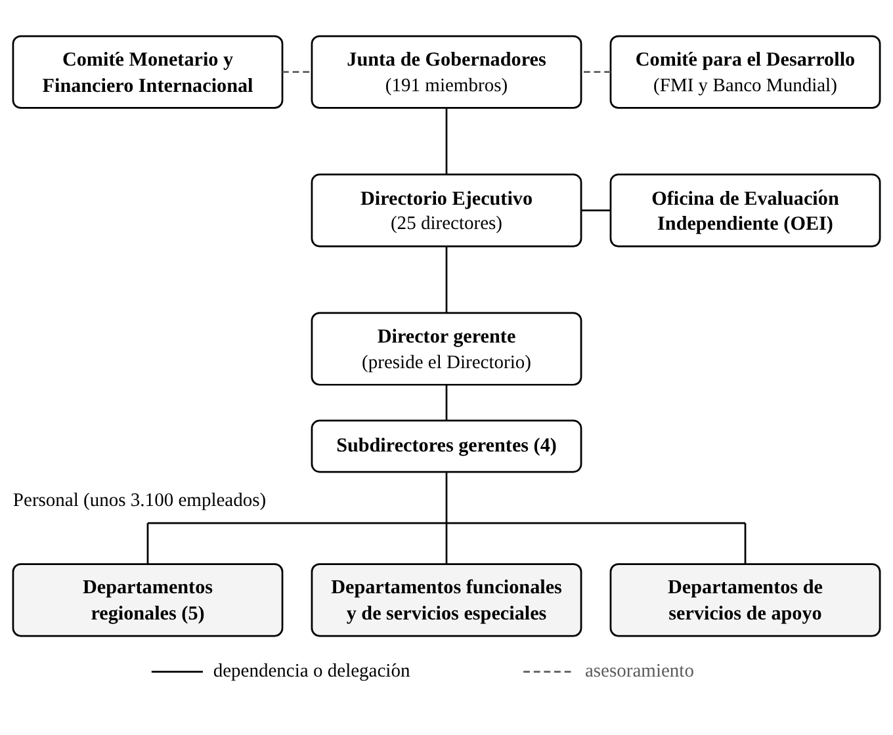

## Introducción



El **Fondo Monetario Internacional** (FMI) cuenta hoy con 191 países miembros. Su funcionamiento descansa en las **cuotas**, que fijan a la vez lo que cada miembro aporta, los votos de que dispone y la financiación a la que puede acceder, de modo que el reparto del poder refleja el peso económico de los miembros con el retraso con que se revisan. EE. UU., con en torno al 16,5 % de los votos (17,4 % de las cuotas), conserva el veto sobre las decisiones que exigen una mayoría del 85 %. Sus prestatarios han cambiado con el tiempo, de las economías avanzadas de Bretton Woods a las emergentes de las crisis de los años noventa y, tras 2008, a economías europeas como Grecia, Irlanda y Portugal. En 2021 aprobó la mayor asignación de derechos especiales de giro de su historia, equivalente a 650.000 M\$, para dar liquidez a sus miembros frente a la pandemia.

Del FMI se analizan aquí:

- *Diseño institucional*: definición, objetivos, miembros, estructura, funcionamiento, financiación y evolución.

- *Servicios y políticas*: servicios financieros, supervisión e inteligencia de mercado, y asesoramiento técnico.

- *Prevención y solución de crisis*: la justificación de la intervención del Fondo, el marco teórico de los programas de ajuste, su implementación práctica, sus efectos, las experiencias históricas más relevantes, la red de seguridad financiera global y la reestructuración de deuda soberana.

## 1. FMI: diseño institucional

Antes de examinar sus funciones conviene conocer cómo está construido el Fondo. Se presentan primero su definición, sus objetivos y sus miembros, después los órganos que lo gobiernan y el modo en que adopta sus decisiones, su estructura económico-financiera y, por último, la evolución de su papel.

### 1.1. Definición, objetivos y miembros

**Definición**: el FMI, organización intergubernamental, se integra entre los organismos especializados de las Naciones Unidas. Tiene sede en Washington, cuenta con aproximadamente 3100 empleados y su actual directora gerente es Kristalina Georgieva, que en esa condición preside el Directorio Ejecutivo. Como institución, tiene una capacidad de movilización de recursos superior a 1 billón (español) de dólares.

**Objetivos**: los fija el artículo I del Convenio Constitutivo, y su contenido se ordena en cuatro áreas:

1. *Estabilidad*: fomentar la cooperación monetaria internacional y la estabilidad cambiaria, evitando devaluaciones competitivas.

2. *Expansión*: facilitar la expansión del comercio internacional, con el fin último de contribuir al empleo y al crecimiento.

3. *Pagos*: establecer un sistema de pagos multilateral para las transacciones corrientes, eliminando las restricciones cambiarias sobre dichas transacciones.

4. *Financiación*: poner temporalmente sus recursos a disposición de los miembros, con garantías adecuadas, para que corrijan sus desequilibrios de balanza de pagos.

**Miembros**: el Fondo cuenta con 191 países miembros[^b22-1], cada uno con una cuota que determina su aportación, sus votos y su acceso a la financiación. Sus principales accionistas son, en porcentaje aproximado de los votos, EE. UU. (16,5 %), Japón (6 %), China (6 %), Alemania (5 %), Francia y el Reino Unido (4 % cada uno).

### 1.2. Estructura y funcionamiento

El Fondo actúa a través de un conjunto de órganos, desde la Junta de Gobernadores hasta los departamentos regionales y funcionales, cuya composición y reglas de votación determinan el peso de cada país en sus decisiones.

#### 1.2.1. Estructura

La figura -@fig-b221-organigrama-fmi simplifica el organigrama que publica el FMI. Las líneas continuas siguen la cadena de delegación, desde la Junta de Gobernadores, que delega la mayoría de sus facultades en el Directorio Ejecutivo, hasta el director gerente, elegido por el Directorio, y el personal, organizado en departamentos. Las discontinuas unen a la Junta con los comités que la asesoran, el Comité Monetario y Financiero Internacional (CMFI) y el Comité para el Desarrollo. La Oficina de Evaluación Independiente (OEI) rinde cuentas al Directorio.

::: {#fig-b221-organigrama-fmi}

::: {.content-visible when-format="html"}
```{=html}
<div class="graph-frame">
<iframe src="../graphs/b221_Organigrama_FMI.html" style="height:600px" loading="lazy" title="fig-b221-organigrama-fmi"></iframe>
</div>
```
:::

::: {.content-visible unless-format="html"}

:::

Organigrama del FMI. La Junta de Gobernadores, asesorada por dos comités ministeriales (líneas discontinuas), delega en el Directorio Ejecutivo, al que rinden cuentas la Oficina de Evaluación Independiente y el director gerente, que dirige al personal.
:::

1. *Junta de Gobernadores* (Board of Governors): ocupa la cúspide de la estructura de decisión. Cada país miembro tiene en ella un gobernador y un suplente, puestos que suelen ocupar, respectivamente, el ministro de economía y el máximo responsable del banco central. La Junta celebra cada año una reunión conjunta con el Banco Mundial. Está encargada de las decisiones financieras estratégicas, como los aumentos de cuotas y las asignaciones de derechos especiales de giro (DEG), y de las de gobernanza (admisión de miembros, enmiendas al Convenio Constitutivo, elección de directores ejecutivos)[^b22-4]. El CMFI la asesora por la vía formal, y foros como el G7 y el G20 lo hacen de manera informal.

2. *Comité Monetario y Financiero Internacional* (CMFI): orienta a la Junta de Gobernadores en materia de liquidez mundial y de supervisión del sistema financiero internacional. Lo integran 25 gobernadores, tantos como sillas tiene el Directorio Ejecutivo (que pasó de 24 a 25 en noviembre de 2024). El CMFI suele reunirse dos veces al año. Desde enero de 2024 lo preside Mohammed Al-Jadaan, ministro de Finanzas de Arabia Saudí.

3. *Comité Conjunto FMI-BM para el Desarrollo*: aconseja sobre las cuestiones decisivas para el desarrollo y sobre la financiación que exige impulsarlo. Sus 25 miembros se reúnen dos veces al año.

4. *Directorio Ejecutivo* (Executive Board): lleva la gestión cotidiana del Fondo, cuyo núcleo es el examen y la aprobación de lo que elabora su personal. Formado por 25 directores ejecutivos desde noviembre de 2024, cuando se creó una tercera silla para el África subsahariana, se reúne varias veces por semana. Está presidido por el director gerente, elegido por el propio Directorio. Desde la reforma de 2016 no existen directores designados y todos son elegidos por periodos de dos años. Ocho países (EE. UU., Japón, China, Alemania, Francia, Reino Unido, Arabia Saudí y Rusia) eligen individualmente director propio, mientras que las 17 sillas restantes son compartidas por varios países. Rusia tiene silla propia desde el 1 de noviembre de 2026, cuando Siria, con la que la compartía desde 2012, volvió a la circunscripción árabe, como se anunció a mediados de octubre durante las Reuniones Anuales de Bangkok.

5. *Oficina de Evaluación Independiente* (OEI): fundada en 2001, evalúa las actuaciones del FMI sin sujeción jerárquica. Es conocida, entre otros, por su informe crítico sobre la incapacidad del FMI para advertir a tiempo de los riesgos que desembocaron en la crisis financiera global (CFG).

6. *Departamentos regionales y funcionales*: los primeros cubren áreas geográficas (p. ej. África, Asia-Pacífico) y los segundos, ámbitos funcionales (p. ej. financiero, jurídico, estadístico).

#### 1.2.2. Funcionamiento: gobernanza y toma de decisiones

A la hora de tomar sus decisiones, el FMI destaca por tres características:

**Sistema de circunscripciones**: la composición del Directorio Ejecutivo constituye el rasgo más característico de la gobernanza del Fondo y explica buena parte de las críticas que recibe. Salvo los ocho miembros con silla propia, los demás se agrupan en circunscripciones que eligen conjuntamente a un director ejecutivo, el cual emite el voto acumulado de todos sus miembros como un bloque indivisible. 

España forma parte de una circunscripción con varios países latinoamericanos, entre ellos México y Venezuela, en la que la silla de director ejecutivo se turna entre los miembros de mayor cuota según un acuerdo de rotación. Cuando ocupa la silla, España ejerce una influencia superior a la que le daría su cuota aislada, aunque debe representar también la posición de los demás miembros. Con este sistema, los países pequeños carecen de voz directa en las deliberaciones y dependen de que el director de su grupo represente su posición.

**Regla de la mayoría cualificada**: las decisiones ordinarias se adoptan por mayoría simple de los votos emitidos, pero las de mayor calado exigen una mayoría cualificada del 85 % del total de votos. Entre ellas figuran la modificación del Convenio Constitutivo, las revisiones generales de cuotas, las asignaciones de derechos especiales de giro y la venta de oro.

Dado que Estados Unidos conserva una participación superior al 15 %, dispone de un veto *de facto* sobre todas ellas, y es el único miembro que lo posee de forma individual. La Unión Europea reúne conjuntamente una participación suficiente para vetar, pero su ejercicio requeriría una coordinación que la dispersión de sus Estados en distintas circunscripciones dificulta.

**Designación de la dirección**: desde la fundación de las instituciones de Bretton Woods rige un acuerdo tácito por el cual la dirección gerente del Fondo corresponde a un europeo y la presidencia del Banco Mundial a un estadounidense. Sin embargo, la práctica ha sido cuestionada de forma creciente por las economías emergentes, que la consideran incompatible con el principio de mérito que ambas instituciones proclaman. Constituye, además, uno de los frentes abiertos del debate sobre la legitimidad de la gobernanza económica internacional.

### 1.3. Financiación: estructura económico-financiera

La estructura económico-financiera del Fondo se aprecia en sus dos estados contables, el balance, muy distinto del de una entidad financiera, y la cuenta de resultados, que muestra de dónde proceden sus ingresos y en qué los gasta.

#### 1.3.1. Naturaleza del balance

Otros organismos multilaterales, como el Grupo Banco Mundial o el Mecanismo Europeo de Estabilidad (MEDE), captan fondos en los mercados financieros internacionales, pero el FMI no recurre a ellos[^b22-7]. Sus recursos proceden fundamentalmente de las aportaciones de sus miembros a través de sus bancos centrales, por lo que se trata de recursos monetarios y no fiscales.

Su balance presenta tres rasgos que lo distinguen del de cualquier entidad financiera:

- *No apalancamiento*: el grueso de sus recursos son aportaciones de capital de los miembros y no deuda emitida. 

- *Compras de divisa*: sus operaciones con cargo a la Cuenta de Recursos Generales no son técnicamente préstamos, sino compras de divisa, en las que el país adquiere moneda utilizable entregando la suya propia y se compromete a la operación inversa en el plazo pactado. Por ello, cuando el Fondo financia un programa, apenas varía el tamaño del balance, pero sí su composición. 

- *Activo utilizable*: es solo una fracción del total, pues las monedas de países con posición exterior débil no sirven para financiar programas. De ahí que la capacidad real de préstamo se mida por la capacidad de compromiso a un año vista (*Forward Commitment Capacity*) y no por el total del balance.

Las características de la estructura económico-financiera pueden entenderse a partir de una presentación estilizada de su balance contable:

| **ACTIVO** | | **PASIVO Y PATRIMONIO NETO** | |
|:---|---:|:---|---:|
| Tenencias de monedas de los países miembros | xxx | **Pasivo** | |
| Tenencias de DEG | xxx | Posiciones en el tramo de reserva (remuneradas y exigibles a la vista) | xxx |
| Oro | xxx | Préstamos tomados (Nuevos Acuerdos para la Obtención de Préstamos y acuerdos bilaterales) | xxx |
| Créditos concedidos pendientes de reembolso | xxx | Otros pasivos | xxx |
| Otros activos (inversiones, inmuebles) | xxx | **Patrimonio neto** | |
| | | Cuotas de los países miembros (netas de las posiciones en el tramo de reserva) | xxx |
| | | Reservas prudenciales acumuladas | xxx |
| **TOTAL ACTIVO** | **xxx** | **TOTAL PASIVO Y PATRIMONIO NETO** | **xxx** |

: Estructura simplificada del balance de la Cuenta de Recursos Generales del FMI. {#tbl-balance-fmi .balance tbl-colwidths="[40,10,40,10]"}

**Activo**:

- *Tenencias de monedas de los miembros*: constituyen la partida principal y proceden del 75 % de la cuota que cada país desembolsa en moneda nacional. Su utilidad es desigual, pues solo son empleables en los programas las monedas de países con posición exterior sólida, seleccionados periódicamente por el Fondo en el denominado plan de transacciones financieras.

- *Tenencias de DEG*: los *derechos especiales de giro* son el activo de reserva internacional creado por el FMI en 1969 para complementar las reservas oficiales de sus miembros. No constituyen una divisa, sino un derecho potencial a obtener monedas de libre uso de otros miembros al tipo de cambio fijado por el Fondo[^b22-8].

    - *Valor*: se determina por una cesta de cinco monedas cuyos pesos, tras la revisión de 2022 (en vigor desde agosto de 2022), son: dólar (43,38 %), euro (29,31 %), renminbi (12,28 %), yen (7,59 %) y libra (7,44 %). La incorporación del renminbi en 2016 reconoció el peso creciente de China en el sistema financiero internacional.

    - *Asignación*: se realiza en proporción a las cuotas, lo que constituye su principal limitación, pues concentra la liquidez creada precisamente en los países que menos la necesitan, como mostró la asignación de 2021 (apartado 3.3.4).

- *Oro*: con 90,5 millones de onzas, aproximadamente 2814 toneladas, el FMI ocupa el tercer puesto mundial entre los tenedores oficiales. Esas reservas proceden en su mayor parte de los pagos de cuota anteriores a 1978, cuando el 25 % se abonaba en oro. Los estatutos acotan con rigor su uso. Así, el Fondo tiene prohibido comprar oro, y para venderlo o admitirlo en pago necesita una mayoría del 85 % de los votos. El oro figura en balance a su coste histórico, muy inferior al valor de mercado, de modo que el patrimonio del Fondo incorpora una plusvalía latente considerable que no aparece reflejada en sus estados financieros.

- *Créditos pendientes de reembolso*: recogen el uso efectivo de los recursos del Fondo por los países con programa en vigor. Su calidad crediticia es excepcionalmente elevada por la consideración *de facto* de *acreedor preferente* de que goza el FMI, es decir, la práctica según la cual sus créditos se atienden con prioridad sobre los del resto de acreedores. Dicha condición no figura en su Convenio Constitutivo, aunque la reconocen textos como el Tratado del MEDE. Descansa en la aceptación general de que el Fondo es lo más parecido a un prestamista internacional de última instancia y en el hecho de que a lo largo de su historia prácticamente no ha registrado quebrantos. Ello explica que esta partida apenas requiera dotaciones por deterioro. Con todo, la crisis griega (2010-2015) puso ese estatus en cuestión, al coexistir el Fondo con acreedores oficiales europeos que reclamaban un trato equivalente.

**Pasivo**:

- *Posiciones en el tramo de reserva*: constituyen el pasivo característico del Fondo y encierran una particularidad notable, pues la misma magnitud es simultáneamente un pasivo para el FMI y un activo de reserva para el país miembro. Corresponden a la diferencia entre la cuota y las tenencias del Fondo de la moneda del miembro. La diferencia equivale a la parte de la cuota desembolsada en activos de reserva más el uso neto que el Fondo haya hecho de esa moneda en sus operaciones. Son exigibles a la vista, sin condicionalidad alguna, por lo que los países las computan dentro de sus reservas internacionales. El Fondo las remunera al tipo de interés del DEG.

- *Préstamos tomados*: constituyen la segunda y tercera líneas de defensa del Fondo, concebidas como recursos temporales que complementan las cuotas cuando estas resultan insuficientes.

    - *Nuevos Acuerdos para la Obtención de Préstamos* (NAB): línea multilateral con 40 participantes, países e instituciones como bancos centrales (FMI, abril de 2026). Se acordó en 1997 tras la crisis del Tequila (1994-1995), entró en vigor en 1998 y se activó de forma continuada, por periodos de seis meses, entre 2011 y 2016.

    - *Acuerdos de Préstamo Bilateral* (BBA): línea bilateral articulada en 39 acuerdos, prorrogados más allá de finales de 2024, por un total aproximado de 136.600 M DEG (unos 187.000 M\$), utilizada en 2009-2011 y mantenida después como tercera línea de defensa.

La 16.ª revisión general de cuotas persigue precisamente reducir el peso de estas fuentes. Al elevar las cuotas un 50 %, prevé reducir los recursos tomados en préstamo (recorte de los NAB y supresión de los acuerdos bilaterales). El objetivo es que la capacidad de préstamo del Fondo permanezca constante, pero que su base se desplace desde la financiación temporal tomada en préstamo hacia las cuotas, de carácter permanente.

**Patrimonio neto**:

- *Cuotas*: constituyen el recurso propio del Fondo y su elemento estructural fundamental[^b22-11]. Se denominan en DEG, se fijan en el momento del ingreso y se revisan con carácter general cada cinco años.

    - *Cálculo*: la cuota calculada de cada país sirve de referencia para negociar la cuota efectiva. La cuota calculada resulta de una fórmula ponderada de cuatro variables: el PIB (50 %, media ponderada a tipos de mercado y en paridad de poder adquisitivo), el grado de apertura (30 %), la variabilidad de los ingresos corrientes y los flujos de capital (15 %) y las reservas internacionales (5 %). El resultado se eleva a un factor de compresión de 0,95, que reduce la cuota de los países mayores y eleva la de los menores[^b22-12].

    - *Pago*: el 25 % se desembolsa en DEG o divisas convertibles, dando lugar al tramo de reserva, y el 75 % restante en moneda nacional.

    - *Funciones*: más allá de su condición de recurso financiero, la cuota determina el derecho de voto, mediante la asignación de votos básicos iguales para todos los miembros más votos adicionales proporcionales a la cuota[^b22-13], y el acceso máximo a la financiación del Fondo.

    - *Revisiones recientes*[^b22-14]:

        - *14.ª revisión (2010)*: duplicó el valor total de las cuotas hasta 477.000 M DEG (unos 659.000 M\$ al tipo de cambio de su entrada en vigor). También transfirió un 6 % hacia economías emergentes y países en desarrollo, con lo que China pasó a ser el tercer mayor contribuyente. Sin embargo, no entró en vigor hasta 2016, por la demora en su ratificación por el Congreso estadounidense.
        - *16.ª revisión (2023)*: aprobó un aumento del 50 % de las cuotas, hasta unos 715.700 M DEG (unos 960.000 M\$), si bien sin modificar las participaciones relativas, lo que ha sido criticado por no abordar la infrarrepresentación de las economías emergentes. El aumento no ha entrado aún en vigor, pues requiere el consentimiento de miembros que reúnan el 85 % de las cuotas, y el plazo para prestarlo, que vencía en noviembre de 2024, se ha prorrogado desde entonces por semestres (la cuarta prórroga lo llevó al 15 de noviembre de 2026). En octubre de 2026, el CMFI pidió completar las aprobaciones nacionales sin más demora.
        - *17.ª revisión*: debe abordar la realineación de las participaciones, que la 16.ª dejó pendiente. Sus discusiones se guían por los Principios Rectores de Diriyah sobre las reformas de las cuotas y de la gobernanza, que el CMFI respaldó en abril de 2026 y que reafirman que el FMI es una institución basada en cuotas.

- *Reservas prudenciales*: se han acumulado a partir de los márgenes de intermediación y desempeñan la función de absorber eventuales pérdidas por impago o por riesgo operativo. El Fondo fija periódicamente un objetivo mínimo para su saldo, que orienta a su vez la política de ingresos.

#### 1.3.2. Cuenta de resultados

El FMI no persigue la maximización del beneficio, sino la cobertura de sus costes y la acumulación de reservas prudenciales hasta el nivel fijado como objetivo. Su cuenta de resultados responde, por tanto, a una lógica de equilibrio y no de rentabilidad.

**Ingresos**: proceden de cuatro fuentes principales:

- *Margen de intermediación*: es la fuente principal. El Fondo aplica a los créditos concedidos un tipo de cargo básico igual al tipo de interés del DEG más un margen, mientras que remunera las posiciones en el tramo de reserva al tipo del DEG. La diferencia entre ambos constituye su margen ordinario.

- *Sobretasas* (*surcharges*): se aplican a los créditos que superan determinados umbrales respecto de la cuota (sobretasa por nivel) o que se prolongan más allá de cierto plazo (sobretasa temporal). Su finalidad declarada es desincentivar el uso excesivo o prolongado de los recursos del Fondo, si bien han sido objeto de crítica por elevar el coste de la financiación precisamente cuando el país atraviesa mayores dificultades.

- *Comisiones*: comisión por servicio sobre cada desembolso y comisión de compromiso sobre los importes acordados y no dispuestos, esta última especialmente relevante en los instrumentos precautorios.

- *Rendimiento de las inversiones*: obtenido a través de la Cuenta de Inversiones, dotada con los beneficios de la venta de oro realizada entre 2009 y 2010 en el marco del nuevo modelo de ingresos.

**Gastos**: se componen de tres partidas principales:

- *Remuneración de las posiciones en el tramo de reserva*: satisfecha al tipo de interés del DEG.

- *Intereses de los recursos tomados en préstamo*: al amparo de los NAB y de los acuerdos bilaterales.

- *Gastos administrativos y de personal*: correspondientes a una plantilla de en torno a tres mil empleados y a la actividad de supervisión y asistencia técnica, que no genera ingresos y se financia con cargo al margen obtenido en la actividad crediticia.

### 1.4. Evolución

El peso que la institución ha dado a cada objetivo ha cambiado mucho a lo largo de su historia:

1. *Etapa de Bretton Woods (1945-1971)*: el FMI actuó como garante de la estabilidad cambiaria y gestor de la liquidez del sistema de tipos de cambio fijos, centrándose en la primera y tercera áreas.

2. *Etapa post-Bretton Woods (1971-2007)*: tras el fin de la convertibilidad del dólar (1971), la firma de los Acuerdos de Jamaica (1976) y la segunda enmienda del Convenio Constitutivo, el FMI tuvo que redefinir a fondo sus funciones, puesto que la defensa de unas paridades fijas había dejado de ser su cometido. Las sucesivas crisis cambiarias y financieras de los países en desarrollo (PED) y la influencia del Consenso de Washington hicieron que se centrase en la segunda y cuarta áreas (la promoción de la liberalización comercial y la asistencia financiera a países en crisis).

3. *Etapa actual (2007-presente)*: la CFG puso de manifiesto la importancia del FMI como gestor de crisis sistémicas y reforzó su papel en la supervisión macroprudencial. Más recientemente, la pandemia de COVID-19 y la crisis climática han ampliado su agenda hacia la financiación de emergencia y la sostenibilidad.

### 1.5. Conclusiones

**Aspectos positivos**: el diseño financiero del Fondo ha demostrado una solidez notable. Al no apalancarse ni acudir a los mercados, su capacidad de préstamo no depende de la confianza de los inversores, precisamente la variable que desaparece cuando los recursos del Fondo resultan necesarios. Esa independencia, unida a la condición *de facto* de acreedor preferente, le ha permitido operar durante ocho décadas prácticamente sin quebrantos y desplegar en 2020 una respuesta de emergencia sin precedentes.

**Limitaciones**: pesan sobre esa arquitectura dos objeciones de distinto orden:

- *Estructura económico-financiera*: los ingresos del Fondo dependen del volumen de crédito vivo y, en último término, de que existan países con dificultades de balanza de pagos, de modo que su cuenta de resultados se deteriora precisamente cuando el sistema funciona bien. Esa circunstancia, manifiesta a mediados de la década de 2000, motivó la adopción en 2008 del nuevo modelo de ingresos, que diversificó las fuentes mediante la venta de 403,3 toneladas de oro y la constitución de una cartera de inversión. A ello se añade la creciente dependencia de recursos tomados en préstamo, de carácter temporal y renovación incierta, que la 16.ª revisión de cuotas pretende corregir desplazando la base hacia recursos permanentes.

- *Estructura organizativa*: la objeción de gobernanza es la de mayor calado. La distribución de cuotas sigue reflejando el peso económico de la década de 2000 antes que el actual, pues su última realineación data de la 14.ª revisión (2010). Por ello, las economías emergentes representan hoy una proporción del producto mundial muy superior a su participación en el capital del Fondo. Al mismo tiempo, Estados Unidos conserva un veto individual sobre las decisiones estructurales y Europa una sobrerrepresentación heredada. 

La 16.ª revisión, al aumentar las cuotas sin alterar las participaciones relativas, aplazó una vez más el problema. La consecuencia no es meramente simbólica, porque la brecha entre poder económico y poder de decisión alimenta el desarrollo de instituciones alternativas, desde el Nuevo Banco de Desarrollo hasta los acuerdos regionales de provisión de liquidez. Esas instituciones fragmentan, a su vez, la red de seguridad financiera global y erosionan la centralidad que justifica la propia existencia del Fondo.

En resumen, la paradoja del FMI es que su fortaleza financiera descansa en una estructura de capital cuya distribución constituye su principal debilidad política.

## 2. FMI: servicios y políticas

El FMI ejerce sus funciones mediante la provisión de diferentes servicios. Los tres principales son la financiación, la supervisión e inteligencia de mercado, y el asesoramiento técnico.

### 2.1. Servicios financieros

El primero de esos servicios, la financiación, se estudia a partir de su justificación y de su diseño en tramos con condicionalidad. Se recorren después los instrumentos no concesionales, los concesionales y otros como el Fondo Fiduciario para la Resiliencia y la Sostenibilidad o la condonación de deuda.

#### 2.1.1. Concepto y justificación

Los **servicios financieros** del FMI engloban, esencialmente, la provisión de fondos. Esta función responde a una doble justificación:

- *Histórica*: la experiencia del periodo de entreguerras mostró que los países incapaces de financiar sus déficits exteriores recurrían a medidas dañinas para la estabilidad global, como las devaluaciones competitivas, los controles de cambio y los impagos soberanos.

- *Económica*: la volatilidad de las cuentas exteriores y los efectos de contagio hacen necesario un prestamista internacional de última instancia que suministre confianza, estabilidad y capacidad de ajuste al sistema.

La política financiera del FMI se rige por cuatro principios:

- *Universalidad*: todos los miembros del Fondo pueden acceder a su financiación.

- *Ausencia de lucro*: la actividad lucrativa no es el fin principal del Fondo.

- *Eficiencia*: en el uso de los recursos.

- *Coordinación*: en su relación con otros organismos[^b22-15].

#### 2.1.2. Diseño: tramo de reserva, tramos de crédito y condicionalidad

**Tramos de financiación**: el acceso a los recursos del Fondo se articula en dos canales:

1. *Tramo de reserva* (apartado 1.3.1): accesible sin comisiones ni exigencias de reforma económica (sin *condicionalidad*), es el canal de primer recurso.

2. *Tramos de crédito*: financiación por encima del tramo de reserva. Se subdividen en instrumentos no concesionales, disponibles para todos los miembros con cargo a la Cuenta de Recursos Generales, e instrumentos concesionales, reservados a los países de renta baja.

La provisión de financiación se caracteriza por:

**Límites de acceso**: la cuota aportada por los miembros del FMI determina no solo la contribución, sino también el volumen máximo de financiación al que un país puede aspirar. Los límites generales se aplican al conjunto del crédito del Fondo con cargo a la Cuenta de Recursos Generales y no a cada instrumento por separado. La Línea de Precaución y Liquidez (PLL), la Línea de Liquidez a Corto Plazo (SLL) y el Instrumento de Financiamiento Rápido (RFI) tienen, además, sublímites propios, y la Línea de Crédito Flexible (FCL) carece de límite predeterminado.

La revisión general concluida en diciembre de 2024 fijó los límites generales con carácter permanente en el 200 % de la cuota anual y el 600 % acumulado, elevando en un 38 % los umbrales establecidos en la revisión de 2016, que eran del 145 % y el 435 % respectivamente. Esos límites se reducirán al 135 % y el 405 % cuando entre en vigor el aumento de cuotas de la 16.ª revisión general, lo que mantiene aproximadamente el acceso en DEG (el aumento de cuotas es del 50 %). Los programas que superan esos umbrales se someten a la *política de acceso excepcional* (apartado 3.4.2).

**Desembolso escalonado y revisiones**: la financiación no se entrega de una sola vez, sino en tramos sucesivos cuya liberación queda condicionada al cumplimiento del programa, verificado en revisiones periódicas, habitualmente trimestrales o semestrales. Este diseño constituye el mecanismo esencial de la condicionalidad, pues el Fondo conserva capacidad de influencia a lo largo de toda la vida del programa y no únicamente en el momento de su aprobación.

**Condicionalidad *ex ante* y *ex post***: la condicionalidad clásica para la obtención de fondos es *ex post*, es decir, se exige el ajuste como contrapartida del desembolso. No obstante, los instrumentos precautorios introducidos tras la crisis financiera global invierten esa lógica. El acceso se reserva a países que ya cumplen determinados criterios de solidez macroeconómica, de modo que la condicionalidad opera *ex ante*, en la propia elegibilidad. El propósito es hacer disponible la financiación sin el estigma asociado a los programas tradicionales, si bien el uso de estos instrumentos se ha limitado a muy pocos países, algo que el propio FMI vinculó en 2014 a la persistencia de ese estigma.

La condicionalidad *ex post* se concreta en los compromisos que asume el país deudor, que se articulan en cuatro categorías según su efecto sobre la aprobación del programa y sobre los desembolsos:

1. *Medidas previas* (*prior actions*): han de adoptarse antes de la aprobación del programa y operan como prueba de compromiso.

2. *Criterios de ejecución cuantitativos*: fijan valores verificables de variables macroeconómicas, como el saldo primario o las reservas internacionales netas, cuyo incumplimiento interrumpe los desembolsos salvo dispensa expresa.

3. *Parámetros estructurales de referencia* (*structural benchmarks*): recogen reformas institucionales, a menudo no cuantificables, cuyo cumplimiento se valora de forma global en la revisión, sin que su incumplimiento interrumpa por sí solo los desembolsos.

4. *Metas indicativas*: orientan sin condicionar formalmente.

#### 2.1.3. Instrumentos no concesionales

La financiación no concesional se ofrece en términos próximos al mercado, con cargo a la Cuenta de Recursos Generales (GRA), y puede ser condicional o no condicional[^b22-17]. Salvo la FCL, todos los instrumentos están sujetos a los límites de acceso generales. Todos comparten, además, la estructura de tipos descrita en el apartado 1.3.2. Los ejemplos de cada instrumento, en este apartado y en el siguiente, proceden de los comunicados de prensa del FMI[^b22-18].

1. *Acuerdo de Derechos de Giro* (Stand-By Arrangement, SBA): creado en 1952, es el instrumento estándar para problemas coyunturales de balanza de pagos y el más utilizado en la historia del Fondo. Es condicional, suele durar de 12 a 24 meses, con un máximo de 36, y se reembolsa en 3,25 a 5 años. Lo utilizaron, entre otros, el Reino Unido (1976), Grecia (2010) y Argentina (2018).

    - *Ejemplo*: en julio de 2023, Pakistán obtuvo un SBA de nueve meses por 2250 M DEG (unos 3000 M\$, el 111 % de su cuota), con dos revisiones trimestrales, para estabilizar una economía afectada por las inundaciones de 2022 y por errores de política.

2. *Servicio Ampliado del FMI* (Extended Fund Facility, EFF): creado en 1974 para problemas de balanza de pagos derivados de deficiencias estructurales que exigen un periodo de ajuste más prolongado. Es condicional, dura tres años, ampliables a cuatro desde su aprobación, y se reembolsa en 4,5 a 10 años, en doce plazos semestrales iguales. Lo utilizaron, entre otros, Irlanda (2010), Portugal (2011), Argentina (2022) y Ucrania (2023).

    - *Ejemplo*: en diciembre de 2022, Egipto obtuvo un EFF de 46 meses por unos 3000 M\$, centrado en el paso a un tipo de cambio flexible, que el Fondo amplió en unos 5000 M\$ en marzo de 2024.

3. *Línea de Crédito Flexible* (Flexible Credit Line, FCL): creada en 2009 para países con fundamentos muy sólidos que afrontan riesgos de liquidez transitorios. No es condicional *ex post*, pues solo exige el cumplimiento de criterios de habilitación previos, ni tiene límites de acceso predeterminados. Su uso se limita a un grupo muy reducido de países, México desde 2009 y, posteriormente, Chile, Marruecos y Costa Rica. Polonia, Perú y Colombia abandonaron el instrumento, esta última tras haberlo mantenido desde 2009, lo que ilustra su naturaleza de seguro transitorio antes que permanente. La mayoría de los acuerdos se tratan como precautorios (sin disposición efectiva de fondos).

    - *Ejemplo*: México fue en abril de 2009 el primer país con FCL, de un año y por 31.500 M DEG (unos 47.000 M\$). La trató como precautoria, sin disponer de ella, y desde 2017 ha ido reduciendo el importe accesible.

4. *Línea de Precaución y Liquidez* (Precautionary and Liquidity Line, PLL): creada en 2011 para países con fundamentos sólidos que no cualifican para la FCL por presentar alguna vulnerabilidad concreta. Es condicional, con límites que dependen de la duración del acuerdo[^b22-19]. La han utilizado, entre otros, Macedonia del Norte y Marruecos, que pasó a la FCL en 2023.

    - *Ejemplo*: tras cuatro acuerdos PLL desde 2012, Marruecos dispuso en abril de 2020 de todo el importe del vigente, 2150 M DEG (unos 3000 M\$, el 240 % de su cuota), para afrontar la pandemia.

5. *Línea de Liquidez a Corto Plazo* (Short-term Liquidity Line, SLL): creada en 2020, es un instrumento renovable de tipo revolvente para miembros con fundamentos muy sólidos que afrontan necesidades de liquidez de carácter moderado y a muy corto plazo. Se distingue de la FCL por su menor coste, con una comisión de servicio reducida, y porque cada disposición se reembolsa en doce meses. Su uso ha sido escaso, y el instrumento se extinguirá en abril de 2027, al cumplirse los siete años previstos en su diseño.

    - *Ejemplo*: Chile, su primer usuario, obtuvo en mayo de 2022 una SLL precautoria de un año por 2529 M DEG (unos 3500 M\$, el 145 % de su cuota), que canceló en agosto al pasar a una FCL.

6. *Instrumento de Financiamiento Rápido* (Rapid Financing Instrument, RFI): asistencia financiera rápida para necesidades urgentes derivadas de catástrofes naturales, *shocks* de precios o conflictos, sin necesidad de programa de ajuste plenamente articulado. Fue el instrumento más utilizado durante la pandemia[^b22-20].

    - *Ejemplo*: en marzo de 2022, dos semanas después de la invasión rusa, Ucrania recibió con cargo al RFI 1005,9 M DEG (unos 1400 M\$, el 50 % de su cuota), sin programa, y canceló el SBA que tenía en vigor.

La tabla -@tbl-instrumentos-gra resume los seis instrumentos. Las tres líneas precautorias, la FCL, la PLL y la SLL, se distinguen sobre todo por la solidez que exigen y por la condicionalidad que conservan.

| | Destinatario y finalidad | Acceso | Plazos | Condicionalidad |
|:---|:---|:---|:---|:---|
| SBA | Todos los miembros, ante problemas coyunturales de balanza de pagos | 200 % anual y 600 % acumulado | 12-24 meses (hasta 36), reembolso en 3,25-5 años | *Ex post*, con revisiones |
| EFF | Todos, sobre todo avanzados y emergentes, ante problemas estructurales de balanza de pagos | 200 % anual y 600 % acumulado | Tres años (hasta cuatro), reembolso en 4,5-10 años | *Ex post*, con reformas estructurales |
| FCL | Fundamentos y políticas muy sólidos, como seguro frente a crisis (casi siempre precautorio) | Sin límite predeterminado | Uno o dos años, reembolso en 3,25-5 años | *Ex ante* |
| PLL | Fundamentos sólidos con alguna vulnerabilidad, como seguro o ante una necesidad efectiva | Sublímites según la duración | Seis meses o uno a dos años, reembolso en 3,25-5 años | *Ex ante* y *ex post* focalizada |
| SLL | Fundamentos muy sólidos, ante necesidades de liquidez a corto plazo por presiones en la cuenta financiera | 200 %, revolvente | Doce meses, renovable, reembolso en doce meses | *Ex ante* |
| RFI | Todos los miembros, ante necesidades urgentes (catástrofes, *shocks*, conflictos) | 50 % anual y 100 % acumulado | Desembolso único, reembolso en 3,25-5 años | Sin condicionalidad *ex post* |

: Instrumentos no concesionales del FMI. {#tbl-instrumentos-gra tbl-colwidths="[8,36,18,22,16]"}

#### 2.1.4. Instrumentos concesionales

Los países de renta baja[^b22-21] pueden acceder a financiación en condiciones más favorables a través del Fondo Fiduciario para el Crecimiento y la Lucha contra la Pobreza (Poverty Reduction and Growth Trust, PRGT). Establecido en 2009 y operativo desde enero de 2010, se financia mediante contribuciones de los miembros y los beneficios de las ventas de oro del Fondo. Su rasgo distintivo ha sido el tipo de interés nulo, generalizado a todos sus servicios. Desde el 1 de mayo de 2025 rige, en cambio, un mecanismo escalonado que mantiene el tipo cero para los países más pobres y aplica un tipo positivo, vinculado al tipo de interés del DEG, a los países de renta baja en mejor situación.

Los límites de acceso del PRGT, mantenidos en su revisión de 2024, coinciden con los de la Cuenta de Recursos Generales. Conviene distinguirlos de la *norma de acceso*, que orienta el volumen habitual de los acuerdos y que desde el 1 de enero de 2025 se sitúa en el 145 % de la cuota.

1. *Servicio de Crédito Standby* (Standby Credit Facility, SCF): análogo al SBA, para problemas coyunturales. Es condicional, con el tipo de interés del mecanismo escalonado del PRGT (nulo para los países más pobres), periodo de gracia de cuatro años y vencimiento final a ocho años.

    - *Ejemplo*: en diciembre de 2023, Ruanda obtuvo un SCF de 14 meses por 200,25 M DEG (unos 268 M\$, el 125 % de su cuota) frente a las presiones de los *shocks* climáticos, como las inundaciones de mayo de 2023.

2. *Servicio de Crédito Ampliado* (Extended Credit Facility, ECF): análogo al EFF, para problemas estructurales. Es condicional, con el mismo esquema de tipos, periodo de gracia de 5,5 años y vencimiento final a diez años. Puede actuar como catalizador de la ayuda oficial al desarrollo.

    - *Ejemplo*: en mayo de 2023, Ghana obtuvo un ECF de tres años por 2242 M DEG (unos 3000 M\$, el 304 % de su cuota), con un ajuste fiscal concentrado al inicio y la reestructuración de su deuda interna y externa.

3. *Servicio de Crédito Rápido* (Rapid Credit Facility, RCF): análogo al RFI, para necesidades urgentes, sin condicionalidad *ex post*.

    - *Ejemplo*: en abril de 2019, tras el ciclón Idai, Mozambique recibió con cargo al RCF y a tipo cero 85,2 M DEG (118,2 M\$, el 37,5 % de su cuota) para financiar la reconstrucción.

La tabla -@tbl-instrumentos-prgt resume los tres servicios del PRGT, que replican el SBA, el EFF y el RFI con plazos más largos y un tipo de interés nulo o reducido según la renta del país.

| | Destinatario y finalidad | Acceso | Plazos | Condicionalidad |
|:---|:---|:---|:---|:---|
| SCF | Renta baja con una posición macroeconómica en general sostenible, ante necesidades a corto plazo (también precautorias) | 200 % anual y 600 % acumulado (norma del 145 % para 18 meses) | 12-36 meses, cuatro años de gracia y vencimiento a ocho | *Ex post*, con revisiones semestrales |
| ECF | Renta baja con problemas prolongados de balanza de pagos, para programas a medio plazo de estabilidad y crecimiento | 200 % anual y 600 % acumulado (norma del 145 % para tres años) | Tres a cinco años, 5,5 años de gracia y vencimiento a diez | *Ex post*, con revisiones semestrales |
| RCF | Renta baja, ante necesidades urgentes (emergencias, *shocks* externos y catástrofes) | 50 % anual y 100 % acumulado (más en *shocks* y catástrofes) | Desembolso único, 5,5 años de gracia y vencimiento a diez | Sin condicionalidad *ex post* |

: Instrumentos concesionales del FMI. {#tbl-instrumentos-prgt tbl-colwidths="[8,36,20,20,16]"}

#### 2.1.5. Otros instrumentos: el Fondo Fiduciario para la Resiliencia y la Sostenibilidad y la condonación de deuda

**Fondo Fiduciario para la Resiliencia y la Sostenibilidad**: en 2022 el FMI creó el Resilience and Sustainability Trust (RST), instrumento diseñado para ayudar a los países vulnerables a abordar retos estructurales de largo plazo, en particular el cambio climático y la preparación ante pandemias. Se financia mediante la canalización voluntaria de DEG por parte de países con posiciones exteriores sólidas. Presta a través del Servicio de Resiliencia y Sostenibilidad (Resilience and Sustainability Facility, RSF), siempre junto a un programa del Fondo con condicionalidad de los tramos superiores de crédito, y a plazos muy largos, de hasta veinte años con diez y medio de carencia[^b22-22].

Su relevancia excede lo instrumental. De hecho, representa la ampliación más significativa del mandato del Fondo desde su fundación, ya que por primera vez financia retos estructurales de largo plazo que no constituyen un problema actual de balanza de pagos, sino un riesgo para la estabilidad futura de la balanza de pagos. De ahí que su creación haya suscitado un debate sobre el riesgo de dispersión del mandato (*mission creep*) y sobre la delimitación de funciones respecto del Banco Mundial.

**Instrumentos de condonación de deuda**: el FMI ha desarrollado dos iniciativas principales en colaboración con el Banco Mundial.

::: {.callout-note appearance="simple" icon=false}
El análisis detallado de la sostenibilidad de la deuda de los países en desarrollo, de la Iniciativa HIPC, de la Iniciativa para el Alivio de la Deuda Multilateral y del Marco Común del G20 se desarrolla en el tema [B29](b29-fod-aod.qmd).
:::

1. *Iniciativa HIPC* (Heavily Indebted Poor Countries, 1996, reforzada en 1999): persigue que ningún país pobre soporte una carga de deuda insostenible. Se articula en dos etapas, el punto de decisión y el punto de culminación, con criterios de elegibilidad basados en umbrales de sostenibilidad. De los 39 países elegibles o potencialmente elegibles, 37 han alcanzado el punto de culminación, el último de ellos Somalia en diciembre de 2023.

2. *Iniciativa para el Alivio de la Deuda Multilateral* (MDRI, 2005): se propuso en la cumbre del G8 de Gleneagles. Va más allá de la HIPC al eliminar por completo la deuda contraída con el FMI, la Asociación Internacional de Fomento (AIF) y el Fondo Africano de Desarrollo. Su objetivo era liberar recursos para los Objetivos de Desarrollo del Milenio, hoy Objetivos de Desarrollo Sostenible. Se aplica automáticamente a todos los países que alcanzan el punto de culminación de la HIPC. Por exigencia del principio de trato uniforme entre los miembros del Fondo, se aplica también a los países no HIPC situados por debajo del umbral de renta per cápita fijado, en concreto, Camboya y Tayikistán.

### 2.2. Supervisión e inteligencia de mercado

El segundo servicio, la supervisión, se ejerce en dos planos, el bilateral, país a país, y el multilateral, atento a las tendencias regionales y globales y al impacto transfronterizo de las políticas nacionales.

#### 2.2.1. Concepto y justificación

La función de **supervisión** del FMI deriva de la existencia de información imperfecta en el sistema monetario y financiero internacional. Su objetivo es identificar vulnerabilidades y externalidades negativas que puedan comprometer la estabilidad del sistema.

**Base jurídica y evolución**: la supervisión encuentra su fundamento en el artículo IV del Convenio Constitutivo. El artículo obliga a los miembros a colaborar con el Fondo y con los demás países para asegurar regímenes de cambio ordenados, y atribuye al Fondo una función de vigilancia firme sobre las políticas cambiarias. Su alcance se ha ampliado sucesivamente a través de tres decisiones:

1. *Decisión de 1977*: se centraba en la política cambiaria, en coherencia con el mandato surgido de Jamaica.

2. *Decisión de 2007*: extendió la vigilancia a la estabilidad exterior en su conjunto.

3. *Decisión sobre Supervisión Integrada de 2012*: incorporó expresamente los efectos de desbordamiento (*spillovers*), sin crear nuevas obligaciones para los miembros. Con ella, las políticas de un país se examinan no solo por sus consecuencias internas, sino también por su impacto sobre la estabilidad del sistema.

Esta evolución responde a una lógica precisa. Al legalizar los Acuerdos de Jamaica la libre elección del régimen cambiario, el Fondo perdió la función de custodio de un sistema de paridades y hubo de reconstruir su papel en torno a la vigilancia. La supervisión es, por tanto, la contrapartida institucional de la flexibilidad concedida en 1976. Si cada país elige su régimen, alguien ha de evaluar si esa elección resulta compatible con la estabilidad del conjunto.

#### 2.2.2. Supervisión bilateral

1. *Consultas del artículo IV*: todo país que ingresa en el FMI acepta que el Fondo supervise sus políticas económicas. Cada consulta sigue una secuencia fija, con una misión anual del personal, un informe, su evaluación por el Directorio Ejecutivo y la publicación. El informe repasa las políticas fiscal, monetaria y comercial y señala las reformas estructurales pertinentes. Con ello se busca detectar los focos de desequilibrio y evitar crisis y contagios. Las recomendaciones del FMI suelen ser tenidas en cuenta por los Gobiernos en sus programas de reforma. Además, la práctica totalidad de los miembros consiente hoy la publicación del informe del personal técnico y de la valoración del Directorio, lo que otorga al diagnóstico un impacto público considerable.

2. *Supervisión de los tipos de cambio*: constituye el mandato legal más fuerte del FMI (art. IV). Los países deben declarar su régimen cambiario, clasificado en tres categorías: vinculación fuerte (*hard peg*: dolarización, junta monetaria), vinculación débil (*soft peg*: tipos deslizantes, bandas) y flotación (intervenida o libre)[^b22-26]. El objetivo es evitar la manipulación de los tipos de cambio. Sin embargo, en la práctica, la supervisión cambiaria enfrenta serias dificultades, porque las declaraciones *de iure* frecuentemente no coinciden con la práctica *de facto*[^b22-27]. Tras la CFG, surgió además el debate sobre si las políticas monetarias no convencionales de los países avanzados, como la expansión cuantitativa (*quantitative easing*, QE), constituyen formas heterodoxas de devaluación competitiva[^b22-28].

3. *Programas de Evaluación del Sector Financiero* (FSAP): supervisión específica e intensiva, que incluye pruebas de tensión (*stress tests*) del sistema bancario. Desde 2010 la evaluación de estabilidad financiera es un componente obligatorio de la consulta del artículo IV para las jurisdicciones con sectores financieros de importancia sistémica. La lista inicial de 25 jurisdicciones se amplió a 29 en 2013 y a 47 en la revisión de 2021, de las cuales 32 se someten al ejercicio cada cinco años, al igual que la zona del euro, y las 15 restantes cada diez. En cambio, para el resto de los miembros la participación es voluntaria.

4. *External Sector Report* (ESR): de periodicidad anual desde 2012, evalúa de forma multilateral y coherente las posiciones exteriores de las principales economías, estimando la desviación de los saldos corrientes y de los tipos de cambio reales respecto de los niveles compatibles con los fundamentos. Constituye el principal instrumento multilateral con el que el Fondo materializa su mandato de vigilancia cambiaria, y su publicación conjunta para todas las economías relevantes persigue evitar el señalamiento individual.

**Flujos de capital**: la supervisión bilateral incluye también el asesoramiento sobre la gestión de los flujos de capital. La visión institucional que el Fondo adoptó en 2012 admitió de forma limitada las medidas de gestión de esos flujos, ante oleadas de entradas o salidas que amenazan con una crisis, siempre que no sustituyan al ajuste macroeconómico necesario. Su revisión de 2022 permite además aplicarlas de forma preventiva a las entradas de deuda cuando los descalces de moneda son elevados (tema [B17](b17-crisis-bp.qmd)). El marco integrado de políticas del Fondo analiza esas medidas junto con la política monetaria, la intervención cambiaria y las medidas macroprudenciales (tema [B15](b15-regimenes-cambiarios.qmd)).

#### 2.2.3. Supervisión multilateral

La supervisión multilateral engloba el seguimiento de tendencias regionales y globales y la evaluación del impacto transfronterizo de las políticas económicas nacionales. Se materializa en tres informes de referencia de carácter semestral:

1. *World Economic Outlook* (WEO): analiza la evolución de la economía mundial.

2. *Global Financial Stability Report* (GFSR): analiza los mercados financieros internacionales.

3. *Fiscal Monitor*: evalúa los desarrollos en materia de finanzas públicas.

Adicionalmente, el FMI fija estándares estadísticos internacionales (Manual de Balanza de Pagos, Manual de Estadísticas Financieras Públicas) y gestiona la Iniciativa de Estándares de Datos. En casos graves de manipulación estadística, el FMI puede emitir declaraciones de censura e imponer sanciones[^b22-30].

### 2.3. Asesoramiento y asistencia técnica

El FMI ofrece asesoramiento técnico para reforzar el marco institucional de los países miembros, concentrándose en dos áreas en las que posee ventaja comparativa:

1. *Política económica*: asesoramiento en el diseño de políticas públicas (regulación y supervisión bancaria, sistemas de pago, gestión de deuda pública, operativa de bancos centrales, gestión de tipos de cambio y reservas).

2. *Capacitación* (*training*): formación de funcionarios en ámbitos estratégicos de la gestión económica.

La asistencia técnica se ha destinado esencialmente a países de renta baja, si bien tras la crisis financiera global también se ha prestado a algunas economías avanzadas.

### 2.4. Conclusiones

La financiación se justifica por la experiencia de entreguerras, cuando los países sin financiación exterior recurrieron a devaluaciones competitivas, controles de cambio e impagos, y por la necesidad de un prestamista internacional de última instancia. Su rasgo distintivo es la condicionalidad, ausente en el tramo de reserva, que en los tramos de crédito exige compromisos verificados en revisiones de las que dependen los desembolsos. Los instrumentos precautorios trasladan esa exigencia a la elegibilidad, aunque el estigma ha limitado su uso. El Fondo Fiduciario para la Resiliencia y la Sostenibilidad amplía el mandato a riesgos que aún no son un problema de balanza de pagos.

La supervisión nace de la información imperfecta y sustituye desde Jamaica a la custodia de las paridades. Su alcance se ha extendido después de la política cambiaria a la estabilidad exterior y a los efectos de desbordamiento. Su eficacia choca, con todo, con la distancia entre los regímenes declarados y los practicados. Los programas de la sección 3 combinan los tres servicios, pues apoyan con asistencia técnica el fortalecimiento institucional y traducen el diagnóstico en criterios de ejecución que condicionan la financiación.

## 3. FMI: prevención y solución de crisis

A lo largo de su historia, el FMI ha ido desarrollando un marco de actuación sofisticado para la prevención y la solución de crisis. Se examinan primero la justificación de su intervención y el desarrollo de los programas de ajuste, después las experiencias históricas en que se han aplicado y, por último, la red de seguridad financiera global y la reestructuración de la deuda soberana.

### 3.1. Concepto y justificación

La justificación de los programas del FMI, una intervención pública multilateral en la prevención y solución de crisis, se fundamenta en tres fallos de mercado:

1. *Estabilidad*: la estabilidad macroeconómica del sistema económico internacional constituye un bien público global, no rival y no excluyente, que el mercado provee en cantidad insuficiente.

2. *Externalidades*: los desequilibrios exteriores generan externalidades negativas sobre terceros países por la vía del contagio y de los efectos de desbordamiento, que ningún país internaliza al diseñar su política económica.

3. *Información imperfecta*: la incertidumbre sobre la actuación futura de los Gobiernos y la falta de credibilidad institucional dan lugar a expectativas erróneas y a primas de riesgo excesivas, que pueden precipitar crisis autocumplidas en economías solventes.

En el caso de los países en desarrollo se añaden dos elementos. El primero es el problema de la **causación acumulativa** y de las trampas de pobreza, es decir, los círculos viciosos que requieren un impulso inicial de magnitud suficiente (*big push*). El segundo es un conjunto de debilidades estructurales comunes, como el bajo grado de mecanización, el peso de la economía sumergida y la fragilidad institucional.

::: {.callout-note appearance="simple" icon=false}
Los modelos que explican el desencadenamiento de las crisis de balanza de pagos se desarrollan en el tema [B17](b17-crisis-bp.qmd); las características estructurales de los países en desarrollo, en el tema [B28](b28-desarrollo.qmd).
:::

### 3.2. Desarrollo de los programas de ajuste

En la práctica, la prevención y solución de crisis se lleva a cabo mediante la elaboración e implementación de programas, que siguen una secuencia estructurada en tres fases: diagnóstico, fijación de objetivos macroeconómicos y aplicación de medidas. Los determinantes de su éxito y sus efectos se recogen al final.

#### 3.2.1. Fase de diagnóstico

El punto de partida es el diagnóstico mediante visitas y misiones sobre el terreno, además del análisis del cuadro macroeconómico del país[^b22-32]. El marco teórico que lo sustenta integra cuatro sectores y se apoya en las aportaciones de Alexander (1952), Polak (1957) y Johnson (1958, 1972):

1. *Sector exterior* (enfoque de absorción de Alexander): la identidad $\text{SB}_{\text{CC}} = Y - A$ muestra que el déficit por cuenta corriente equivale al exceso de la absorción interna ($A$) sobre la renta nacional disponible ($Y$). Las medidas que se derivan de esta identidad se examinan en el apartado 3.2.3.

2. *Sector monetario* (enfoque monetario de Polak y Johnson): la oferta monetaria se descompone en crédito interno y reservas internacionales, $M^s = \text{CI} + R$. De la condición de equilibrio monetario ($M^s = M^d$) se deduce que $\Delta R = \Delta M^d - \Delta \text{CI}$ y, con tipo de cambio fijo y una demanda de dinero constante ($\Delta M^d = 0$), $\Delta R = -\Delta \text{CI}$. Por ello, el control del crédito interno se convierte en el instrumento principal para estabilizar el saldo exterior y la inflación[^b22-33].

3. *Sector financiero*: se analiza conforme a las directrices de los Acuerdos de Basilea, lo que implica el examen de las ratios de solvencia y de capital (ratio de adecuación del capital, colchón de conservación, colchón anticíclico). El análisis abarca también los indicadores de calidad del activo, de rentabilidad y de liquidez (préstamos dudosos sobre el total, rentabilidad sobre activos, ratio de préstamos sobre depósitos).

4. *Sector fiscal*: el punto de partida es la ecuación de financiación del déficit público, $G - T = \Delta \text{NFB}_G + \Delta \text{CI}_G + \Delta \text{FE}_G$. En ella, $\text{NFB}_G$ es la financiación del sector público procedente del sector no bancario interno (emisión de deuda al público) y $\text{CI}_G$, el crédito interno del sistema bancario al sector público (financiación monetaria). Por último, $\text{FE}_G$ es la financiación exterior neta, incluida la del propio Fondo y la de otros acreedores oficiales. La ecuación muestra que, en un contexto de control del crédito interno, la financiación del sector público puede desplazar al crédito privado, lo que se conoce como *efecto expulsión* (*crowding out*). Limitar el déficit sirve, por tanto, para controlar a la vez la absorción interna y el crédito.

*Corolario*: los cuatro sectores no son compartimentos independientes, sino que están ligados por identidades contables. Así, un mismo desequilibrio puede manifestarse simultáneamente como déficit exterior, expansión del crédito interno y déficit público, lo que explica que el programa haya de fijar objetivos coherentes entre sí en los cuatro planos.

#### 3.2.2. Fase de fijación de objetivos macroeconómicos

Del diagnóstico se derivan los objetivos del programa, que se formulan primero en términos cualitativos y se traducen después en magnitudes verificables.

**Objetivos cualitativos**: se busca restaurar la competitividad exterior, recuperar la disciplina monetaria y fiscal, reducir la inflación y restablecer el crecimiento. Se construyen dos escenarios, uno sin cambio de políticas y otro con el programa. En este último, las necesidades de financiación exterior no cubiertas por fuentes ya identificadas determinan la brecha de financiación que el Fondo y otros acreedores oficiales han de cubrir.

**Objetivos cuantitativos**: cada sector del diagnóstico aporta su variable de control. El análisis exterior aporta suelos de reservas internacionales netas, el monetario techos al crédito interno o a los activos internos netos del banco central y el fiscal techos al déficit público o suelos al saldo primario. Estas magnitudes se convierten después en criterios de ejecución cuantitativos, de modo que la coherencia interna del programa se verifica en la propia contabilidad. Así, el ajuste fiscal ha de ser compatible con el techo de crédito interno, y este con el suelo de reservas.

**Secuenciación**: la ordenación temporal resulta tan relevante como el contenido. La estabilización macroeconómica precede habitualmente a la reforma estructural, cuyos efectos son más lentos en manifestarse, y la apertura de la cuenta financiera se sitúa al final de la secuencia, lección extraída de la crisis del sudeste asiático.

#### 3.2.3. Fase de aplicación de medidas

::: {.callout-note appearance="simple" icon=false}
El enfoque de absorción de Alexander (1952) y el enfoque monetario de la balanza de pagos se desarrollan en el tema [B12](b12-ajuste-bp.qmd); la elección del régimen cambiario y sus implicaciones, en el tema [B15](b15-regimenes-cambiarios.qmd).
:::

**Medidas sobre el sector exterior**: se articulan sobre la identidad de absorción, de la que se derivan dos vías complementarias, a las que se añade la gestión del régimen cambiario:

- *De demanda*: políticas monetaria y fiscal contractivas, que reducen la absorción interna y, con ella, las importaciones. Su efecto es rápido, pero recesivo.

- *De cambio del gasto y de oferta*: devaluación o depreciación, que reorienta el gasto hacia la producción nacional (*expenditure switching*), y reformas dirigidas a ampliar la capacidad exportadora[^b22-34]. Su eficacia exige que se cumpla la condición Marshall-Lerner y que la ganancia de competitividad no quede erosionada por la inflación posterior.

- *Régimen cambiario*: cuando la paridad resulta insostenible, la secuencia habitual combina una devaluación calculada, un periodo transitorio de flotación que permita el descubrimiento del precio de equilibrio y la adopción posterior de un ancla nominal alternativa, típicamente un régimen de objetivos de inflación.

**Medidas sobre el sector monetario**: se apoyan en la identidad $M^s = \text{CI} + R$. El control del crédito interno constituye la variable operativa, pues su expansión se traduce mecánicamente en pérdida de reservas bajo un régimen de tipo de cambio fijo. Comprenden techos al crédito interno, elevación de los tipos de interés y, en el plano institucional, medidas dirigidas a reforzar la credibilidad de la autoridad monetaria, señaladamente su independencia legal y la prohibición de financiar directamente al Tesoro.

::: {.callout-note appearance="simple" icon=false}
Los marcos de resolución bancaria, el *bail-in* y la regulación prudencial se desarrollan en el tema [B27](b27-regulacion-financiera.qmd).
:::

**Medidas sobre el sector financiero**: persiguen restablecer la solvencia del sistema bancario y romper el círculo vicioso entre bancos y soberanos (*doom loop*). Comprenden el suministro de liquidez de emergencia, la recapitalización de las entidades viables, la resolución de las inviables mediante bancos puente o venta de activos y negocio, y la imposición de pérdidas a accionistas y acreedores (*bail-in*). La generalización de este instrumento tras 2008 persigue evitar que el coste del rescate recaiga sobre el contribuyente.

**Medidas sobre el sector fiscal**: comprenden tres tipos de actuaciones:

- *Consolidación presupuestaria*: por la vía del gasto o del ingreso.

- *Reestructuración de la deuda*: mediante quitas o reprogramación de vencimientos, cuando el análisis de sostenibilidad la considera necesaria.

- *Fortalecimiento institucional*: de la administración tributaria y de los marcos presupuestarios, ámbito en el que se concentra buena parte de la asistencia técnica del Fondo.

#### 3.2.4. Determinantes del éxito y efectos

Diseñado y aplicado el programa, queda por ver de qué depende su éxito y qué efectos produce, primero a corto plazo y después a largo plazo.

**Determinantes del éxito**:

1. *Velocidad del ajuste*: un ajuste concentrado al inicio (*frontloaded*) resulta más rápido y puede ganar credibilidad, pero tiene mayor coste político. Un ajuste gradual (*backloaded*), por el contrario, suaviza los efectos, si bien puede generar fatiga del ajuste.

2. *Volumen de financiación*: un paquete de gran magnitud (*wall of money*) puede disuadir la especulación cuando el problema es de liquidez, pero exige buenas políticas previas o una condicionalidad reforzada para evitar el riesgo moral.

3. *Propiedad local* (*ownership*): los programas solicitados sin convicción interna presentan mayores índices de fracaso[^b22-35].

4. *Contenido de la reforma estructural*: las reformas macrocríticas han de estar bien diseñadas y ser factibles dentro de los plazos del programa.

5. *Reestructuración de la deuda*: probablemente el aspecto más delicado. Cuando resulta necesaria, debe ser temprana, ordenada y suficientemente profunda. La exigencia automática de reestructuración puede, sin embargo, estigmatizar la intervención del Fondo.

6. *Composición del ajuste fiscal*: idealmente, los recortes deben concentrarse en las partidas menos eficientes, atendiendo a criterios de eficiencia y de equidad.

**Efectos a corto plazo**:

- *Producto*: reducción del crecimiento ($\downarrow g_Y$) por la contracción de la absorción y del crédito.

- *Inflación*: reducción ($\downarrow \pi$), tras el repunte inicial que puede provocar la devaluación.

- *Deuda*: aumento de la ratio de deuda sobre PIB, por el reconocimiento de pasivos ocultos y por la contracción del denominador.

- *Déficit*: reducción del déficit primario.

- *Tipo de cambio*: depreciación o devaluación hacia niveles más próximos al equilibrio.

**Efectos a largo plazo**: un programa eficaz permite recuperar el crecimiento, estabilizar la inflación, reducir el déficit público y recomponer las reservas internacionales.

### 3.3. Experiencias históricas

La práctica de los programas se sigue por orden cronológico a través de las crisis a las que el Fondo ha respondido. El recorrido va desde las terapias de choque y la crisis de deuda de 1976-1990 hasta el recrudecimiento actual de la fragmentación geoeconómica, con Ucrania y Sri Lanka.

#### 3.3.1. Tercera globalización (1976-2007): terapias de choque, crisis de deuda y crisis en mercados emergentes

::: {.callout-note appearance="simple" icon=false}
La mecánica cambiaria del episodio mexicano de 1982, como aplicación del modelo de primera generación, se desarrolla en el tema [B17](b17-crisis-bp.qmd); la vertiente de deuda externa y las sucesivas soluciones (enfoque de liquidez, Plan Baker, Plan Brady), en el tema [B29](b29-fod-aod.qmd). Aquí interesa la actuación del Fondo.
:::

**Terapias de choque y crisis de deuda** (1976-1990): los primeros programas significativos de la era posterior a Bretton Woods incluyeron, en vísperas de Jamaica, la terapia de choque chilena (1975), acompañada de préstamos del Fondo, con la que se estabilizó la economía a costa de un notable aumento de la desigualdad. Incluyeron también la respuesta a la crisis de deuda latinoamericana (1982-1989). Esta respuesta evolucionó desde un enfoque de liquidez, basado en reestructuraciones y financiación puente, hacia el Plan Baker (1985), que planteó el ajuste con crecimiento, y finalmente hacia el Plan Brady (1989), que aceptó la condonación parcial mediante el canje por bonos con principal garantizado.

*Corolario*: los problemas de solvencia no pueden tratarse como problemas de liquidez. De hecho, siete años de financiación puente retrasaron un reconocimiento que resultaba inevitable y prolongaron la denominada década perdida.

::: {.callout-note appearance="simple" icon=false}
El análisis de estos episodios como contraste empírico de los modelos de segunda y tercera generación se encuentra en el tema [B17](b17-crisis-bp.qmd).
:::

**Crisis en mercados emergentes** (1990-2007): la crisis del Tequila (1994-1995), con un rescate de 50.000 M\$ que fue el mayor hasta entonces, y la crisis del sudeste asiático (1997-1998) pusieron a prueba la capacidad de respuesta del Fondo. En Asia, la institución reconoció posteriormente que el ajuste fiscal exigido había sido excesivo, al no anticipar la magnitud de la contracción del producto, y que la liberalización prematura de la cuenta financiera, alentada por el propio Fondo, había contribuido a generar la vulnerabilidad.

*Corolario*: el episodio dejó tres lecciones, la gestión cautelosa de la apertura de la cuenta financiera, la necesidad de una supervisión de carácter macroprudencial y el abandono de las recetas uniformes en favor de programas ajustados a la naturaleza específica de cada desequilibrio.

#### 3.3.2. Crisis financiera global y crisis de deuda soberana europea (2008-2014)

::: {.callout-note appearance="simple" icon=false}
El desarrollo de la crisis financiera global y de sus mecanismos de propagación se encuentra en el tema [B26](b26-crisis-financieras.qmd); la reforma regulatoria posterior, en el tema [B27](b27-regulacion-financiera.qmd).
:::

**Crisis financiera global** (2008-2014): supuso un cambio cualitativo en la actuación del Fondo. En la Cumbre de Londres (2009), el G20 acordó triplicar los recursos del Fondo y respaldó una asignación general de DEG por importe equivalente a 250.000 M\$. El Fondo coordinó la respuesta internacional junto con el G20 en las cumbres de Washington, Londres y Pittsburgh, y reformó su instrumental creando la Línea de Crédito Flexible (2009) y, poco después, el Instrumento de Financiamiento Rápido (2011).

*Corolario*: el episodio revirtió la tendencia de la década anterior. En 2007 la cartera de créditos del Fondo se encontraba en mínimos históricos y su viabilidad financiera estaba en cuestión. Tres años después, el Fondo se había convertido de nuevo en el eje de la red de seguridad financiera global.

::: {.callout-note appearance="simple" icon=false}
La crisis de deuda soberana europea y la respuesta institucional de la zona del euro se desarrollan en los temas [B43](b43-politica-monetaria-ue.qmd) y [B45](b45-politica-fiscal-ue.qmd); la fragilidad de las uniones monetarias incompletas, en el tema [B16](b16-integracion-monetaria.qmd) §3.1.
:::

**Crisis de deuda soberana europea** (2010-2014): el FMI participó en los programas de rescate de Grecia (2010 y 2012), Irlanda (2010), Portugal (2011) y Chipre (2013) como integrante de la *troika*, junto con el Banco Central Europeo y la Comisión Europea. Se trataba de un modelo sin precedentes, pues los países rescatados eran economías avanzadas, miembros de una unión monetaria y, por tanto, carentes de política cambiaria propia, y el Fondo actuaba en régimen de cofinanciación con acreedores regionales.

La experiencia griega resultó particularmente difícil. El país encadenó tres programas sucesivos, una reestructuración de la deuda en manos privadas en 2012 (*Private Sector Involvement*), que afectó a unos 200.000 M€ en bonos y supuso una quita nominal próxima a 107.000 M€, y la imposición de controles de capital en 2015. Todo ello generó un intenso debate sobre tres cuestiones: la sostenibilidad de la deuda y el momento adecuado para reconocerla, la viabilidad de la condicionalidad clásica en una economía sin tipo de cambio propio y la gobernanza de la zona del euro.

*Corolario*: la Oficina de Evaluación Independiente concluyó en 2016 que el Fondo había flexibilizado su criterio de acceso excepcional para permitir el primer programa griego y que la ausencia de reestructuración temprana trasladó pérdidas del sector privado al oficial.

#### 3.3.3. Recuperación y retorno de los grandes programas (2014-2019): el caso argentino

En junio de 2018, Argentina obtuvo un acuerdo Stand-By por 50.000 M\$, ampliado en octubre a 57.000 M\$, el mayor de la historia del Fondo en términos absolutos, aunque no en porcentaje de la cuota, donde lo supera el primer programa griego (2010). El programa perseguía estabilizar una economía afectada por una fuerte depreciación del peso, inflación elevada y salida de capitales. Las condiciones, sin embargo, se deterioraron, el programa no logró restaurar la confianza de los mercados y fue sustituido en 2022 por un acuerdo EFF destinado a refinanciar las obligaciones pendientes con el propio Fondo. En abril de 2025 le siguió un nuevo EFF a cuatro años por 20.000 M\$.

*Corolario*: el caso ha reavivado tres debates. El primero, sobre la eficacia de los programas en contextos de elevada inestabilidad política, cuando la propiedad local del ajuste no está garantizada más allá del ciclo electoral. El segundo, sobre el riesgo moral asociado a los programas de gran magnitud. El tercero, sobre la aplicación de la política de acceso excepcional, que el personal del Fondo examinó críticamente en la evaluación *ex post* del programa (2021)[^b22-38].

#### 3.3.4. Pandemia (2020-2021): respuesta de emergencia sin precedentes

La pandemia de COVID-19 provocó la respuesta más rápida y amplia de la historia de la institución:

1. *Financiación de emergencia*: en los primeros meses, el Fondo la concedió a más de ochenta países mediante el Instrumento de Financiamiento Rápido y el Servicio de Crédito Rápido, y elevó temporalmente los límites de acceso.

2. *Asignación de DEG*: en agosto de 2021 se aprobó la mayor asignación general de la historia, por importe equivalente a 650.000 M\$, con el propósito de proporcionar liquidez incondicional a todos los miembros.

3. *Alivio del servicio de la deuda*: se activó el Fondo Fiduciario para la Contención y el Alivio de Catástrofes, que permitió cubrir el servicio de la deuda de los países más pobres frente al propio FMI.

*Corolario*: la asignación de DEG puso de manifiesto la principal limitación del instrumento, su reparto proporcional a las cuotas (apartado 1.3.1). De ese diagnóstico surgió el mecanismo de canalización voluntaria de DEG desde las economías avanzadas hacia las de renta baja, a través del PRGT y del nuevo Fondo Fiduciario para la Resiliencia y la Sostenibilidad (2022).

#### 3.3.5. Recrudecimiento de la fragmentación geoeconómica (2022-actualidad): Ucrania y Sri Lanka

Los dos programas más significativos del periodo ilustran, cada uno por su lado, el modo en que la fragmentación geopolítica altera las condiciones de actuación del Fondo.

**Ucrania** (2023): en marzo de 2023 se aprobó un acuerdo EFF por 15.600 M\$, en plena guerra a gran escala. Requirió la creación de una política específica sobre financiación en contextos de incertidumbre excepcionalmente elevada y exigió garantías de financiación (*financing assurances*) de los donantes y acreedores oficiales. Estas garantías aseguraban la cobertura de las necesidades del programa y la sostenibilidad de la deuda y, con ella, la capacidad de reembolso al Fondo. En febrero de 2026, un nuevo EFF a cuatro años por 8100 M\$ sustituyó y canceló el de 2023.

**Sri Lanka** (2023): tras el impago soberano de 2022, el agotamiento de reservas y una inflación superior al 50 %, el Fondo aprobó en marzo de 2023 un acuerdo EFF por 2900 M\$. El acuerdo quedó condicionado a la obtención previa de garantías de financiación de los acreedores bilaterales oficiales. Estos acreedores se comprometían a reestructurar su deuda de forma compatible con el programa. El episodio ilustra la principal dificultad de la arquitectura actual. China se ha convertido en acreedor bilateral de primer orden sin pertenecer al Club de París, lo que prolonga los procesos durante años y priva al sistema del foro de coordinación que resolvió las reestructuraciones del s. XX.

*Corolario*: ambos casos apuntan en la misma dirección. La eficacia del Fondo depende de la existencia de un consenso mínimo entre sus principales accionistas, y ese consenso resulta cada vez más difícil de articular. De ahí la relevancia del Marco Común del G20 para el tratamiento de la deuda, cuyo funcionamiento se examina en el apartado 3.4.2 y, para los países en desarrollo, en el tema [B29](b29-fod-aod.qmd), apartado 3.4.

### 3.4. La red de seguridad financiera global y la reestructuración de deuda soberana

Los programas no agotan el papel del Fondo frente a las crisis. En la prevención, el Fondo es la capa central de una red de seguros de liquidez. En la solución, cuando el problema es de solvencia, la financiación ha de acompañarse de una reestructuración de la deuda, para la que no existe un procedimiento concursal internacional, vacío que en buena parte ocupan las políticas del Fondo.

#### 3.4.1. Prevención: la red de seguridad financiera global

::: {.callout-note appearance="simple" icon=false}
El MEDE se desarrolla en el tema [B45](b45-politica-fiscal-ue.qmd), apartado 2.4, y el Acuerdo de Reservas de Contingencia de los BRICS, en el tema [B30](b30-gbm-brsd.qmd), apartado 3.5.3. Aquí se recogen como capas de la red.
:::

La **red de seguridad financiera global** (*global financial safety net*) es el conjunto de mecanismos que aseguran a los países frente a las crisis de balanza de pagos. Según el balance publicado por el FMI en octubre de 2025, sus cuatro capas sumaban en 2024 unos 18,5 billones de dólares:

- *Reservas propias*: unos 14 billones, casi el doble que en 2008. Son el autoseguro, rápido e incondicional pero costoso, por el coste de oportunidad de mantener activos líquidos, y mal repartido, pues los países de renta baja apenas reúnen el 1 % del total.

- *Líneas de swap entre bancos centrales*: la Reserva Federal mantiene desde 2013 líneas permanentes e ilimitadas con el Banco Central Europeo y los bancos centrales de Japón, el Reino Unido, Suiza y Canadá. En 2020 abrió líneas temporales con otros nueve, ya expiradas, y desde 2021 ofrece un servicio permanente de *repos* (*FIMA Repo Facility*, por *Foreign and International Monetary Authorities*) que presta dólares a las autoridades monetarias extranjeras contra bonos del Tesoro.

- *Acuerdos regionales de financiación*: unos 1,3 billones, entre ellos el MEDE (2012; 500.000 M€), la Multilateralización de la Iniciativa de Chiang Mai (CMIM, 2010; 240.000 M\$), el Acuerdo de Reservas de Contingencia de los BRICS (2014; 100.000 M\$), el Fondo Latinoamericano de Reservas (1978) y el Fondo Monetario Árabe (1976). El MEDE financió los programas de España, Chipre y Grecia, mientras que la CMIM y el acuerdo de los BRICS no se han puesto a prueba y condicionan la mayor parte del acceso (el 60 % y el 70 %) a un programa con el Fondo.

- *El FMI*: con una capacidad de préstamo de en torno a 1 billón, es la única capa casi universal y el centro de la red. Además de los programas, ofrece seguros. La FCL y la SLL llevan condicionalidad sobre todo *ex ante*, y la PLL, condicionalidad *ex post* focalizada (apartado 2.1.3).

La red tiene dos deficiencias. La primera es la cobertura desigual, pues las líneas de *swap* son discrecionales y quienes carecen de ellas dependen de sus reservas y del Fondo. La segunda es la fragmentación, pues las capas se coordinan poco entre sí y el estigma limita el uso de los instrumentos precautorios.

#### 3.4.2. Solución: la reestructuración de deuda soberana

::: {.callout-note appearance="simple" icon=false}
Las reestructuraciones de deuda soberana, las cláusulas de acción colectiva, el Marco Común del G20 y la Mesa Redonda Global sobre la Deuda Soberana se desarrollan en el tema [B29](b29-fod-aod.qmd), apartados 3.3 y 3.4. Aquí se recogen desde la perspectiva de las políticas del Fondo.
:::

Prestar a un país con deuda insostenible sin reestructurarla traslada las pérdidas de los acreedores privados al sector oficial, como ocurrió en el primer programa griego. Ahora bien, la reestructuración choca con un problema de acción colectiva, porque a cada acreedor le conviene que los demás acepten la quita, y no existe un procedimiento concursal que imponga a la minoría la decisión de la mayoría.

**Mecanismo estatutario** (2001-2003): en noviembre de 2001, Anne Krueger, primera subdirectora gerente del Fondo, propuso un mecanismo de reestructuración de la deuda soberana (Sovereign Debt Restructuring Mechanism, SDRM). Mediante una enmienda del Convenio Constitutivo, una mayoría cualificada de acreedores, con voto agregado sobre todos los instrumentos, vincularía a la minoría, con suspensión de los litigios y un foro independiente de resolución de disputas. En abril de 2003, no obstante, el CMFI lo consideró inviable ante la oposición de EE. UU., con veto sobre la enmienda (apartado 1.2.2), de los acreedores privados y de muchos emisores emergentes.

**Enfoque contractual**: las *cláusulas de acción colectiva* (CAC) permiten que una mayoría cualificada de tenedores modifique las condiciones de pago con efecto para todos. México las incorporó en febrero de 2003 a sus bonos de ley neoyorquina, y en la zona del euro son obligatorias desde 2013. Sin embargo, como se votaban serie por serie, un fondo disidente podía comprar una minoría de bloqueo en una emisión, y el litigio contra Argentina, en el que los tribunales de Nueva York interpretaron la cláusula *pari passu* como obligación de pago a prorrata, reforzó la posición de los disidentes. De ahí las *CAC reforzadas* de agregación simple (*single-limb*), con una única votación para todas las series, y una nueva cláusula *pari passu*, que el Directorio del Fondo respaldó en 2014.

**Préstamo con atrasos**: la regla tradicional impedía al Fondo prestar a un país con atrasos, lo que daba a cualquier acreedor un veto sobre el programa. Desde 1989 el Fondo puede hacerlo pese a los atrasos con acreedores privados (con los bonistas, desde 1998) si el deudor negocia de buena fe, y desde 2015 pese a los atrasos con acreedores oficiales, en condiciones tasadas. Cuando el país reestructura, el Fondo solo aprueba el programa si obtiene de los acreedores oficiales garantías de financiación compatibles con él.

La revisión de 2022 precisó el criterio de buena fe, y la reforma de abril de 2024 permite al Fondo prestar, con salvaguardas adicionales, cuando no se alcanza a tiempo un acuerdo representativo con los acreedores oficiales. La reforma responde a demoras como las de Sri Lanka o Zambia.

**Acceso excepcional**: desde 2002, a raíz de los grandes rescates de los años noventa, los programas que superan los límites de acceso (apartado 2.1.2) exigen, entre otros criterios, una probabilidad elevada de que la deuda sea sostenible. La excepción por riesgo de contagio sistémico, añadida en 2010 para el primer programa griego, se suprimió en 2016. Ese año se admitió el acceso excepcional con deuda sostenible, pero no con probabilidad elevada, si otros acreedores aportan financiación, incluso mediante un *reperfilamiento*, es decir, una extensión de los vencimientos sin quita del principal. La aplicación de ese criterio de 2016 al programa argentino de 2018 sigue en debate.

**Marco Común del G20** (2020): incorpora a China y a los demás acreedores ajenos al Club de París a un comité único de acreedores oficiales para los 73 países elegibles para la suspensión del servicio de la deuda de 2020. El análisis de sostenibilidad de la deuda del Fondo y el Banco Mundial fija la magnitud del alivio, y el programa del Fondo, que exige garantías de financiación del comité, ancla el proceso.

La lentitud de los primeros casos del Marco Común (Chad, Zambia, Ghana y Etiopía) impulsó la reforma de 2024. En septiembre de 2026, la declaración de la presidencia estadounidense tras la reunión de ministros de Finanzas de Asheville reiteró el compromiso de aplicarlo de forma “predecible, oportuna, ordenada y coordinada”, pero China, principal acreedor bilateral de los países en desarrollo, objetó ese párrafo.

**Mesa Redonda Global sobre la Deuda Soberana** (2023): copresidida por el FMI, el Banco Mundial y la presidencia del G20, reúne a acreedores de todo tipo y a deudores para construir entendimientos no vinculantes. Estos entendimientos se recogen en un manual de reestructuración (*Sovereign Debt Restructuring Playbook*, 2025, actualizado en 2026) que fija plazos orientativos, como doce meses desde el memorando con el comité oficial para cerrar los acuerdos bilaterales.

Contratos, foros de acreedores y políticas del Fondo persiguen así, sin procedimiento concursal, reestructuraciones tempranas, suficientes y no bloqueadas por una minoría, pero el sistema sigue sin suspensión automática de pagos y sin un árbitro que imponga la comparabilidad de trato.

## Conclusiones

Creado en 1944 para vigilar un sistema de tipos de cambio fijos, el FMI ha sobrevivido al fin de ese sistema y se ha reconvertido en gestor de crisis de deuda, supervisor de las políticas de sus miembros y proveedor de liquidez de emergencia. Su diseño financiero, sin apalancamiento y con la condición de acreedor preferente, le da una solidez notable. Sin embargo, las cuotas que lo sostienen fijan también el voto, reflejan el peso económico de la década de 2000 y dejan a EE. UU. un veto sobre las decisiones estructurales, de modo que su fortaleza financiera y su principal debilidad política tienen el mismo origen. El éxito de sus programas depende sobre todo de la propiedad local, del ritmo del ajuste y de reestructurar a tiempo la deuda insostenible, lecciones aprendidas desde la década perdida latinoamericana hasta Grecia.

El FMI es la institución central del sistema monetario internacional, nacida con Bretton Woods (tema [B20](b20-sei-hasta-bw.qmd)) y reconvertida tras su final (tema [B21](b21-sei-despues-bw.qmd)). Sus programas aplican las teorías del ajuste y responden a los mecanismos de las crisis de balanza de pagos, de modo que la condicionalidad cambia según el origen fiscal, autocumplido o financiero de cada crisis (tema [B17](b17-crisis-bp.qmd)). Por su parte, la deuda externa de los países en desarrollo y su reestructuración plantean el problema de coordinar a acreedores dispersos (tema [B29](b29-fod-aod.qmd)), y los bancos multilaterales completan la arquitectura de Bretton Woods con financiación a largo plazo (tema [B30](b30-gbm-brsd.qmd)). Por último, el MEDE es la capa regional europea de la red de seguridad financiera global (tema [B45](b45-politica-fiscal-ue.qmd)).

Los programas de la crisis de deuda soberana europea pusieron en cuestión el diseño de la condicionalidad. Blanchard y Leigh (2013) mostraron que las previsiones del Fondo para las economías europeas que consolidaron en 2010-2011 suponían multiplicadores fiscales de en torno a 0,5, cuando los efectivos se situaban entre 0,9 y 1,7. La austeridad contrajo así el producto más de lo previsto (tema [A40](a40-interrelacion.qmd), apartado 3.2). Tampoco está resuelta la reestructuración de la deuda soberana, para la que el CMFI consideró inviable en 2003 el mecanismo estatutario propuesto por Krueger. La lentitud del Marco Común del G20 y el peso de China como acreedor ajeno al Club de París mantienen la duda de si bastan contratos y foros voluntarios sin un procedimiento concursal internacional (apartado 3.4.2).

[^b22-1]: Prácticamente todos los países del mundo forman parte del FMI. Las excepciones son Cuba, Corea del Norte y algunos microestados, como Mónaco o la Ciudad del Vaticano. Andorra ingresó en 2020 y Liechtenstein, el último en hacerlo, en octubre de 2024. España no lo solicitó hasta enero de 1958, a instancias de EE. UU., e ingresó en septiembre de ese año.

[^b22-4]: Las enmiendas al Convenio Constitutivo exigen la aceptación de tres quintos de los miembros que reúnan el 85 % del total de votos.

[^b22-7]: Su Convenio Constitutivo le permite endeudarse en los mercados (podría emitir bonos), pero nunca lo ha hecho, pues los acuerdos de compra de pagarés (*notes*) que firmó a partir de 2009 fueron solo con el sector oficial (p. ej. China, Brasil, India y Rusia).

[^b22-8]: Los intercambios de DEG por divisas se realizan mediante acuerdos voluntarios entre países o mediante el mecanismo de designación, por el que el FMI designa a miembros con posición exterior sólida para que adquieran DEG a cambio de divisas. El uso de DEG devenga un tipo de interés calculado como media ponderada semanal de los tipos a corto plazo representativos de las cinco monedas de la cesta.

[^b22-11]: Las cuotas no son estrictamente asimilables al capital en sentido financiero, pues cuando se utilizan se remuneran al tipo de interés del DEG, de modo análogo a una línea de crédito.

[^b22-12]: PIB: 60 % a tipos de mercado y 40 % en paridad de poder adquisitivo; apertura: media anual de la suma de ingresos y pagos corrientes en cinco años; variabilidad: desviación típica de los ingresos corrientes y los flujos netos de capital respecto de su tendencia centrada de tres años, en trece años; reservas: media de doce meses.

[^b22-13]: El peso de los votos básicos es limitado (en torno al 5,5 % del total), aunque los votos básicos se triplicaron con la reforma de cuotas y voz de 2008, en vigor desde 2011. La OMC, por contraste, aplica el principio de un país, un voto.

[^b22-14]: Ningún país ha aceptado hasta ahora reducir su cuota nominal (en M DEG), por lo que para realinear las cuotas relativas es necesario aprobar aumentos nominales significativos. Esto genera intensas negociaciones políticas.

[^b22-15]: P. ej. coordinación con el MEDE durante la crisis de deuda soberana europea (2010-2014) o con el Banco Mundial en los programas de la Iniciativa para los Países Pobres Muy Endeudados (HIPC).

[^b22-17]: El compromiso del Gobierno se formaliza en una carta de intenciones (*Letter of Intent*).

[^b22-18]: Comunicados de prensa del FMI n.º 23/261 (Pakistán), 24/101 (Egipto), 09/130 y 25/374 (México), de 8 de abril de 2020 (Marruecos), 22/164 y 22/294 (Chile), 22/69 (Ucrania), 23/450 (Ruanda), 23/151 (Ghana) y 19/121 (Mozambique), y n.º 25/426 para la extinción de la SLL. Las condiciones de las tablas de síntesis proceden de las fichas técnicas del FMI de cada instrumento (2025).

[^b22-19]: Límites PLL vigentes, fijados en la revisión de 2023 y mantenidos en la de diciembre de 2024: para seis meses, 150 % de la cuota (300 % en circunstancias excepcionales, si la necesidad de balanza de pagos procede de un *shock* exógeno), y para 1-2 años, 300 % anual y 600 % en total.

[^b22-20]: Debido a la COVID-19, el límite de acceso al RFI se elevó temporalmente del 50 % al 100 % anual y del 100 % al 150 % acumulado.

[^b22-21]: Para acceder a financiación concesional, el país debe cualificar para los préstamos concesionales del Banco Mundial (renta per cápita inferior a unos 1365\$, umbral operativo del ejercicio 2027).

[^b22-22]: A finales de abril de 2026, el RST había aprobado acuerdos para 28 países, entre ellos Bangladesh, Costa Rica, Jamaica y Ruanda, por unos 11.000 M DEG, unos 15.000 M\$ (FMI).

[^b22-26]: Clasificación *de facto* del FMI, introducida en 1999 y revisada en 2009, cuyas categorías se agrupan en esos tres bloques (más una categoría residual de otros regímenes dirigidos). Los miembros de una unión monetaria se clasifican según el régimen de la moneda común. Las declaraciones de los miembros constituyen su régimen *de iure*, y ambos se recogen en el Informe Anual sobre Regímenes y Restricciones Cambiarios.

[^b22-27]: Son ejemplos las intervenciones esterilizadas de China para contener la apreciación del renminbi hasta 2014 y el *miedo a flotar* (*fear of floating*) de muchos PED, que declaran flotación pero intervienen sistemáticamente (Calvo y Reinhart, 2002).

[^b22-28]: En 2010, el ministro de Hacienda de Brasil, Guido Mantega, habló de una “guerra de divisas” internacional (véase [B15](b15-regimenes-cambiarios.qmd)).

[^b22-30]: Argentina fue el primer país censurado (febrero de 2013) por la inexactitud de sus datos de IPC y PIB, y la censura se levantó en 2016.

[^b22-32]: *Ejemplo*: en Ucrania, el banco central computó en sus reservas internacionales netas activos que no debían incluirse, de modo que las sobrevaloró en 1997 entre 391 M\$ (septiembre) y 713 M\$ (diciembre). El Fondo lo descubrió por etapas desde la crisis rusa de agosto de 1998, y la auditoría de PricewaterhouseCoopers concluyó que esas prácticas pudieron permitir a Ucrania obtener hasta tres desembolsos (FMI, 2000).

[^b22-33]: En la práctica, el FMI parte del agregado monetario amplio M2. En países con instituciones y sector financiero menos desarrollados, se fijan techos al crédito al sector público y al sistema bancario. En países con sector financiero desarrollado, la inestabilidad de la demanda de dinero dificulta la fijación de objetivos cuantitativos, y el Fondo puede sustituirlos por una cláusula de consulta sobre la inflación (FMI, 2014).

[^b22-34]: La devaluación suele ser impopular (encarece las importaciones, se percibe como rebaja del prestigio nacional) y las reformas estructurales no dan resultado inmediato. Por ello, los programas suelen incluir un componente significativo de ajuste de demanda.

[^b22-35]: Un aspecto recurrente es la función de “chivo expiatorio” del FMI, pues los Gobiernos atribuyen al Fondo ajustes impopulares, lo que desgasta su reputación pero facilita políticamente su aplicación.

[^b22-38]: La evaluación (FMI, 2021) concluyó que el programa no restableció la confianza en la viabilidad fiscal y exterior ni impulsó el crecimiento. El debate sobre el riesgo moral tiene un precedente en la crisis del Tequila (1994-1995), cuyo rescate permitió reembolsar a los tenedores de tesobonos y limitó las pérdidas de los inversores internacionales.
