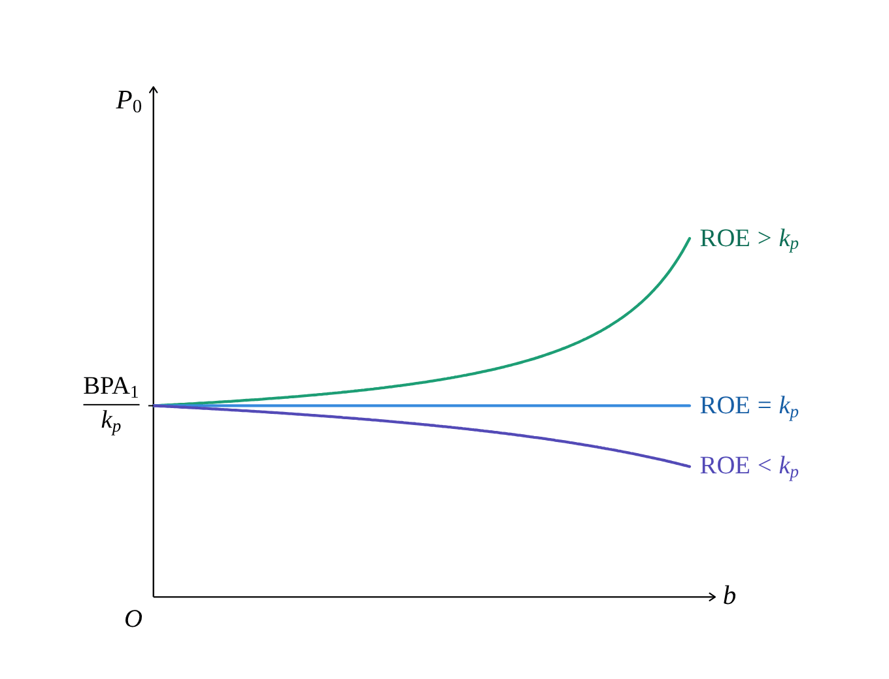
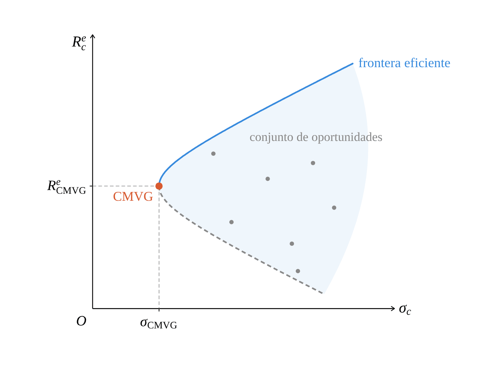
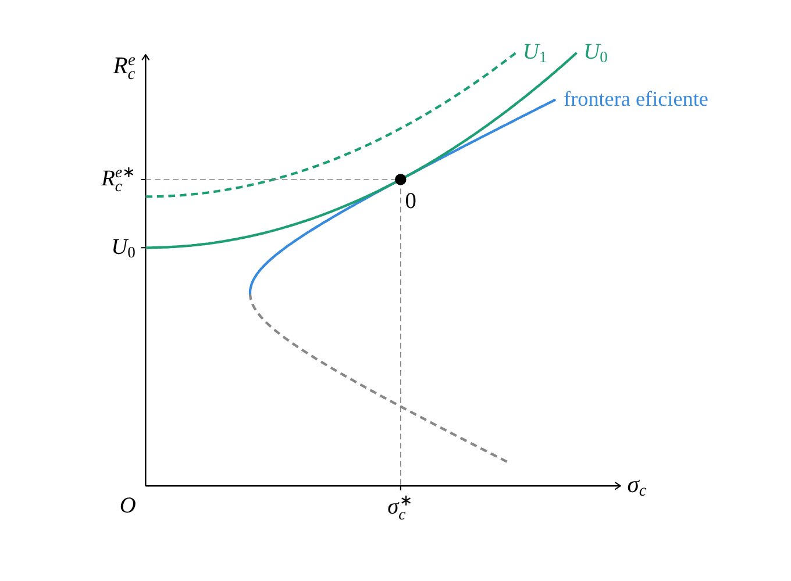
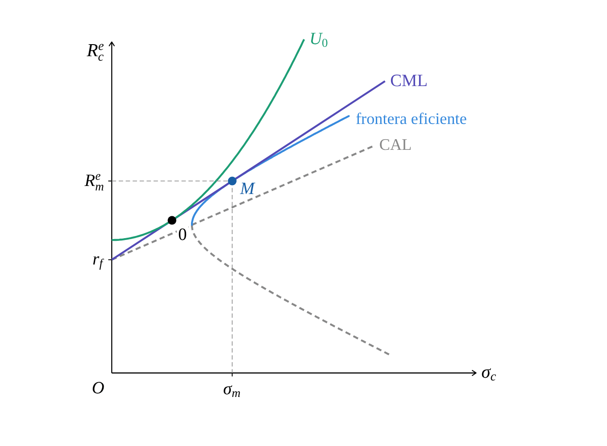
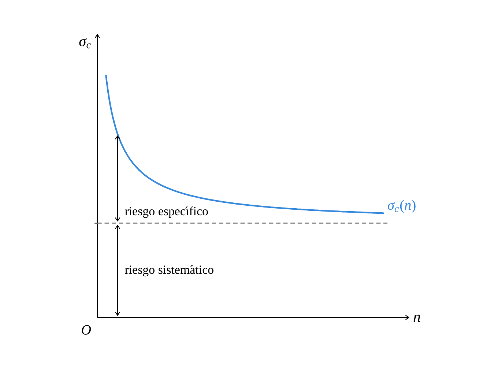
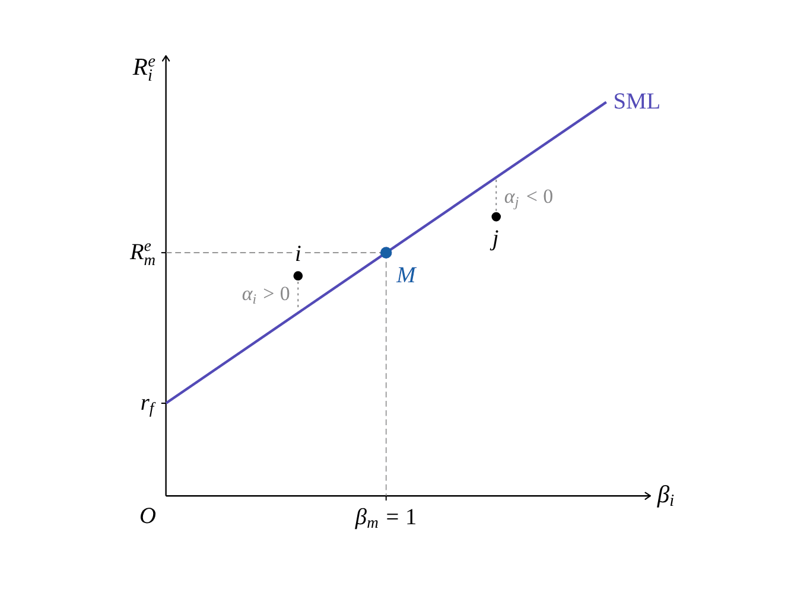

## Introducción



En la **renta variable**, el precio de cada título depende de expectativas sobre unos beneficios futuros inciertos, y la cuestión central es si ese precio refleja bien el valor de la empresa. La **hipótesis de los mercados eficientes** sostiene que los precios incorporan con rapidez toda la información disponible, de modo que nadie puede batir al mercado de forma sistemática. Shiller (1981) mostró, en cambio, que los precios oscilan mucho más que los dividendos que deberían justificarlos, y abrió paso a las explicaciones conductuales. El Premio Nobel de 2013, compartido por Fama, Hansen y Shiller “por su análisis empírico de los precios de los activos”, reconoció ambas líneas de trabajo.

El tema analiza los instrumentos de renta variable en tres bloques:

- *Fundamentos*: los conceptos básicos, la hipótesis de los mercados eficientes y el análisis fundamental y técnico.

- *Selección de carteras*: la teoría de Markowitz, Tobin y Sharpe.

- *Valoración de activos*: los modelos CAPM y APT y las medidas de rendimiento ajustado al riesgo.

## 1. Fundamentos del análisis de renta variable

El análisis de renta variable empieza por el título considerado individualmente. Primero se presentan los conceptos básicos del mercado de renta variable y la hipótesis de eficiencia que condiciona toda la disciplina. Después se exponen los dos métodos de análisis que la práctica emplea para decidir qué comprar y cuándo hacerlo.

### 1.1. Conceptos básicos

Los conceptos básicos van del instrumento, la acción, al mercado en que se negocia, la bolsa de valores, y de ahí a la hipótesis de los mercados eficientes y a la elección entre gestión activa y pasiva.

#### 1.1.1. Instrumentos de renta variable: las acciones

**Definición**: una *acción* es una parte alícuota del capital social de una empresa, que confiere a su titular la condición de socio. De ella se derivan derechos de dos órdenes:

- *Derechos económicos*: la participación en los beneficios mediante el dividendo, el derecho de suscripción preferente en las ampliaciones de capital y la cuota de liquidación.

- *Derechos políticos*: la asistencia y el voto en la junta general y el derecho de información.

El rasgo definitorio de la acción frente a la renta fija es que la retribución no está pactada de antemano. El accionista es *acreedor residual*, pues cobra únicamente después de que la empresa haya atendido a sus proveedores, trabajadores, acreedores financieros y a la Hacienda pública. De ahí se siguen su mayor riesgo y su mayor rendimiento esperado. La acción carece, además, de vencimiento.

**Tipos**: las acciones se clasifican según los derechos que confieren:

- *Ordinarias*: confieren los derechos descritos en su integridad y constituyen la modalidad general.

- *Preferentes o privilegiadas*: otorgan alguna ventaja económica, habitualmente un dividendo preferente o prioridad en la cuota de liquidación, con frecuencia a cambio de la limitación o supresión del derecho de voto.

- *Sin voto*: privan del derecho de voto a cambio de un dividendo mínimo anual, que la sociedad debe repartir si existen beneficios distribuibles, fórmula que permite captar recursos propios sin diluir el control.

- *Rescatables*: emitidas con la posibilidad de amortización a instancia de la sociedad, del titular o de ambos.

**Funcionamiento**: la acción se emite al constituirse la sociedad o en una ampliación de capital y se negocia después en el mercado secundario. Tres operaciones societarias sobre el capital afectan directamente a su valoración:

- *Ampliación de capital*: emisión de nuevas acciones, que puede realizarse a la par, con prima de emisión o con cargo a reservas. Su efecto sobre el accionista existente es la *dilución*, que el derecho de suscripción preferente, o el de asignación gratuita si la ampliación es con cargo a reservas, permite compensar, pues su valor teórico equivale a la pérdida de valor de la acción antigua[^b23-2].

- *Desdoblamiento* (*split*): división del nominal en un número mayor de títulos, sin alterar el capital social ni el valor de la participación. Su finalidad es mejorar la liquidez al reducir el precio unitario, y la operación inversa se denomina *contrasplit*.

- *Recompra de acciones propias* (*buyback*): adquisición por la sociedad de sus propios títulos, habitualmente para amortizarlos. Constituye una alternativa al dividendo como forma de retribución al accionista, con tratamiento fiscal distinto, y eleva el beneficio por acción (BPA), al reducir el denominador, siempre que la rentabilidad por beneficio ($\text{BPA}/P$) supere el coste después de impuestos de los fondos empleados.

**Conclusiones**:

- *Aspectos positivos*: para la empresa, la acción aporta financiación permanente, sin vencimiento ni retribución pactada, que absorbe las pérdidas y respalda el endeudamiento. Para el inversor, da acceso al beneficio residual, con un rendimiento esperado superior al de la renta fija, y a los derechos políticos de socio.

- *Limitaciones*: el accionista soporta el mayor riesgo, porque cobra después de todos los acreedores y su retribución depende de los resultados. Para la empresa, los fondos propios son la fuente de financiación más cara, porque el accionista exige una prima por ese riesgo, y las ampliaciones de capital diluyen la participación de los socios que no acuden a ellas.

#### 1.1.2. La bolsa de valores

**Definición**: la *bolsa* es un mercado organizado que centraliza las ofertas y demandas de valores mobiliarios admitidos a cotización, bajo normas de acceso, contratación y supervisión predeterminadas. Cumple cuatro funciones económicas:

1. *Liquidez*: permite convertir los valores en efectivo con rapidez y a un precio conocido, lo que reduce la rentabilidad que el inversor exige para financiar a la empresa a largo plazo. Esta función concilia el horizonte largo del proyecto empresarial con el horizonte corto del ahorrador.

2. *Financiación*: canaliza el ahorro hacia la inversión productiva mediante la emisión de capital, ya sea en la salida a bolsa, mediante una *oferta pública de suscripción* (en una *oferta pública de venta*, los fondos van a los accionistas vendedores), o en ampliaciones posteriores.

3. *Formación de precios*: la confrontación continua de órdenes genera un precio que sintetiza las expectativas del conjunto de los agentes, y que sirve de referencia para operaciones societarias, garantías y evaluación de la gestión.

4. *Información y disciplina*: la obligación de transparencia que pesa sobre las emisoras reduce la asimetría informativa, y la propia cotización opera como mecanismo de control externo de los administradores, pues una gestión deficiente se traduce en caída del precio y en riesgo de adquisición hostil.

**Tipos**: se distingue el *mercado primario* o de emisión, donde la empresa capta recursos nuevos, del *mercado secundario* o de negociación, donde los títulos ya emitidos cambian de manos sin que la sociedad reciba fondos. Este segundo no aporta financiación directa, pero es condición del desarrollo del primero, pues pocos inversores suscribirían una emisión sin la posibilidad de deshacer la posición.

**Funcionamiento**: la negociación puede organizarse de dos formas:

- *Mercado dirigido por órdenes*: las órdenes se casan automáticamente conforme a prioridad de precio y tiempo, modalidad que predomina en los mercados europeos.

- *Mercado dirigido por precios*: uno o varios creadores de mercado (*market makers*) cotizan permanentemente precios de compra y venta y asumen la contrapartida.

La diferencia entre los precios de compra y venta, u *horquilla* (*bid-ask spread*), constituye una medida habitual de la liquidez del valor. La evolución conjunta de un mercado o segmento se sigue mediante *índices bursátiles*, medias ponderadas de las cotizaciones de una muestra de valores. La ponderación más extendida es por *capitalización ajustada al capital flotante*[^b23-4], es decir, a la fracción efectivamente negociable, si bien existen índices ponderados por precio y equiponderados. Se distinguen, además, los índices de precios, que recogen solo la variación de las cotizaciones, de los de rendimiento total, que incorporan la reinversión de los dividendos y son los relevantes para medir la rentabilidad efectiva del inversor.

**Conclusiones**:

- *Aspectos positivos*: al dar liquidez a los títulos, abarata la financiación de las empresas a largo plazo, y el precio que forma sirve de referencia pública para valorar la empresa y disciplinar a sus administradores.

- *Limitaciones*: la admisión a cotización impone costes y obligaciones de información que pesan más en las empresas pequeñas, y la liquidez es desigual, pues los valores poco negociados tienen horquillas amplias. Además, el precio puede alejarse durante periodos prolongados del valor fundamental, como muestran los episodios de burbuja.

#### 1.1.3. Hipótesis de los mercados eficientes (Fama, 1970)

**Origen**: en su primera formulación (Fama, 1965), un mercado es *eficiente* cuando la cotización de cada activo es en todo momento una estimación fiable de su valor intrínseco y nadie consigue de forma sistemática ganancias extraordinarias ajustadas al riesgo.

**Idea**: en la definición canónica de Fama (1970), el precio incorpora al instante toda la información disponible, así que las variaciones futuras solo pueden responder a información nueva, que por definición es imprevisible.

**Razonamiento**: como el precio incorpora ya toda la información, sigue en primera aproximación un *paseo aleatorio* (*random walk*), en el que la mejor predicción del precio de mañana es el precio de hoy. En rigor, la eficiencia solo exige que los rendimientos anormales (en exceso del de equilibrio) sean impredecibles (juego equitativo o propiedad de martingala), condición más débil que el paseo aleatorio, que exige además incrementos independientes e idénticamente distribuidos.

Fama distingue tres *formas de eficiencia* según el conjunto de información que el precio incorpora, ordenadas de menor a mayor exigencia, y cada una comprende a la anterior:

- *Eficiencia débil*: el precio recoge toda la información contenida en la serie histórica de precios y volúmenes. Su implicación directa es que el análisis técnico carece de valor. Los contrastes habituales son los de autocorrelación de rendimientos, los de rachas y los de reglas de filtro.

- *Eficiencia semifuerte*: el precio incorpora además toda la información pública disponible (estados financieros, anuncios de resultados, operaciones societarias y datos macroeconómicos). Esta forma implica que el análisis fundamental basado en información publicada tampoco permite batir al mercado de forma sistemática. Se contrasta mediante *estudios de acontecimientos* (*event studies*), que examinan la velocidad con que el precio se ajusta a una noticia. Si el mercado es eficiente, el ajuste es inmediato y no se observan rendimientos anormales después del anuncio (los previos pueden reflejar filtraciones o anticipación).

- *Eficiencia fuerte*: el precio recoge asimismo la información privada o privilegiada, de modo que ni siquiera los iniciados podrían obtener rendimientos extraordinarios. Esta forma es la menos respaldada empíricamente, y su incumplimiento sistemático justifica la normativa sobre abuso de mercado y uso de información privilegiada.

**Extensiones**: la evidencia acumulada ha documentado *anomalías*, regularidades difícilmente compatibles con la hipótesis, entre las que destacan:

- *Efecto tamaño* (Banz, 1981): mayor rendimiento ajustado al riesgo de las empresas de menor capitalización.

- *Efecto valor*: superior rendimiento de los títulos con elevada ratio valor contable sobre valor de mercado.

- *Momento* (Jegadeesh y Titman, 1993): persistencia de los rendimientos a horizontes de tres a doce meses, incompatible con la eficiencia débil.

- *Efectos de calendario*: el de enero o el de fin de semana, entre otros.

- *Reacción tardía a los anuncios de resultados* (*post-earnings announcement drift*): contradice la forma semifuerte.

La interpretación de estas anomalías es objeto de controversia:

- *Escuela eficiente*: son compensación por factores de riesgo omitidos en el modelo de valoración empleado, lectura que impulsó los modelos multifactoriales empíricos, como los de Fama y French, que se examinan en el apartado 3.2.

- *Finanzas conductuales* (Kahneman y Tversky; Shiller, Nobel 2013): reflejan sesgos sistemáticos de los inversores, como el exceso de confianza, el anclaje o la aversión a las pérdidas. A ello se suma la existencia de *límites al arbitraje*, que impiden a los inversores racionales corregir las desviaciones de precio, señaladamente por el riesgo de que estas se amplíen antes de revertir.

**Conclusiones**:

- *Aspectos positivos*: la hipótesis proporciona el marco de referencia de toda la disciplina, pues cualquier estrategia de inversión ha de justificarse frente a ella, y su contrastación ha generado la literatura empírica más extensa de las finanzas modernas.

- *Limitaciones*: la hipótesis no es contrastable empíricamente sin un modelo de equilibrio que especifique el rendimiento esperado “normal” de cada activo, dificultad conocida como *problema de la hipótesis conjunta* (*joint hypothesis problem*). Por ello, un rendimiento anormal puede indicar ineficiencia del mercado o error de especificación del modelo, sin que quepa distinguir ambas causas. Además, los episodios de burbuja y colapso, difícilmente explicables por la llegada de información nueva, constituyen la objeción empírica más visible.

#### 1.1.4. Gestión activa y gestión pasiva de carteras

De la hipótesis anterior se deriva la principal disyuntiva práctica del inversor, la elección entre dos filosofías de gestión opuestas en su premisa sobre la eficiencia del mercado.

**Gestión activa**: parte de que el mercado no es plenamente eficiente y de que existen títulos mal valorados susceptibles de identificarse mediante análisis. El gestor selecciona valores (*stock picking*), ajusta la exposición a los movimientos del mercado (*market timing*) o rota entre sectores, con el objetivo de superar al índice de referencia.

**Gestión pasiva o indexada**: parte de que el mercado incorpora ya la información disponible, de modo que el esfuerzo analítico no compensa su coste. El gestor se limita a replicar la composición de un índice, ya sea mediante réplica física, adquiriendo los valores que lo integran, o sintética, mediante derivados. La expansión de la gestión pasiva se ha canalizado a través de los fondos indexados y de los fondos cotizados (ETF).

**Coste**: es el argumento decisivo a favor de la gestión pasiva, pues la gestión activa soporta comisiones y costes de rotación sustancialmente superiores. Por construcción, el conjunto de los inversores obtiene el rendimiento del mercado antes de costes, y la gestión pasiva también lo obtiene al replicarlo. En consecuencia, la gestión activa, considerada globalmente, ha de rendir por debajo del índice una vez descontados los costes, resultado que Sharpe (1991) denominó *aritmética de la gestión activa*. La cuestión no es, por tanto, si algunos gestores baten al mercado, sino si lo hacen de forma persistente y en medida suficiente para compensar su coste.

**Paradoja de la eficiencia** (Grossman y Stiglitz, 1980): si toda la gestión fuese pasiva, nadie analizaría la información y el precio dejaría de incorporarla, con lo que el mercado perdería su eficiencia y la gestión activa volvería a resultar rentable. Ambas modalidades son, por tanto, complementarias, ya que la gestión activa produce la eficiencia de la que se aprovecha la pasiva.

### 1.2. Métodos de análisis fundamental

::: {.callout-note appearance="simple" icon=false}
Los métodos de valoración de empresas tienen su tema fuente en [B04](b04-crecimiento-ma.qmd), apartado 3.3, que los desarrolla para las fusiones y adquisiciones. El coste medio ponderado del capital se estima en el tema [B03](b03-financiacion.qmd), apartado 2.1.3. Aquí se recapitulan los métodos desde la óptica del análisis bursátil y se desarrollan el modelo general de descuento de dividendos y el efecto de la retención de beneficios sobre el precio de la acción.
:::

El **análisis fundamental** parte de que el mercado presenta, a lo sumo, eficiencia débil, de modo que el precio no coincide necesariamente con el **valor intrínseco**, que es el que resulta de los fundamentos económicos de la empresa. Su objeto es estimar ese valor y compararlo con la cotización. Si el valor estimado excede al precio, el título está infravalorado y procede comprarlo, y en caso contrario, venderlo.

El desarrollo del análisis fundamental puede seguir dos secuencias. El **enfoque descendente** (*top-down*) parte del análisis macroeconómico, desciende al sectorial y termina en la empresa, mientras que el **enfoque ascendente** (*bottom-up*) arranca del análisis de la compañía. Los métodos de valoración se agrupan en tres familias.

#### 1.2.1. Métodos estáticos o patrimoniales

Los métodos estáticos valoran la empresa a partir de su balance, sin considerar su capacidad futura de generar renta. De los tres habituales, el primero toma el patrimonio neto contable, el segundo lo corrige a valores de mercado y el tercero lo calcula en la hipótesis de cese de la actividad. Los métodos basados en el fondo de comercio, que añaden al activo neto un múltiplo del beneficio, se exponen en el tema [B04](b04-crecimiento-ma.qmd), apartado 3.3.1.

**Valor contable**: el precio teórico es el patrimonio neto por acción, $P_0 = \text{PN}/n_a$, siendo $n_a$ el número de acciones.

- *Conclusiones*:

    - *Aspectos positivos*: sencillez y objetividad, al apoyarse en un dato contable verificable.

    - *Limitaciones*: queda limitado por los criterios contables, señaladamente el coste histórico, y no recoge las expectativas de generación de valor ni los activos intangibles no registrados, que en las empresas tecnológicas o de servicios constituyen la mayor parte de su valor.

**Valor contable ajustado**: corrige el patrimonio neto con las plusvalías y minusvalías latentes de los activos y pasivos, valorados a precios de mercado, y divide el resultado entre el número de acciones.

- *Conclusiones*:

    - *Aspectos positivos*: corrige el principal defecto del valor contable, el coste histórico, porque refleja el valor actual de los activos y pasivos registrados.

    - *Limitaciones*: sigue sin recoger los intangibles no registrados ni la capacidad futura de generar renta, y el valor de mercado de muchos activos, como la maquinaria específica, no es observable, de modo que su estimación es subjetiva.

**Valor de liquidación**: valora la acción por lo que obtendrían los accionistas si la empresa cesara en su actividad, vendiera sus activos por separado y atendiera sus deudas y los costes de la liquidación (tema [B04](b04-crecimiento-ma.qmd), apartado 3.3.5).

- *Conclusiones*:

    - *Aspectos positivos*: fija un suelo a la valoración, porque si el valor de la empresa en funcionamiento fuera inferior, a los accionistas les convendría liquidarla. El valor de liquidación constituye, además, el método de referencia en las empresas en crisis.

    - *Limitaciones*: ignora el valor de la empresa como negocio en marcha, superior en una empresa viable, y el valor de realización de los activos es incierto, pues depende de la rapidez con que deban venderse y del estado del mercado.

#### 1.2.2. Métodos dinámicos o de descuento

Los métodos dinámicos valoran la empresa por el valor actual de las rentas que se espera que genere, y constituyen el fundamento teóricamente correcto de la valoración.

**Modelo general de descuento de dividendos**: el valor de la acción es el valor actual de la corriente esperada de dividendos,

$$P_0 = \sum_{t=1}^{\infty} \frac{\text{DIV}_t}{(1+k_p)^t}$$

donde $k_p$ es la rentabilidad exigida por el accionista (coste de los fondos propios), habitualmente estimada mediante el modelo de valoración de activos de capital (CAPM, apartado 3.1).

- *Conclusiones*:

    - *Aspectos positivos*: valora la acción por los flujos que efectivamente percibe el accionista y es el marco general del que los demás modelos de descuento de dividendos son casos particulares.

    - *Limitaciones*: exige prever una corriente infinita de dividendos, por lo que en la práctica requiere supuestos sobre su evolución, y no es aplicable directamente a empresas que no reparten dividendos.

**Gordon y Shapiro** (1956): si se supone que los dividendos crecen a una tasa constante $g_D < k_p$, la serie converge y la expresión se reduce a

$$P_0 = \frac{\text{DIV}_1}{k_p - g_D}$$

donde $\text{DIV}_1$ es el dividendo esperado del próximo periodo. La tasa de crecimiento puede estimarse endógenamente como la tasa de crecimiento sostenible (tema [B04](b04-crecimiento-ma.qmd), apartado 2.3), $g_D = g^* = b \cdot \text{ROE}$, siendo $b$ la tasa de retención de beneficios, lo que vincula el crecimiento a la política de dividendos y a la rentabilidad de los fondos propios.

Gráficamente, en el plano tasa de retención-precio de la acción (figura -@fig-b231-gordon-dividendos), cada curva representa el precio teórico, $P_0 = (1-b)\,\text{BPA}_1/(k_p - b \cdot \text{ROE})$, para un valor de la ROE. Todas parten de $\text{BPA}_1/k_p$ cuando no se retienen beneficios ($b = 0$), y su pendiente depende del rendimiento de los beneficios retenidos. El precio crece con la tasa de retención si $\text{ROE} > k_p$, porque la empresa reinvierte a una rentabilidad superior a la que exige el accionista, no varía si $\text{ROE} = k_p$ y decrece si $\text{ROE} < k_p$, porque la reinversión destruye valor.

::: {#fig-b231-gordon-dividendos}

::: {.content-visible when-format="html"}
```{=html}
<div class="graph-frame">
<iframe src="../graphs/b231_Gordon_dividendos.html" style="height:560px" loading="lazy" title="fig-b231-gordon-dividendos"></iframe>
</div>
```
:::

::: {.content-visible unless-format="html"}

:::

Modelo de Gordon y Shapiro (1956). Con $g_D = b \cdot \text{ROE}$, el valor de la acción crece con la tasa de retención $b$ si $\text{ROE} > k_p$, no depende de ella si $\text{ROE} = k_p$ y decrece si $\text{ROE} < k_p$.
:::

- *Conclusiones*:

    - *Aspectos positivos*: vincula de forma transparente el precio con los fundamentos (dividendo, crecimiento y rentabilidad exigida) y resulta especialmente útil para empresas maduras con política de dividendos estable.

    - *Limitaciones*: no es aplicable si $g_D \geq k_p$ y es extremadamente sensible al valor de $g_D$, pues pequeñas variaciones en el denominador alteran el resultado de forma desproporcionada.

**Flujos de caja libres (DCF)**: el método dinámico de referencia proyecta los flujos de caja libres en un horizonte explícito, por lo general de cinco a diez años, y les añade un valor residual, calculado habitualmente con una perpetuidad de tipo Gordon. Los flujos y el valor residual se descuentan al coste medio ponderado del capital (WACC), que pondera por sus pesos a valores de mercado el coste de los fondos propios, estimado por el CAPM, y el de la deuda después de impuestos. El resultado es el valor de la empresa, del que se resta la deuda financiera neta para obtener el de los fondos propios.

- *Conclusiones*:

    - *Aspectos positivos*: es el método más robusto y completo, pues valora directamente la capacidad de generar caja, magnitud menos manipulable que el beneficio contable, y permite incorporar explícitamente la estrategia y la estructura del capital.

    - *Limitaciones*: las proyecciones son subjetivas y el valor residual suele concentrar más de la mitad del valor total, de modo que conviene acompañar la valoración de un análisis de sensibilidad.

#### 1.2.3. Métodos comparativos o por múltiplos

Los métodos comparativos valoran la empresa por referencia al precio que el mercado asigna a compañías semejantes, bajo el supuesto de que activos comparables deben tener precios comparables.

**PER** (*price-to-earnings ratio*): relaciona el precio con el beneficio por acción, $\text{PER} = P/\text{BPA}$. A partir de Gordon, y con el BPA esperado del próximo periodo, puede expresarse como $\text{PER} = P_0/\text{BPA}_1 = (1-b)/(k_p-g_D)$, lo que revela que un PER elevado puede obedecer tanto a expectativas de crecimiento como a una menor rentabilidad exigida, y no necesariamente a sobrevaloración[^b23-7]. Su inversa, $\text{BPA}/P$, es la rentabilidad por beneficio (*earnings yield*).

- *Conclusiones*:

    - *Aspectos positivos*: sencillo, muy difundido y de cálculo inmediato, permite comparar empresas y sectores sin necesidad de proyectar flujos.

    - *Limitaciones*: carece de sentido cuando la empresa tiene pérdidas, y su denominador, el BPA, varía con el endeudamiento de la empresa y con las normas contables que aplique. En la versión más usada, que toma el beneficio del último ejercicio, combina además un dato retrospectivo con el precio, que recoge expectativas.

**Otros múltiplos**: el precio sobre valor contable (P/VC), el cociente entre el valor de la empresa y el resultado bruto de explotación (EV/EBITDA)[^b23-8] y el EV sobre ventas se desarrollan en el tema [B04](b04-crecimiento-ma.qmd), apartado 3.3.4. Allí se trata también la construcción de la muestra de comparables. La rentabilidad por dividendo (*dividend yield*) relaciona el dividendo con el precio.

- *Conclusiones*:

    - *Aspectos positivos*: rapidez, anclaje en precios de mercado observados y facilidad de comunicación.

    - *Limitaciones*: la valoración es relativa y discrecional, pues depende de la muestra elegida y traslada a la empresa cualquier error de valoración del sector, y no explica el valor, sino que lo presupone.

#### 1.2.4. Conclusiones

En la práctica profesional, los tres enfoques se emplean de forma complementaria y no alternativa. Así, el descuento de flujos proporciona la valoración de referencia, los múltiplos actúan como contraste de verosimilitud del resultado obtenido y el valor de liquidación fija un suelo. La discrepancia significativa entre ellos es, en sí misma, información relevante sobre la naturaleza del negocio o sobre la fiabilidad de las hipótesis empleadas.

**Aspectos positivos**: el análisis fundamental proporciona una estimación del valor absoluto de la empresa, anclada en su capacidad de generar renta. Obliga también a explicitar las hipótesis sobre crecimiento, rentabilidad y riesgo, lo que lo convierte en un ejercicio de disciplina analítica con independencia de la cifra que arroje. Constituye, además, el instrumental de referencia en las operaciones societarias, en la salida a bolsa y en la fijación del precio en las fusiones y adquisiciones.

**Limitaciones**: su resultado es extremadamente sensible a las hipótesis, hasta el punto de que la elección de la tasa de descuento y de la tasa de crecimiento a perpetuidad determina buena parte del valor obtenido. Por ello, el método se presta a justificar cualquier cifra previamente decidida. Su horizonte es, además, de medio y largo plazo, por lo que no indica cuándo convergerá el precio hacia el valor estimado.

### 1.3. Análisis técnico

El **análisis técnico** se remonta a las ideas de Charles Dow sobre el comportamiento de los índices bursátiles, en torno a 1900, y se contrapone al análisis fundamental, del que se distancia en su premisa de partida. Mientras el análisis fundamental busca el valor intrínseco confiando en que el precio se desvía de él, el análisis técnico sostiene que el precio ya es un buen indicador del valor y que el estudio de su comportamiento pasado permite anticipar su evolución futura.

#### 1.3.1. Principios del análisis técnico (Dow, 1900-1902)

**Origen**: Charles Dow, cofundador de Dow Jones & Company y del *Wall Street Journal*, elaboró los primeros índices de Dow Jones, uno industrial y otro ferroviario. Expuso sus ideas sobre ellos en los editoriales que escribió para el diario hasta su muerte, en 1902, sin presentarlas nunca como un sistema. William P. Hamilton, que había trabajado a sus órdenes como periodista y dirigió el diario desde 1908, las aplicó a la previsión del mercado en sus propios editoriales y las recogió en su libro de 1922. Robert Rhea las ordenó después en *The Dow Theory* (1932), de donde procede la formulación habitual de sus principios.

**Idea**: los índices, que resumen la información de todos los que operan, se mueven por tendencias reconocibles en su propia evolución, y quien identifica la tendencia primaria anticipa la dirección del mercado, que Hamilton veía como barómetro de la economía.

**Razonamiento**: el análisis técnico moderno parte de tres premisas:

- *Descuento*: el mercado lo descuenta todo, de modo que el precio incorpora toda la información relevante.

- *Tendencias*: los precios se mueven por tendencias (primaria, secundaria y terciaria) que tienden a persistir hasta dar señales de agotamiento. Una tendencia solo se confirma si la siguen los dos índices, el industrial y el ferroviario (hoy, el de transportes), y si el volumen de contratación aumenta en su dirección.

- *Historia*: la historia se repite, porque la psicología del inversor genera pautas recurrentes. Esta premisa, ausente en Dow, procede de la sistematización moderna del análisis técnico (Murphy, 1999).

**Conclusiones**:

- *Aspectos positivos*: sus principios y sus índices son el punto de partida del análisis técnico. Brown, Goetzmann y Kumar (1998) hallan además en las señales de Hamilton de 1902 a 1929 ratios de Sharpe elevadas y alfas positivas.

- *Limitaciones*: las reglas no precisan cuándo empieza o acaba una tendencia, y la doble confirmación retrasa las señales. Cowles (1933), primer contraste de la teoría, concluyó que seguir a Hamilton rendía menos que mantener el índice.

#### 1.3.2. Herramientas del análisis técnico

El instrumental técnico, que trabaja con la serie de precios y el volumen de contratación, se agrupa en tres familias.

1. *Patrones gráficos* (chartismo): figuras que tienden a repetirse, unas de cambio de tendencia (el hombro-cabeza-hombro, los dobles techos y suelos) y otras de continuación (triángulos, banderas, canales), junto con los soportes y las resistencias, cuya rotura anticipa el movimiento.

2. *Indicadores seguidores de tendencia*: confirman la dirección del mercado. Destacan las medias móviles y el MACD (*Moving Average Convergence Divergence*), cuyas señales no se modifican *a posteriori*. Estos indicadores son fiables, pero lentos para detectar los giros.

3. *Osciladores*: anticipan los cambios. Los principales son el RSI (*Relative Strength Index*, Wilder, 1978), el *Force Index* (Elder, que combina precio y volumen) y el estocástico (Lane, que mide la velocidad del precio). Todos ellos se adelantan a los giros y resultan útiles en mercados laterales, aunque generan numerosas señales falsas que exigen confirmación.

A estas familias se añaden enfoques más elaborados, como las ondas de Elliott (que describen el mercado como una sucesión de impulsos y correcciones) o los retrocesos de Fibonacci (que fijan niveles probables de soporte y resistencia).

Gráficamente, en el plano tiempo-precio (figura -@fig-b238-analisis-tecnico), con dos paneles inferiores de volumen y de RSI que comparten el eje temporal, una cotización inventada pasa de una tendencia bajista a un tramo lateral y sale de él al alza:

1. *Velas japonesas*: cada vela es una sesión. El cuerpo va de la apertura al cierre, hueco si la sesión cierra al alza y relleno si cierra a la baja, y las mechas llegan al máximo y al mínimo.

2. *Medias móviles* ($\text{MM}_{10}$ y $\text{MM}_{30}$): medias de los cierres de las diez y las treinta últimas sesiones. La corta sigue antes al precio, y su cruce al alza sobre la larga se lee como señal de tendencia alcista.

3. *Soporte* ($S$) y *resistencia* ($R$): niveles en los que el precio se ha detenido varias veces al caer y al subir, y que delimitan el tramo lateral.

4. *Volumen* ($\text{Vol}$): número de títulos negociados en cada sesión, que aumenta en los toques del soporte y, sobre todo, en la ruptura.

5. *RSI*: oscilador acotado entre 0 y 100, $\text{RSI} = 100 - 100/(1 + \text{RS})$, donde $\text{RS}$ es el cociente entre la subida media y la bajada media de los cierres de las catorce últimas sesiones. Por encima de 70 señala sobrecompra y por debajo de 30, sobreventa, como en la caída hasta el primer toque del soporte.

6. *Señal de compra*: en el punto $A$, el cierre supera la resistencia con un volumen muy superior al habitual, lo que confirma la ruptura, cuando la media corta ya está por encima de la larga y el RSI aún no ha entrado en sobrecompra. La subida posterior lleva el RSI por encima de 70, y en la corrección siguiente la antigua resistencia actúa como soporte.

::: {#fig-b238-analisis-tecnico}

::: {.content-visible when-format="html"}
```{=html}
<div class="graph-frame">
<iframe src="../graphs/b238_Analisis_tecnico.html" style="height:690px" loading="lazy" title="fig-b238-analisis-tecnico"></iframe>
</div>
```
:::

::: {.content-visible unless-format="html"}

:::

Análisis técnico estilizado, con datos inventados. La figura combina velas japonesas, medias móviles de diez y treinta sesiones ($\text{MM}_{10}$ y $\text{MM}_{30}$), soporte ($S$) y resistencia ($R$), con paneles de volumen y de RSI. En el punto $A$, el precio rompe la resistencia con un volumen elevado, cuando la media corta ya está por encima de la larga y el RSI sigue por debajo de 70.
:::

#### 1.3.3. Conclusiones

**Aspectos positivos**: como herramienta para elegir el momento de operar (*timing*) a corto plazo, ofrece señales operativas de entrada y salida, impone disciplina en la gestión y no exige estimar el valor intrínseco. Además, algunos patrones muestran cierto poder predictivo en determinados mercados.

**Limitaciones**: su interpretación es subjetiva y carece de fundamento teórico, y su eficacia puede deberse a la autorrealización de las expectativas. Asimismo, la mayoría de las señales no sobreviven a los costes de transacción, y el método es incompatible con la hipótesis de eficiencia, incluso en su forma débil.

### 1.4. Conclusiones

El análisis del título aislado toma como referencia la hipótesis de los mercados eficientes, de la que depende la elección entre la gestión pasiva y la activa. En la gestión activa, el análisis fundamental decide qué comprar, porque estima el valor intrínseco y lo compara con el precio, mientras que el técnico decide cuándo hacerlo, a partir de las señales que ofrecen los precios y los volúmenes pasados. Por ello la práctica profesional suele combinarlos, con el análisis fundamental para seleccionar los valores y el técnico para ejecutar la operación.

Ambos métodos chocan, sin embargo, con la eficiencia en su forma correspondiente, ya que el análisis técnico exige que ni siquiera se cumpla la eficiencia débil, y el fundamental, que no se cumpla la semifuerte. La evidencia empírica es, en conjunto, más favorable a la eficiencia que a la capacidad de ambos para obtener rendimientos anormales sostenidos una vez descontados los costes.

## 2. Teoría de la selección de carteras

La **teoría de carteras** desplaza el foco desde la valoración de un título aislado hacia la combinación óptima de varios. Hasta mediados del s. XX, la selección de inversiones se apoyaba en modelos de valoración centrados exclusivamente en el rendimiento esperado. Así, el análisis fundamental de Graham y Dodd (1934) y, sobre todo, el modelo de descuento de dividendos de Williams (1938) identificaban los títulos “mejores” por su valor intrínseco, y la cartera se limitaba a acumularlos.

Markowitz (1952) advirtió la incoherencia lógica de las aportaciones teóricas de la época. Si solo importara el rendimiento esperado, el inversor debería concentrar toda su riqueza en el único título más prometedor, conducta que contradice la diversificación observada en la práctica. La aportación de Markowitz consistió en incorporar el riesgo como segunda dimensión del problema, convirtiendo la selección de carteras en un problema de optimización media-varianza. Tobin (1958) lo amplió después con un activo sin riesgo, y Sharpe (1963) lo hizo operativo con un modelo estadístico auxiliar.

### 2.1. Markowitz (1952): modelo media-varianza

**Origen**: Harry Markowitz inaugura la teoría moderna de carteras con *Portfolio Selection* (1952) y su obra posterior (1959), que le valdría el Premio Nobel en 1990.

**Idea**: el riesgo relevante de un activo no es su variabilidad aislada, sino su contribución al riesgo del conjunto de la cartera, a través de las covarianzas. Combinando activos que no evolucionan al unísono, el riesgo total resulta inferior a la media ponderada de los riesgos individuales, de donde se sigue el fundamento analítico de la diversificación.

#### 2.1.1. Supuestos

**Entorno**: los mercados no presentan fricciones relevantes para la decisión (no hay costes de transacción ni impuestos), y los activos son perfectamente divisibles. El horizonte es común y de un único periodo. Solo se consideran activos con riesgo. El rendimiento de cada activo $i$ es una variable aleatoria, $R_i$, que se describe por su rendimiento esperado, $R^e_i = \mathbb{E}[R_i]$, y por su varianza, $\sigma_i^2$, medida del riesgo. La relación entre dos activos se mide por la covarianza de sus rendimientos, $\sigma_{ij} = \rho_{ij} \, \sigma_i \sigma_j$, donde $\rho_{ij} \in [-1, 1]$ es su coeficiente de correlación. El inversor conoce los rendimientos esperados, las varianzas y las covarianzas de todos los activos.

**Agentes**: el inversor es racional y averso al riesgo, y maximiza la utilidad esperada de su riqueza final. Evalúa las carteras exclusivamente por dos momentos de la distribución de rendimientos, la media y la varianza, lo que queda justificado si los rendimientos siguen una distribución normal o si la función de utilidad es cuadrática (condiciones suficientes, no necesarias).

**Restricciones**: una cartera reparte la riqueza entre los activos en proporciones $w_i$, con $\sum_i w_i = 1$. Un $w_i < 0$ indica una venta en descubierto y, si esta no se admite, $w_i \in [0, 1]$. El rendimiento esperado de la cartera es la media ponderada de los rendimientos esperados de los títulos que la componen,

$$R^e_c = \sum_{i=1}^{n} w_i \, R^e_i$$

pero su riesgo no es la media ponderada de los riesgos individuales, sino que incorpora las covarianzas entre pares de títulos:

$$\sigma_c^2 = \sum_{i=1}^{n} \sum_{j=1}^{n} w_i w_j \, \sigma_{ij} = \sum_{i=1}^{n} w_i^2 \sigma_i^2 + \sum_{i=1}^{n} \sum_{j \neq i} w_i w_j \, \sigma_{ij}$$

La intuición se aprecia con nitidez en la formulación más simple, una cartera de dos activos con una proporción $w$ en el primero,

$$\sigma_c^2 = w^2 \sigma_1^2 + (1-w)^2 \sigma_2^2 + 2w(1-w)\,\rho_{12}\,\sigma_1 \sigma_2$$

de donde se derivan tres casos:

- *Correlación perfecta positiva* ($\rho_{12} = 1$): el riesgo de la cartera es la media ponderada de los riesgos individuales y la diversificación no aporta nada.

- *Correlación imperfecta* ($\rho_{12} < 1$): sin ventas en descubierto ($0 < w < 1$), el riesgo es inferior a esa media ponderada y aparece la ganancia de diversificación, tanto mayor cuanto menor sea la correlación.

- *Correlación perfecta negativa* ($\rho_{12} = -1$): existe una combinación que anula por completo el riesgo de la cartera.

#### 2.1.2. Modelo

**Planteamiento**: el problema de elección combina, como cualquier otro, una restricción, que representa las oportunidades, y una función objetivo, que representa las preferencias, pero se resuelve en dos etapas. La primera, técnica, construye el conjunto de oportunidades del inversor, y en la segunda, subjetiva, el inversor elige sobre él de acuerdo con sus preferencias. La particularidad del modelo de Markowitz es que la restricción resulta, a su vez, de un programa de optimización previo.

La primera etapa construye la *frontera eficiente*. Para cada nivel de rendimiento objetivo $\bar{R}^e_c$, el inversor identifica la cartera de mínima varianza resolviendo el programa técnico:

$$\min_{\mathbf{w}} \; \sigma_c^2 = \sum_i \sum_j w_i w_j \sigma_{ij} \quad \text{s.a.:} \begin{cases} \sum_i w_i R^e_i = \bar{R}^e_c \\ \sum_i w_i = 1 \end{cases}$$

donde $\mathbf{w} = (w_1, \ldots, w_n)$ es el vector de proporciones invertidas en cada activo, $\sigma_{ij}$ la covarianza entre los rendimientos de $i$ y $j$, $R^e_i$ el rendimiento esperado del activo $i$ y $\bar{R}^e_c$ el rendimiento objetivo de la cartera.

Al resolver el programa para todos los valores posibles de $\bar{R}^e_c$ se obtiene la *frontera de mínima varianza*. Su tramo superior reúne las *carteras eficientes*, aquellas frente a las que ninguna otra ofrece más rendimiento con igual riesgo ni menos riesgo con igual rendimiento. Esta etapa es puramente técnica, ya que depende solo de los datos (rendimientos, varianzas y covarianzas) y es, por tanto, idéntica para todos los inversores.

Gráficamente, en el plano desviación típica-rendimiento esperado (figura -@fig-b232-markowitz), la frontera de mínima varianza es una hipérbola si se admiten ventas en descubierto (en el plano varianza-rendimiento sería una parábola):

1. *Conjunto de oportunidades*: recoge las carteras alcanzables con los títulos disponibles, y la frontera de mínima varianza lo delimita por la izquierda.

2. *Frontera eficiente*: representa las carteras que ofrecen el máximo rendimiento esperado para cada nivel de riesgo. Es el tramo superior de la frontera de mínima varianza, pues las carteras del tramo inferior quedan dominadas, y tiene pendiente positiva porque en él solo se obtiene más rendimiento esperado a cambio de más riesgo.

3. *Cartera de mínima varianza global* (CMVG): es el vértice, el punto más a la izquierda de la frontera, con riesgo $\sigma_{\text{CMVG}}$ y rendimiento $R^e_{\text{CMVG}}$.

::: {#fig-b232-markowitz}

::: {.content-visible when-format="html"}
```{=html}
<div class="graph-frame">
<iframe src="../graphs/b232_Markowitz.html" style="height:540px" loading="lazy" title="fig-b232-markowitz"></iframe>
</div>
```
:::

::: {.content-visible unless-format="html"}

:::

Conjunto de oportunidades y frontera eficiente de carteras con activos con riesgo en el modelo de Markowitz (1952).
:::

La curvatura de la frontera depende de las covarianzas. Cuanto menores son las correlaciones entre los títulos, mayor es la ganancia de diversificación y más se abomba la frontera hacia la izquierda (menos riesgo para cada rendimiento). En los casos límite del ejemplo de dos activos, la frontera adopta formas extremas, y las carteras con correlaciones intermedias quedan comprendidas en el triángulo que ambas delimitan:

- *Correlación perfecta positiva* ($\rho_{12}=1$): la “frontera” degenera en el segmento recto que une ambos títulos.

- *Correlación perfecta negativa* ($\rho_{12}=-1$): la frontera se quiebra en dos segmentos que alcanzan el eje vertical (riesgo nulo).

En la segunda etapa entran las preferencias sobre carteras, que se derivan de la utilidad esperada. El inversor posee una función de utilidad (de Bernoulli) definida sobre su riqueza final, $u(W)$, y ordena las carteras según su utilidad esperada, $\mathbb{E}[u(W)]$. Con utilidad cuadrática o rendimientos normales, como supone el modelo, la utilidad esperada solo depende de dos parámetros del rendimiento, su media y su varianza. Por ello puede representarse, de forma exacta con utilidad exponencial y rendimientos normales y aproximada en otro caso, mediante el criterio media-varianza

$$U = R^e_c - \frac{A}{2}\,\sigma_c^2$$

donde $A > 0$ es el coeficiente de aversión al riesgo del inversor. Al estar el criterio definido sobre rendimientos y no sobre riqueza, $A$ corresponde a la aversión relativa al riesgo ($A = a\,W_0$, siendo $a$ la aversión absoluta y $W_0$ la riqueza inicial). El valor de $U$ admite una interpretación económica precisa, el *equivalente cierto*, es decir, el rendimiento seguro que reporta al inversor la misma utilidad que la cartera arriesgada.

Las curvas de indiferencia derivadas del criterio anterior, los pares ($\sigma_c, R^e_c$) que mantienen constante $U$, son parábolas de pendiente $A\sigma_c$ en el plano riesgo-rendimiento, tanto más inclinadas cuanto mayor es la aversión, y su ordenada en el origen ($U_0$, el equivalente cierto) crece hacia el noroeste.

El inversor maximiza, pues, su utilidad esperada tomando como restricción la frontera construida en la primera etapa:

$$\max_{\sigma_c,\, R^e_c} \; U = R^e_c - \frac{A}{2}\,\sigma_c^2 \quad \text{s.a.:} \quad R^e_c = f(\sigma_c)$$

donde $R^e_c = f(\sigma_c)$ es la frontera eficiente, $A$ la aversión al riesgo del inversor y $R^e_c$ y $\sigma_c$ el rendimiento esperado y la desviación típica de la cartera.

**CPO**: en la cartera óptima son tangentes la frontera eficiente y la mayor curva de indiferencia que el inversor puede alcanzar. En ese punto se igualan la compensación por riesgo que el inversor exige (pendiente de la curva de indiferencia, $A\sigma_c$) y la que el conjunto de oportunidades ofrece (pendiente de la frontera, $df/d(\sigma_c)$). En términos económicos, el inversor asume riesgo adicional hasta que la prima que el mercado le ofrece por la última unidad coincide con la que él exige.

**CSO**: el criterio $U$ es estrictamente cóncavo en $\sigma_c$ para $A > 0$ y el tramo eficiente de la frontera es cóncavo en el plano $(\sigma_c, R^e_c)$, de modo que la condición de tangencia caracteriza un máximo.

**Solución**: de lo anterior se desprende que los inversores más aversos (curvas más inclinadas) eligen carteras más próximas a la de mínima varianza global, y los más tolerantes, carteras del tramo alto de la frontera. Por tanto, las preferencias seleccionan tanto la cantidad de riesgo como la propia composición de la cartera arriesgada.

**Desarrollo gráfico**: la elección de la cartera óptima se representa en el plano desviación típica-rendimiento esperado (figura -@fig-b233-markowitz-tangencia):

1. *Frontera eficiente*: es la restricción construida en la primera etapa, creciente y cóncava, que recoge el máximo rendimiento esperado alcanzable para cada nivel de riesgo.

2. *Curvas de indiferencia* ($U_0$, $U_1$): cada una reúne las carteras que dan al inversor la misma utilidad. Son crecientes porque el riesgo es un mal que solo se acepta a cambio de más rendimiento, convexas porque su pendiente, $A\sigma_c$, aumenta con el riesgo, y representan más utilidad cuanto más arriba se sitúan.

3. *Óptimo*: en el punto 0, la frontera eficiente es tangente a la curva de indiferencia $U_0$, con riesgo $\sigma^*_c$ y rendimiento $R^{e*}_c$, mientras que la curva $U_1$, más alta, no es alcanzable.

::: {#fig-b233-markowitz-tangencia}

::: {.content-visible when-format="html"}
```{=html}
<div class="graph-frame">
<iframe src="../graphs/b233_Markowitz_tangencia.html" style="height:540px" loading="lazy" title="fig-b233-markowitz-tangencia"></iframe>
</div>
```
:::

::: {.content-visible unless-format="html"}

:::

Óptimo del inversor en el modelo de Markowitz. En el punto 0, la curva de indiferencia más elevada a su alcance, $U_0$, es tangente a la frontera eficiente.
:::

#### 2.1.3. Conclusiones

**Aspectos positivos**: proporciona el fundamento riguroso de la diversificación y demuestra que lo determinante para el riesgo de una cartera es la covarianza de cada título con el resto, y no su varianza aislada. Además, constituye la base de toda la teoría posterior de carteras y de valoración de activos, y su instrumental sigue empleándose en la gestión profesional.

**Limitaciones**: la estimación de sus datos de entrada es muy exigente, pues requiere $n$ rendimientos esperados, $n$ varianzas y $n(n-1)/2$ covarianzas. Los resultados son además muy sensibles a los parámetros estimados, de modo que pequeños errores en los rendimientos esperados producen carteras óptimas radicalmente distintas y con frecuencia poco diversificadas. Descansa, por último, en supuestos exigentes sobre la distribución de los rendimientos, que la evidencia desmiente al documentar asimetría y colas anchas.

### 2.2. Tobin (1958), Sharpe (1964) y Lintner (1965): activo sin riesgo, CML y teorema de la separación

**Origen**: James Tobin (1958), premio Nobel en 1981, extiende el modelo de Markowitz incorporando la posibilidad de invertir en un activo libre de riesgo.

**Idea**: al poder combinarse los activos con riesgo con un activo seguro, todos los inversores eligen la misma cartera arriesgada y se diferencian únicamente en la proporción de riqueza que destinan a ella.

#### 2.2.1. Supuestos

**Entorno**: a los activos con riesgo de Markowitz, cuyos supuestos de entorno y agentes se mantienen, se añade un activo libre de riesgo, de rendimiento cierto $r_f$ y varianza nula, con el que puede prestarse y endeudarse de forma ilimitada al mismo tipo. En Tobin (1958) ese activo es el dinero, sin rendimiento, mientras que el supuesto de prestar y endeudarse a un mismo tipo $r_f$ procede de Sharpe (1964) y Lintner (1965).

**Restricciones**: el inversor destina una proporción $w \geq 0$ de su riqueza a una cartera arriesgada $P$ y el resto al activo seguro (con $w > 1$ si se endeuda para invertir más de lo que posee). Como la varianza del activo seguro y su covarianza con $P$ son nulas, el rendimiento y el riesgo resultantes son

$$R^e_c = (1-w)\,r_f + w\,R^e_P, \qquad \sigma_c = w\,\sigma_P$$

#### 2.2.2. Modelo

**Planteamiento**: el problema conserva la estructura de dos etapas del modelo de Markowitz, pero la introducción del activo seguro transforma la restricción, que deja de ser la frontera curva para convertirse en una recta. La primera etapa construye el nuevo conjunto de oportunidades, que en este caso nace de las líneas de asignación de capital y de la recta del mercado de capitales.

Al ser lineales en $w$ el rendimiento y el riesgo de la cartera, todas las combinaciones se sitúan sobre una recta que parte de $r_f$ y pasa por $P$, la *línea de asignación de capital* (CAL, *capital allocation line*) de la cartera $P$,

$$R^e_c = r_f + \frac{R^e_P - r_f}{\sigma_P}\,\sigma_c$$

cuya pendiente en el plano $(\sigma_c, R^e_c)$ es la prima de rendimiento por unidad de riesgo, conocida como *ratio de Sharpe* de la cartera $P$. La ratio sirve también para evaluar carteras (apartado 3.3).

Existe una CAL por cada cartera arriesgada candidata, de modo que el conjunto de oportunidades es el abanico de todas estas rectas. Un inversor racional prefiere siempre, entre todas las CAL, la de mayor pendiente, pues para cualquier nivel de riesgo ofrece el mayor rendimiento esperado.

La mejor CAL alcanzable es, geométricamente, la tangente a la frontera eficiente de Markowitz desde $r_f$. Su cartera de tangencia, $M$, es la cartera arriesgada con máxima ratio de Sharpe (que en el equilibrio del CAPM resultará ser la cartera de mercado, apartado 3.1) y resuelve el programa

$$\max_{P} \; \frac{R^e_P - r_f}{\sigma_P} \quad \text{s.a.:} \quad P \in \text{frontera eficiente}$$

donde $R^e_P$ y $\sigma_P$ son el rendimiento esperado y la desviación típica de la cartera arriesgada $P$, y $r_f$ el rendimiento del activo sin riesgo.

La CAL que pasa por $M$ es la *recta del mercado de capitales* (CML, *capital market line*) y analíticamente resulta ser:

$$R^e_c = r_f + \frac{R^e_m - r_f}{\sigma_m}\,\sigma_c$$

El rendimiento esperado, $R^e_c$, es la suma del rendimiento libre de riesgo, $r_f$, y una prima de riesgo, el segundo término de la derecha, que contiene, a su vez, dos elementos:

- *Precio del riesgo*: la pendiente de la recta, $\frac{R^e_m - r_f}{\sigma_m}$, es decir, el exceso de rendimiento del mercado por unidad de riesgo, común a todos los inversores.

- *Cantidad de riesgo*: el término $\sigma_c$, que elige cada inversor.

La CML domina tanto a las demás CAL como a la propia frontera eficiente (salvo en el punto $M$, único que comparten), porque combinando el activo seguro con $M$ se alcanzan pares riesgo-rendimiento inalcanzables solo con activos arriesgados.

En la segunda etapa, obtenida la CML, el inversor maximiza sobre ella su utilidad esperada:

$$\max_{\sigma_c,\, R^e_c} \; U = R^e_c - \frac{A}{2}\,\sigma_c^2 \quad \text{s.a.:} \quad R^e_c = r_f + \frac{R^e_m - r_f}{\sigma_m}\,\sigma_c$$

donde $A$ es la aversión al riesgo del inversor, $R^e_m$ y $\sigma_m$ el rendimiento esperado y la desviación típica de la cartera de mercado $M$, y $r_f$ el rendimiento del activo sin riesgo.

**CPO**: en el óptimo, la condición de tangencia iguala la pendiente de la curva de indiferencia ($A\sigma_c$) con la de la CML, es decir, la compensación por riesgo que el inversor exige coincide con el precio de mercado del riesgo.

**CSO**: la función objetivo es estrictamente cóncava en $\sigma_c$ ($A > 0$) y la restricción (la CML) es lineal, por lo que la condición de tangencia es suficiente y el óptimo es único.

**Solución**: de la CPO se obtiene $\sigma^*_c = (R^e_m - r_f)/(A\,\sigma_m)$, es decir, una proporción invertida en $M$ de $w^* = \sigma^*_c/\sigma_m = (R^e_m - r_f)/(A\,\sigma_m^2)$, decreciente con la aversión. De esta solución se siguen dos resultados:

- *Tipos de carteras*: según el valor de $w^*$, se distinguen dos:

    - *Prestamistas* ($w^* < 1$): se sitúan entre $r_f$ y $M$, con parte de la riqueza en el activo seguro.

    - *Prestatarias* ($w^* > 1$): se sitúan a la derecha de $M$, porque el inversor se endeuda al tipo sin riesgo para invertir en $M$ más de lo que posee (apalancamiento).

- *Teorema de la separación*: la decisión de inversión se descompone en dos decisiones independientes, consecuencia central del modelo. La primera etapa (identificar $M$) es puramente técnica e idéntica para todos los inversores, pues solo depende de $r_f$ y de la frontera. La segunda (el reparto entre activo seguro y $M$) es subjetiva y depende de la aversión al riesgo. En el modelo de Markowitz, en cambio, la aversión elegía también la composición de la cartera arriesgada.

**Desarrollo gráfico**: la elección de cartera con activo sin riesgo se representa en el plano desviación típica-rendimiento esperado (figuras -@fig-b234-tobin y -@fig-b237-tobin-prestatario):

1. *Frontera eficiente*: la hipérbola de Markowitz, con las carteras de activos con riesgo de máximo rendimiento esperado para cada nivel de riesgo.

2. *CAL*: cada recta representa las combinaciones del activo seguro con una cartera arriesgada de la frontera. Parte de $r_f$ y es recta porque el rendimiento y el riesgo de la combinación son lineales en $w$, con pendiente igual a la ratio de Sharpe de esa cartera.

3. *CML*: la única CAL tangente a la frontera, en la cartera $M$, con riesgo $\sigma_m$ y rendimiento $R^e_m$.

4. *Curvas de indiferencia* ($U_0$): las del inversor de Markowitz, crecientes y convexas, que unen las combinaciones de riesgo y rendimiento con la misma utilidad y forman su mapa de preferencias.

5. *Óptimo*: en el punto 0, la CML es tangente a la curva de indiferencia más alta alcanzable. Las curvas más inclinadas (mayor aversión) producen tangencias en el tramo prestamista (figura -@fig-b234-tobin), y las más planas, en el prestatario (figura -@fig-b237-tobin-prestatario). La separación se aprecia en que $M$ es el mismo punto para todos, mientras que el punto de tangencia se desliza a lo largo de la recta según las preferencias.

::: {#fig-b234-tobin}

::: {.content-visible when-format="html"}
```{=html}
<div class="graph-frame">
<iframe src="../graphs/b234_Tobin.html" style="height:540px" loading="lazy" title="fig-b234-tobin"></iframe>
</div>
```
:::

::: {.content-visible unless-format="html"}

:::

Teorema de la separación de Tobin (1958) sobre la CML de Sharpe (1964) y Lintner (1965), inversor prestamista. El inversor más averso al riesgo (punto 0) combina el activo sin riesgo con la cartera de mercado $M$ y se sitúa en la CML entre $r_f$ y $M$.
:::

::: {#fig-b237-tobin-prestatario}

::: {.content-visible when-format="html"}
```{=html}
<div class="graph-frame">
<iframe src="../graphs/b237_Tobin_prestatario.html" style="height:540px" loading="lazy" title="fig-b237-tobin-prestatario"></iframe>
</div>
```
:::

::: {.content-visible unless-format="html"}

:::

Teorema de la separación de Tobin (1958) sobre la CML de Sharpe (1964) y Lintner (1965), inversor prestatario. El inversor menos averso al riesgo (punto 0) se endeuda al tipo sin riesgo para invertir en la cartera de mercado $M$ más de lo que posee y se sitúa en la CML a la derecha de $M$.
:::

#### 2.2.3. Conclusiones

**Aspectos positivos**: el teorema de la separación distingue dos decisiones independientes, lo cual simplifica el problema y justifica la separación entre el gestor de la cartera y el inversor final.

**Limitaciones**: el supuesto de un tipo único al que prestar y endeudarse de forma ilimitada es poco realista, pues el tipo de endeudamiento excede en la práctica al de préstamo. La diferencia quiebra la linealidad de la recta a la derecha de $M$ y produce un tramo curvo intermedio.

### 2.3. Sharpe (1963): modelo de la diagonal y de mercado

**Origen**: William Sharpe (1963) responde al número de covarianzas que hay que estimar, principal obstáculo práctico del modelo de Markowitz.

**Idea**: si se relaciona cada título con un único índice común en lugar de con todos los demás, basta estimar su sensibilidad (el coeficiente $b_i$ de la regresión) a ese índice, lo que reduce drásticamente los cálculos.

#### 2.3.1. Supuestos

**Entorno**: la única fuente de covariación entre los títulos es su relación común con el índice, de modo que las perturbaciones específicas $\varepsilon_i$ son independientes entre sí, $\text{cov}(\varepsilon_i, \varepsilon_j) = 0$, e independientes del índice, con media nula.

#### 2.3.2. Modelo

**Planteamiento**: en el *modelo de la diagonal*, el rendimiento de cada título se expresa como una función lineal de un índice común:

$$R_i = a_i + b_i I + \varepsilon_i$$

donde

- $a_i$ es el término constante de la regresión, que refleja la parte del rendimiento del título independiente del índice;

- $b_i$ es la pendiente de la regresión, que mide la sensibilidad del título a las variaciones del índice;

- $\varepsilon_i \sim N(0, \sigma_{\varepsilon_i}^{2})$ es el término de error, que recoge las perturbaciones específicas del título.

Los parámetros $a_i$ y $b_i$ pueden estimarse por mínimos cuadrados ordinarios (MCO). El *modelo de mercado* resulta de emplear como índice el rendimiento de la cartera de mercado[^b23-12] y se expresa en excesos sobre el tipo sin riesgo,

$$R_i - r_f = \alpha_i + \beta_i (R_m - r_f) + \varepsilon_i$$

donde

- $\alpha_i$ es el término constante, que refleja el exceso de rendimiento del título sobre $r_f$ cuando el del mercado es nulo y coincide, por tanto, con el alfa de Jensen;

- $\beta_i$ es la pendiente de la regresión, que en este caso es la *beta del título*, es decir, su sensibilidad a los movimientos del mercado, protagonista del CAPM. La estimación por MCO la proporciona directamente;

- $\varepsilon_i \sim N(0, \sigma_{\varepsilon_i}^{2})$, de nuevo, es el término de error.

**Solución**: de la especificación anterior y de la independencia de las perturbaciones se siguen tres resultados para la valoración de activos financieros. El primero es la *descomposición del riesgo* de cada título:

$$\sigma_i^2 = \underbrace{\beta_i^2 \, \sigma_m^2}_{\text{riesgo sistemático}} + \underbrace{\sigma_{\varepsilon_i}^2}_{\text{riesgo específico}}$$

es decir, la varianza de cada título se descompone en una parte atribuible a su sensibilidad al mercado y otra propia, que es la que se elimina al diversificar. La proporción explicada por el primer término es el coeficiente de determinación $R^2$ de la regresión.

Los otros dos resultados son:

- *Covarianzas*: la covarianza entre dos títulos cualesquiera queda reducida a $\sigma_{ij} = \beta_i \beta_j \sigma_m^2$, de modo que no es necesario estimarla directamente.

- *Ahorro de parámetros*: en lugar de las $n(n-1)/2$ covarianzas del modelo original, basta estimar $\alpha_i$, $\beta_i$ y $\sigma_{\varepsilon_i}^2$ para cada título, más la media y la varianza del índice, en total $3n + 2$ parámetros. Este ahorro resultó decisivo en el contexto de la época, con una capacidad de computación muy limitada. Por ejemplo, para 500 títulos, la estimación pasa de cerca de 125.000 covarianzas a poco más de 1500 parámetros.

**Desarrollo gráfico**: en el plano número de títulos-riesgo de la cartera (figura -@fig-b235-riesgos), la curva $\sigma_c(n)$ representa el riesgo total de una cartera de $n$ títulos con el mismo peso. Decrece con el número de títulos, porque la diversificación elimina el riesgo específico, y tiende al nivel del riesgo sistemático, que no puede diversificarse.

::: {#fig-b235-riesgos}

::: {.content-visible when-format="html"}
```{=html}
<div class="graph-frame">
<iframe src="../graphs/b235_Riesgos.html" style="height:540px" loading="lazy" title="fig-b235-riesgos"></iframe>
</div>
```
:::

::: {.content-visible unless-format="html"}

:::

Diversificación. El riesgo específico se reduce con el número de activos, mientras que el riesgo sistemático permanece.
:::

#### 2.3.3. Conclusiones

**Aspectos positivos**: hace operativo el modelo de Markowitz y proporciona la base empírica para estimar la beta, además de introducir la distinción entre riesgo sistemático y específico que vertebrará el CAPM.

**Limitaciones**: atribuir toda la covariación a un único índice puede resultar una simplificación excesiva, pues existe covariación residual entre títulos del mismo sector que el modelo no captura. Ello dio lugar a los modelos multiíndice y, posteriormente, a la teoría de valoración de activos por arbitraje (APT).

### 2.4. Conclusiones

**Aspectos positivos**: la teoría de carteras produce el desplazamiento conceptual decisivo de las finanzas modernas, del título aislado a su covarianza con el resto, y de él se derivan la diversificación, el riesgo no diversificable y el teorema de la separación.

**Limitaciones**: el planteamiento es normativo y no explicativo, pues indica cómo debería componerse una cartera óptima, pero no determina qué rendimiento ha de ofrecer cada activo en equilibrio. Arrastra además la elevada sensibilidad del modelo original a los parámetros estimados, aunque el modelo de Sharpe reduce su exigencia computacional.

## 3. Modelos de valoración de activos

Si la teoría de carteras indica cómo combinar los activos disponibles, los modelos que siguen determinan el rendimiento que cada activo debe ofrecer en equilibrio. Los dos modelos de valoración, el CAPM y la APT, se construyen sobre el instrumental que aporta el modelo de Sharpe (apartado 2.3): la beta y la distinción entre riesgo sistemático y específico. El apartado se cierra con las medidas de rendimiento ajustado al riesgo, con las que se evalúa la gestión de una cartera.

### 3.1. CAPM (Treynor, 1962; Sharpe, 1964; Lintner, 1965; Mossin, 1966)

**Origen**: desarrollado de forma independiente por los cuatro autores, el *modelo de valoración de activos de capital* (*Capital Asset Pricing Model*) es el primer modelo de equilibrio del mercado de capitales y determina el rendimiento que un activo debe ofrecer en función de su riesgo.

**Idea**: en equilibrio, el mercado solo remunera aquel riesgo que no puede eliminarse mediante diversificación. Puesto que el riesgo específico puede evitarse sin coste, ningún inversor obtendría compensación por soportarlo, de modo que la prima de rentabilidad de un activo depende exclusivamente de su riesgo sistemático.

#### 3.1.1. Supuestos

**Entorno**: mercados perfectos, sin impuestos ni costes de transacción, con información gratuita y simultánea, y competencia perfecta, de modo que los inversores son precio-aceptantes. Los inversores comparten un horizonte de un único periodo, los activos son perfectamente divisibles y se puede prestar y endeudarse sin límite al tipo libre de riesgo.

**Agentes**: inversores racionales con preferencias media-varianza y *expectativas homogéneas* sobre rendimientos, varianzas y covarianzas, lo que garantiza que todos identifiquen la misma frontera eficiente.

#### 3.1.2. Modelo

**Planteamiento**: el modelo parte del de Tobin y pasa del equilibrio individual al de mercado. Cada inversor reparte su riqueza entre el activo sin riesgo, en la proporción $w_f$, y los $n$ activos con riesgo, en proporciones $w_i$, y maximiza el criterio media-varianza del apartado 2.1.2 con el lagrangiano

$$\mathcal{L} = w_f r_f + \sum_i w_i R^e_i - \frac{A}{2} \sum_i \sum_j w_i w_j \sigma_{ij} + \lambda \Big(1 - w_f - \sum_i w_i\Big)$$

donde los dos primeros términos son el rendimiento esperado de la cartera y la doble suma su varianza, porque el activo seguro, de rendimiento $r_f$, no tiene varianza ni covarianza. $R^e_i$ y $\sigma_{ij}$ son los rendimientos esperados y las covarianzas de los activos con riesgo, $A$ la aversión y $\lambda$ el multiplicador de la restricción de riqueza.

**CPO**: con solución interior y la restricción agotada, la derivada respecto de $w_f$ da $\lambda = r_f$, y la derivada respecto de cada $w_i$, con $\sigma_{ic} = \sum_j w_j \sigma_{ij}$ como covarianza del activo $i$ con la cartera, da

$$R^e_i - r_f = A\,\sigma_{ic}$$

La riqueza invertida vale en el margen lo que rinde el activo seguro, y cada activo con riesgo se mantiene hasta que su prima iguala el coste en utilidad del riesgo que añade a la cartera, medido por su covarianza con ella.

**CSO**: la hessiana respecto de las $w_i$, la matriz de covarianzas multiplicada por $-A$, es definida negativa si ningún activo es combinación lineal de los demás, y la restricción es lineal, así que las CPO dan un máximo único.

**Solución**: al despejar las CPO, las posiciones con riesgo resultan proporcionales a $1/A$, y la aversión las escala sin alterar su composición. Con expectativas homogéneas, todos los inversores mantienen así la cartera tangente $M$ del apartado 2.2.2 y difieren solo en la proporción $w = \sum_i w_i$ que destinan a ella.

**Equilibrio**: como todos los activos deben estar en manos de alguien, la agregación de las demandas individuales exige que esa cartera común sea la *cartera de mercado*, es decir, la formada por todos los activos arriesgados ponderados por su valor de capitalización. La CML pasa a ser, así, la relación de equilibrio para las carteras eficientes.

Con la proporción $w$ en $M$, $\sigma_{ic} = w\,\sigma_{im}$ y la CPO queda $R^e_i - r_f = A\,w\,\sigma_{im}$. Ponderada con las proporciones de $M$ y sumada, da $R^e_m - r_f = A\,w\,\sigma_m^2$, de donde sale la misma $w^*$. El cociente de ambas expresiones es la relación de equilibrio para cualquier activo, la *recta del mercado de títulos* (*Security Market Line*, SML):

$$R^e_i = r_f + \beta_i \, (R^e_m - r_f), \qquad \beta_i = \frac{\sigma_{im}}{\sigma_m^2}$$

donde $(R^e_m - r_f)$ es la *prima de riesgo del mercado* y $\beta_i$ mide la sensibilidad del activo a los movimientos de este. Según el valor de la beta, se distinguen cuatro casos:

- *Réplica* ($\beta = 1$): el título se mueve como el mercado.

- *Agresivo* ($\beta > 1$): lo amplifica.

- *Defensivo* ($0 < \beta < 1$): lo atenúa.

- *Cobertura* ($\beta < 0$): caso infrecuente, el título se mueve en sentido contrario al mercado.

De la SML se siguen dos lecturas:

- *Diferencia con la CML*: ambas rectas no deben confundirse. La CML relaciona rendimiento con riesgo total ($\sigma$) y solo es aplicable a carteras eficientes, que son las únicas situadas sobre ella. La SML, por el contrario, relaciona rendimiento con riesgo sistemático ($\beta$) y es aplicable a cualquier activo o cartera, eficiente o no[^b23-13], pues en equilibrio todos han de situarse sobre ella.

- *Infravaloración y sobrevaloración*: la SML proporciona un criterio operativo de selección. Un título situado por encima de la recta ofrece un rendimiento superior al que le corresponde por su beta, por lo que está infravalorado y conviene comprarlo. Uno situado por debajo, en cambio, está sobrevalorado. La distancia vertical a la recta es el *alfa de Jensen*, $\alpha_i$, y en equilibrio debería ser nula para todos los activos.

**Desarrollo gráfico**: el equilibrio del CAPM se representa en el plano beta-rendimiento esperado (figura -@fig-b236-capm):

1. *SML*: representa el rendimiento esperado que el equilibrio asigna a cada nivel de riesgo sistemático. Parte de $r_f$ y pasa por la cartera de mercado, $M$, con $\beta_m = 1$ y rendimiento $R^e_m$, de modo que su pendiente es la prima de riesgo del mercado, positiva porque los inversores solo aceptan más riesgo sistemático a cambio de más rendimiento.

2. *Títulos fuera de la recta*: el título $i$, por encima de la SML ($\alpha_i > 0$), está infravalorado, y el $j$, por debajo ($\alpha_j < 0$), sobrevalorado.

::: {#fig-b236-capm}

::: {.content-visible when-format="html"}
```{=html}
<div class="graph-frame">
<iframe src="../graphs/b236_CAPM.html" style="height:540px" loading="lazy" title="fig-b236-capm"></iframe>
</div>
```
:::

::: {.content-visible unless-format="html"}

:::

CAPM. La recta del mercado de títulos (SML) es la relación lineal entre rentabilidad esperada y beta. El activo $i$ ($\alpha_i > 0$) está infravalorado y el $j$ ($\alpha_j < 0$), sobrevalorado.
:::

**Estática comparativa**: en el agregado, el vaciado del mercado fija $w$ (con el activo sin riesgo en oferta neta nula, $w = 1$). La pendiente de la SML es entonces la prima de riesgo del mercado, $R^e_m - r_f = A\,w\,\sigma_m^2$, y su ordenada en el origen, $r_f$:

- *Mayor aversión al riesgo o mayor varianza del mercado* ($A$ o $\sigma_m^2$): la prima sube y la SML gira hacia arriba sobre $r_f$. El rendimiento exigido aumenta para todo activo con $\beta_i > 0$, tanto más cuanto mayor es su beta, y su precio cae.

- *Subida del tipo sin riesgo con la prima constante* ($r_f$): la SML se desplaza en paralelo hacia arriba y el rendimiento exigido sube lo mismo para todos los activos.

::: {.callout-tip collapse="true" appearance="simple" title="Ejemplo: rendimiento exigido con el CAPM y precio de una acción"}
El tipo sin riesgo es del 3 %, el rendimiento esperado del mercado, del 8 %, y su desviación típica, del 20 %. Una acción tiene una covarianza con el mercado de 0,048 y pagará el próximo año un dividendo de 2 €, que después crecerá al 4 % anual.

- *Beta y rendimiento exigido*: $\beta_i = 0{,}048/0{,}2^2 = 1{,}2$, un título agresivo, y la SML da $R^e_i = 3 + 1{,}2 \cdot (8 - 3) = 9$ %.

- *Precio teórico*: con ese rendimiento como $k_p$ en el modelo de Gordon y Shapiro (apartado 1.2.2), $P_0 = \text{DIV}_1/(k_p - g_D) = 2/(0{,}09 - 0{,}04) = 40$ €.

- *Selección*: si la acción cotiza a 33,33 €, su rendimiento esperado es $2/33{,}33 + 0{,}04 = 10$ %, por encima de la SML. Su alfa es de un punto, por lo que está infravalorada y conviene comprarla.
:::

#### 3.1.3. Extensiones del CAPM (Black, 1972; Merton, 1973; Breeden, 1979)

Las extensiones del CAPM relajan dos de sus supuestos, el endeudamiento ilimitado al tipo sin riesgo y el horizonte de un solo periodo.

**CAPM de beta cero** (Black, 1972): si no existe un activo sin riesgo o no se puede tomar prestado a ese tipo, la SML se mantiene sustituyendo $r_f$ por el rendimiento esperado de la *cartera de beta cero*, $R^e_z$, la de mínima varianza entre las no correlacionadas con la cartera de mercado:

$$R^e_i = R^e_z + \beta_i\,(R^e_m - R^e_z), \qquad R^e_z > r_f$$

Como $R^e_z$ supera al tipo sin riesgo, la SML parte de una ordenada mayor y es más plana, como habían encontrado Black, Jensen y Scholes (1972) al contrastar el modelo (apartado 3.1.4).

**CAPM intertemporal** (ICAPM; Merton, 1973): en tiempo continuo, los inversores temen también que empeoren las oportunidades de inversión futuras, p. ej. que caigan los tipos de interés, y demandan activos que los cubran de ese riesgo[^b23-14]. El rendimiento esperado depende entonces, además de la beta de mercado, de las betas respecto a las variables de estado que describen esas oportunidades:

$$R^e_i - r_f = \beta_{im}\,(R^e_m - r_f) + \sum_{j} \beta_{ij}\,(R^e_j - r_f)$$

donde $R^e_j$ es el rendimiento esperado de la cartera que mejor cubre la variable de estado $j$, de modo que el modelo es multifactorial.

**CAPM de consumo** (CCAPM; Breeden, 1979): Douglas Breeden reduce las betas de Merton a una sola, medida respecto al consumo agregado. Un activo que rinde poco cuando el consumo cae, justo cuando más se valora la riqueza, exige una prima mayor, de modo que el riesgo relevante es la *beta de consumo*, $\beta_{iC} = \sigma_{iC}/\sigma_C^2$, con $\sigma_{iC}$ la covarianza del rendimiento del activo con el crecimiento del consumo, y no la beta de mercado.

El ICAPM da fundamento de equilibrio a los modelos multifactoriales, que la APT (apartado 3.2) justifica, en cambio, solo por la ausencia de arbitraje. El respaldo empírico de ambas versiones es, no obstante, limitado. En particular, con una aversión al riesgo razonable, la escasa covarianza del consumo con la bolsa no basta para explicar la elevada prima de las acciones, el llamado *equity premium puzzle* (Mehra y Prescott, 1985).

#### 3.1.4. Conclusiones

**Aspectos positivos**: es un modelo operativo, de amplia influencia teórica y práctica. Su principal aplicación es la estimación del coste de los fondos propios en la valoración de empresas y en el cálculo del coste medio ponderado del capital, además de proporcionar la referencia para evaluar la gestión de carteras.

**Limitaciones**: el modelo presenta tres debilidades principales:

- *Supuestos*: son poco realistas, señaladamente las expectativas homogéneas y el endeudamiento ilimitado al tipo sin riesgo.

- *Crítica de Roll* (1977): la verdadera cartera de mercado debería comprender todos los activos con valor, incluidos el capital humano y los bienes no negociados, de modo que es inobservable. En consecuencia, el modelo no es estrictamente contrastable, pues lo que se contrasta al emplear un índice bursátil es la eficiencia media-varianza de ese índice y no la validez del CAPM.

- *Evidencia empírica*: la relación entre beta y rendimiento es más débil y plana de lo que el modelo predice, y existen variables ajenas al modelo, como el tamaño y la ratio valor contable sobre valor de mercado, con capacidad explicativa adicional.

### 3.2. APT (Ross, 1976)

**Origen**: Stephen Ross propone la *Arbitrage Pricing Theory* como alternativa al CAPM, fundada en el principio de *ausencia de arbitraje* en lugar de en el equilibrio de la utilidad esperada.

**Idea**: la rentabilidad de un activo depende de su sensibilidad a varios factores de riesgo sistemático, y no a uno solo. Si no existen oportunidades de arbitraje, la prima esperada ha de ser una combinación lineal de esas sensibilidades.

#### 3.2.1. Supuestos

**Entorno**: los rendimientos se generan mediante un modelo factorial lineal, no existen oportunidades de arbitraje y los mercados son competitivos. El número de activos es suficientemente elevado como para diversificar el riesgo idiosincrásico.

#### 3.2.2. Modelo

**Planteamiento**: el punto de partida es una hipótesis estadística sobre cómo se generan los rendimientos (*proceso generador de rendimientos*), no sobre las preferencias de los inversores:

$$R_i = R^e_i + \sum_{j=1}^{k} \beta_{ij} \, F_j + \varepsilon_i$$

donde

- $R^e_i$ es el rendimiento esperado del título, lo que el mercado anticipa. Los términos restantes recogen las *sorpresas* que lo desvían de esa expectativa;

- $F_j$ son los $k$ factores de riesgo sistemático, comunes a todos los títulos, definidos como sorpresas y, por tanto, de media nula (p. ej. una inflación superior a la anticipada, no la inflación en sí);

- $\beta_{ij}$ es la sensibilidad (carga factorial) del título $i$ al factor $j$: cuánto responde su rendimiento a una sorpresa unitaria en dicho factor;

- $\varepsilon_i$ es la perturbación específica del título, de media nula e independiente entre títulos, que, a diferencia de los factores, es diversificable.

La estructura generaliza el modelo de mercado de Sharpe, ya que, en lugar de una única fuente común de covariación (el mercado), admite $k$ fuentes.

La APT no necesita equilibrio de utilidad, sino solo que se cumpla la *condición de no arbitraje*. Intuitivamente, esto exige que no existan “máquinas de hacer dinero”, en el sentido de oportunidades de beneficio seguro (rendimiento positivo con riesgo nulo) sin desembolso alguno (inversión neta nula).

En una economía con muchos activos, un inversor puede construir *carteras de arbitraje*, es decir, combinaciones con *inversión neta nula* (las compras se financian con ventas en descubierto) y *riesgo nulo*. El riesgo factorial se anula eligiendo las ponderaciones para que se cancelen las sensibilidades a todos los factores, y el específico desaparece por diversificación. *A priori*, nada impide que una de estas carteras ofrezca un rendimiento esperado distinto de cero.

La condición establece, sin embargo, que una cartera que no cuesta nada y no arriesga nada no puede rendir nada. Si su rendimiento esperado no fuese nulo, los inversores la replicarían sin límite (en un sentido o en el contrario) y los precios se ajustarían de inmediato hasta eliminarlo.

**Solución**: imponer esta condición sobre todos los activos obliga a que los rendimientos esperados guarden una relación lineal con las sensibilidades, exacta para las carteras bien diversificadas y aproximada para los títulos individuales. Sin embargo, para la mayoría de ellos, los errores de valoración se hacen despreciables cuando el número de activos es grande. De ahí resulta la ecuación fundamental de la APT, la *relación de valoración*,

$$R^e_i = r_f + \sum_{j=1}^{k} \lambda_j \, \beta_{ij}$$

donde

- $r_f$ es el rendimiento del activo sin riesgo, que corresponde a una cartera con todas las sensibilidades nulas;

- $\lambda_j$ es la *prima de riesgo del factor* $j$, es decir, el rendimiento adicional que el mercado exige por unidad de sensibilidad a ese factor, común a todos los títulos;

- $\beta_{ij}$ es la cantidad de exposición del título a cada factor.

La estructura es, así, la misma que la de la SML (rendimiento = tipo sin riesgo + precio del riesgo × cantidad de riesgo), pero con $k$ precios y $k$ cantidades. El CAPM es, por tanto, el caso particular con un único factor, el mercado.

La diferencia de fundamento es, no obstante, profunda. La SML se deriva del equilibrio (todos los inversores optimizando y los mercados vaciándose), mientras que la APT solo exige que unos pocos arbitrajistas eliminen las oportunidades de beneficio sin riesgo, condición mucho más débil y verosímil. Por eso la APT no resuelve el programa de ningún inversor y carece de CPO y CSO.

**Extensiones**: como la teoría no dice cuáles son los factores, su aplicación ha seguido dos vías:

- *Factores macroeconómicos*: Chen, Roll y Ross (1986) emplearon, entre otros, la producción industrial, la inflación no anticipada, la estructura temporal de tipos y las primas de riesgo crediticio.

- *Factores empíricos*: construidos a partir de características de las empresas, culminan en los modelos de Fama y French de tres factores (1993), que añaden al mercado el tamaño y el valor, y de cinco factores (2015), que incorporan la rentabilidad y la inversión. A ellos suele sumarse el momento (Carhart, 1997).

#### 3.2.3. Conclusiones

**Aspectos positivos**: generaliza el CAPM a múltiples fuentes de riesgo, descansa en un principio más robusto que el equilibrio de utilidad, exige supuestos considerablemente menos restrictivos y no requiere identificar la cartera de mercado, con lo que sortea la crítica de Roll.

**Limitaciones**: la teoría no especifica cuáles ni cuántos son los factores, que deben identificarse empíricamente, lo que le resta contenido predictivo y la expone al riesgo de sobreajuste. De hecho, la proliferación de factores propuestos, más de trescientos, ha dado lugar a lo que Cochrane (2011) denominó el *zoo de factores*, y buena parte de ellos no supera los contrastes fuera de muestra.

### 3.3. Medidas de rendimiento ajustado al riesgo

Una vez construida la cartera con base en la teoría de la selección y la valoración de activos, su gestión puede evaluarse mediante medidas de rentabilidad ajustada al riesgo.

**Definición**: una medida de rendimiento ajustado al riesgo relaciona la prima que obtiene una cartera, sobre el activo sin riesgo o sobre su índice de referencia, con el riesgo asumido para obtenerla. Permite así comparar carteras y gestores que asumen riesgos distintos.

**Cálculo**: las cuatro medidas habituales difieren en la noción de riesgo que emplean:

- *Ratio de Sharpe*: $S_c = (R^e_c - r_f)/\sigma_c$, la prima obtenida por unidad de riesgo total.

- *Ratio de Treynor*: $T_c = (R^e_c - r_f)/\beta_c$, la prima por unidad de riesgo sistemático.

- *Alfa de Jensen*: $\alpha_c = R^e_c - [r_f + \beta_c(R^e_m - r_f)]$, el rendimiento obtenido por encima del que corresponde a la cartera según el CAPM.

- *Ratio de información*: $\text{IR} = (R^e_c - R^e_b)/\sigma_{(R_c - R_b)}$, el exceso de rendimiento sobre el índice de referencia, de rendimiento $R_b$, por unidad de riesgo de seguimiento (*tracking error*).

**Interpretación**: cuanto mayor es la medida, mejor es la gestión, pero cada una conviene a un tipo de cartera:

- *Ratio de Sharpe*: resulta apropiada para evaluar carteras que constituyen la inversión completa del sujeto, porque entonces importa su riesgo total.

- *Ratio de Treynor*: conviene cuando la cartera es solo una parte de un conjunto ya diversificado, pues entonces el riesgo específico resulta irrelevante.

- *Alfa de Jensen*: si el CAPM es correcto, el exceso refleja la aportación atribuible a la habilidad del gestor, y un alfa positivo y estadísticamente significativo señala una gestión superior.

- *Ratio de información*: se emplea habitualmente en la gestión activa referenciada a un índice, porque mide lo que el gestor añade al índice por unidad de desviación respecto de él.

Medida con estos indicadores, la evidencia sobre la gestión activa es desfavorable de forma persistente. Así, una proporción muy elevada de los fondos de gestión activa no supera a su índice de referencia una vez descontadas las comisiones. Además, los que lo consiguen en un periodo rara vez repiten en el siguiente, lo que sugiere que el resultado responde al azar antes que a la habilidad. Este hallazgo, coherente con la hipótesis de eficiencia, constituye el fundamento empírico de la expansión de la gestión pasiva examinada en el apartado 1.1.4.

**Conclusiones**:

- *Aspectos positivos*: resumen en una cifra el rendimiento y el riesgo de una cartera, se calculan con datos públicos y permiten contrastar la gestión activa con la pasiva.

- *Limitaciones*: la ratio de Treynor y el alfa de Jensen dependen del CAPM y del índice elegido como cartera de mercado, de modo que les alcanza la crítica de Roll. Por su parte, la ratio de Sharpe mide el riesgo con la desviación típica, que no recoge la asimetría ni las colas anchas de los rendimientos (apartado 2.1.3). Además, todas se calculan con rendimientos históricos, sujetos a error de estimación.

### 3.4. Conclusiones

Los modelos de valoración completan la teoría de carteras al pasar de lo normativo a lo positivo, ya que determinan el rendimiento que cada activo debe ofrecer en equilibrio en función de su riesgo sistemático. La evidencia empírica y la crítica de Roll debilitan, sin embargo, el CAPM, y los modelos multifactoriales, como la APT, resuelven parte del problema a costa de perder contenido predictivo.

Pese a ello, el CAPM sigue siendo el instrumento dominante en la valoración de empresas y la base de la ratio de Treynor y del alfa de Jensen (apartado 3.3). En la gestión de carteras y en la evaluación de resultados ganan peso, en cambio, los modelos multifactoriales.

## Conclusiones

La hipótesis de los mercados eficientes (Fama, 1970) es la referencia del tema. Si el precio incorpora la información disponible, ni el análisis fundamental, que estima el valor intrínseco, ni el técnico, que busca pautas en la serie de precios, permiten obtener rendimientos extraordinarios de forma sistemática. De ahí procede el argumento de coste a favor de la gestión pasiva. Por su parte, la teoría de carteras traslada la atención del título aislado a su covarianza con el resto. En ella, Markowitz fundamenta la diversificación, Tobin añade el activo sin riesgo y el teorema de la separación y Sharpe reduce la covariación a un índice. Sobre esa base, el CAPM concluye que solo se remunera el riesgo sistemático, medido por la beta, y la APT lo generaliza a varios factores sin exigir la cartera de mercado, a costa de no decir cuáles son.

La teoría de carteras aplica la utilidad esperada, cuya curvatura determina la disposición a cambiar rentabilidad por riesgo (tema [A10](a10-riesgo-incertidumbre.qmd)), y el modelo de Tobin (1958) fundamenta también la demanda especulativa de dinero como parte de una cartera diversificada (tema [A35](a35-demanda-dinero.qmd)). En la empresa, el CAPM estima el coste de los fondos propios con el que se descuentan los proyectos (tema [B03](b03-financiacion.qmd)). Por su parte, la hipótesis de eficiencia se contrasta también en el mercado de divisas, donde el *puzzle* de Fama la pone en duda (tema [B13](b13-mercado-divisas.qmd)), y el descuento de flujos que valora las acciones valora igualmente los bonos (tema [B24](b24-renta-fija.qmd)).

La proliferación de factores (el *zoo de factores* del apartado 3.2.3) ha puesto en duda la validez de muchos de ellos. Harvey, Liu y Zhu (2016) sostienen que, corregido el sesgo de contrastar muchas hipótesis a la vez, buena parte de los factores propuestos son falsos descubrimientos, por lo que proponen exigir un estadístico *t* superior a tres. Sigue abierto, además, si esas primas remuneran riesgos omitidos o reflejan sesgos de los inversores y límites al arbitraje. En cambio, la expansión de la gestión pasiva tiene una explicación clara en la aritmética de Sharpe, aunque encuentra su límite en la paradoja de Grossman y Stiglitz (apartado 1.1.4). Queda por saber, sin embargo, a partir de qué peso de los fondos indexados los precios pierden contenido informativo.

[^b23-2]: En una ampliación de capital, el valor teórico del derecho de suscripción preferente es $d = (P_0 - P_{\text{em}})\,\dfrac{n_n}{n_a+n_n}$, donde $P_0$ es la cotización previa a la ampliación, $P_{\text{em}}$ el precio de emisión de las nuevas acciones, $n_a$ el número de acciones antiguas y $n_n$ el de nuevas.

[^b23-4]: *Free float*.

[^b23-7]: Un PER alto puede reflejar también un BPA transitoriamente bajo. Si la caída del BPA no altera las expectativas de beneficios futuros, el precio apenas varía y el PER sube en proporción inversa.

[^b23-8]: EV (*enterprise value*): valor de la empresa, igual a la capitalización bursátil más la deuda financiera neta y las participaciones no dominantes, menos los activos no operativos (tema [B04](b04-crecimiento-ma.qmd), apartado 3.3.4).

[^b23-12]: La variable exógena del modelo de la diagonal es el valor del índice, $I$, y la del modelo de mercado, su rendimiento, $R_m$. La diferencia es relevante porque, aunque ambos pueden estimarse por MCO con series históricas, solo en el segundo la pendiente es la beta que emplea el CAPM.

[^b23-13]: Cuando una cartera es eficiente ($\rho_{c,m} = 1$), $\beta_c = \sigma_c/\sigma_m$, de modo que la CML y la SML le asignan el mismo rendimiento esperado.

[^b23-14]: Merton (1973) designa aquí el artículo publicado en *Econometrica*, distinto del que su autor dedicó el mismo año a la valoración de opciones (tema [B25](b25-derivados.qmd)).
