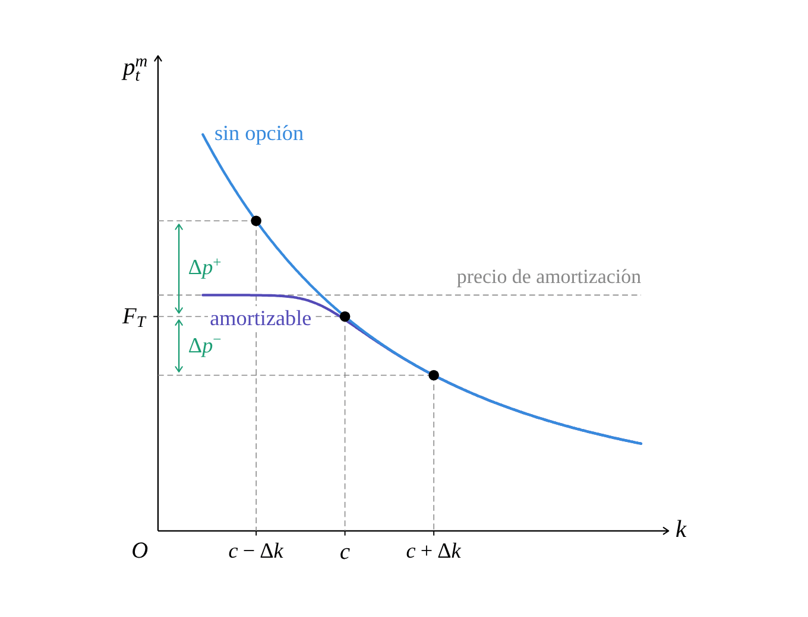
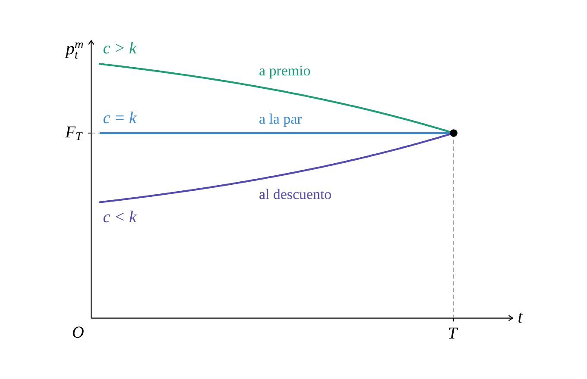
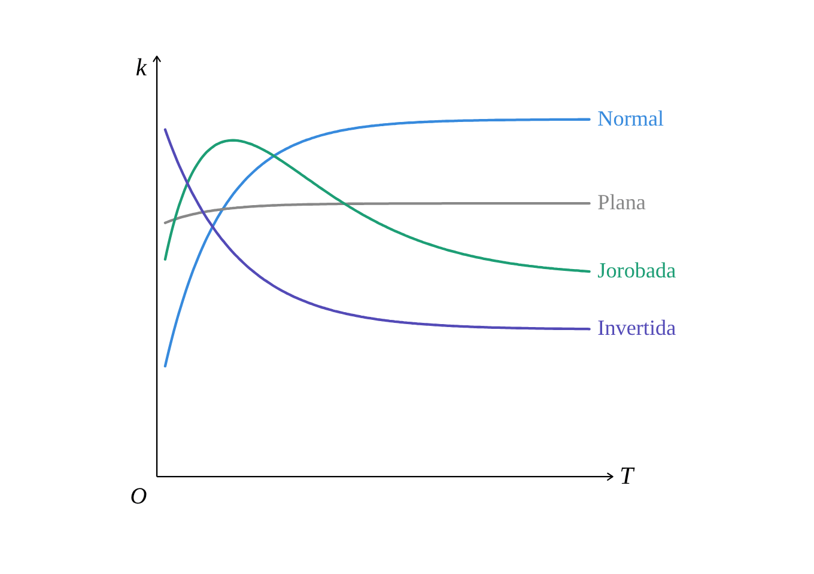
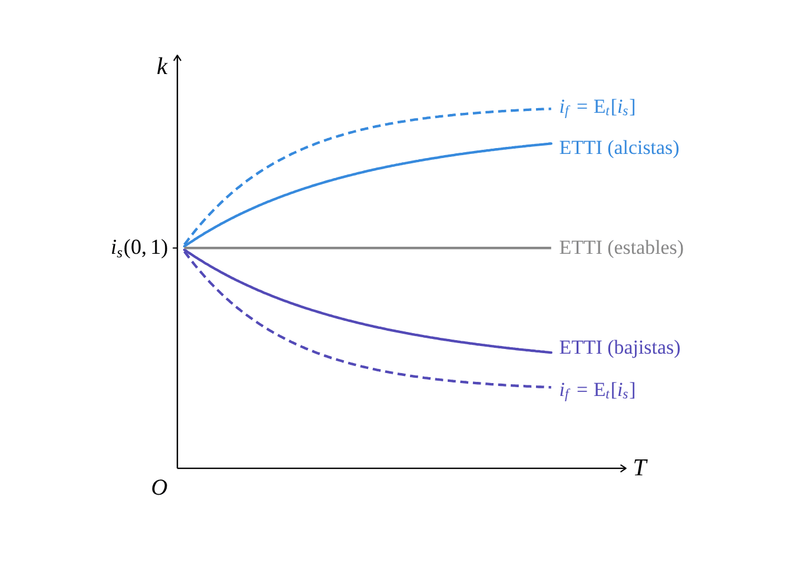
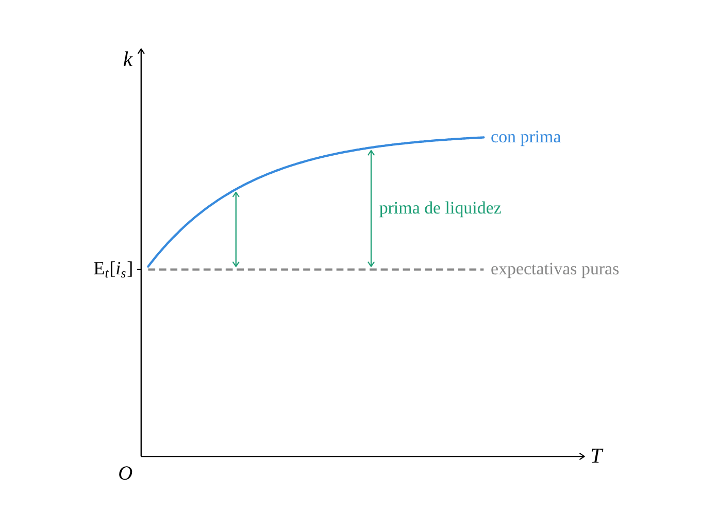
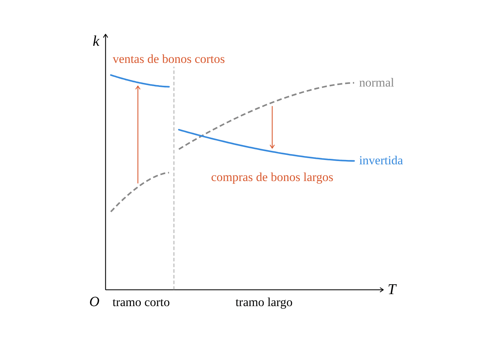
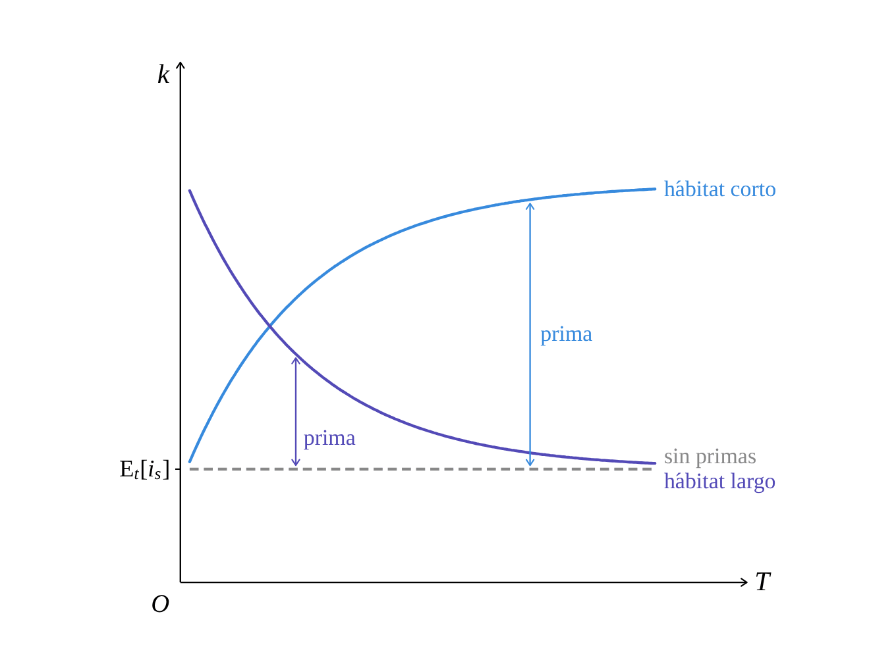
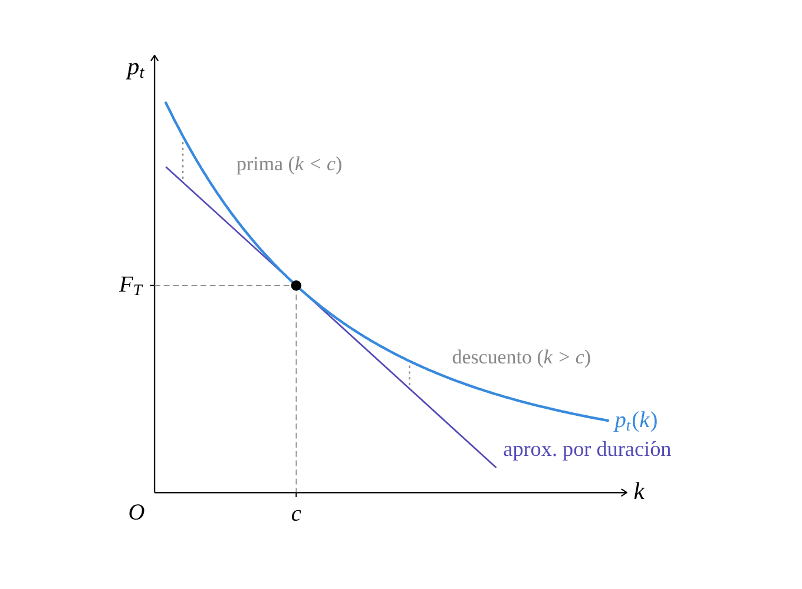

## Introducción

::: {.callout-note appearance="simple" icon=false}

:::

Los instrumentos de **renta fija** constituyen la inmensa mayoría de las emisiones en los mercados financieros internacionales. Se negocian principalmente en dos mercados, el monetario, donde destaca la emisión de pagarés de empresa (títulos a corto plazo), y el de capitales, en concreto el de deuda pública y privada. La deuda pública es, además, la referencia de todo el sistema financiero, porque su rentabilidad se toma como tipo libre de riesgo y en ella intervienen los bancos centrales con sus compras de activos.

Un **bono** promete al inversor una corriente de pagos fijada de antemano, los **cupones** y la devolución del principal, y su precio es el valor actual de esos pagos, de modo que sube cuando bajan los tipos de interés y baja cuando suben. La **rentabilidad al vencimiento** resume en una sola tasa lo que rinde el bono si se mantiene hasta el final, y la **estructura temporal de los tipos de interés** (ETTI) relaciona esa rentabilidad con el plazo. Su forma recoge lo que el mercado espera de los tipos futuros, y su inversión, con tipos largos inferiores a los cortos, ha anticipado varias recesiones. Su explicación ha enfrentado a la teoría de las expectativas de Fisher (1896) con las de la prima de liquidez (Hicks, 1939b), la segmentación de mercados (Culbertson, 1957) y el hábitat preferido (Modigliani y Sutch, 1966).

Aunque la renta sea fija, el inversor soporta un **riesgo de crédito**, el de impago del emisor, que las agencias de calificación resumen en sus notas y el mercado en el diferencial frente a la deuda sin riesgo, y un **riesgo de tipo de interés**, porque una subida de los tipos reduce el precio de los bonos en cartera. La **duración** (Macaulay, 1938) mide esa sensibilidad, y la **convexidad** la corrige ante variaciones grandes. La quiebra del Silicon Valley Bank en marzo de 2023, cuya cartera de bonos a largo plazo acumuló cuantiosas pérdidas latentes con las subidas de tipos de la Reserva Federal, mostró hasta qué punto ese riesgo puede ser decisivo (tema [B26](b26-crisis-financieras.qmd), apartado 2.3.3).

El tema se organiza en tres partes:

- *Fundamentos*: se estudia cómo se determinan el precio y el rendimiento de un bono.

- *Estructura temporal de los tipos de interés*: el tema analiza cómo se configura y qué teorías la explican.

- *Riesgos, duración y convexidad*: la última parte estudia los riesgos de la renta fija y las medidas de sensibilidad de su precio.

## 1. Fundamentos del análisis de renta fija

El análisis de renta fija empieza por el bono considerado individualmente. Primero se presentan los conceptos básicos del instrumento y de su mercado, la hipótesis de eficiencia y la elección entre gestión activa y pasiva. Después se exponen los métodos que permiten determinar el precio teórico del bono y su rentabilidad.

### 1.1. Conceptos básicos

Los conceptos básicos van del instrumento, el bono, al mercado en que se emite y se negocia, y de ahí a la hipótesis de los mercados eficientes y a la elección entre gestión activa y pasiva. Siguen el mismo orden que en el tema [B23](b23-renta-variable.qmd), apartado 1.1.

#### 1.1.1. Instrumentos de renta fija: los bonos

**Definición**: el *bono*, máximo exponente de los instrumentos de renta fija, es un activo financiero por el que su emisor contrae una deuda frente al tenedor, que adquiere un derecho de crédito sobre el nominal y los intereses. Frente a la acción (tema [B23](b23-renta-variable.qmd), apartado 1.1.1), su retribución está pactada de antemano y el tenedor cobra antes que el accionista. El bono se compone de tres elementos esenciales:

1. *Valor facial, nominal o principal* ($F_T$): importe que el tenedor cobra al vencimiento, cuando el emisor ha de reembolsarlo.

2. *Vencimiento* ($T$): fecha en la cual el bono “madura”, es decir, el momento en el cual se paga el principal.

3. *Precio del bono* ($p_t^m$): cuantía que paga el tenedor por adquirir un bono en el mercado en el momento $t$ de la compra.

La mayoría de los bonos ofrecen, además, un *cupón* ($C_t$), pago periódico del interés que el emisor abona al tenedor. El cupón refleja la rentabilidad que obtiene el tenedor por prestar sus fondos al emisor y el coste financiero en el que incurre el emisor por obtener dicha financiación.

**Tipos**: según el cupón, se distinguen cinco tipos de bonos:

1. *Bonos cupón cero*: solo pagan el nominal, al vencimiento.

2. *Bonos con cupón fijo* (o *plain vanilla*): abonan un cupón periódico de cuantía constante y devuelven el principal al vencimiento.

3. *Bonos con cupón variable*: el cupón suele estar referenciado a un tipo de interés de mercado más un diferencial (p. ej. euríbor + 0,5 %), aunque también puede crecer según un calendario preestablecido (bonos *step-up*).

4. *Bonos devengables*: no pagan cupones periódicamente, sino que los cupones se devengan, se acumulan y se pagan al vencimiento.

5. *Bonos con cupones diferidos*: empiezan a devengar cupones periódicos a partir de una fecha fijada y hasta entonces no pagan ninguno.

Según sus cláusulas o el destino de los fondos, destacan otros tres:

1. *Bonos con opción*: el contrato faculta al emisor, o bien al inversor, para amortizar el bono anticipadamente.

2. *Bonos convertibles contingentes* (o CoCos): híbridos deuda-capital que se convierten automáticamente en acciones (o cuyo nominal se reduce) si se activa un disparador contractual, p. ej. si la ratio de capital del emisor cae por debajo de un umbral preestablecido. Estos bonos son, por tanto, un mecanismo de absorción de pérdidas (*bail-in* contractual)[^b24-4].

3. *Bonos verdes*: cualquier tipo de bono cuyos fondos se destinan exclusivamente a financiar o refinanciar, en parte o en su totalidad, proyectos verdes elegibles, ya sean nuevos o existentes, y que, además, están alineados con los *Green Bond Principles* (GBP) de la International Capital Market Association.

**Funcionamiento**: los bonos se emiten en el mercado primario, y puede emitirlos cualquier agente económico, siempre que encuentre algún acreedor, tenga un programa de emisión y cumpla todos los requisitos legales. Los emisores pueden ser instituciones financieras, sociedades no financieras, entidades del sector público y organizaciones internacionales, que se describen en el tema [B26](b26-crisis-financieras.qmd), apartado 1.1. La emisión se realiza, generalmente, de tres formas:

1. *Subasta*: procedimiento de venta donde los interesados compiten entre sí para adjudicarse el título emitido. Existen tres formas básicas:

    - *Inglesa* (o ascendente): los compradores van ofreciendo sumas de dinero crecientes hasta que el mejor postor se adjudica el título, y los participantes van observando las pujas de los demás y deciden si aumentan o no su oferta;

    - *Holandesa* (o descendente): se parte de un valor que se va reduciendo progresivamente, y los participantes no observan las ofertas de los demás y deben decidir si detener o no la subasta teniendo en cuenta el riesgo de que otro comprador lo haga antes[^b24-2];

    - *Española* (u holandesa modificada): combina subasta de precio único y de precios múltiples.

2. *Sindicación*: proceso de estructuración de las operaciones en el mercado primario de capital mediante un sindicato bancario, es decir, un conjunto de entidades bancarias que se unen para realizar operaciones que, por su dimensión y riesgo, no pueden acometer en solitario. Generalmente, existe una entidad directora (*lead manager*) que coordina la actuación de un conjunto más amplio de entidades bancarias (codirectores). La sindicación se utiliza especialmente para eurobonos, bonos corporativos, deuda soberana de países emergentes y préstamos sindicados en divisas.

3. *Colocaciones privadas*: emisiones *ad hoc* con características particulares.

Tras la emisión, el bono se negocia en el mercado secundario hasta su vencimiento, cuando el emisor reembolsa el nominal, o hasta su amortización anticipada, si el contrato la prevé.

**Conclusiones**:

- *Aspectos positivos*: el emisor obtiene financiación a plazo sin ceder derechos políticos, y el tenedor recibe unos flujos fijados por contrato, con prelación sobre el accionista en caso de liquidación.

- *Limitaciones*: los flujos pactados son nominales y su cobro depende de la solvencia del emisor, por lo que el tenedor soporta los riesgos de tipo de interés, de inflación y de crédito (apartado 3.1). El emisor, por su parte, asume una carga financiera que no varía con sus resultados.

#### 1.1.2. Mercado de renta fija

**Definición**: el *mercado de renta fija* es el conjunto de mercados en que se emiten y se negocian los valores de deuda. La mayoría de los mercados de bonos están dirigidos por precios (*quote-driven*), y en ellos los creadores de mercado cotizan precios de compra y de venta y dan contrapartida a sus clientes (CGFS, 2016). En la bolsa, en cambio, predominan las órdenes que se casan automáticamente (tema [B23](b23-renta-variable.qmd), apartado 1.1.2).

**Tipos**: se distinguen según tres criterios:

- *Plazo*: el *mercado monetario* negocia activos a corto plazo, como las letras del Tesoro y los pagarés de empresa, y el *mercado de capitales*, bonos y obligaciones a más de un año.

- *Emisor*: el mercado de deuda pública, cuyos valores sirven de referencia sin riesgo para el resto (apartado 2.1), y el de deuda privada, que incluye los bonos de las empresas, de las entidades financieras y de las titulizaciones.

- *Fase*: el *mercado primario*, en el que el emisor coloca los valores nuevos, y el *secundario*, en el que los inversores negocian los ya emitidos.

**Funcionamiento**: en el mercado secundario, la negociación es sobre todo bilateral, por teléfono o en plataformas electrónicas en las que el cliente pide cotización a varios intermediarios. Los bonos corporativos, numerosos, con poco volumen por emisión y cláusulas propias, dependen más de esa intermediación que los soberanos, y la liquidez se concentra en las emisiones de referencia de deuda pública (CGFS, 2016).

Para sostener esa liquidez, los Tesoros designan *creadores de mercado*. En España, estos creadores se comprometen a pujar en las subastas por al menos el 3 % del importe que adjudica el Tesoro y a cotizar precios en el mercado secundario. Estas obligaciones las fija la Resolución de 21 de julio de 2017 de la Secretaría General del Tesoro y Política Financiera (hoy, del Tesoro y Financiación Internacional).

**Conclusiones**:

- *Aspectos positivos*: el mercado de deuda pública proporciona los tipos sin riesgo de cada plazo con los que se construye la ETTI, y los creadores de mercado aseguran contrapartida en las emisiones de referencia.

- *Limitaciones*: la negociación bilateral es menos transparente que la de la bolsa y, fuera de las emisiones de referencia, la liquidez es escasa, sobre todo en los bonos corporativos y de titulización (apartado 3.1.1).

#### 1.1.3. Hipótesis de los mercados eficientes

::: {.callout-note appearance="simple" icon=false}
La hipótesis de los mercados eficientes (Fama, 1970) y sus tres formas se desarrollan en el tema [B23](b23-renta-variable.qmd), apartado 1.1.3. Aquí se recogen sus implicaciones para la renta fija.
:::

En un mercado de bonos eficiente, el precio de cada bono incorpora toda la información disponible sobre los tipos de interés futuros y sobre la solvencia del emisor. La hipótesis de las expectativas puras (apartado 2.3.1) añade la neutralidad ante el riesgo, y con ella el tipo a plazo implícito es un predictor insesgado del tipo al contado futuro.

La regla de compra y venta del apartado 1.2.1 supone, en cambio, que el mercado es, a lo sumo, débilmente eficiente. Si fuera eficiente en sentido semifuerte, el precio ya reflejaría toda la información pública y el análisis fundamental no permitiría obtener rentabilidades extraordinarias. La gestión activa busca esas desviaciones entre el precio de mercado y el valor teórico.

#### 1.1.4. Gestión activa y gestión pasiva de carteras

::: {.callout-note appearance="simple" icon=false}
La disyuntiva entre gestión activa y pasiva, su coste y la paradoja de la eficiencia (Grossman y Stiglitz, 1980) se desarrollan en el tema [B23](b23-renta-variable.qmd), apartado 1.1.4. Aquí se describen las estrategias propias de la renta fija.
:::

**Gestión activa**: parte de que el mercado no es plenamente eficiente y busca superar al índice de referencia anticipando los movimientos de la curva de tipos (apartado 2.2.2) o eligiendo los bonos mal valorados. Emplea cuatro técnicas principales:

- *Anticipación de tipos*: alarga la duración (apartado 3.2) si se esperan bajadas de los tipos y la acorta en caso contrario.

- *Deslizamiento por la curva* (*riding the yield curve*): compra bonos más largos que el horizonte para venderlos con la plusvalía que da el paso del tiempo si la curva es creciente y estable.

- *Cartera en mancuerna* (*barbell*): repartida entre los extremos de la curva, es más convexa (apartado 3.4) que una concentrada en un plazo intermedio (*bullet*) de igual duración y la supera si la curva se aplana.

- *Selección de emisores*: compra los bonos cuyo diferencial de crédito (apartado 3.1.3) supera al que justifica la solvencia del emisor, a la espera de que se estreche.

**Gestión pasiva**: renuncia a anticipar los tipos, porque parte de que el mercado incorpora ya la información disponible. Comprende tres estrategias:

- *Indexación*: replica un índice de renta fija. Como los índices incluyen muchas emisiones, a menudo poco líquidas, la réplica suele hacerse por muestreo, con una parte de las emisiones que reproduce el plazo medio, la calidad crediticia y los demás factores de riesgo del índice.

- *Inmunización*: iguala la duración de la cartera al horizonte de un compromiso de pago (apartado 3.5).

- *Casamiento de flujos* (*cash-flow matching*): iguala los flujos de la cartera a los pagos comprometidos sin necesidad de reajustes, aunque es más caro que la inmunización.

### 1.2. Determinación del precio teórico o valor intrínseco de un bono

La valoración del bono sigue el esquema que el tema [B25](b25-derivados.qmd), apartado 1.2, aplica a los derivados, con unas consideraciones generales y el cálculo de su valor en la emisión, a lo largo de su vida y al vencimiento.

#### 1.2.1. Consideraciones generales

**Términos del contrato** ($c$, $F_T$, $T$, $n$): la tasa del cupón, el nominal, el vencimiento y la frecuencia de pago se fijan en la emisión y determinan los flujos que recibirá el tenedor. Como el tipo fijo de un *swap*, no son desembolsos, sino cláusulas del contrato.

**Valor teórico** ($p_t$): es el valor actual en $t$ de los flujos pendientes, que en un bono con cupón fijo es

$$p_t = \sum_{s=1}^{n(T-t)} \frac{C}{(1+k/n)^{s}} + \frac{F_T}{(1+k/n)^{n(T-t)}}$$

donde $C = c\,F_T/n$ es el cupón de cada periodo (se paga $n$ veces al año), $F_T$ el valor nominal pagadero en $T$, $s = 1, \ldots, n(T-t)$ numera los periodos de cupón que restan desde $t$ y $k$ la tasa de descuento anual. Se supone que $t$ es una fecha de pago de cupón. La tasa de descuento es el coste de oportunidad de las partes y se compone de un tipo de interés libre de riesgo, $r_f$[^b24-8], y una prima de riesgo, $\rho$, que recoge ciertos riesgos (p. ej. el de impago o el de inflación).

**Precio de mercado** ($p_t^m$): es la cotización observada. El arbitraje la ancla a los precios de otros bonos del mismo emisor, porque un bono con cupón es una cartera de bonos cupón cero (apartado 2.1), pero no fija el nivel de los tipos ni la prima de riesgo. Por eso el precio de mercado puede separarse del valor teórico que calcula cada inversor, cuya prima $\rho$ depende de su propia valoración del riesgo. Comprar tiene un valor actual neto de $p_t - p_t^m$, y de su signo se sigue la posición del inversor:

- *Compra*: si $p_t > p_t^m$, el bono está infravalorado y conviene abrir una posición larga (comprarlo con la esperanza de que suba).

- *Venta*: si $p_t < p_t^m$, el bono está sobrevalorado y el inversor puede no comprarlo o abrir una posición corta (venderlo de prestado y recomprarlo cuando baje).

::: {.callout-tip collapse="true" appearance="simple" title="Ejemplo: precio teórico de un bono con cupón fijo"}
Un bono de nominal 100 y vencimiento a tres años paga un cupón anual del 6 % ($C = 6$, $n = 1$). El inversor le exige una rentabilidad del 5 % ($k = 0{,}05$), la TIR de los bonos de igual plazo y riesgo. Su valor teórico es $p_t = 6/1{,}05 + 6/1{,}05^2 + 106/1{,}05^3 \approx 5{,}71 + 5{,}44 + 91{,}57 = 102{,}72$, por encima del nominal porque el cupón supera a la rentabilidad exigida (Teorema II de la valoración de los bonos). Si cotiza a 101,50, comprarlo tiene un valor actual neto de $102{,}72 - 101{,}50 = 1{,}22 > 0$, así que el bono está infravalorado y conviene abrir una posición larga. A ese precio, su TIR es del 5,44 %, mayor que la exigida.
:::

#### 1.2.2. Valoración del bono

**Valor del bono en la emisión ($t=0$)**: con $nT$ periodos pendientes, $p_0$ es el precio teórico de la emisión. A diferencia de un derivado simétrico, cuyo precio se pacta para que su valor inicial sea nulo, el bono tiene valor positivo desde el origen y el comprador lo paga, como la prima de una opción. El emisor suele fijar el cupón próximo a la rentabilidad exigida, de modo que el bono se coloca cerca de la par (Teorema II). Bajo los supuestos de la rentabilidad al vencimiento, este precio da al tenedor una rentabilidad y al emisor un coste de capital iguales a $k$. Con cupón anual ($n = 1$), el precio es una anualidad más el valor actual del nominal, $p_0 = C \cdot \frac{1 - (1+k)^{-T}}{k} + \frac{F_T}{(1+k)^T}$[^b24-9].

**Valor del bono a lo largo de su vida ($0 < t < T$)**: una vez emitido, el valor teórico varía en sentido inverso a la rentabilidad exigida (Teorema I) y se desplaza hacia el nominal con el paso del tiempo (Teorema III). La regla de compra y venta se aplica en cada momento.

**Valor del bono al vencimiento ($t=T$)**: no quedan periodos pendientes. El bono paga el último cupón y el nominal, y su valor ex cupón es $p_T = F_T$, sea cual sea la rentabilidad exigida (efecto convergencia, Teorema III).

### 1.3. Determinación de la rentabilidad de un bono

Para tomar sus decisiones de inversión, los agentes económicos no solo tienen en cuenta el precio teórico, sino también su **rendimiento o rentabilidad**, que es una medida del valor potencial relativo del bono. Esta rentabilidad se obtiene de tres fuentes:

- *Intereses*: los cupones que el tenedor cobra periódicamente.

- *Enajenación*: las ganancias o pérdidas de capital al deshacerse del bono, ya sea por su venta en el mercado secundario, por su amortización por el emisor o por el cobro del principal al vencimiento.

- *Reinversión de flujos*: los rendimientos de reinvertir los flujos de caja que se obtienen del bono.

Según las características del bono o el modo de medir la rentabilidad, se obtienen distintos indicadores. Los más habituales son la rentabilidad corriente (*current yield*) y la rentabilidad al vencimiento (*yield to maturity*).

#### 1.3.1. Rentabilidad corriente (*current yield*)

**Definición**: la *rentabilidad corriente* (*current yield*, CY) relaciona el cupón anual que paga el bono con el precio que se paga hoy por él en el mercado, y mide, por tanto, el rendimiento por intereses de cada unidad monetaria invertida.

**Cálculo**: se divide el cupón anual entre el precio de mercado del bono:

$$\text{CY} = \frac{n\,C}{p_t^m}$$

donde $n$ es el número de cupones al año, $C$ el cupón de cada periodo y $p_t^m$ el precio de mercado en $t$.

**Interpretación**: la rentabilidad corriente supera a la tasa del cupón si el bono cotiza al descuento ($p_t^m < F_T$) y queda por debajo si cotiza a premio ($p_t^m > F_T$). El motivo es que el mismo cupón se divide entre un precio menor o mayor que el nominal (Teorema II).

**Conclusiones**:

- *Aspectos positivos*: su cálculo es muy sencillo.

- *Limitaciones*: ignora dos de las tres fuentes de rentabilidad, la plusvalía que se obtendría al revender el título en el mercado secundario y lo que rinde la reinversión de los cupones, y se queda únicamente con el cupón.

#### 1.3.2. Rentabilidad al vencimiento (*yield to maturity*)

**Definición**: la *rentabilidad al vencimiento* o *yield to maturity* (YTM) es la tasa interna de rentabilidad (TIR) del bono y ofrece una medida más precisa y más habitual que la corriente.

**Cálculo**: en la práctica, los inversores determinan los flujos de caja prometidos (contractuales) del bono. Después, por prueba y error, hallan la TIR que iguala el valor actual de esos flujos al precio de mercado más el cupón corrido (el interés devengado desde el último pago):

$$p_t^m = \sum_{s=1}^{n(T-t)} \frac{C}{(1+r_B/n)^{s}} + \frac{F_T}{(1+r_B/n)^{n(T-t)}}$$

donde $r_B$ es la rentabilidad al vencimiento, con el resto de la notación ya definida. Se supone que la compra se produce en una fecha de pago de cupón, de modo que el cupón corrido es nulo. Si se produce, en cambio, entre dos fechas de cupón, $p_t^m$ debe entenderse como precio completo (precio ex cupón más cupón corrido) y los plazos se cuentan en fracciones de periodo.

**Interpretación**: $r_B$ es la tasa única que, aplicada a todos los plazos, iguala el valor actual de los flujos prometidos al precio, y resume así en una sola tasa la rentabilidad de todo el bono. La TIR es una especie de media de los tipos al contado de cada plazo (apartado 2.1) y coincide con la rentabilidad exigida, $k$, cuando esta se infiere del precio (Teorema II).

**Conclusiones**:

- *Aspectos positivos*: frente a la rentabilidad corriente, tiene en cuenta el valor facial, el vencimiento y el fraccionamiento de los pagos, $n$, además del precio y el cupón, $r_B = f(C^{+}, F_T^{+}, p_t^{m\,-}, T^{\pm})$.

- *Limitaciones*: solo refleja con exactitud lo que rinde un bono bajo tres supuestos:

    - *Mantenimiento hasta el vencimiento*: el bono carece de opciones de amortización anticipada, tanto de compra a favor del emisor (*callable bonds*) como de venta a favor del inversor (*putable bonds*), y el inversor no lo vende antes de su amortización final.

    - *Pago íntegro de los cupones*: el emisor atiende cada cupón por su importe y en su fecha, según lo pactado. Se descarta así todo riesgo de crédito, ya sea el de impago o insolvencia o, en los bonos soberanos, el riesgo soberano.

    - *Reinversión a la TIR*: el tipo al que se colocan los cupones cobrados es la propia TIR del bono, supuesto del que se siguen dos consecuencias:

        - *Comparación entre bonos*: la tasa de rentabilidad no sirve para comparar dos bonos. Como la rentabilidad depende también del plazo, dos bonos similares con vencimientos a dos y a cinco años descuentan sus pagos a tasas diferentes. Un mismo pago en una misma fecha recibe así un descuento distinto según el vencimiento del bono que lo genera, algo que carece de justificación.

        - *Curva de rentabilidades plana*: la rentabilidad no varía con el plazo, y la curva de rentabilidades sería, por tanto, horizontal en el plano vencimientos-rentabilidad exigida. Nada garantiza, sin embargo, que sea así, porque la curva de tipos puede adoptar perfiles muy diversos (apartado 2).

#### 1.3.3. Teoremas de la valoración de los bonos

Del concepto de rentabilidad al vencimiento se derivan cuatro teoremas sobre la valoración de los bonos. El primero y el cuarto se refieren a la sensibilidad del precio ante la rentabilidad; el segundo, a la relación entre la cotización y el cupón, y el tercero, a la evolución del precio con el paso del tiempo. Los teoremas I y IV recogen la relación inversa, la asimetría de la respuesta del precio (la convexidad) y el efecto cupón, tres de los cinco resultados que demostró Malkiel (1962). Los otros dos, sobre el vencimiento, reaparecen en la duración (apartado 3.2).

**Teorema I (relación entre el precio de mercado y la rentabilidad)**: existe una relación inversa y convexa entre el precio de mercado de un bono sin opción y su rentabilidad al vencimiento, siempre y cuando el valor nominal, el cupón y el vencimiento no cambien. Se refiere, por tanto, a bonos ya emitidos.

Esta relación es el origen del riesgo de tipo de interés (apartado 3.1.1). Junto con el riesgo de impago, el de tipo de interés es el más relevante del mercado de bonos, especialmente en los bonos soberanos.

- *Relación inversa*: se debe a que en el denominador aparece la tasa de rentabilidad. Cuando los bonos nuevos ofrecen una rentabilidad exigida menor, los ya emitidos con el cupón anterior, más alto, ganan atractivo y su demanda crece. Al descontar sus flujos a la nueva tasa, su precio de mercado sube.

- *Convexidad positiva*: se debe a que cada flujo se descuenta con el factor $(1+k/n)^{-s}$, que es una función convexa de la rentabilidad para cualquier plazo $s \geq 1$, y la suma de funciones convexas es convexa. Por ello, el precio sube más ante una caída de la rentabilidad de lo que baja ante una subida de igual cuantía. Ante aumentos de la rentabilidad el precio caerá cada vez menos y ante caídas de la rentabilidad el precio subirá cada vez más, asimetría tanto más apreciable cuanto mayores sean estas variaciones.

- *Bonos amortizables anticipadamente*: en los *callable bonds*, la convexidad pasa a ser negativa cuando la rentabilidad exigida es reducida. Esto se debe a que aumenta el valor de la opción de amortización, que es la diferencia entre el precio del bono sin opción y el del bono con opción. Intuitivamente, una caída del tipo de interés de los bonos nuevos invita al emisor del bono antiguo a amortizar anticipadamente la deuda viva para refinanciarla a menor coste[^b24-15]. De ahí surge el riesgo de llamada o *call risk* (apartado 3.1.2).

Gráficamente, en el plano rentabilidad exigida-precio de mercado (figura -@fig-b244-precio-rentabilidad), la curva del bono sin opción representa el precio que corresponde a cada rentabilidad exigida, con el nominal, el cupón y el vencimiento dados. Tiene pendiente negativa por la relación inversa y es convexa, así que una caída de la rentabilidad, $\Delta k$, eleva el precio ($\Delta p^{+}$) más de lo que lo reduce una subida de igual cuantía ($\Delta p^{-}$). La curva del bono amortizable coincide casi con la anterior a rentabilidades altas. A rentabilidades bajas, en cambio, se aplana por debajo del precio de amortización, al que el emisor rescataría el bono, y se vuelve cóncava (convexidad negativa).

::: {#fig-b244-precio-rentabilidad}

::: {.content-visible when-format="html"}
```{=html}
<div class="graph-frame">
<iframe src="../graphs/b244_Precio_rentabilidad.html" style="height:560px" loading="lazy" title="fig-b244-precio-rentabilidad"></iframe>
</div>
```
:::

::: {.content-visible unless-format="html"}

:::

Relación entre el precio de mercado y la rentabilidad (Teorema I). El precio de un bono sin opción es una función decreciente y convexa de la rentabilidad exigida, y el de un bono amortizable se aplana bajo el precio de amortización.
:::

**Teorema II (relación entre la cotización, la rentabilidad exigida y la tasa del cupón)**: de la relación inversa entre rentabilidad y precio de los bonos se desprende una correspondencia biunívoca entre dos comparaciones. Una es la del precio de mercado con el valor facial, y la otra, la de la rentabilidad exigida con la tasa del cupón:

- *Cotización a la par*: el precio de mercado coincide con el valor facial si y solo si la rentabilidad exigida coincide con la tasa del cupón, $p_t^m = F_T \;\leftrightarrow\; c = k$. En esta expresión, $c$ es la tasa del cupón y $k$ la rentabilidad exigida por el mercado, es decir, la rentabilidad al vencimiento implícita en $p_t^m$ ($k = r_B$).

- *Cotización a premio*: el precio de mercado supera al valor facial si y solo si la rentabilidad exigida es menor que la tasa del cupón, $p_t^m > F_T \;\leftrightarrow\; c > k$.

- *Cotización al descuento*: el precio de mercado es inferior al valor facial si y solo si la rentabilidad exigida es mayor que la tasa del cupón, $p_t^m < F_T \;\leftrightarrow\; c < k$.

**Teorema III (relación entre la prima y el tiempo: efecto convergencia)**: se llama prima de un bono a lo que su cotización excede del valor nominal. Con una rentabilidad exigida constante durante toda la vida del bono, la prima tiende a cero a medida que se aproxima el vencimiento, y lo hace cada vez más deprisa, relación que a veces se conoce como *efecto convergencia*[^b24-16]. Formalmente, el teorema establece que $\lim_{t \rightarrow T} p_t^m = F_T$, es decir, $\lim_{t \rightarrow T} \theta_t = 0$, donde $\theta_t = p_t^m - F_T$ es la prima del bono.

Todo esto implica que el valor de los bonos sigue una senda diferente en función de la relación entre el precio de mercado y su valor facial. Gráficamente, en el plano tiempo-precio de mercado (figura -@fig-b241-pull-to-par), cada curva representa la senda del precio de un bono desde su emisión hasta el vencimiento, con la misma rentabilidad exigida, $k$, y distinto cupón. Las tres sendas convergen al valor nominal, $F_T$, en el vencimiento, $T$:

1. *Senda descendente* ($c > k$): si el bono cotiza a premio, su precio de mercado disminuirá conforme se acerca al vencimiento.

2. *Senda ascendente* ($c < k$): si el bono cotiza al descuento, su precio de mercado aumentará conforme se acerca al vencimiento.

3. *Senda estable* ($c = k$): si el bono cotiza a la par, su precio permanece en el valor nominal durante toda su vida, porque el cupón remunera exactamente la rentabilidad exigida.

::: {#fig-b241-pull-to-par}

::: {.content-visible when-format="html"}
```{=html}
<div class="graph-frame">
<iframe src="../graphs/b241_Pull_to_par.html" style="height:480px" loading="lazy" title="fig-b241-pull-to-par"></iframe>
</div>
```
:::

::: {.content-visible unless-format="html"}

:::

Convergencia al valor nominal (*pull to par*). El precio de un bono con prima o con descuento converge a la par a medida que se acerca el vencimiento.
:::

**Teorema IV (efecto cupón)**: a igualdad de vencimiento y de rentabilidad, un cupón más alto reduce la variación porcentual del precio del bono ante un cambio de su rendimiento, resultado conocido como *efecto cupón*. El cupón protege así al tenedor frente a los cambios de precios, al ofrecer una rentabilidad estable.

La razón es que unos cupones más altos restan peso relativo a la devolución del principal dentro de la rentabilidad total del bono, y con ello se atenúa el efecto directo de los cambios en la tasa de rentabilidad sobre el precio a través de la actualización del valor nominal[^b24-17]. El caso límite lo constituye el bono cupón cero, cuyo precio es, a igualdad de vencimiento, el que más varía, en términos porcentuales, cuando se mueven los tipos de interés.

### 1.4. Conclusiones

El análisis del bono individual descansa en el descuento de flujos. Su precio teórico es el valor actual de los cupones y del nominal a la rentabilidad exigida, suma de un tipo libre de riesgo y una prima de riesgo, y su comparación con el precio de mercado decide la compra o la venta. El bono se coloca cerca de la par en la emisión, su valor varía después en sentido inverso a la rentabilidad exigida y converge al nominal en el vencimiento.

La rentabilidad corriente solo recoge el cupón, mientras que la rentabilidad al vencimiento resume en una sola tasa todo el bono, aunque bajo tres supuestos restrictivos. Los cuatro teoremas de la valoración ordenan las relaciones entre el precio, la rentabilidad, el cupón y el tiempo. El supuesto de reinversión a la TIR implica, además, una curva de rentabilidades plana, y la relación entre rentabilidad y plazo es el objeto de la sección 2.

## 2. Estructura temporal de los tipos de interés

La relación entre rentabilidad y plazo, que el supuesto de una curva plana ignora, es la estructura temporal de los tipos de interés. Se define primero, se describen después sus formas y movimientos y se exponen, por último, las teorías que la explican.

### 2.1. Concepto

**Definición**: la *estructura temporal de los tipos de interés* (ETTI), curva de rentabilidad (*yield curve*), curva de tipos de interés o curva cupón cero es una relación funcional entre la rentabilidad de los préstamos sin riesgo de la economía y el tiempo hasta su vencimiento.

**Importancia**: la curva de tipos de interés ocupa un lugar central en el trabajo de economistas y analistas, que la leen como un resumen de lo que el mercado espera sobre la inflación y el crecimiento, sobre los tipos oficiales o sobre las políticas económicas.

**Tipos al contado y a plazo**: el *tipo al contado* (*spot*) es la rentabilidad de un préstamo cupón cero que empieza hoy, y el *tipo a plazo implícito* (*forward*), la de un préstamo entre dos fechas futuras que se puede fijar hoy. Por ausencia de arbitraje:

$$[1+i_s(0,t)]^t = [1+i_s(0,t-1)]^{t-1} \cdot [1+i_f(0,t-1,t)]$$

donde $i_s(0,t)$ es el tipo al contado anual a $t$ años vigente hoy e $i_f(0,t-1,t)$ el tipo a plazo implícito para el año $t$. Es decir, invertir $t$ años al contado rinde lo mismo que invertir $t-1$ años y fijar hoy el tipo del último. En sentido estricto, la ETTI es la curva de los tipos al contado.

**Precio sin arbitraje**: un bono con cupón es una cartera de bonos cupón cero, de modo que cada flujo se descuenta al tipo al contado de su plazo:

$$p_0 = \sum_{t=1}^{T} \frac{C_t}{[1+i_s(0,t)]^t} + \frac{F_T}{[1+i_s(0,T)]^T}$$

donde $p_0$ es el precio teórico con cupones anuales $C_t$, nominal $F_T$ y vencimiento $T$. Cualquier otro precio permitiría arbitrar segregando el bono en *strips* o reconstituyéndolo. La TIR, $r_B$, es una especie de media de los tipos al contado. Por eso, si la curva no es plana (apartado 1.3.2), dos bonos del mismo vencimiento y distinto cupón tienen distinta TIR, porque reparten de forma distinta sus pagos entre los plazos. La *curva a la par* da el cupón con el que un bono de cada plazo cotizaría a la par.

**Construcción**: la ETTI canónica se elabora con bonos soberanos de máxima calidad crediticia, cuyas tasas de rentabilidad exigida sirven de referencia al resto de los tipos de interés de la economía, pues estos se construyen a partir de ellas.

Lo ideal sería disponer de deuda soberana cupón cero para todos los plazos posibles, puesto que los bonos sin cupón no plantean problemas de comparación y, conservados hasta su amortización, rinden exactamente el tipo *spot* de su plazo, una rentabilidad “verdadera”. Sin embargo, en la práctica solo los productos monetarios a corto plazo (p. ej. las T-*bills* de EE. UU. y las letras del Tesoro de la zona del euro) se emiten sin cupón, mientras que los de más largo plazo pagan un cupón regular.

La excepción son los *strips*, bonos cupón cero que se obtienen segregando los cupones y el principal de bonos a largo plazo, aunque su liquidez es menor. Por ello, la elaboración de la curva exige “construir” el tipo de interés para cada uno de los plazos, lo cual se hace tomando las rentabilidades y “limpiando” los cupones de los bonos a través de diferentes técnicas como el *bootstrapping*.

El *bootstrapping* invierte la fórmula del precio sin arbitraje. Parte del tipo al contado más corto, observable en el mercado monetario, y despeja $i_s(0,2)$ del precio de un bono a dos años, cuyo primer cupón ya puede descontarse, después $i_s(0,3)$ del de un bono a tres años, y así sucesivamente. Por último, los plazos sin bono de referencia se interpolan.

::: {.callout-tip collapse="true" appearance="simple" title="Ejemplo: tipo al contado y tipo a plazo a dos años"}
El tipo al contado a un año es el 3 % y un bono a dos años con cupón anual de 5 y nominal 100 cotiza a 102. El primer cupón vale $5/1{,}03 \approx 4{,}85$, luego $105/[1+i_s(0,2)]^2 = 102 - 4{,}85 = 97{,}15$ e $i_s(0,2) \approx 3{,}96$ %. El tipo a plazo del segundo año es $1{,}03964^2/1{,}03 - 1 \approx 4{,}94$ %, y la TIR del bono, 3,94 %, queda entre los dos tipos al contado.
:::

### 2.2. Posibles formas y movimientos de la ETTI

Una vez construida, la ETTI puede adoptar diferentes formas según la relación entre los tipos a corto y a largo plazo y desplazarse o cambiar de pendiente y de curvatura cuando cambian las condiciones del mercado.

#### 2.2.1. Posibles formas

Gráficamente, en el plano vencimientos-rentabilidad exigida (figura -@fig-b243-etti), cada curva representa la rentabilidad que el mercado exige en un momento dado a los bonos sin riesgo de cada vencimiento. Según su pendiente, la ETTI puede tener distintas formas:

1. *Normal*: la curva de rendimiento es creciente, por la prima de liquidez que exigen los acreedores a más plazo.

2. *Jorobada*: la rentabilidad crece en los plazos cortos y medios y decrece en los largos, caso bastante especial que puede darse en un contexto de desaceleración.

3. *Plana*: apenas hay diferencia entre la rentabilidad a corto y a largo plazo. Se suele dar en un contexto de desaceleración y transición hacia una curva invertida, y la cartera en mancuerna aprovecha ese aplanamiento (apartado 1.1.4).

4. *Invertida*: la rentabilidad decrece con el plazo, caso anómalo más raro, considerado un predictor de recesión.

::: {#fig-b243-etti}

::: {.content-visible when-format="html"}
```{=html}
<div class="graph-frame">
<iframe src="../graphs/b243_ETTI.html" style="height:520px" loading="lazy" title="fig-b243-etti"></iframe>
</div>
```
:::

::: {.content-visible unless-format="html"}

:::

Posibles formas de la estructura temporal de los tipos de interés (normal, plana, jorobada e invertida).
:::

La curva de la deuda pública estadounidense se ha invertido en varios episodios recientes:

- *Crisis de deuda rusa* (1998): tras el impago ruso y en plena turbulencia financiera, el diferencial entre los tipos a diez años y a tres meses se invirtió durante unos días y la Reserva Federal bajó los tipos de interés. Sin embargo, en esta ocasión no hubo recesión.

- *Crisis financiera global* (inversión de 2006-2007): la curva se invirtió durante la mayor parte de 2006 y a comienzos de 2007, anticipando la recesión estadounidense de 2007-2009. Tras el estallido de la crisis *subprime* en 2007, la caída de los tipos a largo plazo hizo subir el precio de los bonos soberanos, cuyo desempeño superó con creces al del mercado bursátil, sumido en una fuerte caída de precios.

- *Crisis de la COVID-19* (2020): tras las subidas de tipos de interés de la Reserva Federal entre 2015 y 2018, el diferencial entre los tipos a diez años y a tres meses ya se había invertido en 2019. Volvió a invertirse brevemente a finales de enero de 2020, con la preocupación creciente por el coronavirus, y de nuevo en febrero, poco antes de la recesión de 2020.

- *Endurecimiento monetario de 2022-2023*: el diferencial entre los tipos a diez y a dos años se mantuvo invertido desde julio de 2022 hasta principios de septiembre de 2024, la inversión más larga registrada. Aun así, no se produjo una recesión, lo que ha matizado su valor como predictor.

#### 2.2.2. Desplazamientos de la ETTI

La dinámica de la transición de una forma a otra se clasifica, en el mismo plano vencimientos-rentabilidad exigida (figura -@fig-b249-movimientos-etti), en tres movimientos:

1. *Movimientos en paralelo*: desplazamientos que suponen una traslación, es decir, un desplazamiento uniforme de toda la curva[^b24-23]. Son alcistas o *bull* (suben los precios de los bonos porque caen los tipos de interés) y bajistas o *bear* (bajan los precios porque suben los tipos de interés).

2. *Movimientos* twist: suponen un cambio de pendiente. Pueden ser enderezadores o *steepening* (la curva se empina, aumento del diferencial o *spread*) o aplanadores o *flattening* (la curva se aplana, reducción del diferencial). La Operation Twist de la Reserva Federal (2011-2012), por ejemplo, buscó un aplanamiento. Al sustituir valores a corto plazo por valores a largo plazo, la Reserva Federal aplicó una política monetaria expansiva sin ampliar su balance, para abaratar los tipos a largo y reactivar la inversión y el consumo financiado con crédito.

3. *Movimientos* butterfly: suponen un cambio de la curvatura. Pueden ser positivos (aumento de la convexidad de la curva, en el que los tipos a corto y a largo suben respecto a los de plazo medio) o negativos (disminución de la convexidad).

::: {#fig-b249-movimientos-etti}

::: {.content-visible when-format="html"}
```{=html}
<div class="graph-frame wide">
<iframe src="../graphs/b249_Movimientos_ETTI.html" style="--r:2.824" loading="lazy" title="fig-b249-movimientos-etti"></iframe>
</div>
```
:::

::: {.content-visible unless-format="html"}

:::

Movimientos de la ETTI. Respecto a la curva inicial, 0, el movimiento en paralelo la traslada entera (hacia abajo si es *bull* y hacia arriba si es *bear*). El *twist* cambia la pendiente de la curva (*steepening* o *flattening*) y el *butterfly* su curvatura (en el positivo, los tipos a corto y a largo suben respecto a los de plazo medio).
:::

### 2.3. Teorías explicativas de la estructura temporal de los tipos

Cuatro teorías tratan de explicar la forma de la ETTI. Difieren en el papel que dan a las expectativas sobre los tipos a corto, a la aversión al riesgo y a las restricciones que impiden a los inversores cambiar de plazo.

#### 2.3.1. Expectativas puras (Fisher, 1896)

**Origen**: la hipótesis de las expectativas puras o insesgadas se debe a los trabajos de Irving Fisher (1896).

**Idea**: la pendiente (o *spread*) de la ETTI es atribuible a las expectativas de cambio en los tipos de interés a corto plazo.

**Razonamiento**: al ser neutrales al riesgo, los inversores solo atienden a la rentabilidad esperada para decidir entre inversiones. Con base en la condición de indiferencia entre invertir a largo plazo o encadenar inversiones a corto (el tipo a largo es la media de los tipos a corto esperados), la forma de la curva depende de las expectativas de los agentes:

- *Expectativas alcistas*: si la curva tiene pendiente positiva en el plano vencimientos-rentabilidad exigida, se espera que suban los tipos de interés a corto plazo. Con esa expectativa, los inversores se resisten a comprometer hoy sus fondos en bonos a largo plazo. La escasa demanda de estos bonos rebaja su precio y eleva su rentabilidad, y por eso la curva tiene pendiente positiva;

- *Expectativas estables*: si es plana, se espera que los tipos a corto plazo actuales se mantengan en el futuro;

- *Expectativas bajistas*: si es decreciente, se espera que los tipos de interés caigan.

Los tipos *forward* son predictores insesgados de los futuros tipos *spot*, $\mathbb{E}_t[i_s(T, T+1)] = i_f(t, T, T+1)$ con $T > t$. Todos los bonos de diferentes vencimientos son sustitutivos perfectos. Por tanto, los rendimientos de los bonos hasta vencimiento coinciden con los rendimientos esperados de una estrategia de reinversiones sucesivas.

Gráficamente, en el plano vencimientos-rentabilidad exigida (figura -@fig-b245-expectativas), las curvas discontinuas representan los tipos a plazo implícitos de cada año, que coinciden con los tipos a corto esperados, y las continuas, la ETTI que resulta de promediarlos. Si se esperan subidas, la ETTI crece, aunque menos que los tipos esperados, y si se esperan bajadas, decrece. Con expectativas estables, ambas curvas coinciden en una recta horizontal.

::: {#fig-b245-expectativas}

::: {.content-visible when-format="html"}
```{=html}
<div class="graph-frame">
<iframe src="../graphs/b245_Expectativas_puras.html" style="height:520px" loading="lazy" title="fig-b245-expectativas"></iframe>
</div>
```
:::

::: {.content-visible unless-format="html"}

:::

Hipótesis de las expectativas puras. Los tipos a plazo coinciden con los tipos a corto esperados, y la ETTI, que es su media, crece si se esperan subidas y decrece si se esperan bajadas.
:::

**Conclusiones**:

- *Aspectos positivos*: ofrece un marco analítico claro basado en expectativas.

- *Limitaciones*: si se cumpliese y se esperasen bajadas de los tipos a corto con la misma frecuencia que subidas, la ETTI debería presentar una pendiente negativa con una frecuencia similar a la pendiente positiva, lo cual no casa con la evidencia empírica. Además, la teoría solo considera agentes neutrales al riesgo y no tiene en cuenta el riesgo de subidas de tipo de interés.

#### 2.3.2. Prima de liquidez (Hicks, 1939b)

**Origen**: la hipótesis de cómo la preferencia por la liquidez afecta a la ETTI fue introducida por John Hicks (1939b).

**Idea**: cambios en la pendiente se deben a cambios en las expectativas en cuanto al tipo de interés *spot*, pero existe preferencia por la liquidez.

**Razonamiento**: los agentes, aversos al riesgo, tienen preferencia por la liquidez. Pueden demandar dinero por motivo precaución debido a la incertidumbre y, por la misma razón, prefieren prestar a corto plazo antes que a largo. Para que se verifique la hipótesis de las expectativas en un sentido general, es necesaria la neutralidad ante el riesgo. Como los inversores no son neutrales, el mercado deberá ofrecer una prima de liquidez por prestar dinero a largo plazo, tanto mayor cuanto más alejado esté el vencimiento. Así, aunque se espere que los tipos a corto plazo se mantengan constantes, la ETTI será una función creciente del tiempo hasta el vencimiento.

A diferencia del caso anterior, los tipos *forward* son predictores sesgados (al alza) de los futuros tipos *spot*, $i_f(t, T, T+1) = \mathbb{E}_t[i_s(T, T+1)] + \rho_L(t, T, T+1)$, con $\rho_L(t, T, T+1) > 0$ y creciente con el plazo. Ello implica que los bonos a corto y largo plazo son sustitutivos imperfectos y que esta imperfección se recoge en la prima.

Gráficamente, en el plano vencimientos-rentabilidad exigida (figura -@fig-b246-prima-liquidez), la recta discontinua representa la ETTI de las expectativas puras cuando se espera que los tipos a corto no varíen, y la curva continua, la ETTI con prima de liquidez. La distancia vertical entre ambas recoge la prima, que aumenta con el plazo, por lo que la curva es creciente aunque las expectativas sean estables.

::: {#fig-b246-prima-liquidez}

::: {.content-visible when-format="html"}
```{=html}
<div class="graph-frame">
<iframe src="../graphs/b246_Prima_liquidez.html" style="height:550px" loading="lazy" title="fig-b246-prima-liquidez"></iframe>
</div>
```
:::

::: {.content-visible unless-format="html"}

:::

Hipótesis de la prima de liquidez. Aunque se espere que los tipos a corto no varíen, la prima, creciente con el plazo, hace que la ETTI sea creciente.
:::

**Extensiones** (Kessel, 1965): la hipótesis de la sustitución del dinero de Reuben Kessel atribuye la preferencia de los inversores por los bonos a corto plazo a que se aproximan mucho al dinero. Completa la aportación de Hicks en cuanto a la naturaleza de la demanda de liquidez.

**Conclusiones**:

- *Aspectos positivos*: es una formulación menos radical de la hipótesis de expectativas puras, ya que no requiere la neutralidad ante el riesgo de los agentes, y explica el predominio de las formas crecientes de la ETTI.

- *Limitaciones*: una curva invertida exige que se esperen bajadas de los tipos a corto lo bastante intensas para compensar la prima, cuya cuantía en cada plazo la teoría no determina.

#### 2.3.3. Segmentación del mercado (Culbertson, 1957)

**Origen**: la hipótesis de la segmentación del mercado se debe a John Culbertson (1957).

**Idea**: existen mercados separados para cada vencimiento específico de la curva de tipos, y el tipo de cada plazo depende solo de la oferta y la demanda de bonos de ese plazo.

**Razonamiento**: las preferencias de los agentes por un plazo son heterogéneas y marcadas, y estos no tienen incentivos a cambiarlas. Separan los segmentos ciertas restricciones, generalmente institucionales, legales o sectoriales, que atan a cada inversor a determinados vencimientos. Como la oferta y la demanda están segmentadas, los precios de los bonos y los tipos de interés de cada segmento se comportan de forma relativamente independiente. La curva de rentabilidad adopta, por eso, el perfil que dicte el equilibrio entre oferta y demanda de cada tramo de vencimientos, dentro del mercado segmentado[^b24-24].

La curva invertida que registró EE. UU. en 2006-2007, en la antesala de la crisis financiera global, ilustra el mecanismo. Los bancos liquidaron sus bonos a corto para atender la fuerte demanda de crédito de la fase expansiva, lo que, junto con las subidas del tipo oficial de la Reserva Federal entre 2004 y 2006, elevó la rentabilidad a corto. Al mismo tiempo, las elevadas compras de bonos a largo de los inversores extranjeros y de los fondos de inversión y de pensiones subían su precio y reducían su rentabilidad, y la conjunción de ambos efectos invirtió la curva.

Gráficamente, en el plano vencimientos-rentabilidad exigida (figura -@fig-b247-segmentacion), cada tramo de la curva representa el tipo que equilibra la oferta y la demanda de bonos de ese plazo, por lo que los tramos se dibujan por separado. En el episodio de 2006-2007, las ventas de bonos a corto elevaron el tipo del tramo corto, las compras de bonos a largo redujeron el del tramo largo y la curva pasó de normal a invertida.

::: {#fig-b247-segmentacion}

::: {.content-visible when-format="html"}
```{=html}
<div class="graph-frame">
<iframe src="../graphs/b247_Segmentacion.html" style="height:520px" loading="lazy" title="fig-b247-segmentacion"></iframe>
</div>
```
:::

::: {.content-visible unless-format="html"}

:::

Hipótesis de la segmentación del mercado. Cada tramo de vencimientos se equilibra por separado, y las ventas de bonos a corto y las compras de bonos a largo invierten la curva, como en EE. UU. en 2006-2007.
:::

**Conclusiones**:

- *Aspectos positivos*: puede explicar cualquier forma de la curva de rentabilidad, incluida la invertida.

- *Limitaciones*: al tratar cada tramo como independiente, no explica que los tipos de los distintos plazos tiendan a moverse juntos, como muestra la evidencia.

#### 2.3.4. Hábitat preferido (Modigliani y Sutch, 1966)

**Origen**: la teoría del hábitat preferido se debe a las aportaciones de Franco Modigliani y Richard Sutch (1966) y constituye una variante de la hipótesis de la prima de liquidez y de la hipótesis de la segmentación del mercado.

**Idea**: la teoría se asemeja a la hipótesis de segmentación del mercado, si bien considera la posibilidad de invertir en diferentes segmentos, porque cada inversor tiene un plazo preferido, pero lo abandona si otro plazo le ofrece una prima suficiente.

**Razonamiento**: los participantes del mercado pueden tener preferencia por zonas específicas de la curva, aunque pueden animarse a comprar bonos de otras partes del espectro si tienen suficientes incentivos. Si un tramo presenta exceso de oferta o de demanda, inversores de otros tramos pueden trasladarse a él siempre que una prima de riesgo les compense la aversión a salir de su hábitat. La curva tendrá entonces pendiente positiva en el plano vencimientos-rentabilidad exigida cuando predomine la preferencia por los plazos muy cortos, y estará invertida cuando predomine la de los muy largos.

Gráficamente, en el plano vencimientos-rentabilidad exigida (figura -@fig-b248-habitat), la recta discontinua representa la ETTI con expectativas estables y sin primas. La curva creciente refleja un mercado en el que predomina el hábitat de los plazos cortos, cuyos inversores exigen una prima para comprar bonos largos. La decreciente refleja uno en el que predomina el de los plazos largos, con la prima en los bonos cortos.

::: {#fig-b248-habitat}

::: {.content-visible when-format="html"}
```{=html}
<div class="graph-frame">
<iframe src="../graphs/b248_Habitat_preferido.html" style="height:540px" loading="lazy" title="fig-b248-habitat"></iframe>
</div>
```
:::

::: {.content-visible unless-format="html"}

:::

Hipótesis del hábitat preferido. La prima que exigen los inversores para salir de su hábitat inclina la ETTI al alza si predominan los de plazos cortos y a la baja si predominan los de plazos largos.
:::

**Conclusiones**:

- *Aspectos positivos*: la teoría del hábitat preferido engloba como casos particulares la de preferencia por la liquidez y la de segmentación. La de liquidez se aplica cuando los agentes prefieren el corto plazo, y la de segmentación, cuando su preferencia por un hábitat es tan fuerte que no salen de él.

- *Limitaciones*: la prima que exige cada inversor para salir de su hábitat no es observable, de modo que la teoría admite casi cualquier forma de la curva y resulta difícil de contrastar.

### 2.4. Conclusiones

La ETTI descompone por plazos la rentabilidad que la TIR resume en una sola tasa. Como un bono con cupón equivale a una cartera de bonos cupón cero, cada flujo se descuenta al tipo al contado de su plazo. La forma habitual de la ETTI es creciente, aunque puede aplanarse, jorobarse o invertirse, y se desplaza en paralelo o cambia de pendiente o de curvatura.

Las teorías se distinguen por la sustituibilidad que atribuyen a los bonos de distintos plazos. Para las expectativas puras son sustitutivos perfectos, y para la prima de liquidez, imperfectos, con una prima que aumenta con el plazo y explica el predominio de las curvas crecientes. La segmentación separa el mercado de cada plazo, pero no explica el movimiento conjunto de los tipos, y el hábitat preferido permite salir del propio tramo a cambio de una prima. Las cuatro teorías son complementarias, de modo que la hipótesis de expectativas, combinada con la preferencia por la liquidez y con cierta demanda de bonos largos por su convexidad, puede explicar bien el comportamiento de la ETTI. La sección 3 añade el riesgo, con el diferencial de crédito, la duración y la convexidad.

## 3. Riesgos, duración y convexidad

Hasta aquí se han tratado el precio, la rentabilidad y el vencimiento de los bonos, pero falta el riesgo, un elemento fundamental para cualquier inversor en estos productos.

### 3.1. Riesgos asociados a los activos financieros

Como cualquier otro activo, los bonos están expuestos a dos grandes categorías de riesgo:

- *Riesgo sistemático*: no puede eliminarse mediante la diversificación, está vinculado a la evolución de la economía y afecta a todos los activos, aunque en distinto grado;

- *Riesgo específico*: también conocido como *riesgo propio* o *idiosincrático*, es aquel que depende de las características concretas del activo y sí puede reducirse mediante la diversificación.

Dentro de cada categoría, algunos tipos tienen especial relevancia en los bonos, como el riesgo de tipo de interés entre los sistemáticos y el de crédito entre los específicos.

#### 3.1.1. Riesgo sistemático

**Riesgo de tipo de interés o de mercado**: solo afecta a quien vende el bono antes de su vencimiento, no a quien lo conserva hasta el final. Aparece cuando los tipos de interés suben, pues el precio del bono cae y su venta arroja una pérdida de capital.

**Riesgo de reinversión**: surge cuando los tipos de interés bajan, lo que reduce los rendimientos que se obtienen al reinvertir los cupones.

Los dos riesgos operan, por tanto, en sentido opuesto. Así, si los tipos de interés suben, el tenedor reinvierte los flujos en mejores condiciones, si bien el precio del bono cae y su venta antes del vencimiento arroja una pérdida. En un horizonte igual a la duración ambos riesgos se compensan, base de la inmunización.

**Riesgo de suceso** (*event risk*): acontecimientos nuevos de alcance general capaces de alterar el valor de los bonos (p. ej. catástrofes naturales o cambios regulatorios).

**Riesgo de tipo de cambio**: afecta al tenedor de bonos denominados en otra divisa. El valor de esos bonos en moneda nacional disminuye si esa divisa se deprecia.

**Riesgo de inflación**: la subida de los precios erosiona el valor real de los cupones y del nominal, y para evitarlo existen los bonos indizados a la inflación.

**Riesgo de liquidez y profundidad del mercado**: es la posibilidad de no encontrar contrapartida en el mercado secundario. Los bonos soberanos son más líquidos al tener un emisor de referencia con un programa estable y voluminoso de emisiones, mientras que los de titulización y los corporativos son menos líquidos por su falta de estandarización.

#### 3.1.2. Riesgo no sistemático o específico

**Riesgo país**: incluye tres componentes:

- *Riesgo de crédito soberano* (*sovereign risk*): probabilidad de insolvencia de un Estado soberano.

- *Riesgo administrativo*: limitaciones temporales o permanentes a la actividad económica, mediante restricciones a la libertad de mercado y a la movilidad de los factores.

- *Riesgo político*: inseguridad jurídica asociada a un país, p. ej. probabilidad de expropiación de las inversiones privadas.

**Riesgo de crédito o de impago** (*default risk*): posibilidad de que el emisor incumpla sus pagos. En sentido amplio, incluye también el riesgo de rebaja de la calificación y de ampliación del diferencial (*spread*). El riesgo de crédito se analiza en el apartado 3.1.3.

**Riesgo de llamada** (*call risk*): afecta a los bonos con opción de amortización anticipada a favor del emisor, y consiste en que una bajada de los tipos de interés le lleve a ejercerla.

La mayoría de estos riesgos se traducen, en definitiva, en una subida de la rentabilidad exigida. Los de reinversión y de llamada, en cambio, se materializan cuando esta cae.

#### 3.1.3. Riesgo de crédito: diferencial y modelo de Merton (1974)

::: {.callout-note appearance="simple" icon=false}
El modelo de Black-Scholes-Merton se desarrolla en el tema [B25](b25-derivados.qmd), apartado 2.2.3. Aquí se aplica a la deuda de una empresa.
:::

**Origen**: Robert Merton (1974) aplicó a la deuda de las empresas la valoración de opciones de Black y Scholes (1973) y fundó los modelos estructurales del riesgo de crédito.

**Idea**: con responsabilidad limitada, el capital es una opción de compra sobre el activo con precio de ejercicio igual a la deuda, y el riesgo de crédito, una opción de venta que los acreedores venden a los accionistas.

**Supuestos**:

- *Calificación*: las agencias resumen la solvencia del emisor en una escala que va de AAA a D (impago). Desde BBB- (Baa3 en la escala de Moody's) hacia arriba, los bonos son de *grado de inversión*, y por debajo, de *alto rendimiento* o especulativos (*high yield*). Las agencias y su regulación se tratan en el tema [B27](b27-regulacion-financiera.qmd), apartado 3.4.

- *Diferencial de crédito*: es la prima $\rho$ del apartado 1.2.1 en un bono con riesgo de impago, $\rho = r_B - r_f$, donde $r_B$ es su TIR y $r_f$ la de un bono sin riesgo del mismo plazo. Compensa tres conceptos:

    - *Pérdida esperada*: aproximadamente, la probabilidad anual de impago (PD) por la pérdida en caso de impago (LGD), que se desarrollan en el tema [B26](b26-crisis-financieras.qmd), apartado 3.2.4.

    - *Prima por riesgo*: los impagos se concentran en las recesiones, cuando más se valora cada unidad monetaria, de modo que esa parte del riesgo de crédito es sistemática y no se elimina diversificando.

    - *Liquidez y fiscalidad*: los bonos corporativos son menos líquidos y, en EE. UU., sus intereses pagan impuestos estatales de los que está exenta la deuda federal.

- *Entorno*: el valor del activo de la empresa, $A_t$, sigue un proceso log-normal con volatilidad constante, $\sigma_A$. La empresa, con responsabilidad limitada, se financia con un bono cupón cero de nominal $F_T$ y vencimiento $T$.

- *Mercados*: no hay fricciones y el tipo sin riesgo, $r_f$, es constante, en capitalización continua.

**Planteamiento**: en $T$, los acreedores cobran $F_T$ si $A_T \geq F_T$ y se quedan con la empresa si no, mientras que los accionistas reciben el resto (figura -@fig-b2410-merton-pagos). El capital es, por tanto, una *call* europea:

$$E_0 = A_0 \cdot N(d_1) - F_T e^{-r_f T} \cdot N(d_2)$$

donde $E_0$ es el valor del capital, $A_0$ el del activo, $r_f$ el tipo sin riesgo en capitalización continua, $N(\cdot)$ la función de distribución normal estándar, $d_1 = [\ln(A_0/F_T) + (r_f + \sigma_A^2/2)T]/(\sigma_A\sqrt{T})$ y $d_2 = d_1 - \sigma_A\sqrt{T}$. La deuda vale $p_0 = A_0 - E_0$, es decir, un bono sin riesgo menos una *put* sobre el activo (paridad *put-call*).

::: {#fig-b2410-merton-pagos}

::: {.content-visible when-format="html"}
```{=html}
<div class="graph-frame">
<iframe src="../graphs/b2410_Merton_pagos.html" style="height:560px" loading="lazy" title="fig-b2410-merton-pagos"></iframe>
</div>
```
:::

::: {.content-visible unless-format="html"}

:::

Pagos en $T$ en el modelo de Merton (1974). El capital, $E_T = \max(A_T - F_T,\, 0)$, es una *call* sobre el activo con precio de ejercicio $F_T$, y la deuda, $p_T = \min(A_T,\, F_T)$, un bono sin riesgo de nominal $F_T$ menos una *put*, $\max(F_T - A_T,\, 0)$, que es la pérdida del acreedor si hay impago (área sombreada). Entre ambos se reparten el activo, como en $A_T^1$, donde los acreedores cobran $F_T$ y los accionistas el resto, $E_T$.
:::

De ahí se siguen tres resultados:

- *Probabilidad de impago*: la neutral al riesgo es $N(-d_2)$.

- *Diferencial*: $\rho = -\ln(p_0/F_T)/T - r_f$ crece con el apalancamiento y con la volatilidad del activo, las dos únicas variables de las que depende para cada plazo.

- *Distancia al impago*: con el rendimiento esperado del activo en lugar de $r_f$, $d_2$ es la *distancia al impago*, el número de desviaciones típicas que separan el activo del umbral de impago.

**Extensiones**: los modelos de *forma reducida* (Jarrow y Turnbull, 1995) tratan el impago como un suceso aleatorio, con una intensidad calibrada con los precios de los bonos y de los *credit default swaps* (CDS, tema [B25](b25-derivados.qmd), apartado 3.1).

**Conclusiones**:

- *Aspectos positivos*: estima la probabilidad de impago de una empresa cotizada a partir de su capitalización y su volatilidad. Además, sobre él se construyen el modelo de KMV (de Moody's desde 2002) y, en su versión de cartera (Vasicek, 2002), la fórmula del método basado en calificaciones internas (IRB) de Basilea II.

- *Limitaciones*:

    - *Impago solo al vencimiento*: Black y Cox (1976) lo adelantan al momento en que el activo cruza un umbral.

    - *Diferenciales a corto plazo casi nulos*: sin saltos en el activo, una empresa solvente no quiebra de inmediato.

    - *Variables no observables*: el valor del activo y su volatilidad deben inferirse de la cotización.

    - *Diferenciales demasiado bajos*: calibrado con datos históricos, subestima los de grado de inversión, brecha conocida como *enigma del diferencial de crédito* (*credit spread puzzle*). La pérdida esperada explica una fracción sorprendentemente pequeña del diferencial y, aun sumándole su prima por riesgo, el impago explica poco en el grado de inversión, menos a plazos cortos, y mucho más en el alto rendimiento (Huang y Huang, 2012).

### 3.2. Duración de Macaulay (1938)

Sea cual sea su origen, toda variación de la rentabilidad exigida se traslada al precio del bono, y la duración mide en qué cuantía.

**Definición**: la *duración o duración de Macaulay* es el plazo medio ponderado de los flujos de caja del bono, con pesos iguales al valor actual de cada flujo sobre el precio. Es también el horizonte en el que, si los cupones se reinvierten al tipo del bono, el riesgo de precio y el de reinversión se compensan en primera aproximación ante un único desplazamiento paralelo e inmediato de una curva de rentabilidad plana. Así, ofrece una medida del riesgo del bono en años.

La duración no debe confundirse con el vencimiento, que mide el plazo del último pago, el del principal. De hecho, la duración se concibió para corregir un defecto del vencimiento como medida, su indiferencia ante los pagos que el bono efectúa antes de vencer[^b24-28]. Por eso es siempre menor que el vencimiento en un bono con cupón y coincide con él en uno cupón cero.

**Cálculo**: se multiplica el vencimiento de cada pago por su peso, dado por su valor actualizado en el momento inicial, $w_t = Q_t/(1+k)^t$[^b24-29]. La suma resultante se divide después entre el peso total de los pagos, que es el valor actualizado de todo el bono, es decir, su precio teórico:

$$D = \frac{\sum_{t=1}^{T} t \cdot \frac{Q_t}{(1+k)^t}}{p_0} \;\rightarrow\; D = \frac{1}{p_0} \cdot \sum_{t=1}^{T} t \cdot w_t$$

**Interpretación**: la duración equivale al centro de gravedad de una balanza en la que cada flujo de caja pesa tanto como su valor actualizado y se sitúa a una distancia igual a su vencimiento. *Ceteris paribus*, la duración es tanto mayor:

- *Vencimiento* ($T$): cuanto mayor sea ($\uparrow T \;\rightarrow\; \uparrow D$), salvo en bonos con fuerte descuento ($c < k$) y vencimientos muy largos, cuya duración puede alcanzar un máximo y descender después hacia la de la perpetuidad, $(1+k)/k$. En el caso de un bono cupón cero, la duración de Macaulay coincide exactamente con el vencimiento, $D = T$;

- *Cupón* ($C_t$): cuanto menor sea, porque el pago final, que incluye el principal, gana importancia relativa ($\downarrow C_t \;\rightarrow\; \uparrow D$);

- *Rentabilidad* ($k$): cuanto menor sea, puesto que se descontará menos el flujo de caja al vencimiento y tendrá más peso en términos relativos ($\downarrow k \;\rightarrow\; \uparrow D$);

- *Frecuencia* ($n$): cuanto menor sea, ya que el flujo final pesa relativamente más.

**Conclusiones**:

- *Aspectos positivos*: frente al vencimiento, indica con mayor exactitud el plazo medio que necesita el inversor para recobrar lo invertido.

- *Limitaciones*: puede resultar tediosa de calcular y, además, está expresada en años, por lo que no da directamente la variación del precio. Como medida de riesgo, solo vale ante desplazamientos paralelos de una curva plana, el supuesto de su definición.

### 3.3. Duración modificada

Para evaluar el riesgo de un bono hace falta saber cuánto varía su precio, en porcentaje y en unidades monetarias, cuando cambia la rentabilidad. La duración de Macaulay, medida en años, no da esa respuesta, y de ahí surge el concepto de duración modificada.

**Definición**: la *duración modificada* es la semielasticidad del precio respecto a la rentabilidad, cambiada de signo. Mide, en primera aproximación, la variación porcentual del precio por cada punto porcentual (100 puntos básicos) que varía la rentabilidad exigida.

**Cálculo**: por definición,

$$D_{\text{mod}} = -\frac{1}{p_t} \cdot \frac{\partial p_t}{\partial k}$$

donde $p_t$ es el precio teórico del bono y $k$ la rentabilidad exigida. Su cálculo depende de que el bono incorpore o no una opción de amortización:

- *Bonos sin opción*: se obtiene de la duración de Macaulay, $D_{\text{mod}} = D/(1+k/n)$, donde $n$ es el número de cupones al año.

- *Bonos con opción*: se usa la *duración efectiva*, que revalora el bono, opción incluida, con los tipos desplazados $\Delta k$ a la baja y al alza, $D_{\text{ef}} = [p_t(k-\Delta k) - p_t(k+\Delta k)]/[2 \cdot p_t(k) \cdot \Delta k]$, donde $p_t(\cdot)$ es el precio según un modelo que valora la opción. Con esos precios se calcula también la convexidad efectiva, negativa en los bonos amortizables anticipadamente con tipos bajos (apartado 1.3.3).

**Interpretación**: el precio cae en torno a un $D_{\text{mod}}$ % por cada 100 puntos básicos que sube la rentabilidad. Multiplicada por el precio, la duración se expresa en unidades monetarias, $D_{\text{mod}}^{\text{um}} = D_{\text{mod}} \cdot p_t \cdot \Delta k$, con $\Delta k = 0{,}01$, e indica cuánto varía el precio en primera aproximación (riesgo del precio). Dividiendo entre 100 la duración en unidades monetarias se obtiene el *valor del punto básico* (*basis point value*), con el que se igualan riesgos en las coberturas.

::: {.callout-tip collapse="true" appearance="simple" title="Ejemplo: duración modificada de un bono cupón cero"}
Un bono cupón cero a diez años, de nominal 100 y rentabilidad del 4 %, cuesta $100/1{,}04^{10} \approx 67{,}56$, con $D_{\text{mod}} = 10/1{,}04 \approx 9{,}62$. Si la rentabilidad sube 100 puntos básicos, la duración anticipa una caída del precio del 9,62 %, y la exacta, hasta $100/1{,}05^{10} \approx 61{,}39$, es del 9,13 %. La diferencia se debe a la convexidad.
:::

**Conclusiones**:

- *Aspectos positivos*: permite traducir el riesgo de tipo de interés a términos porcentuales o monetarios.

- *Limitaciones*: con desplazamientos de la rentabilidad superiores a unos 50 puntos básicos, la aproximación por duración modificada pierde fiabilidad, porque sustituye una relación convexa por una recta, y la convexidad corrige el error de esa aproximación.

### 3.4. Convexidad

**Definición**: la *convexidad* de un bono es una medida de la relación no lineal entre los precios del bono y los tipos de interés. La duración, tanto la modificada como la expresada en unidades monetarias, solo recoge la pendiente de la curva precio-rentabilidad (primer orden). La convexidad añade el término de segundo orden y cuantifica así cuánto se curva esa relación respecto a una recta, de modo que puede leerse como una medida del error en que incurre quien estima el riesgo solo con la duración.

**Cálculo**: la convexidad es $\text{CV} = \frac{1}{p_t} \cdot \frac{\partial^2 p_t}{\partial k^2}$, y con ella la aproximación del cambio en el precio mejora a

$$\frac{\Delta p_t}{p_t} \approx -D_{\text{mod}} \cdot \Delta k + \frac{1}{2} \cdot \text{CV} \cdot (\Delta k)^2$$

**Interpretación**: en los bonos sin opción la convexidad es positiva en todos los casos, por lo que la aproximación lineal queda siempre por debajo del precio efectivo y hay que corregirla al alza.

Gráficamente, en el plano rentabilidad exigida-precio (figura -@fig-b242-convexidad), la curva $p_t(k)$ representa el precio de un bono sin opción para cada rentabilidad exigida y es convexa (Teorema I del apartado 1.3.3). La recta, la aproximación por duración, es su tangente en el punto en que el bono cotiza a la par ($k = c$, $p_t = F_T$), con pendiente $-D_{\text{mod}} \cdot p_t$. La distancia vertical entre ambas, tanto a la izquierda (prima, $k < c$) como a la derecha (descuento, $k > c$) del punto de tangencia, es el error que corrige la convexidad.

::: {#fig-b242-convexidad}

::: {.content-visible when-format="html"}
```{=html}
<div class="graph-frame">
<iframe src="../graphs/b242_Convexidad.html" style="height:540px" loading="lazy" title="fig-b242-convexidad"></iframe>
</div>
```
:::

::: {.content-visible unless-format="html"}

:::

Convexidad. La relación precio-rendimiento es convexa, por lo que la duración sobreestima las caídas y subestima las subidas de precio.
:::

El valor que el inversor atribuye a la convexidad crece con la volatilidad del mercado, que hace más probables los saltos bruscos de la rentabilidad. En esas condiciones conviene, por tanto, un bono muy convexo[^b24-33]. Frente a otro bono de igual duración modificada pero menos convexo, el precio del bono muy convexo cae menos cuando la rentabilidad sube y gana más cuando baja.

*Ceteris paribus*, un bono es más convexo cuanto:

- *Menor sea la rentabilidad*: por la asimetría de la curva precio-rentabilidad, el efecto de la convexidad se aprovecha más a rentabilidades bajas.

- *Menor sea el cupón, a vencimiento constante*: la duración es mayor y, con ella, la sensibilidad del precio.

- *Mayor sea el cupón, a duración modificada constante*: porque los flujos están más dispersos en torno a la duración.

**Conclusiones**:

- *Aspectos positivos*: corrige el error de la aproximación por duración ante variaciones grandes de la rentabilidad y permite comparar bonos de igual duración modificada por la asimetría de su precio.

- *Limitaciones*: como la duración, supone un desplazamiento paralelo de una curva plana y sigue siendo una aproximación, ahora de segundo orden. En los bonos con opción exige, además, calcular la convexidad efectiva con un modelo que valore la opción.

### 3.5. Inmunización (Redington, 1952; Fisher y Weil, 1971)

La duración y la convexidad sirven también para gestionar el riesgo de tipo de interés de una cartera o de un balance. La inmunización, la estrategia pasiva del apartado 1.1.4 que se apoya en ambas, protege un compromiso de pago futuro frente a las variaciones de los tipos.

**Origen**: el actuario Frank Redington (1952) llamó *inmunización* a invertir el activo de una aseguradora de vida de modo que su negocio quedase inmune a un cambio general del tipo de interés.

**Idea**: si activo y pasivo reaccionan igual ante un cambio pequeño de los tipos, el excedente no varía, y si el activo es más convexo, el excedente solo puede aumentar.

**Razonamiento**: con la aproximación anterior, un desplazamiento $\Delta k$ de una curva plana altera el excedente, $S = V_a - V_p$, en:

$$\Delta S \approx -(D_{\text{mod}}^{a} V_a - D_{\text{mod}}^{p} V_p) \cdot \Delta k + \frac{1}{2} \cdot (\text{CV}^{a} V_a - \text{CV}^{p} V_p) \cdot (\Delta k)^2$$

donde $V_a$ y $V_p$ son los valores actuales del activo y del pasivo, cuyas duraciones modificadas y convexidades llevan los superíndices $a$ y $p$. Las *condiciones de Redington* (valores actuales iguales, duraciones iguales y mayor convexidad del activo) anulan el primer término y hacen positivo el segundo.

**Extensiones**:

- *Horizonte de inversión* (Fisher y Weil, 1971): con un único pago comprometido, basta que la duración de la cartera iguale el horizonte de inversión, aunque la curva no sea plana, si los flujos se descuentan a sus tipos al contado y la curva se desplaza en paralelo.

- *Bancos y aseguradoras*: aplican la inmunización y el casamiento de flujos en su gestión de balance (tema [B26](b26-crisis-financieras.qmd), apartado 3.3). La prueba supervisora de valores atípicos, que concretó la Autoridad Bancaria Europea (EBA, 2022), señala a los bancos cuyo valor económico del capital caería más de un 15 % de su capital de nivel 1 ante perturbaciones estándar de los tipos. Por su parte, la Directiva Solvencia II deja descontar a un tipo más alto los compromisos de vida cubiertos con bonos que replican sus flujos (ajuste por casamiento, art. 77 ter).

**Conclusiones**:

- *Aspectos positivos*: protege un compromiso de pago futuro, o el excedente de una aseguradora o de un fondo de pensiones, con bonos convencionales y un cálculo sencillo.

- *Limitaciones*: la inmunización exige reajustes periódicos, porque la duración varía con los tipos y disminuye más despacio que el plazo restante. Además, la inmunización solo protege frente a desplazamientos paralelos y pequeños. Por ello, ante cambios de pendiente o de curvatura (apartado 2.2.2) se usan duraciones parciales por plazos (*key rate durations*) o el casamiento de flujos.

## Conclusiones

La rentabilidad al vencimiento resume el rendimiento de un bono solo si el inversor lo mantiene hasta el final, el emisor no incurre en impago y los cupones se reinvierten a esa misma tasa. Además, la rentabilidad varía con el plazo, y la estructura temporal de los tipos de interés recoge esa relación. La teoría de las expectativas puras de Fisher la explica por los tipos futuros esperados, pero no casa con el predominio de las curvas crecientes. Por ello, Hicks añade una prima de liquidez, Culbertson trata cada plazo como un mercado segmentado, y Modigliani y Sutch, con el hábitat preferido, engloban ambas. En cuanto a los riesgos, el de crédito se mide con el diferencial y con el modelo de Merton, que trata el capital como una opción de compra sobre el activo. Por su parte, el riesgo de tipo de interés se mide con la duración modificada, que aproxima la variación porcentual del precio, y con la convexidad, que corrige esa aproximación ante variaciones grandes y sustenta la inmunización.

La valoración de bonos aplica el mismo descuento de flujos que la de acciones, aunque con flujos conocidos y riesgo de impago (tema [B23](b23-renta-variable.qmd)). El modelo de Merton une el riesgo de crédito con la teoría de opciones, porque los accionistas tienen una opción de compra sobre los activos de la empresa (tema [B25](b25-derivados.qmd)). Asimismo, la pérdida esperada y las calificaciones son la base de la gestión del riesgo bancario (tema [B26](b26-crisis-financieras.qmd)) y de su regulación (tema [B27](b27-regulacion-financiera.qmd)). Por último, la estructura temporal es el canal por el que el tipo oficial a corto plazo llega a los tipos a largo plazo que determinan la inversión y el consumo (tema [A37](a37-politica-monetaria-ii.qmd)).

Las compras de bonos de los bancos centrales han servido para contrastar las teorías de la estructura temporal. En contra de lo que predicen las expectativas puras, Gagnon, Raskin, Remache y Sack (2011) estiman que las compras de la Reserva Federal redujeron sobre todo la prima por plazo, y no los tipos cortos esperados (tema [A37](a37-politica-monetaria-ii.qmd), apartado 3.5.3). Vayanos y Vila (2021) formalizan esa vía con un modelo de hábitat preferido en el que arbitrajistas aversos al riesgo enlazan los segmentos, de modo que la oferta de deuda de cada plazo afecta a su rentabilidad. En cambio, sigue abierto el enigma del diferencial de crédito (apartado 3.1.3), es decir, qué parte del diferencial que los modelos estructurales no explican se debe al riesgo de recesión y qué parte a la liquidez y a la fiscalidad.

[^b24-2]: En la emisión de deuda pública, el término “subasta holandesa” suele designar la subasta de precio único en sobre cerrado, en la que todos los adjudicatarios pagan el mismo precio, el marginal. El Tesoro de EE. UU. la emplea para letras, notas y bonos. El Tesoro Público utiliza la subasta española u holandesa modificada para letras, bonos y obligaciones del Estado. En ella, las pujas competitivas con precio igual o superior al precio medio ponderado pagan ese precio medio, y las situadas entre el precio mínimo aceptado y el medio pagan el precio ofrecido.

[^b24-4]: Se generalizaron tras la crisis financiera global, y Basilea III los admite como capital adicional de nivel 1 (AT1) o de nivel 2 según sus características.

[^b24-8]: Suele aproximarse por la rentabilidad de la deuda pública de referencia de cada moneda, como la de EE. UU. o la de Alemania, aunque EE. UU. perdió en mayo de 2025 la última de sus calificaciones máximas, la de Moody's.

[^b24-9]: En un bono a perpetuidad, el precio teórico es $p_0 = C/k$.

[^b24-15]: *Ejemplo*: una empresa emitió un bono amortizable anticipadamente con un nominal de 100 €, un cupón del 10 % y un precio de amortización anticipada (*call*) de 102 € (el nominal más una prima de 2 €). Al bono le queda un año hasta el vencimiento. Si la rentabilidad exigida por el mercado baja al 5 %, un bono equivalente sin opción valdría $110/1{,}05 \approx 104{,}76$ €, por encima del precio de amortización. Al emisor le conviene entonces amortizar pagando 102 € (más el cupón corrido, si lo hubiera) y refinanciarse al 5 %. Dentro de un año devolverá $102 \cdot 1{,}05 = 107{,}10$ € en lugar de los 110 € del bono antiguo.

[^b24-16]: El efecto convergencia se debe a la reducción progresiva de los flujos pendientes, pues, conforme se acerca el vencimiento, quedan menos cupones y el peso del principal (pagado a la par) domina, atrayendo el precio hacia $F_T$. No debe confundirse con una caída de la tasa de descuento.

[^b24-17]: *Ejemplo*: bono sin opción y cupón constante a tres años: $p_0 = C(1+k)^{-1} + C(1+k)^{-2} + (C + F_T)(1+k)^{-3}$. Derivando: $\partial p_0 / \partial k = -C(1+k)^{-2} - 2C(1+k)^{-3} - 3(C + F_T)(1+k)^{-4}$. El último término recoge el principal y, aunque su denominador es mayor, su numerador, $3(C + F_T)$, es mucho más grande cuando el cupón es pequeño en relación con el nominal, por lo que suele dominar la derivada.

[^b24-23]: Formalmente, supondría sumar una constante. Si se multiplicase, la curva se dilataría y el cambio ya no sería paralelo.

[^b24-24]: Esto implica que los tipos de interés *forward* tienen poco contenido informativo, ya que el tipo de cada tramo refleja la oferta y la demanda de su segmento, y no las expectativas sobre los tipos futuros.

[^b24-28]: Si se compran dos bonos con el mismo vencimiento, uno cupón cero y otro con cupón, y ambos emisores quiebran el último día, el inversor no recibirá nada del bono cupón cero, pero sí habrá recibido los cupones intermedios del otro. Aunque ambos tienen el mismo vencimiento, no tienen el mismo riesgo. En general, esto es una consecuencia del efecto cupón.

[^b24-29]: Los flujos de caja del bono: $Q_t = C_t, \; \forall t < T; \; Q_T = C_T + F_T$.

[^b24-33]: La lógica es similar a la de las opciones, *put* o *call*, cuyo valor crece con la volatilidad del subyacente. En un bono, conviene que la asimetría ante variaciones de la rentabilidad favorezca al tenedor, lo que se consigue con una mayor convexidad.
