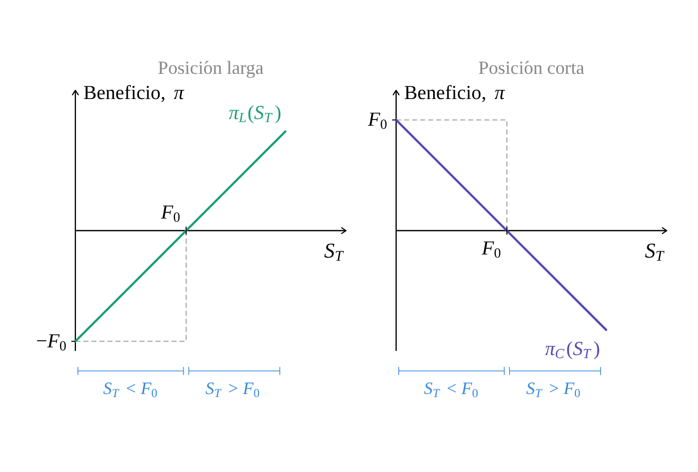
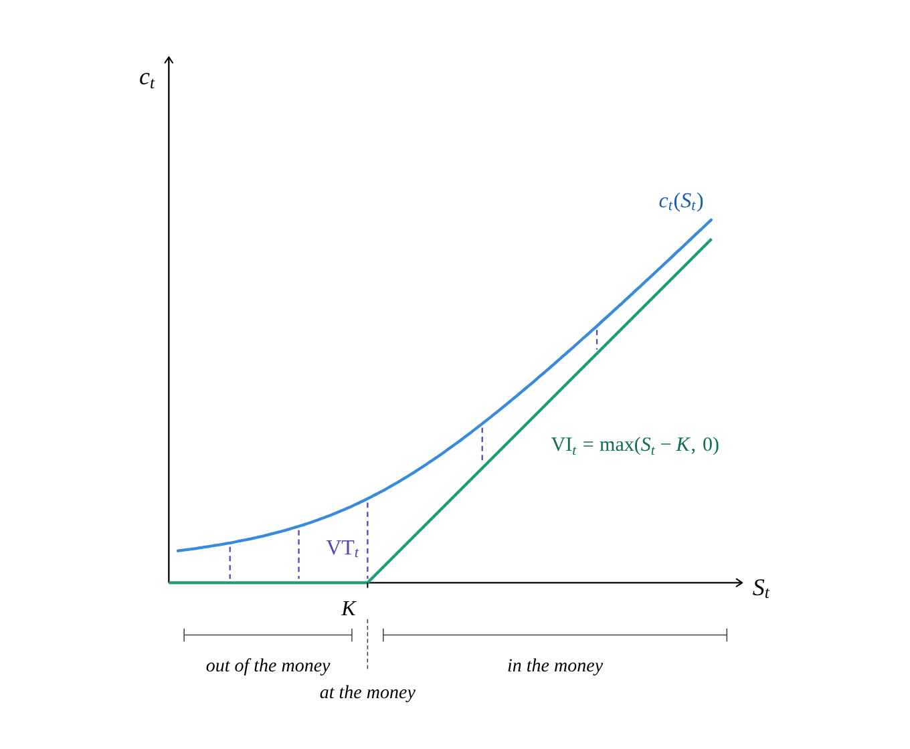
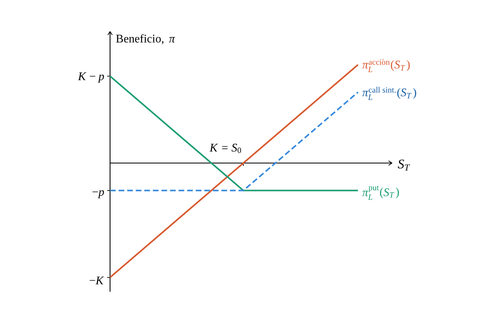
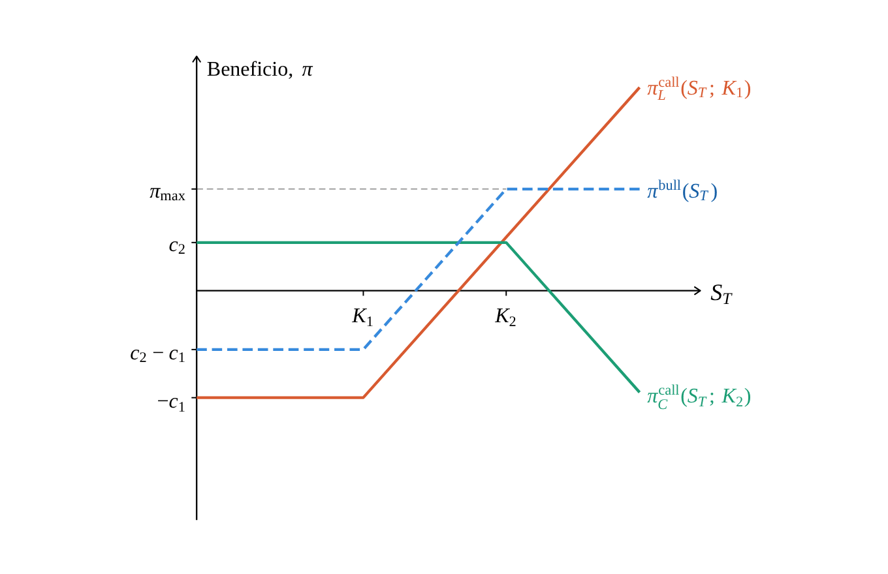
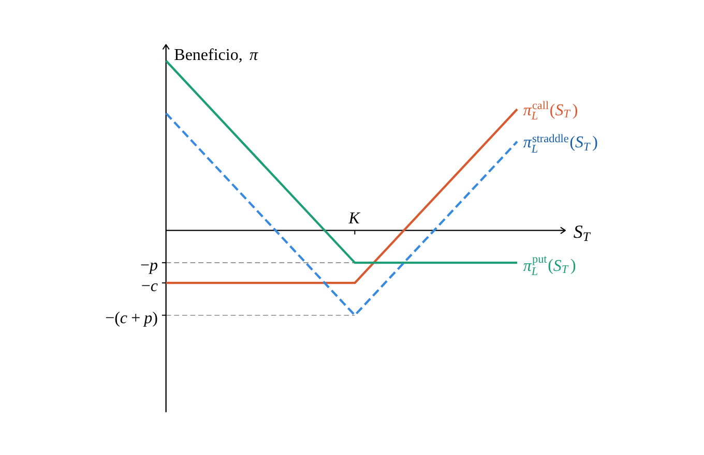
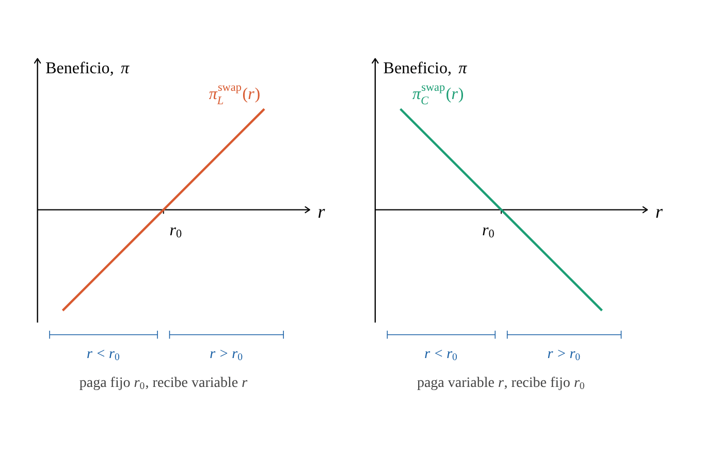

## Introducción

::: {.callout-note appearance="simple" icon=false}

:::

Los **instrumentos derivados**, definidos en la introducción común, permiten separar el riesgo del activo que lo genera. Una empresa puede fijar hoy el precio al que comprará petróleo o divisas dentro de seis meses, y un banco puede protegerse del impago de un deudor sin vender el préstamo. Los mismos instrumentos sirven para la **cobertura**, que traslada el riesgo a quien está dispuesto a asumirlo, para el **arbitraje**, que aprovecha las discrepancias de precios entre mercados, y para la **especulación**, que toma posiciones con poco capital gracias al **apalancamiento**. Ese apalancamiento amplifica tanto las ganancias como las pérdidas, como mostraron la quiebra del banco Barings en 1995, tras las pérdidas de uno de sus operadores en futuros sobre el índice Nikkei, y el rescate privado en 1998 del fondo Long-Term Capital Management, del que eran socios Merton y Scholes.

Se negocian en dos tipos de mercado. En los **mercados organizados**, los contratos están normalizados y una **cámara de compensación** se interpone entre las partes, mientras que en los **mercados no organizados** (*over the counter*, OTC) los contratos se pactan a medida. Los futuros se negocian en los primeros, y los *forwards* y la mayoría de los *swaps*, en los segundos. Su valoración descansa en un principio común, el de **no arbitraje**, según el cual dos carteras que generan los mismos pagos deben tener el mismo precio, lo que permite valorarlos con independencia de las expectativas sobre el subyacente.

El tamaño de estos mercados explica la atención que les prestan los reguladores. Según el Banco de Pagos Internacionales, el importe nocional de los derivados OTC era de 844,6 billones de dólares a finales de 2025, un 79 % de ellos sobre tipos de interés, aunque su valor de mercado bruto, que mide el coste de reemplazar los contratos a precios de mercado, era de 22,8 billones. Las exposiciones bilaterales y opacas de algunos participantes, como AIG, agravaron la crisis financiera global y llevaron al G20 a impulsar su compensación centralizada (tema [B27](b27-regulacion-financiera.qmd), apartado 3.3).

El tema estudia sucesivamente las tres grandes familias de derivados, siempre con el mismo esquema de fundamentos, valoración y estrategias:

- *Mercado de futuros*: se estudian los **futuros** y los **contratos a plazo** (*forwards*).

- *Mercado de opciones*: el tema analiza después las **opciones**, de compra y de venta.

- *Permutas y derivados de crédito*: la última parte trata las **permutas financieras** (*swaps*) y los derivados de crédito, como las permutas de incumplimiento crediticio (CDS, *credit default swaps*).

## 1. Mercado de futuros y *forwards*

La primera familia, la de los futuros y los *forwards*, sigue el esquema anunciado, que parte de sus fundamentos (definición, tipos y funcionamiento), pasa por su valoración y termina en las estrategias de cobertura, arbitraje y especulación.

### 1.1. Fundamentos

Antes de valorar los futuros y los *forwards* conviene fijar su definición y sus tipos, su funcionamiento y los mercados en que se negocian, organizados o no.

#### 1.1.1. Definición y tipos

Los acuerdos de entrega futura a precio pactado tienen antecedentes muy antiguos, y en los Países Bajos del s. XVII ya funcionaban mercados a plazo de materias primas. La fiebre de los tulipanes de 1636-1637 se negoció en buena parte con contratos a plazo sobre bulbos (Garber, 1989). La lonja del arroz de Dōjima (Osaka, 1730) se considera el primer mercado de futuros propiamente dicho. Los mercados de futuros sobre activos financieros nacen mucho después, en 1972, con la creación del IMM (International Monetary Market) por el CME (Chicago Mercantile Exchange).

**Definición**: a diferencia de los contratos al contado (*spot*), los contratos de futuros y los contratos *forward* son acuerdos de compraventa entre dos partes en los que se pactan hoy el precio y la obligación de comprar y vender en una fecha futura. Permiten así transferir el riesgo del activo subyacente (p. ej. una materia prima, un índice o un activo financiero) sin transferir su propiedad. Las principales diferencias entre ambos tipos son:

- *Futuros*: son contratos estandarizados en cuanto a la fecha de compraventa futura y la cantidad y características del activo subyacente. Se negocian en mercados organizados, cuya cámara de compensación elimina casi por completo el riesgo de contrapartida mediante un sistema de garantías y la liquidación diaria de pérdidas y ganancias (*mark to market*), que se describen en el apartado 1.1.3.

- *Forwards*: son contratos bilaterales y, por tanto, mucho más flexibles. Se negocian en mercados no organizados u OTC (*over the counter*).

**Tipos**: los futuros y los *forwards* se pueden construir sobre muchos activos (p. ej. materias primas), si bien entre los de tipo financiero destacan:

- *Futuros financieros*: los de tipos de interés (sobre bonos o sobre tipos a corto plazo), los de divisas (que suelen tener como subyacente monedas fuertes y sirven para cubrir el riesgo cambiario) y los de índices bursátiles. Como un índice no es entregable, estos últimos se liquidan siempre por diferencias.

- *Forwards*: los de tipos de interés (FRA, *forward rate agreements*), empleados para asegurar un determinado tipo de interés para pedir prestado o prestar en un momento futuro determinado.

#### 1.1.2. Funcionamiento

El funcionamiento de un futuro o *forward* y la relación entre las partes se pueden representar con un diagrama que relaciona las pérdidas y ganancias con el precio del futuro y el precio del activo subyacente.

**Comprador (posición larga)**: se compromete a adquirir el subyacente al precio pactado en el momento inicial. Espera que el precio del subyacente suba (perspectiva alcista o *bullish*), en cuyo caso podrá comprarlo a un precio inferior al del mercado. Su zona de ganancias corresponde a los precios del subyacente superiores al precio del futuro, en los que su perfil de resultados es positivo. Sus ganancias son ilimitadas, mientras que sus pérdidas quedan acotadas por el precio pactado siempre que el subyacente no cotice en negativo (como en el episodio del crudo West Texas Intermediate, WTI, de 2020).

**Vendedor (posición corta)**: se compromete a entregar el subyacente al precio pactado en el momento inicial. Sin embargo, no necesita poseerlo, ya que la posición corta se abre vendiendo el contrato, sin préstamo alguno, a cambio de constituir una garantía o margen ante la cámara. Espera que el precio del subyacente baje (perspectiva bajista o *bearish*). Sus ganancias son limitadas, mientras que sus pérdidas son ilimitadas.

Existe, así, una simetría total entre las dos posiciones del contrato, pues la ganancia de la posición larga es exactamente la pérdida de la posición corta y viceversa. Por ello se dice que los futuros son juegos de suma cero. Las posiciones se pueden deshacer antes del vencimiento en el mercado secundario.

Gráficamente, en el plano precio del subyacente al vencimiento-beneficio (figura -@fig-b251-futuros), cada panel representa el resultado al vencimiento de una de las dos posiciones del mismo contrato:

1. *Posición larga* ($\pi_L(S_T) = S_T - F_0$): refleja el resultado de quien se ha comprometido a comprar el subyacente al precio pactado $F_0$. Tiene pendiente unitaria porque cada subida de $S_T$ aumenta en la misma cuantía el valor de lo que recibe, mientras que lo que paga está fijado. El resultado es negativo si $S_T < F_0$, nulo en $S_T = F_0$ y positivo por encima, con una pérdida máxima de $F_0$ si el subyacente se anula.

2. *Posición corta* ($\pi_C(S_T) = F_0 - S_T$): refleja el resultado de quien se ha comprometido a entregar el subyacente a $F_0$. Tiene pendiente $-1$ porque cada subida de $S_T$ aumenta en la misma cuantía el coste de lo que debe entregar a cambio de un precio fijado. Su perfil es el simétrico del anterior respecto al eje horizontal ($\pi_L + \pi_C = 0$), con beneficio si $S_T < F_0$ y pérdida si $S_T > F_0$.

::: {#fig-b251-futuros}

::: {.content-visible when-format="html"}
```{=html}
<div class="graph-frame wide">
<iframe src="../graphs/b251_Futuros.html" style="--r:1.478" loading="lazy" title="fig-b251-futuros"></iframe>
</div>
```
:::

::: {.content-visible unless-format="html"}

:::

Perfil de resultados al vencimiento de una posición larga, $\pi_L(S_T)$, y de una posición corta, $\pi_C(S_T)$, en futuros, en función del precio del subyacente, $S_T$.
:::

#### 1.1.3. Mercados organizados y mercados no organizados

Los derivados se negocian por dos vías, que transfieren el mismo riesgo, pero difieren en su organización. En los **mercados organizados**, una sociedad rectora define contratos estandarizados (subyacente, nominal, vencimientos y forma de liquidación) y una cámara de compensación se interpone entre las partes. En los **mercados no organizados** u OTC (*over the counter*), las partes negocian bilateralmente contratos a medida, documentados con los acuerdos marco de la ISDA (International Swaps and Derivatives Association). Al primer grupo pertenecen los futuros y las opciones cotizadas, y al segundo, los *forwards*, los *swaps* y la mayoría de las opciones exóticas.

El núcleo del mercado organizado es la **entidad de contrapartida central** (ECC, o CCP por sus siglas en inglés), que tras las reformas posteriores a 2009 compensa también buena parte de los derivados OTC estandarizados. Mediante la novación, sustituye cada contrato por dos y actúa como vendedora frente a todo comprador y como compradora frente a todo vendedor. Cada parte asume así el riesgo de impago de la cámara, no el de su contraparte, y sus posiciones opuestas se compensan. La ECC se protege con garantías por capas:

- *Garantía inicial* (*initial margin*): depósito que se constituye al abrir la posición, calculado para cubrir la pérdida de unos pocos días adversos. Esta garantía es un saldo que se recupera al cerrar la posición, no un pago por el contrato, cuyo valor inicial es nulo.

- *Margen de variación* (*variation margin*): es la liquidación diaria. Cada sesión, la cámara carga a la parte perdedora y abona a la ganadora la variación del precio del futuro, $F_t - F_{t-1}$, donde $F_t$ es el precio de liquidación de la sesión $t$[^b25-2]. Este margen es un flujo definitivo, no un depósito, de modo que, tras cada pago, la posición vuelve a valer cero. Si una parte no atiende el pago diario o la garantía adicional que se le exige (*margin call*), la cámara la declara en incumplimiento y cierra sus posiciones.

- *Fondo de garantía y recursos propios*: si las garantías del incumplidor no bastan, la pérdida se cubre, por este orden, con su aportación al fondo de garantía, con recursos propios de la cámara y con las aportaciones de los demás miembros.

En el mercado OTC no compensado centralmente, en cambio, cada parte asume el riesgo de crédito de su contraparte durante toda la vida del contrato, mitigado con la compensación de posiciones en caso de impago (*close-out netting*) y el intercambio bilateral de colateral. A la flexibilidad del contrato a medida se oponen el riesgo de contrapartida, la menor liquidez y, antes de las reformas posteriores a 2009, la opacidad. De hecho, nadie conocía la red de exposiciones, como mostró el caso de AIG (véase el tema [B26](b26-crisis-financieras.qmd), apartado 2.2.1).

Por tamaño, domina el mercado OTC. Según el Banco de Pagos Internacionales (BIS), a finales de 2025 el nocional vivo de los derivados OTC era de 844,6 billones de dólares, el 79 % sobre tipos de interés. Sin embargo, el nocional exagera el riesgo, ya que el valor bruto de mercado, lo que costaría reponer los contratos, era de 22,8 billones.

Los grandes mercados organizados son CME Group (Chicago), Intercontinental Exchange (ICE), Eurex (grupo Deutsche Börse) y Cboe Global Markets. En España opera MEFF, el mercado de derivados de Bolsas y Mercados Españoles (BME), del grupo suizo SIX desde 2020. MEFF negocia futuros y opciones sobre el IBEX 35 y sobre acciones.

::: {.callout-note appearance="simple" icon=false}
La regulación de los mercados de derivados posterior a la crisis se desarrolla en el tema [B27](b27-regulacion-financiera.qmd), apartado 3.3. Aquí se recogen sus rasgos esenciales.
:::

Tras la crisis, el G20 acordó en Pittsburgh (2009) que los derivados OTC estandarizados se compensaran a través de ECC y se negociaran en plataformas organizadas, que todos los contratos se comunicaran a registros de operaciones y que los no compensados soportaran mayores requerimientos de capital. La UE lo incorporó con el Reglamento (UE) n.º 648/2012 (EMIR), reformado en 2024 para reducir la dependencia de las cámaras de fuera de la UE, y EE. UU., con el título VII de la Ley Dodd-Frank (2010). Como resultado, a finales de 2025 casi el 79 % del nocional OTC sobre tipos de interés tenía como contraparte una ECC (BIS), a cambio de concentrar el riesgo en unas pocas cámaras sistémicas.

### 1.2. Valoración de futuros y *forwards*

Antes de valorar cada contrato conviene fijar el marco conceptual, común a todo el tema. En los derivados deben distinguirse tres objetos:

1. *Precio del contrato* ($F_0$, $K$, $r_0$): el término contractual pactado a la firma (el precio de entrega $F_0$ de un futuro o *forward*, el precio de ejercicio $K$ de una opción, el tipo fijo de un *swap* $r_0$). No es un desembolso, sino una cláusula del contrato.

2. *Valor del contrato* ($V_t$): lo que la posición vale en cada momento $t$ de la vida del contrato, desde la firma ($t=0$) hasta el vencimiento ($t=T$).

3. *Precio de mercado*: la cotización observada del contrato, que surge de la oferta y la demanda. Está anclada por el arbitraje al valor teórico, porque cualquier desviación constituye un beneficio sin riesgo y su explotación la elimina de inmediato. Ese anclaje es relativo, como el de un bono a la curva cupón cero (tema [B24](b24-renta-fija.qmd), apartado 2.1), porque el arbitraje fija el precio del derivado dado el del subyacente (en las opciones, también dada la volatilidad de este), pero no el del subyacente. En futuros y *swaps*, el mercado cotiza el precio del contrato, mientras que en opciones cotiza la prima, es decir, el valor.

La relación entre precio y valor depende de la naturaleza del contrato:

- *Contratos simétricos*: en los contratos que obligan a ambas partes (futuros, *forwards*, *swaps*), el precio se pacta precisamente para que el valor inicial sea nulo ($V_0 = 0$), de modo que nadie paga por entrar. El valor solo surge después, conforme el mercado se mueve.

- *Contratos asimétricos*: en las opciones, que otorgan un derecho sin obligación, el valor es positivo desde el origen y debe pagarse. Por tanto, la *prima* es, a la vez, el precio pagado por el instrumento y su valor.

#### 1.2.1. Consideraciones generales

El instrumental que permite calcular los precios y valores teóricos de los derivados se apoya, en general, en la condición de no arbitraje y la medida riesgo-neutral:

1. *Condición de no arbitraje*: supóngase un mercado eficiente y completo en el que existen un activo subyacente, un derivado y un activo libre de riesgo. Si con el subyacente y el derivado se forma una cartera sin riesgo, esta no puede obtener una rentabilidad distinta de la del activo libre de riesgo, porque existirían oportunidades de arbitraje. Dicho de otro modo, todo activo replicable ha de tener el mismo valor que la cartera que lo replica.

2. *Medida riesgo-neutral* (Harrison y Kreps, 1979): la distribución probabilística del valor del subyacente al vencimiento que resulta relevante para valorar el derivado no es la que reflejan las expectativas de los agentes. En su lugar se emplea una distribución ajustada (la llamada *distribución riesgo-neutral*) que garantiza el cumplimiento de la condición de no arbitraje. Intuitivamente, significa que, a la hora de calcular el valor descontado de los flujos del derivado, la distribución utilizada no depende de las expectativas ni de las preferencias por el riesgo de los agentes. En tiempo discreto, como en el binomial (apartado 2.2.2), se deduce de la réplica, y en tiempo continuo el cambio de medida se apoya en el teorema de Girsanov (1960).

#### 1.2.2. Precio y valor de los futuros y los *forwards*

**Precio del contrato ($t=0$)**: con tipos de interés deterministas, futuros y *forwards* comparten la misma fórmula para el precio a plazo de equilibrio, la del *coste de mantenimiento* (*cost of carry*). Para que no exista arbitraje deberá cumplirse que:

$$F_0 = S_0(1+r_f)^T + m, \quad t=0$$

donde $F_0$ es el precio a plazo pactado a la firma del contrato, $S_0$ el precio de contado del subyacente en ese momento, $r_f$ el tipo de interés libre de riesgo, $T$ la duración del contrato y $m$ el coste neto de mantenimiento. Expresado en valor al vencimiento, $m$ recoge los costes que genera el subyacente durante la vida del contrato (p. ej. almacenamiento) netos de las rentas que produce (p. ej. dividendos, cupones o, en materias primas, el rendimiento de conveniencia).

La fórmula establece que el precio a plazo debe ser el precio de contado capitalizado al tipo sin riesgo y ajustado por el coste de mantenimiento. La razón es el arbitraje. Si $F_0$ fuese superior, convendría comprar el subyacente financiándolo al tipo sin riesgo y venderlo a plazo (*cash and carry*), con un beneficio sin riesgo. Si fuese inferior, la operación inversa (*reverse cash and carry*) produciría el mismo resultado[^b25-3].

Cuando el subyacente es una divisa, su renta es el interés que rinde la moneda extranjera. Con $T = 1$, el coste neto de mantenimiento es $m = -i^* F_0$, donde $i^*$ es el tipo de interés extranjero. La fórmula se convierte entonces en $F_0 = S_0(1+r_f)/(1+i^*)$, la paridad cubierta de intereses que el tema [B13](b13-mercado-divisas.qmd), apartado 2.2.3, obtiene por arbitraje como $E_t^f = E_t^s(1+i)/(1+i^*)$.

Cuando los tipos de interés son estocásticos y están correlacionados con el precio del subyacente, en cambio, los precios de ambos contratos difieren (Cox, Ingersoll y Ross, 1981). La diferencia se debe a la forma de liquidación de cada instrumento, con cámara de compensación o sin ella. En un futuro, las ganancias se cobran día a día y se reinvierten al tipo vigente, mientras que en un *forward* todo se liquida al vencimiento.

**Valor del contrato a lo largo de su vida ($0 < t < T$)**: a la firma, el valor de ambos contratos es nulo por construcción, pues el precio de entrega se pacta al nivel de equilibrio ($K = F_0$). A partir de ahí, el valor de la posición evoluciona de forma distinta en cada contrato:

- *Futuros*: el contrato liquida en efectivo cada día la variación de su precio. El importe liquidado es $F_t - F_{t-1}$, cobrado en el momento y, por ello, sin necesidad de descuento alguno. Entre liquidaciones, el valor de la posición es la variación acumulada desde el último cierre. Tras cada ajuste de márgenes, como el contrato se reemplaza por uno nuevo al precio de liquidación, el valor vuelve a ser cero.

- *Forward*: a diferencia del futuro, acumula valor conforme se mueve el precio a plazo vigente para el mismo vencimiento, $F_t$. Para la posición compradora, ese valor es $V_t = (F_t - K)\,e^{-r_f(T-t)}$, donde $K$ es el precio de entrega pactado. La fórmula actualiza una diferencia cierta, que puede asegurarse cerrando la posición con un *forward* de signo contrario, y no un flujo esperado.

La fuente del valor es, pues, la misma en ambos contratos (las variaciones del precio a plazo), pero no el momento del cobro. El *forward* lo aplaza y descuenta, mientras que el futuro lo percibe a diario por su importe nominal.

**Valor del contrato al vencimiento ($t=T$)**:

- *Forward*: la posición compradora liquida de una sola vez la diferencia $S_T - K$.

- *Futuros*: la posición compradora ha ido cobrando (o pagando) esa misma cantidad de forma fraccionada a lo largo de la vida del contrato. Por tanto, en $T$, el valor pendiente es nulo. Si el contrato es de entrega física en lugar de liquidación por diferencias, el comprador adquiere el subyacente pagando el último precio de liquidación. Como todas las diferencias anteriores ya se liquidaron en efectivo, su coste efectivo total sigue siendo el precio pactado $F_0$, con resultado económico idéntico.

**Valoración y situación de mercado**: al comparar el precio del futuro con el del subyacente, los operadores (*traders*) describen dos situaciones de mercado:

1. *Backwardation*: los beneficios netos de la posesión del activo subyacente superan el coste de financiarlo, lo que sitúa el precio de contado por encima del precio del futuro ($S > F$). La situación es frecuente en materias primas con un rendimiento de conveniencia elevado.

2. *Contango*: la posesión del activo subyacente genera costes netos, incluido el de financiarlo, lo que sitúa el precio de contado por debajo del precio del futuro ($S < F$).

Un caso extremo de *contango* se dio en abril de 2020 en el futuro sobre el WTI con entrega en mayo, negociado en el New York Mercantile Exchange (NYMEX). Por el exceso de oferta de crudo y la caída de la demanda que causó la COVID-19, la capacidad de almacenamiento de Cushing (Oklahoma), punto de entrega del contrato, quedó casi agotada. Los tenedores de posiciones largas que no podían recibir el crudo se vieron obligados a cerrarlas a cualquier precio antes del vencimiento. El CME, que días antes había adaptado sus sistemas para admitir cotizaciones negativas, registró así precios por debajo de cero por primera vez en la historia del contrato, que cotiza desde 1983. El 20 de abril de 2020, el futuro cerró a $-37{,}63$ dólares por barril.

### 1.3. Estrategias

Los futuros y los *forwards* se emplean con tres finalidades, que son la cobertura, el arbitraje y la especulación.

#### 1.3.1. Cobertura

Uno de los usos más habituales de estos contratos es la **cobertura**, que consiste en tomar una posición para reducir el riesgo de mercado, es decir, evitar la posible pérdida que causaría un movimiento desfavorable del precio de un activo.

La posición en el derivado va en la dirección opuesta a la exposición de la cartera:

- *Compra futura*: quien va a comprar divisas, acciones o bonos está expuesto, respectivamente, a una apreciación de la divisa, a una subida de las cotizaciones o a un descenso del tipo de interés (a una subida del precio de los bonos). Se cubre comprando futuros sobre el activo subyacente (posición larga).

- *Venta futura*: quien va a vender una cartera, o ya la posee y teme una caída de su valor, está expuesto a bajadas de precio y se cubre vendiendo futuros (posición corta).

A la hora de realizar la cobertura, los operadores tienen en cuenta tres cuestiones:

1. *Cuánto riesgo cubrir*: el valor mínimo de la exposición (la parte que se conoce con certeza), su valor futuro esperado o el principal.

2. *Qué instrumento elegir*: los futuros, normalizados y líquidos, se prestan a cubrir carteras de bonos y acciones. En cambio, los *forwards*, hechos a medida en importe y fecha, se ajustan a exposiciones concretas, como el tipo de un préstamo futuro, que se fija con un FRA, o el riesgo cambiario de una operación comercial. En el mercado de divisas, su volumen supera con holgura al de los futuros (tema [B13](b13-mercado-divisas.qmd), apartados 2.1.2 y 2.2.2).

3. *Qué subyacente emplear*: el mismo activo, si es lo bastante líquido, o uno correlacionado con él.

Si el activo que se desea cubrir es poco líquido, el operador puede cubrirse con un futuro sobre un subyacente fuertemente correlacionado con el original (*proxy hedging*). A cambio, se agrava el *riesgo base*, es decir, el riesgo de que el precio del activo cubierto y el del futuro empleado no evolucionen de forma paralela. Existe, por tanto, una disyuntiva entre liquidez y correlación entre subyacentes.

**Ratio de cobertura de mínima varianza**: con riesgo base, cubrir unidad por unidad no minimiza el riesgo. Si $\Delta S$ y $\Delta F$ son las variaciones del precio del activo cubierto y del futuro durante la cobertura, la proporción de la exposición que conviene cubrir es

$$h^* = \rho_{SF}\, \frac{\sigma_S}{\sigma_F}$$

donde $\rho_{SF}$ es su correlación y $\sigma_S$ y $\sigma_F$ sus desviaciones típicas. La ratio $h^*$ coincide con la pendiente de la regresión de $\Delta S$ sobre $\Delta F$. El número de contratos es $N^* = h^* Q_A / Q_F$, con $Q_A$ el tamaño de la exposición y $Q_F$ el de un contrato. En particular, para una cartera de acciones cubierta con futuros sobre un índice, la ratio es la beta de la cartera y $N^* = \beta\, V_A / V_F$, donde $V_A$ es el valor de la cartera y $V_F$ el nocional de un contrato (el nivel del índice por el multiplicador). En el ejemplo que sigue, la cartera replica el índice, de modo que $\beta = 1$ y la cobertura es de uno a uno.

::: {.callout-tip collapse="true" appearance="simple" title="Ejemplo: precio de un futuro sobre un índice y cobertura de una cartera"}
Un índice bursátil cotiza a 10.000 puntos, el tipo sin riesgo a un año es del 3 % y las acciones del índice pagarán en el año dividendos por 200 puntos, valorados al vencimiento. Un gestor tiene una cartera de 5 millones de euros que replica el índice y teme una caída. Cada contrato de futuro a un año vale 10 € por punto.

- *Precio del futuro*: el dividendo es una renta del subyacente, por lo que el coste neto de mantenimiento es $m = -200$ y $F_0 = 10.000 \cdot 1{,}03 - 200 = 10.100$ puntos.

- *Cobertura*: el gestor vende $5.000.000/(10.000 \cdot 10) = 50$ contratos. Si el índice cae a 9000 puntos, la cartera vale 4,5 millones, cobra 0,1 millones de dividendos y los futuros ganan $(10.100 - 9000) \cdot 10 \cdot 50 = 550.000$ €, en total 5,15 millones. Si sube a 11.000, la cartera vale 5,5 millones, cobra los mismos dividendos y los futuros pierden 450.000 €, de nuevo 5,15 millones.

- *Resultado*: la cartera cubierta rinde el 3 % ($5 \cdot 1{,}03 = 5{,}15$ millones) sea cual sea el índice, porque la venta a plazo fija el precio de venta. La cobertura elimina el riesgo y, con él, la ganancia de una subida.
:::

#### 1.3.2. Arbitraje: *cash and carry*

Si el precio de un futuro no es igual al precio al contado ajustado, existirán oportunidades de **arbitraje** que permitirán lograr un beneficio sin riesgo. Si el futuro cotiza por encima, este beneficio se obtiene con las llamadas estrategias *cash and carry*, que consisten en comprar al contado con financiación, almacenar (si el subyacente es una materia prima) y vender a plazo con un futuro o un *forward*. Combinan, por tanto, una posición larga en el segmento al contado con una posición corta en el segmento a plazo. En cambio, si el futuro cotiza por debajo, la operación inversa (*reverse cash and carry*) combina una venta al contado con una compra a plazo.

#### 1.3.3. Especulación

Frente a la cobertura, que busca reducir el riesgo, la **especulación** consiste en asumirlo de forma deliberada con el fin de obtener un beneficio a partir de las expectativas sobre la evolución del precio. El especulador mantiene así **posiciones abiertas y direccionales**, con una posición larga si prevé una subida del subyacente (perspectiva alcista) y una corta si anticipa una caída (perspectiva bajista).

La especulación puede operar también sobre la estructura temporal del mercado, mediante diferenciales entre vencimientos (*calendar spreads*) o posiciones que anticipan el tránsito entre situaciones de *contango* y *backwardation*.

En todo caso, el rasgo que define la especulación con derivados es el **apalancamiento**. Como el contrato solo exige depositar una garantía o margen, y no el valor íntegro del subyacente, las pérdidas y ganancias se amplifican en relación con el capital comprometido, lo que multiplica tanto la rentabilidad potencial como el riesgo. A ello se añaden la liquidación diaria (*mark to market*), que puede obligar a reponer garantías o a cerrar la posición ante un movimiento adverso, y el carácter ilimitado de las pérdidas en las posiciones cortas.

Con todo, el especulador desempeña una función económica relevante, ya que aporta liquidez al mercado y absorbe el riesgo que los agentes de cobertura desean transferir.

### 1.4. Conclusiones

En resumen, los futuros y *forwards* permiten transferir el riesgo de mercado sin transferir la propiedad del subyacente, en un juego de suma cero en el que las posiciones larga y corta son perfectamente simétricas. Su precio se fija por la condición de no arbitraje ($F_0 = S_0(1+r_f)^T + m$), de modo que no depende de las expectativas de los agentes, sino del coste de mantener el subyacente hasta el vencimiento. Dan servicio tanto a la cobertura como a la especulación y al arbitraje, perfiles complementarios que dotan de liquidez al mercado.

**Aspectos positivos**: transfieren el riesgo de forma eficiente y a bajo coste, y permiten operar con apalancamiento, pues solo exigen un margen. En el caso de los futuros, además, la cámara de compensación y el *mark to market* prácticamente eliminan el riesgo de contrapartida.

**Limitaciones**: el apalancamiento amplifica también las pérdidas, ilimitadas en las posiciones cortas, y la liquidación diaria puede forzar la reposición de garantías. La estandarización resta flexibilidad a los futuros, mientras que los *forwards* quedan expuestos al riesgo de contrapartida. Por último, la cobertura con subyacentes imperfectos introduce riesgo base.

## 2. Mercado de opciones

A diferencia de los futuros, las opciones otorgan a su comprador un derecho, y no una obligación, a cambio de una prima. Tras sus fundamentos se estudian su valoración, por el método binomial y el modelo de Black-Scholes-Merton, y las estrategias que se construyen con ellas.

### 2.1. Fundamentos

Se exponen primero la definición y los tipos de opciones y después su funcionamiento.

#### 2.1.1. Definición y tipos

Aunque los contratos de opción tienen antecedentes en la antigua Grecia, su primer mercado oficial moderno no abrió hasta 1973, en Chicago, con el Chicago Board Options Exchange (CBOE). En Europa destaca Eurex como principal mercado organizado de futuros y opciones.

**Definición**: el *contrato de opción* es un instrumento financiero que permite a su comprador, sin obligarle a ello, adquirir o enajenar un activo subyacente a un precio pactado de antemano, el *precio de ejercicio* (*strike price*). El derecho puede ejercerse en una fecha concreta o en cualquier momento hasta ella.

**Tipos**: existen diferentes formas de clasificar las opciones:

- *Según el derecho otorgado*:

    - *Opción de compra u opción call*: su comprador puede, si así lo decide, adquirir el activo subyacente pagando el precio de ejercicio, y entonces el vendedor está obligado a entregárselo.

    - *Opción de venta u opción put*: su comprador adquiere la facultad de vender el activo que sirve de subyacente. Si decide ejercerla, la contraparte que se la vendió queda obligada a comprárselo.

- *Según el momento de ejercicio*: opción europea (solo se puede ejercer al vencimiento), opción americana (en cualquier momento hasta el vencimiento) y opción bermuda (en determinados momentos prefijados).

- *Según el número de subyacentes*: *single asset* (sobre un único subyacente) y *multiasset* (sobre varios subyacentes, generalmente a través de una cesta, con modalidades *worst of* y *best of*).

- *Según el pago*:

    - *Plain vanilla*: los pagos dependen exclusivamente del precio de ejercicio y el precio del subyacente.

    - *Exóticas*: presentan estructuras de pago más complejas. En muchas de ellas (las dependientes de la trayectoria), los pagos dependen de la evolución pasada del subyacente. En las opciones asiáticas, por ejemplo, el precio de ejercicio se compara con una media del precio del subyacente. Las opciones barrera se activan (*knock in*) o desactivan (*knock out*) si el subyacente alcanza un determinado valor durante la vida de la opción.

- *Otros tipos*:

    - *Opciones al descubierto*: venta de una opción sin cubrir la obligación que se asume (p. ej. vender una *call* sin poseer el subyacente).

    - *Caps*, *floors* y *collars*: establecen techos, suelos y bandas a los tipos de interés.

    - *Warrants*: opciones titulizadas, emitidas directamente por una entidad emisora, que pueden negociarse en bolsa o fuera de ella y con posible vencimiento superior al año.

#### 2.1.2. Funcionamiento

El funcionamiento de una opción depende de su tipo y de la posición, compradora o vendedora, desde la que se observa, y se resume en el perfil de resultados al vencimiento de cada posición en el plano precio del subyacente-beneficio (figura -@fig-b257-opciones-posiciones). Se empieza por las opciones *call*.

**Opciones *call* (comprador)**: adquiere un derecho de compra a cambio de un precio denominado prima, $c$, y ese derecho se materializa en un precio de ejercicio, $K$.

Se dice que la opción está *in the money* cuando el precio del subyacente supera el precio de ejercicio ($S > K$). El agente obtiene, además, un beneficio neto siempre que $S > K + c$. Como solo ejerce cuando le conviene, el comprador de una *call* tiene ganancias ilimitadas y pérdidas limitadas a la prima.

**Opciones *call* (vendedor)**: acepta la obligación de vender el subyacente al precio de ejercicio a cambio del cobro de la prima. Al contrario que el comprador, tiene las ganancias limitadas a la prima, mientras que sus pérdidas no están limitadas, por lo que asume un riesgo mucho mayor.

Existe una **asimetría** importante, porque el vendedor adquiere una obligación, y el comprador, un derecho, que es lo que paga con la prima.

En las opciones *put*, la lógica es idéntica, pero se invierte:

**Opciones *put* (comprador)**: adquiere un derecho de venta a cambio de la prima, $p$. La opción estará *in the money* siempre que $S < K$ y el agente obtendrá un beneficio neto siempre que $S < K - p$. Las ganancias están limitadas a $K - p$ y las pérdidas a la prima.

**Opciones *put* (vendedor)**: acepta la obligación de comprar a cambio del cobro de la prima. Sus ganancias se limitan a la prima, y sus pérdidas, a $K - p$.

::: {#fig-b257-opciones-posiciones}

::: {.content-visible when-format="html"}
```{=html}
<div class="graph-frame">
<iframe src="../graphs/b257_Opciones_posiciones.html" style="height:760px" loading="lazy" title="fig-b257-opciones-posiciones"></iframe>
</div>
```
:::

::: {.content-visible unless-format="html"}

:::

Posiciones simples en opciones. Al vencimiento, en función del precio del subyacente, $S_T$, la *call* comprada, $\pi_L^{\text{call}}(S_T)$, da beneficio por encima de $K + c$ y la *put* comprada, $\pi_L^{\text{put}}(S_T)$, por debajo de $K - p$, y ambas tienen una pérdida máxima igual a la prima. Las posiciones vendedoras, $\pi_C^{\text{call}}(S_T)$ y $\pi_C^{\text{put}}(S_T)$, son sus simétricas respecto del eje horizontal.
:::

### 2.2. Valoración de opciones

Tras unas consideraciones generales, se exponen el método binomial, el modelo de Black-Scholes-Merton y la valoración de las opciones *put* europeas mediante la paridad *put-call*.

#### 2.2.1. Consideraciones generales

En una opción, contrato asimétrico, los objetos del marco del apartado 1.2 se reparten de forma distinta que en los contratos simétricos:

**Precio del contrato ($K$)**: el término contractual pactado es el precio de ejercicio $K$, que solo se desembolsa si la opción se ejerce. Como en los contratos simétricos, es una cláusula del contrato y no un pago a la firma, que en la opción corresponde a la prima.

**Valor del contrato (la prima)**: como la prima es a la vez el precio pagado por el instrumento y su valor, los modelos de este apartado calculan un único objeto, el valor teórico de la prima. Ese valor nunca es negativo, porque la opción otorga un derecho sin obligación.

El valor del contrato o prima, sin embargo, evoluciona en el tiempo. Por ello, la prima de una opción se descompone en valor intrínseco y valor temporal:

**Valor intrínseco**: viene dado por la comparación entre el precio de ejercicio y el precio del subyacente. Ampliando la distinción anterior, caben tres casos:

- *In the money*: el ejercicio de la opción genera un flujo neto positivo y existe valor intrínseco.

- *At the money*: flujo neto cero.

- *Out of the money*: flujo neto negativo y no existe valor intrínseco.

**Valor temporal**: es el sello distintivo de las opciones y depende de dos elementos:

- *Incertidumbre sobre el ejercicio*: si la opción se va a ejercer o no (el elemento principal, siempre positivo).

- *Conveniencia de posponer la operación con el activo subyacente*: depende del tipo de interés libre de riesgo, $r_f$, y de los flujos que genere el activo subyacente durante la vida de la opción.

El valor temporal será máximo cuando la opción esté *at the money* (ATM) y será nulo en la fecha de expiración. No obstante, puede llegar a ser negativo en opciones europeas muy *in the money* cuando existe mucha diferencia entre $r_f$ y los rendimientos del subyacente (p. ej. una *put* con un $r_f$ elevado o una *call* sobre un subyacente con dividendos altos).

Gráficamente, en el plano precio del subyacente-prima de una *call* (figura -@fig-b253-opciones), las curvas representan lo que valdría la opción si se ejerciera de inmediato y lo que vale en el mercado antes del vencimiento:

1. *Valor intrínseco* ($\text{VI}_t = \max(S_t - K, 0)$): refleja lo que se obtendría ejerciendo la opción en $t$. Es nulo *out of the money*, donde ejercer obligaría a comprar por encima del precio de mercado, y crece uno a uno con el subyacente *in the money*, donde cada subida de $S_t$ amplía en la misma cuantía la diferencia $S_t - K$.

2. *Prima* ($c_t(S_t)$): refleja el valor de mercado de la opción, suma del valor intrínseco y el valor temporal. Es creciente y convexa en $S_t$, con una pendiente, la delta, que va de casi cero muy *out of the money* a casi uno muy *in the money*. Si el subyacente no paga dividendos, la prima queda siempre por encima del valor intrínseco.

3. *Valor temporal* ($\text{VT}_t$): es la distancia vertical entre ambas curvas y refleja lo que vale poder aplazar la decisión de ejercicio. Es máximo *at the money* ($S_t = K$), donde es mayor la incertidumbre sobre el ejercicio, y disminuye hacia los dos extremos.

::: {#fig-b253-opciones}

::: {.content-visible when-format="html"}
```{=html}
<div class="graph-frame">
<iframe src="../graphs/b253_Opciones.html" style="height:600px" loading="lazy" title="fig-b253-opciones"></iframe>
</div>
```
:::

::: {.content-visible unless-format="html"}

:::

Valor de una opción *call* antes del vencimiento. Se compone del valor intrínseco ($\text{VI}_t$) y del valor temporal ($\text{VT}_t$), máximo *at the money*.
:::

La prima tiene un valor distinto según el momento:

- *A la firma* ($t=0$): la prima de equilibrio que el comprador paga al vendedor.

- *Durante la vida del contrato* ($0<t<T$): el valor de mercado de la posición, suma del valor intrínseco y el valor temporal.

- *Al vencimiento* ($t=T$): el valor se reduce al intrínseco, puesto que el valor temporal expira con la opción. Formalmente, el valor de una opción al vencimiento es $\max(S_T-K,\, 0)$ para una *call* y $\max(K-S_T,\, 0)$ para una *put*.

En resumen, el valor total de una opción va a depender de seis factores:

1. *Precio del subyacente* ($S$): cuanto mayor sea, mayor será el valor de una *call* y menor el valor de una *put*.

2. *Precio de ejercicio* ($K$): cuanto mayor sea, menor será el valor de una *call* y mayor el de una *put*.

3. *Tipo de interés libre de riesgo* ($r_f$): cuanto mayor sea, mayor será el valor de una *call* y menor el de una *put*.

4. *Volatilidad del precio del activo subyacente* ($\sigma$): cuanto mayor sea, mayor será el valor temporal y, por lo tanto, el valor total de la opción antes de que esta expire, independientemente de si la opción es *call* o *put*. Esto se debe a la asimetría de pérdidas y ganancias, ya que si el movimiento del precio del subyacente va en contra, el inversor nunca ejercerá la opción.

5. *Tiempo de vida de la opción* ($T$): *a priori*, da lugar a un efecto ambiguo:

    - *Efecto favorable*: cuanto mayor sea, mayor será la probabilidad de ocurrencia de una fluctuación favorable en el precio del subyacente.

    - *Efecto de posposición*: a su vez, cuanto mayor sea, más se aplaza la operación con el subyacente, lo que puede restar valor a una opción europea (p. ej. a una *put*, cuyo titular cobra $K$ más tarde, o a una *call* sobre un subyacente que reparte dividendos). En general predomina el primer efecto, por lo que un vencimiento mayor hace más valiosa la opción. Una opción americana, en cambio, nunca vale menos con un plazo mayor, porque su titular conserva todas las fechas de ejercicio de la de plazo menor.

6. *Estructura de pagos del activo subyacente*: si tiene pagos positivos (p. ej. dividendos), estos reducen el valor de las *call* y elevan el de las *put*, porque el precio del subyacente cae al repartirlos y el titular de la opción no los percibe.

#### 2.2.2. Método de la binomial (Cox, Ross y Rubinstein, 1979)

**Origen**: el método binomial de valoración de opciones se debe a Cox, Ross y Rubinstein (1979). Aunque posterior al modelo de Black-Scholes-Merton, converge a él cuando se amplía el número de pasos y constituye su fundamento discreto e intuitivo.

**Idea**: el precio del subyacente es una variable aleatoria que se distribuye según una binomial y, por tanto, lo que vale hoy la opción resulta de ponderar los valores que alcanza en cada uno de los dos estados posibles.

**Supuestos**:

- *Entorno*: horizonte temporal o paso binomial de un periodo que coincide con el vencimiento de la opción. El mercado es eficiente y completo y se cumple la condición de no arbitraje. El derivado financiero es una opción *call* europea y el activo subyacente una acción que no genera dividendos. Este último se distribuye de modo que, al final del periodo, su precio sube en un factor $u$ o baja en un factor $d$, con $d < 1+r_f < u$ para que no haya arbitraje.

- *Agentes*: el inversor construye su cartera mixta que incluye un activo libre de riesgo con una rentabilidad constante y exógena $r_f$.

**Planteamiento**: el modelo arranca con un valor de partida del subyacente, $S_0$, que al final del periodo pasa a valer $uS_0$ (subida) o $dS_0$ (bajada), estados a los que se asignan las probabilidades $q$ y $1-q$ (neutrales al riesgo). Con ellos se calcula el precio de la *call* en cada caso. El precio actual de la opción *call* europea será una media ponderada de su valor en caso de subida, $c_u$, y su valor en caso de bajada, $c_d$, descontada según un factor $1+r_f$[^b25-7]:

$$c = \frac{qc_u + (1-q)c_d}{1+r_f}$$

donde $c$ es el precio actual de la opción, $c_u$ el precio de la opción si el precio del subyacente sube, $c_d$ el precio de la opción si baja y $r_f$ es el tipo de interés libre de riesgo.

El modelo binomial valora la opción replicándola con una cartera de subyacente y activo libre de riesgo. De ahí que la probabilidad $q$ que emplea no sea la probabilidad real del mercado, sino una probabilidad neutral al riesgo derivada de la condición de no arbitraje (apartado 1.2.1).

**Conclusiones**:

- *Aspectos positivos*: no exige estimar la tasa de descuento ni las expectativas de los agentes, pues le bastan los precios de mercado y la condición de no arbitraje. Es también un modelo intuitivo y flexible, ya que admite la valoración de opciones americanas (con posibilidad de ejercicio anticipado en cada nodo) y de subyacentes con dividendos. Por ello, ofrece una aproximación pedagógica y computacionalmente sencilla que converge a Black-Scholes.

- *Limitaciones*: en su versión de un solo periodo es una simplificación poco realista, y su precisión depende del número de pasos considerados, a costa de un mayor cálculo. Además, descansa en supuestos exigentes que rara vez se cumplen en su totalidad.

#### 2.2.3. Modelo de Black-Scholes-Merton (Black y Scholes, 1973; Merton, 1973)

**Origen**: el modelo se debe a Fischer Black y Myron Scholes (1973) y a Robert Merton (1973), y valió a Scholes y Merton el Premio Nobel de 1997 (Black había fallecido en 1995). El método binomial, aunque posterior (1979), ofrece la intuición de su punto de partida. Si el periodo de la binomial se subdivide en subperiodos más pequeños, la rentabilidad logarítmica del subyacente hasta el vencimiento es la suma de las rentabilidades de cada subperiodo, variables binomiales independientes entre sí. A medida que se suman más, la distribución de su suma se va pareciendo a una normal.

**Idea**: existe un precio teórico único de una opción, que depende de la volatilidad del subyacente pero no de su rentabilidad esperada. Se obtiene porque, en teoría, se puede construir una cartera protegida o *hedged portfolio*, insensible a los cambios pequeños del precio del subyacente, formada por una opción vendida y $\Delta$ acciones compradas del activo subyacente. Al carecer de riesgo, esa cartera debe rendir el tipo libre de riesgo. Este tipo de cobertura se conoce como *cobertura delta dinámica* (*delta hedging*)[^b25-8].

**Supuestos**:

- *Entorno*: se mantiene la eficiencia y completitud del mercado, si bien el horizonte temporal es continuo, a diferencia del caso discreto anterior. El precio del activo subyacente se distribuye según una distribución log-normal y, por tanto, su rentabilidad logarítmica hasta el vencimiento, $\ln(S_T/S_0)$, es una variable aleatoria que se distribuye según una distribución normal. El activo subyacente no genera flujos de caja, su volatilidad es conocida y constante y sus movimientos no tienen inercias, es decir, los movimientos en $t$ son independientes de los producidos en $t-1$.

- *Mercados*: no existen costes de transacción ni impuestos, la negociación es continua y el tipo libre de riesgo es constante.

**Planteamiento**: el modelo parte de la ecuación diferencial de Black-Scholes, cuya solución, dada la condición terminal (el valor de la opción al vencimiento), es una fórmula cerrada de valoración. Para una *call* europea sobre una acción que no paga dividendos, la fórmula de Black-Scholes es:

$$c = S_0 \cdot N(d_1) - Ke^{-r_f T} \cdot N(d_2)$$

donde:

- $N(d_1)\in (0, 1)$: probabilidad acumulada de una normal para un determinado valor $d_1$. Recoge la llamada *delta*, es decir, la sensibilidad de la opción de compra al precio del subyacente. $d_1$, al igual que $d_2$, es un valor en abscisas para calcular la probabilidad.

- $N(d_2)\in (0, 1)$: probabilidad acumulada de una normal para un determinado valor $d_2$. Refleja la probabilidad (bajo la distribución riesgo-neutral) de que la opción se ejerza.

- $d_1 = \dfrac{\ln(S_0/K) + (r_f + \sigma^2/2)\,T}{\sigma\sqrt{T}}$ y $d_2 = d_1 - \sigma\sqrt{T}$, donde $\sigma$ es la volatilidad del subyacente.

A pesar de su aparente complejidad, la fórmula tiene una lectura intuitiva:

- *Primer término*, $S_0 \cdot N(d_1)$: refleja el valor actual del subyacente que se recibe si la opción se ejerce al vencimiento (bajo la distribución riesgo-neutral).

- *Segundo término*, $Ke^{-r_f T} \cdot N(d_2)$: refleja el valor actual del precio de ejercicio que debe pagarse al comprar el subyacente, ponderado por la probabilidad riesgo-neutral de ejercicio, $N(d_2)$.

Intuitivamente, la fórmula de Black-Scholes calcula el valor actual esperado, bajo la distribución riesgo-neutral, del pago de la opción al vencimiento, es decir, lo que se recibe menos lo que se paga, cada término con su propia ponderación ($N(d_1) > N(d_2)$).

Sin las ponderaciones, la expresión se reduce al valor intrínseco de una opción *call* calculado con el precio de ejercicio descontado, $S_0 - Ke^{-r_f T}$. Si $\sigma = 0$ (no hay incertidumbre), las dos ponderaciones valen 1 si $S_0 > Ke^{-r_f T}$ y 0 en caso contrario, de modo que el valor de una *call* se simplifica a $c = \max(S_0 - Ke^{-r_f T}, 0)$.

**Estática comparativa** (las cinco griegas): la fórmula de Black-Scholes permite además medir el efecto sobre el precio de la opción de cambios marginales en las variables que lo determinan:

1. *Delta* ($\Delta = \partial c/\partial S$): indica cuánto cambia el valor de una opción ante cambios en el precio del subyacente. Es positiva para una *call* y negativa para una *put*. La delta no es constante, ya que las opciones, a diferencia de los futuros, son productos no lineales, con una convexidad que se refleja en su gamma.

2. *Gamma* ($\Gamma = \partial^2 c/\partial S^2$): refleja la sensibilidad de delta ante cambios en el precio del subyacente (convexidad de la opción). Las posiciones largas en *calls* y en *puts* tienen una gamma positiva, máxima ATM.

3. *Vega* ($\nu = \partial c/\partial \sigma$): mide los cambios en el precio de la opción ante cambios en la volatilidad implícita del subyacente. Las posiciones largas, tanto en *calls* como en *puts*, tienen una vega positiva, más elevada cuanto más cerca está la opción de estar ATM.

4. *Theta* ($\Theta = \partial c/\partial t$): medida de cómo cambia el valor de la opción al paso del tiempo. Suele ser negativa, ya que el paso del tiempo tiende a depreciar el valor temporal de la opción. Además, la theta afecta con mayor intensidad a opciones próximas a su vencimiento.

5. *Rho* ($\rho = \partial c/\partial r_f$): mide la reacción de la prima ante un movimiento del tipo sin riesgo y figura entre los indicadores menos relevantes. Al aumentar el tipo de interés, aumenta el precio de las *calls* y cae el de las *puts*.

**Conclusiones**:

- *Aspectos positivos*: la fórmula permite calcular de manera sencilla el valor teórico de una opción y contribuyó a extender el uso de opciones en los mercados financieros.

- *Limitaciones*:

    - *Volatilidad no constante*: el mercado alterna periodos de fuerte volatilidad con periodos de calma (agrupamiento de la volatilidad), y la volatilidad implícita varía con el precio de ejercicio (*volatility smile/skew*).

    - *Inercias*: los movimientos de los activos no son independientes de los movimientos pasados (p. ej. rebotes).

    - *Colas gruesas*: los movimientos de los activos no siguen una distribución normal, sino que muchas veces tienen colas gruesas, lo que da lugar a exposiciones significativas a riesgo de cola (*tail risk*).

#### 2.2.4. Valoración de opciones *put* europeas: paridad *put-call*

Para opciones europeas con el mismo precio de ejercicio y el mismo vencimiento, y sobre un activo que no genera renta (concretamente, una acción sin dividendo), se pueden formar dos carteras, empleando además un bono cupón cero de nominal $K$ con el mismo vencimiento:

- *Cartera A* (*fiduciary call*): posición larga en una *call* y posición larga en el bono cupón cero de nominal $K$.

- *Cartera B* (*protective put*): posición larga en una *put* y posición larga en una acción sin dividendo.

Ambas carteras pagan lo mismo al vencimiento, sea cual sea la relación entre el precio de la acción y el precio de ejercicio, por lo que, por no arbitraje, su coste actual debe ser el mismo:

$$c + Ke^{-r_f T} = p + S_0$$

Es decir, el coste de comprar una *call* europea e invertir el valor actual del precio de ejercicio, $Ke^{-r_f T}$, al tipo $r_f$ debe ser igual al coste de comprar una *put* y el subyacente. La paridad permite valorar *puts* a partir de *calls* (o viceversa) y fundamenta las estrategias sintéticas.

::: {.callout-tip collapse="true" appearance="simple" title="Ejemplo: una *call* en un árbol binomial y la *put* por la paridad"}
Una acción sin dividendos cotiza a 100 € y al cabo de un periodo valdrá 120 € ($u = 1{,}2$) o 90 € ($d = 0{,}9$). El tipo sin riesgo del periodo es del 5 %. Se valoran una *call* y una *put* europeas con precio de ejercicio $K = 100$ € y vencimiento al final del periodo.

- *Probabilidad neutral al riesgo*: $q = (1{,}05 - 0{,}9)/(1{,}2 - 0{,}9) = 0{,}5$.

- *Call*: vale 20 € si la acción sube y nada si baja, así que $c = 0{,}5 \cdot 20/1{,}05 \approx 9{,}52$ €. La replican dos tercios de acción y un préstamo de 57,14 €, que cuestan lo mismo, $66{,}67 - 57{,}14 \approx 9{,}52$ €.

- *Put por la paridad*: con el descuento discreto del árbol, $p = c + K/(1+r_f) - S_0 = 9{,}52 + 95{,}24 - 100 \approx 4{,}76$ €, el mismo valor que da el árbol, $0{,}5 \cdot 10/1{,}05$.
:::

### 2.3. Estrategias

Las opciones permiten construir perfiles de pago al vencimiento muy diversos, y todas las estrategias se basan en la apertura simultánea de al menos dos posiciones que combinan distintos derivados, o derivados y subyacente. Según los instrumentos combinados, se distinguen tres tipos principales de estrategias. A diferencia de las de los futuros y los *swaps* (apartados 1.3 y 3.3), se ordenan por su construcción y no por su finalidad, aunque cada tipo sirve sobre todo a una: las sintéticas, a la cobertura, y los diferenciales y las estrategias complejas, a la especulación sobre la dirección o la volatilidad del subyacente.

#### 2.3.1. Estrategias sintéticas

Las estrategias sintéticas son operaciones cuya viabilidad se debe a la paridad *put-call* y que consisten en la combinación de una posición primaria sobre el subyacente (bien en efectivo o a través de un futuro) y una posición protectora sobre opciones. Se utilizan, generalmente, para la cobertura de riesgos. Su perfil de pagos al vencimiento es similar al de una opción simple, pero por cuestiones de liquidez, acceso a mercado u otras imperfecciones podría interesar realizar estas operaciones como equivalente. Existen dos tipos:

1. *Opciones* call *sintéticas*: la *married put*, posición larga en el subyacente y en una *put* ATM, equivale a una *call* sintética comprada, y la posición corta en el subyacente y en una *put* ATM, a una *call* sintética vendida. En ambos casos, la posición en el subyacente y la posición en la *put* tienen la misma dirección.

2. *Opciones* put *sintéticas*: la posición corta en el subyacente y larga en una *call* ATM equivale a una *put* sintética comprada, y la posición larga en el subyacente y corta en una *call* ATM (*covered call*), a una *put* sintética vendida. En ambos casos, la posición en el subyacente y la posición en la *call* tienen direcciones opuestas.

Como la posición en opciones compensa parcialmente el riesgo de la posición en el subyacente, la cartera combinada es menos arriesgada que una posición aislada en futuros. Por ello, las cámaras de compensación que calculan los márgenes por cartera pueden exigir un margen menor.

Gráficamente, en el plano precio del subyacente al vencimiento-beneficio (figura -@fig-b254-synthetic-call), la *married put* combina dos perfiles:

1. *Acción* ($\pi_L^{\text{acción}}(S_T)$): refleja el resultado de haber comprado el subyacente a $S_0 = K$, igual a $S_T - K$. Crece uno a uno con el subyacente, como la posición larga en futuros, y vale $-K$ si este se anula.

2. *Put comprada* ($\pi_L^{\text{put}}(S_T)$): refleja el resultado del derecho a vender a $K$, neto de la prima $p$. Por debajo de $K$ tiene pendiente $-1$, porque cada bajada del subyacente aumenta en la misma cuantía lo que se gana al ejercer, y vale $K - p$ si el subyacente se anula. Por encima de $K$ la *put* no se ejerce y el perfil se mantiene en $-p$.

3. *Call sintética* ($\pi_L^{\text{call sint.}}(S_T)$): refleja el resultado conjunto de la *married put* y es la suma vertical de ambos perfiles. Para $S_T \leq K$, las pendientes de la acción y de la *put* se compensan y la pérdida máxima queda fijada en la prima, $-p$. Por encima, el beneficio crece uno a uno, como el de una *call* comprada.

::: {#fig-b254-synthetic-call}

::: {.content-visible when-format="html"}
```{=html}
<div class="graph-frame">
<iframe src="../graphs/b254_synthetic_call.html" style="height:480px" loading="lazy" title="fig-b254-synthetic-call"></iframe>
</div>
```
:::

::: {.content-visible unless-format="html"}

:::

*Call* sintética. La combinación de acción y *put* replica el perfil de una opción de compra (paridad *put-call*).
:::

#### 2.3.2. Estrategias con diferenciales o *spreads* de precios de ejercicio: opciones verticales

Las estrategias de diferenciales en los precios de ejercicio, también conocidas como opciones o *spreads* verticales, se basan en la compra de una opción y la venta simultánea de otra, ambas *call* o ambas *put*, con el mismo vencimiento y distinto precio de ejercicio. Son apropiadas si se tienen expectativas no muy sólidas en cuanto a la evolución del subyacente. Buscan limitar las pérdidas de operaciones de especulación, renunciando de antemano a grandes ganancias.

**Diferenciales basados en *calls***: el *bull call spread* compra una *call* con precio de ejercicio bajo y vende otra con precio de ejercicio alto, de modo que es un *spread* de débito con ganancias y pérdidas limitadas. El *bear call spread* hace la operación inversa y es un *spread* de crédito.

**Diferenciales basados en *puts***: el *bull put spread* vende una *put* con precio de ejercicio alto y compra otra con precio de ejercicio bajo (*spread* de crédito), y el *bear put spread* hace la operación inversa (*spread* de débito).

Si la expectativa es moderadamente alcista, se emplea un *bull call spread* o un *bull put spread*, y si es moderadamente bajista, un *bear call spread* o un *bear put spread*.

Gráficamente, en el plano precio del subyacente al vencimiento-beneficio (figura -@fig-b252-bull-spread), el *bull call spread* suma dos perfiles:

1. *Call comprada* ($\pi_L^{\text{call}}(S_T; K_1)$): refleja el resultado de la *call* de precio de ejercicio bajo, neto de la prima pagada. Hasta $K_1$ no se ejerce y pierde la prima, $-c_1$, y por encima su beneficio crece uno a uno con el subyacente, porque cada subida amplía en la misma cuantía el valor del ejercicio.

2. *Call vendida* ($\pi_C^{\text{call}}(S_T; K_2)$): refleja el resultado de la *call* de precio de ejercicio alto, más la prima cobrada. Hasta $K_2$ el comprador no la ejerce y quien la vendió gana la prima, $c_2$. Por encima, su beneficio decrece uno a uno, porque cada subida del subyacente es una pérdida para el vendedor.

3. *Bull spread* ($\pi^{\text{bull}}(S_T)$): refleja el resultado conjunto y es la suma vertical de ambos perfiles. Es horizontal en el resultado mínimo, $c_2 - c_1$, por debajo de $K_1$ y crece uno a uno entre $K_1$ y $K_2$, donde solo se ejerce la *call* comprada. Por encima de $K_2$, donde las dos pendientes se compensan, vuelve a ser horizontal en el beneficio máximo, $\pi_{\mathrm{max}}$.

::: {#fig-b252-bull-spread}

::: {.content-visible when-format="html"}
```{=html}
<div class="graph-frame">
<iframe src="../graphs/b252_bull_spread.html" style="height:480px" loading="lazy" title="fig-b252-bull-spread"></iframe>
</div>
```
:::

::: {.content-visible unless-format="html"}

:::

*Bull spread* con opciones de compra. El beneficio queda acotado a cambio de un menor coste de la estrategia.
:::

#### 2.3.3. Estrategias complejas

Las estrategias complejas combinan simultáneamente una *call* y una *put*, o más de dos opciones, y resultan adecuadas, sobre todo, para operar sobre la volatilidad. La mayoría (*straddle*, *strangle*, *strip* y *strap*) apuestan por un movimiento fuerte del subyacente en dirección desconocida, mientras que otras, como la *butterfly*, apuestan por su estabilidad.

1. *Long straddle*: combina la compra de una *call* y de una *put* que comparten subyacente, precio de ejercicio y vencimiento. Da beneficios cuando el subyacente termina en valores muy altos o muy bajos. Por ello, se emplea cuando los operadores prevén un movimiento brusco del precio, pero desconocen en qué sentido se producirá (p. ej. antes de la publicación de resultados, de anuncios del BCE, de la aprobación de una ley o de unas elecciones). Sus riesgos son que la reacción del mercado no sea lo suficientemente fuerte y que la estrategia resulte cara si todos los agentes tienen la misma expectativa.

2. *Strangle*: idéntica al *straddle* pero con distintos precios de ejercicio de las diferentes opciones. Las opciones están *out of the money* y, por lo tanto, son más baratas, si bien el *strangle* necesita un mayor movimiento del subyacente.

3. *Butterfly*: lo opuesto al *straddle*, una apuesta por la baja volatilidad. Consiste en comprar dos *calls*, una de precio de ejercicio bajo y otra de precio de ejercicio alto, y vender dos *calls* cuyo precio de ejercicio queda a igual distancia de ambos. Esta estrategia es neutral y maximiza los pagos si el precio del subyacente no se mueve.

4. *Strip y strap*: equivalentes a un *straddle*, pero con un sesgo. El *strip* combina la compra de una *call* y dos *puts*, con sesgo bajista, y el *strap*, la de dos *calls* y una *put*, con sesgo alcista.

Gráficamente, en el plano precio del subyacente al vencimiento-beneficio (figura -@fig-b255-straddle), el *long straddle* suma dos perfiles:

1. *Call comprada* ($\pi_L^{\text{call}}(S_T)$): refleja el resultado del derecho a comprar a $K$, neto de la prima. Hasta $K$ no se ejerce y pierde la prima, $-c$, y por encima su beneficio crece uno a uno con el subyacente.

2. *Put comprada* ($\pi_L^{\text{put}}(S_T)$): refleja el resultado del derecho a vender a $K$, neto de la prima. Hasta $K$ su beneficio decrece uno a uno con el subyacente, porque cada subida reduce lo que se gana al ejercer, y por encima pierde la prima, $-p$.

3. *Straddle* ($\pi_L^{\text{straddle}}(S_T)$): refleja el resultado de la compra conjunta y es la suma vertical de ambos perfiles, en forma de V. La pérdida máxima, $-(c+p)$, se da en $S_T = K$, donde ninguna de las dos opciones tiene valor intrínseco. A cada lado de $K$ solo se ejerce una de ellas, por lo que hay beneficio cuando el subyacente se aleja de $K$ en cualquier dirección más que el coste de las dos primas.

::: {#fig-b255-straddle}

::: {.content-visible when-format="html"}
```{=html}
<div class="graph-frame">
<iframe src="../graphs/b255_straddle.html" style="height:480px" loading="lazy" title="fig-b255-straddle"></iframe>
</div>
```
:::

::: {.content-visible unless-format="html"}

:::

*Straddle*. La compra simultánea de *call* y *put* con el mismo precio de ejercicio es una apuesta por la volatilidad.
:::

### 2.4. Conclusiones

En resumen, las opciones son contratos asimétricos que otorgan a su comprador un derecho sin obligación, por el que paga una prima que es, a la vez, el precio del instrumento y su valor. Esa prima se descompone en valor intrínseco y valor temporal, y su valor teórico se obtiene por no arbitraje (modelo binomial y Black-Scholes), sin depender de las expectativas de los agentes. La paridad *put-call* vincula, además, el valor de *calls* y *puts* europeas. El perfil no lineal de las opciones permite construir estrategias sintéticas, *spreads* y combinaciones que apuestan por la dirección o por la volatilidad del subyacente.

**Aspectos positivos**: permiten cubrir riesgos limitando la pérdida del comprador a la prima y sin renunciar a las ganancias, y ofrecen gran flexibilidad para diseñar perfiles de pago. Las griegas permiten, además, gestionar con precisión la sensibilidad de la posición.

**Limitaciones**: el vendedor asume pérdidas potencialmente ilimitadas, y el valor temporal se deprecia con el paso del tiempo. Los modelos de valoración, por su parte, descansan en supuestos (volatilidad constante, normalidad) que el mercado incumple.

## 3. Mercado de *swaps* y CDS

La última familia reúne las permutas financieras, contratos simétricos como los futuros pero negociados en mercados no organizados, y los derivados de crédito como los CDS. Se presentan sus fundamentos (definición, tipos y funcionamiento), su valoración y sus usos en cobertura, arbitraje y especulación.

### 3.1. Fundamentos

Como en los futuros y en las opciones, se fijan primero la definición y los tipos de *swaps* y CDS y después su funcionamiento.

#### 3.1.1. Definición y tipos

Los primeros *swaps* surgieron en el Reino Unido en los años setenta, a partir de los préstamos paralelos (*parallel loans*) con los que las empresas eludían los controles de cambios británicos. No obstante, el primer *swap* financiero “formal” de la historia lo realizaron en 1981 IBM y el Banco Mundial.

El Banco Mundial necesitaba marcos alemanes y francos suizos para financiar sus operaciones, pero había alcanzado los límites que las autoridades de dichos países imponían a su endeudamiento en esas monedas. Por su parte, IBM tenía deudas contraídas en esas divisas y prefería convertirlas en deuda en dólares. El banco de inversión Salomon Brothers propuso entonces que ambas partes permutaran sus deudas.

**Definición**: en un contrato de *swap* o *permuta financiera*, dos agentes se comprometen a intercambiarse flujos de caja durante un plazo, conforme a una fórmula fijada de antemano. Como los *forwards*, y a diferencia de los futuros, estos contratos se negocian en mercados OTC. En la actualidad, el *swap* es uno de los derivados financieros más negociados por volumen debido a su flexibilidad, los bajos costes de gestión y las potenciales ganancias de eficiencia para las partes, si bien está expuesto al riesgo de contrapartida.

**Tipos**: según el flujo que se permuta, se distinguen cuatro tipos:

- *Swaps de tipos de interés* (IRS): las partes permutan flujos de caja de tipos de interés expresados en una misma moneda. Este tipo de *swap*, el más relevante por volumen, tiene dos subcategorías, el IRS fijo contra variable (*plain vanilla* o *coupon-swap*) y el IRS variable contra variable (*basis swap*).

- *Swaps de tipos de cambio* (*FX swaps*): combinan una compra (o venta) de divisas al contado, la pata *spot* o *near leg*, con la operación contraria a plazo, la pata *forward* o *far leg*, ambas pactadas hoy. Son un intercambio de principales sin pago explícito de intereses, pues el diferencial de tipos entre ambas monedas queda recogido en los puntos *forward*, es decir, en la diferencia entre el tipo *forward* y el *spot*. Como son un instrumento propio del mercado de divisas, el tema [B13](b13-mercado-divisas.qmd), apartado 2.1.3, desarrolla su definición, un ejemplo, su peso en el volumen negociado, su uso como fuente de liquidez y sus riesgos.

- *Swaps de divisas* (*currency swaps*): las dos partes se pagan mutuamente, durante el plazo pactado, flujos de caja (p. ej. intereses) en monedas distintas y, llegado el vencimiento, pueden intercambiar también los principales a un tipo de cambio fijado de antemano. Como hay un tipo de interés y una curva de tipos en cada moneda, caben tres combinaciones (fijo-fijo, fijo-variable y variable-variable). A diferencia de los FX *swaps*, incluyen pagos periódicos de intereses en cada moneda y tienen mayor plazo. Ambos instrumentos eliminan el riesgo de cambio, pero solo los *swaps* de divisas presentan un riesgo de impago apreciable. Su peso en el mercado de divisas se recoge en el tema [B13](b13-mercado-divisas.qmd), apartado 2.1.4.

- *Credit default swaps* (CDS): contratos mediante los cuales una parte ofrece a un comprador cobertura frente a un evento de crédito y el comprador, a cambio, abona cuotas periódicas. Dicho evento, definido contractualmente según la documentación estándar de ISDA, puede consistir en la quiebra de la entidad de referencia, el impago de sus obligaciones o la reestructuración de su deuda. Una mera rebaja de su calificación crediticia, en cambio, no constituye evento de crédito. Se distinguen los *single-name* CDS, que cubren la deuda de una sola entidad de referencia, y los *index* CDS, que cubren una cesta de entidades (p. ej. los índices iTraxx Europe y CDX).

#### 3.1.2. Funcionamiento

Las contrapartes de un *swap* adoptan posiciones espejo. En un *swap* de tipos de interés, por ejemplo, una parte paga el fijo y recibe el variable, y la otra recibe el fijo y paga el variable.

Gráficamente, en el plano tipo de interés variable-beneficio (figura -@fig-b256-swaps), cada panel representa el resultado de una de las dos contrapartes en cada periodo de liquidación:

1. *Pagador del fijo* ($\pi_L^{\text{swap}}(r) = r - r_0$): refleja el resultado de quien paga el tipo fijo pactado, $r_0$, y recibe el variable, $r$. Tiene pendiente unitaria porque cada subida del tipo variable aumenta en la misma cuantía lo que cobra, mientras que lo que paga está fijado. Gana si $r > r_0$ y pierde si $r < r_0$.

2. *Receptor del fijo* ($\pi_C^{\text{swap}}(r) = r_0 - r$): refleja el resultado de la contraparte, que paga $r$ y recibe $r_0$. Tiene pendiente $-1$ porque cada subida del tipo variable aumenta en la misma cuantía lo que paga. Su perfil es el simétrico del anterior, pues lo que gana una parte lo pierde la otra.

::: {#fig-b256-swaps}

::: {.content-visible when-format="html"}
```{=html}
<div class="graph-frame wide">
<iframe src="../graphs/b256_Swaps.html" style="--r:1.545" loading="lazy" title="fig-b256-swaps"></iframe>
</div>
```
:::

::: {.content-visible unless-format="html"}

:::

Mecánica de un *swap* de tipos de interés. El gráfico muestra el perfil de resultados de quien paga fijo, $r_0$, y recibe variable, $r$, y el de su contraparte.
:::

Los *swaps* de divisas aprovechan que cada empresa se financia en mejores condiciones en su propia moneda. Supóngase que una empresa japonesa necesita euros para su actividad en la zona del euro, donde se financia peor que una empresa local y los acreedores pueden exigirle una prima de riesgo. Le conviene entonces encontrar una empresa de la zona del euro con la necesidad inversa, fondos en yenes para operar en Japón. Cada una toma prestado en su propia moneda y ambas intercambian después principales e intereses mediante un *currency swap*.

El CDS se asemeja a un contrato de seguro en el que el *spread* es el precio que abona el comprador para cubrirse frente al riesgo de crédito. El comprador del CDS gana dinero si empeora la calidad crediticia de la entidad de referencia, porque un CDS nuevo exigiría entonces una prima mayor y el ya contratado vale más para el comprador de protección.

### 3.2. Valoración de *swaps* y CDS

Se exponen primero unas consideraciones generales y después el precio y el valor de los *swaps* y de los CDS.

#### 3.2.1. Consideraciones generales

El *swap* es un contrato simétrico y su valoración sigue, por tanto, la lógica general del apartado 1.2. El instrumental es el habitual de no arbitraje, pues el *swap* es replicable. Para quien paga fijo y recibe variable, equivale a una posición larga en un bono a tipo variable y corta en un bono a tipo fijo (o, alternativamente, a una sucesión de FRA). Por ello, su valor ha de coincidir con el de la cartera que lo replica.

#### 3.2.2. Precio y valor de los *swaps* y los CDS

**Precio del contrato ($t=0$)**: a la firma, las partes acuerdan el vencimiento y el diseño del *swap*, que en el caso habitual (IRS *plain vanilla*) tiene dos patas, una fija y una variable. Para la pata variable basta con elegir un indicador de referencia (p. ej. un precio o un tipo de interés de referencia del mercado, como el euríbor o el tipo de interés a corto plazo del euro, €STR). El precio del contrato es el tipo fijo (el *swap rate*, $r_0$), que se determina para que el valor del *swap* a la firma sea cero. Para ello, el valor actual de los flujos de la pata fija ha de igualar al valor actual esperado de los de la pata variable:

$$\text{VA}(\text{pata fija}) = \text{VA}(\text{pata variable})$$

**Valor del contrato a lo largo de su vida ($0 < t < T$)**: una vez firmado, los tipos de mercado se mueven y el tipo fijo pactado deja de ser el de equilibrio. El *swap* adquiere entonces valor para una parte y el valor opuesto para la otra (juego de suma cero, como en los futuros). En cualquier momento, el valor de la posición es la diferencia entre los valores actuales de las patas pendientes. Para quien recibe la variable y paga la fija, $V_t = \text{VA}(\text{pata variable}) - \text{VA}(\text{pata fija})$, y el opuesto para su contraparte. Esta cantidad, cuando es positiva, constituye además la exposición al riesgo de contrapartida de cada momento.

En un *swap* de divisas, cada pata se valora con la curva de tipos de su moneda y la pata en moneda extranjera se convierte al tipo de cambio *spot* antes de restar ambas.

**Valor del contrato al vencimiento ($t=T$)**: intercambiado el último flujo, no queda ninguna obligación pendiente y el valor del contrato es nulo. El resultado acumulado de cada parte es la suma de las diferencias liquidadas en cada periodo, cobradas de forma fraccionada a lo largo de la vida del contrato, de modo análogo a la liquidación diaria del futuro.

::: {.callout-tip collapse="true" appearance="simple" title="Ejemplo: tipo de un *swap* y su valor un año después"}
Un IRS *plain vanilla* a tres años, sobre un nominal de 10 millones de euros con pagos anuales, se firma cuando los tipos cupón cero a uno, dos y tres años son del 2 %, el 2,5 % y el 3 %. $\text{FD}_t$ es el factor de descuento a $t$ años.

- *Swap rate*: la pata fija equivale a un bono a tipo fijo, y la variable, a un bono a tipo variable, que en cada fecha de revisión vale su nominal. El tipo que pone la pata fija a la par es $r_0 = (1 - \text{FD}_3)/(\text{FD}_1 + \text{FD}_2 + \text{FD}_3) = (1 - 0{,}9151)/(0{,}9804 + 0{,}9518 + 0{,}9151) \approx 2{,}98$ %.

- *Valor al año*: tras el primer pago, los tipos a uno y dos años suben al 4 %. La pata variable sigue valiendo 10 millones, y la fija, $10 \cdot [0{,}0298 \cdot (1/1{,}04 + 1/1{,}04^2) + 1/1{,}04^2] \approx 9{,}81$ millones.

- *Resultado*: quien paga el fijo y recibe el variable gana unos 192.000 €, la diferencia entre las dos patas, y su contraparte pierde lo mismo. La subida de tipos favorece a quien se comprometió a pagar el tipo fijo.
:::

**CDS**: el precio del contrato es la prima anual o *spread*, que, como el *swap rate*, se fija para que el contrato no tenga valor a la firma. Para ello, el valor actual esperado de la pata de primas, que paga el comprador de protección mientras no hay evento de crédito, ha de igualar al de la pata contingente, que le compensa la pérdida si lo hay:

$$\text{VA}(\text{pata de primas}) = \text{VA}(\text{pata contingente})$$

Ambos valores se calculan con probabilidades de impago neutrales al riesgo, deducidas de los precios de los bonos de la entidad de referencia. Estas probabilidades superan a las históricas porque incorporan la compensación por riesgo. En primera aproximación, la prima es la probabilidad anual de impago neutral al riesgo por la pérdida en caso de impago, $\text{PD} \cdot \text{LGD}$ (tema [B24](b24-renta-fija.qmd), apartado 3.1.3). Como el diferencial de crédito de un bono de la misma entidad y plazo compensa el mismo riesgo, la prima ha de acercarse a él, relación en la que se basa el arbitraje de la base.

### 3.3. Estrategias

Como los futuros y los *forwards*, los *swaps* y los CDS se emplean con tres finalidades, que son la cobertura, el arbitraje y la especulación.

#### 3.3.1. Cobertura

La cobertura es el uso más extendido del *swap*, con una modalidad para cada tipo de contrato:

- *Swaps de tipos de interés*: una empresa endeudada a tipo variable que teme subidas de tipos contrata un *swap* en el que paga fijo y recibe variable. El flujo variable recibido compensa el cupón variable de su deuda, y el resultado neto es una deuda a tipo fijo. Simétricamente, un inversor con una cartera de bonos a tipo fijo que prevé subidas de tipos puede convertir sus ingresos en variables con la misma posición.

- *Swaps de divisas*: eliminan el riesgo de cambio de una financiación obtenida en moneda extranjera, que se transforma en una deuda en moneda nacional con un tipo de cambio fijado para todos los flujos.

- *CDS*: operan como seguro de crédito, en el que el comprador de protección cubre el riesgo de impago de un bono a cambio de una prima periódica.

#### 3.3.2. Arbitraje

Se distinguen tres formas de arbitraje:

- *Ventaja comparativa*: es el origen histórico del *swap*. Dos empresas con distinta calificación crediticia pueden obtener condiciones relativamente mejores en segmentos distintos (una en el mercado a tipo fijo, otra en el de tipo variable). Si cada una se endeuda donde tiene ventaja comparativa e intercambian después los flujos mediante un *swap*, ambas reducen su coste de financiación respecto al que obtendrían directamente en el segmento deseado. Parte de ese ahorro es, con todo, aparente. El diferencial que paga la empresa peor calificada en el tramo variable puede revisarse si empeora su calidad crediticia, por lo que su coste fijo no queda asegurado, y ambas asumen en el *swap* el riesgo de impago de su contraparte.

- *Curva de tipos*: cuando el *swap rate* cotizado se separa del implícito en la curva de tipos (o en la sucesión de FRA equivalente), la posición combinada en el *swap* y en bonos (o FRA) permite capturar la diferencia sin riesgo.

- *Base del CDS*: la diferencia entre la prima del CDS y el diferencial de crédito del bono subyacente debe tender a cero, y su desviación abre una oportunidad de arbitraje.

#### 3.3.3. Especulación

Quien anticipa una subida de tipos contrata un *swap* pagando fijo y recibiendo variable sin tener deuda ni cartera que cubrir. Si los tipos suben, el valor de su posición aumenta. La posición inversa (pagar variable, recibir fijo) apuesta por bajadas. Frente a la especulación con bonos, el *swap* no exige desembolso inicial y permite apalancamiento. Su coste, sin embargo, es el riesgo de contrapartida, mitigado hoy por la compensación centralizada obligatoria para los *swaps* estandarizados (EMIR en la UE, Dodd-Frank en EE. UU.).

Los CDS admiten también la posición *desnuda* (comprar protección sin poseer el bono), que equivale a apostar por el deterioro crediticio del emisor. Su uso sobre deuda soberana europea durante la crisis de 2010-2014 llevó a la Unión Europea a prohibir los CDS soberanos descubiertos (Reglamento (UE) n.º 236/2012).

### 3.4. Conclusiones

Los *swaps* completan el instrumental de los derivados con un contrato simétrico, negociado en mercados no organizados, que permite transformar la naturaleza de un flujo financiero (fijo por variable, una divisa por otra, riesgo de crédito por prima) sin alterar el activo o pasivo subyacente. Su valoración descansa en el principio de no arbitraje, pues son replicables mediante carteras de bonos o de FRA, y sirven a las tres finalidades clásicas de cobertura, arbitraje y especulación.

**Aspectos positivos**: realizan esa transformación a bajo coste y sin desembolso inicial, y la ventaja comparativa permite a ambas partes reducir su coste de financiación. Los CDS, por su parte, permiten aislar y negociar el riesgo de crédito.

**Limitaciones**: los contratos no compensados centralmente exponen al riesgo de contrapartida, y los CDS pueden concentrar el riesgo en los vendedores de protección, como mostró el caso de AIG en 2008.

## Conclusiones

Un derivado permite transferir un riesgo sin transferir el subyacente, y su precio se obtiene por no arbitraje, con independencia de las expectativas. Por un lado, los futuros y los *forwards* son contratos simétricos de suma cero, cuyo precio refleja el coste de mantener el subyacente. En los futuros, además, la cámara y la liquidación diaria eliminan casi por completo el riesgo de contrapartida. Por otro lado, las opciones son contratos asimétricos que se valoran con el modelo binomial o con el de Black-Scholes-Merton, y su perfil no lineal permite apostar por la dirección del precio o por su volatilidad. Finalmente, los *swaps* transforman la naturaleza de un flujo, de fijo a variable o de una divisa a otra, y los CDS aíslan el riesgo de crédito. Estos instrumentos sirven a la cobertura, que reparte el riesgo, al arbitraje, que integra los mercados, y a la especulación. Sin embargo, su apalancamiento amplifica tanto las ganancias como las pérdidas.

Los derivados se valoran con el mismo principio de no arbitraje que sustenta la paridad cubierta de intereses (tema [B13](b13-mercado-divisas.qmd)). Además, la teoría de opciones se extiende a la valoración del riesgo de crédito de los bonos, porque el capital de una empresa endeudada es una opción de compra (tema [B24](b24-renta-fija.qmd)), y a la de la flexibilidad de los proyectos de inversión (opciones reales) (tema [B02](b02-inversion.qmd)). La cobertura es una técnica de gestión de riesgos, aunque la concentración de exposiciones en CDS convirtió a AIG en un foco de la crisis financiera global (tema [B26](b26-crisis-financieras.qmd)). Esa experiencia llevó, por último, a la compensación centralizada que imponen el Reglamento EMIR y la Ley Dodd-Frank (tema [B27](b27-regulacion-financiera.qmd)).

Buffett (2003) vio en los derivados una amenaza para la estabilidad financiera y los llamó “armas financieras de destrucción masiva” por el apalancamiento y la opacidad de las exposiciones bilaterales. De hecho, esa opacidad impidió en 2008 saber quién estaba expuesto a Lehman Brothers o a AIG. Stulz (2004) concluyó, en cambio, que los beneficios de los derivados superan a sus riesgos, que las empresas pueden medir y gestionar, y situó el peligro sistémico en el participante que llega a ser muy grande en un mercado. Sobre la regulación, Duffie y Zhu (2011) muestran que crear una cámara para una sola clase de derivados, como los CDS, puede debilitar la compensación entre clases y elevar la exposición media, y que separar las clases en cámaras distintas siempre la eleva. Además, la compensación obligatoria concentra el riesgo en unas pocas cámaras, que pasan a ser sistémicas.

## Anexo. Cuadro comparativo de la valoración

La tabla -@tbl-valoracion-derivados resume, para cada contrato, el precio pactado y el valor de la posición (compradora o pagadora fija) en los tres horizontes relevantes.

| Contrato | Precio del contrato | Valor en $t=0$ | Valor en $0<t<T$ | Valor en $t=T$ |
|---|---|---|---|---|
| *Forward* | Precio de entrega $K = F_0 = S_0(1+r_f)^T + m$ | $0$ (por construcción) | $V_t = (F_t - K)\,e^{-r_f(T-t)}$ | $S_T - K$ |
| Futuro | Precio del futuro $F_0$ (misma fórmula; difiere del *forward* si $\text{Corr}(S,r_f) \neq 0$) | $0$ | $0$ tras cada liquidación diaria (se cobra $F_t - F_{t-1}$ en efectivo, sin descuento) | $0$: el resultado $S_T - K$ se ha cobrado de forma fraccionada (con entrega física, se adquiere el subyacente al último precio de liquidación, con idéntico resultado) |
| Opción (*call*) | Precio de ejercicio $K$ (solo se desembolsa si se ejerce) | Prima $c_0$ (binomial, Black-Scholes): precio y valor coinciden | Prima teórica $c_t$ (valor intrínseco + valor temporal) | $\max(S_T - K,\, 0)$ (solo valor intrínseco) |
| *Swap* (pagador fijo) | Tipo fijo o *swap rate* tal que $\text{VA}(\text{pata fija}) = \text{VA}(\text{pata variable})$ | $0$ (por construcción) | $V_t = \text{VA}(\text{variable}) - \text{VA}(\text{fija})$ | $0$ (todos los flujos intercambiados) |

: Valoración de derivados: precio del contrato y valor de la posición según el horizonte. {#tbl-valoracion-derivados}

[^b25-2]: Por ejemplo, en el futuro ICE Brent, el precio de liquidación con el que la cámara (ICE Clear Europe) ajusta los márgenes es la media ponderada de las operaciones cruzadas entre las 19:28 y las 19:30, hora de Londres.

[^b25-3]: En tiempo continuo, con el coste neto de mantenimiento expresado como tasa $\mu$ (y no como importe $m$): $F_0 = S_0e^{(r_f+\mu)T}$. En las fórmulas continuas del tema (valor del *forward*, Black-Scholes, paridad *put-call*), $r_f$ denota el tipo compuesto continuo, equivalente a $\ln(1+r_f)$ si $r_f$ es el tipo discreto de la fórmula del texto. Por sencillez se emplea el mismo símbolo.

[^b25-7]: Probabilidad neutral al riesgo: $q = [(1+r_f) - d]/(u - d)$.

[^b25-8]: Exige reajustar la cartera de forma continua conforme cambia $\Delta$. En la práctica, el reajuste es discreto y deja un error de cobertura (*hedging error*), que se reduce al reajustar con más frecuencia, a costa de mayores costes de transacción.
