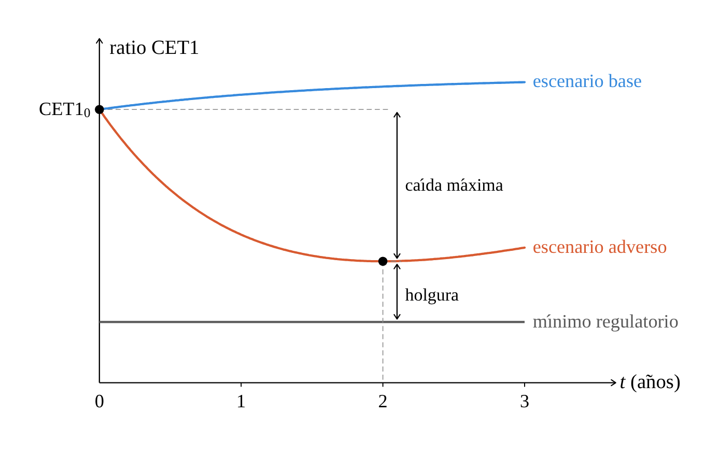
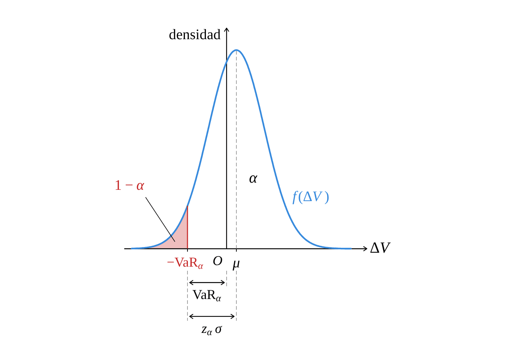

## Introducción



El **sistema financiero**, que lleva el ahorro a la inversión mediante mercados, instrumentos y operadores, tiene una dimensión internacional. Los agentes acuden a mercados financieros internacionales por varios motivos: menor coste de emisión (fiscalidad favorable, regulación más laxa), expectativas cambiarias favorables, estrechez de mercados nacionales (falta de diversidad de activos, que lastra la diversificación) y falta de profundidad (escaso volumen, que genera volatilidad). Operar más allá de las fronteras añade, no obstante, dos riesgos propios, el riesgo país (soberano, político) y el cambiario. El objetivo del tema es triple:

- *Sistema financiero*: ofrecer una visión estilizada del sistema financiero internacional (mercados, emisores, instrumentos y teorías de la inestabilidad).

- *Crisis financieras*: repasar las principales crisis financieras y bancarias, con especial referencia a la crisis financiera internacional iniciada en 2007-2008.

- *Gestión de riesgos*: analizar la gestión de riesgos en las instituciones financieras, tanto en su vertiente microeconómica como macroprudencial.

## 1. El sistema financiero y las teorías de las crisis

La sección combina dos planos. El descriptivo recoge los elementos básicos del sistema financiero, y el teórico, las teorías que explican la inestabilidad de sus mercados y los pánicos bancarios.

### 1.1. Elementos básicos del sistema financiero

El sistema financiero se describe a través de sus mercados, de quienes emiten en ellos, de los formatos de emisión y de los instrumentos que se negocian. Aquí se recoge solo el marco que necesitan las crisis de la sección 2 y la gestión de riesgos de la sección 3, porque los instrumentos se estudian en los temas [B23](b23-renta-variable.qmd) (renta variable), [B24](b24-renta-fija.qmd) (renta fija) y [B25](b25-derivados.qmd) (derivados).

**Mercado financiero**: un *mercado financiero* es un espacio (físico o virtual) donde los agentes emiten, colocan e intercambian activos financieros. Su origen moderno suele situarse en la Bolsa de Ámsterdam (1602), pero su desarrollo comienza a acelerarse en los años setenta del s. XX a raíz del avance de la globalización, cuando nacen los primeros mercados de futuros y de opciones financieros (tema [B25](b25-derivados.qmd)). El resultado de este proceso es la existencia en la actualidad de un mercado financiero internacional integrado, caracterizado por la globalización y la interconexión, el predominio de instrumentos negociables sobre los no negociables, la creación de nuevos instrumentos y la aparición de nuevos participantes[^b26-2].

**Tipos de mercado**: los mercados financieros admiten varias clasificaciones según el criterio utilizado:

1. *Por fase de negociación*: se distingue entre *mercado primario*, donde se emiten o se colocan por primera vez los títulos (generalmente vía oferta pública o subasta)[^b26-19], y *mercado secundario*, donde se realiza el intercambio de títulos y la bolsa actúa como garante de liquidez.

2. *Por plazo*: en el *mercado monetario*, los títulos vencen generalmente a un año o menos, tienen bajo riesgo y alta liquidez y son instrumentales para la política monetaria. En el *mercado de capitales*, en cambio, tienen vencimientos más largos o carecen de vencimiento (p. ej. acciones).

3. *Por volumen*: se distingue entre el *mercado mayorista*, donde participan inversores institucionales y se negocia deuda pública y deuda empresarial, en el que se inscribe el mercado interbancario, y el *mercado minorista*, donde participan inversores minoristas.

4. *Por marco normativo*: se distingue entre *mercados organizados*, en los que los títulos están estandarizados y existen cámaras de compensación y liquidación, y *mercados OTC* (*over-the-counter*), en los que los títulos no están necesariamente estandarizados y se negocian bilateralmente, a menudo en contratos y formatos a medida (tema [B25](b25-derivados.qmd), apartado 1.1.3).

5. *Por localización jurisdiccional*: se distingue entre el *mercado interno*, con emisores nacionales (segmento local) o no residentes (segmento extranjero) en la moneda del país, y los *euromercados* (*offshore*), en los que la moneda de denominación de los títulos no coincide con la moneda de curso legal del país de negociación. Los euromercados nacen en los años cincuenta con los depósitos en dólares en Londres (apartado 2.1.1). La gama de productos se amplió después de forma sucesiva: depósitos y préstamos sindicados (años cincuenta y sesenta), eurobonos (años sesenta), reciclaje de petrodólares (años setenta) y, finalmente, todo tipo de productos derivados de la innovación financiera (años ochenta y noventa)[^b26-4].

**Emisores**: emiten las instituciones financieras, monetarias (bancos centrales, bancos comerciales, fondos del mercado monetario) o no monetarias, como los fondos de titulización y las agencias financieras públicas o con respaldo público (en EE. UU., Fannie Mae y Freddie Mac, que compran y garantizan hipotecas); las sociedades no financieras, que sustituyen cada vez más el crédito bancario por renta fija (desintermediación); el sector público, y las organizaciones internacionales, como el Banco Mundial o el Banco Europeo de Inversiones (BEI), con alta calificación crediticia por su estatuto de acreedor preferente.

**Formatos de emisión**: las acciones se colocan mediante oferta pública de venta (OPV), de acciones ya existentes, o de suscripción (OPS), de acciones nuevas (tema [B23](b23-renta-variable.qmd), apartado 1.1.2), y la deuda, mediante subasta o sindicación (tema [B24](b24-renta-fija.qmd), apartado 1.1.1). La *titulización* transforma activos poco líquidos en bonos negociables, los de titulización hipotecaria (MBS, *mortgage-backed securities*) si el activo son hipotecas y los de titulización de activos (ABS, *asset-backed securities*) si son otros préstamos. Transmite el riesgo del originador al fondo de titulización y de este a los compradores[^b26-7].

**Instrumentos**: la renta fija concentra la gran mayoría de las emisiones internacionales. En el mercado monetario se negocian depósitos interbancarios, base de los índices de referencia (el euríbor y el tipo de interés a corto plazo del euro, €STR)[^b26-3], certificados de depósito, papel comercial, letras del Tesoro y *repos*, cesiones temporales de activos con pacto de recompra. En el de capitales, préstamos sindicados a tipo variable, referenciados históricamente al London Interbank Offered Rate (LIBOR) y hoy al Secured Overnight Financing Rate (SOFR), el €STR o el euríbor (tema [B27](b27-regulacion-financiera.qmd), apartado 3.4), bonos corporativos y del Estado, bonos extranjeros, eurobonos, bonos verdes y bonos Brady (Plan Brady, 1989), cuyos bonos par y de descuento llevaban el principal colateralizado con T-bonds cupón cero[^b26-9]. En renta variable se negocian acciones, fondos cotizados (ETF), recibos de depósito y euroacciones, y en los mercados de derivados, futuros, *forwards*, opciones y *swaps*.

Entre los instrumentos híbridos, junto a las participaciones preferentes y la deuda subordinada (tema [B27](b27-regulacion-financiera.qmd), apartado 3.2.2), dos importan para la absorción de pérdidas (apartados 2.3.3 y 3.4):

- *CoCos* (bonos contingentes convertibles): se convierten en acciones o se amortizan si la ratio de capital ordinario de nivel 1 (CET1) cae por debajo de un umbral. Absorben así pérdidas con la entidad aún en funcionamiento (*going concern*) mediante un disparador contractual (de ahí que a veces se hable de *bail-in* contractual) y son la forma típica del capital adicional de nivel 1 (AT1) de Basilea III. En resolución, quedan además sujetos al *bail-in* legal.

- *Deuda senior no preferente*: absorbe pérdidas antes que la senior preferente en caso de resolución y computa a efectos del requisito mínimo de fondos propios y pasivos admisibles (MREL, *Minimum Requirement for Own Funds and Eligible Liabilities*).

### 1.2. Teorías de la inestabilidad financiera y de los pánicos bancarios

Cuatro teorías explican la inestabilidad de los mercados financieros: la inestabilidad financiera de Minsky, las profecías autocumplidas de Obstfeld, el racionamiento del crédito de Stiglitz y Weiss y los pánicos bancarios de Diamond y Dybvig.

#### 1.2.1. Inestabilidad financiera (Minsky, 1972; 1982; 1986)

**Origen**: la hipótesis de la inestabilidad financiera se debe a Hyman Minsky (1972; 1982; 1986), cuyas tesis se apoyan en Fisher y Keynes.

**Idea**: las crisis financieras son fenómenos endógenos, sistémicos y no accidentales, debidos a la incertidumbre sobre los flujos de caja esperados y a la volatilidad de los precios de los activos. La estabilidad es, paradójicamente, desestabilizadora, porque los periodos prolongados de bonanza inducen a los agentes a asumir estructuras financieras progresivamente más frágiles (“hipótesis de la inestabilidad financiera”)[^b26-12].

**Razonamiento**: Minsky distingue tres posiciones financieras según la relación entre los flujos de caja esperados y los compromisos de deuda:

1. *Financiación cubierta* (*hedge finance*): los flujos de caja esperados bastan para atender tanto los intereses como la amortización del principal. Esta posición domina tras una crisis, cuando la prudencia impera.

2. *Financiación especulativa* (*speculative finance*): los flujos de caja cubren los intereses, pero no la devolución del principal, que debe refinanciarse a su vencimiento. Por ello, el agente depende del funcionamiento normal de los mercados de crédito.

3. *Financiación Ponzi* (*Ponzi finance*): los flujos de caja no cubren siquiera los intereses, de modo que el agente necesita endeudarse adicionalmente o vender activos para atender el servicio de la deuda. Su solvencia depende de que el precio de los activos siga subiendo.

En las fases de auge, la memoria de la última crisis se difumina, con lo que las decisiones de inversión se vuelven más arriesgadas, aumenta el apalancamiento y suben los precios de los activos. Esa subida valida retrospectivamente las apuestas más agresivas y desplaza la estructura financiera agregada desde posiciones cubiertas hacia posiciones especulativas y Ponzi. La euforia especulativa lleva a la generación de deuda para mantener posiciones.

Basta entonces una perturbación (una subida de tipos, una pérdida de confianza) para poner en cuestión la sostenibilidad de la deuda. Los agentes Ponzi se ven forzados a liquidar activos, el precio de estos colapsa (*momento Minsky*) y las ventas forzosas se retroalimentan en una espiral recesiva de deflación de deuda, en la línea de Fisher (1933).

**Conclusiones**:

- *Aspectos positivos*: anticipa el carácter endógeno y recurrente de las crisis financieras, frente a la visión de perturbaciones exógenas, y ofrece una taxonomía (cubierta, especulativa, Ponzi) útil para el diagnóstico macroprudencial. Fundamenta, además, la intervención pública (prestamista de última instancia, *big government*) como estabilizador de los beneficios y de los precios de los activos. La crisis financiera global revitalizó su influencia.

- *Limitaciones*: la tesis se centra en la fase de auge y especulativa, pero no da cuenta de todo el ciclo. Carece también de una formalización canónica, lo que dificulta su contraste empírico, y, aunque atribuye a la innovación financiera la elusión de la regulación, no ofrece un diseño regulatorio que impida de forma sistemática la migración hacia posiciones frágiles.

#### 1.2.2. Profecías autocumplidas (Obstfeld, 1994)

::: {.callout-note appearance="simple" icon=false}
El desarrollo completo de este modelo se encuentra en el tema [B17](b17-crisis-bp.qmd), apartado 2, y su aplicación a las uniones monetarias incompletas, en el tema [B16](b16-integracion-monetaria.qmd), apartado 3.1.
:::

**Origen**: los modelos de segunda generación tratan de explicar la crisis del Sistema Monetario Europeo (SME) de 1992-1993 (apartado 2.1.3). Destaca la aportación de Maurice Obstfeld (1994), que formaliza la idea de crisis autocumplidas que él mismo había planteado en 1986.

**Idea**: puede producirse un ataque especulativo aunque los fundamentos no hagan inevitable la devaluación, porque abandonar la paridad es una decisión racional del Gobierno y el coste de mantenerla depende de las expectativas del mercado.

**Razonamiento**: el Gobierno compara los costes y los beneficios de devaluar, y si el mercado espera una devaluación, defender la paridad se encarece (mayores tipos de interés, más desempleo). Un cambio de expectativas puede así llevar la economía del equilibrio “bueno” (paridad creíble) al “malo” (devaluación), que confirma *ex post* esas expectativas. Por ello, las crisis pueden ser *profecías autocumplidas*.

La versión de 1994 (figura -@fig-b263-obstfeld) supone un coste de devaluar fijo y un beneficio que crece con la intensidad del *shock*. Con ello, los *shocks* débiles nunca justifican la devaluación y los intensos la hacen inevitable, de modo que los equilibrios múltiples solo aparecen en el tramo intermedio (el “purgatorio”).

::: {#fig-b263-obstfeld}

::: {.content-visible when-format="html"}
```{=html}
<div class="graph-frame">
<iframe src="../graphs/b263_Obstfeld.html" style="height:560px" loading="lazy" title="fig-b263-obstfeld"></iframe>
</div>
```
:::

::: {.content-visible unless-format="html"}

:::

Modelo de Obstfeld (1994). El Gobierno compara el coste fijo de devaluar, $C_D$, con el beneficio de hacerlo, que crece con la intensidad del *shock*, $S$, y es mayor si los inversores no confían en la paridad ($B^{\text{NC}}$) que si confían ($B^{\text{C}}$). Por debajo de $S_1$ nunca compensa devaluar y por encima de $S_2$ siempre compensa. En el “purgatorio”, entre ambos, como en $S'$, caben el equilibrio bueno, $N$, y el malo, $D$, con devaluación.
:::

**Conclusiones**:

- *Aspectos positivos*: explica ataques que los modelos de primera generación no podían explicar, como el que sufrió la libra esterlina en 1992 sin una expansión monetaria incompatible con la paridad. Traslada, además, el análisis a la interacción estratégica entre la autoridad y el mercado.

- *Limitaciones*: no determina qué equilibrio se alcanza en el tramo intermedio, lo que limita su capacidad predictiva. Tampoco explica bien la crisis asiática de 1997, porque aquellas economías no tenían incentivos a devaluar y su fragilidad estaba en los balances de bancos y empresas.

#### 1.2.3. Racionamiento del crédito (Stiglitz y Weiss, 1981)

::: {.callout-note appearance="simple" icon=false}
El desarrollo completo de este modelo se encuentra en el tema [A42](a42-ciclos.qmd), apartado 2.3.1.
:::

**Origen**: el modelo se debe a Joseph Stiglitz y Andrew Weiss (*Credit Rationing in Markets with Imperfect Information*, 1981), en la línea de la nueva economía keynesiana.

**Idea**: en presencia de información asimétrica, el tipo de interés no solo es el precio del crédito, sino que actúa como mecanismo de selección.

**Razonamiento**: las subidas del tipo de interés atraen a prestatarios de mayor riesgo (selección adversa) e inducen a los ya financiados a acometer proyectos más arriesgados (riesgo moral), de modo que el rendimiento esperado del banco no es monótonamente creciente en el tipo de interés. El banco maximiza su rendimiento esperado en un tipo $i^*$ (figura -@fig-b264-stiglitz-weiss, cuadrante I). Si este tipo es inferior al que vaciaría el mercado ($i^W$), el banco raciona el crédito, es decir, existe exceso de demanda en equilibrio (cuadrante IV).

::: {#fig-b264-stiglitz-weiss}

::: {.content-visible when-format="html"}
```{=html}
<div class="graph-frame">
<iframe src="../graphs/b264_Stiglitz_Weiss.html" style="height:700px" loading="lazy" title="fig-b264-stiglitz-weiss"></iframe>
</div>
```
:::

::: {.content-visible unless-format="html"}

:::

Racionamiento del crédito (Stiglitz y Weiss, 1981). El rendimiento esperado del banco, $\bar{R}^e(i)$, es máximo en $i^*$ (cuadrante I). A través de la oferta de depósitos, $D^s(\bar{R}^e)$ (cuadrante II), y de su conversión en créditos, $L = \chi D$ (cuadrante III), la oferta de crédito, $L^s(i)$, es también máxima en $i^*$ (cuadrante IV). En $i^*$, inferior al tipo $i^W$ que vaciaría el mercado, la demanda de crédito, $L^d(i)$, supera a la oferta, y ese exceso, $Z$, es el crédito racionado.
:::

**Conclusiones**:

- *Aspectos positivos*: explica que el crédito se racione en equilibrio sin rigideces de precios. Su implicación para la estabilidad financiera es directa, pues las perturbaciones que deterioren la información o el valor del colateral pueden contraer bruscamente la oferta de crédito (*credit crunch*).

- *Limitaciones*: el racionamiento depende de que los bancos no puedan discriminar entre prestatarios, cuando en la práctica exigen garantías que revelan parcialmente el riesgo de los prestatarios y atenúan la asimetría. Además, es un modelo estático de equilibrio parcial.

#### 1.2.4. Pánicos bancarios (Diamond y Dybvig, 1983)

**Origen**: el modelo se debe a Douglas Diamond y Philip Dybvig (*Bank Runs, Deposit Insurance, and Liquidity*, 1983).

**Idea**: al transformar activos ilíquidos en depósitos a la vista, los bancos aseguran a los depositantes frente a necesidades imprevistas de liquidez, pero prometen a corto plazo más de lo que valen sus activos liquidados anticipadamente. Por eso, junto al equilibrio eficiente, existe otro en el que todos retiran porque esperan que los demás lo hagan, y el banco quiebra aun siendo solvente.

**Supuestos**:

- *Entorno*: tres fechas, $T = 0, 1, 2$, y un único bien. Existe un continuo de depositantes *ex ante* idénticos, cada uno con una unidad de dotación en $T = 0$. El tipo (paciente o impaciente) no es observable, de modo que ningún contrato puede condicionarse a él.

- *Agentes*: en $T = 1$ cada agente descubre, de forma privada, su tipo. Con probabilidad $\pi$ es impaciente y solo valora consumir en $T = 1$, y con probabilidad $1 - \pi$ es paciente y valora consumir en $T = 2$, aunque puede retirar antes y guardar lo retirado. Por la ley de los grandes números, $\pi$ es también la fracción de impacientes. La utilidad, $u(c)$, es creciente y estrictamente cóncava, con aversión relativa al riesgo, $-c\,u''(c)/u'(c)$, mayor que uno.

- *Tecnología*: una unidad invertida en $T = 0$ rinde $R > 1$ en $T = 2$, pero liquidada en $T = 1$ solo devuelve la unidad invertida. Existe, además, un almacenamiento sin rendimiento.

**Planteamiento**: en autarquía, el impaciente liquida su inversión y consume 1, y el paciente consume $R$. Un planificador puede mejorar ese resultado repartiendo el riesgo de liquidez:

$$\max_{c_1,\, c_2} \; \pi\, u(c_1) + (1-\pi)\, u(c_2) \quad \text{s.a.:} \quad \pi c_1 + (1-\pi)\frac{c_2}{R} = 1$$

donde $c_1$ es el consumo de cada impaciente en $T = 1$, $c_2$ el de cada paciente en $T = 2$, $\pi$ la fracción de impacientes, $u$ la función de utilidad y $R$ el rendimiento bruto del activo a largo plazo. La restricción reparte la dotación per cápita entre lo que se mantiene líquido, $\pi c_1$, y lo que se invierte para pagar a los pacientes[^b26-20].

**CPO**: con solución interior, sustituyendo la restricción en la función objetivo y derivando respecto a $c_1$, se obtiene $(du/dc_1)|_{c_1^*} = R\,(du/dc_2)|_{c_2^*}$. La relación marginal de sustitución entre consumo temprano y tardío se iguala a la de transformación, pues dar una unidad más a los impacientes obliga a quitar $R$ a los pacientes. Como $R > 1$ y $u'$ es decreciente, $c_2^* > c_1^*$, de modo que al paciente no le interesa hacerse pasar por impaciente. Con aversión relativa al riesgo mayor que uno, $c\,u'(c)$ es decreciente y, en la asignación de autarquía, $(1, R)$, se cumple $u'(1) > R\,u'(R)$. Conviene, por tanto, transferir consumo a los impacientes, con $c_1^* > 1$ y $c_2^* < R$, y el óptimo asegura así frente al riesgo de necesitar liquidez pronto.

**CSO**: la función objetivo es estrictamente cóncava, por serlo $u$, y la restricción es lineal, por lo que la condición de primer orden caracteriza un máximo único.

**Equilibrio**: el banco implementa el óptimo con un *contrato de depósito a la vista*, en el que quien retira en $T = 1$ cobra $r_1 = c_1^*$, por orden de llegada (servicio secuencial) mientras queden fondos, y quienes esperan se reparten en $T = 2$ lo que quede. Si retira en $T = 1$ una fracción $f$ de los depositantes y $f r_1 < 1$, cada uno de los que esperan cobra:

$$r_2(f) = \frac{R\,(1 - f\,r_1)}{1 - f}$$

donde $r_1$ es el pago por unidad depositada en $T = 1$, $f$ la fracción de depositantes que retira en $T = 1$ y $R$ el rendimiento del activo. En cambio, si $f r_1 \geq 1$, el banco agota sus activos y $r_2 = 0$. Un paciente prefiere retirar si $r_2(f) < r_1$, es decir, si $f$ supera el umbral $\bar f = (R - r_1)/[r_1(R - 1)]$ (figura -@fig-b265-diamond-dybvig). Hay, pues, dos equilibrios:

- *Equilibrio eficiente*: si cada paciente espera que solo retiren los impacientes ($f = \pi$), le conviene esperar, pues $r_2(\pi) = c_2^* > r_1$, y se alcanza el óptimo.

- *Pánico bancario*: si cada paciente espera que retiren todos ($f = 1$), el banco solo puede pagar 1 por depositante en promedio, menos de lo prometido, $r_1 > 1$, y los últimos de la cola no cobran. Retirar es, entonces, la mejor respuesta y la expectativa se autovalida. El pánico es posible precisamente porque $r_1 > 1$. Por eso, la transformación de plazos que crea valor crea también la fragilidad, y qué equilibrio se selecciona depende de expectativas ajenas a los fundamentos (“manchas solares”).

::: {#fig-b265-diamond-dybvig}

::: {.content-visible when-format="html"}
```{=html}
<div class="graph-frame">
<iframe src="../graphs/b265_Diamond_Dybvig.html" style="height:560px" loading="lazy" title="fig-b265-diamond-dybvig"></iframe>
</div>
```
:::

::: {.content-visible unless-format="html"}
![Pánicos bancarios (Diamond y Dybvig, 1983). Con los datos del ejemplo ($R = 2$, $\pi = 1/4$), el pago a quien espera, $r_2(f)$, decrece con la fracción $f$ de depositantes que retira en $T = 1$ y cae por debajo de $r_1$ en el umbral $\bar f$, a partir del cual al paciente le conviene retirar (zona sombreada). Por el servicio secuencial, quien retira cobra $r_1$ mientras el banco puede atender a todos, hasta $f = 1/r_1$, y en promedio $1/f$ a partir de ahí. Hay dos equilibrios, el eficiente (punto 0), con $f = \pi$ y $r_2 = c_2^*$, y el pánico (punto 1), con $f = 1$, en el que quien retira cobra en promedio 1, más que quien espera, que no cobra nada.](../graphs/static/b265_Diamond_Dybvig.png)
:::

Pánicos bancarios (Diamond y Dybvig, 1983). Con los datos del ejemplo ($R = 2$, $\pi = 1/4$), el pago a quien espera, $r_2(f)$, decrece con la fracción $f$ de depositantes que retira en $T = 1$ y cae por debajo de $r_1$ en el umbral $\bar f$, a partir del cual al paciente le conviene retirar (zona sombreada). Por el servicio secuencial, quien retira cobra $r_1$ mientras el banco puede atender a todos, hasta $f = 1/r_1$, y en promedio $1/f$ a partir de ahí. Hay dos equilibrios, el eficiente (punto 0), con $f = \pi$ y $r_2 = c_2^*$, y el pánico (punto 1), con $f = 1$, en el que quien retira cobra en promedio 1, más que quien espera, que no cobra nada.
:::

::: {.callout-tip collapse="true" appearance="simple" title="Ejemplo: depósito óptimo y umbral de pánico"}
Con $u(c) = 1 - 1/c$ (aversión relativa al riesgo igual a dos), $R = 2$ y $\pi = 1/4$, la CPO da $c_2 = \sqrt{2}\,c_1$ y, con la restricción, $c_1^* \approx 1{,}28$ y $c_2^* \approx 1{,}81$. El umbral es $\bar f = (2 - 1{,}28)/[1{,}28\,(2 - 1)] \approx 0{,}56$. Si un paciente cree que retirará más del 56 % de los depositantes, le conviene retirar también, aunque solo el 25 % necesite liquidez (Diamond, 2007).
:::

**Estática comparativa**: el umbral, $\bar f = (R/r_1 - 1)/(R - 1)$, mide la robustez del banco:

- *Pago prometido* ($r_1$): $\bar f$ decrece con $r_1$. Cuanto más seguro de liquidez ofrece el contrato, menos depositantes que retiren bastan para desencadenar el pánico. En el límite sin seguro, $r_1 = 1$, el umbral vale uno, de acuerdo con la condición $r_1 > 1$ del pánico bancario (véase el Equilibrio).

- *Rendimiento del activo* ($R$): con $r_1 > 1$, como en el contrato óptimo, y $r_1$ dado, $\bar f$ crece con $R$, porque un activo más rentable deja más para los que esperan y hace falta una retirada mayor para que esperar deje de compensar.

**Extensiones**:

- *Soluciones*: el modelo permite evaluar tres:

    - *Suspensión de la convertibilidad*: si el banco anuncia que dejará de pagar tras atender a una fracción $\pi$ de depositantes, el pago en $T = 2$ queda asegurado, ningún paciente gana retirando y el pánico desaparece sin coste. No obstante, si $\pi$ es aleatoria, el banco no sabe dónde detenerse, de modo que o deja sin liquidez a impacientes, o el pánico vuelve a ser posible.

    - *Seguro de depósitos*: una garantía pública elimina el equilibrio de pánico incluso con $\pi$ aleatoria, porque el Estado puede ajustar *ex post*, mediante un impuesto sobre las retiradas en $T = 1$, el pago a la fracción realizada de impacientes. Así, el pánico no llega a producirse y no hay que pagar rescate alguno. Sin embargo, el coste del seguro, ausente del modelo, es el riesgo moral (apartado 3.1).

    - *Prestamista de última instancia*: el banco central presta al banco solvente y hace innecesaria la liquidación anticipada, conforme a la regla de Bagehot (1873), que consiste en prestar sin límite, a un tipo de penalización y contra buenas garantías.

- *Aplicaciones*: en el pánico de 1907, la retirada de depósitos del Knickerbocker Trust se propagó a otras entidades de Nueva York y solo cedió con el rescate privado coordinado por J.P. Morgan, lo que condujo a la creación de la Reserva Federal (1913). Entre 1930 y 1933, las oleadas de pánicos que Friedman y Schwartz (1963) situaron en el centro de la Gran Depresión llevaron a la suspensión de unos 9000 bancos estadounidenses y al seguro federal de depósitos (1934). Northern Rock (2007) sufrió el primer pánico bancario británico desde la época victoriana, con un seguro que solo cubría íntegramente las primeras 2000 libras (apartado 2.2.1), y el Silicon Valley Bank (SVB, marzo de 2023) reprodujo el mecanismo a velocidad digital (apartado 2.3.3).

**Conclusiones**:

- *Aspectos positivos*: es la primera microfundamentación rigurosa de la banca, pues explica a la vez por qué existen los depósitos a la vista y por qué son frágiles. Muestra, asimismo, que un pánico puede ser racional sin insolvencia previa y justifica las redes de seguridad como mecanismos que seleccionan el equilibrio eficiente.

- *Limitaciones*: el modelo no predice cuándo se produce un pánico, porque la selección del equilibrio queda indeterminada. Goldstein y Pauzner (2005) la resuelven con juegos globales, en los que la probabilidad del pánico depende de los fundamentos. Al ser el activo seguro, el modelo no distingue iliquidez de insolvencia, mientras que la evidencia histórica asocia los pánicos a malas noticias sobre la solvencia bancaria. Además, el contrato solo es sostenible si los depositantes no pueden negociar sus derechos en $T = 1$ (Jacklin, 1987), y se omite el riesgo moral que generan las propias redes de seguridad.

### 1.3. Conclusiones

Del análisis teórico se extraen tres conclusiones:

**Inestabilidad como propiedad**: no es una anomalía, sino un rasgo endógeno de los sistemas basados en la transformación de plazos, el apalancamiento y las expectativas (Minsky; Diamond y Dybvig).

**Racionamiento y equilibrios múltiples**: la información asimétrica y los fallos de coordinación impiden que los mercados financieros se vacíen o generan equilibrios múltiples. Así, el crédito puede quedar racionado en equilibrio, con un exceso de demanda persistente (Stiglitz y Weiss), y el pesimismo puede ser autovalidante tanto en el mercado cambiario (Obstfeld) como en el bancario (Diamond y Dybvig).

**Necesidad de intervención**: estas características justifican la intervención pública en forma de redes de seguridad (seguro de depósitos, prestamista de última instancia) y de regulación y supervisión prudencial. Esas mismas redes generan, sin embargo, riesgo moral, lo que explica el péndulo histórico entre liberalización y rerregulación.

## 2. Crisis financieras y bancarias

A lo largo de la historia reciente, el sistema financiero internacional se ha enfrentado a crisis de diferente índole. Su examen cronológico permite comprobar que, bajo formas siempre nuevas, operan mecanismos antiguos y recurrentes: el apalancamiento excesivo, el descalce de plazos y de divisas, y las expectativas autovalidantes descritas en el apartado 1.2.

### 2.1. Etapa de Bretton Woods y no sistema

La primera etapa va desde el desarrollo de los euromercados y las perturbaciones de los años setenta, pasando por la crisis de deuda latinoamericana, hasta las crisis del SME y del sudeste asiático.

#### 2.1.1. Desarrollo de los euromercados y perturbaciones de los años setenta

El punto de partida de las crisis financieras en la historia reciente es el desarrollo de los euromercados, que explica buena parte de la vulnerabilidad posterior. Su origen se sitúa en los años cincuenta, cuando los bancos del bloque soviético comenzaron a mantener sus depósitos en dólares en la plaza de Londres, fuera del alcance de las autoridades estadounidenses y a resguardo de eventuales confiscaciones durante la Guerra Fría.

Lo que nació como una precaución política dio lugar a un pujante mercado internacional de dólares al margen de toda jurisdicción nacional, que se amplió a los eurobonos a partir de la emisión de Autostrade (1963) y creció impulsado, paradójicamente, por la propia regulación estadounidense. En concreto, los topes a la remuneración de los depósitos (Regulation Q) y el impuesto de igualación de intereses (1963) desplazaron la intermediación en dólares hacia Londres.

Sobre este mercado se proyectaron dos perturbaciones de la década siguiente:

- *Nixon Shock*: la primera fue el colapso del sistema de Bretton Woods, iniciado con la suspensión de la convertibilidad del dólar en oro (agosto de 1971) y culminado con la flotación generalizada de 1973, sancionada en los Acuerdos de Jamaica (1976). La desaparición del ancla cambiaria introdujo una volatilidad de tipos de cambio y de tipos de interés hasta entonces desconocida, que es precisamente el origen de la innovación en productos derivados descrita en el apartado 1.1.

- *Crisis del petróleo*: la segunda fue el primer choque del petróleo (1973). Los excedentes de los países exportadores (petrodólares) se depositaron en la banca internacional y se reciclaron en forma de crédito sindicado hacia los países en desarrollo, lo que sentó las bases de la crisis de 1982.

#### 2.1.2. Crisis de deuda latinoamericana (1982-1989)

::: {.callout-note appearance="simple" icon=false}
La mecánica cambiaria del episodio mexicano de 1982 (modelo de primera generación) se desarrolla en el tema [B17](b17-crisis-bp.qmd), apartado 1.4.2, y su vertiente de deuda externa (Plan Baker y Plan Brady), en el tema [B29](b29-fod-aod.qmd), apartado 3.1.
:::

**Causas**: el reciclaje de petrodólares de los años setenta canalizó abundante crédito bancario sindicado, a tipo variable y en dólares, hacia América Latina.

**Estallido**: el endurecimiento monetario de Volcker (1979-1981) elevó simultáneamente el servicio de la deuda y apreció el dólar, mientras se hundían los precios de las materias primas. Por ello, México devaluó en febrero de 1982 y en agosto declaró la imposibilidad de atender sus pagos.

**Consecuencias**: la suspensión mexicana se propagó al conjunto de la región por la retirada simultánea del crédito bancario sindicado y abrió la “década perdida”, en la que la renta real por habitante retrocedió en muchos países latinoamericanos.

**Soluciones**: la gestión evolucionó desde las reprogramaciones sucesivas (*muddling through*) y el Plan Baker (1985, nueva financiación condicionada a reformas) hasta el Plan Brady (1989), que reconoció la necesidad de quitas y convirtió los préstamos bancarios en bonos negociables colateralizados.

#### 2.1.3. Crisis del SME (1992-1993) y crisis del sudeste asiático (1997-1998)

::: {.callout-note appearance="simple" icon=false}
El desarrollo completo de estas crisis se encuentra en el tema [B17](b17-crisis-bp.qmd), apartados 2.4.1 (SME) y 3.4.1 (sudeste asiático).
:::

**Crisis del SME** (1992-1993):

- *Causas*: como describen los modelos de segunda generación (apartado 1.2.2), la combinación de tipos de interés elevados en Alemania tras la reunificación y la incertidumbre sobre la ratificación de Maastricht hizo dudar al mercado del compromiso de varios países con sus paridades.

- *Estallido*: los ataques especulativos forzaron la salida de la libra y la lira del mecanismo de cambios (septiembre de 1992).

- *Consecuencias*: siguieron nuevas devaluaciones de la peseta, el escudo y la libra irlandesa, entre noviembre de 1992 y mayo de 1993.

- *Soluciones*: la ampliación de las bandas de fluctuación al ±15 % (agosto de 1993) y, a más largo plazo, la sustitución de las paridades ajustables por la moneda única.

**Crisis del sudeste asiático** (1997-1998):

- *Causas*: a diferencia de las crisis anteriores, sus protagonistas presentaban fundamentos fiscales sólidos. El problema residía, en cambio, en los balances privados, con fuerte endeudamiento exterior a corto plazo y en divisa (doble descalce, de moneda y de vencimiento), banca frágil y garantías implícitas.

- *Estallido*: la crisis se inició con la flotación del baht tailandés en julio de 1997 y se extendió por contagio a Indonesia, Corea, Malasia y Filipinas.

- *Consecuencias*: la depreciación cambiaria destruyó los balances y convirtió la crisis cambiaria en crisis bancaria (“crisis gemelas”), episodio que dio lugar a los modelos de tercera generación (Krugman, 1999).

- *Soluciones*: el FMI concedió paquetes de rescate sin precedentes, condicionados a un fuerte ajuste y a subidas de los tipos de interés para frenar la salida de capitales, y esas subidas agravaron la caída de la inversión y del producto.

### 2.2. Crisis financiera de 2007 (2007-2009) y crisis de deuda soberana europea (2010-2014)

La crisis financiera internacional iniciada en 2007 se estudia junto con su prolongación en la zona del euro, la crisis de deuda soberana.

#### 2.2.1. Crisis financiera internacional

::: {.callout-note appearance="simple" icon=false}
Su encaje en la tipología de los modelos de crisis se examina en el tema [B17](b17-crisis-bp.qmd), apartado 3.4.2; el papel del Fondo Monetario Internacional (FMI), en el tema [B22](b22-fmi.qmd), apartado 3.3.2; la respuesta monetaria del Banco Central Europeo (BCE), en el tema [B43](b43-politica-monetaria-ue.qmd), apartados 2.3.3 y 3.3.2; y la respuesta regulatoria, en el tema [B27](b27-regulacion-financiera.qmd), apartado 3.
:::

La crisis *subprime* (2007-2009) nació en el segmento de mayor riesgo del mercado hipotecario estadounidense y, tras la quiebra de Lehman Brothers, se convirtió en la crisis financiera global o Gran Recesión (2008-2014). Reprodujo, sobre todo fuera del perímetro bancario, el pánico del apartado 1.2.4 y la fragilidad endógena descrita por Minsky (apartado 1.2.1).

**Causas**: en el plano macroeconómico, los tipos de interés se mantuvieron bajos tras la crisis puntocom (la Reserva Federal dejó el tipo oficial en el 1 % hasta 2004). A ello se sumó el exceso de ahorro de las economías emergentes y exportadoras de petróleo, canalizado hacia activos estadounidenses (*saving glut*; Bernanke, 2005). Ambos factores comprimieron las primas de riesgo y alimentaron la búsqueda de rentabilidad. Sobre ese fondo se formó en EE. UU. una burbuja inmobiliaria apoyada en hipotecas de alto riesgo (*subprime*), cuyo pago dependía de que la revalorización de la vivienda permitiera refinanciarlas. En el plano microfinanciero, cuatro rasgos hicieron frágil el sistema:

- *Originar para distribuir*: las hipotecas se concedían para titulizarlas en MBS, cuyos tramos se reempaquetaban en obligaciones de deuda garantizadas (CDO, *collateralized debt obligations*). La cadena dispersaba el riesgo, pero debilitaba el incentivo a evaluar al deudor.

- *Calificaciones*: las agencias dieron la máxima calificación a tramos preferentes de CDO respaldados por hipotecas *subprime*, con modelos que infravaloraban la correlación entre impagos y bajo el conflicto de interés de que pague el emisor.

- *Vehículos fuera de balance*: los vehículos de inversión estructurada (SIV) y los *conduits* compraban activos titulizados a largo plazo con papel comercial respaldado por activos (ABCP, *asset-backed commercial paper*) a pocas semanas y líneas de liquidez del banco patrocinador. Así, el riesgo salía del cómputo de capital, pero no del grupo.

- *Apalancamiento y financiación mayorista*: los bancos de inversión y la banca en la sombra, muy apalancados, se financiaban a muy corto plazo en el mercado de cesiones temporales (*repo*) con los propios títulos como colateral. Transformaban plazos como un banco, pero sin seguro de depósitos ni prestamista de última instancia.

**Estallido**: las subidas de tipos de la Reserva Federal desde 2004 elevaron la morosidad *subprime* en cuanto la vivienda dejó de revalorizarse (2006). Tras la quiebra de New Century, gran originadora *subprime* (abril de 2007), las tensiones pasaron a los vehículos, a los bancos y al conjunto del sistema:

- *Agosto de 2007*: el día 9, BNP Paribas suspendió los reembolsos de tres fondos con titulizaciones que ya no podía valorar. El mercado interbancario se tensionó y ese mismo día el BCE inyectó 94.800 M€ a un día.

- *Septiembre de 2007*: el apoyo de liquidez del Banco de Inglaterra (día 14) a Northern Rock, que se financiaba sobre todo en mercados mayoristas, desató el primer pánico bancario británico desde la época victoriana. El pánico solo cesó con la garantía pública de los depósitos de Northern Rock (día 17).

- *Marzo de 2008*: Bear Stearns, sin financiación *repo*, fue absorbido por JPMorgan Chase con apoyo de la Reserva Federal, que abrió su crédito a los intermediarios no bancarios por primera vez desde los años treinta.

- *Septiembre de 2008*: el día 7, Fannie Mae y Freddie Mac pasaron a tutela pública. El 15 quebró Lehman Brothers, con 639.000 M\$ de activos, la mayor quiebra de la historia de EE. UU.[^b26-15] El 16, la Reserva Federal abrió a AIG una línea de crédito de hasta 85.000 M\$. Ese mismo día, el fondo monetario Reserve Primary “rompió el dólar” (su valor liquidativo cayó por debajo de un dólar por participación) por sus pérdidas en papel comercial de Lehman.

- *Octubre de 2008*: EE. UU. aprobó el TARP (Troubled Asset Relief Program), dotado con 700.000 M\$ (día 3), y los grandes bancos centrales recortaron tipos de forma coordinada (día 8).

La propagación siguió la lógica de un pánico bancario, pero en los mercados mayoristas y entre intermediarios sin seguro de depósitos:

- *Repo*: los prestamistas elevaron los recortes de valoración (*haircuts*) del colateral titulizado, lo que equivalía a retirar financiación y forzaba a desapalancarse.

- *ABCP*: los inversores dejaron de renovarlo, y los activos de los vehículos volvieron a los balances bancarios a través de las líneas de liquidez (apartado 3.3).

- *Fondos monetarios*: en la semana del 15 de septiembre de 2008, los que invertían en deuda privada sufrieron reembolsos de unos 300.000 M\$, el 14 % de su patrimonio, según la Comisión de Bolsa y Valores estadounidense (SEC), y dejaron de comprar papel comercial.

- *CDS y AIG*: AIG había vendido protección mediante permutas de incumplimiento crediticio (CDS, *credit default swaps*) por un nocional de 527.000 M\$ en su máximo de 2007. Las rebajas de su calificación le exigieron garantías que no podía aportar, en un mercado OTC sin visibilidad sobre las exposiciones (tema [B25](b25-derivados.qmd), apartado 3.1).

- *Ventas forzosas e interbancario*: las ventas de activos deprimían sus precios y contagiaban pérdidas a otras entidades (apartado 3.1). Antes de agosto de 2007, el diferencial entre el LIBOR a tres meses y el tipo fijo de los *swaps* indexados al tipo a un día (OIS, *overnight index swap*) del mismo plazo rondaba los 10 puntos básicos. El 10 de octubre de 2008 alcanzó los 365 (Sengupta y Tam, 2008).

**Consecuencias**: en 2009, el PIB de las economías avanzadas cayó un 3,4 % y el mundial retrocedió un 0,1 % a paridad de poder adquisitivo (FMI, *World Economic Outlook*, octubre de 2017). El volumen del comercio mundial de mercancías se contrajo un 12,2 %, la mayor caída desde la Segunda Guerra Mundial (Organización Mundial del Comercio, 2010). En EE. UU., el desempleo se duplicó hasta el 10 % en octubre de 2009 (Oficina de Estadísticas Laborales, BLS), y el precio de la vivienda cayó en torno a un 27 % entre julio de 2006 y febrero de 2012 (índice nacional S&P Case-Shiller).

Las pérdidas bancarias no tenían precedentes. El FMI llegó a estimar en unos 4 billones de dólares las depreciaciones de activos de las entidades financieras de todo el mundo (abril de 2009). En octubre de 2010 situó las de la banca entre 2007 y 2010 en unos 2,2 billones (*Global Financial Stability Report*). El coste de los rescates y de la recesión deterioró las cuentas públicas y, en la zona del euro, abrió paso a la crisis de deuda soberana.

**Soluciones**: tras la quiebra de Lehman, la respuesta dejó de decidirse caso por caso y combinó cinco frentes:

- *Liquidez*: el BCE pasó a adjudicar a tipo fijo toda la liquidez solicitada contra colateral (octubre de 2008). La Reserva Federal, por su parte, abrió facilidades para fondos monetarios y emisores de papel comercial y amplió sin límite (octubre de 2008) las líneas *swap* en dólares con otros bancos centrales abiertas en diciembre de 2007. Bajó, además, su tipo oficial al 0-0,25 % (diciembre de 2008) y emprendió compras masivas de activos.

- *Garantías*: se ampliaron los seguros de depósitos (en EE. UU., de 100.000 a 250.000 dólares en octubre de 2008; en la UE, la Directiva 2009/14/CE elevó el mínimo a 50.000 euros y después a 100.000 euros). Se avalaron también la deuda bancaria nueva y las participaciones en fondos monetarios.

- *Recapitalizaciones*: el Tesoro estadounidense anunció el 14 de octubre de 2008 la inversión, con cargo al TARP, de 125.000 M\$ en el capital de nueve grandes bancos (115.000 millones se desembolsaron el 28 de octubre), y los países europeos aprobaron planes nacionales análogos.

- *Estímulo fiscal*: la ley de recuperación estadounidense (ARRA, febrero de 2009; 787.000 M\$ en su estimación inicial) y el Plan Europeo de Recuperación Económica (noviembre de 2008) se sumaron a los estabilizadores automáticos. El plan europeo suponía unos 200.000 M€, el 1,5 % del PIB de la UE.

- *Coordinación internacional*: el G20 pasó a reunirse en cumbres de jefes de Estado y de Gobierno (Washington, noviembre de 2008), y en Londres (abril de 2009) acordó un programa de 1,1 billones de dólares, que incluía triplicar los recursos del FMI. Allí nació también el Consejo de Estabilidad Financiera (FSB), motor de la reforma regulatoria resumida en el apartado 3.4.

#### 2.2.2. Crisis de deuda soberana

::: {.callout-note appearance="simple" icon=false}
El relato de la crisis de deuda soberana europea y la respuesta monetaria se desarrollan en el tema [B43](b43-politica-monetaria-ue.qmd); la respuesta fiscal y de gobernanza, en el tema [B45](b45-politica-fiscal-ue.qmd); y la respuesta bancaria, en el tema [B44](b44-politica-financiera-ue.qmd). El modelo de equilibrios múltiples de una unión monetaria incompleta (De Grauwe, 2011) y el círculo vicioso entre bancos y soberanos (*doom loop*) se desarrollan en el tema [B16](b16-integracion-monetaria.qmd), apartados 3.1 y 3.2.1.
:::

**Causas**: en la zona del euro, la crisis financiera mutó en crisis de deuda soberana por la vía del círculo vicioso entre bancos y soberanos. En ese círculo, el rescate bancario deterioró las cuentas públicas y, a su vez, la caída del precio de la deuda soberana erosionó los balances bancarios que la mantenían en cartera.

**Estallido**: la revisión del déficit griego (finales de 2009) abrió una etapa de rescates sucesivos (Grecia, Irlanda y Portugal en 2010-2011, el sector bancario español en 2012, con el Memorando de Entendimiento, y Chipre en 2013).

**Consecuencias**: la crisis fragmentó financieramente la zona del euro, con primas de riesgo periféricas en máximos. Economías con niveles de deuda comparables, como el Reino Unido y España en 2011, afrontaron condiciones de financiación muy distintas, porque solo el Reino Unido emitía en una moneda que controlaba su banco central (tema [B16](b16-integracion-monetaria.qmd), apartado 3).

**Soluciones**: la crisis quedó contenida con el “whatever it takes” de Draghi (julio de 2012) y el anuncio de las operaciones monetarias de compraventa (OMT), que redujo las primas sin que el BCE llegara a comprar un solo bono. El resultado es coherente con el modelo de equilibrios múltiples, porque un prestamista de última instancia creíble elimina el equilibrio “malo” (tema [B16](b16-integracion-monetaria.qmd), apartado 3.2.2). La crisis motivó, además, reformas estructurales de la arquitectura del euro: el Mecanismo Europeo de Estabilidad (MEDE), la Unión Bancaria y el refuerzo de la gobernanza fiscal.

### 2.3. De la COVID-19 a la actualidad

El último periodo recoge los efectos sobre el sistema financiero de la COVID-19 y de la guerra de Ucrania, y dos episodios más recientes, la quiebra del SVB (marzo de 2023) y la crisis del *carry trade* (agosto de 2024).

#### 2.3.1. Efectos de la COVID-19 sobre el sistema financiero (2020-2021)

**Volatilidad de mercado**: en marzo de 2020 las bolsas mundiales sufrieron caídas superiores al 30 % en pocas semanas y el índice VIX alcanzó máximos históricos. Hubo, además, episodios de iliquidez incluso en mercados habitualmente profundos, como el de deuda pública estadounidense (la llamada *carrera por el efectivo* o *dash for cash*).

**Huida hacia la calidad** (*flight to quality*): los inversores rotaron masivamente hacia activos refugio (p. ej. T-bills, dólar, oro). La rotación llevó las rentabilidades de la deuda pública a mínimos históricos y tensionó la financiación en dólares de bancos no estadounidenses, lo que obligó a reactivar las líneas *swap* entre bancos centrales.

**Política monetaria no convencional**: los bancos centrales respondieron con una contundencia y rapidez inéditas. La Reserva Federal recortó tipos a cero y relanzó las compras de activos. El BCE, por su parte, lanzó el programa de compras de emergencia frente a la pandemia (PEPP), dotado inicialmente con 750.000 M€ y ampliado hasta 1,85 billones. Lo completó con la tercera serie de operaciones de refinanciación a largo plazo condicionadas (TLTRO III), en condiciones ultralaxas. La intervención evitó que la crisis sanitaria degenerara en crisis financiera.

**Disrupciones de precios financieros**: el colapso de la demanda y la saturación de la capacidad de almacenamiento llevaron al futuro del crudo West Texas Intermediate (WTI) con vencimiento en mayo de 2020 a cotizar en negativo el 20 de abril (tema [B25](b25-derivados.qmd), apartado 1.2.2). El hecho, sin precedentes, evidenció la interacción entre fundamentos físicos y posiciones financieras en los mercados de materias primas.

#### 2.3.2. Efectos de la guerra de Ucrania sobre el sistema financiero (2022-hoy)

**Disrupción de los mercados de derivados de materias primas**: la invasión elevó los precios de la energía (gas natural licuado y referencia neerlandesa Title Transfer Facility, TTF, en máximos históricos) y de metales y cereales. Por ello, las cámaras de compensación exigieron márgenes extraordinarios a los operadores de derivados energéticos, lo que generó tensiones de liquidez que requirieron avales públicos en varios países europeos. En el mercado del níquel, la Bolsa de Metales de Londres (LME) llegó a suspender la negociación y cancelar operaciones (marzo de 2022) tras una subida superior al 200 % en dos sesiones.

**Alza de las cotizaciones de la industria armamentística**: el rearme europeo y el giro en la política de defensa (p. ej. el *Zeitenwende* alemán) revalorizaron con fuerza las acciones de empresas como Rheinmetall, Leonardo o BAE Systems. El alza contrasta con el debate sobre el encaje del sector en los criterios de inversión sostenible.

**Disrupción de los mercados de divisas**: las sanciones, con la congelación de reservas del banco central ruso y la exclusión de bancos rusos de la red de mensajería interbancaria SWIFT, provocaron el desplome inicial del rublo, seguido de una recuperación artificial sostenida por controles de capital. El dólar se apreció con intensidad como divisa refugio y se aceleró el debate sobre la fragmentación del sistema monetario internacional y la búsqueda de alternativas al dólar por parte de algunos países emergentes.

#### 2.3.3. Otras crisis: quiebra del SVB (marzo de 2023) y crisis del *carry trade* (agosto de 2024)

**Quiebra del SVB** (marzo de 2023):

- *Causas*: el Silicon Valley Bank, decimosexto banco estadounidense por activos, presentaba una base de depósitos muy concentrada (empresas tecnológicas y capital riesgo) y mayoritariamente no asegurada, invertida en una cartera de bonos a largo plazo. Las subidas de tipos de la Reserva Federal generaron abultadas pérdidas latentes en esa cartera.

- *Estallido*: cuando el banco intentó recomponer su liquidez vendiendo bonos con pérdidas y ampliando capital, se desató una retirada de depósitos fulminante, amplificada por la banca digital y las redes sociales. La retirada fue un pánico bancario como el de Diamond y Dybvig (apartado 1.2.4), pero a velocidad digital. El 9 de marzo salieron más de 42.000 M\$ y, con otros 100.000 millones de retiradas previstas para el día siguiente, el banco fue intervenido el 10 de marzo.

- *Consecuencias*: cayeron también Signature Bank y First Republic y, en Europa, UBS absorbió Credit Suisse en una operación que incluyó la amortización íntegra de los CoCos AT1 de Credit Suisse[^b26-16].

- *Soluciones*: las autoridades invocaron la excepción de riesgo sistémico para garantizar la totalidad de los depósitos y la Reserva Federal habilitó una facilidad de liquidez extraordinaria, el Bank Term Funding Program (BTFP).

**Crisis del *carry trade*** (agosto de 2024):

- *Causas*: durante años, el Banco de Japón mantuvo tipos de interés en torno a cero (o negativos) para combatir la deflación. Los tipos bajos debilitaron el yen y alimentaron el *carry trade* yen-dólar (endeudarse en yenes a tipos de interés bajos e invertir en dólares a tipos de interés altos). Entre enero de 2022 y julio de 2024, con las subidas de tipos de la Reserva Federal, el yen perdió, en términos acumulados, más de un 20 % de su valor frente al dólar.

- *Estallido*: el 31 de julio de 2024, el Banco de Japón sorprendió al mercado con un giro restrictivo y subió su tipo de interés oficial del 0-0,1 % al 0,25 %.

- *Consecuencias*: ese giro tuvo dos efectos:

    - *Cierre de posiciones*: se deshicieron masivamente posiciones de *carry trade* para hacer frente a la deuda en yenes.

    - *Apreciación del yen y contagio*: en pocas sesiones, la moneda japonesa ganó en torno a un 12 % frente al dólar desde sus mínimos de julio, y la volatilidad se propagó a las bolsas mundiales. El 5 de agosto de 2024, el Nikkei registró su mayor caída diaria desde 1987 (superior al 12 %).

- *Soluciones*: el 7 de agosto, el subgobernador Shinichi Uchida aseguró que el Banco de Japón no subiría los tipos mientras los mercados financieros siguieran inestables, palabras que debilitaron el yen e impulsaron la bolsa japonesa.

### 2.4. Conclusiones

El recorrido cronológico encuentra en cada episodio alguno de los mecanismos del apartado 1.2. Los euromercados crecieron al margen de toda jurisdicción, impulsados por la misma regulación estadounidense que esquivaban. El reciclaje de petrodólares llevó después a América Latina crédito a tipo variable y en dólares, que el endurecimiento monetario de Volcker encareció hasta la suspensión de pagos mexicana. En el SME, las expectativas forzaron devaluaciones que los fundamentos no hacían inevitables, y en el sudeste asiático el doble descalce de los balances privados convirtió la crisis cambiaria en bancaria.

La crisis de 2007 trasladó el pánico bancario a los mercados mayoristas, donde la banca en la sombra transformaba plazos sin seguro de depósitos ni prestamista de última instancia. En la zona del euro se prolongó en el círculo vicioso entre bancos y soberanos, y la quiebra del SVB (2023) mostró que la banca digital acelera las retiradas. Esa recurrencia plantea la pregunta del apartado 3, cómo se miden y se gestionan los riesgos de los que nacen las crisis.

## 3. Gestión de riesgos de las instituciones financieras

Queda por ver cuáles son los principales riesgos para la estabilidad del sistema financiero, cómo se miden y cómo pueden gestionarse y mitigarse.

### 3.1. Tipos de riesgos financieros

**Según las posibilidades de diversificación**: cabe distinguir entre el riesgo sistemático o de mercado, que afecta al conjunto de los activos y no puede eliminarse mediante diversificación, y el riesgo específico o propio de cada emisor, que sí puede eliminarse combinando activos imperfectamente correlacionados.

::: {.callout-note appearance="simple" icon=false}
Sobre esta distinción y su formalización en el binomio media-varianza, véase el tema [B23](b23-renta-variable.qmd).
:::

**Según el origen del riesgo**: se distinguen los riesgos de crédito o impago, de inflación, de liquidez, operacional, legal o político, y de evento. Los bonos están expuestos, además, al riesgo de tipo de interés, ya sea de mercado o de reinversión, y al riesgo de tipo de cambio.

::: {.callout-note appearance="simple" icon=false}
Sobre los riesgos de los instrumentos de renta fija, véase el tema [B24](b24-renta-fija.qmd).
:::

**Según el alcance de sus efectos**: la distinción decisiva para este tema, y la que separa la gestión microeconómica de la macroprudencial, es la que opone el riesgo idiosincrásico de cada entidad al *riesgo sistémico*. Este se entiende como la probabilidad de que la inviabilidad de una entidad o la materialización de una perturbación comprometa el funcionamiento del conjunto del sistema financiero y, con él, la financiación de la economía real. Su rasgo distintivo es que no resulta de la suma de los riesgos individuales, sino de las relaciones entre entidades, de modo que una gestión de riesgos impecable entidad por entidad no garantiza la estabilidad del conjunto. Tres mecanismos lo generan:

- *Interconexión*: las exposiciones bilaterales (interbancario, derivados, sistemas de pago) transmiten la caída de una entidad a sus contrapartes, como ilustraron Lehman Brothers y AIG.

- *Exposiciones comunes*: entidades sin vínculos directos entre sí pueden verse afectadas simultáneamente por tener carteras similares, lo que convierte la venta forzosa de activos de unas en pérdidas latentes de otras (*fire sales*).

- *Prociclicidad*: los propios mecanismos de gestión del riesgo amplifican el ciclo, pues las medidas basadas en volatilidades y probabilidades de impago recientes permiten mayor apalancamiento en el auge y lo restringen bruscamente en la recesión, cuestión que se retoma en los apartados 3.2.2 y 3.2.4.

De la existencia de riesgo sistémico se deriva el problema del *riesgo moral* asociado a las entidades demasiado grandes para caer (*too big to fail*). Cuando el mercado anticipa que la autoridad no permitirá la quiebra de una entidad por sus efectos sobre el conjunto, esta se financia más barato de lo que justificaría su perfil de riesgo. Tiene, además, incentivos a asumir riesgos mayores, con beneficios privados y pérdidas socializadas. A resolver este problema se dirigen los recargos de capital a las entidades sistémicas y los regímenes de resolución (apartado 3.4).

### 3.2. Medición de riesgos

Se exponen las pruebas de estrés, los modelos de valor en riesgo y de valor en riesgo condicional, la medición del riesgo de crédito y la de otros riesgos.

#### 3.2.1. Pruebas de estrés

**Definición**: las *pruebas de estrés* (*stress tests*) evalúan la resistencia de una entidad, o del sistema en su conjunto, ante escenarios adversos pero plausibles, midiendo el impacto sobre su solvencia (capital), su liquidez o su cuenta de resultados. A diferencia de las medidas estadísticas basadas en la experiencia histórica reciente, se preguntan explícitamente “qué pasaría si” se materializara una perturbación severa.

**Cálculo**: las pruebas de estrés admiten tres modalidades:

- *Análisis de sensibilidad*: mide el impacto de la variación de un único factor (p. ej. una subida de 200 puntos básicos de los tipos).

- *Análisis de escenarios*: mide perturbaciones macrofinancieras coherentes y multivariantes, históricas o hipotéticas.

- *Pruebas inversas* (*reverse stress tests*): invierten la lógica del ejercicio, pues parten del evento de inviabilidad y buscan identificar los escenarios capaces de provocarlo.

Independientemente de la técnica empleada, las pruebas de estrés pueden clasificarse según su ejecución:

- *Pruebas de abajo a arriba* (*bottom-up*): calculadas por las propias entidades con sus modelos internos, bajo supuestos y escenarios comunes fijados por el supervisor.

- *Pruebas de arriba a abajo* (*top-down*): calculadas por el propio supervisor con modelos centralizados, aplicados de forma homogénea al conjunto de las entidades.

En la práctica, los grandes ejercicios supervisores nacidos de la crisis financiera global combinan ambas modalidades. En EE. UU., el Supervisory Capital Assessment Program (SCAP, 2009) y sus continuadores, los ejercicios Comprehensive Capital Analysis and Review (CCAR) y Dodd-Frank Act Stress Tests (DFAST), contrastan las proyecciones de las propias entidades con las de la Reserva Federal. En la UE, en cambio, las pruebas bienales de la Autoridad Bancaria Europea (EBA) se ejecutan de abajo a arriba por las entidades bajo escenarios comunes, mientras que el supervisor emplea sus propios modelos como herramienta de contraste y control de calidad.

**Interpretación**: el resultado es la caída que sufriría la ratio de capital (o la posición de liquidez) de la entidad entre el punto de partida y el peor momento del escenario adverso, y se lee frente a los mínimos regulatorios. En EE. UU., desde 2020 esa caída, proyectada con los modelos de la Reserva Federal y sumada a cuatro trimestres de dividendos previstos, fija el colchón de capital de estrés (*stress capital buffer*) de cada banco. Ese colchón tiene un mínimo del 2,5 % de los activos ponderados por riesgo. La prueba de la EBA no fija, en cambio, un umbral de aprobado y su resultado alimenta el proceso de revisión supervisora (Pilar 2).

Gráficamente, en el plano años del horizonte-ratio CET1 (figura -@fig-b261-pruebas-estres), cada curva representa la senda proyectada de la ratio CET1 de una entidad hasta el final del ejercicio (tres años en la prueba de la EBA de 2025). La del escenario base sube levemente, porque la entidad genera beneficios, y la del adverso cae por las pérdidas de crédito y de mercado hasta un punto mínimo. La recta horizontal es el mínimo regulatorio. La distancia del punto de partida al punto más bajo del escenario adverso mide la caída máxima de capital, y la de ese punto a la recta, la holgura de la entidad.

::: {#fig-b261-pruebas-estres}

::: {.content-visible when-format="html"}
```{=html}
<div class="graph-frame">
<iframe src="../graphs/b261_Pruebas_estres.html" style="height:480px" loading="lazy" title="fig-b261-pruebas-estres"></iframe>
</div>
```
:::

::: {.content-visible unless-format="html"}

:::

Prueba de estrés. La ratio CET1 sube en el escenario base y cae en el adverso, cuyo punto más bajo mide la caída máxima de capital y la holgura frente al mínimo regulatorio.
:::

**Conclusiones**:

- *Aspectos positivos*: capturan eventos extremos fuera de la muestra histórica y obligan a las entidades a mapear sus vulnerabilidades. Publicadas con transparencia, además, contribuyen a restaurar la confianza del mercado, como ocurrió con el SCAP de 2009.

- *Limitaciones*: sus resultados dependen críticamente del diseño del escenario, que puede pecar de benévolo por razones de economía política. El supuesto habitual de balance estático ignora, además, las reacciones de las entidades, y las pruebas no capturan bien los efectos de segunda ronda, el contagio ni las espirales de liquidez.

#### 3.2.2. Modelos de valor en riesgo (VaR)

**Definición**: el *valor en riesgo* (VaR) es la pérdida máxima que una cartera no superará, con un nivel de confianza determinado, en un horizonte temporal dado. Formalmente, el VaR al nivel $\alpha$ es el cuantil de la distribución de pérdidas tal que $P(L > \text{VaR}_\alpha) = 1 - \alpha$.

**Cálculo**: existen tres grandes familias de modelos VaR:

- *VaR paramétrico* o de varianzas-covarianzas (popularizado por RiskMetrics de JP Morgan, 1994): supone normalidad de los rendimientos y obtiene la desviación típica de la cartera de la matriz de varianzas y covarianzas. Si la variación del valor de la cartera en el horizonte, $\Delta V$, es normal, de media $\mu$ y desviación típica $\sigma$, $\text{VaR}_\alpha = z_\alpha\,\sigma - \mu$, donde $z_\alpha$ es el cuantil $\alpha$ de la normal estándar (2,33 al 99 %).

- *VaR de simulación histórica*: aplica a la cartera actual las variaciones observadas de los factores de riesgo en una ventana pasada, sin supuestos distribucionales.

- *VaR de simulación de Montecarlo*: genera miles de trayectorias a partir de procesos estocásticos calibrados. Este modelo es el más flexible, pues admite no linealidades y opciones, y también el más costoso computacionalmente.

**Interpretación**: un VaR diario de 10 M€ al 99 % indica que solo en el 1 % de los días se espera perder más de esa cifra. La enmienda de 1996 al Acuerdo de Basilea I (Market Risk Amendment) lo consagró como base de los modelos internos de riesgo de mercado (VaR al 99 % con horizonte de diez días).

Gráficamente, en el plano variación del valor de la cartera-densidad (figura -@fig-b262-var), la curva representa la distribución de pérdidas y ganancias de la cartera en el horizonte, con las pérdidas a la izquierda del origen. En el VaR paramétrico es una normal de media $\mu$ y desviación típica $\sigma$. La cola sombreada acumula la probabilidad $1 - \alpha$ y empieza en $-\text{VaR}_\alpha$, a $z_\alpha\,\sigma$ de la media, así que el VaR es esa distancia menos la ganancia esperada.

::: {#fig-b262-var}

::: {.content-visible when-format="html"}
```{=html}
<div class="graph-frame">
<iframe src="../graphs/b262_VaR.html" style="height:510px" loading="lazy" title="fig-b262-var"></iframe>
</div>
```
:::

::: {.content-visible unless-format="html"}

:::

Valor en riesgo (VaR). La cola izquierda de la distribución de pérdidas y ganancias, de probabilidad $1 - \alpha$, empieza en $-\text{VaR}_\alpha$.
:::

**Conclusiones**:

- *Aspectos positivos*: resume el riesgo de carteras heterogéneas en una única cifra monetaria, comparable entre mesas, entidades y periodos. Facilita, además, la asignación de límites y de capital y es contrastable mediante *backtesting*.

- *Limitaciones*: no informa de la magnitud de las pérdidas más allá del umbral (silencio sobre la cola) y no es, en general, una medida coherente de riesgo (puede violar la subaditividad, penalizando la diversificación). Además, el supuesto de normalidad infraestima las colas gruesas, y el VaR es procíclico, porque las volatilidades bajas del auge lo reducen y permiten más apalancamiento. Su aparente precisión, por último, genera falsa seguridad, como evidenció la crisis financiera global.

#### 3.2.3. Riesgo de pérdida en cola: valor en riesgo condicional (CVaR)

**Definición**: el *valor en riesgo condicional* (CVaR) mide la pérdida esperada condicionada a que la pérdida supere el VaR: $\text{CVaR}_\alpha = \mathbb{E}[L \mid L \geq \text{VaR}_\alpha]$, expresión que coincide con el *expected shortfall* (ES) cuando la distribución de pérdidas es continua.

**Cálculo**: se estima con las mismas tres familias de métodos que el VaR (paramétrico, simulación histórica y Montecarlo), promediando en cada caso las pérdidas situadas más allá del cuantil.

**Interpretación**: responde a la pregunta que el VaR deja abierta, la de cuánto se pierde, en promedio, en los peores escenarios. Tras la crisis financiera global, la revisión fundamental de la cartera de negociación (FRTB, 2016; revisada en 2019) sustituyó el VaR al 99 % por el *expected shortfall* al 97,5 % para medir el riesgo de mercado, porque el *expected shortfall* trata mejor el riesgo de cola. En la figura -@fig-b262-var, el CVaR es la pérdida media dentro de la cola sombreada.

**Conclusiones**:

- *Aspectos positivos*:

    - *Coherencia*: si la distribución de pérdidas es continua, es una medida coherente de riesgo, conforme a los axiomas de Artzner et al. (1999), por lo que satisface la subaditividad y premia la diversificación. Captura, además, la severidad de las pérdidas extremas y no solo su frecuencia. El *expected shortfall*, en cambio, es coherente con cualquier distribución (Acerbi y Tasche, 2002).

    - *Resistencia a la manipulación*: es más difícil de eludir mediante posiciones que concentran las pérdidas en la cola, más allá del umbral del VaR.

- *Limitaciones*: es más difícil de contrastar mediante *backtesting*, pues el número de observaciones en la cola es, por construcción, reducido. Sus estimaciones son, además, más sensibles a errores de modelo y de muestra, y el CVaR hereda del VaR la dependencia de la calidad de los datos y de los supuestos distribucionales.

#### 3.2.4. Medición del riesgo de crédito: pérdida esperada

**Definición**: a diferencia del riesgo de mercado, cuya medición se apoya en precios observables y series de alta frecuencia, el riesgo de crédito se caracteriza por acontecimientos infrecuentes y distribuciones fuertemente asimétricas. Su medida básica es la *pérdida esperada*, la pérdida media que cabe anticipar en una exposición o una cartera en un horizonte dado, normalmente un año.

**Cálculo**: la pérdida esperada se descompone en tres parámetros:

$$\text{PE} = \text{PD} \cdot \text{LGD} \cdot \text{EAD}$$

donde $\text{PD}$ es la probabilidad de impago, $\text{LGD}$ (*loss given default*) la severidad o porcentaje no recuperado, y $\text{EAD}$ (*exposure at default*) la exposición en el momento del impago. Los parámetros y las ponderaciones de riesgo se obtienen por tres vías:

- *Enfoque estándar*: las ponderaciones de riesgo vienen fijadas por el regulador en función de la calificación crediticia externa de la contraparte.

- *Enfoque IRB* (*internal ratings-based*, Basilea II): las entidades estiman internamente los parámetros, ya sea solo la $\text{PD}$ (modalidad *foundation*) o también la $\text{LGD}$, la $\text{EAD}$ y el vencimiento (modalidad *advanced*). Sin embargo, la finalización de Basilea III restringió esta última para grandes empresas y entidades financieras.

- *Modelos de cartera*: incorporan la correlación entre impagos para obtener la distribución de pérdidas del conjunto (p. ej. CreditMetrics, CreditRisk+), sobre la que se calculan el VaR y el CVaR de crédito.

**Interpretación**: la pérdida esperada se cubre con provisiones, mientras que la *pérdida inesperada*, obtenida de la distribución de pérdidas de la cartera, ha de cubrirse con capital. Expresada como porcentaje de la exposición, $\text{PD} \cdot \text{LGD}$, la pérdida esperada es el coste del riesgo que el diferencial del préstamo debe cubrir antes de remunerar el capital.

**Conclusiones**:

- *Aspectos positivos*: la descomposición en $\text{PD}$, $\text{LGD}$ y $\text{EAD}$ separa la pérdida que se provisiona de la que exige capital y permite fijar requerimientos sensibles al riesgo de cada exposición.

- *Limitaciones*: la aparente objetividad de los parámetros oculta una elevada discrecionalidad, dado que las estimaciones dependen de ventanas históricas que rara vez cubren un ciclo completo. De ahí la variabilidad injustificada de las ponderaciones entre entidades comparables que motivó el *output floor* de 2017, y de ahí también el carácter procíclico de estas medidas, pues las $\text{PD}$ estimadas caen en las expansiones y aumentan con fuerza en las recesiones.

#### 3.2.5. Medición de otros riesgos

**Liquidez**: el *Liquidity Adjusted Value-at-Risk* (LVaR) incorpora el riesgo de liquidez a los modelos VaR tradicionales. Considera así la posibilidad de que las perturbaciones se traduzcan no solo en pérdidas, sino también en un deterioro de las condiciones de liquidez (horquillas de precios más amplias, costes de deshacer posiciones en mercados tensionados). En el plano regulatorio, el riesgo de liquidez de financiación (distinto del de liquidez de mercado que recoge el LVaR) se mide mediante la ratio de cobertura de liquidez (LCR) y la ratio de financiación estable neta (NSFR) de Basilea III.

**Resultados y rentabilidad**: son relevantes los indicadores *Earnings at Risk* (EaR) y *Cash Flow at Risk* (CFaR), que miden el impacto del riesgo de mercado sobre la cuenta de pérdidas y ganancias y sobre el estado de flujos de efectivo, respectivamente. Es decir, miden el riesgo sobre la rentabilidad económica (ROA) y financiera (ROE) más que sobre el valor de mercado de la cartera.

**Ciberseguridad**: los *Cyber Resilience Stress Tests* (CRST), ejercicio realizado por el BCE en 2024, evalúan cómo responden y se recuperan los bancos frente a un ciberataque que produce una disrupción en sus operaciones normales. El ejercicio es una prueba de respuesta y recuperación, y no una estimación de pérdidas.

**Riesgo climático**: el BCE llevó a cabo en 2022 su primera prueba de estrés climática supervisora con la participación de las entidades (tras un ejercicio agregado para el conjunto de la economía en 2021). La prueba evalúa la exposición de las entidades a los riesgos físicos (materialización de fenómenos extremos) y de transición (reconversión hacia una economía descarbonizada). Su horizonte, de décadas, y la escasez de series históricas obligan a apoyarse en escenarios prospectivos antes que en datos observados.

### 3.3. Gestión y mitigación microeconómica de riesgos

**Diversificación**: la combinación de activos imperfectamente correlacionados reduce el riesgo específico de la cartera sin exigir, a cambio, una menor rentabilidad esperada (Markowitz). Su límite, sin embargo, es el riesgo sistemático, que no puede diversificarse, y su eficacia disminuye precisamente en las crisis, cuando las correlaciones tienden a uno.

**Cobertura**: consiste en tomar posiciones en derivados cuyo valor se mueva en sentido contrario al de la posición que se desea proteger.

- *Vía futuros y forwards*: fijan hoy el precio de una operación futura y eliminan la incertidumbre en ambas direcciones, pues se renuncia también al beneficio potencial. Estos contratos son el instrumento habitual de cobertura del riesgo de tipo de cambio de exportadores e importadores y del riesgo de precio de las materias primas.

- *Vía opciones*: proporcionan una cobertura asimétrica, que protege frente a movimientos adversos preservando el potencial favorable, a cambio del pago de una prima (p. ej. una *put* protectora sobre una cartera de acciones).

- *Vía swaps*: permiten transformar la naturaleza de los flujos (de tipo fijo a variable y viceversa, o de una divisa a otra), y son el instrumento central de la gestión del riesgo de tipo de interés de los balances bancarios.

La cobertura no elimina el riesgo, sino que lo transforma, ya que convierte el riesgo de mercado en riesgo de liquidez o de contrapartida, según el instrumento empleado.

**Gestión de balance** (*asset and liability management*): se sitúa a caballo entre la planificación estratégica y la gestión del riesgo financiero, y busca cerrar tres brechas entre activos y pasivos. La de liquidez se cierra asegurando fuentes de financiación estables, la de tipos de interés, protegiendo el diferencial o margen de intermediación, y la de vencimientos, casando duraciones y recurriendo a derivados. La quiebra del SVB ilustra el coste de una gestión de balance deficiente frente al riesgo de tipo de interés.

***Covenants***: acuerdos o cláusulas entre prestamista y prestatario que establecen obligaciones financieras específicas para proteger al prestamista y garantizar el repago de la deuda.

- *Elementos de un covenant*: es habitual que establezcan ratios financieras a mantener (p. ej. apalancamiento, cobertura de intereses, servicio de la deuda, ratio de liquidez) y umbrales cuya vulneración activa consecuencias contractuales (*covenant trigger*), desde la renegociación hasta el vencimiento anticipado.

- *Tipos de covenant*: negativos (prohíben ciertas actividades, como repartir dividendos o endeudarse adicionalmente por encima de un límite) y positivos (exigen determinados requerimientos, como suministrar información financiera auditada o mantener asegurados los activos).

**Transferencia y retención**: cuando el riesgo no puede diversificarse ni cubrirse, cabe transferirlo a terceros mediante seguros, derivados de crédito (CDS) o titulización. También cabe retenerlo de forma consciente, con provisiones para la pérdida esperada y capital para la inesperada, conforme a la descomposición ya expuesta. No obstante, la crisis de las *subprime* (2007-2009) mostró los límites de la primera vía, ya que la titulización desplazó el riesgo de crédito sin hacerlo desaparecer del sistema. De hecho, el riesgo volvió a los balances bancarios por vías no previstas, ya fuese por las líneas de liquidez comprometidas con los vehículos o por razones reputacionales.

### 3.4. Gestión y mitigación macroeconómica de riesgos

::: {.callout-note appearance="simple" icon=false}
El marco institucional, los Acuerdos de Basilea y la resolución bancaria se desarrollan en el tema [B27](b27-regulacion-financiera.qmd), apartados 2, 3.1 y 3.2. Aquí se resume lo que necesita la gestión macroeconómica del riesgo.
:::

**Marco institucional**: los estándares internacionales carecen de fuerza jurídica vinculante (*soft law*) y solo adquieren eficacia cuando cada jurisdicción los incorpora a su ordenamiento, como hace la UE con el Reglamento de requisitos de capital (CRR) y la Directiva de requisitos de capital (CRD). Los fijan comités sectoriales (en banca, el Comité de Supervisión Bancaria de Basilea, BCBS, con secretaría en el Banco de Pagos Internacionales), con el impulso político del G20 y la coordinación del FSB, y el FMI evalúa su aplicación país por país con el Programa de Evaluación del Sector Financiero (FSAP). En la UE, el marco institucional se apoya en el Sistema Europeo de Supervisión Financiera (SESF, 2011), la Unión Bancaria (2012) y la Unión de Ahorros e Inversiones (UAI, 2025).

**Acuerdos de Basilea**: Basilea I (1988) fijó un capital mínimo del 8 % de los activos ponderados por riesgo de crédito, y la enmienda de 1996 añadió el riesgo de mercado. Basilea II (2004) ordenó la regulación en tres pilares (capital mínimo con modelos internos, revisión supervisora y disciplina de mercado), y la crisis financiera global reveló carencias como el capital escaso y de baja calidad, la confianza excesiva en los modelos y en las calificaciones, la prociclicidad y la falta de normas de liquidez y apalancamiento. Basilea III (2010) eleva el mínimo de capital ordinario CET1 del 2 % al 4,5 %, sin cambiar el 8 % total, y añade colchones de capital, una ratio de apalancamiento y dos ratios de liquidez (LCR y NSFR). Su finalización (2017) limita el ahorro de capital de los modelos internos con un suelo del 72,5 % del método estándar[^b26-17].

**Resolución y absorción de pérdidas**: la reforma poscrisis sustituye el rescate (*bail-out*) por la imputación de las pérdidas a accionistas y acreedores (*bail-in*), en regímenes de resolución distintos del concurso, conforme a los *Key Attributes* del FSB (2011) y, en la UE, a la Directiva de reestructuración y resolución bancaria (BRRD) y al Mecanismo Único de Resolución[^b26-18]. La capacidad total de absorción de pérdidas (TLAC) del FSB (2015) y el MREL de la UE exigen pasivos suficientes a los que imputar las pérdidas, como los CoCos y la deuda senior no preferente (apartado 1.1). El episodio de Credit Suisse (2023) ilustra las tensiones que aún suscita su aplicación.

## Conclusiones

La inestabilidad forma parte de la propia naturaleza del sistema financiero. Cuatro marcos teóricos identifican las fuentes de esa inestabilidad. Minsky la atribuye a la acumulación endógena de fragilidad durante las expansiones, y Obstfeld, a los equilibrios múltiples, entre los que las expectativas determinan cuál se alcanza. Por su parte, Stiglitz y Weiss explican el racionamiento del crédito por la información asimétrica, y Diamond y Dybvig muestran que el descalce de vencimientos hace posible el pánico bancario. Los episodios históricos, desde la crisis de la deuda latinoamericana hasta la quiebra del SVB, reproducen esas fuentes bajo formas nuevas, a menudo nacidas del arbitraje regulatorio. El riesgo de cada entidad se mide con pruebas de estrés, VaR, CVaR y pérdida esperada, pero el riesgo del sistema depende de las relaciones entre entidades y no equivale a la suma de los riesgos individuales. Por ello, la gestión del riesgo de cada entidad debe completarse con un marco macroprudencial que atienda al riesgo sistémico, a la prociclicidad y a la interconexión.

Las teorías de la inestabilidad comparten mecanismos con otros temas. Los equilibrios múltiples de Obstfeld proceden de las crisis cambiarias (tema [B17](b17-crisis-bp.qmd)) y se aplican a la deuda soberana de una unión monetaria incompleta (tema [B16](b16-integracion-monetaria.qmd)), y el racionamiento del crédito es también un mecanismo de amplificación del ciclo (tema [A42](a42-ciclos.qmd)). Por su parte, los derivados permiten cubrir los riesgos que miden las entidades, aunque también los concentran (tema [B25](b25-derivados.qmd)). Por último, como el riesgo sistémico no es la suma de los riesgos individuales, la estabilidad financiera es un bien público que exige un diseño institucional propio (tema [B27](b27-regulacion-financiera.qmd)), con una articulación específica en la Unión Europea (tema [B44](b44-politica-financiera-ue.qmd)).

Gorton y Metrick (2012) interpretan la crisis de 2007-2008 como un pánico en el mercado de *repo*, en el que la subida de los recortes de valoración equivalió a una retirada de depósitos. Krishnamurthy, Nagel y Orlov (2014) muestran, en cambio, que ese *repo* pesaba poco en la financiación de la banca en la sombra y se contrajo mucho menos que el papel comercial respaldado por activos. Sobre la posibilidad de anticipar las crisis, Schularick y Taylor (2012) muestran, con datos de catorce países desde 1870, que el crecimiento del crédito es el mejor predictor de las crisis financieras, lo que respalda la tesis de Minsky y los colchones anticíclicos. Queda abierto, sin embargo, si basta la política macroprudencial para contener esos auges o debe acompañarla la política monetaria.


[^b26-2]: La innovación de producto (futuros, opciones, *swaps*, titulizaciones) responde a la mayor volatilidad cambiaria y a la mayor libertad de circulación de capitales. La innovación de proceso (telecomunicaciones, informática) reduce los costes de transacción y aumenta la velocidad.

[^b26-3]: El €STR se publica desde el 2 de octubre de 2019. Desde entonces, el índice medio del tipo de interés del euro a un día (EONIA) se calculó como €STR más 8,5 puntos básicos, hasta su desaparición el 3 de enero de 2022.

[^b26-4]: El desarrollo del mercado del eurodólar fue posible por la actitud tolerante de las autoridades americanas (principio de territorialidad). En contraste, Alemania y Suiza fueron hostiles al desarrollo de mercados en euromarcos y eurofrancos suizos con base en Londres.

[^b26-7]: En las titulizaciones con SPV (*Special Purpose Vehicle*), el riesgo crediticio se “aparca” fuera del perímetro del originador (*bankruptcy remoteness*). Intervienen además la sociedad gestora, los garantes financieros, los proveedores de liquidez y las agencias de calificación.

[^b26-9]: Otras modalidades de bonos Brady, como los bonos C brasileños, no estaban colateralizadas. México (2003) y Brasil (2005-2006) ya retiraron sus bonos Brady.

[^b26-12]: A diferencia de los neokeynesianos, que explican las fluctuaciones por perturbaciones exógenas propagadas por las rigideces nominales de precios y salarios, para Minsky la excesiva volatilidad del precio de los activos explica los ciclos financieros.

[^b26-15]: La decisión de no rescatar Lehman Brothers sigue siendo objeto de debate. Quienes la defienden invocan el riesgo moral acumulado tras los rescates previos, mientras que quienes la critican señalan que el coste sistémico de la quiebra superó con creces el de cualquier rescate.

[^b26-16]: La amortización de los AT1 de Credit Suisse antes que las acciones, que invertía la prelación habitual, provocó una crisis de confianza en el mercado de CoCos. La crisis obligó al BCE, la EBA y la Junta Única de Resolución a aclarar públicamente que en la UE se respetaría el orden ordinario de prelación.

[^b26-17]: En la UE, Basilea III se implementa a través del paquete CRR/CRD. La finalización del marco se recoge en el CRR III, aplicable con carácter general desde el 1 de enero de 2025 (la FRTB se ha aplazado al 1 de enero de 2027), y en la CRD VI, aplicable desde enero de 2026.

[^b26-18]: En la Unión Bancaria, las autoridades nacionales de resolución ejercen sus funciones en coordinación con la Junta Única de Resolución, competente para las entidades significativas.

[^b26-19]: Emitir un título es crearlo y ponerlo en circulación, de modo que el emisor capta fondos. Colocarlo es hacerlo llegar a los inversores, directamente o a través de entidades colocadoras (tema [B24](b24-renta-fija.qmd), apartado 1.1.1).

[^b26-20]: El original multiplica la utilidad del paciente por un factor $\rho$, con $1/R < \rho \leq 1$, de modo que la CPO sería $du/dc_1|_{c_1^*} = \rho R\,du/dc_2|_{c_2^*}$. Aquí se normaliza a $\rho = 1$, sin alterar los resultados cualitativos.
