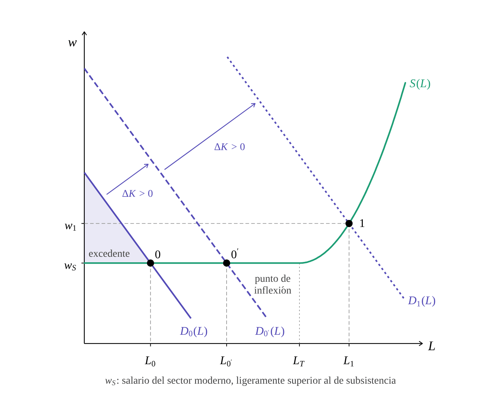
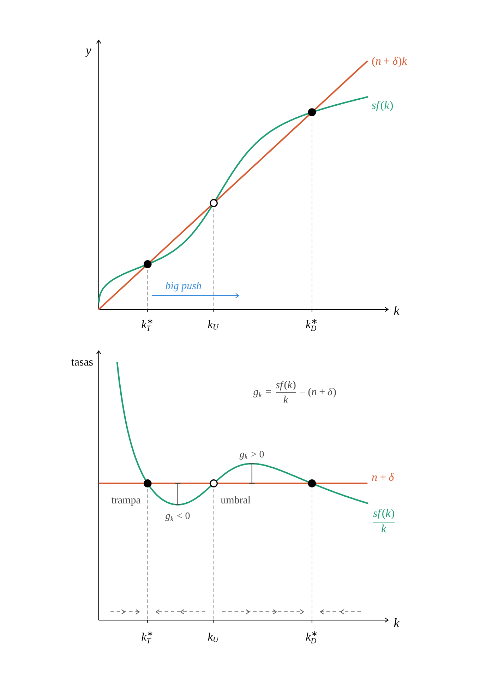

## Introducción



La **teoría del desarrollo económico** constituye una rama de la ciencia económica que busca explicar por qué unos países alcanzan altos niveles de bienestar y otros no, y cómo puede impulsarse el proceso de desarrollo en los países más rezagados. A diferencia de la teoría del crecimiento, que se centra en variables cuantitativas (PIB, acumulación de capital), la teoría del desarrollo incorpora dimensiones cualitativas (instituciones, distribución, salud, educación) y presta especial atención a las peculiaridades estructurales de los países en desarrollo (PED). En la formulación de Amartya Sen (1999), el desarrollo consiste en ampliar las libertades reales de las personas para vivir la vida que valoran (apartado 2.2.2).

El interés académico por esta cuestión se intensificó tras la Segunda Guerra Mundial, y desde entonces ha dado lugar a un cuerpo teórico amplio y heterogéneo que ha evolucionado significativamente a lo largo de las décadas.

El tema estudia la teoría del desarrollo económico en tres partes:

- *Fundamentos*: características de los PED y medición del desarrollo.

- *Teorías del desarrollo*: de los pioneros (décadas de 1940 a 1970) a las necesidades básicas y las capacidades, el Consenso de Washington, el Post-Consenso, el nuevo institucionalismo y los modelos alternativos.

- *Evidencia empírica e implicaciones para el diseño de políticas*: los determinantes profundos, el diagnóstico del crecimiento, la aproximación experimental, las implicaciones de política y el marco de los ODM y los ODS.

## 1. Fundamentos: características de los PED y medición del desarrollo

Antes de exponer las teorías del desarrollo conviene delimitar su objeto, es decir, qué rasgos comparten los países en desarrollo y cómo se miden el desarrollo, la pobreza y la desigualdad.

### 1.1. Características de los países en desarrollo

La teoría del desarrollo se centra en el estudio y diseño de políticas relativas a los países en desarrollo y los países menos avanzados. En estos países, a pesar de constituir un grupo muy heterogéneo, pueden identificarse una serie de rasgos comunes que, con cautela, se agrupan en cuatro categorías: rasgos económicos, institucionales, sociales y demográficos.

#### 1.1.1. Rasgos económicos

**Estructura económica**: predomina un sector primario[^b28-3] poco mecanizado y, por ello, de baja productividad. A su lado conviven una industria frágil y escasamente competitiva, unos servicios poco desarrollados y una economía sumergida de peso significativo (p. ej. cerca del 38 % del PIB en África Subsahariana frente al 23 % en Europa y el 17 % en la OCDE, media de 2010-2014). El mercado de trabajo presenta trabajadores poco cualificados y una elevada infrautilización de la mano de obra, cuya forma dominante es el subempleo y el empleo informal, más que el desempleo abierto.

**Variables flujo**: la baja productividad mantiene reducida la renta per cápita, el ahorro es escaso porque el consumo absorbe casi toda la renta, y la dependencia del exterior es elevada. Las ventas al exterior se concentran en materias primas y alimentos (*commodities*), bienes de precios volátiles y márgenes estrechos cuya demanda, por la ley de Engel, crece menos que la renta[^b28-4]. Esa concentración genera además una elevada exposición a las perturbaciones exteriores, y por ello la volatilidad del crecimiento de los países en desarrollo duplica aproximadamente la de las economías avanzadas.

**Variables *stock***: la deuda externa alcanza niveles elevados. En cambio, la deuda interior o doméstica es, generalmente, comparativamente baja, incluso en relación con países desarrollados. Sin embargo, la composición importa más que el nivel. Al no poder endeudarse en el exterior en su propia moneda, lo que Eichengreen y Hausmann (1999) denominaron *pecado original*, estos países emiten deuda en divisas. Por ello, una depreciación eleva el valor de esa deuda en moneda nacional sin que aumenten los ingresos con los que atenderla.

#### 1.1.2. Rasgos institucionales, sociales y demográficos

**Rasgos institucionales**:

- *Sector público*: débil capacidad recaudatoria, ineficiencia administrativa y, frecuentemente, problemas de corrupción y captura del Estado. La presión fiscal se sitúa habitualmente entre el 10 % y el 20 % del PIB, frente a valores en torno al 34 % de media en la OCDE y al 40 % en la UE. Ello limita severamente la provisión de bienes públicos y refuerza la dependencia de la financiación exterior.

- *Sector financiero*: poco desarrollado, lo que obstaculiza la canalización del ahorro hacia la inversión y la financiación del crecimiento[^b28-5]. La exclusión financiera de una parte sustancial de la población y de las pymes explica el recurso a mecanismos informales de crédito y ahorro, con costes muy superiores a los del sistema formal.

**Rasgos sociales**:

- *Inequidad*: mayor desigualdad económica y clase media exigua. La desigualdad no solo es más elevada, sino más persistente, por la limitada movilidad intergeneracional que impone el acceso desigual a la educación y a la sanidad.

- *Inestabilidad*: conflictividad social y política, alimentada en parte por la desigualdad. La relación es de doble sentido, pues la inestabilidad desincentiva a su vez la inversión a largo plazo y perpetúa el atraso, mecanismo que la literatura institucionalista sitúa en el centro de la explicación del subdesarrollo.

**Rasgos demográficos**:

- *Nacimientos y muertes*: alta tasa de natalidad y de mortalidad. Esta última no procede únicamente de causas naturales (la mortalidad infantil y las enfermedades transmisibles asociadas a la carencia de saneamiento y de atención sanitaria), sino también de causas violentas. Entre las causas violentas destacan los conflictos armados, cuya incidencia se concentra de forma desproporcionada en los países de renta baja.

- *Crecimiento demográfico*: la población aumenta a un ritmo alto comparado con el del producto nacional, y ello frena la mejora de la renta per cápita. Se trata, no obstante, de una fase, no de una condición permanente. Conforme avanza la transición demográfica, la mortalidad desciende antes que la natalidad, lo que ensancha temporalmente la población en edad de trabajar y abre la denominada *ventana de oportunidad demográfica*, cuyo aprovechamiento depende de que exista capacidad de absorción de empleo.

### 1.2. La medición del desarrollo, la pobreza y la desigualdad

La medición combina un indicador sintético del desarrollo, el Índice de Desarrollo Humano, con medidas específicas de la pobreza y de la desigualdad, entre ellas el coeficiente de Gini.

#### 1.2.1. Índice de Desarrollo Humano (IDH)

**Definición**: el indicador más utilizado es el *Índice de Desarrollo Humano*, elaborado por el Programa de las Naciones Unidas para el Desarrollo (PNUD) en su *Informe sobre Desarrollo Humano*. Se construye como media geométrica de tres subíndices con igual ponderación:

- *Renta*: renta nacional bruta (RNB) per cápita en dólares en paridad de poder adquisitivo (PPA) de 2021. Se utiliza la RNB en lugar del PIB para excluir las rentas de filiales extranjeras que repatrían beneficios.

- *Salud*: esperanza de vida al nacer.

- *Educación*: media de años de escolarización y esperanza de años de escolarización.

**Cálculo**: cada dimensión se normaliza mediante un subíndice que expresa la posición relativa del país entre unos valores mínimo y máximo predefinidos:

$$I_{\text{dimensión}} = \frac{\text{valor observado} - \text{valor mínimo}}{\text{valor máximo} - \text{valor mínimo}}$$

El subíndice de renta se calcula sobre logaritmos, reflejando la utilidad marginal decreciente de la renta:

$$I_{\text{renta}} = \frac{\ln(\text{RNBpc}) - \ln(\text{mín})}{\ln(\text{máx}) - \ln(\text{mín})}$$

y el de educación es la media aritmética de los subíndices de años medios y años esperados de escolarización. El IDH agregado es la media geométrica de los tres subíndices:

$$\text{IDH} = \left(I_{\text{salud}} \cdot I_{\text{educación}} \cdot I_{\text{renta}}\right)^{1/3}$$

El recurso a la media geométrica (adoptado en el IDH de 2010) penaliza los desequilibrios entre dimensiones. Un país no puede así compensar un déficit grave en una de ellas con un exceso de igual cuantía en otra, a diferencia de lo que permitía la media aritmética empleada anteriormente.

**Interpretación**: el IDH oscila entre 0 y 1. Según el *Human Development Report* de 2025 (con datos de 2023), Islandia ocupa el primer puesto (0,972), seguida de Suiza y Noruega (0,970). En el extremo opuesto, Sudán del Sur (0,388), Somalia (0,404) y la República Centroafricana (0,414) cierran la clasificación, y los nueve últimos países son todos del África Subsahariana.

Para paliar algunas de sus limitaciones, el PNUD ha desarrollado indicadores complementarios. Entre ellos figuran el *IDH ajustado por la desigualdad* (IDH-D, desde 2010), que descuenta la pérdida de desarrollo atribuible a la desigualdad interna, el *Índice de Desigualdad de Género* (IDG) y el *Índice de Pobreza Multidimensional* (IPM). Conceptualmente, el IDH se inspira en el enfoque de las capacidades de Amartya Sen (apartado 2.2.2).

**Conclusiones**:

- *Aspectos positivos*: es multidimensional[^b28-6] y comparable internacionalmente.

- *Limitaciones*: la ponderación homogénea de los factores permite alcanzar el mismo valor por caminos muy diferentes, y el índice omite aspectos cualitativos importantes (desigualdad interna, sostenibilidad ambiental, libertades civiles).

#### 1.2.2. Medición de la pobreza

Junto a los índices sintéticos de desarrollo conviven tres aproximaciones a la medición de la pobreza, cuya distinción resulta esencial.

**Pobreza monetaria absoluta**: el Banco Mundial fija líneas internacionales de pobreza expresadas en paridad de poder adquisitivo, que permiten la comparación entre países y a lo largo del tiempo. La línea de pobreza extrema vigente es de 3,00 \$ diarios en PPA de 2021 desde junio de 2025 (antes, 2,15 \$ en PPA de 2017). Se ha revisado sucesivamente con las nuevas estimaciones de paridad y de las líneas nacionales de pobreza[^b28-7], y se complementa con líneas de 4,20 \$ y 8,30 \$ diarios para los países de renta media-baja y media-alta.

Su virtud es la comparabilidad, y su limitación, que reduce la privación a una única dimensión y depende críticamente de la calidad de las encuestas de hogares, escasas y poco frecuentes en numerosos países. Buena parte de la reducción de la pobreza extrema mundial registrada desde 1990 se concentra, además, en un solo país[^b28-8].

**Pobreza multidimensional**: el Índice de Pobreza Multidimensional (IPM), elaborado por el PNUD y la Iniciativa sobre Pobreza y Desarrollo Humano de Oxford desde 2010, traduce el enfoque de las capacidades a una métrica operativa. Identifica como pobre a quien sufre privación simultánea en un número suficiente de indicadores agrupados en tres dimensiones (salud, educación y nivel de vida). El resultado se descompone en la incidencia de la pobreza, o proporción de personas pobres, y su intensidad, o proporción media ponderada de indicadores en que sufren privación quienes son pobres. El interés analítico del IPM reside en que revela solapamientos que las medidas monetarias ocultan, ya que buena parte de quienes superan la línea de renta siguen careciendo de acceso a saneamiento, electricidad o escolarización.

**Pobreza relativa**: en las economías avanzadas se emplea con preferencia un umbral definido como fracción de la mediana nacional de la renta disponible equivalente, el 60 % en la UE (Eurostat) y el 50 % en la OCDE. Mide, por tanto, distancia respecto del cuerpo social antes que privación absoluta, de modo que la pobreza relativa puede aumentar en un contexto de mejora generalizada de la renta.

#### 1.2.3. Coeficiente de Gini

**Definición**: el *coeficiente de Gini* (Gini, 1912) mide la dispersión estadística en la distribución de la renta. Basado en la curva de Lorenz, oscila entre 0 (igualdad perfecta) y 1 (desigualdad máxima).

**Cálculo**: formalmente (figura -@fig-b284-lorenz), si $A$ es el área comprendida entre la línea de equidistribución (la bisectriz) y la curva de Lorenz, y $B$ el área situada bajo la curva de Lorenz, el índice se define como:

$$G = \frac{A}{A + B}, \qquad G \in [0, 1]$$

::: {#fig-b284-lorenz}

::: {.content-visible when-format="html"}
```{=html}
<div class="graph-frame">
<iframe src="../graphs/b284_Lorenz.html" style="height:620px" loading="lazy" title="fig-b284-lorenz"></iframe>
</div>
```
:::

::: {.content-visible unless-format="html"}

:::

Curva de Lorenz y coeficiente de Gini. La curva de Lorenz, $L(p)$, da la proporción acumulada de renta que recibe la proporción acumulada de población, $p$, y queda por debajo de la línea de equidistribución, la bisectriz. $A$ es el área entre ambas, $B$ el área bajo la curva de Lorenz, y el coeficiente de Gini es $G = A/(A + B)$.
:::

**Interpretación**: como el triángulo bajo la bisectriz tiene área $A + B = 1/2$, el coeficiente equivale a $G = 2A = 1 - 2B$. Cuanto más se aleja la curva de Lorenz de la diagonal, mayor es el área $A$ y mayor la desigualdad. Aunque el Gini es la medida más difundida, no es la única ni siempre la más informativa. Otras medidas son:

- *Ratios entre percentiles*: resultan más transparentes y sensibles a los extremos de la distribución, en particular el cociente entre la renta del decil superior y la del inferior.

- *Índice de Theil*: procedente de la teoría de la información, presenta la propiedad de ser descomponible aditivamente entre grupos, lo que permite distinguir la desigualdad existente dentro de cada región o sector de la que existe entre ellos.

- *Curva del elefante*: representa, en la formulación de Branko Milanovic[^b28-9], el crecimiento de la renta real por percentiles de la distribución mundial entre 1988 y 2008. Mostró que la globalización benefició sobre todo a las clases medias emergentes asiáticas y al 1 % más rico, mientras estancaba las rentas medias-bajas de las economías avanzadas, un hallazgo que ha resultado central en el debate político posterior sobre la globalización.

**Conclusiones**:

- *Aspectos positivos*: ofrece una medida sintética de la desigualdad.

- *Limitaciones*: es una medida relativa, que puede aumentar aunque el número absoluto de personas en pobreza haya disminuido. Además, el Gini puede ser elevado incluso en países desarrollados (p. ej. EE. UU. presenta un Gini de renta disponible en torno a 0,40), por lo que no es necesariamente representativo del grado de subdesarrollo.

### 1.3. Conclusiones

Los PED comparten una estructura primaria de baja productividad que genera poca renta y poco ahorro. Sus exportaciones se concentran en materias primas de precio volátil y su deuda exterior se emite en divisas, lo que los hace vulnerables a los *shocks*, como evidenció la pandemia de COVID-19. La escasa recaudación limita la provisión de bienes públicos, y la desigualdad alimenta una inestabilidad política que desincentiva la inversión y perpetúa el atraso. El crecimiento demográfico frena la renta per cápita hasta que la transición abre una ventana de oportunidad.

La medición combina un indicador sintético con medidas específicas, cada una con sus límites. El IDH agrega renta, salud y educación con una media geométrica que penaliza los desequilibrios entre dimensiones. La pobreza se mide en términos absolutos, multidimensionales o relativos, y el Gini resume la desigualdad sin reflejar el grado de subdesarrollo. Las peculiaridades estructurales de los PED llevaron a muchos economistas a juzgar insuficiente la teoría del crecimiento convencional para este grupo de países, y de ahí nació el cuerpo teórico propio que estudia el apartado 2.

## 2. Teorías del desarrollo: de los pioneros a las teorías recientes

La teoría del desarrollo ha evolucionado por generaciones. Los pioneros explicaron el subdesarrollo como una etapa, como una trampa o como fruto de la inserción exterior del país. La reflexión posterior se ordena por décadas. Los años setenta redefinieron el concepto de desarrollo, los ochenta trajeron la contrarrevolución neoclásica y el Consenso de Washington y los noventa, el Post-Consenso de Washington y el nuevo institucionalismo, junto al que han surgido modelos alternativos al neoclásico.

### 2.1. Los pioneros (décadas de 1940 a 1970)

Entre los autores que fundaron la teoría del desarrollo predominaban los de orientación heterodoxa[^b28-10]. Se distinguen tres vertientes, de cada una de las cuales se deriva una recomendación de política (apartado 3.4): quienes conciben el subdesarrollo como una etapa, quienes enfatizan las trampas y círculos viciosos, y quienes ponen el acento en los factores externos. A ellas se añade el estudio de Kuznets (1955) sobre la relación entre desigualdad y desarrollo.

#### 2.1.1. El subdesarrollo como una etapa

La primera vertiente concibe el subdesarrollo como una etapa que puede recorrerse con mayor o menor rapidez. Sus dos modelos de referencia son el dual de Lewis y el de etapas de Rostow.

**Modelo dual (Lewis, 1954)**: una de las limitaciones de los modelos de crecimiento que señalaron los pioneros fue su carácter unisectorial, pues el de Harrod-Domar (keynesiano), como después el de Solow-Swan (neoclásico, 1956), trataba la producción como un agregado. Arthur Lewis (1954) fue uno de los primeros autores en plantear un modelo analítico en el que la economía de un PED puede simplificarse a una economía de dos sectores[^b28-11].

- *Idea*: el sector moderno absorbe el excedente de trabajo del sector tradicional a un salario constante próximo al de subsistencia, de modo que el desarrollo consiste en un proceso de cambio estructural alimentado por la reinversión del excedente capitalista.

- *Razonamiento*: el sector tradicional agrícola, rural, pobre y superpoblado, produce para la subsistencia a partir de trabajo y tierra, $Y_A = f_A(T, L_A)$, y en él existe *desempleo encubierto*[^b28-12]. Por su parte, el sector moderno industrial, urbano, con capacidad de ahorro y de acumulación de capital, produce a partir de trabajo y capital, $Y_I = f_I(K, L)$.

- *Desarrollo gráfico*: el modelo dual se representa en el plano empleo-salario del sector moderno (figura -@fig-b282-lewis):

    - *Oferta de trabajo* ($S(L)$): recoge el trabajo que el sector agrícola cede al moderno a cada salario. Es horizontal al salario $w_S$, ligeramente superior al de subsistencia, mientras queda excedente de trabajo agrícola, porque retirar del campo trabajadores con productividad marginal nula no reduce su producción. Es creciente a partir del punto de inflexión, $L_T$, porque atraer más trabajadores exige entonces elevar el salario.

    - *Demanda de trabajo* ($D(L)$): recoge la productividad marginal del trabajo en el sector moderno, decreciente, y su posición depende del capital acumulado.

    - *Equilibrio*: en el punto 0, la demanda $D_0(L)$ corta la oferta en el tramo horizontal, con empleo $L_0$ y salario $w_S$, y el área entre la demanda y el salario es el excedente capitalista.

- *Dinámica*: el desarrollo se articula en dos fases, separadas por el punto de inflexión:

    1. *Fase de oferta ilimitada de trabajo*: mientras exista excedente, el salario real permanece constante y todas las ganancias de productividad se traducen en excedente capitalista. Su reinversión ($\Delta K > 0$) desplaza hacia la derecha la demanda de trabajo, de $D_0(L)$ a $D_{0'}(L)$, y permite absorber una nueva tanda de trabajadores al mismo salario (del punto 0 al 0′, con empleo $L_{0'}$). El proceso es acumulativo, pues cuanto mayor es el excedente, mayor la inversión y mayor la absorción del periodo siguiente.

    2. *Fase neoclásica*: el proceso termina cuando ya no queda mano de obra sobrante que absorber, en el *punto de inflexión de Lewis* (*Lewis turning point*). A partir de él, atraer un trabajador adicional exige elevar el salario, y los salarios reales crecen con la productividad (con la demanda $D_1(L)$, el salario sube a $w_1$ en el punto 1). El debate sobre si China ha alcanzado ya ese punto ha ocupado a la literatura durante la última década.

::: {#fig-b282-lewis}

::: {.content-visible when-format="html"}
```{=html}
<div class="graph-frame">
<iframe src="../graphs/b282_Lewis.html" style="height:600px" loading="lazy" title="fig-b282-lewis"></iframe>
</div>
```
:::

::: {.content-visible unless-format="html"}

:::

Modelo dual de Lewis (1954). La oferta de trabajo es ilimitada a un salario constante próximo al de subsistencia hasta el punto de inflexión.
:::

- *Extensiones*: el *modelo de Harris-Todaro* (1970) refinó el enfoque de Lewis para explicar una paradoja observada en muchos PED, la persistencia de fuertes flujos migratorios del campo a la ciudad pese a la existencia de elevado desempleo urbano. La decisión de migrar no depende del salario urbano efectivo, sino del esperado (el salario del sector formal ponderado por la probabilidad de obtener empleo). Mientras ese salario esperado supere la renta agrícola, la migración prosigue y genera un equilibrio con desempleo urbano involuntario (o subempleo en el sector informal). Por ello, las medidas que elevan el salario o el empleo urbano sin actuar sobre el medio rural pueden ser contraproducentes, al atraer más migrantes de los que la ciudad es capaz de absorber (la *paradoja de Todaro*).

- *Conclusiones*:

    - *Aspectos positivos*: el modelo fue influyente al poner de manifiesto la dualidad de las economías PED y la importancia del cambio estructural.

    - *Limitaciones*: en los PED el desempleo abierto suele concentrarse en las ciudades y no en el campo (de ahí el modelo de Harris-Todaro), los capitalistas no siempre reinvierten y la movilidad intersectorial perfecta es un supuesto fuerte.

**Modelo de etapas (Rostow, 1960)**: Walt Whitman Rostow lo formuló en *The Stages of Economic Growth: A Non-Communist Manifesto* (1960), cuyo subtítulo revela su propósito, ofrecer en plena Guerra Fría una secuencia histórica alternativa a la marxista, en la que el desarrollo culmina en la sociedad de consumo y no en el socialismo.

- *Idea*: todos los países atraviesan cinco etapas sucesivas, la *sociedad tradicional* (economía agrícola de subsistencia), las *precondiciones para el despegue* (mecanización agrícola y desarrollo del transporte), el *despegue* (rápido aumento del ahorro y de la inversión, con adopción de tecnología), la *marcha hacia la madurez* (diversificación económica y difusión tecnológica) y la *era del consumo de masas* (terciarización y consumo masivo).

- *Razonamiento*: el elemento analítico central es la caracterización del despegue, que Rostow define mediante tres condiciones simultáneas:

    - *Salto en la tasa de inversión*: la inversión productiva ha de elevarse desde el entorno del 5 % hasta superar el 10 % de la renta nacional, umbral a partir del cual el crecimiento del producto excede de forma sostenida al de la población. La conexión con el modelo de Harrod-Domar es directa, pues la tasa de acumulación determina el crecimiento.

    - *Sectores líderes*: el desarrollo de uno o varios sectores manufactureros con elevada tasa de crecimiento, capaces de arrastrar al resto de la economía mediante encadenamientos, noción próxima a los eslabonamientos de Hirschman (1958).

    - *Marco institucional*: un entramado político, social e institucional capaz de convertir el excedente en inversión, en lugar de en consumo suntuario o en salida de capitales.

- *Conclusiones*:

    - *Aspectos positivos*: junto con Harrod-Domar y Rosenstein-Rodan, influyó en los modelos de brecha del Banco Mundial para estimar necesidades de financiación, porque la brecha entre el ahorro observado y el requerido para el despegue daba un criterio operativo sobre el que fundamentar la ayuda exterior.

    - *Limitaciones*: Kuznets objetó que muchos países alcanzaron etapas avanzadas sin las elevadas tasas de ahorro previstas. Al modelo se le reprocha además su carácter mecanicista y unilineal, y las etapas no son irreversibles, como ilustra el retroceso de la economía rusa tras la disolución de la Unión Soviética (1991). El modelo de Rostow ignora, por último, el contexto internacional, objeción que formula el estructuralismo de la Comisión Económica para América Latina y el Caribe (CEPAL).

#### 2.1.2. Circularidades, equilibrios múltiples y trampas

Frente a la concepción del subdesarrollo como etapa de una senda común, otros autores sostienen que existen restricciones endógenas que lo perpetúan. Su fundamento analítico común es la **causación acumulativa** (*circular cumulative causation*), es decir, la existencia de mecanismos de retroalimentación positiva que amplifican las diferencias iniciales en lugar de corregirlas. Por ello, donde la teoría neoclásica predice convergencia condicional, por los rendimientos decrecientes del capital, esta perspectiva predice divergencia. La idea se construyó en buena parte al margen de la economía del desarrollo:

- *Allyn Young (1928)*: señaló la interdependencia entre el tamaño del mercado y la división del trabajo.

- *Gunnar Myrdal (1957)*: acuñó el término y distinguió los efectos de arrastre (*spread*), por los que la región próspera dinamiza a la atrasada, de los de succión (*backwash*), por los que atrae sus recursos y su trabajo cualificado, con predominio tendencial de los segundos[^b28-13].

- *Nicholas Kaldor (1957, 1966)*: lo ligó a la industrialización mediante las economías de aglomeración y la ley de Verdoorn.

- *Kenneth Arrow (1962)*: proporcionó el mecanismo microeconómico al modelizar el aprendizaje por la práctica (*learning by doing*) como fuente de rendimientos crecientes.

**Trampas de pobreza (Nurkse, 1953; Azariadis y Drazen, 1990)**: Ragnar Nurkse (1953) identificó los círculos viciosos de la pobreza, intuición que Costas Azariadis y Allan Drazen (1990) formalizaron después mediante externalidades de umbral.

- *Idea*: la economía puede descansar en un equilibrio estable de renta baja al que retorna tras cualquier perturbación de escasa magnitud, de modo que el subdesarrollo no es una posición transitoria sino un estado de reposo.

- *Razonamiento*: Nurkse identificó dos círculos viciosos, reforzados, sin ser por sí mismos mecanismos circulares, por unos mercados financieros subdesarrollados, que limitan el trasvase del ahorro hacia la inversión, y por un tejido productivo débil:

    - *Círculo de la oferta*: la renta baja solo permite un ahorro bajo, el ahorro bajo financia una inversión insuficiente, la inversión insuficiente mantiene la productividad escasa y la productividad escasa condena a la renta a seguir siendo baja.

    - *Círculo de la demanda*: la renta baja hace que el mercado interno sea reducido, el mercado reducido ofrece escaso incentivo a invertir, la falta de inversión mantiene la productividad escasa y esta, de nuevo, la renta baja.

- *Desarrollo gráfico*: en el modelo de Azariadis y Drazen (1990), cuando el rendimiento de la acumulación (especialmente de capital humano) depende del *stock* ya existente, la función de producción presenta un tramo de rendimientos crecientes que genera equilibrios múltiples. La trampa de pobreza se representa en el plano capital per cápita-producto per cápita (figura -@fig-b281-trampa):

    - *Curva de ahorro* ($sf(k)$): recoge el ahorro por trabajador, una fracción $s$ de la producción per cápita, $f(k)$, que financia la inversión bruta. Es cóncava en los niveles bajos y altos de capital, por los rendimientos decrecientes, y el tramo de rendimientos crecientes la hace convexa en los niveles intermedios.

    - *Inversión de reposición* ($(n + \delta)k$): recoge la inversión que mantiene constante el capital per cápita, porque compensa la depreciación, a la tasa $\delta$, y el crecimiento de la población, a la tasa $n$. Es una recta que parte del origen, de pendiente $n + \delta$, porque es proporcional a $k$.

    - *Equilibrio*: ambas curvas se cortan, además de en el origen, tres veces, en dos equilibrios estables, uno en la trampa de pobreza ($k^*_T$) y otro en un nivel alto de desarrollo ($k^*_D$), y en uno inestable intermedio ($k_U$) que actúa como umbral. Si el capital se sitúa por debajo de ese umbral, la economía gravita hacia la trampa, y solo un impulso que lo lleve por encima de $k_U$ (*big push*, apartado 3.4.2) la conduce a $k^*_D$. El panel inferior lo muestra en tasas, pues el capital per cápita crece a la tasa $g_k = sf(k)/k - (n + \delta)$, negativa entre $k^*_T$ y $k_U$ y positiva entre $k_U$ y $k^*_D$.

::: {#fig-b281-trampa}

::: {.content-visible when-format="html"}
```{=html}
<div class="graph-frame">
<iframe src="../graphs/b281_Trampa.html" style="height:1023px" loading="lazy" title="fig-b281-trampa"></iframe>
</div>
```
:::

::: {.content-visible unless-format="html"}

:::

Trampa de pobreza. El modelo de Solow con función de producción no cóncava tiene equilibrios múltiples, y el *big push* permite escapar al equilibrio alto.
:::

- *Conclusiones*:

    - *Aspectos positivos*: proporciona la justificación analítica más sólida del impulso de gran escala y de la ayuda exterior concentrada en el tiempo frente a la ayuda sostenida.

    - *Limitaciones*: la existencia empírica de las trampas es objeto de controversia. William Easterly ha señalado que numerosos países muy pobres han crecido de forma sostenida sin recibir impulso alguno, y que la persistencia del atraso se explica mejor por la calidad institucional que por un umbral tecnológico. El modelo tampoco especifica dónde se sitúa el umbral, lo que limita considerablemente su utilidad operativa.

**Trampas demográficas (Nelson, 1956)**: Richard Nelson (1956) formuló la *trampa de equilibrio de nivel bajo* (*low-level equilibrium trap*).

- *Idea*: la trampa puede originarse en la propia dinámica de la población. Si el crecimiento demográfico responde positivamente a la renta per cápita en los niveles bajos, todo aumento del producto se traduce en más habitantes antes que en mayor renta por habitante, de modo que la economía queda atrapada en un equilibrio de subsistencia.

- *Razonamiento*: la renta per cápita, $y$, crece a la tasa $g_y = g_Y - n$, diferencia entre la tasa de crecimiento de la renta nacional, $g_Y$, y la de la población, $n$, y ambas dependen del nivel de $y$. Gráficamente, la trampa demográfica se representa en el plano renta per cápita-tasas de crecimiento (figura -@fig-b283-nelson):

    - *Tasa de crecimiento de la población*, $n(y)$: es nula en la renta de subsistencia, $y_S$, y negativa por debajo de ella. Por encima, crece deprisa con la renta, porque cae la mortalidad, hasta aplanarse en un máximo fisiológico.

    - *Tasa de crecimiento de la renta*, $g_Y(y)$: es nula también en $y_S$, donde el ahorro neto se anula, y creciente, porque el ahorro y la inversión aumentan con la renta. Cerca de la subsistencia tiene menos pendiente que $n(y)$, pero sigue subiendo cuando esta se aplana.

    - *Transición demográfica* (tramo discontinuo): en las rentas altas la natalidad cae y $n(y)$ desciende, posibilidad que el modelo no contempla.

    - *Equilibrio*: las dos curvas se cortan dos veces. El punto 0, en $y_S$, es un equilibrio estable de nivel bajo, porque entre $y_S$ y el umbral se cumple $n(y) > g_Y(y)$ y la renta per cápita retrocede hacia él ($g_y < 0$), y por debajo de $y_S$ la población disminuye más deprisa que la renta. El punto U, en $y_U$, es un umbral inestable, pues solo si el producto crece con la intensidad suficiente para rebasarlo, la renta per cápita aumenta de forma sostenida ($g_Y(y) > n(y)$, $g_y > 0$). La distancia entre ambos puntos mide la fuerza de la trampa, que refuerzan la elevada correlación entre renta per cápita y crecimiento poblacional, una propensión marginal a invertir reducida y la escasez de suelo cultivable.

::: {#fig-b283-nelson}

::: {.content-visible when-format="html"}
```{=html}
<div class="graph-frame">
<iframe src="../graphs/b283_Nelson.html" style="height:560px" loading="lazy" title="fig-b283-nelson"></iframe>
</div>
```
:::

::: {.content-visible unless-format="html"}

:::

Trampa de equilibrio de nivel bajo (Nelson, 1956). Entre la renta de subsistencia, $y_S$ (punto 0, estable), y el umbral, $y_U$ (punto U, inestable), la población crece más deprisa que la renta, $n(y) > g_Y(y)$, y la renta per cápita vuelve al punto 0. Pasado el umbral, la renta per cápita crece de forma sostenida.
:::

- *Conclusiones*:

    - *Aspectos positivos*: incorpora la demografía al análisis del desarrollo y ofrece el fundamento analítico de las políticas de planificación familiar que dominaron la agenda internacional durante los años sesenta y setenta.

    - *Limitaciones*: la evidencia posterior desmintió la premisa central, pues la transición demográfica ha reducido las tasas de natalidad conforme aumentaba la renta, sin necesidad de impulso externo. La relación positiva entre renta y crecimiento poblacional resultó ser, así, un fenómeno de fase y no una constante. El planteamiento subestima además el efecto de la educación femenina y de la reducción de la mortalidad infantil sobre la fecundidad.

#### 2.1.3. Factores externos: la hipótesis centro-periferia

Las dos vertientes anteriores buscan la causa del subdesarrollo en el interior de la economía atrasada. En cambio, una tercera corriente la sitúa fuera, en la forma en que el país se inserta en la economía mundial. Su premisa compartida es que el comercio internacional, lejos de ser neutral, transmite el atraso, de modo que la especialización que recomienda la teoría de la ventaja comparativa perpetúa la brecha. La formulación estructuralista localiza el problema en el deterioro de los precios relativos, y la ley de Thirlwall, en la restricción que el sector exterior impone al ritmo de crecimiento.

**El estructuralismo de la CEPAL (Prebisch, 1949; Singer, 1950)**: la escuela estructuralista de la CEPAL[^b28-14], encabezada por Raúl Prebisch, formuló la *hipótesis del centro-periferia*. Hans Singer (1950), desde la sede de las Naciones Unidas en Nueva York, llegó a la vez a la misma tesis sobre la relación real de intercambio.

- *Idea*: el desarrollo y el subdesarrollo no son fenómenos independientes, sino los dos polos de un mismo sistema centro-periferia, en el que el comercio internacional y la especialización asimétrica perpetúan el atraso[^b28-15].

- *Razonamiento*: la hipótesis se sustenta en tres argumentos interrelacionados:

    - *Argumento estructural*: la economía mundial se divide en centro, con estructuras productivas industriales y diversificadas, y periferia, especializada en productos primarios de bajo valor añadido[^b28-16]. Esa asimetría estructural, y no la mera dotación de factores, explica la distinta capacidad de una y otra para retener los frutos del progreso técnico.

    - *Argumento de la relación real de intercambio*: la RRI se deteriora tendencialmente para la periferia. En primer lugar, por la ley de Engel, la elasticidad-renta de la demanda de productos primarios es inferior a la unidad mientras que la de las manufacturas la supera, por lo que el crecimiento de la renta mundial desplaza la demanda hacia los bienes que exporta el centro ($\downarrow P_X$). En segundo lugar, por la asimetría en la distribución de las ganancias de productividad, pues en el centro el poder sindical y la estructura oligopolística permiten retenerlas en forma de salarios y beneficios ($P_M$ no desciende), mientras que en la periferia el excedente de mano de obra las traslada a los compradores exteriores mediante menores precios de exportación. Los PED deben, por tanto, exportar cada vez más por cada unidad importada.

    - *Argumento histórico*: durante el s. XIX las relaciones centro-periferia actuaron como motor de crecimiento, por la vía de la demanda de materias primas y de los flujos de factores, pero esa transmisión se interrumpió en el s. XX por la ley de Engel, la autosuficiencia agrícola del centro (p. ej. la política agrícola común europea), el desarrollo del comercio de servicios y la volatilidad de las *commodities*.

- *Conclusiones*:

    - *Aspectos positivos*: incorporó al análisis del desarrollo la dimensión internacional que las teorías anteriores omitían, y su diagnóstico sobre la volatilidad y la escasa elasticidad-renta de las materias primas conserva plena vigencia, como muestra la persistencia de la maldición de los recursos naturales.

    - *Limitaciones*: la evidencia sobre el deterioro tendencial de la RRI es más débil de lo que la hipótesis sostiene, pues las series de largo plazo muestran una tendencia negativa moderada dominada por una volatilidad muy superior. El planteamiento no anticipó, además, que numerosas economías periféricas lograran industrializarse y exportar manufacturas, lo que erosionó la propia dicotomía centro-periferia y restó influencia al estructuralismo a partir de los años ochenta.

**La ley de Thirlwall (1979)**: Anthony Thirlwall (1979) desplaza el foco desde los precios hacia las cantidades.

- *Idea*: el crecimiento de una economía abierta no está limitado por la oferta (la disponibilidad de factores), sino por la demanda exterior, de modo que ningún país puede crecer de forma sostenida por encima del ritmo que su balanza de pagos permite financiar.

- *Razonamiento*: si la cuenta corriente ha de mantenerse en equilibrio a largo plazo y los precios relativos son estables, el crecimiento del país se aproxima al crecimiento mundial ajustado por la ratio de elasticidades-renta, $g_Y = (\varepsilon_{XY^*}/\varepsilon_{MY}) \cdot g_{Y^*}$, donde $g_Y$ es la tasa de crecimiento del país, $\varepsilon_{XY^*}$ la elasticidad-renta de la demanda de sus exportaciones, $\varepsilon_{MY}$ la elasticidad-renta de sus importaciones y $g_{Y^*}$ la tasa de crecimiento del resto del mundo. La restricción depende, por tanto, de la composición de la especialización, más que del volumen exportado. Así, un país que exporta bienes de baja elasticidad-renta e importa bienes de alta elasticidad ($\varepsilon_{XY^*} < \varepsilon_{MY}$) crece necesariamente por debajo del resto del mundo, y su brecha se amplía con el tiempo. Esta especialización asimétrica es la misma que la de Prebisch-Singer, leída en términos de cantidades en lugar de precios.

- *Conclusiones*:

    - *Aspectos positivos*: presenta un buen ajuste empírico, especialmente en los países en desarrollo, y ofrece un criterio operativo de política económica. Según ese criterio, la vía para relajar la restricción no es devaluar, sino modificar la estructura exportadora hacia bienes de mayor elasticidad-renta.

    - *Limitaciones*: omite el papel de los precios y del tipo de cambio real, no considera que los flujos de capital permitan sostener déficits durante periodos prolongados, y supone elasticidades constantes cuando la propia transformación productiva las modifica.

#### 2.1.4. Desigualdad y desarrollo: la curva de Kuznets (Kuznets, 1955)

**Origen**: Simon Kuznets (1955), con series de EE. UU., el Reino Unido y Alemania, estudió cómo cambia la desigualdad a lo largo del desarrollo.

**Idea**: la desigualdad sigue una U invertida respecto de la renta per cápita, pues aumenta en las primeras fases del desarrollo y disminuye después.

**Razonamiento**: en una economía dual como la de Lewis, el trabajo pasa de un sector tradicional, pobre e igualitario, a otro moderno, más rico y más desigual. Al principio, la reasignación añade a la desigualdad la brecha entre los dos sectores, y la desigualdad global sube. Cuando la mayor parte de la población ya está en el sector moderno, esa brecha pesa menos, y la urbanización, la educación y la redistribución reducen la desigualdad.

**Extensiones**: las teorías modernas invierten la causalidad y estudian cómo la desigualdad afecta al desarrollo. Con mercados de crédito imperfectos, quien no tiene riqueza no puede financiar su educación ni su inversión, de modo que la distribución inicial de la riqueza condiciona la renta a largo plazo y puede crear trampas de pobreza individuales (Galor y Zeira, 1993; Banerjee y Newman, 1993). Estas teorías dan así una microfundamentación a las trampas ya descritas. La evidencia sobre la curva y sobre la relación entre desigualdad y crecimiento se desarrolla en el tema [A45](a45-crecimiento-empirica.qmd), apartado 3.3.

**Conclusiones**:

- *Aspectos positivos*: relacionó por primera vez la distribución de la renta con el proceso de desarrollo y fue durante décadas el marco de referencia del debate.

- *Limitaciones*: la evidencia posterior es débil. Con datos de cada país a lo largo del tiempo, la U invertida no aparece en la gran mayoría de los casos (Deininger y Squire, 1998), y el aumento de la desigualdad en las economías avanzadas desde los años ochenta (Piketty, 2014) contradice su tramo final.

### 2.2. Década de los setenta: la redefinición del desarrollo

En los años setenta, la observación de experiencias de crecimiento que no reducían la pobreza (p. ej. el “milagro brasileño”, con fuerte crecimiento y desigualdad creciente) y la mayor disponibilidad de información estadística llevaron a redefinir el concepto de desarrollo. El desarrollo pasó a entenderse como algo más amplio que el crecimiento económico, con dimensiones cualitativas.

En el plano de los instrumentos, de esta década data también el **microcrédito**[^b28-23], concebido como respuesta a la exclusión financiera de los hogares sin garantías reales y basado en la responsabilidad solidaria del grupo de prestatarios como sustituto del colateral. Su expansión posterior lo convertiría en uno de los instrumentos de desarrollo más difundidos, si bien la evaluación experimental matizaría sus efectos (apartados 3.3.2 y 3.3.3).

#### 2.2.1. Necesidades básicas (Seers, 1969; OIT, 1976)

**Origen**: con base en las aportaciones de Dudley Seers[^b28-22] (1969), la Conferencia Mundial sobre el Empleo de la Organización Internacional del Trabajo (OIT, 1976) formuló el *enfoque de necesidades básicas*.

**Idea**: el desarrollo exige cubrir las necesidades básicas, que la OIT definió por dos elementos. El primero es el consumo mínimo de una familia (alimento, vivienda, vestido), y el segundo, los servicios esenciales de la comunidad (agua potable, saneamiento, transporte público, sanidad, educación).

**Razonamiento**: la política que propuso incluía, además, el empleo libremente elegido, como medio y como fin, y la participación de la población en las decisiones que la afectan.

**Conclusiones**:

- *Aspectos positivos*: constituye un antecedente directo del concepto de desarrollo económico actual y del posterior Índice de Desarrollo Humano. Asimismo, su adopción simultánea por el Banco Mundial, bajo la presidencia de Robert McNamara, resultó decisiva para su traslación operativa, pues la institución reorientó una parte sustancial de su cartera hacia proyectos de desarrollo rural, salud y educación y se apartó así del énfasis anterior en la infraestructura.

- *Limitaciones*: como toda medición multidimensional, exige decidir qué necesidades incluir, un juicio de valor explícito (tema [A24](a24-eb-iii.qmd), apartado 1.4.3).

#### 2.2.2. Enfoque de las capacidades (Sen, 1979, 1999)

**Origen**: la formulación teórica de esta ampliación del concepto la ofreció Amartya Sen (Nobel de Economía, 1998) con su *enfoque de las capacidades*, desarrollado desde su conferencia de 1979 a lo largo de las dos décadas siguientes.

**Idea**: para Sen, el desarrollo no consiste en la acumulación de bienes ni en la utilidad subjetiva, sino en la expansión de las capacidades. Las capacidades son el conjunto de *funcionamientos* (*functionings*) que una persona puede efectivamente elegir ser o hacer, como estar bien alimentada, gozar de salud o participar en la vida de la comunidad.

**Razonamiento**: la renta es solo un medio, cuya conversión en bienestar depende de factores personales y sociales heterogéneos, por lo que dos personas con la misma renta pueden disfrutar de niveles de libertad muy distintos. En *Desarrollo y libertad* (1999), Sen sintetizó esta visión y definió el desarrollo como un proceso de expansión de las libertades reales de que disfrutan los individuos. En ese proceso, la libertad es a la vez el fin primordial (papel constitutivo) y el principal medio (papel instrumental) del desarrollo.

**Conclusiones**:

- *Aspectos positivos*: el enfoque, que Mahbub ul Haq llevó a la práctica con la colaboración del propio Sen en el primer *Informe sobre Desarrollo Humano* (1990), constituye el fundamento conceptual del IDH y de los enfoques multidimensionales de la pobreza (apartados 1.2.1 y 1.2.2).

- *Limitaciones*: tropieza con la imposibilidad de observar directamente las capacidades individuales, que obliga a aproximarlas mediante indicadores de funcionamientos (tema [A24](a24-eb-iii.qmd), apartado 1.3.1).

### 2.3. El Consenso de Washington y el Post-Consenso (décadas de 1980 y 1990)

La década de los ochenta tuvo una vertiente doctrinal, la contrarrevolución neoclásica, y otra aplicada, el programa de reformas conocido como Consenso de Washington. Su balance abrió en los noventa un debate entre una visión moderada y otra radical.

#### 2.3.1. La contrarrevolución neoclásica

Con el fracaso de la industrialización por sustitución de importaciones (ISI) y el éxito relativo de la industrialización orientada a la exportación (IOE), que compara el apartado 3.4.3, perdió fuerza el acuerdo sobre las políticas de desarrollo que había predominado en los años cincuenta y sesenta. El detonante fue la crisis de deuda de 1982, de modo que el agotamiento del modelo se manifestó como crisis fiscal y exterior antes que como debate doctrinal. Se abrió así un periodo de reflexión sobre los tres pilares de la ISI:

- *La industria como motor exclusivo del crecimiento*: la agricultura avanzada también puede serlo.

- *El proteccionismo*: las instituciones internacionales pasan a recomendar la apertura comercial y financiera.

- *El intervencionismo*: las teorías del fallo del Estado identifican problemas de corrupción y de grupos de presión.

A partir de los ochenta se enfatizó de nuevo que la apertura económica era beneficiosa para los PED, por las ganancias derivadas de la especialización, las economías de escala, los efectos procompetitivos, la difusión tecnológica y la disciplina económica. Autores como Deepak Lal (1983), Anne Krueger, Jagdish Bhagwati y Peter Bauer defienden la apertura económica como herramienta para fomentar el desarrollo y rechazan el dirigismo de la primera generación. Subrayan los fallos del Estado (búsqueda de rentas, captura regulatoria) frente a los fallos del mercado. El giro tuvo una raíz teórica, la pérdida de crédito del marco keynesiano, que no sabía dar cuenta de las crisis de oferta, y otra empírica, formada por las crisis de endeudamiento de los PED y por los buenos resultados de la IOE asiática.

#### 2.3.2. El Consenso de Washington (Williamson, 1989)

**Origen**: cuando gobiernos conservadores accedieron al poder en varias economías avanzadas, la contrarrevolución neoclásica dejó de ser solo doctrina y cristalizó en recetas concretas de política económica. Esas medidas pasaron a condicionar los programas de ajuste del FMI y los préstamos de ajuste estructural que el Banco Mundial concedía desde 1980, y John Williamson (1989) llamó *Consenso de Washington* a su núcleo común.

**Idea**: el término designa el conjunto de recetas económicas para los PED (en su origen, para América Latina) que recomendaban el FMI, el Banco Mundial y el Gobierno de EE. UU. durante la década de los años ochenta.

**Razonamiento**: las recomendaciones giraban en torno a tres ámbitos:

1. *Fiscal*: disciplina presupuestaria (un déficit operativo que no supere el 1 % o el 2 % del producto nacional bruto), reorientación del gasto hacia sanidad, educación e infraestructura, bases imponibles amplias y tipos marginales moderados.

2. *Regulación*: privatizaciones, garantía de derechos de propiedad, desregulación y liberalización de tipos de interés.

3. *Exterior*: liberalización comercial, apertura a la inversión extranjera directa y tipos de cambio competitivos. La lista original de Williamson no incluía la liberalización de la cuenta de capital, aunque en la práctica esta se aplicó, a menudo de forma brusca, en los programas de ajuste.

**Conclusiones**:

- *Aspectos positivos*: tradujo en un programa concreto y común la defensa de la apertura de la contrarrevolución neoclásica (apartado 2.3.1).

- *Limitaciones*: se le han reprochado cinco deficiencias:

    - *Supuestos*: confianza excesiva en que se dieran las condiciones de la competencia perfecta.

    - *Uniformidad*: la misma receta para todos (*one size fits all*), ajena a las peculiaridades de cada país.

    - *Evidencia*: apoyo empírico selectivo, tomado de la experiencia asiática, cuando en realidad esos países combinaron intervención y liberalización.

    - *Costes sociales*: se prestó poca atención a los de corto plazo.

    - *Secuenciación*: la apertura exterior fue demasiado abrupta y no respetó el orden prudente, en el que la cuenta corriente precede a la financiera y la inversión extranjera directa a la de cartera.

#### 2.3.3. Enfoque moderado: el Consenso de Washington ampliado (Williamson; Burki y Perry, 1998-2003)

Los resultados decepcionantes del ajuste estructural erosionaron el prestigio del Consenso de Washington a lo largo de los años noventa. En América Latina y el África Subsahariana el crecimiento no repuntó según lo prometido y los costes sociales de la estabilización fueron elevados. Por su parte, la “**terapia de choque**” aplicada en la Rusia postsoviética fracasó frente al gradualismo chino. Sobre todo, la crisis financiera asiática de 1997 desacreditó la liberalización brusca de la cuenta de capital y reforzó a quienes reclamaban secuenciación y regulación. De este desencanto surgió la idea, hoy dominante, de que “**las instituciones importan**”, y con ella un intenso debate en el seno de las propias instituciones multilaterales, articulado en torno a dos visiones, la moderada de este apartado y la radical del 2.3.4.

**Origen**: Burki y Perry resumieron el giro en el propio título de su informe para el Banco Mundial, *Beyond the Washington Consensus: Institutions Matter* (1998). Kuczynski y Williamson (2003) propusieron después completar la agenda del Consenso con reformas institucionales de segunda generación, en lo que Rodrik (2006) llamaría “Consenso de Washington ampliado” (*augmented Washington Consensus*).

**Idea**: la respuesta desde dentro de las instituciones fue ampliar el Consenso, no romper con él. Se admite ahora que el Estado complemente al mercado, sin sustituirlo.

**Razonamiento**: en la agenda ampliada, el Estado garantiza la estabilidad macroeconómica, promueve la calidad institucional, salvaguarda el medio ambiente, protege a grupos vulnerables (reformas “de segunda generación”) e invierte en capital físico y humano.

**Conclusiones**: el Consenso de Washington ampliado se inscribe en la tradición del enfoque “favorable a los mercados” (*market-friendly*) que el Banco Mundial había formulado en su *Informe sobre el Desarrollo Mundial* de 1991.

- *Aspectos positivos*: recupera la importancia del Estado como complemento del mercado y añade a la agenda la calidad institucional, la protección de los grupos vulnerables y la inversión en capital físico y humano.

- *Limitaciones*: no rompe con la ortodoxia neoclásica y conserva una receta común para todos los países, alargada con reformas de segunda generación sin orden de prioridad, crítica de la que parte el diagnóstico del crecimiento (apartado 3.2).

#### 2.3.4. Enfoque radical: el Post-Consenso de Washington (Stiglitz, 1998)

**Origen**: Joseph Stiglitz, como economista jefe del Banco Mundial (1997-2000), formuló una crítica más profunda y difundió la expresión “Post-Consenso de Washington”, que ya circulaba, en su conferencia de 1998 para el World Institute for Development Economics Research (WIDER) de la Universidad de las Naciones Unidas.

**Idea**: Stiglitz partió de la economía de la información, según la cual las asimetrías informativas hacen que los fallos de mercado sean omnipresentes, no la excepción.

**Razonamiento**: desde ahí enfatizó tres aspectos: liberalización cautelosa y secuenciada (la apertura brusca, sobre todo financiera, genera externalidades negativas), soberanía nacional y apropiación (*ownership*) de las reformas por cada país, y humildad intelectual (“no tenemos todas las respuestas”).

**Conclusiones**:

- *Aspectos positivos*: fundamenta en la economía de la información la liberalización cautelosa y secuenciada, cuya necesidad había mostrado la crisis asiática de 1997, y fue bien recibido en la CEPAL.

- *Limitaciones*: fue criticado en los círculos ortodoxos por su generalismo y la falta de propuestas concretas. En la práctica, la síntesis que prevaleció en las instituciones fue la moderada, reflejada en el llamado “Consenso de Santiago” (1998), que pretendía dar por superado el Consenso de Washington e integrar la dimensión social del desarrollo (educación, salud, inclusión).

### 2.4. El nuevo institucionalismo y los modelos alternativos

La idea de que las instituciones importan se apoya en el nuevo institucionalismo, que ha hecho de ellas el eje del análisis del desarrollo. Frente a la lectura neoclásica del crecimiento de Asia oriental y de China, el Estado desarrollista y el Consenso de Pekín reabren, por su parte, el debate sobre la intervención selectiva.

#### 2.4.1. El nuevo institucionalismo

**Origen**: la incorporación de las instituciones al análisis del desarrollo procede de la *nueva economía institucional*, cuya genealogía se remonta a Coase (1937, 1960) y se consolida con Oliver Williamson (costes de transacción), Douglass North (reglas de juego) y Elinor Ostrom (gobernanza de los bienes comunes). Los tres, como el propio Coase, recibieron el Premio Nobel de Economía. Las instituciones importan porque reducen la incertidumbre y facilitan la coordinación social.

**Idea**: no existe una definición única de “instituciones”, si bien generalmente se entienden como tales las reglas de juego formales e informales (North, 1990) o una visión integrada que incluye normas sociales, leyes, creencias y organizaciones (Greif, 2006). A estas definiciones se suma la distinción de Acemoglu y Robinson (2012) entre instituciones *extractivas* e *inclusivas*. Las extractivas se caracterizan por la concentración del poder y de las rentas en una élite, la corrupción y las dificultades para el crecimiento sostenible, como en Sierra Leona, Congo o Zimbabue. Las inclusivas, por los incentivos a la inversión, la seguridad jurídica y el control ciudadano, como en Botsuana[^b28-25].

**Razonamiento**: en 2024, Daron Acemoglu, Simon Johnson y James Robinson recibieron el Premio Nobel de Economía por sus estudios sobre cómo se forman las instituciones y cómo afectan a la prosperidad. Su investigación empírica sostiene que las instituciones inclusivas son la causa última de las diferencias de renta entre países. Se apoya en experimentos naturales, como el uso de la mortalidad de los colonos europeos como variable instrumental del tipo de instituciones heredadas (Acemoglu, Johnson y Robinson, 2001).

Paul David (1985) formuló la noción de *path dependence* a propósito de la tecnología, con el ejemplo del teclado QWERTY, y North (1990) la extendió a las instituciones, donde las decisiones pasadas, incluido el diseño institucional, condicionan las futuras. Por tanto, el cambio institucional efectivo exige, además del cambio *de iure*, un cambio *de facto*.

**Conclusiones**:

- *Aspectos positivos*: el marco institucional se ha consolidado como factor explicativo de primer orden, y la evidencia dominante sugiere que la causalidad va de las instituciones al desarrollo.

- *Limitaciones*: la falta de consenso sobre qué son las “buenas instituciones” dificulta la prescripción de política. Una línea de la literatura, representada por Glaeser, La Porta, López-de-Silanes y Shleifer (2004), sostiene además que el capital humano y el crecimiento preceden a la mejora institucional. La evidencia sugiere también que un salto institucional no es imprescindible para iniciar una senda de crecimiento, aunque sí para consolidarla[^b28-26].

#### 2.4.2. El Estado desarrollista (Johnson, 1982; Amsden, 1989; Wade, 1990)

**Origen**: una corriente heterodoxa (Chalmers Johnson sobre Japón, 1982; Alice Amsden sobre Corea, 1989; Robert Wade sobre Taiwán, 1990) se opuso a la lectura neoclásica del “milagro asiático”.

**Idea**: el éxito de Asia oriental no se debió al libre mercado, sino a un *Estado desarrollista* que “gobernó el mercado”.

**Razonamiento**: ese Estado disciplinó a las empresas, orientó el crédito y protegió selectivamente a industrias nacientes, exigiéndoles a cambio resultados de exportación. El propio Banco Mundial reconoció parcialmente el papel del Estado en su informe *El milagro de Asia oriental* (1993), si bien atribuyó el éxito primordialmente a fundamentos favorables al mercado (*market-friendly*)[^b28-28].

**Conclusiones**:

- *Aspectos positivos*: ofrece una explicación del crecimiento de Asia oriental alternativa a la neoclásica y muestra que la intervención selectiva puede funcionar si se condiciona a resultados de exportación (apartado 3.4.3).

- *Limitaciones*: el Banco Mundial (1993) sostuvo que la intervención selectiva asiática difícilmente es replicable.

#### 2.4.3. El Consenso de Pekín (Ramo, 2004)

**Origen**: en la línea del Estado desarrollista, Joshua Cooper Ramo (2004) acuñó el término *Consenso de Pekín* en referencia a las políticas aplicadas por China desde el inicio de la reforma y apertura (1978). Estas políticas han producido un crecimiento medio del 8,9 % anual entre 1979 y 2023 (cercano al 10 % hasta 2010).

**Idea**: Ramo sugiere que el modelo intervencionista chino podría ser una alternativa para los PED.

**Razonamiento**: el modelo descansa en la innovación y la experimentación constante como motor, en la sostenibilidad y la equidad, y no solo el PIB per cápita, como medida del progreso, y en la autodeterminación en el modelo económico.

**Conclusiones**:

- *Aspectos positivos*: ofrece una explicación del crecimiento de China alternativa a la neoclásica.

- *Limitaciones*: ha sido criticado por su vaguedad y por la ausencia de consenso sobre su contenido real, aunque puede entenderse en relación con el trilema de Rodrik (véase el tema [B10](b10-integracion.qmd)).

### 2.5. Conclusiones

Los pioneros vieron el subdesarrollo como una etapa que se acelera con más acumulación (Lewis, Rostow), como una trampa de renta baja o demográfica de la que solo saca un impulso discreto (Nurkse, Nelson) o como fruto de una especialización asimétrica entre centro y periferia (Prebisch y Singer), que Thirlwall (1979) leyó después como restricción exterior al crecimiento. Las peculiaridades estructurales de los PED justificaban así un cuerpo teórico propio, distinto de la teoría del crecimiento convencional.

A partir de los años setenta, la teoría del desarrollo ha ampliado su objeto y ha alternado entre el mercado y el Estado. Las necesidades básicas y las capacidades de Sen hicieron del desarrollo algo más amplio que el crecimiento de la renta. La contrarrevolución neoclásica antepuso después los fallos del Estado a los del mercado, y el Consenso de Washington llevó ese diagnóstico a una receta común de disciplina fiscal, privatizaciones y liberalización. Los resultados decepcionantes del ajuste y la crisis asiática de 1997 condujeron al Post-Consenso, que hizo de las instituciones el eje del análisis, mientras que el Estado desarrollista y el Consenso de Pekín reabren el debate sobre la intervención selectiva. Qué dice la evidencia empírica sobre estas teorías y qué implica para el diseño de políticas es el objeto del apartado 3.

## 3. Evidencia empírica e implicaciones para el diseño de políticas

El debate más reciente ha abandonado los grandes marcos universales en favor de enfoques específicos, evaluables y sensibles al contexto, sin renunciar por ello a las grandes preguntas estructurales sobre la transformación productiva. La sección recorre la evidencia sobre las causas últimas del desarrollo, el diagnóstico del crecimiento y la aproximación experimental, extrae las implicaciones para el diseño de políticas y cierra con el marco internacional que va de los Objetivos de Desarrollo del Milenio (ODM) a los Objetivos de Desarrollo Sostenible (ODS).

### 3.1. Los determinantes profundos: geografía, instituciones e integración

**Origen**: el institucionalismo (apartado 2.4.1) se inserta en un debate más amplio sobre los *determinantes profundos* (*deep determinants*) del desarrollo, es decir, las causas últimas que explican por qué unos países acumulan más capital físico, humano y tecnológico que otros. Rodrik, Subramanian y Trebbi (2004) trataron de arbitrarlo empíricamente.

**Idea**: compiten tres hipótesis:

1. *Geografía*: la dotación de recursos, el clima, la carga de enfermedades (p. ej. la malaria) y el acceso al mar condicionan directamente la productividad (Jeffrey Sachs y Jared Diamond).

2. *Instituciones*: lo decisivo es la calidad de las reglas de juego, moldeada por la historia colonial (Acemoglu, Johnson y Robinson, 2001).

3. *Integración*: la apertura al comercio internacional impulsa el crecimiento vía especialización y difusión tecnológica (Sachs y Warner, 1995, y Frankel y Romer, 1999).

**Razonamiento**: el estudio de Rodrik, Subramanian y Trebbi concluyó que las instituciones “mandan”, pues dominan sobre la geografía y la integración. La geografía influye, con todo, de forma indirecta, a través de las propias instituciones, y el comercio, sin efecto directo significativo una vez controladas las instituciones, contribuye también a mejorarlas.

Un corolario es la **paradoja de la abundancia** o *maldición de los recursos* (*resource curse*), según la cual los países ricos en recursos naturales tienden, en promedio, a crecer menos. Ello obedece a efectos económicos, como la enfermedad holandesa (*Dutch disease*), que aprecia el tipo de cambio real y resta competitividad a la industria manufacturera. Obedece, sobre todo, a efectos político-institucionales, pues las rentas de los recursos financian regímenes rentistas y alimentan la corrupción y el conflicto. Que sean bendición o maldición depende, en última instancia, de la calidad institucional previa.

**Conclusiones**:

- *Aspectos positivos*: ordena en tres hipótesis contrastables las causas últimas del desarrollo y da base empírica a la prioridad de la calidad institucional.

- *Limitaciones*: las tres hipótesis no son independientes, pues la geografía y el comercio actúan también a través de las instituciones, lo que dificulta separar sus efectos.

### 3.2. Del recetario universal al diagnóstico del crecimiento

**Origen**: la crítica al carácter uniforme del Consenso de Washington y de su versión ampliada (apartados 2.3.2 y 2.3.3) cristalizó en el *diagnóstico del crecimiento* (*growth diagnostics*) de Hausmann, Rodrik y Velasco (2005).

**Idea**: en lugar de aplicar un mismo paquete de reformas a todos los países, este enfoque identifica en cada economía la restricción más limitante (*binding constraint*) y concentra en ella la política económica[^b28-27]. La pregunta deja de ser “¿qué reformas?” para pasar a ser “¿cuál es el principal obstáculo aquí y ahora?”.

**Razonamiento**: las restricciones candidatas se agrupan en tres ramas:

- *Rendimiento social de la inversión*: escaso, por carencias de capital humano o de infraestructura.

- *Apropiabilidad privada*: baja, por fallos de gobierno, como la corrupción, o de mercado.

- *Coste de la financiación*: elevado, interior o exterior.

### 3.3. La aproximación experimental (Banerjee, Duflo y Kremer, Nobel 2019)

El Premio Nobel de Economía 2019 fue otorgado a Abhijit Banerjee, Esther Duflo y Michael Kremer por su enfoque experimental para el alivio de la pobreza. Mediante **ensayos controlados aleatorios** (RCT), descomponen los grandes interrogantes del desarrollo en preguntas acotadas y comprobables.

#### 3.3.1. Método

El investigador asigna por sorteo las unidades de estudio (personas, hogares, escuelas, aldeas) a un grupo de tratamiento, que recibe la intervención, y a un grupo de control, que no la recibe. Como el sorteo hace que ambos grupos sean iguales en promedio en todas sus características, observables o no, la diferencia entre sus resultados medios estima sin sesgo el efecto medio del tratamiento y elimina el sesgo de selección que afecta a las comparaciones no experimentales. En el desarrollo, los experimentos se llevan a cabo sobre el terreno, a menudo con organizaciones no gubernamentales o con las propias administraciones.

#### 3.3.2. Resultados

Entre los resultados de esta línea de investigación destacan cuatro:

1. *Productividad*: la productividad y el rendimiento del capital varían mucho entre empresas de un mismo PED, señal de una mala asignación de los recursos que se suma a la brecha frente a los países desarrollados (Banerjee y Duflo, 2005).

2. *Educación*: más materiales educativos no producen mejoras significativas, mientras que sí funcionan los incentivos a profesores (contra el absentismo) y la tutorización personalizada de estudiantes desaventajados.

3. *Salud*: la demanda de productos preventivos es muy sensible al precio. Así, cobrar un precio pequeño por las mosquiteras tratadas o por el tratamiento antiparasitario reduce mucho su uso, y repartirlos gratis lo eleva (Kremer y Miguel, 2007, y Cohen y Dupas, 2010).

4. *Microcréditos*: tienen efectos sobre pequeños negocios, pero no sobre el consumo u otros indicadores de desarrollo.

Este método está en el origen de la evidencia sobre una de las innovaciones de política más difundidas de las últimas décadas, las *transferencias monetarias condicionadas* (TMC). Estas transferencias son subsidios a los hogares pobres a cambio de que escolaricen a sus hijos o acudan a controles sanitarios. El programa mexicano Progresa/Oportunidades (1997), evaluado precisamente mediante un experimento aleatorio, y el brasileño Bolsa Família se convirtieron en modelos replicados por decenas de países.

#### 3.3.3. Validez y escalado

La utilidad de esta evidencia para la política depende de cuestiones que el sorteo por sí solo no resuelve.

**Validez interna y externa**: la aleatorización garantiza la *validez interna*, es decir, que el efecto estimado no está sesgado para la población y el contexto estudiados, si el experimento se ejecuta bien (sin abandonos selectivos ni contagio entre grupos). No garantiza, sin embargo, la *validez externa*, que exige que el efecto se repita con otra población, otro ejecutor u otra escala. Como los efectos dependen del contexto, la respuesta ha sido replicar los experimentos. Así, seis evaluaciones del microcrédito en cuatro continentes hallaron efectos “modestamente positivos, pero no transformadores” (Banerjee, Karlan y Zinman, 2015).

**Escalado y equilibrio general**: un programa eficaz como piloto puede dejar de serlo al extenderse. En Kenia, por ejemplo, los profesores con contrato temporal mejoraron los resultados escolares cuando los contrató una organización no gubernamental, pero no tuvieron efecto alguno cuando el Gobierno aplicó el mismo contrato (Bold et al., 2018). A gran escala aparecen, además, efectos de equilibrio general sobre precios, salarios y no beneficiarios que un experimento pequeño no capta.

De ahí la propuesta de experimentar a escala, con unidades de aleatorización amplias como mercados o aldeas, y de ajustar el diseño junto con la administración que lo aplicará. Un experimento de transferencias monetarias incondicionales en 653 aldeas de Kenia midió así efectos positivos sobre los hogares no beneficiarios, una inflación mínima y un multiplicador local de 2,5 (Egger et al., 2022).

#### 3.3.4. Cuestiones éticas

Sortear una intervención supone negársela al grupo de control, lo que solo se justifica si hay incertidumbre genuina sobre su eficacia o si los recursos no alcanzan para todos. En ese caso, el sorteo puede ser el reparto más equitativo, y el grupo de control puede recibirla después. Se añaden el consentimiento informado de participantes pobres, con escaso poder frente a investigadores y financiadores extranjeros, y el riesgo de causar daño.

#### 3.3.5. Conclusiones

**Aspectos positivos**: ha reorientado la práctica del desarrollo hacia lo medible, y su evolución hacia experimentos a escala y centrados en los mecanismos responde en buena medida a las críticas por la validez externa y la escalabilidad de sus hallazgos.

**Limitaciones**: Deaton (2010) niega que los experimentos tengan una capacidad especial para producir conocimiento más creíble que otros métodos, porque estiman un efecto medio que oculta la heterogeneidad de las respuestas y, sin entender los mecanismos, difícilmente permiten generalizar. Además, la aleatorización iguala los grupos solo en promedio, no en cada muestra, y trasladar un resultado a otra población exige conocimiento adicional. Se ha advertido también de que exigir experimentos sesga la evidencia hacia lo que puede aleatorizarse, y de que el método de referencia (*gold standard*) es, en cada caso, el más adecuado a la pregunta.

### 3.4. Implicaciones para el diseño de políticas

Cada diagnóstico de los pioneros (apartado 2.1) lleva aparejada una prescripción de política, y el contraste entre los resultados de las estrategias aplicadas forma parte de la evidencia que llevó a las teorías posteriores. Las implicaciones de estas se recogen con cada una: el recetario del Consenso de Washington (apartado 2.3.2), la restricción más limitante y las intervenciones evaluadas experimentalmente.

#### 3.4.1. La canalización del ahorro

Para las teorías de etapas (apartado 2.1.1), el subdesarrollo es una etapa, una posición temprana en una senda que se recorre en un orden determinado, y de ello se deriva una prescripción de política clara. Si la economía se encuentra ya en la trayectoria correcta, el problema es de velocidad, no de dirección, y la velocidad depende de la tasa de acumulación.

La recomendación de política económica consiste, por tanto, en elevar la inversión por tres vías complementarias:

- *Ahorro interno*: la movilización del ahorro interno, mediante el desarrollo de la intermediación financiera y de la capacidad recaudatoria.

- *Trasvase*: la canalización del excedente agrícola hacia el sector moderno, en la línea del mecanismo de Lewis.

- *Financiación exterior*: cuando el ahorro doméstico resulta insuficiente para alcanzar el umbral del despegue, la financiación exterior, señaladamente la ayuda oficial al desarrollo, concebida como complemento transitorio destinado a cubrir la brecha entre el ahorro observado y el requerido.

Esta prescripción difiere de la que se deriva de los modelos de circularidad, porque el diagnóstico del subdesarrollo es distinto en cada caso:

- *Teorías de etapas*: es un problema de nivel insuficiente de inversión sobre una trayectoria correcta.

- *Teorías de trampas*: es un problema de equilibrio estable de renta baja (apartado 2.1.2).

De esa diferencia de diagnóstico se sigue una diferencia de remedio. Las teorías de etapas recomiendan un flujo sostenido de recursos que acelere un proceso ya en marcha. Las de trampas exigen, en cambio, un impulso discreto, simultáneo y de magnitud suficiente para desplazar a la economía más allá del umbral, porque los incrementos marginales se disipan sin alterar el equilibrio. Sin ayuda, en el primer caso el desarrollo sería más lento, mientras que en el segundo sencillamente no se produciría.

#### 3.4.2. El *big push* y el control de la natalidad

Si el subdesarrollo es un equilibrio y no una etapa, la política económica no ha de acelerar un proceso en marcha, sino desplazar a la economía más allá de un umbral. De ahí se derivan tres exigencias para la intervención:

- *Discreta*: de magnitud suficiente para superar el umbral.

- *Simultánea*: la rentabilidad de cada inversión depende de que las demás se realicen.

- *Transitoria*: una vez alcanzado el equilibrio superior, el proceso se autosostiene.

El fallo de mercado que se corrige no es de nivel, sino de coordinación, ya que cada inversor actúa racionalmente al abstenerse mientras los demás se abstengan, de modo que el resultado colectivo es subóptimo aunque ninguna decisión individual lo sea.

**Estrategias de impulso**: la literatura ofreció dos respuestas al mismo problema, que comparten el diagnóstico y difieren en la forma de resolverlo:

- *Crecimiento equilibrado* (Rosenstein-Rodan, 1943, y Nurkse, 1953): resolver la coordinación por la vía de la simultaneidad, mediante un programa de inversión en todos los sectores a la vez, para que la demanda generada por cada industria sostenga a las demás. La expresión *big push* procede de la nota de Rosenstein-Rodan de 1961. La nota fundaba la necesidad del impulso en tres indivisibilidades: la de la función de producción (sobre todo en el capital social fijo), la de la demanda (complementariedad entre industrias) y la de la oferta de ahorro. Murphy, Shleifer y Vishny (1989) formalizaron el argumento como un problema de coordinación con equilibrios múltiples.

- *Crecimiento desequilibrado* (Hirschman, 1958): resolver la coordinación por la vía de la secuencia. Un impulso generalizado exige recursos y, sobre todo, una capacidad de decisión inversora de la que carece un país en desarrollo, por lo que resulta preferible concentrar la inversión en unos pocos sectores con fuertes eslabonamientos (*linkages*). Las tensiones que esos sectores generan inducirán después la inversión en las actividades conectadas, ya sea hacia atrás, como cuando la industria del automóvil arrastra a sus proveedores, o hacia delante, como cuando el acero abastece a las industrias transformadoras. Con ello, el desequilibrio deja de ser un problema y pasa a ser el instrumento.

**Políticas complementarias**: de las trampas demográficas se derivó, además, la planificación familiar como medio de reducir el crecimiento de la población y elevar la renta per cápita.

::: {.callout-note appearance="simple" icon=false}
El debate contemporáneo sobre esta cuestión, entre quienes defienden un gran impulso de ayuda (Sachs, 2005) y quienes sostienen que la ayuda planificada fracasa por falta de rendición de cuentas (Easterly, 2006), se desarrolla en el tema [B29](b29-fod-aod.qmd), apartado 2.5.
:::

#### 3.4.3. Sustitución de importaciones frente a orientación exportadora

Si la restricción es exterior (apartado 2.1.3), la política de desarrollo ha de actuar sobre la inserción internacional del país. La literatura ofreció dos respuestas, ensayadas en dos regiones distintas con resultados divergentes.

**Industrialización por sustitución de importaciones (ISI)**: la CEPAL defendió durante años esta estrategia, que comprendía:

- *Crecimiento hacia dentro*: estrategia basada en el mercado interno, ampliado mediante la integración regional para superar su estrechez.

- *Protección comercial*: mediante aranceles, contingentes y tipos de cambio múltiples, al amparo del trato especial que el GATT reconocía a los países en desarrollo (artículo XVIII y, ya en 1979, la cláusula de habilitación).

- *Sustitución de demanda*: reemplazo de las manufacturas extranjeras por producción nacional[^b28-17].

Adoptada en toda América Latina, así como en Egipto e India, la ISI dinamizó el crecimiento a corto plazo pero acabó fracasando por una combinación de factores:

- *De escala*: los mercados nacionales resultaron insuficientes para alcanzar la escala mínima eficiente, y la expansión se extendió indiscriminadamente a sectores capital-intensivos sin ventaja comparativa.

- *De incentivos*: al percibirse la protección como permanente, desapareció el estímulo a mejorar la eficiencia, y con él la difusión tecnológica.

- *Macroeconómicos*: la caída de las importaciones apreció el tipo de cambio real ($\downarrow M \rightarrow \downarrow e$), lo que perjudicó a las exportaciones primarias que financiaban el proceso, mientras las políticas de demanda expansivas generaban déficits e inflación.

- *Financieros*: el endeudamiento exterior creciente se hizo insostenible con la subida de los tipos internacionales y desembocó en la crisis de deuda de 1982 y en la década perdida del desarrollo.

Durante los años sesenta y setenta, André Gunder Frank, Theotonio dos Santos y, en versión moderada, Fernando Henrique Cardoso radicalizaron el diagnóstico de la hipótesis centro-periferia. Para ellos, el subdesarrollo no sería un retraso susceptible de superarse mediante política industrial, sino el producto activo de la propia inserción periférica, de donde procede la expresión de Frank “el desarrollo del subdesarrollo”. La consecuencia de política era todavía más extrema. Mientras que Prebisch proponía industrializar mediante protección sin abandonar el comercio internacional, la dependencia más radical concluía en la desconexión comercial.

**Industrialización orientada a la exportación (IOE)**: a diferencia de las economías anteriores, las de Asia oriental y el sudeste asiático[^b28-19] adoptaron desde los años sesenta estrategias orientadas al exterior. La diferencia esencial no fue el rechazo de la protección, sino su carácter temporal y condicionado al desempeño exportador. La estrategia avanzó por etapas: sustitución en productos básicos, exportación de estos, sustitución en productos más avanzados y exportación de mayor valor añadido, lo que permitió la acumulación progresiva de capital humano y tecnología.

Esta estrategia difería, además, en el sector objetivo. Frente a las industrias capital-intensivas de la ISI, la IOE explotó inicialmente la ventaja comparativa en manufacturas trabajo-intensivas de gama baja, como el textil, el calzado y la electrónica básica.

El éxito fue notable, con crecimientos superiores al 6 % durante décadas, pero no cabe atribuirlo solo a la política comercial, porque influyeron también las elevadas tasas de ahorro, el esfuerzo educativo, la estabilidad macroeconómica y la atracción de inversión extranjera directa. La crisis de 1997 matizó después la narrativa del milagro asiático. Leído desde la ley de Thirlwall, sin embargo, el contraste es nítido. La IOE elevó la elasticidad-renta de las exportaciones al desplazar la especialización hacia manufacturas. La ISI, en cambio, la dejó intacta y se limitó a reducir la de las importaciones por vía administrativa, con lo que la restricción exterior reapareció en cuanto la protección se hizo insostenible.

::: {.callout-note appearance="simple" icon=false}
La relación entre comercio y crecimiento y la evidencia empírica sobre apertura y desarrollo se desarrollan en el tema [B09](b09-comercio-crecimiento.qmd); el argumento de la industria naciente, en los temas [B07](b07-politica-comercial-i.qmd) y [B08](b08-politica-comercial-ii.qmd).
:::

### 3.5. El marco internacional del desarrollo: de los ODM a los ODS

Paralelamente a la evolución doctrinal, la comunidad internacional ha articulado dos marcos sucesivos de objetivos cuantificados que han condicionado la asignación de la ayuda y la agenda de investigación.

#### 3.5.1. Los ODM (2000-2015)

**Contexto**: derivaron de la Declaración del Milenio, que la Asamblea General de las Naciones Unidas aprobó en la Cumbre del Milenio (septiembre de 2000).

**Objetivo**: comprendían ocho objetivos. Entre ellos figuraban reducir a la mitad la pobreza extrema entre 1990 y 2015, alcanzar la enseñanza primaria universal y reducir la mortalidad infantil.

**Miembros**: los 189 Estados entonces miembros de las Naciones Unidas suscribieron la Declaración del Milenio.

**Contenido**: los ODM comprendían veintiuna metas y sesenta indicadores.

**Conclusiones**:

- *Aspectos positivos*: la concreción, pues se fijaron metas verificables con horizonte temporal definido, lo que permitió la rendición de cuentas.

- *Limitaciones*: fueron tres:

    - *Alcance*: se dirigían casi exclusivamente a los países en desarrollo, sin obligaciones sustantivas para los avanzados salvo en materia de ayuda.

    - *Elaboración*: se formularon sin participación de los propios destinatarios.

    - *Atribución*: el cumplimiento agregado de la meta de pobreza se debió en gran medida al crecimiento chino, que difícilmente puede atribuirse a la agenda.

#### 3.5.2. Los ODS (2015-2030)

**Contexto**: la Agenda 2030, aprobada por la Asamblea General en septiembre de 2015 (resolución 70/1), sustituyó el marco de los ODM.

**Objetivo**: comprende diecisiete objetivos.

**Miembros**: la suscribieron los 193 Estados miembros de las Naciones Unidas.

**Contenido**: la Agenda fija ciento sesenta y nueve metas y presenta tres diferencias de fondo respecto de los ODM:

- *Universalidad*: vinculan también a las economías avanzadas.

- *Integración*: abarcan las tres dimensiones de la sostenibilidad, económica, social y ambiental.

- *Participación*: se elaboraron mediante un proceso consultivo de gran amplitud.

::: {.callout-note appearance="simple" icon=false}
La financiación de la Agenda 2030 y la brecha de financiación de los ODS se desarrollan en el tema [B29](b29-fod-aod.qmd), apartado 2.4; la Agenda de Acción de Adís Abeba y el papel de las instituciones financieras multilaterales en su consecución, en el tema [B30](b30-gbm-brsd.qmd); y la dimensión ambiental, en el tema [B31](b31-ma-bpg.qmd).
:::

**Conclusiones**:

- *Aspectos positivos*: su universalidad y su integración dan a la Agenda 2030 un alcance mayor que el de los ODM, pues comprometen también a las economías avanzadas y unen en un solo marco el desarrollo y la sostenibilidad ambiental.

- *Limitaciones*: a cambio, su extensión ha suscitado la crítica de dispersión, pues un marco con ciento sesenta y nueve metas carece de la capacidad de priorización que hacía operativos a los ocho objetivos precedentes. Se critica también que buena parte de los indicadores carezca de datos suficientes para su seguimiento.

## Conclusiones

La teoría del desarrollo nació tras la Segunda Guerra Mundial porque la teoría del crecimiento no explicaba los rasgos estructurales de los PED, y su objeto se ha ampliado de la renta per cápita a la pobreza, la desigualdad y las capacidades de Sen. Los pioneros vieron el subdesarrollo como una etapa (Lewis, Rostow), como una trampa que solo rompe un gran impulso (Nurkse, Rosenstein-Rodan, Nelson) o como fruto de una especialización asimétrica entre centro y periferia (Prebisch y Singer), y de ahí derivaron la ISI. Thirlwall (1979) leyó después esa misma asimetría como restricción exterior al crecimiento. El agotamiento de la ISI con la crisis de deuda de 1982 dio paso al Consenso de Washington, y los costes de la liberalización brusca, al Post-Consenso, que situó las instituciones en el centro del análisis. Frente a la lectura neoclásica del crecimiento de Asia oriental y de China, el Estado desarrollista y el Consenso de Pekín reabrieron el debate sobre la intervención selectiva. La investigación posterior ha cambiado las recetas universales por el diagnóstico del crecimiento y la evaluación experimental, y los ODS recogen esa concepción multidimensional del desarrollo.

La economía del desarrollo aplica y discute la teoría del crecimiento. Los modelos exógeno y endógeno ofrecen el marco (temas [A43](a43-crecimiento-i.qmd) y [A44](a44-crecimiento-ii.qmd)), y la evidencia sobre las instituciones, la geografía y el capital humano como causas últimas lo pone a prueba (tema [A45](a45-crecimiento-empirica.qmd)). Por su parte, la ISI se apoyó en el argumento de la industria naciente (tema [B07](b07-politica-comercial-i.qmd)), y la restricción exterior de Thirlwall tiene su versión financiera en el modelo de las dos brechas, que fundamentó la ayuda al desarrollo y el debate sobre su eficacia (tema [B29](b29-fod-aod.qmd)). Por último, las instituciones financieras multilaterales traducen esas ideas en préstamos y condiciones (tema [B30](b30-gbm-brsd.qmd)).

Los defensores de los ensayos aleatorios, premiados con el Nobel de 2019, discuten con críticos como Deaton (2010) si los resultados experimentales pueden generalizarse (apartado 3.3). Los primeros han respondido replicando los experimentos y llevándolos a escala, mientras que Deaton objeta que el efecto medio oculta la heterogeneidad de las respuestas y que, sin entender los mecanismos, difícilmente se generaliza. Sobre las causas últimas del desarrollo (apartados 2.4.1 y 3.1), Rodrik, Subramanian y Trebbi (2004) defienden la primacía de las instituciones, y Glaeser et al. (2004), la del capital humano y el crecimiento. El despegue chino desde 1978 parece apoyar la segunda tesis.

[^b28-3]: En estos países, el sector primario emplea entre el 45 % y el 70 % de la mano de obra.

[^b28-4]: Esa menor elasticidad-renta es uno de los dos fundamentos de la tesis de Prebisch-Singer sobre el deterioro de la relación real de intercambio (RRI), junto con la asimetría en el reparto de las ganancias de productividad (§2.1.3).

[^b28-5]: La baja renta y el escaso ahorro limitan la expansión del sistema financiero, incluso en los segmentos de menor riesgo, y el crédito es escaso y costoso.

[^b28-6]: Pese a la multidimensionalidad del IDH, el PIB per cápita y su crecimiento siguen siendo el protagonista del desarrollo, con una correlación muy elevada con el IDH.

[^b28-7]: El salto desde 2,15 \$ se debe sobre todo a la revisión de las líneas nacionales de pobreza de los países de renta baja, cuya mediana fija la línea internacional, y en menor medida a las nuevas PPA. Con la línea de 3,00 \$/día (PPA de 2021), la tasa de pobreza extrema mundial de 2022 se revisó del 9,0 % al 10,5 %, y la del África Subsahariana, del 37 % al 45,5 %. La región concentra unos dos tercios de los pobres extremos del mundo (559 de 838 millones en 2022).

[^b28-8]: En 1990, el 66 % de la población china vivía en extrema pobreza (línea de 1,90 \$/día, PPA de 2011). En 2018, esa cifra era inferior al 1 %.

[^b28-9]: Lakner y Milanovic (2016), *World Bank Economic Review*, 30(2).

[^b28-10]: Su contexto fue el predominio keynesiano (modelo Harrod-Domar, centrado en el ahorro y la inversión), el milagro económico soviético, con industrialización dirigida y autarquía, y la descolonización.

[^b28-11]: El alejamiento de los modelos unisectoriales tuvo dos implicaciones, la existencia de efectos acumulativos y la posibilidad de equilibrios múltiples.

[^b28-12]: Productividad marginal nula del trabajo excedente, de modo que retirarlo del campo no reduce la producción agrícola.

[^b28-13]: Myrdal, institucionalista, incluía entre las causas del subdesarrollo el escaso desarrollo institucional, y no solo la escasa acumulación de capital.

[^b28-14]: Comisión regional de las Naciones Unidas, creada en 1948.

[^b28-15]: La especialización es perniciosa para estos autores (a diferencia de Ricardo) porque consideran los aspectos dinámicos del comercio (p. ej. el accidente histórico), mientras que las teorías (neo)clásicas son esencialmente estáticas.

[^b28-16]: El estructuralismo de la CEPAL debe distinguirse de la teoría de la dependencia, más radical y de inspiración marxista (§3.4.3). Cardoso y Faletto la matizaron con la noción de “desarrollo dependiente-asociado”, y Wallerstein la integró en su teoría del sistema-mundo (centro, semiperiferia y periferia).

[^b28-17]: Existían razones económicas (escepticismo sobre la capacidad exportadora de manufacturas) y políticas (grupos de interés a favor de la industria nacional) para que la ISI no buscase la exportación.

[^b28-19]: Los cuatro “tigres” o “dragones” asiáticos (Hong Kong, Taiwán, Corea del Sur, Singapur) y los “nuevos tigres” de segunda generación (Malasia, Tailandia, Indonesia, Filipinas).

[^b28-22]: Seers introdujo tres variables fundamentales para valorar el desarrollo: desempleo, desigualdad y pobreza.

[^b28-23]: Suele citarse como precedente el modelo de Comilla (1959) de Akhter Hameed Khan, en el entonces Pakistán Oriental, si bien el microcrédito fue popularizado y sistematizado por Muhammad Yunus y el Grameen Bank.

[^b28-25]: Botsuana: en las tres décadas y media siguientes a su independencia (1966) registró la mayor tasa de crecimiento per cápita del mundo, y sus índices de gobernanza se cuentan entre los mejores de África. El Gobierno declaró los yacimientos de diamantes propiedad nacional, evitando su captura por oligarquías extractivas.

[^b28-26]: Así ocurrió en China, que inició su despegue a partir de 1978 con reformas institucionales graduales y heterodoxas, sin un salto institucional previo.

[^b28-27]: El método se articula como un árbol de decisión que descarta sucesivamente las restricciones candidatas hasta aislar la que realmente frena el crecimiento en cada país.

[^b28-28]: El informe citó entre las intervenciones el crédito dirigido y la promoción de exportaciones.
